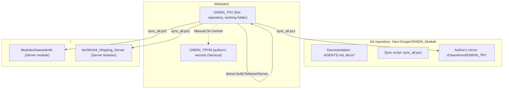

# DWDN ARCHITECT'S GUIDE: BANNERLORD MODDING CODEX (FOR AI)

> **CONTEXT FOR AI AGENTS:**
> This is the compact entry point for the **DWDN (Daewden)** mod for Mount & Blade II: Bannerlord. Deep, per-subsystem knowledge used to live in this file (and before that in the root `AI_MODDING_GUIDE.md`, translated from Russian into English on 15.11.2026); it is now split into specialized files under [`docs/agents/`](docs/agents/) — see the topic index in section 3. The practical setup steps are in [docs/DOCUMENTATION.md](docs/DOCUMENTATION.md), the game engine internals in [docs/ENGINE.md](docs/ENGINE.md), the current state of the project in [docs/STATUS.md](docs/STATUS.md), the roadmap in [docs/PLAN.md](docs/PLAN.md).

---

## 0. QUICK ENGINEERING INDEX (BUILD • SKILLS • RULES • DOCS MAP)

> Compact entry point merged from the previous `main` branch index (translated from Russian). Read the deep codex below and the files in [`docs/`](docs/) as needed, without overloading the context.

### 0.1. Module base architecture

The module consists of two target builds sharing common code (`Common/`) and platform-specific subsystems (`Client/` and `Server/`):

| Layer | Project | Platform | Output path |
|---|---|---|---|
| **Client** | `ModuleData/scripts/DWDN_Script/DWDN_Script.csproj` | `.NET Framework 4.7.2` | `bin/Win64_Shipping_Client/DWDN_Script.dll` |
| **Server** | `ModuleData/scripts/DWDN_Script.Server/DWDN_Script.Server.csproj` | `.NET 8.0` (Bannerlord v1.5.7+) | `bin/Win64_Shipping_Server/` and `bin/Linux64_Shipping_Server/` |

Directory map:
- `SubModule.xml` — the main module manifest, version (`<Version value="vX.Y.Z"/>`), registration of the client and server DLLs, XML list.
- `ModuleData/` — game XML (`mpclassdivisions.xml`, `mpcharacters.xml`, `mpcultures.xml`, `crafting_pieces.xml`, `crafting_templates.xml`, `weapon_descriptions.xml`, `artillery_config.xml`, `mpitems/*.xml`).
- `ModuleData/scripts/DWDN_Script/` — C# source code:
  - `Common/` — duchies, classes and network messages (`DWDN_DuchyManager`, `NetworkMessages`).
  - `Client/` — Gauntlet class-selection UI, 3D preview, artillery HUD, admin panel.
  - `Server/` — server-side spawn, loadout, bannerman aura and admin-service logic.
  - Root `DWDN_*Behavior.cs` — shared client-server `MissionBehavior`s (artillery, firearms, input).
- `GUI/` — Gauntlet XML prefabs (`Prefabs/`) and sprites (`Brushes/`, `SpriteData/`).
- `Assets/` — baked game resources (`.tpac`); `AssetSources/` — source `.fbx`/`.png` (not included in the release archive).
- `Tools/` — standalone utilities (`.NET 8`): `MechanicsTester`, `ModValidator`, `WeaponCalibrator`, `DuchyLoadoutStudio`.

Basic build and check commands:
```powershell
# Build the client (automatically pulls in the server DLL)
dotnet build ModuleData/scripts/DWDN_Script/DWDN_Script.csproj -c Release

# Build only the dedicated server (.NET 8)
dotnet build ModuleData/scripts/DWDN_Script.Server/DWDN_Script.Server.csproj -c Release

# Headless CLI run of the mechanics test suite (no game launch)
dotnet run --project Tools/MechanicsTester/MechanicsTester.csproj -c Release -- --cli

# Synchronize with the local Dedicated Server
.\sync_all.ps1
```

### 0.2. External modding skills and knowledge bases

Before complex tasks involving the engine, native code, assets or decompilation, always rely on these proven skills and repositories:

**Universal Modder (`rehan-remade/universal-modder`)**
- **Bannerlord Engine Reference** — TaleWorlds engine specifics, modules and the XML/C# pipeline: [engines/bannerlord.md](https://github.com/rehan-remade/universal-modder/blob/main/.agents/skills/mod-any-game/references/engines/bannerlord.md)
- **Mod Any Game (Core Skill)** — base research and mod development protocol: [mod-any-game/SKILL.md](https://github.com/rehan-remade/universal-modder/blob/main/.agents/skills/mod-any-game/SKILL.md)
- **Safety & Stability Rules** — protection against crashes, broken saves and degradation: [mod-any-game/references/safety.md](https://github.com/rehan-remade/universal-modder/blob/main/.agents/skills/mod-any-game/references/safety.md)
- **Reverse Engineering** — decompilation, memory structure analysis and native calls: [reverse-engineering/SKILL.md](https://github.com/rehan-remade/universal-modder/blob/main/.agents/skills/reverse-engineering/SKILL.md)
- **Game Recon** — binaries, logs and runtime-state reconnaissance: [game-recon/SKILL.md](https://github.com/rehan-remade/universal-modder/blob/main/.agents/skills/game-recon/SKILL.md)
- **Asset Pipeline** — 3D models, textures, materials and asset containers: [asset-pipeline/SKILL.md](https://github.com/rehan-remade/universal-modder/blob/main/.agents/skills/asset-pipeline/SKILL.md)
- **Publish Mod** — packaging, versioning and release: [publish-mod/SKILL.md](https://github.com/rehan-remade/universal-modder/blob/main/.agents/skills/publish-mod/SKILL.md)
- **Share Field Notes** — recording technical findings for subsequent AI sessions: [share-field-notes/SKILL.md](https://github.com/rehan-remade/universal-modder/blob/main/.agents/skills/share-field-notes/SKILL.md)

**Native hooks (C++ / Interop)**
- **NativeHook (`ShortJake/NativeHook`)** — reference for native function interception and the C++/C# bridge: [github.com/ShortJake/NativeHook](https://github.com/ShortJake/NativeHook)

### 0.3. Mandatory working rules

1. **Plan before action:** describe the change plan first, then start editing.
2. **Minimal changes:** do not touch working code outside the task scope; do not create temporary XML/SubModule copies in the repository.
3. **Check before committing:** after code edits, build both DLLs (`Client` + `Server`) and run `Tools/MechanicsTester`.
4. **Synopsis for other AIs:** read the latest entries in [`docs/CHRONICLE.md`](docs/CHRONICLE.md) before starting, and briefly record your significant findings/decisions there.
5. **Branch flow:** all development goes `feature/*` / `fix/*` → PR into `development` → merge into `main` (owner only, `@Havi-Dorgeir`), which automatically creates a release.

### 0.4. Documentation map (`docs/`)

| Document | When to read |
|---|---|
| `AGENTS.md` (this file) | Deep internal DWDN specifications: firearms, Gauntlet UI, loadout pipeline, `CraftingPiece` Z-offsets, `0xC0000005` crash protection, network compression, artillery, Admin Tools. |
| [`docs/DOCUMENTATION.md`](docs/DOCUMENTATION.md) | Practical DWDN modding guide: adding classes, equipment, duchies, the bannerman aura, the GUI studios in `Tools/`. |
| [`docs/ENGINE.md`](docs/ENGINE.md) | Bannerlord core reverse-engineering encyclopedia: `DotNetObject`, `project.mbproj` vs `MBObjectManager`, `.tpac`/`.rdc` formats, skeleton, network protocol. |
| [`docs/CHRONICLE.md`](docs/CHRONICLE.md) | Full development chronicle: solved bugs, balance edits and the synopsis of previous AI sessions. |
| [`docs/GITHUB_WORKFLOW.md`](docs/GITHUB_WORKFLOW.md) | Branch model (`development` / `main`), PR rules, Branch Protection / Rulesets setup and the automatic release pipeline. |
| [`docs/agents/`](docs/agents/) | Specialized AI deep dives per subsystem (see the topic index in section 3). |

---

## 1. CORE TOPOGRAPHY (FOLDER LAYOUT AND SYNCHRONIZATION BOUNDARIES)

All mod development is distributed across **four interlinked directories**:



### Physical paths

1. **This Git repository (source of truth):** `https://github.com/Havi-Dorgeir/DWDN_Module`.
   It has to be cloned into the game's Modules folder under the exact name `DWDN_TRY`, because the client project resolves the game libraries through relative paths:
   `<Bannerlord>\Modules\DWDN_TRY`
   *Compilation and local testing happen here; see [README.md](README.md) for the build commands.*
2. **Dedicated Server:**
   `<DedicatedServer>\Modules\DaewdenM`
   *And the binary folder: `<DedicatedServer>\bin\Win64_Shipping_Server`.*
3. **The author's scratch hub (`d:\banAImod\`):** decompiler dumps, research scripts and mirrors of the scripts and XML. It is not part of the repository and nothing needed to build the mod lives there.

---

## 2. BUILD AND SYNCHRONIZATION CYCLE
**CRITICAL RULE:**  
`DWDN_Script.csproj` is configured with relative `HintPath` paths of the form `..\..\..\..\..\bin\Win64_Shipping_Client\`.  
Therefore the project must be compiled **ONLY** when the repository sits inside the game's Modules folder:
`<Bannerlord>\Modules\DWDN_TRY\ModuleData\scripts\DWDN_Script\DWDN_Script.csproj`

**Build commands via the .NET CLI** (from the repository root, which has to sit at `<Bannerlord>\Modules\DWDN_TRY`):
```powershell
# 1. Client DLL (net472) -> bin\Win64_Shipping_Client
dotnet build ModuleData/scripts/DWDN_Script/DWDN_Script.csproj -c Release

# 2. Server DLL (net8.0) -> bin\Win64_Shipping_Server
dotnet build ModuleData/scripts/DWDN_Script.Server/DWDN_Script.Server.csproj -c Release

# 3. Spread the build over all nodes (client, local mirror, DaewdenM on the server)
.\sync_all.ps1
```

---

## 3. SPECIALIZED TOPIC INDEX (`docs/agents/`)

| File | Read it when working on… | Former sections |
|---|---|---|
| [`docs/agents/firearms.md`](docs/agents/firearms.md) | Hand cannon / firearms: Crossbow-hack XML (`dwdn_weapon.xml`), `DWDN_FirearmsBehavior` VFX/sounds, `AddCustomMissile` server prohibition | 3 |
| [`docs/agents/gauntlet-ui-preview.md`](docs/agents/gauntlet-ui-preview.md) | Class-selection Gauntlet UI, ViewModels, isolated 3D preview (`AgentVisuals.Create`), `0xC0000005` pedestal crash history | 4 |
| [`docs/agents/loadout-classes-spawn.md`](docs/agents/loadout-classes-spawn.md) | Class registration (`mpcharacters.xml` / `mpclassdivisions.xml` / `DWDN_DuchyManager`), loadout network sync, cavalry dismount horse-warp fix | 5 |
| [`docs/agents/crafted-weapons.md`](docs/agents/crafted-weapons.md) | Crafting piece math (`previous/next_piece_offset`), Blender coordinate pitfalls, `finnard_spear` calibration | 6 |
| [`docs/agents/reverse-engineering.md`](docs/agents/reverse-engineering.md) | Modding repositories/reference mods, TaleWorlds decompilation, `d:\banAImod` scratch hub and decompiler dumps | 2.1, 2.2, 8 |
| [`docs/agents/game-systems.md`](docs/agents/game-systems.md) | GUI studios in `Tools/`, Bannerman tactical aura, field artillery & crew, mobile siege engines on carts, Admin Tools, admin panel GUI, horse-drawn artillery | 9, 47 |
| [`docs/agents/troubleshooting.md`](docs/agents/troubleshooting.md) | Symptom → cause → fix cases: endless loading screen on join (TaleWorlds patch breakage), spawn crash in `Equipment.GetInitialWeaponIndicesToEquip` | diagnostics in 9 |
| [`docs/agents/network-scrapcode.md`](docs/agents/network-scrapcode.md) | Anti-scrapcode working rules, `CraftedItem` mp_ pieces trap, `WeaponUsageIndexChangeMessage` / network compression decode crashes | 7, 46 |

