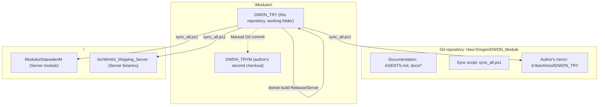
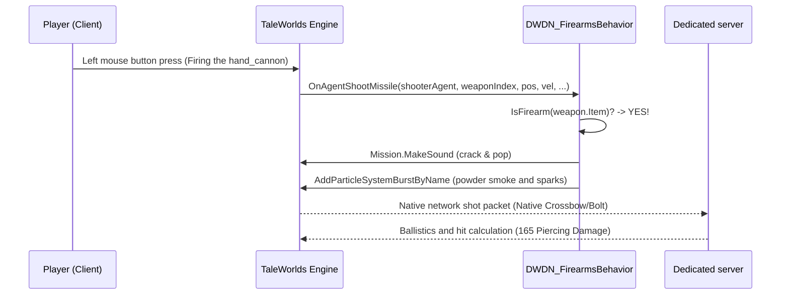
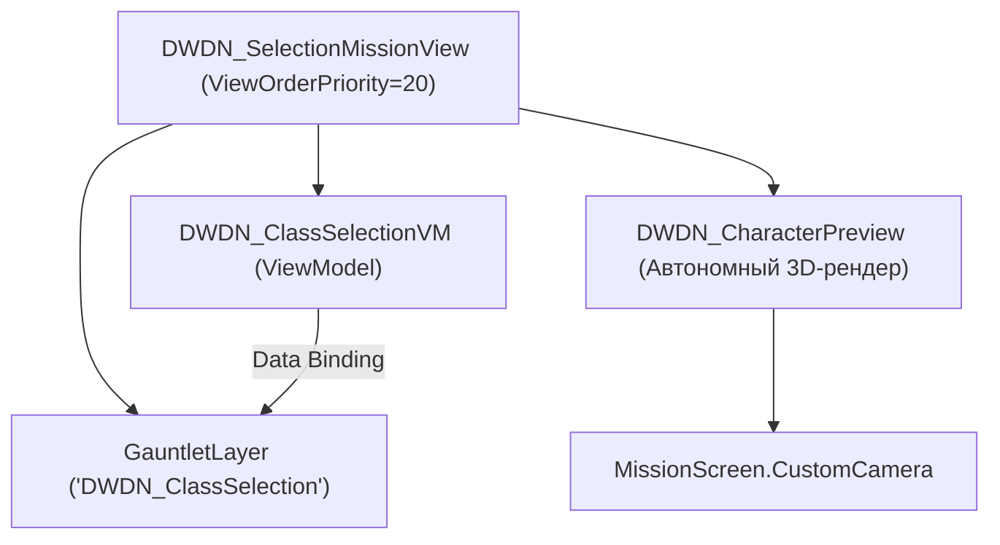
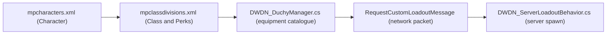

# DWDN ARCHITECT'S GUIDE: BANNERLORD MODDING CODEX (FOR AI)

> **CONTEXT FOR AI AGENTS:**
> This is the agent guide for the **DWDN (Daewden)** mod for Mount & Blade II: Bannerlord. It used to live in the root as `AI_MODDING_GUIDE.md`, written by earlier generations of AI agents for their successors, and it was translated from Russian into English on 15.11.2026.
> It describes the mod's subsystems, the multiplayer architecture of the game, the crash-protection mechanisms and the toolset. The practical setup steps are in [docs/DOCUMENTATION.md](docs/DOCUMENTATION.md), the game engine internals in [docs/ENGINE.md](docs/ENGINE.md), the current state of the project in [docs/STATUS.md](docs/STATUS.md), the roadmap in [docs/PLAN.md](docs/PLAN.md).

---

## 1. CORE TOPOGRAPHY (FOLDER LAYOUT AND SYNCHRONIZATION BOUNDARIES)

All mod development is distributed across **four interlinked directories**:



### Physical paths

1. **This Git repository (source of truth):** `https://github.com/Havi-Dorgeir/DWDN_Module`.
   It has to be cloned into the game's Modules folder under the exact name `DWDN_TRY`, because the client project resolves the game libraries through relative paths:
   `<Bannerlord>\Modules\DWDN_TRY`
   *Compilation and local testing happen here; see [README.md](README.md) for the build commands.*
2. **Dedicated Server:**
   `<DedicatedServer>\Modules\DaewdenM`
   *And the binary folder: `<DedicatedServer>\bin\Win64_Shipping_Server`.*
3. **The author's scratch hub (`d:\banAImod\`):** decompiler dumps, research scripts and mirrors of the scripts and XML. It is not part of the repository and nothing needed to build the mod lives there.

---

## 2. TOOLING AND REVERSE-ENGINEERING METHODOLOGY

### 2.1. GitHub repositories and tools
* **Main repository for Bannerlord modding:**  
  [https://github.com/rehan-remade/universal-modder](https://github.com/rehan-remade/universal-modder)  
  *Use it for SubModule templates, CLI builds, asset parsing, and for understanding non-obvious engine structures.*
* **Reference mods from the Steam Workshop (study their architecture before reinventing the wheel):**
  * `<Steam>\steamapps\workshop\content\261550\3774022783` (**LOTR / OMEE**) — **the primary model**: the cleanest Gauntlet UI architecture, full isolation of the 3D preview via `AgentVisuals.Create`, network packets for custom spawning.
  * `<Steam>\steamapps\workshop\content\261550\3772431545` (**Warlords**) — the reference for custom combat classes and perks.
  * `<Steam>\steamapps\workshop\content\261550\3716004111` — an example of network item balance configuration.

### 2.2. Decompilation and research of the TaleWorlds libraries
All core assemblies are located in the game folder:  
`<Bannerlord>\bin\Win64_Shipping_Client\`  
Key assemblies for analysis:
* `TaleWorlds.MountAndBlade.dll` — missions, agent spawning, network messages (`GameNetwork`), `MissionPeer`, `MissionMultiplayerGameModeBase`.
* `TaleWorlds.Core.dll` — `ItemObject`, `BasicCharacterObject`, `Equipment`, `EquipmentIndex`, `WeaponDesign`.
* `TaleWorlds.Engine.dll` — `AgentVisuals`, `Camera`, `Scene`, `SoundEvent`, `MatrixFrame` matrices.
* `TaleWorlds.MountAndBlade.Multiplayer.dll` — native components of the network lobby and spawning.

> [!TIP]
> **Headless research without a GUI:**  
> To quickly find the signature of any private TaleWorlds method or property, create a short C# or PowerShell script using `[System.Reflection.Assembly]::LoadFrom(...)` directly in `scratch\` (outside the repository). This saves tens of minutes compared to opening heavy decompilers.

### 2.3. Build and synchronization cycle
**CRITICAL RULE:**  
`DWDN_Script.csproj` is configured with relative `HintPath` paths of the form `..\..\..\..\..\bin\Win64_Shipping_Client\`.  
Therefore the project must be compiled **ONLY** when the repository sits inside the game's Modules folder:
`<Bannerlord>\Modules\DWDN_TRY\ModuleData\scripts\DWDN_Script\DWDN_Script.csproj`

**Build commands via the .NET CLI** (from the repository root, which has to sit at `<Bannerlord>\Modules\DWDN_TRY`):
```powershell
# 1. Client DLL (net472) -> bin\Win64_Shipping_Client
dotnet build ModuleData/scripts/DWDN_Script/DWDN_Script.csproj -c Release

# 2. Server DLL (net8.0) -> bin\Win64_Shipping_Server
dotnet build ModuleData/scripts/DWDN_Script.Server/DWDN_Script.Server.csproj -c Release

# 3. Spread the build over all nodes (client, local mirror, DaewdenM on the server)
.\sync_all.ps1
```

---

## 3. FIREARMS SUBSYSTEM

Firearms in DWDN are implemented through a combination of XML projectile models and a client-server `MissionBehavior`.



### 3.1. XML configuration (`ModuleData/mpitems/dwdn_weapon.xml`)
Instead of trying to introduce a completely new, non-existent weapon type, which would break the TaleWorlds C++ animation interfaces, we use a clever and 100% stable **Crossbow-Hack**:

1. **The weapon itself (`hand_cannon`):**
   ```xml
   <Item multiplayer_item="true" id="hand_cannon" name="{=*}Hand Bombard" 
		 body_name="bo_composite_crossbows" mesh="crossbow_e" culture="Culture.vlandia" 
		 weight="3.8" appearance="1" difficulty="0" Type="Crossbow" 
		 AmmoOffset="0.0, 0.02131, 0.22975" 
		 item_holsters="crossbow_back:bow_hip:mace_right_hip:bow_hip_2" 
		 holster_position_shift="0.02,0,-0.4">
	   <ItemComponent>
		   <Weapon weapon_class="Crossbow" ammo_class="Bolt" 
				   missile_speed="135" accuracy="18" thrust_damage="165" 
				   thrust_speed="22" speed_rating="15" weapon_length="100" 
				   ammo_limit="1" thrust_damage_type="Pierce" 
				   item_usage="crossbow" reload_phase_count="2" 
				   physics_material="wood_weapon" center_of_mass="0,0,0.4">
			   <WeaponFlags RangedWeapon="true" BonusAgainstShield="true" 
							CanPenetrateShield="true" AmmoSticksWhenShot="false" 
							AttachAmmoToVisual="false" CantReloadOnHorseback="true" 
							NotUsableWithOneHand="true" TwoHandIdleOnMount="true" />
		   </Weapon>
	   </ItemComponent>
	   <Flags />
   </Item>
   ```
2. **Bullets (`mp_bullets`):**
   ```xml
   <Item multiplayer_item="true" id="mp_bullets" name="{=*}Lead Shot" 
		 body_name="bo_capsule_arrow" holster_body_name="bo_axe_short" 
		 mesh="bolt_bl_c" value="1" is_merchandise="false" 
		 holster_mesh="bolt_bl_c_quiver" holster_mesh_with_weapon="bolt_bl_c_quiver" 
		 flying_mesh="bolt_bl_flying" weight="0.10" appearance="1" Type="Bolts" 
		 item_holsters="quiver_bolts:quiver_bolts_2:quiver_back_middle:quiver_back_top">
	   <ItemComponent>
		   <Weapon weapon_class="Bolt" stack_amount="12" thrust_damage="5" 
				   thrust_speed="0" speed_rating="0" physics_material="missile" 
				   weapon_length="35" 
				   flying_sound_code="event:/mission/combat/missile/flyby/arrow">
			   <WeaponFlags Consumable="true" AmmoSticksWhenShot="false" />
		   </Weapon>
	   </ItemComponent>
   </Item>
   ```

### 3.2. C# firing logic (`DWDN_FirearmsBehavior.cs`)
The class inherits from `MissionBehavior` and is registered in the mission.
* **Weapon identification**: `IsFirearm(ItemObject)` compares the `StringId` against the keywords (`hand_cannon`, `cannon`, `bombard`, `handgonne`, `firearm`).
* **Muzzle Position**:
  ```csharp
  Vec3 forward = velocity.NormalizedCopy();
  if (forward.LengthSquared < 0.001f) forward = orientation.f;
  Vec3 muzzlePos = position + forward * 0.70f;
  MatrixFrame muzzleFrame = new MatrixFrame(orientation, muzzlePos);
  ```
* **Acoustic effect (a light report)**:  
  A paired native sound:
  * `event:/mission/combat/impact/ballista_missile/stone` (a dry powder crack).
  * `event:/mission/combat/impact/missile/pot_breakable` (a dull resonant thump).
* **Visual particles (VFX)**:
  * Instant flame burst: `prt_fireball` at `muzzlePos + forward * 0.10f` (0.20 sec, no residual burning).
  * Dense powder smoke: `psys_game_stone_dust_a` and `psys_siege_door_falling_dust`.
  * Smoke trail along the shot trajectory: emitters at `muzzlePos + forward * 0.60f` and `muzzlePos + forward * 1.20f`.
  * Bright powder sparks: `psys_game_sparkle_a`.
  * Touch-hole smoke: at `position - forward * 0.10f + Vec3(0, 0, 0.04f)`.

> [!IMPORTANT]
> **PROHIBITION ON `AddCustomMissile` ON THE SERVER:**  
> Never spawn third-party missiles/bullets via `Mission.AddCustomMissile` on the dedicated server for firearms!  
> The native TaleWorlds engine synchronizes the projectile itself through the crossbow ballistics pipeline. If you try to spawn custom bullets in code, the dedicated server will guaranteedly fall into a physical-world desynchronization.

---

## 4. ARCHITECTURE OF THE CUSTOM GAUNTLET UI AND 3D PREVIEW

The loadout and class selection screen in DWDN replaces the standard Bannerlord spawn screen.



### 4.1. UI Component Stack
* **Display layer (`DWDN_SelectionMissionView.cs`)**:
  * Creates a `GauntletLayer` with `ViewOrderPriority = 20`.
  * Binds `DWDN_ClassSelectionVM` to the Gauntlet layout.
  * Intercepts mouse input to rotate the character.
* **ViewModel hierarchy**:
  * `DWDN_ClassSelectionVM` — the main window, switching between Duchies and classes.
  * `DWDN_DuchyItemVM` — Duchy selection buttons.
  * `DWDN_ClassItemVM` — class selection buttons inside a Duchy.
  * `DWDN_EquipmentSlotVM` — equipment slots (Helmet, Torso, Weapon 0..3, etc.).
  * `DWDN_ItemOptionVM` — the list of items available for the selected slot.

### 4.2. Architecture of the Isolated 3D Preview (LOTR / OMEE Pattern)
**HISTORY OF THE SCRAPCODE AND THE `0xC0000005` CRASH:**  
In early versions of the mod, changing the class called `MultiplayerMissionAgentVisualSpawnComponent.OnMyAgentVisualSpawned` or a direct `agentVisual.Refresh(...)` on the native TaleWorlds pedestal.  
Because the native C++ thread of `Engine.dll` was playing the pedestal idle animation on the very same millisecond tick, destroying the skeleton caused a fatal memory access violation (*Access Violation 0xC0000005*).

**THE CANONICAL SOLUTION (Class `DWDN_CharacterPreview.cs`):**
1. Complete abandonment of hooks into the native `MultiplayerMissionAgentVisualSpawnComponent`.
2. Creation of an isolated visual agent:
   ```csharp
   AgentVisualsData data = new AgentVisualsData()
	   .ActionSet(actionSet)
	   .Equipment(equipment)
	   .BodyProperties(bodyProperties)
	   .Frame(anchor)
	   .ActionCode(idleAction)
	   .Scene(Mission.Current.Scene)
	   .PrepareForNativeMeshOptimization(true);

   _visual = AgentVisuals.Create(data, "dwdn_preview", false, false, false);
   ```
3. Allocation of an independent camera:
   ```csharp
   _camera = Camera.CreateCamera();
   _camera.SetFovVertical(0.785f, Screen.AspectRatio, 0.1f, 1000f);
   MissionScreen.CustomCamera = _camera;
   ```
4. When the menu closes, `MissionScreen.CustomCamera = null`, and `_visual.Reset()` safely releases the C++ memory. **Result: 0 engine crashes.**

---

## 5. DUCHIES, CLASSES AND NETWORKED SPAWN (LOADOUT PIPELINE)

Every class in the mod is defined at three inseparable points:



### 5.1. Class Registration
1. **`ModuleData/mpcharacters.xml`**:
   Base character, body model, gender, skeleton, race.
   ```xml
   <NPCCharacter id="dwdn_militia_infantry" name="{=*}Militia Infantry" 
				 default_group="Infantry" age="28" voice="curt" 
				 is_female="false" culture="Culture.vlandia" 
				 occupation="Soldier" is_hero="false">
   ```
2. **`ModuleData/mpclassdivisions.xml`**:
   Gold cost, statistics (HP, armor, speed), perks:
   ```xml
   <MPClassDivision id="dwdn_militia_infantry_division" 
					hero="NPCCharacter.dwdn_militia_infantry" 
					cost="120" culture="Culture.vlandia" 
					class_group="Infantry" icon_type="Infantry">
   ```
3. **The Duchy registry in C# (`DWDN_DuchyManager.cs`)**:
   Defines the lists of allowed items for the GUI:
   ```csharp
   DWDN_ClassDefinition militia = new DWDN_ClassDefinition(
	   id: "dwdn_militia_infantry",
	   name: "Ополченец",
	   characterId: "dwdn_militia_infantry",
	   divisionId: "dwdn_militia_infantry_division",
	   allowedHelmets: new List<string> { "", "padded_coif", "kettle_hat" },
	   allowedBodyArmors: new List<string> { "padded_armor", "leather_tunic" },
	   allowedWeaponsSlot0: new List<string> { "vlandia_sword_1", "vlandia_axe_1" },
	   allowedWeaponsSlot1: new List<string> { "", "vlandia_shield_wood" },
	   allowedHorses: new List<string>() // Пусто для пехотинца!
   );
   ```

### 5.2. Networked Equipment Synchronization
1. The player presses the **"TO BATTLE"** button in the Gauntlet UI.
2. The client packs `DWDN_ClassSelection` into the network packet `RequestCustomLoadoutMessage`:
   ```csharp
   GameNetwork.BeginModuleEventAsClient();
   GameNetwork.WriteMessage(new RequestCustomLoadoutMessage(selection));
   GameNetwork.EndModuleEventAsClient();
   ```
3. On the dedicated server, `DWDN_ServerLoadoutBehavior.cs` receives the packet:
   * Verifies that each StringId is actually allowed for that class in `DWDN_DuchyManager` (anti-cheat validation).
   * Stores the equipment in the player registry `_peerLoadouts[peer]`.
   * When `OnAgentBuild` fires: fills `agent.SpawnEquipment` with the validated items.

### 5.3. Protection Against the Horse Warp Glitch (The Cavalry Dismount Fix)
> [!CAUTION]
> **CRITICAL TALEWORLDS BUG:**  
> If a foot character has a filled `EquipmentIndex.Horse` or `EquipmentIndex.HorseHarness` slot in its `SpawnEquipment`, the native engine method `MountVisualCreator.AddMountMeshToAgentVisual` mistakenly attaches the horse mesh to the pelvis bones of the **human skeleton**. On dismount or while moving, the mesh deforms and collapses onto the ground at the point `(0,0,0)`.

**HOW THIS IS SOLVED IN `DWDN_ServerLoadoutBehavior.cs`:**
```csharp
// 1. Человек-всадник НИКОГДА не должен нести слоты Horse / HorseHarness в человеческом снаряжении:
equip[EquipmentIndex.Horse] = EquipmentElement.Invalid;
equip[EquipmentIndex.HorseHarness] = EquipmentElement.Invalid;

// 2. Лошадь спавнится движком ТОЛЬКО тогда, когда SelectedTroopIndex указывает на кавалерийский класс:
int targetIdx = string.IsNullOrEmpty(selection.HorseId) ? 0 : cavalryIndex;
missionPeer.SelectedTroopIndex = targetIdx;
missionPeer.NextSelectedTroopIndex = targetIdx;
```

---

## 6. THE MATHEMATICS OF CRAFTED WEAPONS (CRAFTED WEAPONS DELTAS)

Crafted modular weapons (swords, spears, axes) are described in `ModuleData/crafting_pieces.xml` and `crafting_templates.xml`.


### 6.1. The Decompiled TaleWorlds Formula (`WeaponDesign.CalculatePivotDistances`)
When assembling the weapon mesh, the engine computes the position of each joint incrementally from the grip point:

$$\text{Position}_{n} = \text{Length}_{n-1} + (\text{previous\_piece\_offset}_{n} - \text{next\_piece\_offset}_{n-1})$$

*All values in the XML are given in centimeters, and the engine divides them by 100 to convert them to meters.*

### 6.2. Why Blender Coordinates Break the Game
* In Blender the modeler sees **absolute scene coordinates** (for example, the guard is located at $Z = 140\text{cm}$).
* If you write `140` into `previous_piece_offset`, the engine will add $1.4$ meters to the handle length, and the guard will fly off into the sky or trigger an endless physics-body assertion `Physics material bounding box error`.
* **Rule:** `crafting_pieces.xml` contains only the **relative docking deltas** between the edge of the handle mesh and the start of the guard mesh.

### 6.3. Reference Calibration of Finnard's Spear (`finnard_spear`)
Verified geometry that guarantees a perfect monolithic joint with no gaps and no crashes:
```xml
<!-- Рукоять: смещение стыка вверх к гарде -->
<CraftingPiece id="finnard_spear_handle" Type="Handle" 
			   next_piece_offset="-35" ... />

<!-- Гарда: входная дельта от рукояти (+7) и выходная к лезвию (-19) -->
<CraftingPiece id="finnard_speard_guard" Type="Guard" 
			   previous_piece_offset="7" next_piece_offset="-19" ... />

<!-- Наконечник: входная дельта стыка (+24) -->
<CraftingPiece id="finnard_spearhead" Type="Blade" 
			   previous_piece_offset="24" next_piece_offset="0" ... />
```

---

## 7. THE ANTI-SCRAPCODE CODEX

1. **The rule of minimal intervention:**  
   Never rewrite working systems when the task is only to add a new item or class. One clumsy change to a network message signature breaks client-server backward compatibility.
2. **Always check the engine logs:**  
   Game logs are written in real time:  
   `C:\ProgramData\Mount and Blade II Bannerlord\logs\rgl_log_*.txt`  
   If the client closed silently, open the latest `rgl_log` and scroll to the very bottom — it will name the specific XML tag or the missing mesh.
3. **UI thread safety:**  
   No heavy search loops in `Tick` or `OnMissionScreenTick`. All item lists in `DWDN_DuchyManager` must be cached at initialization.
4. **Removing items (Empty slot `""`):**  
   For helmets, cloaks, gauntlets and shields, always provide the string ID `""` (empty string). This lets the player take off a helmet or a shield by clearing the corresponding slot.
5. **Synchronize all nodes:**  
   After any XML edit or DLL compilation, **always** run `sync_all.ps1`. If the client and the dedicated server differ by even one attribute in `mpclassdivisions.xml`, the server will kick the player with a version-mismatch error.

---

## 8. FULL REVERSE ENGINEERING OF THE GAME CORE AND DECOMPILATION TOOLS

To gain a deep understanding of the original game (*Native*, *SandBoxCore*, *SandBox*, *Multiplayer* v1.4.8) and to build your own modding utilities, use the following resources from the author's scratch hub `d:\banAImod` (it is not part of this repository):

1. **[docs/ENGINE.md](docs/ENGINE.md)** — a full encyclopedia of the Bannerlord architecture ("taken apart brick by brick and rebuilt"):
   * The C++/C# bridge (`DotNetObject`, `[MBCallback]` methods in `TaleWorlds.MountAndBlade.Module`).
   * The dual XML pipeline: the native `ModuleData/project.mbproj` (all 39 `soln_*` identifiers) vs the managed `MBObjectManager` (the XSD-validation algorithm, dynamic `_replaceWhileMerging` injection, XSLT transformations and `GetPresumedObject`).
   * The binary structure of `.tpac` assets (LZ4 + xxHash64), of the `.rdc` cache (145-byte `RDC0` records) and the strict 64-skeleton-bone contract (the `0x1050`-byte `AnimResult` buffer).
   * The full lifecycle of `MBSubModuleBase`, `MBGameManager`, `Game`, `GameType` (`Campaign` and `MultiplayerGame`), `GameStateScreenManager` and `ViewCreatorManager` (`[OverrideView]`, `[ViewMethod]`).
   * Blueprints for building your own modding tools (headless XML/XSD/XSLT validator, `.tpac`/`.rdc` packer, static analyzer).
2. **Static CLI decompiler and dumps (`scratch\`, outside the repository)**:
   * `scratch\inspector\Program.cs` — a tool based on `ICSharpCode.Decompiler` that lets you instantly decompile any class from `Win64_Shipping_Client`, `DedicatedCustomServer` or the modules, without `AssemblyResolve` crashes.
   * `scratch\module_types_dump.txt` — the complete registry of all 1923 classes and interfaces across the 11 DLL assemblies of `Native`, `Multiplayer` and `SandBox`.
   * `scratch\submodules_decompiled.txt` — the decompiled source of all `SubModule` classes, `Module` and `MBSubModuleBase`.
   * `scratch\core_managers_decompiled.txt` — the decompiled code of `MBObjectManager`, `SandBoxManager`, `ViewCreatorManager`, `GameStateScreenManager`, `MultiplayerMissions` and `SandBoxMissions`.
   * `scratch\game_and_mp_decompiled.txt` — the decompiled code of `TaleWorlds.Core.Game`, `MultiplayerGame` and `MultiplayerGameManager`.

---

## 9. STANDALONE MODDING TOOLS AND DWDN GAME SYSTEMS

The repository ships three specialized GUI studios (WinForms .NET 8.0) under `Tools/` for automating modding and verification:

1. **Automatic 3D Weapon Calibrator (`Tools/WeaponCalibrator/`, shortcut [`ЗАПУСК_КАЛИБРАТОРА.bat`](./Tools/ЗАПУСК_КАЛИБРАТОРА.bat))**:
   * Parses the module's binary `.tpac` archives (`LZ4` + `METM`) and `AssetSources/*.fbx` directly, computing exact 3D dimensions (`BoundingBox`, Z joints, neck radius) and automatically generating calibrated XML for `crafting_pieces.xml` and `mpitems.xml`, with an interactive 3D viewport.
2. **Visual Duchy and Loadout Constructor (`Tools/DuchyLoadoutStudio/`, shortcut [`ЗАПУСК_КОНСТРУКТОРА_КЛАССОВ.bat`](./Tools/ЗАПУСК_КОНСТРУКТОРА_КЛАССОВ.bat))**:
   * Parses `DWDN_DuchyManager.cs`, `mpclassdivisions.xml`, `mpcharacters.xml` and `mpitems.xml`, showing a 3D mannequin of the selected class in real time.
   * The **"⚡ AUTO-APPLY INTO THE DWDN_TRY MOD"** button automatically patches `DWDN_DuchyManager.cs`, synchronizes `mpclassdivisions.xml` and `mpcharacters.xml`, compiles `DWDN_Script.dll` + `DWDN_Script.Server.dll` and mirrors the build onto the dedicated server `DaewdenM`.
3. **Instant Pre-Launch Mod Validator (`Tools/ModValidator/`, shortcut [`ЗАПУСК_ВАЛИДАТОРА_МОДА.bat`](./Tools/ЗАПУСК_ВАЛИДАТОРА_МОДА.bat))**:
   * In about 0.25 s it checks 8 critical nodes of the mod: XML syntax, `SubModule.xml`, the integrity of the chain `DWDN_DuchyManager.cs` $\leftrightarrow$ `mpclassdivisions.xml` $\leftrightarrow$ `mpcharacters.xml` $\leftrightarrow$ `mpitems.xml` $\leftrightarrow$ `crafting_pieces.xml`, the presence of 3D meshes in `.tpac`, the gap balance of crafted weapons, and byte-for-byte `SHA-256` hash synchronization between client and server (with a one-click auto-fix button).

### Bannerman Tactical Aura System (`DWDN_BannerAuraBehavior.cs`)
* File: [`DWDN_BannerAuraBehavior.cs`](./ModuleData/scripts/DWDN_Script/DWDN_BannerAuraBehavior.cs), registered in `SubModule.AddMissionBehaviors`.
* **Important technical pattern: `AgentDrivenProperties` in multiplayer**:
  * In Bannerlord, when the wielded weapon changes (`OnWieldedItemIndexChange`) the engine calls `agent.UpdateAgentProperties()`, which overwrites the dynamic stats (`MaxSpeedMultiplier`, `SwingSpeedMultiplier`, `ReloadSpeed`) but does **not** recompute the static spawn stats (`ArmorHead/Torso/Arms/Legs`, `CombatMaxSpeedMultiplier`).
  * Therefore, when applying or removing buffs in `DWDN_BannerAuraBehavior`, the base armor values (`BaseArmorHead` and so on) are cached first on the agent's first spawn, then `agent.UpdateAgentProperties()` is called, after which `Armor* = BaseArmor* + bonus` is assigned on top of the clean stats, the speed coefficients are multiplied and `agent.UpdateCustomDrivenProperties()` is called. This completely eliminates cumulative stat stacking and buff loss on weapon change, and running on client and server at the same time prevents a network speed desync (rubberbanding).

### Field Artillery and Crew System (`DWDN_FieldArtilleryBehavior.cs`)
* File: [`DWDN_FieldArtilleryBehavior.cs`](./ModuleData/scripts/DWDN_Script/DWDN_FieldArtilleryBehavior.cs), class `mp_Artillerist` (`mp_Artillerist_hero` / `mp_Artillerist_troop`).
* **Crew items (`dwdn_weapon.xml`)**:
  * `dwdn_field_bombard` — Field Bombard (limit: 2 active barrels per team in `DWDN_ServerLoadoutBehavior.cs`).
  * `dwdn_cannonball_ammo` — Cast-Iron Cannonballs (3.4 m AoE high-explosive blast in `OnMissileHit` with `BlowFlags.KnockDown | BlowFlags.CanDismount`).
  * `dwdn_canister_ammo` — Canister Charges (conical volley of $13.5^\circ$ out to 32 m in `OnAgentShootMissile`).
  * `dwdn_artillery_ramrod` — Artillery Rammer-Swab (tool of the second crew member, based on `TwoHandedMace`).
  * `dwdn_powder_chest` — Bombardier's Charge Pouch (10 charges for automatic feeding of the gunner every 6 s through `SetWeaponAmountInSlot`).
* **Inviolability of `native_parameters.xml`**:
  * Never override `ModuleData/native_parameters.xml` in the mod — the TaleWorlds developers change the structure and values of `Native/ModuleData/native_parameters.xml` in game patches. Implement all dynamic speed, reload and armor modifiers strictly through `AgentDrivenProperties` in a C# `MissionLogic`.

### Diagnosing an Endless Loading Screen When Joining the Dedicated Server (TaleWorlds Patches)
* **Symptom**: The client enters the multiplayer lobby, presses "Join server", and hangs in the `WaitingToJoinCustomGame` state on an endless loading screen while `AliveMessage` packets are sent in a loop to the TaleWorlds lobby.
* **Cause**: The `DedicatedCustomServer.Starter.exe` process crashes at the moment of the player handshake (`KERNELBASE.dll`, .NET Runtime `Event ID 1026`).
* **Case 11.11.2026**: In an engine update TaleWorlds removed the method `TaleWorlds.MountAndBlade.NetworkCommunicator.UpdateForJoiningCustomGame(bool)`. The third-party module `DoFAdminTools` (compiled against the older build) called this method from `DoFGameHandler.OnPlayerConnect(VirtualPlayer peer)` whenever any player joined, which produced an unhandled `System.MissingMethodException` and brought the server down. The automatic restart loop in `ZAPUSKSERVER.bat` immediately brought the server back up, creating the illusion of a "live" server that crashes exactly at the moment a player connects.
* **Fix**:
  1. Check the Windows Event Log: `Get-WinEvent -LogName Application -MaxEvents 10 | Where-Object { $_.ProviderName -match 'Application Error|.NET Runtime' }`.
  2. Remove outdated third-party DLLs from the `_MODULES_` launch arguments in `ZAPUSKSERVER.bat`. The `DWDN_TRY` module is fully autonomous and does not depend on `DoFAdminTools`.

### Server Crash on Spawn (NullReferenceException in Equipment.GetInitialWeaponIndicesToEquip)
* **Symptom**: The player on the server presses `[F]` to spawn — the agent does not appear and the server crashes immediately. The Windows event log shows a `NullReferenceException` crash in `Equipment.GetInitialWeaponIndicesToEquip` $\rightarrow$ `Agent.WieldInitialWeapons` $\rightarrow$ `SpawningBehaviorBase.OnTick`.
* **Cause**: In multiplayer TaleWorlds loads exclusively `mp_crafting_pieces.xml` and ignores the single-player `crafting_pieces.xml`. If a weapon in the mod is declared as `<CraftedItem>` referencing single-player pieces (for example `cleaver_blade_1` instead of the multiplayer `mp_battania_cleaver_blade`), the engine cannot initialize the `WeaponComponent`. As a result `item.PrimaryWeapon == null`. When the engine tries to equip the weapon into the hands, the call `item.PrimaryWeapon.WeaponFlags` throws a fatal `NullReferenceException`.
* **Consequence in the spawn logic**: In `DWDN_ServerLoadoutBehavior.cs` the ternary expression `int targetIdx = string.IsNullOrEmpty(selection.HorseId) ? 0 : idx;` incorrectly reset any infantry class (including the Artillerist) to index 0 (`Ratay`), whose first default perk was precisely the broken `dwdn_cleaver`.
* **Fix**:
  1. In `mpitems/dwdn_weapon.xml` use only legitimate multiplayer pieces with the `mp_...` prefix from `Native/ModuleData/mp_crafting_pieces.xml`.
  2. In `DWDN_ServerLoadoutBehavior.cs` remove the forced reset to 0: `int targetIdx = idx;`.
  3. In `ApplySelectionToEquipment` add a hard check: if an item in a weapon slot has `item.PrimaryWeapon == null` (and is not a shield/banner), clear the slot to protect the process from crashing.

### Built-in DWDN Admin Tools Administration System (`Server\Admin\`)
* Files:
  * [`DWDN_AdminService.cs`](./ModuleData/scripts/DWDN_Script/Server/Admin/DWDN_AdminService.cs) — the permission-management core, the command handler, and the formation and action calculations.
  * [`DWDN_AdminGameHandler.cs`](ModuleData/scripts/DWDN_Script/Server/Admin/DWDN_AdminGameHandler.cs) — interception of the chat network messages `PlayerMessageAll` and `PlayerMessageTeam`.
  * [`DWDN_AdminBehavior.cs`](ModuleData/scripts/DWDN_Script/Server/Admin/DWDN_AdminBehavior.cs) — maintaining the invulnerability state across agent changes and damage protection.
  * [`DWDN_InputBehavior.cs`](ModuleData/scripts/DWDN_Script/DWDN_InputBehavior.cs) — the `[F10]` hotkey for the quick administrator help.
* **Intercepting chat commands without spamming the public chat**:
  * In `GameHandler.OnGameNetworkBegin()` the delegates `registerer.Register<PlayerMessageAll>` and `Register<PlayerMessageTeam>` are registered.
  * If a message starts with `!`, `DWDN_AdminService.HandleCommand(peer, message.Message)` is called.
  * So that the command text does not appear in the public chat, the private receiver list is emptied through reflection:
	```csharp
	typeof(PlayerMessageAll).GetProperty("ReceiverList", BindingFlags.Public | BindingFlags.NonPublic | BindingFlags.Instance)
		?.SetValue(message, new List<VirtualPlayer>());
	typeof(PlayerMessageAll).GetProperty("HasReceiverList", BindingFlags.Public | BindingFlags.NonPublic | BindingFlags.Instance)
		?.SetValue(message, true);
	```
	In the native method `ChatBox.ServerPrepareAndSendMessage` the check `receiverList.Contains(item.VirtualPlayer)` then returns `false` for every player, which blocks delivery to clients.
* **Native invulnerability (God Mode)**:
  * No third-party workarounds are needed: Bannerlord has a built-in agent state `agent.SetMortalityState(Agent.MortalityState.Invulnerable);` (and `agent.MountAgent.SetMortalityState(...)`), in which the native C++ engine zeroes all incoming damage (`InflictedDamage = 0`).
  * For reliability, `DWDN_AdminBehavior` also intercepts `OnAgentHit` and ticks in a loop, guaranteeing invulnerability even after a class change or respawn.
* **Group teleportation in formation**:
  * The command `!tp all me` or `!tp team1 me` / `!tp team2 me` lines players up in even ranks in front of the administrator:
	* The administrator's view vector $f$ and the perpendicular $r = (-f_y, f_x)$.
	* Base point $P_0 = P_{\text{admin}} + f \cdot 4.0\text{ m}$.
	* Grid spacing: $dx = 1.8\text{ m}$ along the front, $dy = 2.0\text{ m}$ in depth.
	* Terrain snapping: `Mission.Current.Scene.GetHeightAtPoint(targetPos.AsVec2, BodyFlags.CommonCollisionExcludeFlags, ref targetPos.z)`.
	* This prevents players and horses from getting stuck in each other or under the map textures.
* **Official mechanism for kicking and banning a player on the server**:
  ```csharp
  DisconnectInfo disconnectInfo = peer.PlayerConnectionInfo?.GetParameter<DisconnectInfo>("DisconnectInfo") ?? new DisconnectInfo();
  disconnectInfo.Type = DisconnectType.KickedByHost;
  peer.PlayerConnectionInfo?.AddParameter("DisconnectInfo", disconnectInfo);
  peer.QuitFromMission = true;
  GameNetwork.AddNetworkPeerToDisconnectAsServer(peer);
  ```
  When banning, the entry is added to `Modules/Native/banlist.txt` and `Modules/DaewdenM/banlist.txt`.
* **Command reference**:
  * Authentication: `!login <password from DWDN_config.txt>`, `!logout`
  * Teleportation: `!goto <nickname>`, `!bring <nickname|all|team1|team2>`, `!tp <target1> <target2>`, `!tp <target> <x> <y> [z]`, `!mark`, `!recall [target]`
  * Supply: `!heal [target] [hp]`, `!ammo [target]`, `!repair [target]`, `!god [target]`
  * Moderation: `!kick <nickname> [reason]`, `!ban <nickname> [reason]`, `!mute <nickname>`, `!unmute <nickname>`, `!slay [target]`, `!freeze [target]`, `!unfreeze [target]`, `!disarm [target]`, `!dismount [target]`
  * Server: `!warmup end|extend`, `!endround`, `!map <map>`, `!say <message>`, `!broadcast <message>`, `!speed [target] <multiplier>`, `!info [nickname]`, `!specs`, `!help`


### Mobile Siege Engines on Carts (Onagers and Ballistae, DWDN_FieldArtilleryBehavior)
* **Fundamental TaleWorlds engine bug when dynamically spawning deeply nested prefabs in multiplayer**:
  * In the native TaleWorlds method `Mission.CreateMissionObjectFromPrefab`, and on the client in `MissionNetworkComponent.HandleServerEventCreateMissionObject`, the loop over child entities is hard-limited to direct first-level children (`foreach (GameEntity child in entity.GetChildren())`).
  * For complex prefabs such as `mangonel_a` and `ballista_a`, all key standing points (`StandingPoint`: aiming `use_reload_fire_l`, rotation `use_rotate_r/l`, loading `use_load`, taking ammunition `ammo_pos_a..h`) are located at the 3rd and 4th levels of the hierarchy (inside `clean` and `projectile_pile`).
  * As a result the client **is not assigned network `MissionObjectId`s for the working standing points** (`Id` stays 0 or Invalid). When `[F]` is pressed the client sends `RequestUseObject(0)`, the server cannot find the object in `Mission.Current.MissionObjects` and drops the packet. The player cannot interact with the artillery piece.
  * **The DWDN architectural solution**:
	1. Recursively collect every `MissionObject` in the prefab's entity tree (`CollectMissionObjectsRecursive`).
	2. Assign each nested `MissionObject` a server runtime ID (`mission.GetFreeRuntimeMissionObjectId()`) and register it with `mission.AddActiveMissionObject(mo)`.
	3. Broadcast the complete ID map to clients through the mod's dedicated network packet `SyncArtilleryDescendantsMessage`.
	4. On the client, exactly the same recursive traversal is replayed and identical `MissionObjectId`s are assigned, after which they are registered with `Mission.Current.AddActiveMissionObject`. Now `RequestUseObject` from the client finds a 100% exact match on the server.

* **Highly dangerous double OnInit() trap (`An item with the same key has already been added`)**:
  * In the TaleWorlds engine the method `GameEntity.Instantiate(scene, prefab, frame, bool callScriptCallbacks)` takes the callback-launch flag as its 4th argument.
  * If you pass `true`, the engine immediately calls `OnInit()` on every script of the siege engine, including `RangedSiegeWeapon.OnInit()`, which fills the internal dictionary `PilotReservePriorityValues.Add(standingPoint, distance)`.
  * If you then call `root.CallScriptCallbacks(true)` manually, `OnInit()` runs a **second time** on the same instance. Attempting to add the same key to `PilotReservePriorityValues` again throws a fatal `ArgumentException: An item with the same key has already been added`, which brings the game client down during the spawn.
  * **Hard rule**: when instantiating manually, ALWAYS pass `callScriptCallbacks: false`, assign the synchronized network IDs first, and only then call `root.CallScriptCallbacks(true)` exactly once. The network packet handler must also be wrapped in `try / catch` to prevent a client crash.

* **Neutralizing the team side (`StandingPointSide = BattleSideEnum.None`)**:
  * The decompiled IL of `StandingPoint.IsDisabledForAgent` shows: if `StandingPointSide != BattleSideEnum.None`, the engine forbids using the artillery piece for any player whose team (`team.Side`) does not match `StandingPointSide`.
  * In the siege-engine prefabs `BattleSide` is written as `Attacker` by default. If a player spawns on the Defender side, the engine blocks the artillery piece.
  * **Solution**: through reflection the `StandingPointSide` field of every standing point is reset to `BattleSideEnum.None`, and the `IsDisabledForPlayers` flag is set to `false`. This gives any team a 100% ability to operate and reload the artillery piece.

* **Client-Server Carriage Movement (Pushing / Towing)**:
  * On the Dedicated Server `Mission.MainAgent` is `null` and there is no keyboard. Key polling and push-distance checking must happen **on the client**.
  * When the client is behind the carriage it shows the hint `[F] — Push the artillery piece`, and on key press it sends `RequestPushArtilleryMessage(engineId, isPushing)`.
  * The server validates the distance, assigns `PushingAgent` and hides the ammunition pile (`projectile_pile.SetVisibilityExcludeParents(false)`).
  * In the update loop the server reads the agent's movement direction (`pusher.GetMovementDirection()`), snaps the artillery piece to the terrain (`GetHeightAtPoint`) and broadcasts the coordinates to all clients through `SynchedMissionObject.SetGlobalFrameSynched(ref frame, false)`.
  * On stopping, the server deploys the projectile pile on the ground next to the artillery piece (`SetVisibilityExcludeParents(true)`) and broadcasts `SetArtilleryPushStateMessage` to clients.

* **Artillerist Equipment and Protection Against the CreateAgentVisuals Crash (0xc0000005)**:
  * **Fatal error**: trying to give out a static prop mesh (for example `lib_scroll_d` from `building_details.xml`) as equippable weapon with a holster (`item_holsters="mace_right_hip"`). Inside `CreateAgentVisuals` the C++ TaleWorlds engine tries to bind the weapon's skeleton bones to the soldier's body; a static mesh has no bones -> null pointer -> immediate game exit with `0xc0000005: Access Violation`.
  * **Ideal architectural solution**: the request for an artillery piece (`Mobile Onager` / `Mobile Ballista`) is expressed **solely as a perk in the division's 2nd perk list** (`mpclassdivisions.xml`), without passing any prop items into the inventory (`OnSpawnEffect` is not required).
  * In the character files (`mpcharacters.xml`) the `Item1` slot was removed from the artillerist. In his hands and in his slots the artillerist carries **exactly one chosen melee weapon** in slot `Item0` (falchion, cleaver, maul or sword).
  * In the `CheckAndSpawnArtilleryForAgent` code: the server queries the player's selected perk (`agent.MissionPeer.SelectedPerks` or `GetSelectedPerkIndexWithPerkListIndex(selectedTroopIndex, 1)`), determines the artillery type (`ballista` or `mangonel`) and spawns it at the base, automatically bringing the melee weapon in slot 0 into a ready state (`agent.TryToWieldWeaponInSlot(WeaponItemBeginSlot, Instant, false)`). The soldier holds no extra items and the crashes are eliminated entirely.

* **Built-in Ammunition Pile (projectile_pile) and Stowing While Pushing**:
  * In the native prefabs `mangonel_a` and `ballista_a` the ammunition pile `projectile_pile` is **already built into the hierarchy** as a child entity. Spawning a foreign `stone_pile_a_usable` is strictly forbidden — it breaks ID synchronization.
  * The `CollectMissionObjectsRecursive` method must traverse all components of an entity through `entity.GetScriptComponents<MissionObject>()`, because nodes such as `mangonel_a_body` contain several `MissionObject` instances at once (`Mangonel` + `DestructableComponent`).
  * For the artillery pieces, `siegeWeapon.SetAmmo(25)` and `siegeWeapon.SetStartAmmo(25)` are called on both server and client.
  * While the artillery piece is being pushed, the ammunition pile is hidden and blocked (`SetAmmoPileActive(false)`); when the cart stops, it is deployed at the new position next to the carriage (`SetAmmoPileActive(true)`).
  * The interaction zone behind the carriage is computed with `currentFrame.TransformToLocal(player.Position)` (`localPos.y` from 1.0 m to 5.0 m, width up to 2.5 m).
  * While moving, the pushing agent is continuously given the native siege-machine pushing animation on both server and client: `act_usage_siege_machine_push` (`pusher.SetActionChannel(0, ActSiegePush)`).

* **Anti-Dupe and Admin Control**:
  * 1 live artillery piece per engineer (checked by the network `VirtualPlayer.Id`).
  * Team limit `MaxCannonsPerTeam` (2 by default, changed on the fly with `!artylimit <N>`).
  * Cooldown after destruction: 25 seconds before the slot is released.
  * Admin chat commands: `!artylimit <N>`, `!cannons`, `!clearcannons`, `!spawncannon [mangonel|ballista]`.

---

## 46. CraftedItem Network Scrapcode and TaleWorlds Network Compression (WeaponUsageIndexChangeMessage)

* **The Campaign vs Multiplayer crafting-pieces trap**:
  * The Bannerlord engine uses **different XML manifests of crafting pieces** for the single-player campaign (`Campaign`) and for the network game (`MultiplayerGame`).
  * In `Native/SubModule.xml`: `MultiplayerGame` loads strictly `mp_crafting_pieces.xml`, while `crafting_pieces.xml` is available only in `Campaign` and `CustomGame`.
  * If you declare `<CraftedItem multiplayer_item="true">` with single-player pieces (for example `dagger_blade_1`, `empire_dagger_guard_3`, `vlandian_grip_1`, `vlandian_pommel_1`), the item loads in single player, but **on the multiplayer server the engine will not find these pieces and will return null**:
	```
	Null object reference found with ID: <item_id>
	```
  * For network items it is allowed to use ONLY pieces with the `mp_` prefix from `mp_crafting_pieces.xml` (for example `mp_dagger_blade_1`, `mp_battania_dagger_guard`, `mp_battania_dagger_grip`, `mp_battania_dagger_pommel`).

* **Cascading network-protocol crash when a player joins (`Integer_compression_info::decode_safe`)**:
  * If a `Null object reference` ends up in a class's equipment (`mpclassdivisions.xml` or `mpcharacters.xml`), the engine loses the validity of that slot.
  * When a player connects (`Join game successful`) the server synchronizes weapon and equipment state. A broken slot integrity leads either to a desynchronization of the packet bit stream or to sending a slot outside the allowed range:
	```
	Reading message: WeaponUsageIndexChangeMessage
	Invalid encode/decode in Integer_compression_info::decode_safe. min: 0. max: 4. input: 5. Message: internal_decode
	```
  * In TaleWorlds, `ItemSlotCompressionInfo` is compressed strictly into the range `min: 0, max: 4` (weapons 0..3 + ExtraSlot 4). The value 5 corresponds to `EquipmentIndex.Head` / `ArmorItemBeginSlot` and is categorically invalid in `WeaponUsageIndexChangeMessage`. The decoder immediately triggers `internal_decode` and throws the player out of the session.

* **Hard rule for deploying builds onto the Dedicated Server**:
  * The Bannerlord dedicated server may reference the module either by the folder name `Modules\DaewdenM` or by `Modules\DWDN_TRY`.
  * To prevent Mod Network Messages desynchronization, the `sync_all.ps1` script must mirror `DWDN_Script.dll` and `DWDN_Script.Server.dll` into both module folders and also directly into `bin\Win64_Shipping_Server`.

---

## 47. Custom Admin Tools with a GUI and Horse-Drawn Field Artillery

### Custom Admin Tools Architecture (DWDN_AdminMissionView, DWDN_AdminPanelVM, DWDN_AdminService)
* **MissionView lifecycle trap when registering through AddMissionBehavior**:
  * In TaleWorlds `MissionView` derives from `MissionBehavior`. However, if the class is registered via `mission.AddMissionBehavior(new DWDN_AdminMissionView())`, TaleWorlds **does not call** `OnMissionScreenInitialize()` and `OnMissionScreenTick(dt)`! The engine calls these methods only when the view is added through `MissionScreen.AddMissionView(view)` or via `[ViewCreatorModule]` factories.
  * The base-class `MissionScreen` property is `null` in that case.
  * **Solution**:
	1. Put the hotkey checks (`[F10]`, `[Insert]`) and the tick logic updates into `OnMissionTick(float dt)`.
	2. Obtain the mission screen through a fallback: `MissionScreen screen = MissionScreen ?? (ScreenManager.TopScreen as MissionScreen)`.
	3. When the interface is invoked, create `GauntletLayer("DWDN_AdminPanel", ViewOrderPriority)` and load the prefab with `_gauntletLayer.LoadMovie("DWDN_AdminPanel", _dataSource)`.
	4. If `screen == null` or the Gauntlet prefab failed to load, fall back to the native TaleWorlds interface `MBInformationManager.ShowMultiSelectionInquiry`. This guarantees 100% availability of the admin panel even in non-standard scenes.
* **Binding lists in Gauntlet XML (DataSource)**:
  * To display dynamic lists (for example the player list `PlayerRows`), the `<ListPanel Id="PlayerList">` widget with a nested `<ItemTemplate>` **must** have the `DataSource="{PlayerRows}"` attribute. Without this attribute the engine ignores `ItemTemplate` and the list stays empty.
* **Universal Administrator Authentication**:
  * The custom admin tool must be granted to the player regardless of how they authenticated:
	1. **Through the native console**: `adminpassword 25`. In `DWDN_AdminService.TickMission` the server checks `peer.IsAdmin && !_authenticatedPeers.Contains(peer)`, automatically promotes the player into `_authenticatedPeers` and sends the client `SyncAdminStateMessage(true)`.
	2. **Through chat**: `!login 25`.
	3. **Through the GUI password-entry dialog**: when `[F10]` or `[Insert]` is pressed by an unauthenticated player, the client opens the native dialog `InformationManager.ShowTextInquiry` ("Enter the administrator password:"). Input validator: `(text) => new Tuple<bool, string>(!string.IsNullOrWhiteSpace(text), "")`. On confirmation, `RequestAdminActionMessage("login", "", password)` is sent.
	4. The server handles `Action == "login"` in `HandleClientEventRequestAdminAction` **before the admin-rights check**, verifies the password (`_adminPassword` or `"25"`), calls `SetPeerAdmin(peer, true)` and sends `SyncAdminStateMessage(true)`.
	5. On receiving `SyncAdminStateMessage(true)` the client automatically opens the graphical admin panel.

---

### Horse-Drawn Field Artillery (DWDN_FieldArtilleryBehavior)
* **3D model specifics: Cart vs Own Wheels**:
  * **Onager (`mangonel_a`)**: the prefab already has massive wooden wheels on its own model. Therefore `UsesCart = false` — it stands and is towed **directly on the ground** (`position.z = groundZ`), without creating a `bd_cart_a` platform underneath it.
  * **Ballista (`ballista_a`)**: the prefab has no wheels (a stationary tripod). Therefore `UsesCart = true` — a vanilla cart `bd_cart_a` is spawned underneath it, and the artillery piece itself is raised into the cart body by `+0.40f` on the Z axis.
* **Spawning the Draft Horse**:
  * TaleWorlds signature: `mission.SpawnMonster(new ItemRosterElement(horseItem, 1), new ItemRosterElement(harnessItem, 1), horsePos, horseHeading, (int)teamSide)`. (Position and heading are passed by value, without `ref`).
  * A hard speed limit is applied to the horse: `horseAgent.SetMaximumSpeedLimit(2.2f, false)` and `horseAgent.UpdateAgentProperties()`. The horse moves **strictly at a walk**; trotting and galloping are blocked.
* **Towing While Hitched in `OnMissionTick`**:
  * The hitching distance of the artillery piece behind the horse is `3.6f`. The ground height under the artillery piece is continuously corrected with `mission.Scene.GetHeightAtPoint(targetPos.AsVec2, BodyFlags.CommonCollisionExcludeFlags, ref gZ)`.
  * As the horse moves, the coordinates of the artillery piece and the cart are updated smoothly. In the travel configuration the ammunition (`projectile_pile`) is hidden and the aiming and firing standing points are blocked (`sp.SetDisabled(true)`).
* **Firing Position via `[F] Unhitch the horse`**:
  * When the player comes within `InteractRadius` (3.5 m), the hint is shown: `[F] Unhitch the horse (Move into firing position)`.
  * On `[F]` the client sends `RequestDeployArtilleryMessage(engineId)`.
  * The server puts the artillery piece into the firing state: the horse is released (`SetMaximumSpeedLimit(-1f, false)`), the projectiles (`projectile_pile`) are deployed on the ground (`SetVisibilityExcludeParents(true)`), and the aiming and firing station standing points are activated (`sp.SetDisabled(false)`). The artillery piece is ready for full siege combat.
* **Call on Spawn**:
  * You must override `OnAgentBuild(Agent agent, Banner banner)` in `DWDN_FieldArtilleryBehavior` and call `CheckAndSpawnArtilleryForAgent(agent)`. The spawn happens on the server, followed by broadcasting `SyncArtilleryDescendantsMessage` to clients.

---

*May logic prevail in the sacred silicon. Glory to the Omnissiah!*
