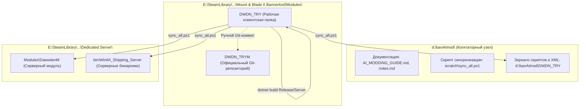
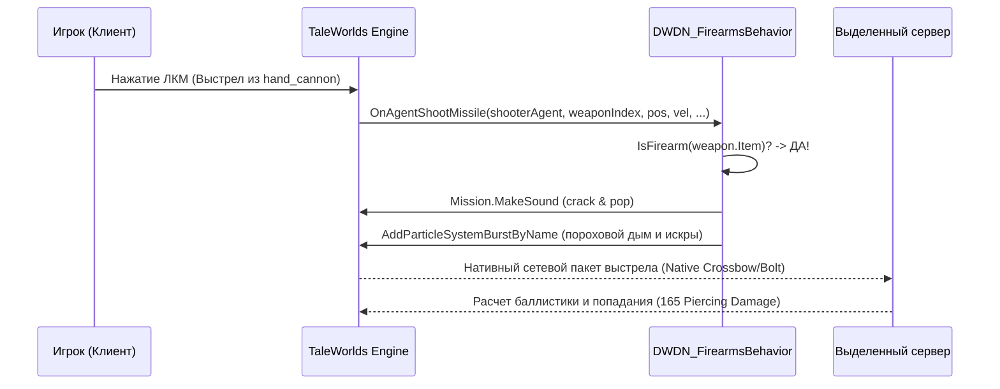
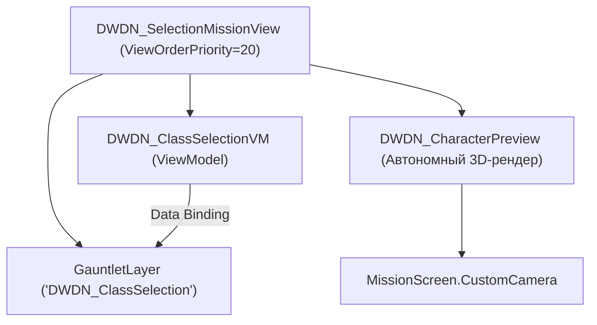
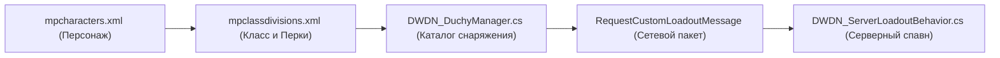
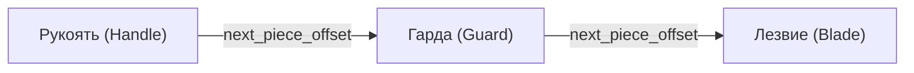

# РУКОВОДСТВО АРХИТЕКТОРА DWDN: СВЯЩЕННЫЙ КОДЕКС МОДДИНГА BANNERLORD (ДЛЯ ИИ)

> **КОНТЕКСТ ДЛЯ ИСКУССТВЕННОГО ИНТЕЛЛЕКТА:**  
> Этот документ составлен предыдущими поколениями ИИ для последующих ИИ-агентов.  
> Прочитав этот кодекс, ты получаешь полное понимание устройства мода **DWDN (Daewden)**, архитектуры мультиплеера Mount & Blade II: Bannerlord, механизмов защиты от падений (крашей) движка и готовый инструментарий для немедленной продуктивной работы без лишних вопросов к пользователю.

---

## 1. СВЯЩЕННАЯ ТОПОГРАФИЯ (РАСПОЛОЖЕНИЕ ПАПОК И КОНТУРЫ СИНХРОНИЗАЦИИ)

Вся разработка мода распределена между **четырьмя взаимосвязанными директориями**:



### Физические пути:
1. **Клиентская рабочая копия (Client Dev & Play):**  
   `E:\SteamLibrary\steamapps\common\Mount & Blade II Bannerlord\Modules\DWDN_TRY`  
   *Здесь ведется компиляция и локальное тестирование.*
2. **Git-репозиторий мода (Source Control):**  
   `E:\SteamLibrary\steamapps\common\Mount & Blade II Bannerlord\Modules\DWDN_TRYM`  
   *Удаленный репозиторий: `https://github.com/Havi-Dorgeir/DWDN_Module`.*  
   *Исключения `.gitignore`: монолит `AssetPackages/pack0.tpac` (1.1 ГБ) и рабочий кэш `RuntimeDataCache/`.*
3. **Выделенный сервер (Dedicated Server):**  
   `E:\SteamLibrary\steamapps\common\Mount & Blade II Dedicated Server\Modules\DaewdenM`  
   *И бинарная папка: `E:\SteamLibrary\steamapps\common\Mount & Blade II Dedicated Server\bin\Win64_Shipping_Server`.*
4. **Когитаторный архив агента (AI Hub):**  
   `d:\banAImod\`  
   *Здесь лежат конспекты (`notes.md`), скрипты исследования и вспомогательные утилиты.*

---

## 2. ИНСТРУМЕНТАРИЙ И МЕТОДОЛОГИЯ РЕВЕРС-ИНЖИНИРИНГА

### 2.1. Репозитории и инструменты GitHub
* **Главный репозиторий для модинга Bannerlord:**  
  [https://github.com/rehan-remade/universal-modder](https://github.com/rehan-remade/universal-modder)  
  *Используй его для шаблонов SubModule, CLI-сборки, парсинга ассетов и понимания неочевидных структур движка.*
* **Эталонные моды из мастерской Steam (изучай их архитектуру перед изобретением велосипеда):**
  * `E:\SteamLibrary\steamapps\workshop\content\261550\3774022783` (**LOTR / OMEE**) — **главный образец**: чистейшая Gauntlet UI архитектура, полная изоляция 3D-превью через `AgentVisuals.Create`, сетевые пакеты кастомного спавна.
  * `E:\SteamLibrary\steamapps\workshop\content\261550\3772431545` (**Warlords**) — эталон кастомных боевых классов и перков.
  * `E:\SteamLibrary\steamapps\workshop\content\261550\3716004111` — пример конфигурации баланса сетевых предметов.

### 2.2. Декомпиляция и исследование библиотек TaleWorlds
Все сборки ядра лежат в папке игры:  
`E:\SteamLibrary\steamapps\common\Mount & Blade II Bannerlord\bin\Win64_Shipping_Client\`  
Ключевые сборки для анализа:
* `TaleWorlds.MountAndBlade.dll` — миссии, спавн агентов, сетевые сообщения (`GameNetwork`), `MissionPeer`, `MissionMultiplayerGameModeBase`.
* `TaleWorlds.Core.dll` — `ItemObject`, `BasicCharacterObject`, `Equipment`, `EquipmentIndex`, `WeaponDesign`.
* `TaleWorlds.Engine.dll` — `AgentVisuals`, `Camera`, `Scene`, `SoundEvent`, матрицы `MatrixFrame`.
* `TaleWorlds.MountAndBlade.Multiplayer.dll` — нативные компоненты сетевого лобби и спавна.

> [!TIP]
> **Headless-исследование без GUI:**  
> Чтобы быстро узнать сигнатуру любого приватного метода или свойства TaleWorlds, создавай короткий скрипт на C# или PowerShell с `[System.Reflection.Assembly]::LoadFrom(...)` прямо в `d:\banAImod\scratch\`. Это экономит десятки минут по сравнению с открытием тяжелых декомпиляторов.

### 2.3. Священный цикл сборки и синхронизации
**КРИТИЧЕСКОЕ ПРАВИЛО:**  
`DWDN_Script.csproj` настроен на относительные пути `HintPath` вида `..\..\..\..\..\bin\Win64_Shipping_Client\`.  
Поэтому компилировать проект нужно **ТОЛЬКО** в рабочей папке Steam:
`E:\SteamLibrary\steamapps\common\Mount & Blade II Bannerlord\Modules\DWDN_TRY\ModuleData\scripts\DWDN_Script\DWDN_Script.csproj`

**Команды сборки через .NET CLI:**
```powershell
# 1. Сборка клиентской DLL
dotnet build "E:\SteamLibrary\steamapps\common\Mount & Blade II Bannerlord\Modules\DWDN_TRY\ModuleData\scripts\DWDN_Script\DWDN_Script.csproj" -c Release

# 2. Сборка серверной DLL
dotnet build "E:\SteamLibrary\steamapps\common\Mount & Blade II Bannerlord\Modules\DWDN_TRY\ModuleData\scripts\DWDN_Script\DWDN_Script.csproj" -c Server

# 3. Синхронизация всех файлов во все узлы (Клиент, Сервер, Локальный архив)
powershell.exe -ExecutionPolicy Bypass -File "d:\banAImod\scratch\sync_all.ps1"
```

---

## 3. ПОДСИСТЕМА ОГНЕСТРЕЛЬНОГО ОРУЖИЯ (FIREARMS SUBSYSTEM)

Огнестрельное оружие в DWDN реализовано через связку XML-моделей снарядов и клиент-серверного `MissionBehavior`.



### 3.1. XML-конфигурация (`ModuleData/mpitems/dwdn_weapon.xml`)
Вместо попыток внедрить совершенно новый несуществующий тип оружия, который сломал бы C++ интерфейсы анимаций TaleWorlds, мы используем гениальный и 100% стабильный **Crossbow-Hack**:

1. **Само орудие (`hand_cannon`):**
   ```xml
   <Item multiplayer_item="true" id="hand_cannon" name="{=*}Hand Bombard" 
         body_name="bo_composite_crossbows" mesh="crossbow_e" culture="Culture.vlandia" 
         weight="3.8" appearance="1" difficulty="0" Type="Crossbow" 
         AmmoOffset="0.0, 0.02131, 0.22975" 
         item_holsters="crossbow_back:bow_hip:mace_right_hip:bow_hip_2" 
         holster_position_shift="0.02,0,-0.4">
       <ItemComponent>
           <Weapon weapon_class="Crossbow" ammo_class="Bolt" 
                   missile_speed="135" accuracy="18" thrust_damage="165" 
                   thrust_speed="22" speed_rating="15" weapon_length="100" 
                   ammo_limit="1" thrust_damage_type="Pierce" 
                   item_usage="crossbow" reload_phase_count="2" 
                   physics_material="wood_weapon" center_of_mass="0,0,0.4">
               <WeaponFlags RangedWeapon="true" BonusAgainstShield="true" 
                            CanPenetrateShield="true" AmmoSticksWhenShot="false" 
                            AttachAmmoToVisual="false" CantReloadOnHorseback="true" 
                            NotUsableWithOneHand="true" TwoHandIdleOnMount="true" />
           </Weapon>
       </ItemComponent>
       <Flags />
   </Item>
   ```
2. **Пули (`mp_bullets`):**
   ```xml
   <Item multiplayer_item="true" id="mp_bullets" name="{=*}Lead Shot" 
         body_name="bo_capsule_arrow" holster_body_name="bo_axe_short" 
         mesh="bolt_bl_c" value="1" is_merchandise="false" 
         holster_mesh="bolt_bl_c_quiver" holster_mesh_with_weapon="bolt_bl_c_quiver" 
         flying_mesh="bolt_bl_flying" weight="0.10" appearance="1" Type="Bolts" 
         item_holsters="quiver_bolts:quiver_bolts_2:quiver_back_middle:quiver_back_top">
       <ItemComponent>
           <Weapon weapon_class="Bolt" stack_amount="12" thrust_damage="5" 
                   thrust_speed="0" speed_rating="0" physics_material="missile" 
                   weapon_length="35" 
                   flying_sound_code="event:/mission/combat/missile/flyby/arrow">
               <WeaponFlags Consumable="true" AmmoSticksWhenShot="false" />
           </Weapon>
       </ItemComponent>
   </Item>
   ```

### 3.2. C#-логика выстрела (`DWDN_FirearmsBehavior.cs`)
Класс наследуется от `MissionBehavior` и регистрируется в миссии.
* **Идентификация оружия**: `IsFirearm(ItemObject)` сверяет `StringId` с ключевыми словами (`hand_cannon`, `cannon`, `bombard`, `handgonne`, `firearm`).
* **Точка среза ствола (Muzzle Position)**:
  ```csharp
  Vec3 forward = velocity.NormalizedCopy();
  if (forward.LengthSquared < 0.001f) forward = orientation.f;
  Vec3 muzzlePos = position + forward * 0.70f;
  MatrixFrame muzzleFrame = new MatrixFrame(orientation, muzzlePos);
  ```
* **Акустический эффект («Легкий бах»)**:  
  Сдвоенный нативный звук:
  * `event:/mission/combat/impact/ballista_missile/stone` (сухой пороховой щелчок).
  * `event:/mission/combat/impact/missile/pot_breakable` (глухой резонирующий хлопок).
* **Визуальные партиклы (VFX)**:
  * Густой пороховой дым: `psys_game_stone_dust_a` и `psys_siege_door_falling_dust`.
  * Дымный шлейф по траектории выстрела: эмиттеры на `muzzlePos + forward * 0.60f` и `muzzlePos + forward * 1.20f`.
  * Вспышка и искры: `psys_game_sparkle_a`.
  * Дымок запального отверстия: на `position - forward * 0.10f + Vec3(0, 0, 0.04f)`.

> [!IMPORTANT]
> **ЗАПРЕТ НА `AddCustomMissile` НА СЕРВЕРЕ:**  
> Никогда не спавните сторонние ракеты/пули через `Mission.AddCustomMissile` на выделенном сервере для огнестрела!  
> Нативный движок TaleWorlds сам синхронизирует снаряд через баллистический пайплайн арбалета. Если пытаться спавнить кастомные пули в коде, выделенный сервер гарантированно упадет в десинхронизацию физического мира.

---

## 4. АРХИТЕКТУРА КАСТОМНОГО GAUNTLET UI И 3D-ПРЕДПРОСМОТРА

Экран выбора снаряжения и класса в DWDN заменяет стандартный спавн-экран Bannerlord.



### 4.1. Стек UI-компонентов
* **Слой отображения (`DWDN_SelectionMissionView.cs`)**:
  * Создает `GauntletLayer` с `ViewOrderPriority = 20`.
  * Привязывает `DWDN_ClassSelectionVM` к Gauntlet-макету.
  * Перехватывает ввод мыши для вращения персонажа.
* **Иерархия ViewModel**:
  * `DWDN_ClassSelectionVM` — главное окно, переключение герцогств и классов.
  * `DWDN_DuchyItemVM` — кнопки выбора герцогств.
  * `DWDN_ClassItemVM` — кнопки выбора класса внутри герцогства.
  * `DWDN_EquipmentSlotVM` — слоты экипировки (Шлем, Торс, Оружие 0..3 и т.д.).
  * `DWDN_ItemOptionVM` — список доступных предметов для выбранного слота.

### 4.2. Архитектура изолированного 3D-превью (LOTR / OMEE Pattern)
**ИСТОРИЯ СКРАПКОДА И КРАША `0xC0000005`:**  
В ранних версиях мода при смене класса вызывался `MultiplayerMissionAgentVisualSpawnComponent.OnMyAgentVisualSpawned` или прямой `agentVisual.Refresh(...)` на нативном пьедестале TaleWorlds.  
Так как нативный C++ поток `Engine.dll` в этот же миллисекундный тик крутил анимацию ожидания пьедестала, разрушение скелета вызывало фатальное нарушение прав доступа к памяти (*Access Violation 0xC0000005*).

**СВЯЩЕННОЕ РЕШЕНИЕ (Класс `DWDN_CharacterPreview.cs`):**
1. Полный отказ от хуков на нативный `MultiplayerMissionAgentVisualSpawnComponent`.
2. Создание изолированного визуального агента:
   ```csharp
   AgentVisualsData data = new AgentVisualsData()
       .ActionSet(actionSet)
       .Equipment(equipment)
       .BodyProperties(bodyProperties)
       .Frame(anchor)
       .ActionCode(idleAction)
       .Scene(Mission.Current.Scene)
       .PrepareForNativeMeshOptimization(true);

   _visual = AgentVisuals.Create(data, "dwdn_preview", false, false, false);
   ```
3. Выделение независимой камеры:
   ```csharp
   _camera = Camera.CreateCamera();
   _camera.SetFovVertical(0.785f, Screen.AspectRatio, 0.1f, 1000f);
   MissionScreen.CustomCamera = _camera;
   ```
4. При закрытии меню `MissionScreen.CustomCamera = null`, а `_visual.Reset()` безопасно освобождает C++ память. **Результат: 0 крашей движка.**

---

## 5. ГЕРЦОГСТВА, КЛАССЫ И СЕТЕВОЙ СПАВН (LOADOUT PIPELINE)

Каждый класс в моде задается в трех неразрывных точках:



### 5.1. Регистрация класса
1. **`ModuleData/mpcharacters.xml`**:
   Базовый персонаж, модель тела, пол, скелет, раса.
   ```xml
   <NPCCharacter id="dwdn_militia_infantry" name="{=*}Militia Infantry" 
                 default_group="Infantry" age="28" voice="curt" 
                 is_female="false" culture="Culture.vlandia" 
                 occupation="Soldier" is_hero="false">
   ```
2. **`ModuleData/mpclassdivisions.xml`**:
   Стоимость в золоте, характеристики (HP, броня, скорость), перки:
   ```xml
   <MPClassDivision id="dwdn_militia_infantry_division" 
                    hero="NPCCharacter.dwdn_militia_infantry" 
                    cost="120" culture="Culture.vlandia" 
                    class_group="Infantry" icon_type="Infantry">
   ```
3. **Реестр герцогств в C# (`DWDN_DuchyManager.cs`)**:
   Определяет списки допустимых предметов в GUI:
   ```csharp
   DWDN_ClassDefinition militia = new DWDN_ClassDefinition(
       id: "dwdn_militia_infantry",
       name: "Ополченец",
       characterId: "dwdn_militia_infantry",
       divisionId: "dwdn_militia_infantry_division",
       allowedHelmets: new List<string> { "", "padded_coif", "kettle_hat" },
       allowedBodyArmors: new List<string> { "padded_armor", "leather_tunic" },
       allowedWeaponsSlot0: new List<string> { "vlandia_sword_1", "vlandia_axe_1" },
       allowedWeaponsSlot1: new List<string> { "", "vlandia_shield_wood" },
       allowedHorses: new List<string>() // Пусто для пехотинца!
   );
   ```

### 5.2. Сетевая синхронизация экипировки
1. Игрок нажимает кнопку **«В БОЙ»** в Gauntlet UI.
2. Клиент упаковывает `DWDN_ClassSelection` в сетевой пакет `RequestCustomLoadoutMessage`:
   ```csharp
   GameNetwork.BeginModuleEventAsClient();
   GameNetwork.WriteMessage(new RequestCustomLoadoutMessage(selection));
   GameNetwork.EndModuleEventAsClient();
   ```
3. На выделенном сервере `DWDN_ServerLoadoutBehavior.cs` принимает пакет:
   * Проверяет, что каждый StringId действительно разрешен данному классу в `DWDN_DuchyManager` (античит-валидация).
   * Сохраняет экипировку в реестр игрока `_peerLoadouts[peer]`.
   * При срабатывании `OnAgentBuild`: заполняет `agent.SpawnEquipment` проверенными предметами.

### 5.3. Защита от варп-скверны коней (The Cavalry Dismount Fix)
> [!CAUTION]
> **КРИТИЧЕСКИЙ БАГ TALEWORLDS:**  
> Если пеший персонаж имеет в своем `SpawnEquipment` заполненный слот `EquipmentIndex.Horse` или `EquipmentIndex.HorseHarness`, нативный метод движка `MountVisualCreator.AddMountMeshToAgentVisual` ошибочно прикрепляет меш лошади к костям таза **человеческого скелета**. При спешивании или движении меш деформируется и опадает на землю в точку `(0,0,0)`.

**КАК ЭТО РЕШЕНО В `DWDN_ServerLoadoutBehavior.cs`:**
```csharp
// 1. Человек-всадник НИКОГДА не должен нести слоты Horse / HorseHarness в человеческом снаряжении:
equip[EquipmentIndex.Horse] = EquipmentElement.Invalid;
equip[EquipmentIndex.HorseHarness] = EquipmentElement.Invalid;

// 2. Лошадь спавнится движком ТОЛЬКО тогда, когда SelectedTroopIndex указывает на кавалерийский класс:
int targetIdx = string.IsNullOrEmpty(selection.HorseId) ? 0 : cavalryIndex;
missionPeer.SelectedTroopIndex = targetIdx;
missionPeer.NextSelectedTroopIndex = targetIdx;
```

---

## 6. МАТЕМАТИКА СОСТАВНОГО ОРУЖИЯ (CRAFTED WEAPONS DELTAS)

Составное модульное оружие (мечи, копья, топоры) описывается в `ModuleData/crafting_pieces.xml` и `crafting_templates.xml`.



### 6.1. Декомпилированная формула TaleWorlds (`WeaponDesign.CalculatePivotDistances`)
При сборке меша оружия движок вычисляет позицию каждого сочленения инкрементно от точки хвата:

$$\text{Position}_{n} = \text{Length}_{n-1} + (\text{previous\_piece\_offset}_{n} - \text{next\_piece\_offset}_{n-1})$$

*Все значения в XML указываются в сантиметрах, а движок делит их на 100 для перевода в метры.*

### 6.2. Почему координаты из Blender ломают игру
* В Blender моделлер видит **абсолютные координаты сцены** (например, гарда находится на $Z = 140\text{ см}$).
* Если прописать `140` в `previous_piece_offset`, движок прибавит $1.4$ метра к длине рукояти, и гарда улетит в небеса или вызовет бесконечный ассерт физического тела `Physics material bounding box error`.
* **Правило:** в `crafting_pieces.xml` указываются только **относительные дельты стыковки** между краем меша рукояти и началом меша гарды.

### 6.3. Эталонная калибровка копья Финнарда (`finnard_spear`)
Проверенная геометрия, гарантирующая идеальный монолитный стык без щелей и крашей:
```xml
<!-- Рукоять: смещение стыка вверх к гарде -->
<CraftingPiece id="finnard_spear_handle" Type="Handle" 
               next_piece_offset="-35" ... />

<!-- Гарда: входная дельта от рукояти (+7) и выходная к лезвию (-19) -->
<CraftingPiece id="finnard_speard_guard" Type="Guard" 
               previous_piece_offset="7" next_piece_offset="-19" ... />

<!-- Наконечник: входная дельта стыка (+24) -->
<CraftingPiece id="finnard_spearhead" Type="Blade" 
               previous_piece_offset="24" next_piece_offset="0" ... />
```

---

## 7. КОДЕКС ЗАЩИТЫ ОТ СКРАПКОДА (ANTI-SCRAPCODE CODEX)

1. **Правило минимального вмешательства:**  
   Никогда не переписывай работающие системы, если задача касается только добавления нового предмета или класса. Одно неловкое изменение в сигнатуре сетевого сообщения ломает обратную совместимость клиента и сервера.
2. **Всегда проверяй логи движка:**  
   Логи игры пишутся в реальном времени:  
   `C:\ProgramData\Mount and Blade II Bannerlord\logs\rgl_log_*.txt`  
   Если клиент закрылся молча, открой последний `rgl_log` и промотай в самый низ — там будет указан конкретный XML-тег или отсутствующий меш.
3. **Безопасность UI-потоков:**  
   Никаких тяжелых циклов поиска в `Tick` или `OnMissionScreenTick`. Все списки предметов в `DWDN_DuchyManager` должны кэшироваться при инициализации.
4. **Снятие предметов (Пустой слот `""`):**  
   Для шлемов, плащей, перчаток и щитов всегда предусматривай строковый ID `""` (пустая строка). Это позволяет игроку снять шлем или щит, очищая соответствующий слот.
5. **Синхронизируй все узлы:**  
   После любой правки XML или компиляции DLL **всегда** запускай `d:\banAImod\scratch\sync_all.ps1`. Если клиент и выделенный сервер расходятся хотя бы на один атрибут в `mpclassdivisions.xml`, сервер кикнет игрока с ошибкой несоответствия версий.

---

*Да пребудет логика в священном кремнии. Слава Омниссии!*
