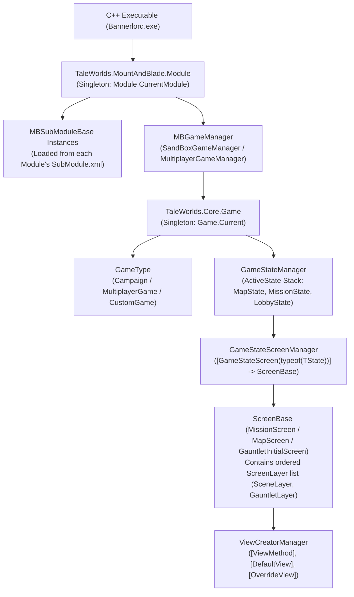

# MOUNT & BLADE II: BANNERLORD (v1.4.8) — COMPLETE REVERSE ENGINEERING & ARCHITECTURE BIBLE
**Target Audience**: Autonomous AI Modding Agents & Tooling Engineers  
**Scope**: Full brick-by-brick disassembly and end-to-end architectural reconstruction of the 4 foundational vanilla modules:
1. `Modules/Native` (`v1.4.8`)
2. `Modules/SandBoxCore` (`v1.4.8`)
3. `Modules/SandBox` (`v1.4.8`)
4. `Modules/Multiplayer` (`v1.4.8`)

---

## PART I: THE ATOMIC BRICKS (DISASSEMBLY)

Bannerlord is a **dual-layer hybrid engine**:
1. **Native C++ Layer (RGL / `TaleWorlds.Native.dll`)**: Owns the scene graph (`Scene`, `GameEntity`), Havok physics (`PhysicsShape`, `PhysicsMaterial`), skeletal animation evaluation (64-bone hard limit, `0x1050`-byte `AnimResult`), `.tpac` binary asset streaming, Direct3D11/12 rendering, spatial audio, and low-level UDP packet replication.
2. **Managed .NET Layer (`TaleWorlds.*.dll` + Module Assemblies)**: Owns the application state machine (`Module`, `MBSubModuleBase`, `GameManagerBase`, `Game`, `GameType`, `GameStateManager`), object database (`MBObjectManager`), gameplay math (`GameModel`s), mission logic (`Mission`, `MissionBehavior`, `Agent`), campaign simulation (`Campaign`, `CampaignBehaviorBase`), and Gauntlet UI (`ScreenBase`, `ScreenLayer`, `ViewModel`, `Widget`).

---

### Brick 1: The C++ / C# Bridge (`DotNetObject` & `[MBCallback]`)

The native C++ executable (`Bannerlord.exe` / `TaleWorlds.MountAndBlade.Launcher.exe` / `DedicatedCustomServer.Starter.exe`) hosts the .NET runtime (`netstandard2.0` / `.NET Framework 4.7.2` on Client, `.NET 6.0` on Dedicated Server) via `TaleWorlds.DotNet.dll`.

- **Inbound (C++ $\rightarrow$ C#)**: Methods decorated with `[MBCallback]` in `TaleWorlds.MountAndBlade.Module` and `Managed` are registered in a function-pointer table passed to `TaleWorlds.Native.dll` at startup.
  - Examples on [`TaleWorlds.MountAndBlade.Module`](file:///d:/banAImod/scratch/submodules_decompiled.txt#L1868-L2732):
    - `InitializeSubModules()` — Loads all `<SubModule>` DLLs and instantiates `MBSubModuleBase` subclasses.
    - `OnApplicationTick(float dt)` — Main frame heartbeat from C++ into C#.
    - `CreateProcessedSkinsXMLForNative(out string baseSkinsXmlPath)`
    - `CreateProcessedActionSetsXMLForNative()`
    - `CreateProcessedActionTypesXMLForNative()`
    - `CreateProcessedAnimationsXMLForNative(out stringAnimationsXmlPaths)`
    - `CreateProcessedVoiceDefinitionsXMLForNative()`
    - `CreateProcessedModuleDataXMLForNative(string xmlType)`
    - `SetLoadingFinished()`
- **Outbound (C# $\rightarrow$ C++)**: `EngineApplicationInterface` (`IEntitySystem`, `IScene`, `IAgent`, `IMBMission`, `ISkeleton`, `IMesh`, `ITexture`, etc.) in `TaleWorlds.Engine.dll` and `MBAPI` in `TaleWorlds.MountAndBlade.dll` invoke C++ P/Invoke thunks generated by `TaleWorlds.Engine.AutoGenerated.dll` and `TaleWorlds.MountAndBlade.AutoGenerated.dll`.

---

### Brick 2: The Dual XML Data Pipelines (Engine `project.mbproj` vs Managed `MBObjectManager`)

Bannerlord has **two completely separate XML pipelines**. Confusing them is the #1 cause of silent XML failures or native `0xC0000005` crashes.

```mermaid
flowchart TD
    subgraph NativePipeline["1. Native C++ Engine XML Pipeline (ModuleData/project.mbproj)"]
        MBPROJ["ModuleData/project.mbproj\n(<file id='soln_*' name='...' type='...'/>)"]
        MBCB["Module.[MBCallback] Methods\n(CreateProcessed*XMLForNative)"]
        MBOM_NATIVE["MBObjectManager.GetMergedXmlForNative(soln_id)"]
        RGL["C++ RGL Engine Parser\n(TaleWorlds.Native.dll)"]
        MBPROJ --> MBCB --> MBOM_NATIVE --> RGL
    end

    subgraph ManagedPipeline["2. Managed C# Object Pipeline (SubModule.xml <Xmls>)"]
        SUBXML["SubModule.xml\n(<XmlNode><XmlName id='...' path='...'/>)"]
        XSD["Validation: Schemas/<XmlName>.xsd\n(+ dynamic _replaceWhileMerging attribute)"]
        XSLT["Transformation: ModuleData/<path>.xsl / .xslt"]
        MERGE["MBObjectManager.MergeElements()\n(Keyed by XSD unique/key attributes)"]
        DESER["MBObjectManager.LoadXml()\n(Instantiates MBObjectBase into ObjectTypeRecord<T>)"]
        SUBXML --> XSD --> XSLT --> MERGE --> DESER
    end
```

#### Pipeline A: Native C++ Engine XMLs (`ModuleData/project.mbproj`)
- **Where declared**: Inside `<Module>/ModuleData/project.mbproj` (see [`Native/ModuleData/project.mbproj`](file:///E:/SteamLibrary/steamapps/common/Mount%20&%20Blade%20II%20Bannerlord/Modules/Native/ModuleData/project.mbproj)).
- **How loaded**: C++ calls `Module.CreateProcessed*XMLForNative()`, which calls [`MBObjectManager.GetMergedXmlForNative(string id, ...)`](file:///d:/banAImod/scratch/core_managers_decompiled.txt#L211-L249) using the canonical `soln_*` ID, and returns a raw merged XML string to C++.
- **Complete Inventory of the 39 `soln_*` IDs in `Native/ModuleData/project.mbproj`**:
  1. `soln_Physics_Materials_xml` (`ModuleData/physics_materials.xml`, type `PhysicsMaterial`)
  2. `soln_Body_Meshes_xml` (`ModuleData/body_meshes.xml`)
  3. `soln_Map_Icons_xml` (`ModuleData/map_icons.xml`, type `MapIcon`)
  4. `soln_Item_Holsters_xml` (`ModuleData/item_holsters.xml`, type `ItemHolster`)
  5. `soln_action_types` (`ModuleData/action_types.xml`, type `ActionTypes`)
  6. `soln_action_sets` (`ModuleData/action_sets.xml`, type `ActionSet`)
  7. `soln_animations_human` (`ModuleData/animations_human.xml`, type `Animation`)
  8. `soln_animations_horse` (`ModuleData/animations_horse.xml`, type `Animation`)
  9. `soln_animations_camel` (`ModuleData/animations_camel.xml`)
  10. `soln_animations_animals` (`ModuleData/animations_animals.xml`, type `Animation`)
  11. `soln_animations_siege` (`ModuleData/animations_siege.xml`, type `Animation`)
  12. `soln_animations_cinematic` (`ModuleData/animations_cinematic.xml`, type `Animation`)
  13. `soln_animations_cheer_and_conversation` (`ModuleData/animations_cheer_and_conversation.xml`, type `Animation`)
  14. `soln_combat_Idle_animations` (`ModuleData/combat_idle_animations.xml`, type `Animation`)
  15. `soln_voices_xml` (`ModuleData/voices.xml`, type `Sound`)
  16. `soln_sound_files` (`ModuleData/soundfiles.xml`, type `Sound`)
  17. `soln_sound_definitions` (`ModuleData/sounds.xml`, type `Sound`)
  18. `soln_particle_systems` (`ModuleData/particle_systems.xml`, type `ParticleSystem`)
  19. `soln_particle_systems_basic` (`ModuleData/particle_systems_basic.xml`)
  20. `soln_particle_systems_fire` (`ModuleData/particle_systems_fire.xml`)
  21. `soln_particle_systems_general` (`ModuleData/particle_systems_general.xml`)
  22. `soln_particle_systems_local_inf` (`ModuleData/particle_systems_local_inf.xml`)
  23. `soln_particle_systems_map_icon` (`ModuleData/particle_systems_map_icon.xml`)
  24. `soln_particle_systems_outdoor` (`ModuleData/particle_systems_outdoor.xml`)
  25. `soln_particle_systems_siege` (`ModuleData/particle_systems_siege.xml`)
  26. `soln_particle_systems_weather` (`ModuleData/particle_systems_weather.xml`)
  27. `soln_prerender` (`ModuleData/prerender.xml`, type `PreRender`)
  28. `soln_skins` (`ModuleData/skins.xml`, type `Skin`)
  29. `soln_monster_usage_sets` (`ModuleData/monster_usage_sets.xml`, type `MonsterUsageSet`)
  30. `soln_item_usage_sets` (`ModuleData/item_usage_sets.xml`, type `ItemUsageSet`)
  31. `soln_movement_sets` (`ModuleData/movement_sets.xml`, type `MovementSet`)
  32. `soln_full_movement_sets` (`ModuleData/full_movement_sets.xml`, type `FullMovementSet`)
  33. `soln_prebaked_animations` (`ModuleData/prebaked_animations.xml`, type `PrebakedAnimations`)
  34. `soln_combat_parameters` (`ModuleData/combat_parameters.xml`, type `CombatParameter`)
  35. `soln_skeletons` (`ModuleData/skeletons.xml`, type `Skeleton`)
  36. `soln_flora_kinds` (`ModuleData/flora_kinds.xml`, type `FloraKind`)
  37. `soln_cloth_materials` (`ModuleData/cloth_materials.xml`, type `ClothMaterial`)
  38. `soln_terrain_materials` (`ModuleData/terrain_materials.xml`, type `TerrainMaterial`)
  39. `soln_weather_nodes` (`ModuleData/weather_nodes.xml`, type `WeatherNode`)
- **Special Case for `skins.xml` (`soln_skins`)**:
  - Look at [`Module.CreateProcessedSkinsXMLForNative`](file:///d:/banAImod/scratch/submodules_decompiled.txt#L2282-L2327): C++ requires **two** return values:
    1. `baseSkinsXmlPath` (out parameter) = the physical file path to the **first** loaded `skins.xml` (`Native/ModuleData/skins.xml`) used as the base template.
    2. The return string = an XSLT-filtered diff containing only elements from later modules!
- **Special Case for `action_sets.xml` (`soln_action_sets`)**:
  - `Module.CreateProcessedActionSetsXMLForNative()` merges all `soln_action_sets` files, then runs a second pass where any `<action_set base_set="as_human_warrior">` copies missing `<action>` child nodes from its `base_set` in C# before handing the XML to C++.

#### Pipeline B: Managed C# Object XMLs (`SubModule.xml` $\rightarrow$ `MBObjectManager`)
- **Where declared**: In `SubModule.xml` under `<Xmls><XmlNode><XmlName id="..." path="..."/><IncludedGameTypes>...</IncludedGameTypes></XmlNode></Xmls>`.
- **Exact Merge Algorithm** (decompiled from [`MBObjectManager`](file:///d:/banAImod/scratch/core_managers_decompiled.txt#L204-L420)):
  1. **Discovery**: Scans enabled modules in load order (`ModuleHelper.GetModules()`). If `<Module>/ModuleData/<path>` is a single `.xml` file, adds it; if `<Module>/ModuleData/<path>` is a directory (e.g. `SandBoxCore/ModuleData/items/`), adds all `.xml` files in that directory alphabetically.
  2. **XSD Validation & Unique Key Extraction**: Reads `Schemas/<XmlName>.xsd`. Dynamically injects `<xs:attribute name="_replaceWhileMerging" type="xs:boolean" />` into every complex type (`AddReplaceReadMethodToSchema`). Extracts XSD `<xs:unique>` / `<xs:key>` constraints to know which attribute identifies each element (typically `id`).
  3. **XSLT Transformation**: If `<path>.xsl` or `<path>.xslt` exists alongside the XML, applies `XslCompiledTransform` to the previously accumulated XML document before merging the current module's XML.
  4. **Element Merging (`MergeElements`)**:
     - If an incoming XML node has the same XSD key (`id`) as an existing node:
       - Attributes on the incoming node overwrite attributes on the existing node.
       - If the incoming node or any child block has `_replaceWhileMerging="true"`, the existing child block is wiped before appending incoming children; otherwise children are recursively merged/appended.
  5. **Type Registration & Deserialization (`RegisterType<T>` & `LoadXml`)**:
     - Each `MBObjectBase` subclass is registered with a `classPrefix` (XML element tag), `dictionaryQuickName` (`XmlName id`), and numeric `typeId` (shifted by `<< 26` to form the 64-bit `MBGUID`).
     - **Core Registered Types (`Game.RegisterTypes`)**:
       | `typeId` | XML Element (`classPrefix`) | `XmlName id` (`dictionaryQuickName`) | C# Class |
       | :--- | :--- | :--- | :--- |
       | `2` | `Monster` | `Monsters` | `TaleWorlds.Core.Monster` |
       | `3` | `Scale` | `Scales` (`SkeletonScales`) | `TaleWorlds.Core.SkeletonScale` |
       | `4` | `Item` | `Items` | `TaleWorlds.Core.ItemObject` |
       | `6` | `ItemModifier` | `ItemModifiers` | `TaleWorlds.Core.ItemModifier` |
       | `7` | `ItemModifierGroup` | `ItemModifierGroups` | `TaleWorlds.Core.ItemModifierGroup` |
       | `8` | `CharacterAttribute` | `CharacterAttributes` | `TaleWorlds.Core.CharacterAttribute` |
       | `9` | `Skill` | `Skills` | `TaleWorlds.Core.SkillObject` |
       | `10` | `ItemCategory` | `ItemCategories` | `TaleWorlds.Core.ItemCategory` |
       | `11` | `CraftingPiece` | `CraftingPieces` | `TaleWorlds.Core.CraftingPiece` |
       | `12` | `CraftingTemplate` | `CraftingTemplates` | `TaleWorlds.Core.CraftingTemplate` |
       | `13` | `SiegeEngineType` | `SiegeEngineTypes` | `TaleWorlds.Core.SiegeEngineType` |
       | `14` | `WeaponDescription` | `WeaponDescriptions` | `TaleWorlds.Core.WeaponDescription` |
       | `50` | `BodyProperty` | `BodyProperties` | `TaleWorlds.Core.MBBodyProperty` |
       | `51` | `EquipmentRoster` | `EquipmentRosters` | `TaleWorlds.Core.MBEquipmentRoster` |
       | `52` | `SkillSet` | `SkillSets` | `TaleWorlds.Core.MBCharacterSkills` |
       | `53` | `BannerEffect` | `BannerEffects` | `TaleWorlds.Core.BannerEffect` |
     - **Multiplayer Additional Types (`MultiplayerGame.OnRegisterTypes`)**:
       | `typeId` | XML Element | `XmlName id` | C# Class |
       | :--- | :--- | :--- | :--- |
       | `17` | `Culture` | `BasicCultures` | `TaleWorlds.Core.BasicCultureObject` |
       | `43` | `NPCCharacter` | `MPCharacters` | `TaleWorlds.Core.BasicCharacterObject` |
       | `45` | `MPClassDivision` | `MPClassDivisions` | `MultiplayerClassDivisions.MPHeroClass` |
     - **Presumed Objects (Forward References)**: When XML A references `"Item.iron_sword"` or `"NPCCharacter.imperial_recruit"` via `ReadObjectReferenceFromXml`, `MBObjectManager.GetPresumedObject` creates an uninitialized placeholder instance (`IsReady = false`) if the target hasn't been deserialized yet. Once all XMLs finish loading, `ObjectManager.UnregisterNonReadyObjects()` purges any unresolved placeholders!

---

### Brick 3: Binary Asset Containers (`.tpac` & `.rdc`) & The 64-Bone Skeleton Contract

#### 1. `.tpac` (`AssetPackages/*.tpac`) Container Layout
All visual/physical assets (meshes, textures, materials, skeletons, animations, morphs, procedural shaders, physics shapes) live in `<Module>/AssetPackages/*.tpac`.
- **Header**: Magic `TPAC` (`0x43415054`), uint32 version `2`.
- **Compression & Hashing**: Payloads compressed with **LZ4**; asset names/keys hashed with **xxHash64**; every asset has a 16-byte GUID + string name.
- **Cross-Module Override Rule**: The C++ resource manager mounts `.tpac` packages in module load order and resolves assets **by string name** (`Mesh.GetFromResource("my_mesh")`). A later module's `.tpac` containing an asset with the same string name overrides an earlier module's asset.
- **Asset Types inside `.tpac`**:
  - `Texture`: Metadata header (`1` = external `.dds` in `StreamingAssets/`, `0` = embedded pixel data).
  - `Material`: Shader reference + texture slot bindings + material flags (`288` = `use_areamap` + `specularity` for PBR).
  - `Mesh` (`MetaMesh`): LOD submeshes, 3D vertex buffers, skinning bone weights (4 bone indices + 4 weights per vertex), bounding box, clothing simulation data.
  - `Skeleton`: Bone hierarchy tree (`name`, `parent_index`, `rest_frame` 4x4 matrix) + collision capsule bodies.
  - `SkeletalAnimation`: Per-bone quaternion rotation + translation keyframes.
  - `PhysicsShape`: Havok collision hulls/capsules (`bo_*` bodies).

#### 2. `.rdc` (`AssetSources/runtime_data_cache.rdc`) Layout
When a mod ships raw `.tpac` packages without running the official Editor's asset publisher, the engine checks `AssetSources/runtime_data_cache.rdc`:
- **Header**: 8 bytes (`RDC0\0\0\0\0`).
- **Entry Count**: `uint32` count of entries.
- **Fixed Entry Size**: **145 bytes per entry**:
  - `16 bytes`: Asset GUID (`Guid.ToByteArray()`).
  - `4 bytes`: Asset Type ID (`uint32`).
  - `4 bytes`: Timestamp/Flags (`uint32`).
  - `120 bytes`: Null-padded ASCII asset name.
  - `1 byte`: Trailing flag (`0x00`).

#### 3. The Hard 64-Bone Native Engine Contract
Inside `TaleWorlds.Native.dll`:
- The skeletal evaluation output buffer is `0x1050` bytes (`4176` bytes) = `64 bones * 64 bytes (Mat4x4) + 80 bytes header`.
- Bone masks are stored in 64-bit unsigned integers (`uint64_t`).
- **Any skeleton with $> 64$ bones causes an immediate stack/heap buffer overflow (`0xC0000005` Access Violation)**.
- **Human Biped 28-Bone Index Order**:
  `0: pelvis`, `1: thorax`, `2: spine`, `3: spine1`, `4: spine2`, `5: neck`, `6: head`, `7: clavicle_l`, `8: upperarm_l`, `9: forearm_l`, `10: hand_l`, `11: finger0_l`, `12: item_l`, `13: clavicle_r`, `14: upperarm_r`, `15: forearm_r`, `16: hand_r`, `17: finger0_r`, `18: item_r`, `19: thigh_l`, `20: calf_l`, `21: foot_l`, `22: toe0_l`, `23: thigh_r`, `24: calf_r`, `25: foot_r`, `26: toe0_r`, `27: camera`.

---

### Brick 4: The Application, Game, State, Screen, and View Stack

#### 1. `MBSubModuleBase` Lifecycle Hooks (in Exact Execution Order)
Decompiled from [`MBSubModuleBase`](file:///d:/banAImod/scratch/submodules_decompiled.txt#L2734-L2839) and [`Module`](file:///d:/banAImod/scratch/submodules_decompiled.txt#L1868-L2732):
1. **Constructor `new MySubModule()`** — Invoked during `Module.InitializeSubModules()`.
2. **`OnSubModuleLoad()`** — Called once at game startup for each module in load order. Register initial screen options (`Module.CurrentModule.AddInitialStateOption`), console commands, or Harmony patches here.
3. **`OnServiceRegistration()`** — Registers platform/network services before `OnBeforeInitialModuleScreenSetAsRoot`.
4. **`OnConfigChanged()`** — Called when engine options change.
5. **`OnBeforeInitialModuleScreenSetAsRoot()`** — Called right before the Main Menu (`InitialState`) is pushed.
6. **When a Game (SP or MP) Starts (`MBGameManager` State Machine)**:
   - **`RegisterSubModuleObjects(bool isSavedCampaign)`** — Called during `Game.RegisterTypes` to let submodules register custom `MBObjectBase` XML types (`MBObjectManager.Instance.RegisterType<T>(...)`).
   - **`InitializeGameStarter(Game game, IGameStarter starterObject)`** — **THE primary hook** to add `GameModel`s (`starterObject.AddModel(...)`) and `CampaignBehaviorBase`s (`((CampaignGameStarter)starterObject).AddBehavior(...)`).
   - **`OnGameStart(Game game, IGameStarter gameStarterObject)`** — Called immediately before `game.SetBasicModels(gameStarter.Models)`.
   - **`BeginGameStart(Game game)`** — Called after `BasicModels` and `GameStateManager` are created, before XMLs load.
   - **`AfterSubModuleObjectsInitialized(Game game)`** — Called after default game objects (`DefaultSkills`, `DefaultItemCategories`, etc.) are created.
   - **`OnCampaignStart(Game game, object starterObject)`** / **`OnMultiplayerGameStart(Game game, object starterObject)`** — Called after XMLs are loaded on a new game.
   - **`OnGameLoaded(Game game, object initializerObject)`** — Called when loading a saved game.
   - **`OnAfterGameInitializationFinished(Game game, object starterObject)`** — Called after all XMLs, models, and behaviors are initialized.
   - **`DoLoading(Game game)`** — Polled every frame during `GameManagerLoadingSteps.PostInitializeFourthState` until it returns `true`.
7. **When a Mission Starts**:
   - **`OnBeforeMissionBehaviorInitialize(Mission mission)`** — Inject `MissionBehavior`s into **every** mission before behaviors initialize (`mission.AddMissionBehavior(...)`).
   - **`OnMissionBehaviorInitialize(Mission mission)`** — Inject `MissionBehavior`s after default behaviors initialize.
8. **Per-Frame & Shutdown**:
   - **`OnApplicationTick(float dt)`** — Called every frame regardless of whether a game is loaded.
   - **`OnGameEnd(Game game)`** — Called when exiting a campaign/multiplayer session back to Main Menu.
   - **`OnSubModuleUnloaded()`** — Called on application exit.

#### 2. Screen & View Binding (`GameStateScreenManager` & `ViewCreatorManager`)
Decompiled from [`GameStateScreenManager`](file:///d:/banAImod/scratch/core_managers_decompiled.txt#L1182-L1324) and [`ViewCreatorManager`](file:///d:/banAImod/scratch/core_managers_decompiled.txt#L999-L1180):
- **`[GameStateScreen(typeof(MyGameState))]`**:
  - `GameStateScreenManager.CollectTypes()` iterates `ViewSubModule.GetViewAssemblies()` and maps `GameState` Type $\rightarrow$ `ScreenBase` Type.
  - Whenever `GameStateManager.PushState(state)` or `CleanAndPushState(state)` is called, `GameStateScreenManager.CreateScreen(state)` instantiates the bound `ScreenBase` and pushes it to `ScreenManager`.
- **`[ViewCreatorModule]` & `[ViewMethod("MissionName")]`**:
  - Static classes marked `[ViewCreatorModule]` contain static methods marked `[ViewMethod("Battle")]` that call `MissionState.OpenNew("Battle", rec, (Mission m) => new MissionBehavior[] { ... })`.
  - If a later module defines `[ViewMethod("Battle")]`, it **overwrites** the dictionary entry in `ViewCreatorManager._viewCreators["Battle"]`!
- **`[DefaultView]` and `[OverrideView(typeof(BaseView))]`**:
  - `ViewCreatorManager` scans `ModuleHelper.GetActiveGameAssemblies()` **in reverse load order** (`for (int num = activeGameAssemblies.Length - 1; num >= 0; num--)`).
  - Any `MissionView` or `MapView` class decorated with `[OverrideView(typeof(MissionMainAgentInteractionComponent))]` automatically replaces `ViewCreator.CreateMissionMainAgentInteractionComponent()` across the entire game without Harmony!

#### 3. Gauntlet UI Architecture (`UIResourceManager` + `ViewModel` + `Widget`)
- **3-Tier Resource Hierarchy**:
  1. `SpriteData` (`GUI/<Module>SpriteData.xml`): Maps sprite names (`BlankWhiteSquare_9`) to texture sheets (`ui_fullscreens_1.dds`) and UV coordinates/9-slice borders.
  2. `BrushFactory` (`GUI/Brushes/*.xml`): Defines visual styles, states (`Default`, `Hovered`, `Pressed`, `Selected`, `Disabled`), font colors, and sound events.
  3. `WidgetFactory` (`GUI/Prefabs/**/*.xml`): Defines hierarchical widget trees with data bindings (`Text="@HeaderText"`, `Command.Click="ExecuteClose"`, `DataSource="{InventoryList}"`).
- **AOT vs Runtime Prefabs**:
  - Vanilla modules precompile their XML prefabs into `*.GauntletUI.AutoGenerated.*.dll` (`WidgetPrefab` C# classes) for zero-allocation instantiation.
  - When a mod places an `.xml` file in `<Mod>/GUI/Prefabs/` with the same name as a vanilla prefab (or a new name), `WidgetFactory` loads it dynamically if not overridden by an AOT class, or you can load it directly via `gauntletLayer.LoadMovie("MyPrefabName", myViewModel)`.

---

## PART II: MODULE-BY-MODULE DISASSEMBLY

### Module 1: `Native` (`E:\SteamLibrary\steamapps\common\Mount & Blade II Bannerlord\Modules\Native`)
**Role**: The engine bootstrap, shared core data (`Monsters`, `SkeletonScales`, `CraftingPieces`, `WeaponDescriptions`, `SiegeEngineTypes`, `MPItems`, `MPCharacters`, `MPClassDivisions`, `MPCultures`), core mission views, and PC platform integration.

#### 1. `Native/SubModule.xml` Breakdown
- **Dependencies**: None (root of the DAG).
- **SubModule DLLs**:
  1. [`TaleWorlds.MountAndBlade.View.ViewSubModule`](file:///d:/banAImod/scratch/submodules_decompiled.txt#L2-L246) (`TaleWorlds.MountAndBlade.View.dll`):
     - Initializes `BannerVisualCreator`, `TableauCacheManager`, `ScreenManager`, `GameStateScreenManager`, `MBSoundEvent`, ` DecalAtlasGroup`.
     - Hooks `HotKeyManager` (`BannerlordConfig.Initialize()`).
  2. [`TaleWorlds.MountAndBlade.GauntletUI.GauntletUISubModule`](file:///d:/banAImod/scratch/submodules_decompiled.txt#L248-L454) (`TaleWorlds.MountAndBlade.GauntletUI.dll`):
     - Initializes `UIResourceManager`, `GauntletInformationView` (tooltips), `GauntletSceneNotification`, `GauntletQueryManager` (popups), `GauntletChatLogView`, `LoadingWindow`.
  3. `PlatformPCSubModule` (`TaleWorlds.MountAndBlade.Platform.PC.dll`), `PlatformPSSubModule`, `PlatformGDKSubModule` (filtered by `<Tags><Tag key="Platform" .../>`).
- **Registered `<Xmls>` in `Native/SubModule.xml`**:
  | `XmlName id` | `path` | `IncludedGameTypes` | Purpose |
  | :--- | :--- | :--- | :--- |
  | `Items` | `mpitems` (`ModuleData/mpitems/*.xml` per culture) | `MultiplayerGame` | All multiplayer weapons, shields, armor, horses |
  | `MPCharacters` | `mpcharacters` (`ModuleData/mpcharacters.xml`) | `MultiplayerGame` | MP troop stats, equipment sets, perks |
  | `MPClassDivisions` | `mpclassdivisions` (`ModuleData/mpclassdivisions.xml`) | `MultiplayerGame` | MP selectable troop classes, costs, hero classes, perk trees |
  | `BasicCultures` | `mpcultures` (`ModuleData/mpcultures.xml`) | `MultiplayerGame` | MP factions (`empire`, `vlandia`, `sturgia`, `aserai`, `khuzait`, `battania`, `neutral_culture`) |
  | `Monsters` | `monsters` (`ModuleData/monsters.xml`) | *All* | Human, child, horse, camel, dog, goose, hog, sheep, cow physics capsules, bone indices (`head_look_direction_bone`, `main_hand_item_bone`), ragdoll joints, `action_set` bindings |
  | `SkeletonScales` | `skeleton_scales` (`ModuleData/skeleton_scales.xml`) | *All* | Bone scaling tables for height/build variations |
  | `ItemModifiers` | `item_modifiers` (`ModuleData/item_modifiers.xml`) | *All* | Rusty, Cracked, Masterwork, Lordly stat multipliers |
  | `ItemModifierGroups` | `item_modifiers_groups` (`ModuleData/item_modifiers_groups.xml`) | *All* | Groups of modifiers per item type |
  | `CraftingPieces` | `crafting_pieces` (`ModuleData/crafting_pieces.xml`) | `Campaign`, `CampaignStoryMode`, `CustomGame`, `EditorGame` | SP smithing blades, guards, grips, pommels |
  | `CraftingPieces` | `mp_crafting_pieces` (`ModuleData/mp_crafting_pieces.xml`) | `MultiplayerGame` | MP weapon crafting pieces |
  | `WeaponDescriptions` | `weapon_descriptions` (`ModuleData/weapon_descriptions.xml`) | *All* | Weapon flags, weapon classes, swing/thrust damage types, item usage references |
  | `CraftingTemplates` | `crafting_templates` (`ModuleData/crafting_templates.xml`) | *All* | Weapon assembly recipes, holster meshes, piece order |
  | `SiegeEngineTypes` | `siegeengines` (`ModuleData/siegeengines.xml`) | *All* | Trebuchet, Onager, Fire Onager, Ballista, Battering Ram, Siege Tower |

#### 2. Key Non-MBObjectManager XMLs in `Native/ModuleData/`
- `managed_core_parameters.xml` & `combat_parameters.xml`: Global physics/combat constants loaded into `ManagedParameters.Instance` (gravity, air friction, parry timings, chamber windows, shield bash stun durations).
- `action_types.xml` & `action_sets.xml`: Maps logical action names (`act_strike_left_stance`, `act_reload_crossbow`) to animation clips in `animations_*.xml` with blend-in/blend-out times and action channels (`ActionChannel 0` = upper body, `ActionChannel 1` = lower body/posture).
- `item_usage_sets.xml`: Defines how each weapon type (`onehanded_block_shield_swing_thrust`, `bow`, `crossbow`, `musket`) maps user input (`Attack`, `Defend`, `Reload`, `Kick`) + movement direction to `action_types`, sound effects, and passive stances.
- `skins.xml`: Defines human (`male`, `female`, `child`) and horse/camel skin meshes, hair meshes, beard meshes, tattoo decals, facegen morph targets, and voice types.

---

### Module 2: `SandBoxCore` (`E:\SteamLibrary\steamapps\common\Mount & Blade II Bannerlord\Modules\SandBoxCore`)
**Role**: Pure **Data-Only Module** (`<SubModules/>` is empty—zero DLLs). Supplies the entire singleplayer/custom-battle item, troop template, equipment roster, skill set, and culture catalog.

#### `SandBoxCore/SubModule.xml` Breakdown
- **Dependencies**: `Native`.
- **IncludedGameTypes for all XMLs**: `Campaign`, `CampaignStoryMode`, `CustomGame`, `EditorGame`.
- **Registered `<Xmls>`**:
  1. `SkillSets` $\rightarrow$ `ModuleData/sandboxcore_skill_sets.xml`
  2. `Items` $\rightarrow$ Directory `ModuleData/items/` containing 10 files:
     - `arm_armors.xml`, `banners.xml`, `body_armors.xml`, `head_armors.xml`, `horses_and_others.xml`, `leg_armors.xml`, `shields.xml`, `shoulder_armors.xml`, `tournament_weapons.xml`, `weapons.xml`
  3. `EquipmentRosters` $\rightarrow$ `ModuleData/sandboxcore_equipment_sets.xml`
  4. `SPCultures` $\rightarrow$ `ModuleData/spcultures.xml`
  5. `BodyProperties` $\rightarrow$ `ModuleData/sandboxcore_bodyproperties.xml`
  6. `NPCCharacters` $\rightarrow$ `ModuleData/spnpccharactertemplates.xml`, `ModuleData/spnpccharacters.xml`, `ModuleData/obsolete_characters.xml`

---

### Module 3: `SandBox` (`E:\SteamLibrary\steamapps\common\Mount & Blade II Bannerlord\Modules\SandBox`)
**Role**: The Singleplayer Open-World Campaign & Tactical Mission implementation. Builds on `TaleWorlds.CampaignSystem.dll` (core engine DLL) and wires up the world map (`MapScreen`), settlement exploration (`LocationComplex`, `AgentNavigator`), tournaments, board games, conversations, and tactical battles (`SandBoxMissions`).

#### 1. Assembly Architecture (`SandBox/bin/Win64_Shipping_Client/`)
- **`SandBox.dll`**:
  - [`SandBoxSubModule`](file:///d:/banAImod/scratch/submodules_decompiled.txt#L1189-L1372): Registers `SandBoxSaveHelper`, starts new campaigns on initial state option, and populates `InitializeGameStarter` with 15 `Sandbox*Model`s and 31 `CampaignBehaviorBase`s.
  - [`SandBoxGameManager`](file:///d:/banAImod/scratch/submodules_decompiled.txt#L1374-L1541): Orchestrates `Campaign` creation (`new Campaign(CampaignGameMode.Campaign)`), savegame loading, character creation state (`CharacterCreationState`), and transition into `MapState`.
  - [`SandBoxMissions`](file:///d:/banAImod/scratch/core_managers_decompiled.txt#L1940-L3048): Static `[MissionManager]` factory class opening 20+ singleplayer mission types (`OpenTownCenterMission`, `OpenIndoorMission`, `OpenPrisonBreakMission`, `OpenVillageMission`, `OpenArenaStartMission`, `OpenBattleMission`, `OpenCaravanBattleMission`, `OpenAlleyFightMission`, `OpenHideoutBattleMission`, `OpenSiegeMissionWithDeployment`, `OpenSiegeMissionNoDeployment`, `OpenSiegeLordsHallFightMission`, `OpenCampMission`, `OpenConversationMission`, etc.).
  - **15 Sandbox `GameModel`s (`SandBox.GameComponents`)**:
    1. `SandboxAgentDecideKilledOrUnconsciousModel`
    2. `SandboxAgentStatCalculateModel` (applies hero perks, skills, banner effects, captain bonuses to `AgentDrivenProperties`)
    3. `SandboxApplyWeatherEffectsModel`
    4. `SandboxAutoBlockModel`
    5. `SandboxBattleInitializationModel`
    6. `SandboxBattleMoraleModel`
    7. `SandboxBattleSpawnModel`
    8. `SandboxDamageParticleModel`
    9. `SandboxStrikeMagnitudeModel`
    10. `SandboxAgentApplyDamageModel` (melee/ranged damage, couched lance, horse charge, shield damage, knockdown/crush-through)
    11. `SandboxItemPickupModel`
    12. `SandboxRidingModel`
    13. `SandboxSiegeEngineCalculationModel`
    14. `DefaultBattleBannerBearersModel`
    15. `DefaultFormationArrangementModel`
    *(Note: The remaining ~112 campaign-map models like `DefaultClanFinanceModel`, `DefaultPartySpeedCalculatingModel`, `DefaultSettlementProsperityModel`, etc., are registered earlier in [`TaleWorlds.CampaignSystem.SandBoxManager.InitializeCharactersAfterLoad / InitializeDefaultModels`](file:///d:/banAImod/scratch/core_managers_decompiled.txt#L510-L997)).*
  - **AI & Civilian Crowd System (`SandBox.Missions.AgentBehaviors`)**:
    - `AgentNavigator` attached to civilian/town `Agent`s.
    - `BehaviorGroups`: `DailyBehaviorGroup`, `InterruptingBehaviorGroup`, `AlarmedBehaviorGroup`.
    - `AgentBehaviors`: `StandGuardBehavior`, `PatrolAroundPointBehavior`, `WandererBehavior`, `WalkingBehavior`, `EscortAgentBehavior`, `FightBehavior`, `FleeBehavior`, `TalkBehavior`.
    - Interacts with scene `UsableMachine`s (`Chair`, `Bench`, `AnimationPoint`, `Passage` doors).
- **`SandBox.View.dll`**:
  - [`SandBoxViewSubModule`](file:///d:/banAImod/scratch/submodules_decompiled.txt#L1543-L1809): Registers `MapScreen`, `MapView`s (`MapAudioManagerView`, `MapCameraView`, `MapMobilePartyTrackerView`, `MapPartyNameplatesView`, `MapSettlementNameplateView`, `MapWeatherVisualsView`), `MapConversationView`, and `SandBoxMissionViews`.
- **`SandBox.ViewModelCollection.dll`**:
  - ViewModels for `MapBarVM`, `MapMobilePartyTrackerVM`, `NameplateVM`, `BoardGameVM`, `TournamentVM`, `SPOrderOfBattleVM`, `SPScoreboardVM`, `SaveLoadVM`.
- **`SandBox.GauntletUI.dll`**:
  - [`SandBoxGauntletUISubModule`](file:///d:/banAImod/scratch/submodules_decompiled.txt#L1811-L1866) & `[OverrideView]` / `[GameStateScreen]` implementations binding Gauntlet prefabs to `MapState`, `CharacterCreationState`, `MenuView`, `MapConversationView`, `TournamentView`, `BoardGameView`.

#### 2. Registered `<Xmls>` in `SandBox/SubModule.xml`
- `NPCCharacters`: `lords.xml`, `heroes.xml`, `bandits.xml`, `caravans.xml`, `spspecialcharacters.xml`, `spgenericcharacters.xml`
- `Kingdoms`: `spkingdoms.xml` (Faction rulers, policies, banner colors, relationships)
- `Factions`: `spclans.xml` (Noble houses, minor factions, bandit clans, home settlements)
- `WorkshopTypes`: `spworkshops.xml` (Brewery, Smithy, Velvet Weavery production inputs/outputs)
- `LocationComplexTemplates`: `location_complex_templates.xml` (Town/Castle/Village sub-locations: `center`, `tavern`, `lordshall`, `prison`, `alley`, `house_1`)
- `PartyTemplates`: `partyTemplates.xml` (Lord party stacks, villager stacks, caravan stacks, bandit lair stacks)
- `Settlements`: `settlements.xml` (Every town, castle, village, hideout 2D map coordinates, culture, owner clan, scene levels 1–3, bound villages)

---

### Module 4: `Multiplayer` (`E:\SteamLibrary\steamapps\common\Mount & Blade II Bannerlord\Modules\Multiplayer`)
**Role**: Client/Server Networked Multiplayer, Diamond Matchmaking Lobby, 6 Game Modes, and the Perk/Class Division System.

#### 1. `Multiplayer/SubModule.xml` & Dual Binary Architecture
Unlike `SandBox`, `Multiplayer` ships **two separate binary sets** in `bin/`:
1. **`bin/Win64_Shipping_Client/`** (Client UI, lobby, client-side mission prediction/interpolation):
   - `TaleWorlds.MountAndBlade.Multiplayer.dll`
   - `TaleWorlds.MountAndBlade.Multiplayer.View.dll`
   - `TaleWorlds.MountAndBlade.Multiplayer.ViewModelCollection.dll`
   - `TaleWorlds.MountAndBlade.Multiplayer.GauntletUI.dll`
   - `TaleWorlds.MountAndBlade.Multiplayer.GauntletUI.AutoGenerated.dll`
   - `TaleWorlds.MountAndBlade.DedicatedCustomServer.ClientHelper.dll` (lets players download custom server maps over HTTP!)
2. **`bin/Win64_Shipping_wEditor/` (and Dedicated Server binaries)**:
   - Adds `TaleWorlds.MountAndBlade.DedicatedServer.dll`, `TaleWorlds.MountAndBlade.DedicatedCustomServer.dll`, `TaleWorlds.MountAndBlade.DedicatedCustomServer.WebPanel.dll`, `TaleWorlds.MountAndBlade.ListedServer.dll`, `TaleWorlds.MountAndBlade.Matchmaker.dll`, `TaleWorlds.MountAndBlade.CustomGameServer.dll`.

#### 2. Startup Tag Filtering in `Multiplayer/SubModule.xml`
Each `<SubModule>` entry uses `<Tags>` so only the appropriate server/client submodules load:
- `<Tag key="DedicatedServerType" value="none" />` $\rightarrow$ Client-only (`MultiplayerViewSubModule`, `MultiplayerGauntletUISubModule`, `DedicatedCustomServerClientHelperSubModule`).
- `<Tag key="DedicatedServerType" value="custom" />` $\rightarrow$ Custom Dedicated Server (`DedicatedCustomServerSubModule`, `ListedServerSubModule`).
- `<Tag key="DedicatedServerType" value="matchmaker" />` $\rightarrow$ Official TaleWorlds Matchmaker Server.
- `<Tag key="PlayerHostedDedicatedServer" value="true" />` $\rightarrow$ WebPanel (`DedicatedCustomServerWebPanelSubModule`).

#### 3. Multiplayer Initialization & Game Loop (`MultiplayerGameManager` & `MultiplayerGame`)
Decompiled from [`MultiplayerGameManager`](file:///d:/banAImod/scratch/game_and_mp_decompiled.txt#L590-L693) and [`MultiplayerGame`](file:///d:/banAImod/scratch/game_and_mp_decompiled.txt#L456-L588):
1. `MultiplayerGameManager.DoLoadingForGameManager`:
   - Step 1: Calls `MBGameManager.LoadModuleData(false)`, `MBGlobals.InitializeReferences()`, and `Game.CreateGame(new MultiplayerGame(), this).DoLoading()`.
   - Step 2 (`MultiplayerGame.OnInitialize`):
     - Creates `BasicGameStarter` and registers **13 Multiplayer `GameModel`s**:
       1. `MultiplayerRidingModel`
       2. `MultiplayerStrikeMagnitudeModel`
       3. `MultiplayerAgentStatCalculateModel`
       4. `MultiplayerAgentApplyDamageModel`
       5. `MultiplayerBattleMoraleModel`
       6. `MultiplayerBattleInitializationModel`
       7. `MultiplayerBattleSpawnModel`
       8. `MultiplayerBattleBannerBearersModel`
       9. `DefaultFormationArrangementModel`
       10. `DefaultAgentDecideKilledOrUnconsciousModel`
       11. `DefaultDamageParticleModel`
       12. `DefaultItemPickupModel`
       13. `DefaultSiegeEngineCalculationModel`
     - Calls `GameManager.InitializeGameStarter` $\rightarrow$ `GameManager.OnGameStart` $\rightarrow$ `currentGame.SetBasicModels(gameStarter.Models)`.
     - Loads XMLs in exact order:
       `Monsters` $\rightarrow$ `SkeletonScales` $\rightarrow$ `ItemModifiers` $\rightarrow$ `ItemModifierGroups` $\rightarrow$ `CraftingPieces` (`mp_crafting_pieces`) $\rightarrow$ `WeaponDescriptions` $\rightarrow$ `CraftingTemplates` $\rightarrow$ `BodyProperties` $\rightarrow$ `SkillSets` $\rightarrow$ `Items` (`mpitems`) $\rightarrow$ `MPCharacters` (`mpcharacters`) $\rightarrow$ `BasicCultures` (`mpcultures`) $\rightarrow$ `MPClassDivisions` (`mpclassdivisions`).
     - Calls `MultiplayerClassDivisions.Initialize()` and `BadgeManager.InitializeWithXML("Native/ModuleData/mpbadges.xml")`.
     - Adds `ChatBox` (and `MultiplayerGameLogger` on Dedicated Server).
2. `MultiplayerGameManager.OnLoadFinished`:
   - On Dedicated Server: Pushes `UnspecifiedDedicatedServerState` and enables frame limiter sleep.
   - On Client: Pushes `LobbyState` (which opens `GauntletLobbyScreen` backed by `MPLobbyVM` communicating with the Diamond backend via `LobbyClient`).

#### 4. The 6 Multiplayer Game Modes (`MultiplayerMissions` & `MultiplayerMissionViews`)
Registered in [`MultiplayerSubModule.OnGameStart`](file:///d:/banAImod/scratch/submodules_decompiled.txt#L1011-L1026) and opened via [`MultiplayerMissions`](file:///d:/banAImod/scratch/core_managers_decompiled.txt#L1326-L1680):
Each mode consists of a Server Behavior (`MissionMultiplayerGameModeBase`), a Client Behavior (`MissionMultiplayerGameModeBaseClient`), a SpawnFrameBehavior, and a SpawningBehavior:
1. **`Battle`**: `MissionMultiplayerBattle` + `MissionMultiplayerGameModeFlagDominationClient` + `BattleSpawnFrameBehavior` + `BattleSpawningBehavior`
2. **`Captain`**: `MissionMultiplayerFlagDomination` + `MissionMultiplayerGameModeFlagDominationClient` + `FlagDominationSpawnFrameBehavior` + `FlagDominationSpawningBehavior` (AI sergeants & troop formations controlled by players)
3. **`Skirmish`**: `MissionMultiplayerFlagDomination` + `MissionMultiplayerGameModeFlagDominationClient` + `FlagDominationSpawnFrameBehavior` + `FlagDominationSpawningBehavior`
4. **`Siege`**: `MissionMultiplayerSiege` + `MissionMultiplayerSiegeClient` + `SiegeSpawnFrameBehavior` + `SiegeSpawningBehavior`
5. **`TeamDeathmatch`**: `MissionMultiplayerTeamDeathmatch` + `MissionMultiplayerTeamDeathmatchClient` + `TeamDeathmatchSpawnFrameBehavior` + `TeamDeathmatchSpawningBehavior`
6. **`Duel`**: `MissionMultiplayerDuel` + `MissionMultiplayerGameModeDuelClient` + `DuelSpawnFrameBehavior` + `DuelSpawningBehavior`

#### 5. The Multiplayer Perk Architecture (`MPPerkObject`)
Inside `TaleWorlds.MountAndBlade.Multiplayer.dll`, perks in `mpclassdivisions.xml` are parsed by reflection attributes `[PerkXmlParse("...")]`:
- **17 `MPPerkCondition`s**: `AgentHealthCondition`, `AgentMountedCondition`, `AgentMoraleCondition`, `BannerBearerCondition`, `ControlPointCondition`, `FlagDominationMoraleCondition`, `HorseHealthCondition`, `LastStandCondition`, `MeleeWeaponCondition`, `MountManeuverCondition`, `MountSpeedCondition`, `PeerControlledTroopCountCondition`, `RangedWeaponCondition`, `ShieldCondition`, `SlowedByDamageCondition`, `TroopCountCondition`, `WeatherCondition`.
- **37 `MPPerkEffect`s**: `AlternativeEquipmentEffect` (swaps weapons/shields/arrows on spawn!), `ArmorBonusEffect`, `AttackSpeedEffect`, `BannerBearerEffect`, `ConvertTroopEffect`, `DamageBonusEffect`, `DamageDealtEffect`, `DamageTakenEffect`, `EnchantedWeaponEffect`, `ExtraAmmoEffect`, `GoldGainOnKillEffect`, `HealthRecoveryEffect`, `HitpointsEffect`, `MountArmorEffect`, `MountChargeDamageEffect`, `MountHitpointsEffect`, `MountManeuverEffect`, `MountSpeedEffect`, `MovementSpeedEffect`, `RandomEquipmentEffect`, `ReloadSpeedEffect`, `RangedAccuracyEffect`, `ShieldDamageEffect`, `SpawnGoldEffect`, `StartingGoldEffect`, `ThrowSpeedEffect`, `TroopCountEffect`, etc.

#### 6. Network Protocol (`GameNetworkMessage`)
Every network packet between Client and Dedicated Server inherits from `GameNetworkMessage`:
- **`FromServer` (`NetworkMessages.FromServer.*`)**: Server-authoritative state synchronization (`CreateAgent`, `SynchronizeAgentSpawnEquipment`, `SetWieldedItemIndex`, `CombatLogNetworkMessage`, `ServerPerformanceState`, `SyncPerksForCurrentlySelectedTroop`, `FlagDominationCapturePointMessage`, etc.).
- **`FromClient` (`NetworkMessages.FromClient.*`)**: Client input requests (`RequestTroopIndexChange`, `SelectPerk`, `RequestUseObject`, `DropWeapon`, `BarkSelected`, `TauntSelected`, etc.).
- Registered via `[DefineGameNetworkMessageType(GameNetworkMessageSendType.FromServer)]` or `[DefineGameNetworkMessageTypeForMod(GameNetworkMessageSendType.FromServer)]` (which mods can use to add custom network packets!).

---

## PART III: REASSEMBLING THE GAME END-TO-END (UNIFIED EXECUTION FLOWS)

### 1. Complete Application Boot & Main Menu Sequence
1. **Native Entry**: `Bannerlord.exe` initializes RGL, mounts `Native/AssetPackages/*.tpac`, and starts the CLR.
2. **Native $\rightarrow$ Managed Handshake**: C++ invokes `Module.InitializeSubModules()`.
3. **Module Graph Resolution**: `Module` reads `SubModule.xml` for all enabled modules in load order (`Native` $\rightarrow$ `SandBoxCore` $\rightarrow$ `SandBox` $\rightarrow$ `StoryMode` / `Multiplayer` $\rightarrow$ User Mods).
4. **Native Engine XML Ingestion**: C++ calls `[MBCallback]` methods (`CreateProcessedSkinsXMLForNative`, `CreateProcessedActionSetsXMLForNative`, `CreateProcessedAnimationsXMLForNative`, `CreateProcessedModuleDataXMLForNative`) which read `ModuleData/project.mbproj` across all modules and pass merged XML strings back to C++.
5. **SubModule Load Phase**:
   - `ViewSubModule.OnSubModuleLoad()` collects all `[ViewCreatorModule]` and `[GameStateScreen]` attributes.
   - `GauntletUISubModule.OnSubModuleLoad()` loads `SpriteData`, `Brushes`, and `Prefabs` into `UIResourceManager`.
   - `SandBoxSubModule.OnSubModuleLoad()` registers the `"SandBoxNewGame"` and `"LoadGame"` buttons on the Main Menu.
6. **Main Menu Screen**: `Module.SetInitialModuleScreenAsRootScreen()` pushes `InitialState` $\rightarrow$ `GameStateScreenManager` creates `GauntletInitialScreen` (`Native`).

### 2. Singleplayer Campaign Launch & Frame Loop
1. User clicks **SandBox** $\rightarrow$ `MBGameManager.StartNewGame(new SandBoxGameManager(true))`.
2. `SandBoxGameManager` creates `Campaign(CampaignGameMode.Campaign)` and `Game.CreateGame(campaign, this)`.
3. **`Game.RegisterTypes`** registers the 16 Core `MBObjectBase` types, then `Campaign.OnRegisterTypes` registers Campaign types (`CharacterObject`, `CultureObject`, `Kingdom`, `Clan`, `Settlement`, `WorkshopType`, `PartyTemplateObject`, `Concept`, `TraitObject`, `VillageType`, `ItemObject`, `Hero`), then calls `SubModule.RegisterSubModuleObjects`.
4. **`Campaign.OnInitialize`**:
   - Creates `CampaignGameStarter`.
   - `SandBoxManager.InitializeDefaultModels` adds ~112 campaign math `GameModel`s + ~180 `CampaignBehaviorBase`s.
   - `SandBoxSubModule.InitializeGameStarter` adds 15 tactical `Sandbox*Model`s + 31 `CampaignBehaviorBase`s.
   - Any subsequent Mod's `InitializeGameStarter` runs last—**Note**: `GameModelsManager.GetGameModel<T>()` iterates the models list **in reverse** (`for (int num = _gameModels.Count - 1; num >= 0; num--)`), so **the last `AddModel` registered wins** without needing to remove the default model!
   - `MBObjectManager` loads and merges all XMLs (`Monsters`, `Items`, `SPCultures`, `NPCCharacters`, `Kingdoms`, `Factions`, `Settlements`, etc.).
   - `CampaignEvents.OnNewGameCreatedEvent` fires across all `CampaignBehaviorBase`s (spawning initial parties, workshops, notables, family trees).
5. **World Map Loop (`MapState` $\leftrightarrow$ `MapScreen`)**:
   - `CharacterCreationState` completes $\rightarrow$ `GameStateManager.CleanAndPushState(CreateState<MapState>())`.
   - `MapScreen` renders the 3D world map scene (`mod_map` / `main_map`) via `SceneLayer` and overlays `GauntletMapBarGlobalLayer`, `GauntletMapBasicView`, `GauntletPartyNameplatesView`, `GauntletSettlementNameplateView`.
   - Every campaign tick (`Campaign.RealTick(dt)`), `MobilePartyAi` updates party movement, `EncounterManager` checks party collisions, and `CampaignEventDispatcher` fires hourly/daily/weekly events.

### 3. Tactical Mission Lifecycle (`MissionState` $\leftrightarrow$ `Mission` $\leftrightarrow$ `MissionScreen`)
Whether triggered from `SandBoxMissions.OpenBattleMission` (SP) or `MultiplayerMissions.OpenBattleMission` (MP):
1. **`MissionState.OpenNew(missionName, initializerRecord, behaviorsDelegate)`**:
   - Creates a `MissionState` and pushes it onto `GameStateManager`.
   - `GameStateScreenManager` creates `MissionScreen` (from `TaleWorlds.MountAndBlade.View.dll`).
   - Instantiates `TaleWorlds.MountAndBlade.Mission` and loads the native C++ `Scene` (`scene.xscene` + `.tpac` meshes/terrain).
2. **`MissionBehavior` Assembly**:
   - Collects core behaviors + behaviors returned by `behaviorsDelegate` (from `SandBoxMissions` + `SandBoxMissionViews` or `MultiplayerMissions` + `MultiplayerMissionViews`).
   - Calls `MBSubModuleBase.OnBeforeMissionBehaviorInitialize(mission)` on all loaded mods.
   - Calls `behavior.OnBehaviorInitialize()` on each `MissionBehavior`.
   - Calls `MBSubModuleBase.OnMissionBehaviorInitialize(mission)` on all loaded mods.
   - `MissionScreen.OnMissionStateActivated()` creates a `MissionView` `GauntletLayer` for every registered `MissionView` (`MissionGauntletCrosshair`, `MissionGauntletAgentStatus`, `MissionGauntletOrderOfBattleUIHandler`, etc.).
3. **Agent Spawning (`Mission.SpawnAgent(AgentBuildData)`)**:
   - Looks up `Monster` (`monsters.xml`), `SkeletonScale`, `BasicCharacterObject`, `Equipment`, and `BodyProperties`.
   - Calls `MissionGameModels.Current.AgentStatCalculateModel.InitializeAgentStats(agent, spawnEquipment, agentDrivenProperties, agentBuildData)`.
   - C++ instantiates the native `Agent`, binds the `ActionSet` (`as_human_warrior`), attaches armor `MetaMesh`es to the 28-bone skeleton, and spawns weapon entities in `ItemHolster` slots (`item_l`, `item_r`, back/hip holsters).
4. **Combat & Damage Pipeline (Per-Frame)**:
   - Native Havok capsule raycast detects weapon-to-bone collision (`AttackCollisionData`).
   - C++ calls C# `Mission.MeleeHitCallback` / `MissileHitCallback`:
     1. `AgentApplyDamageModel.DecideCrushedThrough(...)`
     2. `StrikeMagnitudeCalculationModel.CalculateStrikeMagnitudeForSwing / Thrust / PassiveUsage(...)`
     3. `AgentApplyDamageModel.CalculateDamage(in AttackInformation, in AttackCollisionData, in MissionWeapon, float baseDamage)`
     4. `MissionBehavior.OnRegisterBlow(attacker, victim, realHitEntity, blow, ref collisionData, in attackerWeapon)`
     5. `MissionBehavior.OnAgentHit(affectedAgent, affectorAgent, in affectorWeapon, in blow, in attackCollisionData)`
     6. If HP $\le 0$: `AgentDecideKilledOrUnconsciousModel.GetAgentStateProbability(...)` $\rightarrow$ `MissionBehavior.OnAgentRemoved(...)`.

---

## PART IV: BLUEPRINTS FOR MODDING & CUSTOM TOOL CREATION

### 1. Exact Extension & Override Matrix (Zero-Harmony First!)
Before writing any Harmony patch, use Bannerlord's native architectural hooks:

| Goal | Architectural Hook | How It Works |
| :--- | :--- | :--- |
| **Change any combat, damage, speed, morale, economy, or siege formula** | `IGameStarter.AddModel(new CustomModel())` inside `MBSubModuleBase.InitializeGameStarter` | `GameModelsManager.GetGameModel<T>()` searches from the **end** of the list backward. Your model automatically overrides `Sandbox*Model` / `Default*Model` / `Multiplayer*Model`. Inherit from the vanilla model and override only the target method! |
| **Add logic to every battle / town / MP match** | `MBSubModuleBase.OnMissionBehaviorInitialize(Mission mission)` $\rightarrow$ `mission.AddMissionBehavior(new MyBehavior())` | Gives you `OnMissionTick`, `OnAgentBuild`, `OnAgentHit`, `OnAgentRemoved`, `OnScoreHit`, `OnMissileHit`, `OnObjectUsed`. |
| **Replace a vanilla UI View (`MissionView` or `MapView`)** | Decorate your class with `[OverrideView(typeof(VanillaViewType))]` | `ViewCreatorManager` scans assemblies in reverse load order and instantiates your view instead of the vanilla view. |
| **Replace an entire Mission setup** | Create a `[ViewCreatorModule]` class with `[ViewMethod("Battle")]` | Overwrites `ViewCreatorManager._viewCreators["Battle"]`. |
| **Replace or modify an XML item, troop, settlement, or class** | Add `<XmlNode>` in `SubModule.xml` with the same `id` (or an `.xslt` file) | `MBObjectManager.MergeElements` merges attributes by `id`. Add `_replaceWhileMerging="true"` on child nodes (`<Flags>`, `<Equipments>`) to replace instead of append. |
| **Modify engine-level `skins.xml`, `action_sets.xml`, `item_usage_sets.xml`, `monsters.xml` (native)** | Declare `<file id="soln_..." name="ModuleData/..." type="..."/>` in `<Mod>/ModuleData/project.mbproj` | Hooked by `MBObjectManager.GetMergedXmlForNative`. Without `project.mbproj`, the C++ engine completely ignores mod `action_sets.xml` or `item_usage_sets.xml`! |
| **Add custom network packets in Multiplayer** | Inherit `GameNetworkMessage` + `[DefineGameNetworkMessageTypeForMod(FromServer / FromClient)]` | Registered automatically by `GameNetwork` during mission startup; handle via `GameNetwork.NetworkMessageHandlerRegisterer`. |

---

### 2. Engineering Custom Modding Tools (Based on Reverse-Engineered Internals)

#### Tool Blueprint A: Static Decompiler & Assembly Inspector (`d:\banAImod\scratch\inspector`)
We already built and validated a fast, crash-free static analyzer in [`d:\banAImod\scratch\inspector\Program.cs`](file:///d:/banAImod/scratch/inspector/Program.cs) using `ICSharpCode.Decompiler` (`8.2.0.7535`).
- **Why not `Assembly.LoadFrom` reflection?** Loading `TaleWorlds.*.dll` via standard .NET reflection triggers `AppDomain.AssemblyResolve` recursion or native P/Invoke static constructors (`TaleWorlds.Native.dll`) that crash outside `Bannerlord.exe`.
- **`ICSharpCode.Decompiler` (`UniversalAssemblyResolver` + `PEFile`)** reads PE metadata and decompiles IL to C# statically in milliseconds across both Client (`netstandard2.0`) and Dedicated Server (`net6.0`) binaries.

#### Tool Blueprint B: Offline `MBObjectManager` XML/XSD/XSLT Simulator & Validator
Using our decompiled analysis of [`MBObjectManager`](file:///d:/banAImod/scratch/core_managers_decompiled.txt#L204-L420), an offline CLI validator tool can catch 100% of XML crashes before launching the game:
1. Parse `SubModule.xml` dependency graph across selected modules.
2. For each `<XmlNode>`, load `E:\SteamLibrary\steamapps\common\Mount & Blade II Bannerlord\XmlSchemas\<XmlName>.xsd`.
3. Inject `_replaceWhileMerging` into complex types, apply `.xslt` transforms, run `MergeElements`, and validate against XSD.
4. Build a cross-reference symbol table (`Item.*`, `NPCCharacter.*`, `Culture.*`, `Monster.*`, `ActionSet.*`, `WeaponDescription.*`, `CraftingTemplate.*`, `ItemUsageSet.*`) and report any unresolved `GetPresumedObject` references or missing meshes in `.tpac` packages!

#### Tool Blueprint C: Headless `.tpac` & `.rdc` Asset Compiler (`tw_tpac_tool`)
As documented in [`editor-free-bannerlord-assets.md`](file:///D:/banAImod/scratch/universal-modder/knowledge/techniques/editor-free-bannerlord-assets.md):
- Any glTF/FBX model can be converted directly into `<Mod>/AssetPackages/custom_assets.tpac` + `<Mod>/AssetSources/runtime_data_cache.rdc` (145-byte records) without opening the 100GB Bannerlord Modding Kit Editor:
  - Enforce the **64-bone hard limit** (`bone_count <= 64`) at build time.
  - Enforce the **28-bone human index order** (`0: pelvis` ... `27: camera`) when exporting human armor or animations.
  - Normalize vertex bone weights to sum to `1.0f` and recompute bounding boxes (`bbox_min`, `bbox_max`, `bounding_sphere`).

#### Tool Blueprint D: Native Crash Watchdog & RGL Symbol Resolver
As documented in [`bannerlord-native-crashes-and-hangs.md`](file:///D:/banAImod/scratch/universal-modder/knowledge/techniques/bannerlord-native-crashes-and-hangs.md):
- When `TaleWorlds.Native.dll` crashes with `0xC0000005`, managed stack traces (`AppDomain.UnhandledException`) are bypassed.
- **Root Cause Checklist for AI Debugging**:
  1. **Startup Crash during `CreateProcessedSkinsXMLForNative`**: Missing `baseSkinsXmlPath` or malformed `skins.xml` XSLT merge.
  2. **Crash on Agent Spawn (`Mission.SpawnAgent`)**:
     - `Monster.ActionSetCode` references an `<action_set>` not registered in `ModuleData/project.mbproj` (`soln_action_sets`).
     - Skeleton has $> 64$ bones or bone index in `monsters.xml` (`head_look_direction_bone`, `main_hand_item_bone`) is $\ge$ skeleton bone count.
     - Armor/weapon `Mesh` name does not exist in any loaded `.tpac` and triggers a null-pointer dereference in `MetaMesh` initialization.
  3. **Crash on Weapon Wield / Attack**:
     - `WeaponDescription` references an `item_usage` string missing from `item_usage_sets.xml` (`soln_item_usage_sets`).
     - Custom ranged weapon sets `ReloadPhaseCount > 1` without a valid reload animation action in `item_usage_sets.xml`.
  4. **Infinite Loading Hang (`DoLoading` loop)**:
     - `GameManagerLoadingSteps.SecondInitializeThirdState` or `PostInitializeFourthState` waiting on an async resource or `MBSubModuleBase.DoLoading(Game)` returning `false`.
