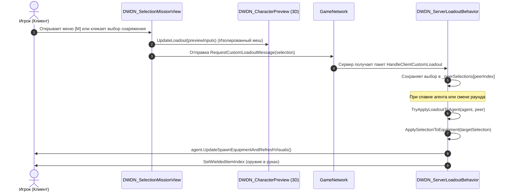

# Священный Мануал по Моддингу Daewden (DWDN)
## Полная техническая документация и пошаговые руководства

> [!NOTE]
> Настоящий документ написан как самодостаточное техническое руководство. Следуя ему шаг за шагом, любой моддер или разработчик сможет самостоятельно, без помощи искусственного интеллекта или сторонних утилит, добавить в игру новый класс или расширить выбор экипировки для существующего класса в кастомном UI мода.

---

## 1. Архитектурная карта мода

Модуль **Daewden (DWDN)** представляет собой глубокую многопользовательскую модификацию для *Mount & Blade II: Bannerlord*, вводящую отдельную фракцию Даевден с автономным Gauntlet UI выбора герцогств, классов и снаряжения (на базе архитектурного паттерна *Order of Middle-Earth / LOTR*).

### Структура каталогов модуля (`DWDN_TRYM`)

```text
DWDN_TRYM/
├── SubModule.xml                  # Главный манифест модуля: точка входа C# и регистрация XML
├── README.md                      # Краткое описание репозитория и установка
├── DOCUMENTATION.md               # Данный мануал
├── .gitignore                     # Исключения бинарных кэшей и временных файлов
│
├── bin/                           # Скомпилированные библиотеки для запуска
│   ├── Win64_Shipping_Client/     # Клиентские сборки (DWDN_Script.dll)
│   └── Win64_Shipping_Server/     # Серверные сборки (DWDN_Script.Server.dll)
│
├── ModuleData/                    # Главный конфигурационный узел игры (XML и C#)
│   ├── mpcharacters.xml           # Регистрация NPCCharacter (модели, скиллы, дефолтный инвентарь)
│   ├── mpclassdivisions.xml       # Регистрация MPClassDivision (стоимость, статы, перки, иконки)
│   ├── mpcultures.xml             # Определение кастомной культуры Culture.dwdn и цветов знамен
│   ├── mpitems/                   # Описания предметов брони, щитов, баннеров
│   ├── crafting_pieces.xml        # Составные части кастомного оружия (клинки, гарды, древки)
│   ├── crafting_templates.xml     # Шаблоны сборки составного оружия (DWDN_1h_spear и др.)
│   ├── weapon_descriptions.xml    # Параметры хватов и типов атак оружия
│   │
│   └── scripts/DWDN_Script/       # Исходный код логики мода (C# Solution)
│       ├── DWDN_Script.csproj     # Проект C# (.NET Framework 4.7.2)
│       ├── SubModule.cs           # Жизненный цикл модуля (OnSubModuleLoad, MissionBehaviors)
│       ├── Common/                # Общая логика (присутствует и на клиенте, и на сервере)
│       │   ├── Duchies/
│       │   │   ├── DWDN_DuchyManager.cs    # ★ ГЛАВНЫЙ РЕЕСТР: классы и пулы доступной экипировки UI
│       │   │   ├── DWDN_ClassDefinition.cs # Структура класса и списки доступных предметов
│       │   │   ├── DWDN_Duchy.cs           # Структура герцогства (Баннрайх и др.)
│       │   │   └── DWDN_LoadoutSelection.cs# Модель выбранной игроком экипировки
│       │   └── Network/
│       │       ├── DWDN_NetworkMessages.cs # Сетевые пакеты выбора лодаута
│       │       └── DWDN_NetworkHelper.cs   # Безопасная регистрация сетевых обработчиков
│       ├── Client/                # Клиентский слой (только для игрока)
│       │   └── UI/
│       │       ├── DWDN_SelectionMissionView.cs # Главный MissionView окна выбора (клавиши M, F)
│       │       ├── DWDN_ClassSelectionVM.cs     # ViewModel для Gauntlet UI
│       │       ├── DWDN_CharacterPreview.cs     # Изолированный 3D-превью персонажа
│       │       └── DWDN_PreviewBuilder.cs       # Сборка предпросмотра экипировки
│       └── Server/                # Серверный слой (выделенный сервер)
│           └── Behaviors/
│               └── DWDN_ServerLoadoutBehavior.cs# ★ Прием сетевого выбора и надевание вещей на агента
│
├── GUI/                           # Пользовательский интерфейс Gauntlet
│   ├── Prefabs/
│   │   └── DWDN_ClassSelection.xml# XML-разметка окна выбора классов и селекторов брони
│   └── Gauntlet/                  # Стили, кисти (brushes) и спрайты интерфейса
│
├── Assets/                        # Метаданные материалов и текстур ассетов
├── AssetSources/                  # Исходные 3D-модели (FBX) и PBR-текстуры
├── Shaders/                       # Пользовательские шейдеры
└── splash.bmp                     # Заставка загрузки модуля
```

---

## 2. Пошаговое руководство: Добавление нового класса с нуля

Добавление класса состоит из 4 взаимосвязанных шагов:
1. Описание игрового персонажа в `mpcharacters.xml`.
2. Описание сетевого класса и перков в `mpclassdivisions.xml`.
3. Регистрация класса и его экипировки в C# коде `DWDN_DuchyManager.cs`.
4. Сборка решения и синхронизация.

Разберем процесс на конкретном практическом примере: создадим класс **«Стражник»** (`mp_Strazhnik`).

---

### Шаг 1. Создание персонажа в `ModuleData/mpcharacters.xml`

Откройте файл `ModuleData/mpcharacters.xml`. Каждый сетевой класс требует регистрации записи `<NPCCharacter>` (обычно с суффиксом `_hero` для игрока и `_troop` для ботов).

Вставьте новую запись:

```xml
<!-- Стражник (mp_Strazhnik) -->
<NPCCharacter id="mp_Strazhnik_hero" 
              default_group="Infantry" 
              level="20" 
              name="Стражник Даевдена" 
              occupation="Soldier" 
              culture="Culture.dwdn">
    <face>
        <BodyProperties version="4" age="35.0" weight="0.5" build="0.5" 
                        key="00000000010003000000000000067000000000000000000000000000000000000006660606000000000000000000000000000000000000000000000001180000" />
        <BodyPropertiesMax version="4" age="60.0" weight="0.7" build="0.8" 
                           key="0005FC059A0034D0FFFFFFFF887AFFFFFFFEFFFB6FB7FFFFFFFFFFFFFFFFFFFF000FAFFA0FFFFFFF000000000000000000000000000000000000000001680141" />
    </face>
    <skills>
        <skill id="OneHanded" value="120" />
        <skill id="TwoHanded" value="100" />
        <skill id="Polearm" value="110" />
        <skill id="Athletics" value="100" />
        <skill id="Riding" value="20" />
    </skills>
    <Equipments>
        <EquipmentRoster>
            <!-- Базовое снаряжение по умолчанию (до применения кастомного лодаута) -->
            <equipment slot="Head" id="Item.Banobranny_helmet" />
            <equipment slot="Body" id="Item.Banobranny_surcoat" />
            <equipment slot="Leg" id="Item.banobranyi_leg" />
            <equipment slot="Gloves" id="Item.crossbowman_mailgoves" />
            <equipment slot="Item0" id="Item.mp_vlandian_arming_sword" />
            <equipment slot="Item1" id="Item.bannpbran_shield1" />
        </EquipmentRoster>
    </Equipments>
    <Resistances dismount="80" />
</NPCCharacter>
```

> [!IMPORTANT]
> Обратите внимание на префикс `Item.` в блоке `<equipment>`! В `mpcharacters.xml` перед строковым идентификатором предмета **обязательно** пишется `Item.`, например: `Item.Banobranny_helmet`.

---

### Шаг 2. Определение класса в `ModuleData/mpclassdivisions.xml`

Откройте `ModuleData/mpclassdivisions.xml`. Здесь настраиваются сетевые характеристики: стоимость в золоте (`cost`), базовая броня (`armor`), скорость бега и перки.

Добавьте запись класса:

```xml
<!-- mp_Strazhnik -->
<MPClassDivision id="mp_Strazhnik" 
                 hero="mp_Strazhnik_hero" 
                 troop="mp_Strazhnik_hero" 
                 hero_idle_anim="act_sturgia_mp_huskarl_idle" 
                 troop_idle_anim="act_idle_unarmed_1" 
                 multiplier="0.80" 
                 cost="110" 
                 icon="Infantry_Medium" 
                 melee_ai="45" 
                 ranged_ai="30" 
                 armor="20" 
                 movement_speed="0.81" 
                 combat_movement_speed="0.9" 
                 acceleration="2.2" 
                 hitpoints="100">
    <Perks>
        <!-- Слот 1: Пассивные усиления -->
        <Perk game_mode="All" name="Выносливость" description="+8 брони" icon="PerkToughness" perk_list="1">
            <OnSpawnEffect type="ArmorOnSpawn" value="8" />
        </Perk>
        <Perk game_mode="All" name="Подвижность" description="+6% к скорости бега" icon="PerkFleetFooted" perk_list="1">
            <Effect type="DrivenProperty" driven_property="MaxSpeedMultiplier" value="0.06" />
        </Perk>

        <!-- Слот 2: Оружие / Варианты -->
        <Perk game_mode="All" name="Меч" description="Надежный одноручный клинок" icon="PerkSword" perk_list="2">
            <OnSpawnEffect type="AlternativeEquipmentOnSpawn" slot="Item0" item="mp_vlandian_arming_sword" />
        </Perk>
        <Perk game_mode="All" name="Топор" description="Тяжелый пехотный топор" icon="PerkHeavyAxe" perk_list="2">
            <OnSpawnEffect type="AlternativeEquipmentOnSpawn" slot="Item0" item="mp_sturgia_axe" />
        </Perk>
    </Perks>
</MPClassDivision>
```

**Ключевые параметры `MPClassDivision`:**
* `id` — идентификатор класса (должен совпадать с тем, что мы укажем в C# коде).
* `hero` — ссылка на `NPCCharacter id` из `mpcharacters.xml`.
* `cost` — стоимость класса в золоте на сетевом сервере (например, `110`).
* `icon` — иконка класса (доступные варианты: `Infantry_Light`, `Infantry_Medium`, `Infantry_Heavy`, `Ranged`, `Cavalry_Light`, `Cavalry_Heavy`).
* `armor` — базовое сопротивление урону.
* `movement_speed` — базовая скорость перемещения пехотинца.

---

### Шаг 3. Регистрация класса в `DWDN_DuchyManager.cs`

Откройте файл:
`ModuleData/scripts/DWDN_Script/Common/Duchies/DWDN_DuchyManager.cs`.

Найдите метод `Initialize()` и добавьте инициализацию нового класса в выбранное герцогство (например, в Баннрайх `banreich`):

```csharp
// =========================================================================
// Новый класс: Стражник Даевдена
// =========================================================================
var strazhnik = new DWDN_ClassDefinition(
    "mp_Strazhnik",                 // Id класса (совпадает с MPClassDivision id)
    "Стражник",                     // Отображаемое имя в UI
    "Городская стража герцогства, вооруженная мечами, копьями и надежными щитами.", // Описание
    "mp_Strazhnik_hero"             // Ссылка на персонажа из mpcharacters.xml
);

// 1. Пулы шлемов ("" означает возможность снять шлем)
strazhnik.AllowedHelmets.AddRange(new[] { "Banobranny_helmet", "ratay_kettle_bare", "" });

// 2. Пулы доспехов тела
strazhnik.AllowedBodyArmors.AddRange(new[] { "Banobranny_surcoat", "ratay_overcoat" });

// 3. Пулы поножей/обуви
strazhnik.AllowedLegs.AddRange(new[] { "banobranyi_leg", "ratay_hose" });

// 4. Пулы перчаток
strazhnik.AllowedGloves.AddRange(new[] { "crossbowman_mailgoves", "arch_banreich_leatherglove", "" });

// 5. Пулы наплечников / плащей
strazhnik.AllowedCapes.AddRange(new[] { "" });

// 6. Оружие Слот 0 (Основное одноручное/двуручное оружие)
strazhnik.AllowedWeaponsSlot0.AddRange(new[] { "mp_vlandian_arming_sword", "mp_sturgia_axe" });

// 7. Оружие Слот 1 (Щиты)
strazhnik.AllowedWeaponsSlot1.AddRange(new[] { "bannpbran_shield1", "ratay_1_shield", "" });

// 8. Оружие Слот 2 (Копья / Дополнительное оружие)
strazhnik.AllowedWeaponsSlot2.AddRange(new[] { "", "mp_western_spear" });

// 9. Оружие Слот 3
strazhnik.AllowedWeaponsSlot3.AddRange(new[] { "" });

// Если класс конный — задайте доступных скакунов:
// strazhnik.AllowedMounts.AddRange(new[] { "mp_vlandia_horse", "" });

// 10. Формируем дефолтный лодаут (берутся первые элементы из каждого пула)
strazhnik.DefaultLoadout = strazhnik.CreateDefaultLoadout(banreich.Id);

// 11. Добавляем класс в герцогство
banreich.Classes.Add(strazhnik);
```

---

### Шаг 4. Компиляция и сборка проекта

Откройте консоль PowerShell и выполните сборку двух конфигураций библиотеки:

```powershell
# 1. Сборка клиентской версии (DWDN_Script.dll)
dotnet build "E:\SteamLibrary\steamapps\common\Mount & Blade II Bannerlord\Modules\DWDN_TRYM\ModuleData\scripts\DWDN_Script\DWDN_Script.csproj" -c Release

# 2. Сборка серверной версии (DWDN_Script.Server.dll)
dotnet build "E:\SteamLibrary\steamapps\common\Mount & Blade II Bannerlord\Modules\DWDN_TRYM\ModuleData\scripts\DWDN_Script\DWDN_Script.csproj" -c Server
```

После успешной сборки (0 ошибок) скопируйте обновленные файлы в папку клиентского и выделенного сервера.

---

## 3. Пошаговое руководство: Добавление новой вещи классу в кастомном UI

В кастомном интерфейсе Daewden игрок может прямо в меню выбирать из списков шлемы, кирасы, поножи, перчатки, плащи, 4 слота оружия и скакуна.

Чтобы расширить гардероб или арсенал любого класса, выполните 3 простых шага.

---

### Шаг 1. Получение правильного строкового ID предмета

Любая экипировка в движке Bannerlord имеет свой уникальный строковый идентификатор `StringId`:

1. **Ванильные предметы Mount & Blade II:**
   * Мечи: `mp_vlandian_arming_sword`, `mp_battania_noble_sword`, `mp_vlandian_short_sword`
   * Топоры: `mp_sturgia_axe`, `mp_sturgia_heavy_axe`
   * Копья/Пики: `mp_western_short_spear`, `mp_western_long_spear`, `mp_western_spear`
   * Щиты: `mp_heavy_heater_shield`, `mp_kite_shield`
   * Лошади: `mp_vlandia_horse`, `mp_battania_horse_war`
2. **Кастомные предметы мода Daewden:**
   * Загляните в `ModuleData/mpitems/` или `ModuleData/items.xml` и найдите атрибут `id="..."`.
   * Шлемы: `armeds_bacinet_with_facemask`, `officer_dwdn_bacinet`, `dwdn_pikeman_kettlehad`, `Banobranny_helmet`, `ratay_kettle_bare`
   * Доспехи: `armeds_striped_cuirass`, `officer_brigantine`, `dwdn_pikeman_cuirass_v1`, `Banobranny_surcoat`, `bannerman_cuirass`
   * Перчатки: `plate_gauntlet`, `plate_round_gauntlet`, `gothic_gloves`, `crossbowman_mailgoves`
   * Поножи: `plate_legs_dwdn`, `officer_legs`, `pikemen_dwdn_plate_leg`, `banobranyi_leg`
   * Плащи: `Baron_rundal_cape`, `finard_cape`, `archer_scarf`
   * Кастомное оружие: `pike1` (длинная пика), `finnard_spear` (копье Финнарда), `dwdn_banner1` (священное знамя), `hand_cannon` (ручница).

> [!CAUTION]
> В C# коде `DWDN_DuchyManager.cs` идентификатор пишется **БЕЗ** приставки `Item.`, например: `"armeds_bacinet_with_facemask"`. Серверный обработчик `MBObjectManager.Instance.GetObject<ItemObject>(itemId)` ищет предмет строго по чистому ID!

---

### Шаг 2. Добавление предмета в пулы класса в `DWDN_DuchyManager.cs`

Откройте `ModuleData/scripts/DWDN_Script/Common/Duchies/DWDN_DuchyManager.cs`.

Найдите нужный класс (например, `mp_Officer` — Десятник):

```csharp
var officer = new DWDN_ClassDefinition(
    "mp_Officer",
    "Десятник",
    "Младший командир пехоты в бригантине с офицерским бацинетом.",
    "mp_Officer_hero"
);
```

#### Примеры добавления предметов в разные слоты:

1. **Добавить новый шлем:**
   ```csharp
   // Было:
   officer.AllowedHelmets.AddRange(new[] { "officer_dwdn_bacinet", "" });
   
   // Стало (добавили бацинет с забралом):
   officer.AllowedHelmets.AddRange(new[] { "officer_dwdn_bacinet", "armeds_bacinet_with_facemask", "" });
   ```

2. **Добавить новый нагрудник:**
   ```csharp
   // Было:
   officer.AllowedBodyArmors.AddRange(new[] { "officer_brigantine" });
   
   // Стало (добавили латную кирасу пикинёра):
   officer.AllowedBodyArmors.AddRange(new[] { "officer_brigantine", "dwdn_pikeman_cuirass_v1" });
   ```

3. **Добавить новое оружие в Слот 0:**
   ```csharp
   // Было:
   officer.AllowedWeaponsSlot0.AddRange(new[] { "mp_battania_noble_sword", "mp_sturgia_heavy_axe" });
   
   // Стало (добавили булаву):
   officer.AllowedWeaponsSlot0.AddRange(new[] { "mp_battania_noble_sword", "mp_sturgia_heavy_axe", "mp_battnia_heavy_mace" });
   ```

4. **Разрешить снять щит / предмет (пустой слот):**
   Если вы хотите, чтобы игрок мог отказаться от предмета (например, снять шлем, снять щит или не брать копье), просто добавьте пустую строку `""`:
   ```csharp
   officer.AllowedWeaponsSlot1.AddRange(new[] { "zbroyniy_shield1", "zbroyniy_shield_silver1", "" });
   ```

---

### Шаг 3. Пересборка и синхронизация

После внесения изменений в `DWDN_DuchyManager.cs`:
1. Скомпилируйте `Release` и `Server`.
2. Запустите игру.
3. Откройте интерфейс на клавишу **M** — добавленные вещи сразу же появятся в селекторах!

---

## 4. Как работает серверная синхронизация и почему ничего не ломается

Сетевая модель экипировки Daewden построена на принципах изоляции и авторитетности сервера:



### Главные защитные правила архитектуры:
1. **Никакого вызова `agentVisual.Refresh` на клиенте:**
   Клиент **никогда** не модифицирует нативный пьедестал спавна TaleWorlds во время захода на карту. Это исключает вылеты вида `0xC0000005 Access Violation`.
2. **Слоты скакунов у человека:**
   В методе `ApplySelectionToEquipment` слоты `Horse` и `HorseHarness` на агенте-человеке **всегда** очищаются (`EquipmentElement.Invalid`). В противном случае нативный движок TaleWorlds привязывает меш седла и крупа коня к тазу человека, вызывая визуальное падение мешей под землю при спешивании.
3. **Составные копья и мечи (`crafting_pieces.xml`):**
   Движок складывает смещения последовательно: $Позиция = Длина + (previous\_offset - next\_offset)$. Не используйте мировые координаты Blender в `previous_piece_offset` — указывайте только относительные дельты стыков деталей.

---

## 5. Памятка по решению типовых неполадок

| Симптом | Причина | Способ устранения |
| :--- | :--- | :--- |
| Предмет в игре не появился (остался дефолтный) | Опечатка в ID предмета в `DWDN_DuchyManager.cs` | Проверьте консоль сервера на сообщение: `[DWDN Server WARNING] Предмет с id='...' не найден`. Сверьте точный ID в `items.xml` |
| Персонаж спавнится голым | Ошибка в создании `DefaultLoadout` | Убедитесь, что в пулах `AllowedBodyArmors` и `AllowedLegs` первый элемент содержит валидный ID доспеха, а не `""` |
| Гарда или наконечник копья висят в воздухе | Неправильные оффсеты в `crafting_pieces.xml` | В `BuildData` гарды используйте проверенные дельты: `previous_piece_offset="7"` и `next_piece_offset="-19"` |
| Класс отсутствует в списке UI | Не вызван `banreich.Classes.Add(...)` | Проверьте метод `Initialize()` в `DWDN_DuchyManager.cs`, убедитесь, что класс добавлен в список `Classes` герцогства |

---

## 6. Тактическая система Ауры Знаменосца (`DWDN_BannerAuraBehavior.cs`)

Чтобы класс **Знаменосец (`mp_Bannerman`)** не был просто пехотинцем без щита с декоративным флагом, в модуль внедрена сбалансированная тактическая система поддержки строя (`ModuleData/scripts/DWDN_Script/DWDN_BannerAuraBehavior.cs`).

### Условия работы ауры:
* **Знамя должно быть в руках**: Аура активна **только тогда**, когда Знаменосец жив и держит знамя непосредственно в руках (`Offhand` или `Primary` слот, где `ItemType == ItemTypeEnum.Banner` или ID содержит `"banner"`, например `dwdn_banner1`). Если Знаменосец убирает знамя за спину, аура мгновенно гаснет.
* **Защита от стакания (Anti-Stacking)**: Бонусы от нескольких знаменосцев **не складываются**. Каждый агент получает строго один уровень ауры (`Tier 1` — союзник в строю, `Tier 2` — сам Знаменосец).
* **Радиус действия**: **12 метров** вокруг Знаменосца (`AuraRadius = 12.0f`).

### Таблица бонусов ауры:

| Параметр | Союзник в радиусе 12 м (`Tier 1`) | Сам Знаменосец со знаменем (`Tier 2`) | Назначение в балансе |
| :--- | :--- | :--- | :--- |
| **Броня (Голова, Корпус, Руки, Ноги)** | **`+4` ед.** | **`+6` ед.** | Снижает урон от стрел и скользящих ударов; компенсирует отсутствие щита у Знаменосца |
| **Скорость марша (`MaxSpeedMultiplier`)** | **`+5%`** | **`+5%`** | Позволяет пехотной коробке быстрее перестраиваться и смыкать ряды |
| **Боевой шаг (`CombatMaxSpeedMultiplier`)** | **`+6%`** | **`+6%`** | Улучшает работу ног (footwork) в плотном строю |
| **Скорость удара (`Swing / Thrust Speed`)** | **`+4%`** | **`+5%`** | Даёт лёгкое преимущество инициативы в ближнем бою |
| **Перезарядка (`ReloadSpeed`)** | **`+6%`** | **`+6%`** | Ускоряет стрелков и арбалетчиков, стоящих под прикрытием знамени |
| **«Второе дыхание» (Реген вне боя)** | **`+1 HP` / 3 сек (до `75%` HP)** | **`+1 HP` / 3 сек (до `75%` HP)** | Работает только если боец **5 секунд не получал урона**; позволяет отряду перегруппироваться после стычки |

---

## 7. Полевая Артиллерия и Система Артиллерийского Расчёта (`DWDN_FieldArtilleryBehavior.cs`)

В модуль внедрён специализированный класс **«Артиллерист (Пушкарь)» (`mp_Artillerist`)**, конфигурационный файл **[`ModuleData/artillery_config.xml`](ModuleData/artillery_config.xml)** и серверно-клиентская система размещения и коллективного обслуживания полевых орудий ([`DWDN_FieldArtilleryBehavior.cs`](ModuleData/scripts/DWDN_Script/DWDN_FieldArtilleryBehavior.cs)).

### 1. Как спавнится пушка, как выбрать тип, количество и расположение
* **Управление прямо в бою (для класса «Артиллерист»)**:
  * **`[B]` — Установить пушку на землю / Свернуть и перекатить**:
    * Если рядом нет развёрнутого орудия: устанавливает **стационарный 3D-лафет орудия** (`GameEntity`: ствол на станке, двойной орудийный щит-мантлет и пирамида ядер) на земле прямо перед игроком по направлению взгляда (с автоматической привязкой к высоте рельефа). Орудие **остаётся стоять на земле в этой точке**, даже если наводчик отойдёт за боеприпасами или достанет меч.
    * Если подойти к уже установленному орудию своей команды (в радиусе `2.2 м`) и нажать **`[B]`** — орудие **сворачивается**, чтобы его можно было перенести и установить на новой позиции!
    * *(Дополнительно: если наводчик с `dwdn_field_bombard` просто присядет на месте на 1 секунду и лимит не исчерпан, лафет развернётся автоматически).*
  * **`[V]` — Выбрать тип орудия и боеприпаса**:
    * Переключает между **3 типами полевых орудий** (как перед установкой, так и прямо у развёрнутого лафета с автоматической сменой снарядов в сумке):
      1. **Полевая Бомбарда (`bombard_he`)** — стреляет чугунными фугасными ядрами (`dwdn_cannonball_ammo`), взрыв в радиусе `3.6 м` с опрокидыванием строя (`KnockDown`).
      2. **Дальнобойная Кулеврина (`culverin_ap`)** — удлинённый ствол, повышенная точность (`+35%`) и скорость перезарядки (`+12%`), сокрушительный бронебойный урон (`130 ед.`).
      3. **Картечная Бомбарда (`bombard_canister`)** — конусный дробовой залп картечью (`dwdn_canister_ammo`) на `32 м` против пехоты и конницы вблизи.
  * **`[N]` — Тактическая сводка всех пушек команды (и координаты для карт)**:
    * Выводит в HUD список всех установленных орудий команды (`Активно: X / Max`), их **точные координаты `(X, Y, Z)`**, выбранный тип, остаток зарядов в ящике лафета (`8/14`) и число бойцов расчёта (`1/3`, `2/3`, `3/3`).
  * **`[Shift + N]` — Изменить лимит пушек на команду прямо в игре (`1..6 шт.`)**:
    * Позволяет на лету регулировать максимальное число орудий на команду (`1 -> 2 -> 3 -> 4 -> 5 -> 6`) и сразу сохраняет новое значение в `ModuleData/artillery_config.xml`!
* **Настройка через файл [`ModuleData/artillery_config.xml`](ModuleData/artillery_config.xml) (без перекомпиляции DLL)**:
  * Атрибут `max_cannons_per_team="2"` задаёт максимальное число пушек на команду (как для установки на землю, так и для спавна стволов `dwdn_field_bombard` в `DWDN_ServerLoadoutBehavior.cs`).
  * Секция `<CannonTypes>` позволяет менять урон, радиус взрыва, запас ядер на лафете и время перезарядки каждого типа орудия.
  * Секция `<StaticMapSpawns>` позволяет прописать **фиксированные координаты авто-спавна пушек при старте карты**:
    ```xml
    <StaticSpawn scene="mp_sergeant_map_001" side="Attacker" type="bombard_he" x="145.0" y="110.0" z="0.0" yaw_deg="90" />
    ```
    *(Координаты любой удобной позиции можно узнать прямо в игре, поставив пушку клавишей `[B]` и нажав `[N]`).*

### 2. Кооперация расчёта из 2–3 человек (Радиус 3.5 м)

| Состав расчёта у орудия | Скорость перезарядки (`ReloadSpeed`) | Время перезарядки | Разброс (`WeaponInaccuracy`) | Защита лафета и доп. бонусы |
| :--- | :--- | :--- | :--- | :--- |
| **На ходу (Лафет свёрнут)** | `x0.22` | ~22 сек | `x3.00` (огромный) | Скорость бега `-20%`, отдача сбивает с ног |
| **1 чел. (Наводчик в одиночку)** | `x0.34` | **~16 сек** | `x1.40` (косо) | `+10` брони корпуса/ног за щитом лафета |
| **2 чел. (Наводчик + Подносчик)** | `x0.86` (**ускорение в 2.5 раза**) | **~6.2 сек** | `x0.78` | `+10` брони наводчику, `+6` брони обслуге |
| **2 чел. (Наводчик + Заряжающий с Банником в руках)** | `x1.02` (**ускорение в 3.0 раза**) | **~5.2 сек** | `x0.58` | `+12` брони наводчику, прочистка ствола банником |
| **3+ чел. (Полный расчёт: Наводчик + Банник + Подносчик)** | `x1.22` (**ускорение в 3.6 раза**) | **~4.3 сек** | `x0.38` (снайперский) | `+14` брони, `+25%` скорости наводки, **авто-подача `+1` снаряда каждые 6 сек** |

### 3. Два типа артиллерийских боеприпасов
1. **Чугунные Ядра (`dwdn_cannonball_ammo`)**:
   * Крупнокалиберный снаряд настильной траектории (`stack_amount="5"`).
   * При попадании в землю, щит или врага создаёт **фугасный взрыв в радиусе 3.4 метра** (`35–95` ед. дробящего урона по площади) и **опрокидывает вражескую пехоту на землю (`KnockDown`)** + сбивает всадников (`CanDismount`).
2. **Картечные Заряды (`dwdn_canister_ammo`)**:
   * Дробовой заряд ближнего и среднего боя (`stack_amount="6"`).
   * В момент выстрела выбрасывает **конусный веер картечи (угол $13.5^\circ$, дальность до 32 метров)**, нанося всем врагам в секторе перед дулом от `34` до `78` ед. колющего урона с отбрасыванием вблизи (`< 11 м`).

---

## 8. Комплекс визуальных GUI-студий моддинга (`Tools/`)

В каталоге `Tools/` (и в рабочей среде `d:\banAImod\`) расположены три автономные визуальные студии на `.NET 8.0 (WinForms)` для автоматизации разработки и проверки мода:

1. **Авто-Калибратор 3D Оружия (`Tools/WeaponCalibrator/`)**:
   * Напрямую читает бинарные `.tpac` пакеты (`LZ4` + `METM`) и `AssetSources/*.fbx`, вычисляя точные 3D-габариты (`BoundingBox`, точки Z-стыков, радиус рукояти).
   * Отрисовывает интерактивное 3D-превью сборки оружия (Blade + Guard + Handle + Pommel) и в 1 клик записывает откалиброванные `length`, `piece_offset`, `previous_piece_offset` и `next_piece_offset` в `crafting_pieces.xml`.
2. **Визуальный Конструктор Герцогств и Лодаутов (`Tools/DuchyLoadoutStudio/`)**:
   * Загружает все герцогства и классы из `DWDN_DuchyManager.cs`, `mpclassdivisions.xml`, `mpcharacters.xml` и `mpitems/`.
   * Отображает интерактивный 3D-манекен класса со всеми надетыми слоями брони и оружия.
   * Кнопка **«⚡ АВТО-ПРИМЕНИТЬ В МОД DWDN_TRY»** автоматически патчит `DWDN_DuchyManager.cs`, синхронизирует XML, компилирует `DWDN_Script.dll` + `DWDN_Script.Server.dll` и копирует билд на выделенный сервер `DaewdenM`.
3. **Мгновенный Предпусковой Валидатор Мода (`Tools/ModValidator/`)**:
   * За **0.25 секунды** без запуска игры проверяет 8 уровней целостности мода: синтаксис всех XML, порядок загрузки `SubModule.xml`, сквозные ссылки `DWDN_DuchyManager.cs` $\leftrightarrow$ `mpclassdivisions.xml` $\leftrightarrow$ `mpcharacters.xml` $\leftrightarrow$ `mpitems.xml` $\leftrightarrow$ `crafting_pieces.xml`, наличие 3D-мешей в `.tpac`, зазоры составного оружия и совпадение хэшей `SHA-256` между клиентом и сервером `DaewdenM`.

---
*Документ подготовлен во славу Бога-Машины. Да пребудет логика в священном кремнии.*
