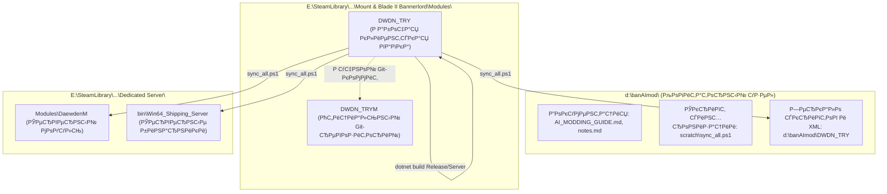
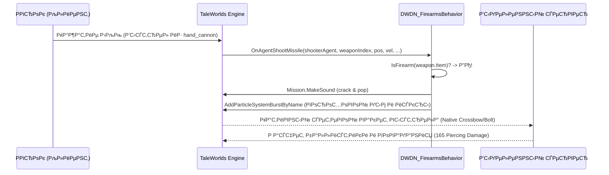
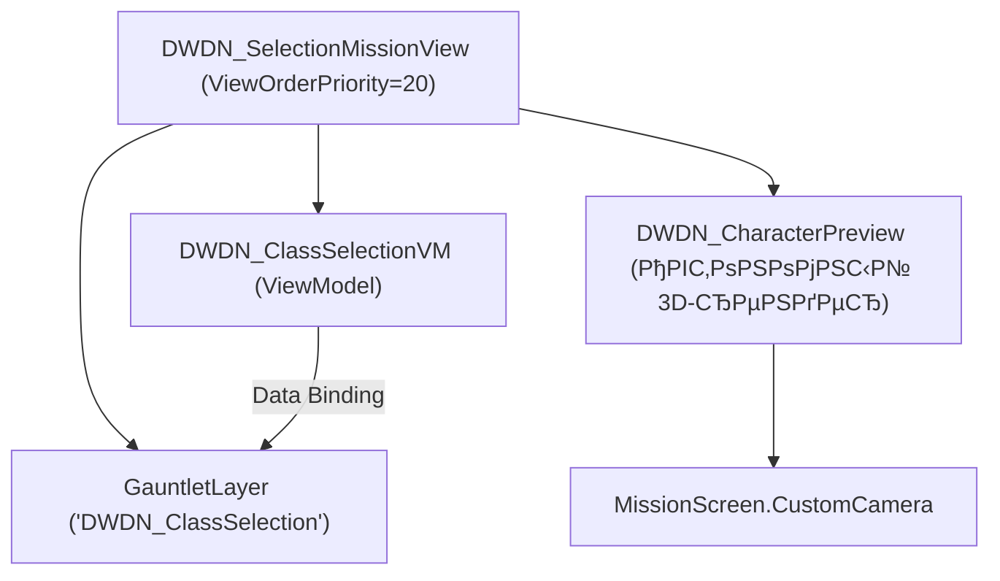
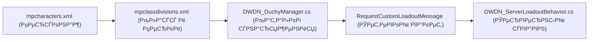

# РУКОВОДСТВО АРХИТЕКТОРА DWDN: СВЯЩЕННЫЙ КОДЕКС МОДДИНГА BANNERLORD (ДЛЯ ИИ)

> **КОНТЕКСТ ДЛЯ ИСКУССТВЕННОГО ИНТЕЛЛЕКТА:**  
> Этот документ составлен предыдущими поколениями ИИ для последующих ИИ-агентов.  
> Прочитав этот кодекс, ты получаешь полное понимание устройства мода **DWDN (Daewden)**, архитектуры мультиплеера Mount & Blade II: Bannerlord, механизмов защиты от падений (крашей) движка и готовый инструментарий для немедленной продуктивной работы без лишних вопросов к пользователю.

---

## 1. СВЯЩЕННАЯ ТОПОГРАФИЯ (РАСПОЛОЖЕНИЕ ПАПОК И КОНТУРЫ СИНХРОНИЗАЦИИ)

Вся разработка мода распределена между **четырьмя взаимосвязанными директориями**:



### Физические пути:
1. **Клиентская рабочая копия (Client Dev & Play):**  
   `E:\SteamLibrary\steamapps\common\Mount & Blade II Bannerlord\Modules\DWDN_TRY`  
   *Здесь ведется компиляция и локальное тестирование.*
2. **Git-репозиторий мода (Source Control):**  
   `E:\SteamLibrary\steamapps\common\Mount & Blade II Bannerlord\Modules\DWDN_TRYM`  
   *Удаленный репозиторий: `https://github.com/Havi-Dorgeir/DWDN_Module`.*  
   *Исключения `.gitignore`: монолит `AssetPackages/pack0.tpac` (1.1 ГБ) и рабочий кэш `RuntimeDataCache/`.*
3. **Выделенный сервер (Dedicated Server):**  
   `E:\SteamLibrary\steamapps\common\Mount & Blade II Dedicated Server\Modules\DaewdenM`  
   *И бинарная папка: `E:\SteamLibrary\steamapps\common\Mount & Blade II Dedicated Server\bin\Win64_Shipping_Server`.*
4. **Когитаторный архив агента (AI Hub):**  
   `d:\banAImod\`  
   *Здесь лежат конспекты (`notes.md`), скрипты исследования и вспомогательные утилиты.*

---

## 2. ИНСТРУМЕНТАРИЙ И МЕТОДОЛОГИЯ РЕВЕРС-ИНЖИНИРИНГА

### 2.1. Репозитории и инструменты GitHub
* **Главный репозиторий для модинга Bannerlord:**  
  [https://github.com/rehan-remade/universal-modder](https://github.com/rehan-remade/universal-modder)  
  *Используй его для шаблонов SubModule, CLI-сборки, парсинга ассетов и понимания неочевидных структур движка.*
* **Эталонные моды из мастерской Steam (изучай их архитектуру перед изобретением велосипеда):**
  * `E:\SteamLibrary\steamapps\workshop\content\261550\3774022783` (**LOTR / OMEE**) — **главный образец**: чистейшая Gauntlet UI архитектура, полная изоляция 3D-превью через `AgentVisuals.Create`, сетевые пакеты кастомного спавна.
  * `E:\SteamLibrary\steamapps\workshop\content\261550\3772431545` (**Warlords**) — эталон кастомных боевых классов и перков.
  * `E:\SteamLibrary\steamapps\workshop\content\261550\3716004111` — пример конфигурации баланса сетевых предметов.

### 2.2. Декомпиляция и исследование библиотек TaleWorlds
Все сборки ядра лежат в папке игры:  
`E:\SteamLibrary\steamapps\common\Mount & Blade II Bannerlord\bin\Win64_Shipping_Client\`  
Ключевые сборки для анализа:
* `TaleWorlds.MountAndBlade.dll` — миссии, спавн агентов, сетевые сообщения (`GameNetwork`), `MissionPeer`, `MissionMultiplayerGameModeBase`.
* `TaleWorlds.Core.dll` — `ItemObject`, `BasicCharacterObject`, `Equipment`, `EquipmentIndex`, `WeaponDesign`.
* `TaleWorlds.Engine.dll` — `AgentVisuals`, `Camera`, `Scene`, `SoundEvent`, матрицы `MatrixFrame`.
* `TaleWorlds.MountAndBlade.Multiplayer.dll` — нативные компоненты сетевого лобби и спавна.

> [!TIP]
> **Headless-исследование без GUI:**  
> Чтобы быстро узнать сигнатуру любого приватного метода или свойства TaleWorlds, создавай короткий скрипт на C# или PowerShell с `[System.Reflection.Assembly]::LoadFrom(...)` прямо в `d:\banAImod\scratch\`. Это экономит десятки минут по сравнению с открытием тяжелых декомпиляторов.

### 2.3. Священный цикл сборки и синхронизации
**КРИТИЧЕСКОЕ ПРАВИЛО:**  
`DWDN_Script.csproj` настроен на относительные пути `HintPath` вида `..\..\..\..\..\bin\Win64_Shipping_Client\`.  
Поэтому компилировать проект нужно **ТОЛЬКО** в рабочей папке Steam:
`E:\SteamLibrary\steamapps\common\Mount & Blade II Bannerlord\Modules\DWDN_TRY\ModuleData\scripts\DWDN_Script\DWDN_Script.csproj`

**Команды сборки через .NET CLI:**
```powershell
# 1. Сборка клиентской DLL
dotnet build "E:\SteamLibrary\steamapps\common\Mount & Blade II Bannerlord\Modules\DWDN_TRY\ModuleData\scripts\DWDN_Script\DWDN_Script.csproj" -c Release

# 2. Сборка серверной DLL
dotnet build "E:\SteamLibrary\steamapps\common\Mount & Blade II Bannerlord\Modules\DWDN_TRY\ModuleData\scripts\DWDN_Script\DWDN_Script.csproj" -c Server

# 3. Синхронизация всех файлов во все узлы (Клиент, Сервер, Локальный архив)
powershell.exe -ExecutionPolicy Bypass -File "d:\banAImod\scratch\sync_all.ps1"
```

---

## 3. ПОДСИСТЕМА ОГНЕСТРЕЛЬНОГО ОРУЖИЯ (FIREARMS SUBSYSTEM)

Огнестрельное оружие в DWDN реализовано через связку XML-моделей снарядов и клиент-серверного `MissionBehavior`.



### 3.1. XML-конфигурация (`ModuleData/mpitems/dwdn_weapon.xml`)
Вместо попыток внедрить совершенно новый несуществующий тип оружия, который сломал бы C++ интерфейсы анимаций TaleWorlds, мы используем гениальный и 100% стабильный **Crossbow-Hack**:

1. **Само орудие (`hand_cannon`):**
   ```xml
   <Item multiplayer_item="true" id="hand_cannon" name="{=*}Hand Bombard" 
         body_name="bo_composite_crossbows" mesh="crossbow_e" culture="Culture.vlandia" 
         weight="3.8" appearance="1" difficulty="0" Type="Crossbow" 
         AmmoOffset="0.0, 0.02131, 0.22975" 
         item_holsters="crossbow_back:bow_hip:mace_right_hip:bow_hip_2" 
         holster_position_shift="0.02,0,-0.4">
       <ItemComponent>
           <Weapon weapon_class="Crossbow" ammo_class="Bolt" 
                   missile_speed="135" accuracy="18" thrust_damage="165" 
                   thrust_speed="22" speed_rating="15" weapon_length="100" 
                   ammo_limit="1" thrust_damage_type="Pierce" 
                   item_usage="crossbow" reload_phase_count="2" 
                   physics_material="wood_weapon" center_of_mass="0,0,0.4">
               <WeaponFlags RangedWeapon="true" BonusAgainstShield="true" 
                            CanPenetrateShield="true" AmmoSticksWhenShot="false" 
                            AttachAmmoToVisual="false" CantReloadOnHorseback="true" 
                            NotUsableWithOneHand="true" TwoHandIdleOnMount="true" />
           </Weapon>
       </ItemComponent>
       <Flags />
   </Item>
   ```
2. **Пули (`mp_bullets`):**
   ```xml
   <Item multiplayer_item="true" id="mp_bullets" name="{=*}Lead Shot" 
         body_name="bo_capsule_arrow" holster_body_name="bo_axe_short" 
         mesh="bolt_bl_c" value="1" is_merchandise="false" 
         holster_mesh="bolt_bl_c_quiver" holster_mesh_with_weapon="bolt_bl_c_quiver" 
         flying_mesh="bolt_bl_flying" weight="0.10" appearance="1" Type="Bolts" 
         item_holsters="quiver_bolts:quiver_bolts_2:quiver_back_middle:quiver_back_top">
       <ItemComponent>
           <Weapon weapon_class="Bolt" stack_amount="12" thrust_damage="5" 
                   thrust_speed="0" speed_rating="0" physics_material="missile" 
                   weapon_length="35" 
                   flying_sound_code="event:/mission/combat/missile/flyby/arrow">
               <WeaponFlags Consumable="true" AmmoSticksWhenShot="false" />
           </Weapon>
       </ItemComponent>
   </Item>
   ```

### 3.2. C#-логика выстрела (`DWDN_FirearmsBehavior.cs`)
Класс наследуется от `MissionBehavior` и регистрируется в миссии.
* **Идентификация оружия**: `IsFirearm(ItemObject)` сверяет `StringId` с ключевыми словами (`hand_cannon`, `cannon`, `bombard`, `handgonne`, `firearm`).
* **Точка среза ствола (Muzzle Position)**:
  ```csharp
  Vec3 forward = velocity.NormalizedCopy();
  if (forward.LengthSquared < 0.001f) forward = orientation.f;
  Vec3 muzzlePos = position + forward * 0.70f;
  MatrixFrame muzzleFrame = new MatrixFrame(orientation, muzzlePos);
  ```
* **Акустический эффект («Легкий бах»)**:  
  Сдвоенный нативный звук:
  * `event:/mission/combat/impact/ballista_missile/stone` (сухой пороховой щелчок).
  * `event:/mission/combat/impact/missile/pot_breakable` (глухой резонирующий хлопок).
* **Визуальные партиклы (VFX)**:
  * Мгновенный всплеск пламени: `prt_fireball` на `muzzlePos + forward * 0.10f` (0.20 сек, без остаточного горения).
  * Густой пороховой дым: `psys_game_stone_dust_a` и `psys_siege_door_falling_dust`.
  * Дымный шлейф по траектории выстрела: эмиттеры на `muzzlePos + forward * 0.60f` и `muzzlePos + forward * 1.20f`.
  * Яркие пороховые искры: `psys_game_sparkle_a`.
  * Дымок запального отверстия: на `position - forward * 0.10f + Vec3(0, 0, 0.04f)`.

> [!IMPORTANT]
> **ЗАПРЕТ НА `AddCustomMissile` НА СЕРВЕРЕ:**  
> Никогда не спавните сторонние ракеты/пули через `Mission.AddCustomMissile` на выделенном сервере для огнестрела!  
> Нативный движок TaleWorlds сам синхронизирует снаряд через баллистический пайплайн арбалета. Если пытаться спавнить кастомные пули в коде, выделенный сервер гарантированно упадет в десинхронизацию физического мира.

---

## 4. АРХИТЕКТУРА КАСТОМНОГО GAUNTLET UI И 3D-ПРЕДПРОСМОТРА

Экран выбора снаряжения и класса в DWDN заменяет стандартный спавн-экран Bannerlord.



### 4.1. Стек UI-компонентов
* **Слой отображения (`DWDN_SelectionMissionView.cs`)**:
  * Создает `GauntletLayer` с `ViewOrderPriority = 20`.
  * Привязывает `DWDN_ClassSelectionVM` к Gauntlet-макету.
  * Перехватывает ввод мыши для вращения персонажа.
* **Иерархия ViewModel**:
  * `DWDN_ClassSelectionVM` — главное окно, переключение герцогств и классов.
  * `DWDN_DuchyItemVM` — кнопки выбора герцогств.
  * `DWDN_ClassItemVM` — кнопки выбора класса внутри герцогства.
  * `DWDN_EquipmentSlotVM` — слоты экипировки (Шлем, Торс, Оружие 0..3 и т.д.).
  * `DWDN_ItemOptionVM` — список доступных предметов для выбранного слота.

### 4.2. Архитектура изолированного 3D-превью (LOTR / OMEE Pattern)
**ИСТОРИЯ СКРАПКОДА И КРАША `0xC0000005`:**  
В ранних версиях мода при смене класса вызывался `MultiplayerMissionAgentVisualSpawnComponent.OnMyAgentVisualSpawned` или прямой `agentVisual.Refresh(...)` на нативном пьедестале TaleWorlds.  
Так как нативный C++ поток `Engine.dll` в этот же миллисекундный тик крутил анимацию ожидания пьедестала, разрушение скелета вызывало фатальное нарушение прав доступа к памяти (*Access Violation 0xC0000005*).

**СВЯЩЕННОЕ РЕШЕНИЕ (Класс `DWDN_CharacterPreview.cs`):**
1. Полный отказ от хуков на нативный `MultiplayerMissionAgentVisualSpawnComponent`.
2. Создание изолированного визуального агента:
   ```csharp
   AgentVisualsData data = new AgentVisualsData()
       .ActionSet(actionSet)
       .Equipment(equipment)
       .BodyProperties(bodyProperties)
       .Frame(anchor)
       .ActionCode(idleAction)
       .Scene(Mission.Current.Scene)
       .PrepareForNativeMeshOptimization(true);

   _visual = AgentVisuals.Create(data, "dwdn_preview", false, false, false);
   ```
3. Выделение независимой камеры:
   ```csharp
   _camera = Camera.CreateCamera();
   _camera.SetFovVertical(0.785f, Screen.AspectRatio, 0.1f, 1000f);
   MissionScreen.CustomCamera = _camera;
   ```
4. При закрытии меню `MissionScreen.CustomCamera = null`, а `_visual.Reset()` безопасно освобождает C++ память. **Результат: 0 крашей движка.**

---

## 5. ГЕРЦОГСТВА, КЛАССЫ И СЕТЕВОЙ СПАВН (LOADOUT PIPELINE)

Каждый класс в моде задается в трех неразрывных точках:



### 5.1. Регистрация класса
1. **`ModuleData/mpcharacters.xml`**:
   Базовый персонаж, модель тела, пол, скелет, раса.
   ```xml
   <NPCCharacter id="dwdn_militia_infantry" name="{=*}Militia Infantry" 
                 default_group="Infantry" age="28" voice="curt" 
                 is_female="false" culture="Culture.vlandia" 
                 occupation="Soldier" is_hero="false">
   ```
2. **`ModuleData/mpclassdivisions.xml`**:
   Стоимость в золоте, характеристики (HP, броня, скорость), перки:
   ```xml
   <MPClassDivision id="dwdn_militia_infantry_division" 
                    hero="NPCCharacter.dwdn_militia_infantry" 
                    cost="120" culture="Culture.vlandia" 
                    class_group="Infantry" icon_type="Infantry">
   ```
3. **Реестр герцогств в C# (`DWDN_DuchyManager.cs`)**:
   Определяет списки допустимых предметов в GUI:
   ```csharp
   DWDN_ClassDefinition militia = new DWDN_ClassDefinition(
       id: "dwdn_militia_infantry",
       name: "Ополченец",
       characterId: "dwdn_militia_infantry",
       divisionId: "dwdn_militia_infantry_division",
       allowedHelmets: new List<string> { "", "padded_coif", "kettle_hat" },
       allowedBodyArmors: new List<string> { "padded_armor", "leather_tunic" },
       allowedWeaponsSlot0: new List<string> { "vlandia_sword_1", "vlandia_axe_1" },
       allowedWeaponsSlot1: new List<string> { "", "vlandia_shield_wood" },
       allowedHorses: new List<string>() // Пусто для пехотинца!
   );
   ```

### 5.2. Сетевая синхронизация экипировки
1. Игрок нажимает кнопку **«В БОЙ»** в Gauntlet UI.
2. Клиент упаковывает `DWDN_ClassSelection` в сетевой пакет `RequestCustomLoadoutMessage`:
   ```csharp
   GameNetwork.BeginModuleEventAsClient();
   GameNetwork.WriteMessage(new RequestCustomLoadoutMessage(selection));
   GameNetwork.EndModuleEventAsClient();
   ```
3. На выделенном сервере `DWDN_ServerLoadoutBehavior.cs` принимает пакет:
   * Проверяет, что каждый StringId действительно разрешен данному классу в `DWDN_DuchyManager` (античит-валидация).
   * Сохраняет экипировку в реестр игрока `_peerLoadouts[peer]`.
   * При срабатывании `OnAgentBuild`: заполняет `agent.SpawnEquipment` проверенными предметами.

### 5.3. Защита от варп-скверны коней (The Cavalry Dismount Fix)
> [!CAUTION]
> **КРИТИЧЕСКИЙ БАГ TALEWORLDS:**  
> Если пеший персонаж имеет в своем `SpawnEquipment` заполненный слот `EquipmentIndex.Horse` или `EquipmentIndex.HorseHarness`, нативный метод движка `MountVisualCreator.AddMountMeshToAgentVisual` ошибочно прикрепляет меш лошади к костям таза **человеческого скелета**. При спешивании или движении меш деформируется и опадает на землю в точку `(0,0,0)`.

**КАК ЭТО РЕШЕНО В `DWDN_ServerLoadoutBehavior.cs`:**
```csharp
// 1. Человек-всадник НИКОГДА не должен нести слоты Horse / HorseHarness в человеческом снаряжении:
equip[EquipmentIndex.Horse] = EquipmentElement.Invalid;
equip[EquipmentIndex.HorseHarness] = EquipmentElement.Invalid;

// 2. Лошадь спавнится движком ТОЛЬКО тогда, когда SelectedTroopIndex указывает на кавалерийский класс:
int targetIdx = string.IsNullOrEmpty(selection.HorseId) ? 0 : cavalryIndex;
missionPeer.SelectedTroopIndex = targetIdx;
missionPeer.NextSelectedTroopIndex = targetIdx;
```

---

## 6. МАТЕМАТИКА СОСТАВНОГО ОРУЖИЯ (CRAFTED WEAPONS DELTAS)

Составное модульное оружие (мечи, копья, топоры) описывается в `ModuleData/crafting_pieces.xml` и `crafting_templates.xml`.


### 6.1. Декомпилированная формула TaleWorlds (`WeaponDesign.CalculatePivotDistances`)
При сборке меша оружия движок вычисляет позицию каждого сочленения инкрементно от точки хвата:

$$\text{Position}_{n} = \text{Length}_{n-1} + (\text{previous\_piece\_offset}_{n} - \text{next\_piece\_offset}_{n-1})$$

*Все значения в XML указываются в сантиметрах, а движок делит их на 100 для перевода в метры.*

### 6.2. Почему координаты из Blender ломают игру
* В Blender моделлер видит **абсолютные координаты сцены** (например, гарда находится на $Z = 140\text{ см}$).
* Если прописать `140` в `previous_piece_offset`, движок прибавит $1.4$ метра к длине рукояти, и гарда улетит в небеса или вызовет бесконечный ассерт физического тела `Physics material bounding box error`.
* **Правило:** в `crafting_pieces.xml` указываются только **относительные дельты стыковки** между краем меша рукояти и началом меша гарды.

### 6.3. Эталонная калибровка копья Финнарда (`finnard_spear`)
Проверенная геометрия, гарантирующая идеальный монолитный стык без щелей и крашей:
```xml
<!-- Рукоять: смещение стыка вверх к гарде -->
<CraftingPiece id="finnard_spear_handle" Type="Handle" 
               next_piece_offset="-35" ... />

<!-- Гарда: входная дельта от рукояти (+7) и выходная к лезвию (-19) -->
<CraftingPiece id="finnard_speard_guard" Type="Guard" 
               previous_piece_offset="7" next_piece_offset="-19" ... />

<!-- Наконечник: входная дельта стыка (+24) -->
<CraftingPiece id="finnard_spearhead" Type="Blade" 
               previous_piece_offset="24" next_piece_offset="0" ... />
```

---

## 7. КОДЕКС ЗАЩИТЫ ОТ СКРАПКОДА (ANTI-SCRAPCODE CODEX)

1. **Правило минимального вмешательства:**  
   Никогда не переписывай работающие системы, если задача касается только добавления нового предмета или класса. Одно неловкое изменение в сигнатуре сетевого сообщения ломает обратную совместимость клиента и сервера.
2. **Всегда проверяй логи движка:**  
   Логи игры пишутся в реальном времени:  
   `C:\ProgramData\Mount and Blade II Bannerlord\logs\rgl_log_*.txt`  
   Если клиент закрылся молча, открой последний `rgl_log` и промотай в самый низ — там будет указан конкретный XML-тег или отсутствующий меш.
3. **Безопасность UI-потоков:**  
   Никаких тяжелых циклов поиска в `Tick` или `OnMissionScreenTick`. Все списки предметов в `DWDN_DuchyManager` должны кэшироваться при инициализации.
4. **Снятие предметов (Пустой слот `""`):**  
   Для шлемов, плащей, перчаток и щитов всегда предусматривай строковый ID `""` (пустая строка). Это позволяет игроку снять шлем или щит, очищая соответствующий слот.
5. **Синхронизируй все узлы:**  
   После любой правки XML или компиляции DLL **всегда** запускай `d:\banAImod\scratch\sync_all.ps1`. Если клиент и выделенный сервер расходятся хотя бы на один атрибут в `mpclassdivisions.xml`, сервер кикнет игрока с ошибкой несоответствия версий.

---

## 8. ПОЛНЫЙ РЕВЕРС-ИНЖИНИРИНГ ЯДРА ИГРЫ И ИНСТРУМЕНТЫ ДЕКОМПИЛЯЦИИ

Для глубокого понимания устройства оригинальной игры (*Native*, *SandBoxCore*, *SandBox*, *Multiplayer* v1.4.8) и создания собственных утилит моддинга используй следующие ресурсы в `d:\banAImod`:

1. **[`BANNERLORD_COMPLETE_REVERSE_ENGINEERING.md`](file:///d:/banAImod/BANNERLORD_COMPLETE_REVERSE_ENGINEERING.md)** — полная энциклопедия архитектуры Bannerlord («разборка по кирпичикам и сборка заново»):
   * Мост C++/C# (`DotNetObject`, `[MBCallback]` методы в `TaleWorlds.MountAndBlade.Module`).
   * Двойной пайплайн XML: нативный `ModuleData/project.mbproj` (все 39 `soln_*` идентификаторов) vs управляемый `MBObjectManager` (алгоритм XSD-валидации, динамической инъекции `_replaceWhileMerging`, XSLT-трансформаций и `GetPresumedObject`).
   * Бинарная структура ассетов `.tpac` (LZ4 + xxHash64), кэша `.rdc` (145-байтные записи `RDC0`) и жесткий контракт на 64 кости скелета (`0x1050`-байтный буфер `AnimResult`).
   * Полный жизненный цикл `MBSubModuleBase`, `MBGameManager`, `Game`, `GameType` (`Campaign` и `MultiplayerGame`), `GameStateScreenManager` и `ViewCreatorManager` (`[OverrideView]`, `[ViewMethod]`).
   * Чертежи создания собственных инструментов моддинга (Headless XML/XSD/XSLT валидатор, `.tpac`/`.rdc` упаковщик, статический анализатор).
2. **Статический CLI-декомпилятор и дампы (`d:\banAImod\scratch\`)**:
   * [`d:\banAImod\scratch\inspector\Program.cs`](file:///d:/banAImod/scratch/inspector/Program.cs) — инструмент на базе `ICSharpCode.Decompiler`, позволяющий мгновенно декомпилировать любой класс из `Win64_Shipping_Client`, `DedicatedCustomServer` или модулей без крашей `AssemblyResolve`.
   * [`d:\banAImod\scratch\module_types_dump.txt`](file:///d:/banAImod/scratch/module_types_dump.txt) — полный реестр всех 1923 классов и интерфейсов в 11 DLL-сборках `Native`, `Multiplayer` и `SandBox`.
   * [`d:\banAImod\scratch\submodules_decompiled.txt`](file:///d:/banAImod/scratch/submodules_decompiled.txt) — декомпилированный исходный код всех `SubModule` классов, `Module` и `MBSubModuleBase`.
   * [`d:\banAImod\scratch\core_managers_decompiled.txt`](file:///d:/banAImod/scratch/core_managers_decompiled.txt) — декомпилированный код `MBObjectManager`, `SandBoxManager`, `ViewCreatorManager`, `GameStateScreenManager`, `MultiplayerMissions` и `SandBoxMissions`.
   * [`d:\banAImod\scratch\game_and_mp_decompiled.txt`](file:///d:/banAImod/scratch/game_and_mp_decompiled.txt) — декомпилированный код `TaleWorlds.Core.Game`, `MultiplayerGame` и `MultiplayerGameManager`.

---

## 9. АВТОНОМНЫЕ ИНСТРУМЕНТЫ МОДДИНГА И ИГРОВЫЕ СИСТЕМЫ DWDN

В корне `d:\banAImod` созданы три специализированные GUI-студии (WinForms .NET 8.0) для автоматизации моддинга и верификации:

1. **Авто-Калибратор 3D Оружия (`d:\banAImod\WeaponCalibrator\`, ярлык [`ЗАПУСК_КАЛИБРАТОРА.bat`](file:///d:/banAImod/%D0%97%D0%90%D0%9F%D0%A3%D0%A1%D0%9A_%D0%9A%D0%90%D0%9B%D0%98%D0%91%D0%A0%D0%90%D0%A2%D0%9E%D0%A0%D0%90.bat))**:
   * Напрямую парсит бинарные `.tpac` архивы модуля (`LZ4` + `METM`) и `AssetSources/*.fbx`, вычисляя точные 3D-габариты (`BoundingBox`, Z-стыки, радиус шейки) и автоматически генерируя калиброванный XML для `crafting_pieces.xml` и `mpitems.xml` с интерактивным 3D-вьюпортом.
2. **Визуальный Конструктор Герцогств и Лодаутов (`d:\banAImod\DuchyLoadoutStudio\`, ярлык [`ЗАПУСК_КОНСТРУКТОРА_КЛАССОВ.bat`](file:///d:/banAImod/%D0%97%D0%90%D0%9F%D0%A3%D0%A1%D0%9A_%D0%9A%D0%9E%D0%9D%D1%81%D0%A2%D0%A0%D0%A3%D0%9A%D0%A2%D0%9E%D0%A0%D0%90_%D0%9A%D0%9B%D0%90%D0%A1%D0%A1%D0%9E%D0%92.bat))**:
   * Парсит `DWDN_DuchyManager.cs`, `mpclassdivisions.xml`, `mpcharacters.xml` и `mpitems.xml`, отображая 3D-манекен выбранного класса в реальном времени.
   * Кнопка **«⚡ АВТО-ПРИМЕНИТЬ В МОД DWDN_TRY»** автоматически патчит `DWDN_DuchyManager.cs`, синхронизирует `mpclassdivisions.xml` и `mpcharacters.xml`, компилирует `DWDN_Script.dll` + `DWDN_Script.Server.dll` и зеркалирует билд на выделенный сервер `DaewdenM`.
3. **Мгновенный Предпусковой Валидатор Мода (`d:\banAImod\ModValidator\`, ярлык [`ЗАПУСК_ВАЛИДАТОРА_МОДА.bat`](file:///d:/banAImod/%D0%97%D0%90%D0%9F%D0%A3%D0%A1%D0%9A_%D0%92%D0%90%D0%9B%D0%98%D0%94%D0%90%D0%A2%D0%9E%D0%A0%D0%90_%D0%9C%D0%9E%D0%94%D0%90.bat))**:
   * За ~0.25 сек проверяет 8 критических узлов мода: синтаксис XML, `SubModule.xml`, целостность цепочки `DWDN_DuchyManager.cs` $\leftrightarrow$ `mpclassdivisions.xml` $\leftrightarrow$ `mpcharacters.xml` $\leftrightarrow$ `mpitems.xml` $\leftrightarrow$ `crafting_pieces.xml`, наличие 3D-мешей в `.tpac`, баланс зазоров составного оружия и побайтовую синхронизацию хэшей `SHA-256` между клиентом и сервером (с кнопкой авто-исправления в 1 клик).

### Система Тактической Ауры Знаменосца (`DWDN_BannerAuraBehavior.cs`)
* Файл: [`DWDN_BannerAuraBehavior.cs`](file:///e:/SteamLibrary/steamapps/common/Mount%20&%20Blade%20II%20Bannerlord/Modules/DWDN_TRY/ModuleData/scripts/DWDN_Script/DWDN_BannerAuraBehavior.cs), регистрируется в `SubModule.AddMissionBehaviors`.
* **Важный технический паттерн `AgentDrivenProperties` в мультиплеере**:
  * В Bannerlord при смене оружия (`OnWieldedItemIndexChange`) движок вызывает `agent.UpdateAgentProperties()`, который перезаписывает динамические статы (`MaxSpeedMultiplier`, `SwingSpeedMultiplier`, `ReloadSpeed`), но **не** пересчитывает статические статы спавна (`ArmorHead/Torso/Arms/Legs`, `CombatMaxSpeedMultiplier`).
  * Поэтому при наложении или снятии баффов в `DWDN_BannerAuraBehavior` сначала кэшируются базовые значения брони (`BaseArmorHead` и т.д.) при первом входе агента, затем вызывается `agent.UpdateAgentProperties()`, после чего поверх чистых статов выставляется `Armor* = BaseArmor* + bonus`, умножаются скоростные коэффициенты и вызывается `agent.UpdateCustomDrivenProperties()`. Это полностью исключает кумулятивное накопление статов и сброс баффа при смене оружия, а выполнение на клиенте и сервере одновременно предотвращает сетевой рассинхрон скорости (rubberbanding).

### Система Полевой Артиллерии и Расчёта (`DWDN_FieldArtilleryBehavior.cs`)
* Файл: [`DWDN_FieldArtilleryBehavior.cs`](file:///e:/SteamLibrary/steamapps/common/Mount%20&%20Blade%20II%20Bannerlord/Modules/DWDN_TRY/ModuleData/scripts/DWDN_Script/DWDN_FieldArtilleryBehavior.cs), класс `mp_Artillerist` (`mp_Artillerist_hero` / `mp_Artillerist_troop`).
* **Предметы расчёта (`dwdn_weapon.xml`)**:
  * `dwdn_field_bombard` — Полевая Бомбарда (лимит: 2 активных ствола на команду в `DWDN_ServerLoadoutBehavior.cs`).
  * `dwdn_cannonball_ammo` — Чугунные Ядра (AoE фугасный взрыв 3.4 м в `OnMissileHit` с `BlowFlags.KnockDown | BlowFlags.CanDismount`).
  * `dwdn_canister_ammo` — Картечные Заряды (конусный залп $13.5^\circ$ на 32 м в `OnAgentShootMissile`).
  * `dwdn_artillery_ramrod` — Артиллерийский Банник-Шомпол (инструмент 2-го номера расчёта на базе `TwoHandedMace`).
  * `dwdn_powder_chest` — Зарядная Сума Бомбардира (10 зарядов для авто-подачи наводчику каждые 6 сек через `SetWeaponAmountInSlot`).
* **Неприкосновенность `native_parameters.xml`**:
  * Никогда не переопределяй `ModuleData/native_parameters.xml` в моде — разработчики TaleWorlds обновляют структуру и значения `Native/ModuleData/native_parameters.xml` в патчах игры. Все динамические модификаторы скорости, перезарядки и брони реализуй строго через `AgentDrivenProperties` в C# `MissionLogic`.

### Диагностика Бесконечной Загрузки при Подключении к Выделенному Серверу (Патчи TaleWorlds)
* **Проявление бага**: Клиент входит в сетевое лобби, нажимает «Присоединиться к серверу», зависает в статусе `WaitingToJoinCustomGame` на бесконечном экране загрузки, пока в цикле шлются `AliveMessage` в лобби TaleWorlds.
* **Причина**: Краш процесса `DedicatedCustomServer.Starter.exe` в момент хэндшейка игрока (`KERNELBASE.dll`, .NET Runtime `Event ID 1026`).
* **Кейс 11.11.2026**: В обновлении движка TaleWorlds удалили метод `TaleWorlds.MountAndBlade.NetworkCommunicator.UpdateForJoiningCustomGame(bool)`. Сторонний модуль `DoFAdminTools` (скомпилированный под старый билд) при входе любого игрока вызывал этот метод из `DoFGameHandler.OnPlayerConnect(VirtualPlayer peer)`, что приводило к необработанному `System.MissingMethodException` и падению сервера. А цикл автоматического перезапуска в `ZAPUSKSERVER.bat` тут же поднимал сервер снова, создавая иллюзию «живого» сервера, который падает ровно в момент коннекта игрока.
* **Лечение**:
  1. Проверять Windows Event Log: `Get-WinEvent -LogName Application -MaxEvents 10 | Where-Object { $_.ProviderName -match 'Application Error|.NET Runtime' }`.
  2. Исключать устаревшие сторонние DLL из аргументов запуска `_MODULES_` в `ZAPUSKSERVER.bat`. Модуль `DWDN_TRY` полностью автономен и не зависит от `DoFAdminTools`.

### Краш Сервера при Спавне (NullReferenceException в Equipment.GetInitialWeaponIndicesToEquip)
* **Проявление**: Игрок на сервере нажимает `[F]` для спавна — агент не появляется, сервер мгновенно падает. В журнале событий Windows краш `NullReferenceException` в `Equipment.GetInitialWeaponIndicesToEquip` $\rightarrow$ `Agent.WieldInitialWeapons` $\rightarrow$ `SpawningBehaviorBase.OnTick`.
* **Причина**: В мультиплеере TaleWorlds загружает исключительно `mp_crafting_pieces.xml` и игнорирует синглплеерный `crafting_pieces.xml`. Если оружие в моде объявлено как `<CraftedItem>` со ссылкой на детали из синглплеера (например, `cleaver_blade_1` вместо сетевого `mp_battania_cleaver_blade`), движок не может инициализировать `WeaponComponent`. В результате `item.PrimaryWeapon == null`. При попытке движка экипировать оружие в руки вызов `item.PrimaryWeapon.WeaponFlags` выбрасывает фатальный `NullReferenceException`.
* **Следствие в логике спавна**: В `DWDN_ServerLoadoutBehavior.cs` тернарный оператор `int targetIdx = string.IsNullOrEmpty(selection.HorseId) ? 0 : idx;` ошибочно сбрасывал любой пехотный класс (включая Артиллериста) на индекс 0 (`Ratay`), у которого первым дефолтным перком стоял как раз сломанный `dwdn_cleaver`.
* **Лечение**:
  1. В `mpitems/dwdn_weapon.xml` использовать только легитимные сетевые детали с префиксом `mp_...` из `Native/ModuleData/mp_crafting_pieces.xml`.
  2. В `DWDN_ServerLoadoutBehavior.cs` убрать принудительный сброс на 0: `int targetIdx = idx;`.
  3. В `ApplySelectionToEquipment` добавить жесткую проверку: если предмет в слоте оружия имеет `item.PrimaryWeapon == null` (и не является щитом/знаменем), очищать слот для защиты от падения процесса.

### Встроенная Система Администрирования DWDN Admin Tools (`Server\Admin\`)
* Файлы:
  * [`DWDN_AdminService.cs`](file:///e:/SteamLibrary/steamapps/common/Mount%20&%20Blade%20II%20Bannerlord/Modules/DWDN_TRY/ModuleData/scripts/DWDN_Script/Server/Admin/DWDN_AdminService.cs) — ядро управления правами, обработчик команд, расчёт формирований и действий.
  * [`DWDN_AdminGameHandler.cs`](file:///e:/SteamLibrary/steamapps/common/Mount%20&%20Blade%20II%20Bannerlord/Modules/DWDN_TRY/ModuleData/scripts/DWDN_Script/Server/Admin/DWDN_AdminGameHandler.cs) — перехват сетевых сообщений чата `PlayerMessageAll` и `PlayerMessageTeam`.
  * [`DWDN_AdminBehavior.cs`](file:///e:/SteamLibrary/steamapps/common/Mount%20&%20Blade%20II%20Bannerlord/Modules/DWDN_TRY/ModuleData/scripts/DWDN_Script/Server/Admin/DWDN_AdminBehavior.cs) — поддержание состояния бессмертия при смене агентов и защита от урона.
  * [`DWDN_InputBehavior.cs`](file:///e:/SteamLibrary/steamapps/common/Mount%20&%20Blade%20II%20Bannerlord/Modules/DWDN_TRY/ModuleData/scripts/DWDN_Script/DWDN_InputBehavior.cs) — горячая клавиша `[F10]` для быстрой справки администратора.
* **Перехват команд чата без спама в общий чат**:
  * В `GameHandler.OnGameNetworkBegin()` регистрируются делегаты `registerer.Register<PlayerMessageAll>` и `Register<PlayerMessageTeam>`.
  * Если сообщение начинается с `!`, вызывается `DWDN_AdminService.HandleCommand(peer, message.Message)`.
  * Чтобы текст команды не появлялся в общем чате, через рефлексию обнуляется приватный список получателей:
    ```csharp
    typeof(PlayerMessageAll).GetProperty("ReceiverList", BindingFlags.Public | BindingFlags.NonPublic | BindingFlags.Instance)
        ?.SetValue(message, new List<VirtualPlayer>());
    typeof(PlayerMessageAll).GetProperty("HasReceiverList", BindingFlags.Public | BindingFlags.NonPublic | BindingFlags.Instance)
        ?.SetValue(message, true);
    ```
    В нативном методе `ChatBox.ServerPrepareAndSendMessage` проверка `receiverList.Contains(item.VirtualPlayer)` даёт `false` для всех игроков, блокируя отправку клиентам.
* **Нативное бессмертие (God Mode)**:
  * Не нужно городить сторонние костыли: в Bannerlord есть встроенное состояние агента `agent.SetMortalityState(Agent.MortalityState.Invulnerable);` (и `agent.MountAgent.SetMortalityState(...)`), при котором нативный C++ движок обнуляет весь входящий урон (`InflictedDamage = 0`).
  * Для надёжности `DWDN_AdminBehavior` также перехватывает `OnAgentHit` и тикает в цикле, гарантируя бессмертие даже после смены класса или респавна.
* **Групповая телепортация в строю**:
  * Команда `!tp all me` или `!tp team1 me` / `!tp team2 me` строит игроков ровными шеренгами перед администратором:
    * Вектор взгляда администратора $f$ и перпендикуляр $r = (-f_y, f_x)$.
    * Базовая точка $P_0 = P_{\text{admin}} + f \cdot 4.0\text{ м}$.
    * Шаг сетки: по фронту $dx = 1.8\text{ м}$, в глубину $dy = 2.0\text{ м}$.
    * Привязка к рельефу: `Mission.Current.Scene.GetHeightAtPoint(targetPos.AsVec2, BodyFlags.CommonCollisionExcludeFlags, ref targetPos.z)`.
    * Это исключает застревание игроков и коней друг в друге или под текстурами карты.
* **Официальный механизм кика и бана игрока на сервере**:
  ```csharp
  DisconnectInfo disconnectInfo = peer.PlayerConnectionInfo?.GetParameter<DisconnectInfo>("DisconnectInfo") ?? new DisconnectInfo();
  disconnectInfo.Type = DisconnectType.KickedByHost;
  peer.PlayerConnectionInfo?.AddParameter("DisconnectInfo", disconnectInfo);
  peer.QuitFromMission = true;
  GameNetwork.AddNetworkPeerToDisconnectAsServer(peer);
  ```
  При бане запись добавляется в `Modules/Native/banlist.txt` и `Modules/DaewdenM/banlist.txt`.
* **Справочник команд**:
  * Авторизация: `!login <пароль из DWDN_config.txt>`, `!logout`
  * Телепортация: `!goto <ник>`, `!bring <ник|all|team1|team2>`, `!tp <цель1> <цель2>`, `!tp <цель> <x> <y> [z]`, `!mark`, `!recall [цель]`
  * Снабжение: `!heal [цель] [хп]`, `!ammo [цель]`, `!repair [цель]`, `!god [цель]`
  * Модерация: `!kick <ник> [причина]`, `!ban <ник> [причина]`, `!mute <ник>`, `!unmute <ник>`, `!slay [цель]`, `!freeze [цель]`, `!unfreeze [цель]`, `!disarm [цель]`, `!dismount [цель]`
  * Сервер: `!warmup end|extend`, `!endround`, `!map <карта>`, `!say <сообщение>`, `!broadcast <сообщение>`, `!speed [цель] <множитель>`, `!info [ник]`, `!specs`, `!help`

---

*Да пребудет логика в священном кремнии. Слава Омниссии!*


### Передвижные Осадные Орудия на Тележках (Онагры и Баллисты, DWDN_FieldArtilleryBehavior)
* **Фундаментальный баг движка TaleWorlds при динамическом спавне глубоких префабов в мультиплеере**:
  * В нативном методе TaleWorlds `Mission.CreateMissionObjectFromPrefab` и на клиенте в `MissionNetworkComponent.HandleServerEventCreateMissionObject` цикл обхода дочерних сущностей жестко ограничен прямыми потомками первого уровня (`foreach (GameEntity child in entity.GetChildren())`).
  * Для сложных префабов, таких как `mangonel_a` и `ballista_a`, все ключевые подножки (`StandingPoint`: прицел `use_reload_fire_l`, вращение `use_rotate_r/l`, зарядка `use_load`, взятие снарядов `ammo_pos_a..h`) находятся на 3-м и 4-м уровнях иерархии (внутри `clean` и `projectile_pile`).
  * В результате клиенту **не присваиваются сетевые `MissionObjectId` для рабочих подножек** (`Id` остается 0 или Invalid). При нажатии `[F]` клиент отправляет `RequestUseObject(0)`, сервер не находит объект в `Mission.Current.MissionObjects` и сбрасывает пакет. Игрок не может взаимодействовать с орудием!
  * **Решение архитектуры DWDN**:
    1. Рекурсивный сбор всех `MissionObject` в дереве сущностей префаба (`CollectMissionObjectsRecursive`).
    2. Присвоение каждому вложенному `MissionObject` серверного runtime ID (`mission.GetFreeRuntimeMissionObjectId()`) и регистрация в `mission.AddActiveMissionObject(mo)`.
    3. Рассылка полной карты ID клиентам через выделенный сетевой пакет мода `SyncArtilleryDescendantsMessage`.
    4. На клиенте воспроизводится точно такой же рекурсивный обход и присваиваются идентичные `MissionObjectId`, после чего они регистрируются в `Mission.Current.AddActiveMissionObject`. Теперь `RequestUseObject` от клиента находит 100% точное совпадение на сервере!

* **Опаснейшая ловушка двойного вызова OnInit() (`An item with the same key has already been added`)**:
  * В движке TaleWorlds метод `GameEntity.Instantiate(scene, prefab, frame, bool callScriptCallbacks)` принимает 4-м аргументом флаг запуска колбэков.
  * Если передать `true`, движок немедленно вызывает `OnInit()` на всех скриптах осадного орудия, включая `RangedSiegeWeapon.OnInit()`, который заполняет внутренний словарь `PilotReservePriorityValues.Add(standingPoint, distance)`.
  * Если затем вручную вызвать `root.CallScriptCallbacks(true)`, метод `OnInit()` запускается **второй раз** на том же экземпляре. Попытка повторного добавления того же ключа в `PilotReservePriorityValues` выбрасывает фатальный `ArgumentException: An item with the same key has already been added`, который обрушивает клиент игры при спавне.
  * **Священное правило**: при кастомном инстанцировании ВСЕГДА передавать `callScriptCallbacks: false`, сначала назначать синхронизированные сетевые ID, и лишь затем вызывать `root.CallScriptCallbacks(true)` строго один раз! Обработчик сетевого пакета также обязан быть обернут в `try / catch`, предотвращая краш клиента.

* **Нейтрализация стороны команды (`StandingPointSide = BattleSideEnum.None`)**:
  * В декомпилированном IL-коде `StandingPoint.IsDisabledForAgent` обнаружено: если `StandingPointSide != BattleSideEnum.None`, движок запрещает использование орудия любому игроку, чья команда (`team.Side`) не совпадает с `StandingPointSide`.
  * В префабах осадных орудий `BattleSide` по умолчанию прописана как `Attacker`. Если игрок спавнится за Защитников (`Defender`), орудие блокируется движком.
  * **Решение**: через рефлексию поле `StandingPointSide` для всех подножек сбрасывается в `BattleSideEnum.None`, а флаг `IsDisabledForPlayers` выставляется в `false`. Это дает 100% возможность управления орудием и зарядки для любой команды.

* **Клиент-Серверное Перемещение Лафета (Pushing / Towing)**:
  * На Выделенном Сервере (Dedicated Server) `Mission.MainAgent` равен `null`, а клавиатура отсутствует. Опрос клавиш и дистанции толкания обязан происходить **на клиенте**.
  * Клиент при нахождении позади лафета отображает подсказку `[F] — Толкать орудие` и при нажатии шлет `RequestPushArtilleryMessage(engineId, isPushing)`.
  * Сервер валидирует дистанцию, назначает `PushingAgent` и скрывает кучу боеприпасов (`projectile_pile.SetVisibilityExcludeParents(false)`).
  * В цикле обновления сервер считывает направление движения агента (`pusher.GetMovementDirection()`), привязывает орудие к рельефу (`GetHeightAtPoint`) и транслирует координаты всем клиентам через `SynchedMissionObject.SetGlobalFrameSynched(ref frame, false)`.
  * При остановке сервер разворачивает кучу снарядов на грунте рядом с орудием (`SetVisibilityExcludeParents(true)`) и рассылает клиентам `SetArtilleryPushStateMessage`.

* **Экипировка Артиллериста и Защита от Краша CreateAgentVisuals (0xc0000005)**:
  * **Фатальная ошибка**: попытка выдать статичный меш пропса (например, `lib_scroll_d` из `building_details.xml`) в качестве экипируемого оружия с холстером (`item_holsters="mace_right_hip"`). В процедуре `CreateAgentVisuals` C++ движок TaleWorlds пытается привязать скелетные кости оружия к телу бойца; для статического меша кости отсутствуют -> нулевой указатель -> немедленный вылет игры `0xc0000005: Access Violation`.
  * **Идеальное архитектурное решение**: заявка на орудие (`Mobile Onager` / `Mobile Ballista`) оформляется **исключительно как перк во 2-м перк-листе дивизиона** (`mpclassdivisions.xml`) без передачи каких-либо бутафорских предметов в инвентарь (`OnSpawnEffect` не требуется).
  * В файлах персонажей (`mpcharacters.xml`) у артиллериста удален слот `Item1`. В руках и слотах артиллерист имеет **строго одно выбранное холодное оружие** в слоте `Item0` (фальшион, тесак, молот или меч).
  * В коде `CheckAndSpawnArtilleryForAgent`: сервер опрашивает выбранный перк игрока (`agent.MissionPeer.SelectedPerks` или `GetSelectedPerkIndexWithPerkListIndex(selectedTroopIndex, 1)`), определяет тип орудия (`ballista` или `mangonel`) и спавнит его на базе, автоматически приводя в боевую готовность холодное оружие в слоте 0 (`agent.TryToWieldWeaponInSlot(WeaponItemBeginSlot, Instant, false)`). В руках бойца нет лишних предметов, а вылеты полностью исключены.

* **Встроенная куча боеприпасов (projectile_pile) и Сворачивание при Толкании**:
  * В нативных префабах `mangonel_a` и `ballista_a` куча боеприпасов `projectile_pile` **уже встроена в иерархию** как дочерняя сущность. Спавнить сторонний `stone_pile_a_usable` категорически запрещено — это нарушает синхронизацию идентификаторов.
  * Метод `CollectMissionObjectsRecursive` обязан обходить все компоненты сущности через `entity.GetScriptComponents<MissionObject>()`, так как узлы вроде `mangonel_a_body` содержат сразу несколько `MissionObject` (`Mangonel` + `DestructableComponent`).
  * Для орудий на сервере и клиенте вызывается `siegeWeapon.SetAmmo(25)` и `siegeWeapon.SetStartAmmo(25)`.
  * При толкании орудия куча боеприпасов скрывается и блокируется (`SetAmmoPileActive(false)`), а при остановке тележки разворачивается на новой позиции рядом с лафетом (`SetAmmoPileActive(true)`).
  * Зона взаимодействия сзади лафета рассчитывается через `currentFrame.TransformToLocal(player.Position)` (`localPos.y` от 1.0м до 5.0м, ширина до 2.5м).
  * Во время перемещения толкающему агенту на сервере и клиенте непрерывно транслируется нативная анимация толкания осадных машин: `act_usage_siege_machine_push` (`pusher.SetActionChannel(0, ActSiegePush)`).

* **Анти-дюп и Админ-контроль**:
  * 1 живое орудие на инженера (проверка по сетевому `VirtualPlayer.Id`).
  * Командный лимит `MaxCannonsPerTeam` (по умолчанию 2, меняется на лету через `!artylimit <N>`).
  * Кулдаун после разрушения: 25 секунд до освобождения слота.
  * Админ-команды в чате: `!artylimit <N>`, `!cannons`, `!clearcannons`, `!spawncannon [mangonel|ballista]`.

---

## 46. Сетевой скрапкод CraftedItem и сетевое сжатие TaleWorlds (WeaponUsageIndexChangeMessage)

* **Ловушка Campaign vs Multiplayer Crafting Pieces**:
  * В движке Bannerlord для одиночной кампании (`Campaign`) и сетевой игры (`MultiplayerGame`) используются **разные XML-манифесты деталей ковки**.
  * В `Native/SubModule.xml`: для `MultiplayerGame` загружается строго `mp_crafting_pieces.xml`, в то время как `crafting_pieces.xml` доступен только в `Campaign` и `CustomGame`.
  * Если объявить `<CraftedItem multiplayer_item="true">` с деталями из синглплеера (например `dagger_blade_1`, `empire_dagger_guard_3`, `vlandian_grip_1`, `vlandian_pommel_1`), в одиночной игре предмет загрузится, но **на мультиплеерном сервере движок не найдет эти детали и вернет null**:
    ```
    Null object reference found with ID: <item_id>
    ```
  * Для сетевых предметов допустимо использовать ТОЛЬКО детали с префиксом `mp_` из `mp_crafting_pieces.xml` (например `mp_dagger_blade_1`, `mp_battania_dagger_guard`, `mp_battania_dagger_grip`, `mp_battania_dagger_pommel`).

* **Каскадный краш сетевого протокола при входе игрока (`Integer_compression_info::decode_safe`)**:
  * Если `Null object reference` попадает в экипировку класса (`mpclassdivisions.xml` или `mpcharacters.xml`), движок теряет валидность слота.
  * При подключении игрока (`Join game successful`) сервер синхронизирует состояние оружия и экипировки. Нарушение целостности слота приводит либо к рассинхронизации битового потока пакетов, либо к отправке слота за пределами допустимого диапазона:
    ```
    Reading message: WeaponUsageIndexChangeMessage
    Invalid encode/decode in Integer_compression_info::decode_safe. min: 0. max: 4. input: 5. Message: internal_decode
    ```
  * В TaleWorlds `ItemSlotCompressionInfo` сжат строго в диапазон `min: 0, max: 4` (оружие 0..3 + ExtraSlot 4). Значение 5 соответствует `EquipmentIndex.Head` / `ArmorItemBeginSlot` и категорически недопустимо в `WeaponUsageIndexChangeMessage`. Декодер мгновенно инициирует `internal_decode` и выбрасывает игрока из сессии.

* **Священное правило развертывания сборок на Выделенном Сервере**:
  * Выделенный сервер Bannerlord может ссылаться на модуль как по имени папки `Modules\DaewdenM`, так и `Modules\DWDN_TRY`.
  * Для предотвращения рассинхронизации Mod Network Messages скрипт `sync_all.ps1` обязан зеркально дублировать `DWDN_Script.dll` и `DWDN_Script.Server.dll` как в обе папки модулей, так и напрямую в `bin\Win64_Shipping_Server`.

---

## 47. Кастомный Admin Tools с GUI и Полевая Конная Артиллерия

### Архитектура Кастомного Admin Tools (DWDN_AdminMissionView, DWDN_AdminPanelVM, DWDN_AdminService)
* **Ловушка жизненного цикла MissionView при регистрации через AddMissionBehavior**:
  * В TaleWorlds `MissionView` наследуется от `MissionBehavior`. Однако если класс регистрируется через `mission.AddMissionBehavior(new DWDN_AdminMissionView())`, TaleWorlds **не вызывает** `OnMissionScreenInitialize()` и `OnMissionScreenTick(dt)`! Движок вызывает эти методы исключительно при добавлении вьюшки в `MissionScreen.AddMissionView(view)` или через фабрики `[ViewCreatorModule]`.
  * Свойство `MissionScreen` базового класса при этом равно `null`!
  * **Решение**:
    1. Проверку горячих клавиш (`[F10]`, `[Insert]`) и обновление логики тиков помещать в `OnMissionTick(float dt)`.
    2. Экран миссии получать через fallback: `MissionScreen screen = MissionScreen ?? (ScreenManager.TopScreen as MissionScreen)`.
    3. При вызове интерфейса создавать `GauntletLayer("DWDN_AdminPanel", ViewOrderPriority)` и загружать префаб `_gauntletLayer.LoadMovie("DWDN_AdminPanel", _dataSource)`.
    4. Если `screen == null` или Gauntlet префаб не загрузился, активировать fallback на нативный интерфейс TaleWorlds `MBInformationManager.ShowMultiSelectionInquiry`. Это гарантирует 100% доступность админки даже в нестандартных сценах.
* **Привязка списков в Gauntlet XML (DataSource)**:
  * Для отображения динамических списков (например, списка игроков `PlayerRows`) виджет `<ListPanel Id="PlayerList">` с вложенным `<ItemTemplate>` **обязан** иметь атрибут `DataSource="{PlayerRows}"`. Без этого атрибута движок игнорирует `ItemTemplate` и список остается пустым.
* **Универсальная Авторизация Администратора**:
  * Кастомный админ-инструмент должен выдаваться игроку независимо от того, как он авторизовался:
    1. **Через нативную консоль**: `adminpassword <пароль_сервера>`. В `DWDN_AdminService.TickMission` сервер проверяет `peer.IsAdmin && !_authenticatedPeers.Contains(peer)`, автоматически промоутит игрока в `_authenticatedPeers` и рассылает клиенту `SyncAdminStateMessage(true)`.
    2. **Через чат**: `!login <пароль_сервера>`.
    3. **Через GUI-диалог ввода пароля**: при нажатии `[F10]` или `[Insert]` неавторизованным игроком клиент открывает нативный диалог `InformationManager.ShowTextInquiry` ("Введите пароль администратора:"). Валидатор ввода: `(text) => new Tuple<bool, string>(!string.IsNullOrWhiteSpace(text), "")`. При подтверждении отправляется `RequestAdminActionMessage("login", "", password)`.
    4. Сервер в `HandleClientEventRequestAdminAction` обрабатывает `Action == "login"` **до проверки прав админа**, проверяет пароль (строго против `_adminPassword`, загруженного из `MultiplayerOptions.OptionType.AdminPassword` или `DWDN_config.txt`), вызывает `SetPeerAdmin(peer, true)` и отправляет `SyncAdminStateMessage(true)`.
    5. Клиент при получении `SyncAdminStateMessage(true)` автоматически открывает графическую панель администратора.

---

### Полевая Артиллерия на Конной Тяге (DWDN_FieldArtilleryBehavior)
* **Специфика 3D-моделей: Тележка vs Собственные Колеса**:
  * **Онагр (`mangonel_a`)**: префаб уже имеет на своей модели массивные деревянные колеса. Поэтому `UsesCart = false` — он стоит и буксируется **прямо по земле** (`position.z = groundZ`), без создания под ним платформы `bd_cart_a`.
  * **Баллиста (`ballista_a`)**: префаб колес не имеет (стационарная тренога). Поэтому `UsesCart = true` — под ней спавнится ванильная тележка `bd_cart_a`, а само орудие приподнимается в кузов на `+0.40f` по оси Z.
* **Спавн Тягловой Лошади**:
  * Сигнатура TaleWorlds: `mission.SpawnMonster(new ItemRosterElement(horseItem, 1), new ItemRosterElement(harnessItem, 1), horsePos, horseHeading, (int)teamSide)`. (Позиция и направление передаются по значению, без `ref`).
  * Для коня вызывается жесткое ограничение скорости: `horseAgent.SetMaximumSpeedLimit(2.2f, false)` и `horseAgent.UpdateAgentProperties()`. Конь движется **СТРОГО ШАГОМ**, бег и галоп заблокированы.
* **Буксировка на Сцепке в `OnMissionTick`**:
  * Расстояние сцепки орудия за лошадью — `3.6f`. Высота грунта под орудием постоянно корректируется через `mission.Scene.GetHeightAtPoint(targetPos.AsVec2, BodyFlags.CommonCollisionExcludeFlags, ref gZ)`.
  * При движении коня координаты орудия и тележки обновляются плавно. В походном виде боеприпасы (`projectile_pile`) скрыты, подножки прицела и огня заблокированы (`sp.SetDisabled(true)`).
* **Боевое Положение по `[F] Отцепить коня`**:
  * При приближении игрока на дистанцию `InteractRadius` (3.5м) выводится подсказка: `[F] Отцепить коня (Перевести в боевое положение)`.
  * По `[F]` клиент шлет `RequestDeployArtilleryMessage(engineId)`.
  * Сервер переводит орудие в боевое состояние: конь освобождается (`SetMaximumSpeedLimit(-1f, false)`), снаряды (`projectile_pile`) разворачиваются на грунте (`SetVisibilityExcludeParents(true)`), подножки станций наведения и огня активируются (`sp.SetDisabled(false)`). Орудие готово к полноценному осадном бою!
* **Вызов при Спавне**:
  * Обязательно переопределить `OnAgentBuild(Agent agent, Banner banner)` в `DWDN_FieldArtilleryBehavior`, вызывая `CheckAndSpawnArtilleryForAgent(agent)`. Спавн происходит на сервере с последующей рассылкой `SyncArtilleryDescendantsMessage` клиентам.

---

*Да пребудет логика в священном кремнии. Слава Омниссии!*
