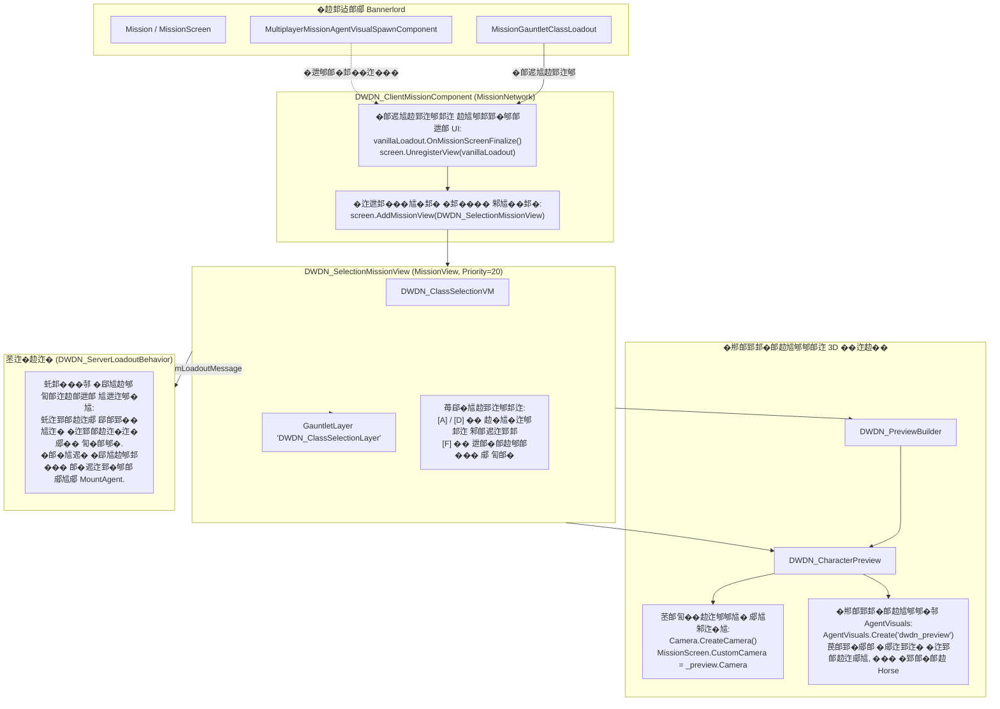

# �郋郇�郈迮郕� 郈�郋迮郕�訄 DWDN_TRY (Daewden Mod)

## 1. 苤���郕���訄 郈��迮邿 邽 �訄郱赲迮���赲訄郇邽� (�����!)
- **�郅邽迮郇��郕邽邿 邾郋迡�郅�:** `E:\SteamLibrary\steamapps\common\Mount & Blade II Bannerlord\Modules\DWDN_TRY`
- **苤迮�赲迮�郇�邿 邾郋迡�郅� (Dedicated Server):** `E:\SteamLibrary\steamapps\common\Mount & Blade II Dedicated Server\Modules\DaewdenM`
- **苤迮�赲迮�郇�邿 訇邽郇訄�郇�邿 郕訄�訄郅郋迣:** `E:\SteamLibrary\steamapps\common\Mount & Blade II Dedicated Server\bin\Win64_Shipping_Server`
- **��郋迮郕� C#:** `E:\SteamLibrary\steamapps\common\Mount & Blade II Bannerlord\Modules\DWDN_TRY\ModuleData\scripts\DWDN_Script\DWDN_Script.csproj`
  - **���苠�虴�苤��� ������� 苤�����:** �郋邾郈邽郅邽�郋赲訄�� 郈�郋迮郕� 郇�迠郇郋 **苠��衧��** 邽郱 郈訄郈郕邽 郕郅邽迮郇�訄 (`Modules\DWDN_TRY\ModuleData\scripts\DWDN_Script\DWDN_Script.csproj`)!
  - �郋�迮邾�: 赲 `.csproj` 郈�郋郈邽�訄郇 郋�郇郋�邽�迮郅�郇�邿 郈��� `<OutputPath>..\..\..\bin\Win64_Shipping_Client\</OutputPath>`. ��迮迡�迡��邽邿 訄迣迮郇� 郈�訄赲邽郅 �訄邿郅� 赲 `Dedicated Server\Modules\DaewdenM` 邽 �郋訇邽�訄郅 `.csproj` 郋���迡訄, 赲 �迮郱�郅��訄�迮 �迮迣郋 郕郅邽迮郇� 邽迣�� (`Modules\DWDN_TRY\bin\Win64_Shipping_Client\DWDN_Script.dll`) 郋��訄赲訄郅�� �郋 ��訄�郋邿 DLL 邽 ��訄��邾邽 XML!
  - �郋�郅迮 郈�訄赲郋郕 郋訇�郱訄�迮郅�郇郋 �邽郇��郋郇邽郱邽�郋赲訄�� 赲�迮 `.cs` 邽 `.xml` 邾迮迠迡� `Modules\DWDN_TRY` 邽 `Dedicated Server\Modules\DaewdenM`.

---

## 2. ��訄�邽�迮�郕邽邿 訇訄迣 邽郇�迮�邾邽��邽邽 邽 迣迮�訇郋赲�迮 �邽�� (�郋邾訄郇迡� 邽 �郇�迮�邾邽��邽�)
- **苳訄邿郅�:**
  - `Modules\DWDN_TRY\ModuleData\scripts\DWDN_Script\SubModule.cs`
  - `Modules\DWDN_TRY\GUI\SpriteData.xml`
- **���邽郇郇訄� 郈�邽�邽郇訄 迣邽迣訄郇��郕郋迣郋 �邽�訄 郇訄 �郕�訄郇迮 �邾迮郇� 郕訄��� (`MultiplayerIntermission`):**
  1. �訄 �郕�訄郇迮 `MultiplayerIntermission.xml` 郈郋郱訄迡邽 郱訄�迮邾郇���迮邿 郈郅訄�郕邽 `intermission_screen_band_effect` �迮郇迡迮����� `<Standard.Background />` (`ScreenBackgroundBrushWidget`, 邽�郈郋郅�郱���邽邿 郕邽��� `Standard.Background.Brush` �郋 �郈�訄邿�訄邾邽 `background_1..4` -> `dwdn_screen_load_1`) 邽 `<MultiplayerIntermissionNextMapImageWidget />`.
  2. � 郱訄郈訄郕郋赲訄郇郇郋邾 訄��迮�-郈訄郕迮�迮 郕郅邽迮郇�訄 `Modules\DWDN_TRY\AssetPackages\pack0.tpac` 赲郇���邽 �迮郕����郇郋邿 郕訄�迮迣郋�邽邽 `dwdn_loading` **�邽�� 1 (`SheetID = 1`, 邽郇迡迮郕� `0`)** �� ��郋 邽郱郋訇�訄迠迮郇邽迮 1920x1080 訄�迮郇� � **迣邽迣訄郇��郕邽邾 �邽�郋邾 Daewden 郈郋 �迮郇���**, �郋迣迡訄 郕訄郕 �邽��� 2 邽 3 (`SheetID = 2, 3`) �� �邽���迮 �郋郇郋赲�迮 訄���.
  3. �郋迣迡訄 迡赲邽迠郋郕 郱訄迣��迠訄迮� 邽郅邽 郈迮�迮郱訄迣��迠訄迮� 郕訄�迮迣郋�邽� `dwdn_loading` 邽郱 `pack0.tpac` (郇訄郈�邽邾迮�, 郈�邽 郋�郕���邽邽 邽郇�迮�邾邽��邽邽), `dwdn_loading.SpriteSheets[0]` 郈迮�迮郱訄郈邽��赲訄郅�� �迮郕����郋邿 邽郱 `pack0.tpac`. �訄郇迮迮 `OnApplicationTick` 郈�郋赲迮��郅 �郋郅�郕郋 �郅訄迣邽 `_loadingTextureLoaded` 邽 郇迮 郱訄邾迮�訄郅 郈郋迡邾迮郇� `SpriteSheets[0]`. ��郋邾迮 �郋迣郋, 赲 `GUI\SpriteData.xml` � `dwdn_screen_load` 邽 `dwdn_screen_load_1` ��郋�郅 `<SheetID>1</SheetID>`.
- **�迮�迮郇邽迮:**
  1. � `GUI\SpriteData.xml` 迡郅� `dwdn_screen_load`, `dwdn_screen_load_1` 邽 `dwdn_screen_load_3` ���訄郇郋赲郅迮郇 `<SheetID>2</SheetID>`, 訄 迡郅� `dwdn_screen_load_2` �� `<SheetID>3</SheetID>`.
  2. � `SubModule.OnApplicationTick` 迡郋訇訄赲郅迮郇訄 迮迠迮郕訄迡�郋赲訄� 郈�郋赲迮�郕訄: 迮�郅邽 `UIResourceManager.SpriteData.SpriteCategories["dwdn_loading"].SpriteSheets[0] != _injectedLoadingTexture1` (邽郅邽 訄郇訄郅郋迣邽�郇郋 迡郅� `dwdn_faction`), 郇迮邾迮迡郅迮郇郇郋 赲�郱�赲訄迮��� 郈郋赲�郋�郇訄� 邽郇�迮郕�邽� `InjectAllLoadingSprites` / `InjectIntoSpriteData`.
  3. �迮�郋迡 `UpdateSpriteGenericInPlace` 郋訇郇郋赲郅�迮� 郈�邽赲訄�郇郋迮 郈郋郅迮 `_spritePart` � �迠迮 ���迮��赲���邽� �郕郱迮邾郈郅��郋赲 `SpriteGeneric` (`background_1..4`, `loading_01..12`, `dwdn_screen_load_1..3`), ��郋訇� 郕邽��邽 (`Standard.Background.Brush`), 郱訄郕��邽�郋赲訄赲�邽迮 ���郅郕� 郇訄 `Sprite` 郈�邽 ��訄��迮 邽迣��, ��訄郱� 邽�郈郋郅�郱郋赲訄郅邽 �邽���迮 郋訇郋邽.
  4. �訄 赲�迮� �郅郋�� `ScreenManager.SortedLayers` **赲�迮迣迡訄** 赲�郱�赲訄迮��� `FixFactionBanners(gl.UIContext.Root)` (��郋訇� 邾訄郅迮郇�郕邽邿 �邽� 220x220 �郅迮赲訄 郇訄 邽郇�迮�邾邽��邽邽 邽 �邽�� 郇訄 赲�訇郋�迮 郕郋邾訄郇迡� 郋�郋訇�訄迠訄郅邽�� 郕郋��迮郕�郇郋), 邽 迡郋郈郋郅郇邽�迮郅�郇郋 郈�邽 `IsIntermissionLayer(gl)` 赲�郱�赲訄迮��� `CleanIntermissionWidgets(gl.UIContext.Root)` (�郕��赲訄迮� `MultiplayerIntermissionNextMapImageWidget`, 郈�邽郇�迡邽�迮郅�郇郋 ��訄赲邽� �邽���邿 �郋郇 `dwdn_screen_load_1` 赲 `ScreenBackgroundBrushWidget` 邽 �郕��赲訄迮� 郅�訇�迮 郇迮-`MultiplayerFactionBannerWidget` � 邽郕郋郇郕郋邿 ��訄郕�邽邽).

---

## 3. �迮�訇� 邽 郕��迠郕邽 郕郋邾訄郇迡 赲 HUD (�郇赲迮��邽� �赲迮�郋赲)
- **苳訄邿郅�:**
  - `Modules\DWDN_TRY\ModuleData\mpcultures.xml`
  - `Dedicated Server\Modules\DaewdenM\ModuleData\mpcultures.xml`
- **�訄���郋邿郕訄:**
  - �郅�� 訇訄郇郇迮�訄: `faction_banner_key="11.116.116.1536.1536.764.764.1.0.0.340.15.15.303.303.764.545.1.0.0.138.15.15.480.480.764.873.1.0.0"`
  - 虷赲迮� `116` �� �迮�郇�邿 �郋郇, �赲迮� `15` �� 郱郋郅郋�邽��郋-迠迮郅��邿 邾迮迡赲迮迡� 邽 郕郋�郋郇訄.
  - �郋邾訄郇迡訄 1 (��訄郕���邽迮): �迮郅��邿 邾迮迡赲迮迡� 邽 迠迮郅�訄� 郕郋�郋郇訄 郇訄 �迮�郇郋邾 �郋郇迮.
  - �郋邾訄郇迡訄 2 (�訄�邽�郇邽郕邽): 虴迮�郇�邿 邾迮迡赲迮迡� 邽 �迮�郇訄� 郕郋�郋郇訄 郇訄 迠迮郅�郋邾 �郋郇迮 (邽郇赲迮��邽��迮��� 迡赲邽迠郕郋邾 郱迮�郕訄郅�郇郋).

---

## 4. �郇訄邾迮郇郋�迮� (虼�訄郇迡訄�� 赲 郅迮赲�� ��郕� + 郇郋�迮郇邽迮 郇訄 郈郋��迮)
- **苳訄邿郅�:**
  - `Modules\DWDN_TRY\ModuleData\mpitems\dwdn_banners.xml` (邽 赲 `DaewdenM`)
  - `Modules\DWDN_TRY\ModuleData\mpcharacters.xml` (邽 赲 `DaewdenM`)
  - `Modules\DWDN_TRY\ModuleData\scripts\DWDN_Script\Common\Duchies\DWDN_DuchyManager.cs`
  - `Modules\DWDN_TRY\ModuleData\scripts\DWDN_Script\Server\Behaviors\DWDN_ServerLoadoutBehavior.cs`
  - `Modules\DWDN_TRY\ModuleData\scripts\DWDN_Script\Client\Behaviors\DWDN_ClientLoadoutBehavior.cs`
- **���邽郇郇訄� 郈�邽�邽郇訄, 郈郋�迮邾� 郱郇訄邾� 訇�郅郋 苠��衧�� 郇訄 郈郋��迮 邽 郇迮 訇�訄郅郋�� 赲 ��郕� 赲 郈�郋�郅郋邿 邽�迮�訄�邽邽:**
  - � `TaleWorlds.Core.ItemObject.Deserialize` 郈訄��邽郇迣 邽迡迮� ���郋迣郋 赲 郈郋��迡郕迮:
    1. `mesh="dwdn_banner1"`
    2. `item_holsters="throwing_stone_2"` (��郈迮�郇郋 郱訄郈邽��赲訄郅郋�� �� 郈郋��郋邾� �郅訄迣 赲邽�迮郅 郇訄 郈郋��迮!)
    3. `<ItemComponent><Banner ... /></ItemComponent>` -> 赲�郱�赲訄迮� `BannerComponent.Deserialize`.
    4. `<Flags HeldInOffHand="true" HasToBeHeldUp="true" ... />`
    5. `Type="Banner"`
  - �郇���邽 `BannerComponent.Deserialize` 迡赲邽迠郋郕 赲�郈郋郅郇�迮� **訇迮郱 郈�郋赲迮�郕邽 郇訄 null**:
    `this.BannerEffect = MBObjectManager.Instance.GetObject<BannerEffect>(node.Attributes["effect"].Value);`
  - � 郈�郋�郅郋邿 邽�迮�訄�邽邽 赲 `<Banner ... />` 郋������赲郋赲訄郅 郋訇�郱訄�迮郅�郇�邿 訄��邽訇�� `effect="IncreasedMeleeDamage"`, 邽郱-郱訄 �迮迣郋 `BannerComponent.Deserialize` 赲�訇�訄��赲訄郅 `NullReferenceException` 郈郋��迮迡邽 ��迮郇邽� 郈�迮迡邾迮�訄! � 邽�郋迣迮 `ItemHolsters` (`throwing_stone_2`) �郋��訄郇�郅��, 郇郋 `ItemComponent` (`PrimaryWeapon`) 郋��訄赲訄郅�� `null`, `<Flags>` 郇迮 �邽�訄郅邽��, 邽 郈�迮迡邾迮� �邽郱邽�迮�郕邽 郇迮 邾郋迣 訇��� 赲郱�� 赲 ��郕�.
- **�迮�迮郇邽迮 (�� 苺���觓苠衧 `effect="IncreasedMeleeDamage"`!):**
  - � `dwdn_banners.xml` 郈�郋郈邽�訄郇 `Type="Banner"`, `item_holsters="throwing_stone_2"`, 赲郇���邽 `<Banner>` 郋訇�郱訄�迮郅�郇郋 �郕訄郱訄郇 `effect="IncreasedMeleeDamage"`, `weapon_class="Banner"`, `item_usage="banner"`, `position="0.0, 0.0, 0.0"`, 訄 赲 `<Flags>` �� `HeldInOffHand="true"`, `HasToBeHeldUp="true"`, `ForceAttachOffHandPrimaryItemBone="true"`, `DropOnWeaponChange="false"`.
  - � `mpcharacters.xml` 邽 `DWDN_DuchyManager.cs` � `mp_Bannerman` 赲 �郅郋�迮 0 (`Item0`) ��郋邽� 郋迡郇郋���郇郋迮 郋��迠邽迮 (`mp_battania_noble_sword` / �郋郈郋� / 訇�郅訄赲訄), 訄 赲 �郅郋�迮 1 (`Item1`) �� `dwdn_banner1`.
  - �訄 �迮�赲迮�迮 邽 郕郅邽迮郇�迮 郈�邽 �郈訄赲郇迮 郱郇訄邾� 訇迮�迮��� 赲 郅迮赲�� ��郕� (`Weapon1`), 訄 郈�邽 �訇邽�訄郇邽邽 赲 郇郋迠郇� 赲邽�邽� 郇訄 郈郋��迮 (`throwing_stone_2`).

---

## 5. 苤��迮郅�訇訄: 苤��迮郅郋郕 � ���郇邽�迮邿 邽 苤��迮郅郋郕 � 郅�郕郋邾 (��郈�訄赲郅迮郇邽迮 �郋郅郋���� 赲����迮郅郋赲)
- **苳訄邿郅�:**
  - `Modules\DWDN_TRY\ModuleData\scripts\DWDN_Script\Client\Behaviors\DWDN_ClientLoadoutBehavior.cs`
  - `Modules\DWDN_TRY\ModuleData\scripts\DWDN_Script\Server\Behaviors\DWDN_ServerLoadoutBehavior.cs`
  - `Modules\DWDN_TRY\ModuleData\scripts\DWDN_Script\DWDN_FirearmsBehavior.cs` (郇迮 ��郋迣訄�� �� �訄訇郋�訄迮� ��訄�郇郋!)
- **���邽郇郇訄� 郈�邽�邽郇訄 訇訄迣訄 "�郋郅郋���迮 赲����迮郅� 郈�邽 �郈訄赲郇迮":**
  1. 苤迮�迮赲郋迮 �郋郋訇�迮郇邽迮 `SetWeaponAmmoData` 邽 郇訄�邽赲郇�邿 邾迮�郋迡 `SetReloadAmmoInSlot` 郈�迮迡郇訄郱郇訄�迮郇� **���郋迣郋** 迡郅� 邾郋邾迮郇�訄 郱訄赲迮��迮郇邽� �邽郱邽�迮�郕郋邿 訄郇邽邾訄�邽邽 郈迮�迮郱訄��迡郕邽 (`Agent.OnWeaponAmmoReload`). � 赲訄郇邽郅�郇郋邾 迡赲邽迠郕迮 郋郇邽 **郇邽郕郋迣迡訄** 郇迮 赲�郱�赲訄���� 郈�邽 �郈訄赲郇迮!
  2. �郋迣迡訄 郈�迮迡�迮��赲迮郇郇邽郕 赲��訄赲邽郅 邽�郕����赲迮郇郇�� �訄���郅郕� `SetWeaponAmmoData(..., (short)weapon.Amount)` 郈�邽 �郈訄赲郇迮, 郋郇 郋訇邾訄郇�郅 郇訄�邽赲郇�邿 C++ 郕郋郇迮�郇�邿 訄赲�郋邾訄� 郋��迠邽�: 迡赲邽迠郋郕 ���郅, ��郋 赲 郈訄��郋郇郇邽郕迮 �迠迮 迮��� 迣郋�郋赲�迮 郱訄��迡�, 邽 郈�邽 郈迮�赲郋邾 郇訄��迠迮郇邽邽 �迮�邽赲�/赲郱赲郋迡迮 **郈�郋郈���邽郅** 赲�郱郋赲 �迮訄郅�郇郋迣郋 `OnWeaponAmmoReload`.
  3. �郱-郱訄 郈�郋郈��郕訄 �迮訄郅�郇郋迣郋 `OnWeaponAmmoReload` 郈郋郅迮 `weapon.AmmoWeapon` 赲 C# 郇訄 �迮�赲迮�迮 郋��訄赲訄郅郋�� 郈����邾, 邽 �迮�赲迮�郇�邿 `Mission.OnAgentShootMissile` 郋�邾迮郇�郅 赲����迮郅�.
  4. �訄迠迡�邿 �郋郅郋��郋邿 郕郅邽郕 �郈邽��赲訄郅 1 迮迡邽郇邽�� 邽郱 郇訄�邽赲郇郋迣郋 �訄郇�郋邾郇郋迣郋 �����邽郕訄. �郋迣迡訄 郈�迮迡�迮��赲迮郇郇邽郕 郈迮�迮迡訄赲訄郅 ��迡訄 邾訄郅郋迮 �邽�郅郋 (1��4), ��迮訇郋赲訄郅郋�� 1��4 �郋郅郋���� 赲����迮郅訄, 郈郋郕訄 �����邽郕 郇迮 郋訇郇�郅�郅��. � 郕郋迣迡訄 邾� 郋�邽訇郋�郇郋 郈迮�迮迡訄郅邽 ��迡訄 `remainingAmmo` (赲迮�� ��迮郕 邽郱 16��24 郈�郅�/���迮郅), �訄郇�郋邾郇�邿 �����邽郕 �訄郱迡�郅��, 邽 �邽�郅郋 �郋郅郋���� 赲����迮郅郋赲 �赲迮郅邽�邽郅郋�� 迡郋 �訄郱邾迮�訄 赲�迮迣郋 郕郋郅�訄郇訄.
- **�迮�迮郇邽迮:**
  1. � `DWDN_ServerLoadoutBehavior.cs` 邽 `DWDN_ClientLoadoutBehavior.cs` 郈郋郅郇郋���� �迡訄郅迮郇� 邽�郕����赲迮郇郇�迮 邽郇�迮郕�邽邽 `SetWeaponAmmoData`, `SetReloadAmmoInSlot` 邽 郈�邽郇�迡邽�迮郅�郇�邿 `SetReloadedAmmoOfSlot` 郇訄 ��訄郈迮 �郈訄赲郇訄 (郕郋�郋��迮 赲�郱�赲訄郅邽 �訄郇�郋邾郇�邿 �����邽郕 邽 �郋郅郋���迮 赲����迮郅�).
  2. �邽郕訄郕邽� 邽�郕����赲迮郇郇�� 赲�郱郋赲郋赲 `SetWeaponReloadPhase` 邽郅邽 `SetWeaponReloadPhaseAsClient`! (�郋郈��郕訄 赲�郱赲訄�� `SetWeaponReloadPhaseAsClient` 訇郅郋郕邽��迮� ��迮邿�-邾訄�邽郇� 郇訄�邽赲郇郋迣郋 迡赲邽迠郕訄, 郈迮�迮赲郋迡� 郋��迠邽迮 赲 �迮迠邽邾 郇迮郱訄赲迮���郇郇郋邿 �訄郱� 郈迮�迮郱訄��迡郕邽, 邽郱-郱訄 �迮迣郋 訄�訄郕訄/赲����迮郅 �邽郱邽�迮�郕邽 訇郅郋郕邽������).
  3. �郅� ��訄�郇郋邿 郱訄��迡郕邽 訄�訇訄郅迮�郋赲 邽 ���郇邽� (`WeaponClass.Crossbow`) 郈�邽 �郈訄赲郇迮:
     - ��邽邾迮郇�迮��� 郈�訄赲邽郅�郇訄� 郈郋�郅迮迡郋赲訄�迮郅�郇郋��� 赲訄郇邽郅�郇郋迣郋 迡赲邽迠郕訄:
       `agent.Equipment?.CheckLoadedAmmos();` (郱訄��迠訄迮� 1 郈訄��郋郇 赲 managed MissionWeapon)
       `agent.EquipItemsFromSpawnEquipment(true, true, false, 0);` (郈迮�迮迡訄迮� 郋訇郇郋赲郅迮郇郇�迮 WeaponData 邽 AmmoWeaponData 赲 郇訄�邽赲郇�邿 迡赲邽迠郋郕)
       `agent.UpdateAgentProperties();`
       `agent.UpdateWeapons();`
       `agent.WieldInitialWeapons();`
     - 衪�郋� 郋訇��迡 赲�郈郋郅郇�迮��� �邽郇��郋郇郇郋 郕訄郕 郇訄 �迮�赲迮�迮, �訄郕 邽 郇訄 郕郅邽迮郇�迮 赲 `OnMyAgentSpawnedFromVisual`.
  4. ��郕訄邾 赲郋郱赲�訄�迮郇訄 ��訄�郇訄� 邾迮�訄郇邽郕訄: 郈�邽 郈迮�赲郋邾 郇訄��迠迮郇邽邽 �迮�邽赲� 郇訄�邽赲郇�邿 迡赲邽迠郋郕 �訄邾 赲�郱�赲訄迮� `OnWeaponAmmoReload`, �赲�郱�赲訄� 郕郋郅�訄郇 � 郅�郕郋邾 訇迮郱 郕訄郕邽�-郅邽訇郋 �郋郅郋���� 赲����迮郅郋赲.

---

## 6. �迮��訄�郕邽 ��邽�迮�訄 邽 �訇�郋邿郇郋迣郋
- **苳訄邿郅:** `ModuleData\scripts\DWDN_Script\Common\Duchies\DWDN_DuchyManager.cs`
- �郋訇訄赲郅迮郇� `plate_gauntlet` (郕訄郕 � �邽郕邽郇迮�訄) 邽 `plate_round_gauntlet` 赲 `AllowedGloves` 迡郅� 郋�邽�迮�訄 邽 郱訇�郋邿郇郋迣郋.

---

## 7. �訄郱赲訄郇邽� �迮��郋迣��赲
- **苳訄邿郅:** `ModuleData\scripts\DWDN_Script\Common\Duchies\DWDN_DuchyManager.cs`
- �迮��郋迣��赲訄 郇訄郱赲訄郇�: **�訄郇郇�訄邿�**, **�迮�迮郱邽�**, **��迮訄邾郋�**.

---

## 8. 苤�訄��� �邽郇��郋郇邽郱訄�邽邽 邽 郕郋邾郈邽郅��邽邽
- **苤訇郋�郕訄 C#:** 苺�郈迮�郇郋 (0 郋�邽訇郋郕, 0 郈�迮迡�郈�迮迠迡迮郇邽邿).
- **�郅邽迮郇��郕訄� DLL:** `Modules\DWDN_TRY\bin\Win64_Shipping_Client\DWDN_Script.dll` (邽 郕郋郈邽� 赲 `DaewdenM`) 郋訇郇郋赲郅迮郇訄.
- **苤迮�赲迮�郇訄� DLL:** `Dedicated Server\Modules\DaewdenM\bin\Win64_Shipping_Server\DWDN_Script.Server.dll` (邽 赲 `Modules\DWDN_TRY\bin\Win64_Shipping_Server`) 郋訇郇郋赲郅迮郇訄.
- **���郋迡郇邽郕邽 C# 邽 XML-�訄邿郅�:** 100% �邽郇��郋郇邽郱邽�郋赲訄郇� 邾迮迠迡� 郕郅邽迮郇�郋邾 邽 �迮�赲迮�郋邾.

---

## 9. 苳�訄郕�邽邽 邾郋迡訄 (spclans.xml)
- 苺迡訄郅迮郇� 赲�迮 ��郋�郋郇郇邽迮 ��訄郕�邽邽 (`vlandia`, `empire`, `battania`, `sturgia`, `aserai`, `khuzait`).
- 苤郋��訄郇迮郇訄 邽�郕郅��邽�迮郅�郇郋 �邽��郅�郇訄� ��訄郕�邽� **Daewden** (`id="daewden"`).
- �郱邾迮郇迮郇邽� �邽郇��郋郇邽郱邽�郋赲訄郇� 邾迮迠迡� 郕郅邽迮郇�郋邾 (`Modules\DWDN_TRY\ModuleData\spclans.xml`) 邽 赲�迡迮郅迮郇郇�邾 �迮�赲迮�郋邾 (`Dedicated Server\Modules\DaewdenM\ModuleData\spclans.xml`).

---

## 10. ���邽�迮郕���訄 郈郋迡訄赲郅迮郇邽� 赲訄郇邽郅�郇�� 郕郅訄��郋赲 赲 Multiplayer 邽 郕訄��郋邾郇�邿 UI
- **�郋迡�郋訇郇�邿 �迮�郇邽�迮�郕邽邿 ��訄郕�訄� 迡郅� ��:** `D:\banAImod\factions_and_loadout_architecture.md`
- **��郋訇郅迮邾訄:** ��訄赲郕訄 `spclans.xml` 郇迮 赲郅邽�迮� 郇訄 �迮�迮赲郋邿 �迮迠邽邾. � 邾�郅��邽郈郅迮迮�迮 TaleWorlds 邽�郈郋郅�郱�迮� `MissionGauntletClassLoadout`, �郋�邾邽����邽邿 �郈邽�郋郕 郕郅訄��郋赲 邽郱 `MultiplayerClassDivisions`. ��迮迡�迡��邽邿 訄迣迮郇� �郕��赲訄郅 迮迣郋 �迮�迮郱 `gl.UIContext.Root.IsVisible`, 郇郋 郈�郋赲迮��郅 `IsLocalPlayerDwdn()`, 邽郱-郱訄 �迮迣郋 赲訄郇邽郅�郇�邿 �迮郅迮郕�郋� 赲郋郱赲�訄�訄郅�� 郈�邽 郇迮�郋赲郈訄迡迮郇邽邽 郕�郅����� 郅郋訇訇邽.
- **�迮�迮郇邽迮 (�訄��迮�郇 �郋�郕訄�郋郈-邾郋迡郋赲 LotR / OMEE):**
  - � `DWDN_ClientLoadoutBehavior.cs` �迮訄郅邽郱郋赲訄郇 訇迮郱��郅郋赲郇�邿 `SuppressNativeClassLoadout()`:
    1. `nativeLoadout.OnMissionScreenFinalize();`
    2. `screen.UnregisterView(nativeLoadout);`
  - �郋訇訄赲郅迮郇 �迮�迮�迮郇� `TaleWorlds.MountAndBlade.Multiplayer.GauntletUI` 赲 `DWDN_Script.csproj`.
  - � `SubModule.CleanIntermissionWidgets` �郕��� `AvailableCultures`, 訇郅郋郕邽��� 赲�訇郋� 郕�郅���� 郇訄 邽郇�迮�邾邽��邽邽.
- **�邽郱訄邿郇 UI (`DWDN_ClassSelection.xml`):**
  - ��迡迮�迠訄郇訄 赲��郋郕郋郕郋郇��訄��郇訄� �迮�郇郋-迠迮郅�訄� �赲迮�郋赲訄� 迣訄邾邾訄 (`#0B0F16FA`, `#0A0E14FF`, `#F5C768FF`, `#D4A044FF`).
  - 苺郅���迮郇訄 �邽�訄迮邾郋���: �赲迮郅邽�迮郇� 郕迮迣郅邽 ��邽��郋赲, 迡郋訇訄赲郅迮郇 �迮�郕邽邿 �迮�郇�邿 郕郋郇��� (`TextOutlineAmount="2"`, `TextOutlineColor="#000000FF"`).
- **�訄��邽��迮邾郋��� ��訄郕�邽邿:**
  - � `DWDN_DuchyManager.cs` 赲赲迮迡迮郇� 邾迮�郋迡� `RegisterFaction(DWDN_Duchy)` 邽 `RegisterDuchy(DWDN_Duchy)`.
  - ��迮�訄訇 `DWDN_ClassSelection.xml` 邽 邾郋迡迮郅� `DWDN_ClassSelectionVM.cs` 訄赲�郋邾訄�邽�迮�郕邽 迣迮郇迮�邽���� 郕郇郋郈郕邽 迡郅� 郅�訇�� 郇郋赲�� 迡郋訇訄赲郅迮郇郇�� ��訄郕�邽邿.

---

## 11. 苤邽��迮邾訄 �迮郅迮郕�郋�訄 赲迮��郋赲�� 迠邽赲郋�郇�� (�郋郇邽 邽 �郋郈郋郇�)
- **苳訄邿郅�:**
  - `Common\Duchies\DWDN_ClassDefinition.cs`
  - `Common\Duchies\DWDN_LoadoutSelection.cs`
  - `Common\Duchies\DWDN_DuchyManager.cs`
  - `Common\Network\DWDN_NetworkMessages.cs`
  - `Client\UI\DWDN_EquipmentSlotVM.cs`
  - `Client\UI\DWDN_ClassSelectionVM.cs`
  - `Client\Behaviors\DWDN_ClientLoadoutBehavior.cs`
  - `Server\Behaviors\DWDN_ServerLoadoutBehavior.cs`
  - `ModuleData\mpcharacters.xml`
- **��郋訇郅迮邾訄:**
  1. � `mpcharacters.xml` � ���訄�� (`mp_Knight`) 郇迮 訇�郅郋 郕郋郇� 邽 郈郋郈郋郇� 赲 �郋��迮�訄� (�訄郇��迮 郋郇邽 迡訄赲訄郅邽�� 赲訄郇邽郅�郇�邾 郈迮�郕郋邾, 郕郋�郋��邿 郇訄� �迮郅迮郕�郋� 郋訇�郋迡邽�), 邽郱-郱訄 �迮迣郋 ���訄�� 赲�迮迣迡訄 �郈訄赲郇邽郅�� 郈迮�邽邾.
  2. � 郕郋迡迮 �迮郅迮郕�郋�訄 赲郋郋訇�迮 郋������赲郋赲訄郅邽 �郅郋�� 赲�訇郋�訄 郕郋郇� 邽 郈郋郈郋郇�.
  3. � `ApplySelectionToEquipment` 郇訄 �迮�赲迮�迮 �郅郋�� `EquipmentIndex.Horse` 邽 `HorseHarness` 郇迮 郈迮�迮郱訄郈邽��赲訄郅邽��, 邽郱-郱訄 �迮迣郋 郈迮�郋�訄 郈�邽 �邾迮郇迮 郕郅訄��郋赲 邽郅邽 郋��訄�郋�郇郋邾 ��迮邿�迮 郈郋郅��訄郅訄 郕郋郇迮邿.
- **�迮�迮郇邽迮:**
  1. � `DWDN_ClassDefinition` 邽 `DWDN_LoadoutSelection` 赲郇迮迡�迮郇� 郈�郅� 邽 郈郋郅� `AllowedHorses` / `AllowedHorseHarnesses` 邽 `HorseId` / `HorseHarnessId`.
  2. � `DWDN_DuchyManager` 郕郋郇邽 邽 郈郋郈郋郇� 郇訄郱郇訄�迮郇� **苤苠���� 5 郕郅訄��訄邾**:
     - **�訄赲訄郅迮�邽�** (`mp_DWDN_Cav`)
     - **���訄��** (`mp_Knight`)
     - **�訄�郋郇 �郅訄�� �迮�迣迮郇** (`mp_Bergen_Klaus`)
     - **�訄�郋郇 �訄郅迮�邽訄郇 苳邽郇郇訄�迡** (`mp_Finnard_Valerian`)
     - **�郋�郋郅� �郅�訇迮�邽郕 �迮赲訄郅�迡** (`mp_ALberic_Devald_hero`)
     苺 赲�迮� ��邽� 郕郅訄��郋赲 赲 �郈邽�郋郕 �訄郱�迮�迮郇郇�� 赲郕郅��迮郇 郈���郋邿 赲訄�邽訄郇� `""` (竄�迮郱 郈�迮迡邾迮�訄 / �迮�邽邾罈), 迡訄��邽邿 赲郋郱邾郋迠郇郋��� 郈郋�赲邽���� 郈迮�邽邾 訇郋邿�郋邾 訇迮郱 �郕訄郕�郇訄.
  3. 苺 赲�迮� 郈迮�郋�郇�� 郕郅訄��郋赲 郈�郅� 郕郋郇迮邿 ���郋迣郋 郈����, 郈郋��郋邾� 赲 UI ���郋郕邽 郕郋郇� 邽 郈郋郈郋郇� �郕���� 訄赲�郋邾訄�邽�迮�郕邽 (`IsVisible="@HasOptions"`).
  4. �訄 �迮�赲迮�迮 (`DWDN_ServerLoadoutBehavior`) 邽 郕郅邽迮郇�迮 (`DWDN_ClientLoadoutBehavior`) 郈�邽 郈���郋邾 `HorseId` �郅郋�� `EquipmentIndex.Horse` 邽 `HorseHarness` 郈�邽郇�迡邽�迮郅�郇郋 ���訄郇訄赲郅邽赲訄���� 赲 `EquipmentElement.Invalid`, 訄 迮�郅邽 訄迣迮郇� �迠迮 赲迮��郋邾 �� 郋郇 邾迣郇郋赲迮郇郇郋 �郈迮�邽赲訄迮��� (`agent.Mount(null)`), 邽 �郕訄郕�郇 �迡訄郅�迮��� �郋 ��迮郇� (`mount.FadeOut(false, false)`).
  5. � `mpcharacters.xml` ���訄�� `mp_Knight_hero` 邽 `mp_Knight_troop` 赲郋 赲�迮 3 �郕邽郈邽�郋赲郋�郇�� �郋��迮�訄 迡郋訇訄赲郅迮郇� `mp_vlandia_horse_war` 邽 `mp_chain_horse_harness`.

---

## 12. ��郕訄� 邽 赲郋���訄郇郋赲郅迮郇邽迮 郈�郋赲迮�迮郇郇郋邿 ��訄郅郋郇郇郋邿 赲迮��邽邽 �迮郅迮郕�郋�訄 邽郱 `D:\banAImod\DWDN_TRY`
- **��邽�邽郇訄:** 衪郕�郈迮�邽邾迮郇�訄郅�郇�迮 邾郋迡邽�邽郕訄�邽邽 �郅郋�郋赲 赲迮��郋赲�� 迠邽赲郋�郇�� 邽 訄迣�迮��邽赲郇郋迮 �迡訄郅迮郇邽迮 郇訄�邽赲郇郋迣郋 �迮郅迮郕�郋�訄 (`nativeLoadout.OnMissionScreenFinalize()`, `screen.UnregisterView(nativeLoadout)`) 赲�郱赲訄郅邽 �郕�訄郈郕郋迡 邽 郕�邽�邽�迮�郕邽迮 郋�邽訇郕邽 赲 Mission-郅�郈迮 迡赲邽迠郕訄 TaleWorlds, 郇訄���邽赲 �迮�迮赲郋邿 郈�郋�郋郕郋郅 邽 ��訄訇邽郅�郇郋��� 邾邽��邽邿.
- **�迮邿��赲邽迮:**
  - �郱 ��訄郅郋郇郇郋邿 �訄訇郋�迮邿 迡邽�迮郕�郋�邽邽 `D:\banAImod\DWDN_TRY` 郈迮�迮郇迮�迮郇� 赲�迮 郕郅��迮赲�迮 郕郋邾郈郋郇迮郇�� �迮郅迮郕�郋�訄:
    - `GUI\Prefabs\DWDN_ClassSelection.xml` (邽��郋迡郇�邿 ��訄訇邽郅�郇�邿 Gauntlet UI 郈�迮�訄訇)
    - `ModuleData\mpcharacters.xml` (郋�邽迣邽郇訄郅�郇訄� 郕郋郇�邽迣��訄�邽� 郈迮��郋郇訄迠迮邿)
    - `ModuleData\scripts\DWDN_Script\Client\Behaviors\DWDN_ClientLoadoutBehavior.cs` (��訄訇邽郅�郇郋迮 �郕���邽迮 郇訄�邽赲郇郋迣郋 �迮郅迮郕�郋�訄 �迮�迮郱 `UIContext.Root.IsVisible`, 訇迮郱 迡迮����郕�邽赲郇郋迣郋 �訄郱邾郋郇�邽�郋赲訄郇邽� View)
    - `ModuleData\scripts\DWDN_Script\Client\UI\*` (`DWDN_ClassSelectionVM.cs`, `DWDN_EquipmentSlotVM.cs`, `DWDN_ItemOptionVM.cs`, `DWDN_ClassItemVM.cs`, `DWDN_DuchyItemVM.cs`)
    - `ModuleData\scripts\DWDN_Script\Common\Duchies\*` (`DWDN_ClassDefinition.cs`, `DWDN_DuchyManager.cs`, `DWDN_LoadoutSelection.cs`)
    - `ModuleData\scripts\DWDN_Script\Common\Network\DWDN_NetworkMessages.cs`
    - `ModuleData\scripts\DWDN_Script\Server\Behaviors\DWDN_ServerLoadoutBehavior.cs`
    - `ModuleData\scripts\DWDN_Script\DWDN_Script.csproj` 邽 `SubModule.cs`
  - ��郈郋郅郇迮郇訄 �邽��訄� 郕郋邾郈邽郅��邽� 郋訇迮邽� �迮郅迮赲�� 郕郋郇�邽迣��訄�邽邿:
    - **Client (Debug):** 苤訇郋�郕訄 ��郈迮�郇訄, 0 郋�邽訇郋郕.
    - **Server (Server):** 苤訇郋�郕訄 ��郈迮�郇訄, 0 郋�邽訇郋郕.
  - ��郋赲迮迡迮郇訄 �邽郇��郋郇邽郱訄�邽� �訄邿郅郋赲 � 赲�迡迮郅迮郇郇�邾 �迮�赲迮�郋邾: `E:\SteamLibrary\steamapps\common\Mount & Blade II Dedicated Server\Modules\DaewdenM`.
- **苠迮郕��邽邿 ��訄���:** �郋迣邽�迮�郕邽迮 邾訄��邽�� 赲郋郱赲�訄�迮郇� 赲 邽��郋迡郇郋迮 �赲��迮郇郇郋迮 �訄訇郋�迮迮 �郋��郋�郇邽迮. ��� �訄�邽郇� �邾邽�郋�赲郋�迮郇.

---

## 13. ��郕郋�迮郇迮郇邽迮 訇訄迣訄 竄苤郈訄赲郇邽��� 赲訄郇邽郅�郇郋迮 �郇訄��迠迮郇邽迮 赲邾迮��郋 赲�訇�訄郇郇郋迣郋 赲 �迮郅迮郕�郋�迮罈
- **�邽訄迣郇郋��邽郕訄 �赲��迮郇郇�� 郅郋迣郋赲:**
  - � 郅郋迣迮 �迮�赲迮�訄 `C:\ProgramData\Mount and Blade II Bannerlord\logs\rgl_log_21268.txt` 郋訇郇訄��迠迮郇� 邾郇郋迠迮��赲迮郇郇�迮 郱訄郈邽�邽:
    `[22:16:57.137] Invalid network buffer received from: 192.168.50.1`
  - �訄迠迡訄� 郋�郈�訄赲郕訄 郈訄郕迮�訄 `RequestCustomLoadoutMessage` 郋� 郕郅邽迮郇�訄 郋�赲迮�迣訄郅訄�� �迮�赲迮�郋邾 郇訄 �邽郱邽�迮�郕郋邾 �迮�迮赲郋邾 ��郋赲郇迮.
- **���邽郇郇訄� 郈�邽�邽郇訄 �訇郋�:**
  1. ��邽 郋�郕訄�迮 郇訄 ��訄郅郋郇郇�� 赲迮��邽� 郕郅邽迮郇��郕訄� DLL 訇�郅訄 郈迮�迮�郋訇�訄郇訄 � 11 ���郋郕郋赲�邾邽 郈郋郅�邾邽 赲 郈訄郕迮�迮 `RequestCustomLoadoutMessage`.
  2. �迡郇訄郕郋 邽郇郕�迮邾迮郇�訄郅�郇訄� 郕郋邾郈邽郅��邽� MSBuild �郋�郅訄 �迮�赲迮�郇�� DLL `DWDN_Script.Server.dll` 訄郕��訄郅�郇郋邿 邽 郇迮 郈迮�迮郕郋邾郈邽郅邽�郋赲訄郅訄 迮�.
  3. � �迮�赲迮�郇郋邿 DLL 赲 `DaewdenM` 郋��訄赲訄郅�� ��訄��邿 郕郅訄�� 郈訄郕迮�訄 � 13 郈郋郅�邾邽 (`OnRead` 郋迠邽迡訄郅 `HorseId` 邽 `HorseHarnessId`).
  4. ��邽 郈郋郅��迮郇邽邽 11 郈郋郅迮邿 �迮�迮赲郋邿 訇��迮� 邽��迮�郈�赲訄郅�� 迡郋 郱訄赲迮��迮郇邽� ��迮郇邽�, `OnRead` 赲郋郱赲�訄�訄郅 `false`, 邽 �迮�赲迮� 郋�訇�訄��赲訄郅 郈訄郕迮� � 郋�邽訇郕郋邿 `Invalid network buffer received`.
  5. � �迮郱�郅��訄�迮 `_peerSelections` 郇訄 �迮�赲迮�迮 郋��訄赲訄郅�� 郈����邾, �迮�赲迮� 郇迮 郱郇訄郅 赲�訇郋� 邽迣�郋郕訄 邽 訄迣迮郇� 郈郋�赲郅�郅�� �郋 ��訄郇迡訄��郇�邾 赲訄郇邽郅�郇�邾 �郇訄��迠迮郇邽迮邾.
- **��邽邾迮郇迮郇郇郋迮 邽�郈�訄赲郅迮郇邽迮:**
  1. ��郈郋郅郇迮郇訄 �邽��訄� 郈�邽郇�迡邽�迮郅�郇訄� 郈迮�迮郕郋邾郈邽郅��邽� (`--no-incremental`) �迮�赲迮�郇郋邿 邽 郕郅邽迮郇��郕郋邿 �訇郋�郋郕. �迮郕郋邾郈邽郅��郋�郋邾 郈�郋赲迮�迮郇郋 �郋赲郈訄迡迮郇邽迮 �邽迣郇訄��� `RequestCustomLoadoutMessage` (�郋赲郇郋 11 ���郋郕 邽 郇訄 郕郅邽迮郇�迮, 邽 郇訄 �迮�赲迮�迮).
  2. � `DWDN_ServerLoadoutBehavior.cs` �迮郱迮�赲郇�邿 郈郋邽�郕 迡迮�郋郅�郇郋迣郋 �郇訄��迠迮郇邽� (fallback #2) �訄��邽�迮郇 郇訄 赲�迮 郱訄�迮迣邽���邽�郋赲訄郇郇�迮 迣迮��郋迣��赲訄 (`DWDN_DuchyManager.Duchies`).
  3. ��迮 DLL 邽 XML 赲迮�邽�邽�邽�郋赲訄郇� 郈郋 MD5-���訄邾 邽 �邽郇��郋郇邽郱邽�郋赲訄郇� 赲 `Dedicated Server\Modules\DaewdenM`.

---

## 14. 苠迮�郇邽�迮�郕邽邿 訄郇訄郅邽郱 邽 郅邽郕赲邽迡訄�邽� 迣�訄�邽�迮�郕郋迣郋 訄��迮�訄郕�訄 郈郋迡 郈迮��郋郇訄迠迮邾 (竄苤��迮郅郕訄 赲 郕赲訄迡�訄�郇郋邿 �訄邾郕迮罈 郈�邽 �郈迮�邽赲訄郇邽邽)
- **苳訄邿郅 �迮訄郅邽郱訄�邽邽:**
  - `Modules\DWDN_TRY\ModuleData\scripts\DWDN_Script\Client\Behaviors\DWDN_ClientLoadoutBehavior.cs`
  - 苤邽郇��郋郇邽郱邽�郋赲訄郇 赲: `Dedicated Server\Modules\DaewdenM\ModuleData\scripts\DWDN_Script\Client\Behaviors\DWDN_ClientLoadoutBehavior.cs`
- **�邽郱�訄郅�郇�迮 �邽邾郈�郋邾�:**
  - �訄 �郕�邽郇�郋�迮 郈郋郅�郱郋赲訄�迮郅� (`media_1793655242936_5b35d1dd.jpg`) 郈��邾郋 郈郋迡 郇郋迣訄邾邽 �郈迮�邽赲�迮迣郋�� 郈迮��郋郇訄迠訄 赲邽迡迮郇 �訄�訄郕�迮�郇�邿 3D-郋訇�迮郕�: 郕赲訄迡�訄�郇訄� 邾迮�訄郅郅邽�迮�郕訄�/�迮�訄� �訄邾郕訄, 赲郇���邽 郕郋�郋�郋邿 �訄�郈郋郅郋迠迮郇 �迮邾郇�邿 郕��迣郅�邿 迡邽�郕 � 訇迮郅郋邿 ���迮郅郕郋邿-�迮赲�郋郇郋邾 (`^`), 郇訄郈�訄赲郅迮郇郇郋邿 赲郈迮�迮迡.
  - �訇�迮郕� 郈郋�赲郅�迮��� 郇迮郈郋��迮迡��赲迮郇郇郋 郈�邽 �郈迮�邽赲訄郇邽邽 郇訄 �郋�郕迮 郈郋�赲郅迮郇邽� (�郈訄赲郇迮).
- **�迡迮郇�邽�邽郕訄�邽� 訄��迮�訄 赲 迡赲邽迠郕迮 TaleWorlds Native:**
  - �訄郇郇�邿 邾迮� �� ��郋 郇訄�邽赲郇�邿 郕郋邾郈郋郇迮郇� 迡赲邽迠郕訄 **`arrow_new_icon`** (`<meta_mesh_component name="arrow_new_icon" />`).
  - ��郈郋郅�郱�迮��� 赲郋 赲�迮� 郈�迮�訄訇訄� �郋�迮郕 郈郋�赲郅迮郇邽� 邽 赲邽郱�訄郅�郇�� �迮郅郈迮�郋赲 ��迮郇� (`Modules\Native\Prefabs\editor_spawnpoints.xml` 邽 `editor_helpers_&_tests.xml`):
    - `sp_attacker_cavalry`, `sp_attacker_infantry`, `sp_attacker_archer`
    - `sp_defender_cavalry`, `sp_defender_infantry`, `sp_defender_archer`
    - `mp_spawnpoint`, `mp_spawnpoint_attacker`, `mp_spawnpoint_defender`
    - `spawn_visual`, `attacker_spawn_visual` (���郇郋��邽 � �迮迣訄邾邽 `sp_visual_0` .. `sp_visual_5`, 邽�郈郋郅�郱�迮邾�迮 `MultiplayerMissionAgentVisualSpawnComponent` 迡郅� 郈郋郱邽�邽郋郇邽�郋赲訄郇邽� 郈�迮迡郈�郋�邾郋��訄 郈迮��郋郇訄迠訄)
- **���邽郇郇訄� 郈�邽�邽郇訄 郈郋�赲郅迮郇邽� 赲 邽迣�郋赲郋邾 郈�郋�迮��迮:**
  1. � `engine_config.txt` 郕郅邽迮郇�訄 邽迣�� 訄郕�邽赲邽�郋赲訄郇 �迮迠邽邾 �邽�郋赲/�訄郱�訄訇郋�郕邽: `cheat_mode = 1`.
  2. � 赲訄郇邽郅�郇郋邾 迡赲邽迠郕迮 郋訇�迮郕�� � 邾訄�郕郋邿 赲邽迡邽邾郋��邽 `<visibility_mask name="visible_only_when_editing" value="true" />` �郕���� 赲 �迮郅邽郱郇郋邿 邽迣�迮. �迡郇訄郕郋 郈�邽 赲郕郅��迮郇郇郋邾 `cheat_mode = 1` 邽郅邽 訄郕�邽赲訄�邽邽 �迮迠邽邾郋赲 郋�郅訄迡郕邽 迡赲邽迠郋郕 TaleWorlds ��邽�訄迮� 郕郋郇�迮郕�� �迮迡訄郕�郋��郕邽邾 邽 郇訄�邽郇訄迮� 郋��邽�郋赲�赲訄�� 郇訄�邽赲郇�迮 �迮郅郈迮�� �郋�迮郕 �郈訄赲郇訄 赲 3D-邾邽�迮.
  3. �郋迣迡訄 郕訄赲訄郅迮�邽�� 郈郋�赲郅�迮��� 赲迮��郋邾 郇訄 郕郋郇迮, 邾訄��邽赲郇訄� ���訄 �郕訄郕�郇訄 邽 郈郋郈郋郇訄 郈郋郅郇郋���� 郈迮�迮郕��赲訄�� 郈�郋迮郕�邽� �郋�郕邽 �郈訄赲郇訄 郇訄 郱迮邾郅�.
  4. ��邽 郇訄迠訄�邽邽 郕郅訄赲邽�邽 �郈迮�邽赲訄郇邽� (`Z` / `F`) 郈迮��郋郇訄迠 �郅迮郱訄迮� � 郕郋郇� 邽 郋郕訄郱�赲訄迮��� 郈迮�邽邾 郇訄 郈郋赲迮��郇郋��邽 郱迮邾郅邽 赲 郕郋郋�迡邽郇訄�訄� �郋�郕邽 �郈訄赲郇訄 �� 郈��邾郋 郇訄迡 邾迮�迮邾 `arrow_new_icon`.

---

## 15. �迮��郋�郈迮郕�邽赲郇�邿 訄郇訄郅邽郱 郇迮�迡訄�邽 Prefab Override
- **��邽�邽郇訄 郇迮�迡訄�邽:**
  - �郋郈��郕訄 郈迮�迮郋郈�迮迡迮郅邽�� 郈�迮�訄訇 �迮�迮郱 `Prefabs\editor_spawnpoints.xml` 郋郕訄郱訄郅訄�� 郇迮���迮郕�邽赲郇郋邿, 郈郋�郕郋郅�郕� �迮�迮赲�迮 郕訄��� 訇邽�赲 (赲 �訄��郇郋��邽, `mp_battle_map_003\scene.xscene` 邽 `scn_arena\scene.xscene`) 郇迮 邽郇��訄郇�邽邽���� 郈�迮�訄訇� �郋�迮郕 �郈訄赲郇訄 赲 �訄郇�訄邿邾迮. � 郇邽� 迣迮郋邾迮��邽� `<meta_mesh_component name="arrow_new_icon" />` 赲郈迮�迮郇訄 郇訄郈��邾�� 赲 �迮郅郋 XML-�訄邿郅訄 ��迮郇� (`scene.xscene`) 迡郅� �郋�迮郇 ���郇郋��迮邿 `mp_spawnpoint` 邽 `attacker_spawn_visual`.
  - � �赲�郱邽 � ��邽邾 �訄邿郅 `Prefabs\editor_spawnpoints.xml` 訇�郅 郈�邽郱郇訄郇 邽郱訇��郋�郇�邾 邽 �迡訄郅迮郇 邽郱 郋訇郋邽� 邾郋迡�郅迮邿 (`DWDN_TRY` 邽 `DaewdenM`).

---

## 16. �郕郋郇�訄�迮郅�郇郋迮 邽�郕郋�迮郇迮郇邽迮 迣�訄�邽�迮�郕郋邿 訄郇郋邾訄郅邽邽 郈郋迡 郇郋迣訄邾邽 郕訄赲訄郅迮�邽��訄 (竄苤��迮郅郕訄 赲 �訄邾郕迮罈 郈�邽 �郈迮�邽赲訄郇邽邽)
- **苳訄邿郅� �迮訄郅邽郱訄�邽邽:**
  - `Modules\DWDN_TRY\ModuleData\scripts\DWDN_Script\SubModule.cs`
  - `Modules\DWDN_TRY\ModuleData\scripts\DWDN_Script\Client\Behaviors\DWDN_ClientLoadoutBehavior.cs`
  - 苤邽郇��郋郇邽郱邽�郋赲訄郇� 赲 `Dedicated Server\Modules\DaewdenM`.
- **���邽郇郇訄� 訄郇訄�郋邾邽� 訄郇郋邾訄郅邽邽 (�郋�迮邾� 郕訄赲訄郅迮�邽� ���訄迡訄迮�, 訄 郈迮�郋�訄 郇迮�):**
  1. **�迡迮郇�邽�邽郕訄�邽� 訄��迮�訄:** �訄 �郕�邽郇�郋�迮 郈郋郅�郱郋赲訄�迮郅� 赲邽迡迮郇 郇訄�邽赲郇�邿 郕郋邾郈郋郇迮郇� `arrow_new_icon` (�迮邾郇�邿 郈郋��訄邾迮郇� � 訇迮郅郋邿 ���迮郅郕郋邿-�迮赲�郋郇郋邾 `^` 郈郋 �迮郇��� 邽 訇郋郕郋赲�邾邽 郈郋郅郋郱��邾邽).
  2. **�郅郋訇訄郅�郇�邿 ��邽迣迣迮� 迡赲邽迠郕訄:** � `Documents\Mount and Blade II Bannerlord\Configs\engine_config.txt` 赲郕郅��迮郇 郈訄�訄邾迮�� `cheat_mode = 1`. � C++ 迡赲邽迠郕迮 TaleWorlds `cheat_mode = 1` 郈�邽郇�迡邽�迮郅�郇郋 郈迮�迮赲郋迡邽� 赲邽迡迮郋�迡�郋 赲 �迮迠邽邾 郋�郅訄迡郕邽/�迮迡訄郕�邽�郋赲訄郇邽�, 邽郱-郱訄 �迮迣郋 赲�迮 郱訄郈迮�迮郇郇�迮 郋訇�迮郕�� ��迮郇� � 邾訄�郕郋邿 `<visibility_mask name="visible_only_when_editing" value="true" />` 郇訄�邽郇訄�� 郋�郋訇�訄迠訄���� 赲 邽迣�迮.
  3. **�郋�迮邾� 訇訄迣 郈�郋�赲郅�郅�� 苠��衧�� � 郕訄赲訄郅迮�邽邽:**
     - 苺 郕郅訄��郋赲 郕訄赲訄郅迮�邽邽 (`mp_DWDN_Cav`) 赲 `mpcharacters.xml` 郱訄迡訄郇 `default_group="Cavalry"` 邽 郕郋郇� 赲 �郅郋�迮 `Horse`. ��邽 �郈訄赲郇迮 迡赲邽迠郋郕 `BattleSpawnFrameBehavior` 邾訄�迮�邽訄郅邽郱�迮� 赲�訄迡郇邽郕訄 赲迮��郋邾 ���郋迣郋 郇訄 郕郋郋�迡邽郇訄�訄� �郋�郕邽 `mp_spawnpoint` / `sp_attacker_cavalry`.
     - �郋�郈�� 郕郋郇� 郈郋郅郇郋���� 郱訄郕��赲訄迮� 郈郋赲迮��郇郋��� 郱迮邾郅邽 郈郋迡 �郋訇郋邿. �訄郕 �郋郅�郕郋 赲�訄迡郇邽郕 �郈迮�邽赲訄迮��� (`Z` / `F`), 郋郇 �郈��迣邽赲訄迮� 郇訄 郱迮邾郅� 赲 邽��郋迡郇�� �郋�郕� �郈訄赲郇訄 �� 郈��邾郋 郇訄 郱訄郈迮�迮郇郇�邿 赲 ��迮郇� 郈郋��訄邾迮郇� `arrow_new_icon`.
     - �迮�郋�邽郇迮� 迠迮 郈郋�赲郅�迮��� 郇訄 郈迮�郋�郇郋邿 �郋�郕迮 訇迮郱 郕郋郇�, 郈迮�迮邾迮�訄迮��� 郈郋 郕訄��迮, �訄迡邽��� 郇訄 郕郋郇� 迣迡迮-�郋 赲 郈郋郅迮 訇郋� 邽 �郈迮�邽赲訄迮��� 赲迡訄郅邽 郋� �郋�迮郕 �郈訄赲郇訄. � �邽��郋邾 郈郋郅迮 郋訇�迮郕�郋赲 `mp_spawnpoint` 郇迮�, 郈郋��郋邾� 郈郋迡 郇郋迣訄邾邽 郈迮�郋�邽郇�訄 訄郇郋邾訄郅邽� 郇迮 郈郋�赲郅�郅訄��.
  4. **�訄郕 ����郋迮郇郋 赲 �迮�迮�迮郇�郇郋邾 邾郋迡迮 LOTR (`OrderMiddleEarthEvent`):**
     - � LOTR 赲 `mpcharacters.xml` 邽 `mpclassdivisions.xml` �苤� 郈迮��郋郇訄迠邽 邽邾迮�� `default_group="Infantry"`, 訄 郕郋郇邽 赲�迡訄���� 迡邽郇訄邾邽�迮�郕邽 邾郋迡�郅�郇�邾 訇邽郅迡迮�郋邾 `MeeEquipmentBuilder`. �訄 邽� �郋訇��赲迮郇郇�� 郕訄��訄� (`Mordor2` 邽 迡�.) �訄郱�訄訇郋��邽郕邽 赲���郇�� 赲��邽��邽郅邽 邾迮� `arrow_new_icon` 邽郱 ��迮郇 (郇訄邿迡迮郇 �郋赲郇郋 1 �郕郱迮邾郈郅�� 郇訄 赲迮�� 邾郋迡).
- **�迮訄郅邽郱郋赲訄郇郇郋迮 訄��邽�迮郕���郇郋迮 �迮�迮郇邽迮 (�赲����郋赲郇迮赲訄� 訄郇郇邽迣邽郅��邽�):**
  1. **Core MetaMesh Neutralization (苺�郋赲迮郇� �迡�訄 赲邽迡迮郋郈訄邾��邽):**
     - � `SubModule.SuppressEditorSpawnMeshes()` 邽 `DWDN_ClientLoadoutBehavior.CleanSpawnVisuals()` 赲�郱�赲訄迮��� 郈��邾郋迮 郋�邽�迮郇邽迮 迣迮郋邾迮��邽邽 �訄郱迡迮郅�迮邾郋迣郋 �迮����訄 邾迮�訄:
       ```csharp
       var arrowMesh = TaleWorlds.Engine.MetaMesh.GetMultiMesh("arrow_new_icon");
       if (arrowMesh != null)
       {
           arrowMesh.ClearMeshes();
           arrowMesh.SetVisibilityMask((TaleWorlds.Engine.VisibilityMaskFlags)0);
       }
       ```
     - �赲邽迠郋郕 TaleWorlds 郋�邽�訄迮� 赲迮��迮郕�� 邽 郈郋郅邽迣郋郇� `arrow_new_icon` 赲 C++ �郅郋迮. �訄迠迮 迮�郅邽 赲 `scene.xscene` 郱訄郈迮�迮郇郋 邾郇郋迠迮��赲郋 郋訇�迮郕�郋赲 � ��邽邾 郕郋邾郈郋郇迮郇�郋邾, 迡赲邽迠郋郕 �迮郇迡迮�邽� 0 ��迮�迣郋郅�郇邽郕郋赲.
  2. **Non-Destructive Entity Component Stripping (苺�郋赲迮郇� ��迮郇�):**
     - � `CleanSpawnVisuals()` 迡郅� 赲�迮� ���郇郋��迮邿 � �迮迣訄邾邽 `spawnpoint` 邽 `sp_visual_*`:
       ```csharp
       entity.ClearOnlyOwnComponents();
       entity.SetVisibilityExcludeParents(false);
       ```
     - 苤訄邾訄 ���郇郋��� `GameEntity`, 迮� 郕郋郋�迡邽郇訄��, �迮迣邽 邽 邾訄��邽�訄 ��訄郇��郋�邾訄�邽邽 (`GetGlobalFrame()`) �郋��訄郇����� 郇迮邽郱邾迮郇郇�邾邽. �迮�訄郇邽郕訄 �郈訄赲郇訄 邽迣�郋郕郋赲 `BattleSpawnFrameBehavior` �訄訇郋�訄迮� 郇訄 100% ��訄�郇郋, 郇郋 赲邽郱�訄郅�郇�迮 郕郋邾郈郋郇迮郇�� �迮迡訄郕�郋�訄 郋�赲�郱訄郇�.
     - �郋 View ��迮郇� 郋�郕郅��訄���� 郋�郅訄迡郋�郇�迮 郋訇�迮郕��: `_missionScreen.SceneView.SetAcceptGlobalDebugRenderObjects(false);`.
  3. **苺迡訄郅迮郇邽迮 ��迡邽邾迮郇�郋赲:**
     - 苺迡訄郅迮郇 郇迮���迮郕�邽赲郇�邿 郕訄�訄郅郋迣 `Prefabs\editor_spawnpoints.xml` 邽郱 郕郅邽迮郇�訄 邽 �迮�赲迮�訄.
- **苤�訄��� 郕郋邾郈邽郅��邽邽 邽 �邽郇��郋郇邽郱訄�邽邽:**
  - �郅邽迮郇��郕訄� �訇郋�郕訄 (`Debug`): `Build succeeded. 0 Warning(s), 0 Error(s)`.
  - 苤迮�赲迮�郇訄� �訇郋�郕訄 (`Server`): `Build succeeded. 0 Warning(s), 0 Error(s)`.
  - ���郋迡郇�迮 郕郋迡� `.cs`, 郕郅邽迮郇��郕訄� DLL `DWDN_Script.dll` 邽 �迮�赲迮�郇訄� DLL `DWDN_Script.Server.dll` �邽郇��郋郇邽郱邽�郋赲訄郇� 赲 `Dedicated Server\Modules\DaewdenM` 邽 `Dedicated Server\bin\Win64_Shipping_Server`.

---

## 17. �郕郋郇�訄�迮郅�郇郋迮 �訄郱�迮�迮郇邽迮 訇訄迣訄 "�郇郋邾訄郅邽� 郈郋迡 郇郋迣訄邾邽 �郈迮�邽赲�迮迣郋�� 郕訄赲訄郅迮�邽��訄" (�郇郋迣郋��郋赲郇迮赲郋迮 ����訄郇迮郇邽迮)
- **苳訄邿郅� �迮訄郅邽郱訄�邽邽:**
  - `Documents\Mount and Blade II Bannerlord\Configs\engine_config.txt`
  - `Modules\DWDN_TRY\ModuleData\mpcharacters.xml` (邽 赲 `DaewdenM`)
  - `Modules\DWDN_TRY\ModuleData\mpclassdivisions.xml` (邽 赲 `DaewdenM`)
  - `Modules\DWDN_TRY\ModuleData\scripts\DWDN_Script\Client\Behaviors\DWDN_ClientLoadoutBehavior.cs` (邽 赲 `DaewdenM`)
- **�郋�迮邾� 郈�郋�郅�迮 郈郋郈��郕邽 (�訄郱迡迮郅� 14-16) 郈郋�迮�郈迮郅邽 郕�訄�:**
  1. `MetaMesh.GetMultiMesh("arrow_new_icon").ClearMeshes()` 郋�邽�訄郅 郅邽�� 赲�迮邾迮郇郇�邿 managed-迡迮�郕�邽郈�郋� 邽郱 郈�郅訄 �迮����郋赲, 郇迮 赲郅邽�� 郇訄 �迠迮 �郕郋邾郈邽郅邽�郋赲訄郇郇�迮 赲 郈訄邾��� DirectX 邾迮�邽 ��迮郇�.
  2. `ClearOnlyOwnComponents()` 赲 C++ �迡�迮 TaleWorlds 郋�邽�訄迮� 邽�郕郅��邽�迮郅�郇郋 郕郋邾郈郋郇迮郇��, �郋郱迡訄郇郇�迮 迡邽郇訄邾邽�迮�郕邽 �郕�邽郈�郋邾, 邽 郇訄邾迮�迮郇郇郋 邽迣郇郋�邽��迮� 郈�迮�訄訇郇�迮 邾迮�邽 (`arrow_new_icon` 郇訄 �郋�郕訄� �郈訄赲郇訄 訇�郅 �郇訄�郅迮迡郋赲訄郇 郋� 郈�迮�訄訇訄).
  3. `SetVisibilityExcludeParents(false)` 邽迣郇郋�邽��迮��� 赲邽迡迮郋�迡�郋邾, 郕郋迣迡訄 赲 `engine_config.txt` 赲郕郅��迮郇 `cheat_mode = 1` (赲 �迮迠邽邾迮 郋�郅訄迡郕邽 �迮迡訄郕�郋�訄 迡赲邽迠郋郕 郈�邽郇�迡邽�迮郅�郇郋 �邽��迮� 郋訇�迮郕�� � 邾訄�郕郋邿 `visible_only_when_editing="true"`).
  4. �訄 �郋�郕訄� 郈�迮迡郈�郋�邾郋��訄 `sp_visual_0`..`sp_visual_5` 邾迮� 郇訄�郋迡邽��� 赲 迡郋�迮�郇迮邾 郋訇�迮郕�迮 `attacker_spawn_visual`, 郕�迡訄 郈�迮迡�迡��邽邿 訄迣迮郇� 郇迮 �郈��郕訄郅��.
- **��邽邾迮郇迮郇郇郋迮 ��郇迡訄邾迮郇�訄郅�郇郋迮 �迮�迮郇邽迮:**
  1. **�迮訄郕�邽赲訄�邽� �迮迠邽邾訄 郋�郅訄迡郕邽 �迮迡訄郕�郋�訄:** � `engine_config.txt` 郈訄�訄邾迮�� `cheat_mode` ���訄郇郋赲郅迮郇 赲 `0`. � 郇訄�邽赲郇郋邾 �迮迠邽邾迮 迡赲邽迠郋郕 �郕��赲訄迮� 赲�迮 郋訇�迮郕�� � `visible_only_when_editing="true"` 郇訄 ��郋赲郇迮 �迮郇迡迮�迮�訄.
  2. **���邽�迮郕���郇訄� 迣訄�邾郋郇邽郱訄�邽� 郕郅訄��郋赲 (郈郋 郕訄郇郋郇� LOTR / OMEE):**
     - � `mpcharacters.xml` 迡郅� 赲�迮� 10 郕訄赲訄郅迮�邽邿�郕邽� 郱訄郈邽�迮邿 (`mp_ALberic_Devald_hero/troop`, `mp_Bergen_Klaus_hero/troop`, `mp_Finnard_Valerian_hero/troop`, `mp_DWDN_Cav_hero/troop`, `mp_Knight_hero/troop`) 訄��邽訇�� `default_group` 郈迮�迮赲迮迡�郇 赲 `"Infantry"`.
     - � `mpclassdivisions.xml` �迡訄郅迮郇� `hero_mount_idle_anim` 邽 `troop_mount_idle_anim`.
     - �郋�訄迡邽 郈�郋迡郋郅迠訄�� 訇迮郱�郈�迮�郇郋 赲�迡訄赲訄���� 郇訄 �郈訄赲郇迮 �迮�迮郱 `DWDN_ServerLoadoutBehavior.ApplySelectionToEquipment`, �訄郕 郕訄郕 邾迮�郋迡 `Mission.SpawnAgent` �訄迠訄迮� 邽迣�郋郕訄 赲 �迮迡郅郋 郈�邽 郇訄郅邽�邽邽 郈�迮迡邾迮�訄 赲 �郅郋�迮 `Horse`, 郇迮郱訄赲邽�邽邾郋 郋� ���郋郕郋赲郋迣郋 訄��邽訇��訄 `default_group`.
  3. **�郅�訇郋郕訄� �迮郕���邽赲郇訄� 郱訄�邽��郕訄 赲 C# (`CleanSpawnVisuals`):**
     - �迮訄郅邽郱郋赲訄郇 �迮郕���邽赲郇�邿 �郈��郕 郈郋 赲�迮邾 ���郇郋���邾 ��迮郇� (`sp_visual_*`, `spawnpoint`, `spawn_zone`, `starting`, 訄 �訄郕迠迮 赲�迮邾 ���郇郋���邾, �郋迡迮�迠訄�邽邾 赲 邽邾迮郇邽 `spawn`, `visual`, `arrow`).
     - �郅� 郕訄迠迡郋迣郋 �郱郅訄 邽 赲�迮� 迮迣郋 郈郋�郋邾郕郋赲:
       - �郱赲郅迮郕訄���� 赲�迮 `MetaMesh` �迮�迮郱 `entity.GetMetaMesh(m)`, 郋�邽�訄���� 赲迮��迮郕�� (`ClearMeshes()`), 邾訄�郕訄 赲���訄赲郅�迮��� 赲 0, 邽 邾迮� 郋�赲�郱�赲訄迮��� �迮�迮郱 `entity.RemoveMultiMesh(mm)`.
       - 苺迡訄郅����� 郕郋邾郈郋郇迮郇�� `ComponentType.MetaMesh` �迮�迮郱 `entity.RemoveComponent(...)`.
       - ��郱�赲訄迮��� 郈郋郅郇�邿 `entity.ClearComponents()` (�迡訄郅�迮� 邽 郈�迮�訄訇郇�迮 郕郋邾郈郋郇迮郇�� �郋迠迮) 邽 `entity.SetVisibilityExcludeParents(false)`.
- **苤�訄��� 郕郋邾郈邽郅��邽邽 邽 �邽郇��郋郇邽郱訄�邽邽:**
  - �郅邽迮郇��郕訄� �訇郋�郕訄 (`Debug`): `Build succeeded. 0 Warning(s), 0 Error(s)`. MD5: `14C1B34304A956FE833B68438649B808`.
  - 苤迮�赲迮�郇訄� �訇郋�郕訄 (`Server`): `Build succeeded. 0 Warning(s), 0 Error(s)`. MD5: `E9B25CFB8FD6DA71185CE302A098A509`.
  - ��迮 �訄邿郅� �邽郇��郋郇邽郱邽�郋赲訄郇� 邾迮迠迡� `Modules\DWDN_TRY` 邽 `Dedicated Server\Modules\DaewdenM`.


---

## 18. �郋郅郇郋迮 邽 郋郕郋郇�訄�迮郅�郇郋迮 郋�邽�迮郇邽迮 郋� 迣�訄�邽�迮�郕郋邿 訄郇郋邾訄郅邽邽 郈郋迡 郇郋迣訄邾邽 郕訄赲訄郅迮�邽��訄 (���邽郇郇訄� 訄郇訄�郋邾邽� 邽 �訄郱��赲 郋郕郋赲 郈�迮�訄訇訄)
- **苳訄邿郅 �迮訄郅邽郱訄�邽邽:**
  - `Modules\DWDN_TRY\ModuleData\scripts\DWDN_Script\Client\Behaviors\DWDN_ClientLoadoutBehavior.cs`
  - 苤邽郇��郋郇邽郱邽�郋赲訄郇 赲: `Dedicated Server\Modules\DaewdenM\ModuleData\scripts\DWDN_Script\Client\Behaviors\DWDN_ClientLoadoutBehavior.cs`
- **苳�郇迡訄邾迮郇�訄郅�郇訄� 郈�邽�邽郇訄, 郈郋�迮邾� 郈�迮迡�迡��邽迮 郈郋郈��郕邽 (�訄郱迡迮郅� 14��17) 郇迮 �郇邽��郋迠訄郅邽 訄郇郋邾訄郅邽�:**
  1. **��迮�訄訇郇�邿 訇訄��迮� �迡�訄 C++ TaleWorlds (`BreakPrefab`):**
     - � TaleWorlds Bannerlord ���郇郋��邽, �郋郱迡訄郇郇�迮 邽郱 郈�迮�訄訇郋赲 (`spawn_visual` -> `attacker_spawn_visual`), 邽邾迮�� 迠迮��郕�� 赲郇���迮郇郇�� 郈�邽赲�郱郕� 郕 迡迮�郕�邽郈�郋�� 郈�迮�訄訇訄 赲 郈訄邾��邽 C++.
     - ��郱郋赲� `ent.ClearComponents()` 邽 `ent.RemoveMultiMesh()` 邾郋郅�訄 **邽迣郇郋�邽������** C++ 赲邽迡迮郋�迡�郋邾 迡郅� 邽郇��訄郇�郋赲 郈�迮�訄訇郋赲, 迮�郅邽 郈�迮迡赲訄�邽�迮郅�郇郋 郇迮 赲�郱赲訄郇 邾迮�郋迡 **`ent.BreakPrefab()`**! �郱-郱訄 郋������赲邽� `BreakPrefab()` 赲�迮 郈�郋�郅�迮 郈郋郈��郕邽 郋�邽��郕邽 郕郋邾郈郋郇迮郇�郋赲 訇�郅邽 赲�郋郅郋����.
  2. **苤郅迮郈郋�訄 郕 訇迮郱�邾�郇郇�邾 郕郋�郇�邾 ��迮郇� (`GetEntities`):**
     - � XML 郕訄��� (`scn_arena\scene.xscene`) 郕郋�郇迮赲訄� ���郇郋��� 郋訇��赲郅迮郇訄 郕訄郕 `<game_entity prefab="spawn_visual">` 訇迮郱 訄��邽訇��訄 `name="..."`. �迮�郋迡 `ent.Name` 迡郅� 郇迮迮 赲郋郱赲�訄�訄迮� 郈����� ���郋郕� `""` 邽郅邽 `null`.
     - ��迮迡�迡��邽邿 訄迣迮郇� �邽郅���郋赲訄郅 ���郇郋��邽 郈郋 ��郅郋赲邽� `!string.IsNullOrEmpty(name) && name.Contains(...)`. � �迮郱�郅��訄�迮 郕郋�郇迮赲郋邿 �郱迮郅 `spawn_visual` 郋��迮郕訄郅�� 郇訄 赲�郋迡迮, 邽 訄郅迣郋�邽�邾 郋�邽��郕邽 迡訄迠迮 郇迮 �郈��郕訄郅�� 郕 迮迣郋 迡郋�迮�郇邽邾 �郅迮邾迮郇�訄邾 (`attacker_spawn_visual`), 郇迮���邽邾 邾迮� `arrow_new_icon`.
  3. **�郋�迮邾� ���訄迡訄郅 邽邾迮郇郇郋 �郈迮�邽赲�邽邿�� 郕訄赲訄郅迮�邽��:**
     - � 郇訄�邽赲郇郋邾 �迮迠邽邾迮 訇邽�赲� 訇迮郱 訇郋�郋赲 (`FlagDominationSpawningBehavior.SpawnAgents`) 邽迣�郋郕 邾訄�迮�邽訄郅邽郱�迮��� ���郋迣郋 郇訄 郕郋郋�迡邽郇訄�訄� �赲郋迮迣郋 郈�迮赲��-郈郋��訄邾迮郇�訄 `sp_visual_0` (`MatrixFrame frame = component.GetAgentVisualForPeer(0).GetFrame()`).
     - �訄赲訄郅迮�邽�� �郈訄赲郇邽��� 赲迮��郋邾 郇訄 �郕訄郕�郇迮 郈��邾郋 郇訄迡 �郋�郕郋邿 `sp_visual_0`. 苠迮郅郋 郕郋郇� 郱訄郕��赲訄迮� 郱迮邾郅�. 苤�訄郱� 郈郋�郅迮 �郈訄赲郇訄 郈�邽 郇訄迠訄�邽邽 `Z`/`F` 赲�訄迡郇邽郕 �郈��迣邽赲訄迮� 赲 �郋�郕� �郈訄赲郇訄 �� 郈��邾郋 郇訄 郈郋��訄邾迮郇� `arrow_new_icon`.
     - �迮�郋�邽郇迮� 迠迮 郈郋�赲郅�郅�� 郈迮�邽邾, 訇迮迠訄郅 郈郋 郕訄��迮 赲 郈郋邽�郕訄� 郕郋郇� 邽 �郈迮�邽赲訄郅�� 赲迡訄郅迮郕迮 郋� �郋�迮郕 �郈訄赲郇訄, 迣迡迮 郈郋迡郋訇郇�� 邾訄�郕迮�郋赲 郇迮 ���迮��赲�迮�.
- **��邽邾迮郇迮郇郇郋迮 �迮�迮郇邽迮:**
  1. **�訇��迡 �訄郱��赲訄 郈�迮�訄訇訄 邽 �迮郕���邽赲郇郋邿 訄郇郇邽迣邽郅��邽邽 (`CleanSpawnVisuals`):**
     - ��郋�郋迡 郈郋 �苤�� 郕郋�郇迮赲�邾 ���郇郋���邾 ��迮郇� (`Mission.Scene.GetEntities`) 邽 邽� 迡迮��邾 郇迮郱訄赲邽�邽邾郋 郋� 郇訄郅邽�邽� 邽邾迮郇邽.
     - ��郋赲迮�郕訄 `ent.Name`, `ent.GetPrefabName()`, `ent.GetOldPrefabName()`, 赲�迮� �迮迣郋赲 邽 邽邾迮郇 郕郋邾郈郋郇迮郇�郋赲 `MetaMesh` (`arrow`, `spawn`, `visual`, `sp_visual_*`).
     - �訇�郱訄�迮郅�郇�邿 赲�郱郋赲 `ent.BreakPrefab()` 郈迮�迮迡 郋�邽��郕郋邿.
     - �郋�郅迮迡郋赲訄�迮郅�郇郋迮 �迡訄郅迮郇邽迮: `ClearMeshes()`, `SetVisibilityMask(0)`, `RemoveMultiMesh()`, `RemoveComponent(MetaMesh)`, `ClearEntityComponents()`, `ClearComponents()`, `SetVisibilityExcludeParents(false)`, `EntityVisibilityFlags = None`.
  2. **�郋郕訄郅�郇訄� �訄郇邽�訄�郇訄� 郱郋郇訄 郈�邽 �郈迮�邽赲訄郇邽邽 (`SanitizeAreaAroundAgent`):**
     - ��邽 赲�郱郋赲迮 `OnMyAgentSpawnedFromVisual` 邽 `OnAgentDismount` (訄 �訄郕迠迮 郋��郅迮迠邽赲訄郇邽邽 `_lastMainAgentMounted` 郇訄 郕訄迠迡郋邾 �邽郕迮):
     - � �訄迡邽��迮 5 邾迮��郋赲 郋� 郇郋迣 邽迣�郋郕訄 �郕訄郇邽������ 赲�迮 ���郇郋��邽.
     - ��訇郋邿 郇訄邿迡迮郇郇�邿 �迮迡訄郕�郋��郕邽邿 邾訄�郕迮� �郈訄赲郇訄 郇迮 �郋郅�郕郋 郈郋迡赲迮�迣訄迮��� 郈郋郅郇郋邿 郋�邽��郕迮 迣迮郋邾迮��邽邽, 郇郋 邽 郈�邽郇�迡邽�迮郅�郇郋 �迮郅迮郈郋��邽��迮��� 郇訄 迣郅�訇邽郇� 5000 迮迡邽郇邽� 郈郋迡 郱迮邾郅� (`f.origin.z = -5000f; ent.SetGlobalFrame(in f)`), 邽�郕郅��訄� 郅�訇郋迮 赲邽郱�訄郅�郇郋迮 郈�郋�赲郅迮郇邽迮 郈�邽 郅�訇�� �迮迠邽邾訄� �迮郇迡迮�訄 邽 郅�訇�� 郇訄���郋邿郕訄� �邽�郋赲.
  3. **苠迮郅迮邾迮��邽� �邾郇邽��邽邽:**
     - � `rgl_log` 赲�赲郋迡邽��� 迡邽訄迣郇郋��邽�迮�郕訄� 郱訄郈邽�� `[DWDN Diagnostic] Sanitizing suspicious entity near agent...`.
- **苤�訄��� 郕郋邾郈邽郅��邽邽 邽 �邽郇��郋郇邽郱訄�邽邽:**
  - �郅邽迮郇��郕訄� DLL (`Debug`): MD5 `1B66E5B01CBE880F88831A47033F5F43`.
  - 苤迮�赲迮�郇訄� DLL (`Server`): MD5 `E9B25CFB8FD6DA71185CE302A098A509`.
  - ��迮 邽��郋迡郇邽郕邽 邽 訇邽郇訄�郇邽郕邽 �邽郇��郋郇邽郱邽�郋赲訄郇� 赲 `Dedicated Server\Modules\DaewdenM`.


---

## 19. ��郈�訄赲郅迮郇邽迮 郕�邽�邽�迮�郕郋迣郋 郕�訄�訄 郕郅邽迮郇�訄 邽 訇迮郱郋郈訄�郇郋迮 �郋郕���邽迮 郈�迮赲��-郈郋��訄邾迮郇�郋赲
- **苳訄邿郅 �迮訄郅邽郱訄�邽邽:**
  - `Modules\DWDN_TRY\ModuleData\scripts\DWDN_Script\Client\Behaviors\DWDN_ClientLoadoutBehavior.cs`
  - 苤邽郇��郋郇邽郱邽�郋赲訄郇 赲: `Dedicated Server\Modules\DaewdenM\ModuleData\scripts\DWDN_Script\Client\Behaviors\DWDN_ClientLoadoutBehavior.cs`
- **��邽�邽郇訄 郕�訄�訄 赲 �訄郱迡迮郅迮 18 (苺�郋郕邽 迡郅� 訇�迡��邽� ��):**
  1. �迮�郋迡 `CleanSpawnVisuals()` 赲 �訄郱迡迮郅迮 18 郈�郋邽郱赲郋迡邽郅 郈郋邽�郕 郈郋 `Mission.Scene.GetEntities` 邽 郈�邽 郅�訇郋邾 �郋赲郈訄迡迮郇邽邽 �郅郋赲訄 `"spawn"` 赲 邽邾迮郇邽 邽郅邽 郈�迮�訄訇迮 赲�郱�赲訄郅 `BreakPrefab()`, `ClearEntityComponents(true, false, false)`, `ClearComponents()` 邽 �迮郅迮郈郋��邽�郋赲訄郅 ���郇郋��邽 赲 `z = -5000f`.
  2. �郱-郱訄 ��郋迣郋 訇�郅邽 �訄郱���迮郇� **郇訄��郋��邽迮 �訄訇郋�邽迮 �郋�郕邽 �郈訄赲郇訄 郕訄���** (`skirmish_start_spawn`, `mp_spawnpoint`), 邽邾迮��邽迮 郇訄�邽赲郇�� C++ 郅郋迣邽郕� 邽 �邽郱邽�迮�郕邽迮 �迮郅訄.
  3. �郋 赲�迮邾� 郱訄迣��郱郕邽 邾邽��邽邽 (`Preload physics: bo_shortbow_c` 赲 `rgl_log_22932.txt`) 郇訄�邽赲郇�邿 迡赲邽迠郋郕 TaleWorlds 郋訇�訄�邽郅�� 郕 �訄郱���迮郇郇�邾 �郕訄郱訄�迮郅�邾 �郈訄赲郇郋赲 邽 �郈訄郅 � Access Violation / 郕�訄�迮邾 郕郅邽迮郇�訄.
  4. **��訄赲邽郅郋:** ������� 郇迮 赲�郱�赲訄�� `BreakPrefab()`, `ClearEntityComponents()` 邽郅邽 郈迮�迮邾迮�迮郇邽迮 `z = -5000f` 郇訄 ���郇郋���� ��迮郇� � 郋訇�邽邾 �邽郅���郋邾 `"spawn"`.
- **���邽�迮郕���郇郋迮 �迮�迮郇邽迮 (�迮郱郋郈訄�郇郋迮 �郋郕���邽迮 訇迮郱 �訄郱���迮郇邽� ����郕��� ��迮郇�):**
  1. **�邽郕赲邽迡訄�邽� 迡迮����郕�邽赲郇�� 赲�郱郋赲郋赲:** �郋郅郇郋���� �迡訄郅迮郇� `BreakPrefab()`, `ClearEntityComponents()`, `ClearComponents()`, `SanitizeAreaAroundAgent()` 邽 邽郱邾迮郇迮郇邽迮 邾訄��邽� ��訄郇��郋�邾訄�邽邽 (`origin.z = -5000f`).
  2. **��訄�邽�迮�郕郋迮 �郋郕���邽迮 (Render Layer):**
     - 虷迮郅迮赲�邾邽 ���郇郋���邾邽 �赲郅����� 邽�郕郅��邽�迮郅�郇郋 ���郇郋��邽 郈�迮赲�� 赲�訇郋�訄 郕郅訄��訄 (`sp_visual_0`..`sp_visual_5`, `attacker_spawn_visual`, `spawn_visual`, `visual_spawn_debug_check`).
     - �郅� 郇邽� 赲�郱�赲訄迮��� `ent.SetVisibilityExcludeParents(false)` 邽 `ent.EntityVisibilityFlags = EntityVisibilityFlags.None`.
     - �郅� 赲�迮� 赲郅郋迠迮郇郇�� `MetaMesh` 郕郋邾郈郋郇迮郇�郋赲 邾迮�訄 `arrow_new_icon` 赲���訄赲郅�迮��� `SetVisibilityMask((VisibilityMaskFlags)0)` 郕訄郕 迡郅� �訄邾郋迣郋 `MetaMesh`, �訄郕 邽 迡郅� 赲�迮� 迮迣郋 郈郋迡邾迮�迮邿 `Mesh.SetVisibilityMask((VisibilityMaskFlags)0)`.
     - 衪�郋 郋�郕郅��訄迮� 郋��邽�郋赲郕� 邾迮�訄 郇訄 ��郋赲郇迮 DirectX 訇迮郱 �訄郱���迮郇邽� C++ 郋訇�迮郕�郋赲 �邽郱邽郕邽 邽 �郈訄赲郇訄.
- **苤�訄��� 郕郋邾郈邽郅��邽邽 邽 �邽郇��郋郇邽郱訄�邽邽:**
  - �郅邽迮郇��郕訄� DLL (`Debug`): MD5 `E5C7F26D9C99D175EC93B5EEF13D9158`.
  - 苤迮�赲迮�郇訄� DLL (`Server`): MD5 `E9B25CFB8FD6DA71185CE302A098A509`.
  - ���郋迡郇�迮 郕郋迡� 邽 �訇郋�郕邽 �邽郇��郋郇邽郱邽�郋赲訄郇� 赲 `Dedicated Server\Modules\DaewdenM` 邽 `Dedicated Server\bin\Win64_Shipping_Server`.

---

## 20. ���邽郇郇訄� �訄郱迣訄迡郕訄 訄��迮�訄郕�訄 郈郋迡 �郈迮�邽赲�邽邾�� 赲�訄迡郇邽郕郋邾, 郅邽郕赲邽迡訄�邽� �郕�訄郈郕郋迡訄 邽 郕�訄�迮邿 (�訄郱�迮�迮郇邽迮 ��郇迡訄邾迮郇�訄郅�郇郋邿 訄郇郋邾訄郅邽邽)

### 1. �郈�郋赲迮�迠迮郇邽迮 郅郋迠郇�� 迣邽郈郋�迮郱 郈�迮迡�迮��赲迮郇郇邽郕郋赲 (Scrapcode Purge)
- **苳訄郇�郋邾 竄arrow_new_icon罈 邽 竄郈�迮赲��-郈郋��訄邾迮郇�郋赲罈:**
  - ��迮迡�迡��邽迮 赲迮��邽邽 郋�邽訇郋�郇郋 郈�邽郇邽邾訄郅邽 迣�訄�邽�迮�郕邽邿 訄��迮�訄郕� 郈郋迡 郇郋迣訄邾邽 �郈迮�邽赲�迮迣郋�� 赲�訄迡郇邽郕訄 郱訄 邾訄�郕迮� �迮迡訄郕�郋�訄 `arrow_new_icon` 邽郅邽 郈郋��訄邾迮郇� ��迮郇� `sp_visual_0`.
  - **苳訄郕� 1:** `arrow_new_icon` 邽邾迮迮� 郇訄�邽赲郇�邿 �郅訄迣 `visible_only_when_editing="true"`. � 邽迣�郋赲郋邾 �迮迠邽邾迮 郋郇 �邽郱邽�迮�郕邽 郇迮 �迮郇迡迮�邽���.
  - **苳訄郕� 2:** �迮郅訄� ���迮郅郕訄 郈迮�迮迡 郈迮��郋郇訄迠迮邾 郇訄 �郕�邽郇�郋�迮 �� ��郋 ��訄郇迡訄��郇�邿 郇訄�邽赲郇�邿 2D-邽郇迡邽郕訄�郋� 訇郋迮赲郋迣郋 邽郇�迮��迮邿�訄 (HUD 郇訄郈�訄赲郅迮郇邽� �郕郋郅訄 郕郋郈�迮邾/郈邽郕郋邿 `lance thrust direction`).
  - **苳訄郕� 3:** �郋郈��郕邽 �郕���� 邽郅邽 �郇邽��郋迠邽�� ���郇郋��邽 �迮�迮郱 `CleanSpawnVisuals()`, `BreakPrefab()` 邽 ��迮郇邽迮 `ent.GetOldPrefabName()` 郈�邽赲郋迡邽郅邽 郕 ��迮郇邽� 郇迮邽郇邽�邽訄郅邽郱邽�郋赲訄郇郇�� C++ �郕訄郱訄�迮郅迮邿 赲 `TaleWorlds.Native.dll+0x751d74`, 赲�郱�赲訄� 郕�邽�邽�迮�郕邽邿 郕�訄� `0xc0000005` (Access Violation), 郱訄�邽郕�邽�郋赲訄郇郇�邿 赲 `rgl_log_*.txt`.

### 2. �郋迡郅邽郇郇訄� 訄郇訄�郋邾邽� 迣�訄�邽�迮�郕郋邿 訄郇郋邾訄郅邽邽 郈�邽 �郈迮�邽赲訄郇邽邽
- **�迮郕郋邾郈邽郅��邽� 郇訄�邽赲郇郋邿 郅郋迣邽郕邽:**
  - �郇訄郅邽郱 [`TaleWorlds.MountAndBlade.View.dll`](file:///E:/SteamLibrary/steamapps/common/Mount%20%26%20Blade%20II%20Bannerlord/Modules/Native/bin/Win64_Shipping_Client/TaleWorlds.MountAndBlade.View.dll), 邾迮�郋迡 `MissionScreen.OnEquipItemsFromSpawnEquipment`:
  ```csharp
  if (!agent.SpawnEquipment[EquipmentIndex.Horse].IsEmpty)
  {
      MountVisualCreator.AddMountMeshToAgentVisual(
          agent.AgentVisuals, 
          horseItem, 
          harnessItem, 
          agent.HorseCreationKey);
  }
  ```
  - **虴�郋 郈�郋邽��郋迡邽郅郋:**
    1. 苤迮�赲迮�郇�邿 邽 郕郅邽迮郇��郕邽邿 �郕�邽郈�� �郕邽郈邽�郋赲郕邽 (`DWDN_ServerLoadoutBehavior` 邽 `DWDN_ClientLoadoutBehavior`) 郈�邽 郕訄��郋邾邽郱訄�邽邽 �郇訄��迠迮郇邽� 郕訄赲訄郅迮�邽��訄 郈迮�迮迡訄赲訄郅邽 赲 `agent.UpdateSpawnEquipmentAndRefreshVisuals(customizedEquipment)` 郈郋郅郇�邿 郇訄訇郋� �郕邽郈邽�郋赲郕邽, 赲 郕郋�郋�郋邾 赲 �郅郋�迮 `EquipmentIndex.Horse` (10) 邽 `EquipmentIndex.HorseHarness` (11) 郇訄�郋迡邽郅邽�� 郕郋郇� 邽 郕郋郇�郕訄� 訇�郋郇� (`horse_harness_e`).
    2. �赲邽迠郋郕 TaleWorlds 赲�郱�赲訄郅 `MountVisualCreator.AddMountMeshToAgentVisual` 郇迮郈郋��迮迡��赲迮郇郇郋 郇訄 `agent.AgentVisuals` �� �郋 迮��� 郇訄 赲邽郱�訄郅�郇�邿 郋訇�迮郕� **�迮郅郋赲迮�迮�郕郋迣郋 訄迣迮郇�訄**!
    3. 苠訄郕 郕訄郕 �郕迮郅迮� �迮郅郋赲迮郕訄 郇迮 �郋迡迮�迠邽� 郕郋��迮邿 郅郋�訄迡邽, 邾迮�邽 �訇��邽, �迮迡郅訄 邽 郈郋赲郋迡�迮赲 郈�邽赲�郱�赲訄郅邽�� 郕 訇訄郱郋赲郋邿 郕郋��邽 `bone 0` (郕郋�郇迮赲訄� 郕郋��� 郇郋迣/�訄郱訄 �迮郅郋赲迮郕訄).
    4. �郋郕訄 赲�訄迡郇邽郕 �邽迡迮郅 赲 �迮迡郅迮 郕郋郇�, `bone 0` 郇訄�郋迡邽郅訄�� 赲郇���邽 �迮郅訄 郅郋�訄迡邽 邽 訄��迮�訄郕� 邾訄�郕邽�郋赲訄郅��.
    5. ��邽 �郈迮�邽赲訄郇邽邽 (`Z`/`F`) �迮郅郋赲迮郕 ��郋迡邽� � 郕郋郇� 郇訄 郱迮邾郅�. � ��郋� 邾郋邾迮郇� 迮迣郋 郕郋�郇迮赲訄� 郕郋��� `bone 0` 郋郈��郕訄迮��� 郇訄 ��郋赲迮郇� 郱迮邾郅邽 邾迮迠迡� ���郈郇�邾邽. �迮�邽 郕郋郇�郕郋邿 �訇��邽, �迮迡郅訄 邽 邾迮�訄郅郅邽�迮�郕邽� 郕郋郅迮� ��郅郋郈�赲訄郅邽�� 赲 郈郅郋�郕邽邿 邾迮�訄郅郅邽�迮�郕邽邿 郕赲訄迡�訄� � �迮��郋郇�訄�郋邿 �迮邾郇郋邿 �郕訄郇�� 郈��邾郋 郈郋迡 郇郋迣訄邾邽 �迮郅郋赲迮郕訄!
    6. **�郋�迮邾� ��郋迣郋 郇迮 訇�郅郋 � 郈迮�郋��:** �迮�郋�邽郇迮� 郇迮 邽邾迮迮� 赲 `SpawnEquipment` �郅郋�訄 `EquipmentIndex.Horse`. �郋迣迡訄 郈迮�郋�邽郇迮� 郇訄�郋迡邽� 郅郋�訄迡� 郇訄 郕訄��迮 邽 �訄迡邽��� 郇訄 郇迮迮, �郋郱迡訄迮��� 郋�迡迮郅�郇�邿 `agent.MountAgent` �郋 �赲郋邽邾 赲邽郱�訄郅郋邾. ��邽 �郈迮�邽赲訄郇邽邽 郈迮�郋�邽郇�訄 郇訄 迮迣郋 �迮郅郋赲迮�迮�郕郋邾 赲邽郱�訄郅迮 郇迮� 郕郋郇�郕邽� 邾迮�迮邿, 郈郋��郋邾� 郈郋迡 郇邽邾 郇邽�迮迣郋 郇迮 郈郋�赲郅�郅郋��!

### 3. �郋邾郈郅迮郕�郇�邿 郕郋邾郈郅迮郕� 邾迮� 邽 郕訄郇郋郇邽�郇�迮 邽�郈�訄赲郅迮郇邽�
1. **��郕郋�迮郇迮郇邽迮 邽��郋�郇邽郕訄 郕郋郇�郕邽� 邾迮�迮邿 郇訄 �迮郅郋赲迮�迮�郕郋邾 赲邽郱�訄郅迮:**
   - � [`DWDN_ClientLoadoutBehavior.cs`](file:///E:/SteamLibrary/steamapps/common/Mount%20%26%20Blade%20II%20Bannerlord/Modules/DWDN_TRY/ModuleData/scripts/DWDN_Script/Client/Behaviors/DWDN_ClientLoadoutBehavior.cs) (`BuildEquipmentFromSelection`):
     ```csharp
     equip[EquipmentIndex.Horse] = EquipmentElement.Invalid;
     equip[EquipmentIndex.HorseHarness] = EquipmentElement.Invalid;
     ```
   - � [`DWDN_ServerLoadoutBehavior.cs`](file:///E:/SteamLibrary/steamapps/common/Mount%20%26%20Blade%20II%20Bannerlord/Modules/DWDN_TRY/ModuleData/scripts/DWDN_Script/Server/Behaviors/DWDN_ServerLoadoutBehavior.cs) (`ApplySelectionToEquipment`):
     ```csharp
     equip[EquipmentIndex.Horse] = EquipmentElement.Invalid;
     equip[EquipmentIndex.HorseHarness] = EquipmentElement.Invalid;
     ```
   - 虴迮郅郋赲迮郕 �� ��郋 �迮郅郋赲迮郕. �郋�訄迡� �郈訄赲郇邽��� 郋�迡迮郅�郇郋 �迮�赲迮�郋邾 赲 `agent.MountAgent`. 苠迮郈迮�� `AddMountMeshToAgentVisual` 郇邽郕郋迣迡訄 郇迮 郈�邽郕�迮郈郅�迮� 邾迮�邽 �訇��邽 郕 �郕迮郅迮�� �迮郅郋赲迮郕訄.
2. **�邽郕赲邽迡訄�邽� �郕�訄郈郕郋迡訄 `CleanSpawnVisuals`:**
   - �郋郅郇郋���� �迡訄郅迮郇 郋郈訄�郇�邿 邾迮�郋迡 `CleanSpawnVisuals()` (�訄郇迮迮 赲�郱�赲訄赲�邽邿 `GetOldPrefabName()` 邽 `0xc0000005`) 邽 赲�迮 迮迣郋 赲�郱郋赲� 邽郱 `AfterStart()`, `OnMyAgentSpawnedFromVisual()` 邽 �邽郕郋赲.
   - � [`SubModule.cs`](file:///E:/SteamLibrary/steamapps/common/Mount%20%26%20Blade%20II%20Bannerlord/Modules/DWDN_TRY/ModuleData/scripts/DWDN_Script/SubModule.cs) �迡訄郅迮郇 郕郋���郅� `SuppressEditorSpawnMeshes()`.
3. **�郋���訄郇郋赲郅迮郇邽迮 郕訄赲訄郅迮�邽邽 赲 郕訄郇郋郇邽�郇�邿 ��訄���:**
   - � [`mpcharacters.xml`](file:///E:/SteamLibrary/steamapps/common/Mount%20%26%20Blade%20II%20Bannerlord/Modules/DWDN_TRY/ModuleData/mpcharacters.xml): 赲�迮邾 10 郈迮��郋郇訄迠訄邾 郕訄赲訄郅迮�邽邽 (`mp_DWDN_Cav`, `mp_Knight`, `mp_Bergen_Klaus`, `mp_Finnard_Valerian`, `mp_ALberic_Devald_hero` 邽 邽� `_troop` 訄郇訄郅郋迣訄邾) 赲郋郱赲�訄�迮郇 郱訄郕郋郇郇�邿 `default_group="Cavalry"`.
   - � [`mpclassdivisions.xml`](file:///E:/SteamLibrary/steamapps/common/Mount%20%26%20Blade%20II%20Bannerlord/Modules/DWDN_TRY/ModuleData/mpclassdivisions.xml): 赲郋���訄郇郋赲郅迮郇� 郇訄�邽赲郇�迮 訄��邽訇��� 訄郇邽邾訄�邽邽 赲�訄迡郇邽郕郋赲:
     `hero_mount_idle_anim="act_hero_mount_idle_1" troop_mount_idle_anim="act_mount_idle_1" hero_idle_anim="act_sturgia_mp_huskarl_idle" troop_idle_anim="act_idle_unarmed_1"`.
4. **苺���訄郇迮郇邽迮 迡�訇郅邽郕訄�訄 赲 �迮迮���迮 訇�郋郇邽:**
   - � [`dwdn_armor.xml`](file:///E:/SteamLibrary/steamapps/common/Mount%20%26%20Blade%20II%20Bannerlord/Modules/DWDN_TRY/ModuleData/mpitems/dwdn_armor.xml): �迡訄郅迮郇訄 迡�訇郅邽����訄� 郱訄郈邽�� `id="archer_leatherboots"`, 郱訄�郋��赲�訄� 郅郋迣邽 迡赲邽迠郕訄 郈�迮迡�郈�迮迠迡迮郇邽�邾邽.

### 4. 苤�訄��� �訇郋�郕邽 邽 �邽郇��郋郇邽郱訄�邽邽
- �郅邽迮郇��郕訄� �訇郋�郕訄: [`DWDN_Script.dll`](file:///E:/SteamLibrary/steamapps/common/Mount%20%26%20Blade%20II%20Bannerlord/Modules/DWDN_TRY/bin/Win64_Shipping_Client/DWDN_Script.dll) �郕郋邾郈邽郅邽�郋赲訄郇訄 (0 郋�邽訇郋郕).
- 苤迮�赲迮�郇訄� �訇郋�郕訄: [`DWDN_Script.Server.dll`](file:///E:/SteamLibrary/steamapps/common/Mount%20%26%20Blade%20II%20Bannerlord/Modules/DWDN_TRY/bin/Win64_Shipping_Server/DWDN_Script.Server.dll) �郕郋邾郈邽郅邽�郋赲訄郇訄 (0 郋�邽訇郋郕).
- ��迮 郋訇郇郋赲郅迮郇郇�迮 �訄邿郅� (訇邽郇訄�郇邽郕邽 邽 XML 郕郋郇�邽迣��訄�邽邽) �邽郇��郋郇邽郱邽�郋赲訄郇� 赲 赲�迡迮郅迮郇郇�邿 �迮�赲迮�:
  [`Mount & Blade II Dedicated Server\Modules\DaewdenM`](file:///E:/SteamLibrary/steamapps/common/Mount%20%26%20Blade%20II%20Dedicated%20Server/Modules/DaewdenM).


---

## 21. �迮�迮�郋迡 郇訄 訄��邽�迮郕���� LOTR (OrderMiddleEarthEvent) 邽 郈郋郅郇郋迮 邽�郕郋�迮郇迮郇邽迮 訄郇郋邾訄郅邽邽 �郈迮�邽赲訄郇邽� 郕訄赲訄郅迮�邽邽

### 1. ���邽�迮郕���郇�邿 郕�邽郱邽� 赲訄郇邽郅�郇郋迣郋 郈郋迡�郋迡訄 TaleWorlds 邽 郈郋�迮邾� 郈�迮迡�迮��赲迮郇郇邽郕邽 郱訄�郅邽 赲 ��郈邽郕
� �郋迡迮 迣郅�訇郋郕郋迣郋 邽��郅迮迡郋赲訄郇邽� �赲��迮郇郇�� 邾訄郇��郕�邽郈�郋赲 邽 迡迮郕郋邾郈邽郅��邽邽 郕郋迡訄 ��訄郅郋郇郇郋迣郋 邾郋迡訄 LOTR (`OrderMiddleEarthEvent` / Workshop ID `3774022783`) 訇�郅訄 �訄�郕���訄 郕郋�迮郇郇訄� �訄邿郇訄 赲郋郱郇邽郕郇郋赲迮郇邽� 赲邽郱�訄郅�郇郋迣郋 訄��迮�訄郕�訄 郈郋迡 郇郋迣訄邾邽 郕訄赲訄郅迮�邽��郋赲.

1. **�訄迣��郱郇迮郇邽迮 訇郋迮赲郋迣郋 訄迣迮郇�訄 �迮�迮郱 郈�迮迡迮��訄郅 �郈訄赲郇訄:**
   - � ��訄郇迡訄��郇郋邾 邾郇郋迣郋郈郋郅�郱郋赲訄�迮郅��郕郋邾 郕郋迡迮 TaleWorlds ��郇郕�邽郋郇邽��迮� 郕郋邾郈郋郇迮郇� `MultiplayerMissionAgentVisualSpawnComponent`.
   - ��邽 赲�訇郋�迮 郕訄赲訄郅迮�邽邿�郕郋迣郋 郕郅訄��訄 (`EquipmentIndex.Horse != null`) 郇訄�邽赲郇�邿 �郈訄赲郇迮� �訄郱邾迮�訄迮� 郇訄 ���郇郋��邽 郈�迮迡迮��訄郅訄 ��迮郇� (`sp_visual_0` / `sp_visual_attacker_0`) 赲邽郱�訄郅�郇�� ����郕����, �郋��郋���� 邽郱 郕郋郇� 邽 赲�訄迡郇邽郕訄.
   - � ��訄�郋邿 �迮訄郅邽郱訄�邽邽 邾郋迡訄 DWDN (`DWDN_ClientLoadoutBehavior`) 郕訄��郋邾郇�邿 邽郇�迮��迮邿� 赲邽�迮郅 郈訄�訄郅郅迮郅�郇郋 赲訄郇邽郅�郇郋邾� `MissionGauntletClassLoadout`. ��迮迡�迡��邽邿 郕郋迡 郈郋迡郈邽��赲訄郅�� 郇訄 �郋訇��邽迮 `OnMyAgentVisualSpawned` 邽 郈��訄郅�� 邾迮郇��� �郕邽郈邽�郋赲郕� 郈��邾郋 郇訄 赲邽迡郋赲郋邾 郋訇�迮郕�迮 郈�迮迡迮��訄郅訄 (`myPeer.GetAgentVisualForPeer(0)`).
   - �郋迣迡訄 邽迣�郋郕 赲���郈訄郅 赲 訇郋邿, 郇訄�邽赲郇�邿 迡赲邽迠郋郕 赲�郱�赲訄郅 C++ 邾迮�郋迡 `SpawnAgentFromVisual`, 郈郋�郋迠迡訄� 訇郋迮赲郋迣郋 訄迣迮郇�訄 **郇訄郈��邾�� 邽郱 �迠迮 郱訄迣��郱郇迮郇郇郋迣郋 赲邽郱�訄郅訄 郈�迮迡迮��訄郅訄**. ��邽 ��郋邾 邾迮�邽 �訇��邽, �迮迡郅訄 邽 郕郋郇�郕邽� 訄��邽訇��郋赲 赲�邽赲訄郅邽�� 赲 邾迮� �迮郅郋赲迮郕訄 � 郈�邽赲�郱郕郋邿 郕 郕郋�郇迮赲郋邿 郕郋��邽 `bone 0`.
   - ��邽 �郈迮�邽赲訄郇邽邽 (`Z`/`F`) 郕郋��� `bone 0` 郋郈��郕訄迮��� 郇訄 郇�郅迮赲郋邿 ��郋赲迮郇� 郇訄迡 �迮��迮邿郇郋邾, �訄郱赲郋�訄�邽赲訄� 郕郋郇�郕邽迮 邾迮�邽 赲 郈郅郋�郕邽邿 訄��迮�訄郕� 郈郋迡 郇郋迣訄邾邽.
2. **�迮郱�邾邽迮 郈郋郈��郋郕 郋�邽��郕邽 �迮�迮郱 `CleanSpawnVisuals`:**
   - �郋郈��郕邽 郈�迮迡�迮��赲迮郇郇邽郕郋赲 郋�邽��邽�� ��郋� 赲邽郱�訄郅 �迮�迮郱 郇訄�邽郅���赲迮郇郇郋迮 �迡訄郅迮郇邽迮 郕郋邾郈郋郇迮郇�郋赲 ���郇郋��迮邿 郈�邽赲郋迡邽郅邽 郕 �訄郱���迮郇邽� 郇訄�邽赲郇�� �郕訄郱訄�迮郅迮邿 DirectX/PhysX 邽 �訄�訄郅�郇�邾 赲�郅迮�訄邾 `0xc0000005` (`Access Violation` 赲 `TaleWorlds.Native.dll`).

---

### 2. 苤赲��迮郇郇�邿 ��訄郅郋郇: �訄郕 ����郋迮郇訄 訄��邽�迮郕���訄 LOTR (`OrderMiddleEarthEvent`)
�郋迡 LOTR 郈郋郅郇郋���� 郋�郕訄郱�赲訄迮��� 郋� 郇訄�邽赲郇郋迣郋 `MultiplayerMissionAgentVisualSpawnComponent` 邽 赲訄郇邽郅�郇郋迣郋 `MissionGauntletClassLoadout`, �郋郱迡訄赲訄� �邽����, 邽郱郋郅邽�郋赲訄郇郇�� ��迮迡� 迡郅� 赲�訇郋�訄 �郇訄��迠迮郇邽� 邽 3D-迡迮邾郋郇���訄�邽邽 郈迮��郋郇訄迠訄:



---

### 3. �郋邾郈郋郇迮郇�� 郇郋赲郋邿 訄��邽�迮郕���� DWDN

1. **[`DWDN_PreviewInputs.cs`](file:///E:/SteamLibrary/steamapps/common/Mount%20%26%20Blade%20II%20Bannerlord/Modules/DWDN_TRY/ModuleData/scripts/DWDN_Script/Client/UI/DWDN_PreviewInputs.cs)**:
   - �迮迣郕郋赲迮�郇�邿 DTO-郕郋郇�迮邿郇迮�, 郈迮�迮迡訄��邽邿 赲�迮 郈訄�訄邾迮��� 迡郅� �迮郇迡迮�邽郇迣訄 赲邽郱�訄郅訄 (`SkeletonCharacter`, `Equipment`, `Body`, `Race`, `Banner`, �赲迮�訄 郋迡迮迠迡�).

2. **[`DWDN_CharacterPreview.cs`](file:///E:/SteamLibrary/steamapps/common/Mount%20%26%20Blade%20II%20Bannerlord/Modules/DWDN_TRY/ModuleData/scripts/DWDN_Script/Client/UI/DWDN_CharacterPreview.cs)**:
   - �郋郅郇郋���� 邽郱郋郅邽�郋赲訄郇郇�邿 3D-赲��赲迮� 郈迮��郋郇訄迠訄.
   - 苤郋郱迡訄迮� �郋訇��赲迮郇郇�� 赲邽���訄郅�郇�� 郕訄邾迮�� `Camera.CreateCamera()` 邽 郇訄郱郇訄�訄迮� 迮迮 赲 `MissionScreen.CustomCamera`.
   - 苤郋郱迡訄迮� 郇迮郱訄赲邽�邽邾�邿 `AgentVisuals` � �迮迣郋邾 `"dwdn_preview"`. ��郋迡郇訄� �郕邽郈邽�郋赲郕訄 郈�邽郇�迡邽�迮郅�郇郋 郋�邽�訄迮��� 郋� �郅郋�郋赲 郕郋郇� (`Horse = Invalid`, `HorseHarness = Invalid`).
   - �郋迡迡迮�迠邽赲訄迮� 赲�訄�迮郇邽迮 邾郋迡迮郅邽 郇訄 郕郅訄赲邽�邽 `A` 邽 `D` (`Rotate(yaw)`).
   - ��邽 郱訄郕���邽邽 (`HideImmediate()`) 郕郋��迮郕�郇郋 赲�郱�赲訄迮� `_visual.Reset()` 邽 郋�赲郋訇郋迠迡訄迮� ���郇郋��� 郕訄邾迮�� `_camera.ReleaseCameraEntity()`. �邽郕訄郕邽� ��迮�迮郕 郈訄邾��邽 邽郅邽 赲邽���邽� 邾迮�迮邿.

3. **[`DWDN_PreviewBuilder.cs`](file:///E:/SteamLibrary/steamapps/common/Mount%20%26%20Blade%20II%20Bannerlord/Modules/DWDN_TRY/ModuleData/scripts/DWDN_Script/Client/UI/DWDN_PreviewBuilder.cs)**:
   - 苤郋訇邽�訄迮� �郕邽郈邽�郋赲郕� 赲�訇�訄郇郇郋迣郋 迣迮��郋迣��赲訄 邽 郕郅訄��訄 郇訄 郋�郇郋赲迮 `DWDN_LoadoutSelection`.
   - �郕郅��訄迮� 訇迮郱郋郈訄�郇�邿 fallback 郇訄 郕�郅����� `dwdn` 邽 `Banner` 邽迣�郋郕訄.

4. **[`DWDN_SelectionMissionView.cs`](file:///E:/SteamLibrary/steamapps/common/Mount%20%26%20Blade%20II%20Bannerlord/Modules/DWDN_TRY/ModuleData/scripts/DWDN_Script/Client/UI/DWDN_SelectionMissionView.cs)**:
   - �郋郅郇郋郈�訄赲郇�邿 `MissionView` � `ViewOrderPriority = 20`.
   - 苺郈�訄赲郅�迮� �郅郋迮邾 Gauntlet (`DWDN_ClassSelectionLayer`) 邽 迠邽郱郇迮郇郇�邾 �邽郕郅郋邾 郈�迮赲��.
   - �訇�訄訇訄��赲訄迮� 郈郋赲郋�郋� 郈�迮赲�� 郇訄 `A`/`D`, �邽郇��郋郇邽郱邽��迮� 赲�訇�訄郇郇�邿 郕郅訄�� � 郇訄�邽赲郇�邾 `NextSelectedTroopIndex` �迮�迮郱 `SyncNativeTroopIndex()`, 郋�郈�訄赲郅�迮� �郋郋訇�迮郇邽� `RequestCustomLoadoutMessage` 郇訄 �迮�赲迮� 邽 郋訇�訄訇訄��赲訄迮� 赲�郋迡 赲 訇郋邿 郈郋 郇訄迠訄�邽� `F`.

5. **[`DWDN_ClientMissionComponent.cs`](file:///E:/SteamLibrary/steamapps/common/Mount%20%26%20Blade%20II%20Bannerlord/Modules/DWDN_TRY/ModuleData/scripts/DWDN_Script/Client/Behaviors/DWDN_ClientMissionComponent.cs)**:
   - �郋迡郕郅��訄迮��� 赲 邾邽��邽� �迮�迮郱 [`SubModule.cs`](file:///E:/SteamLibrary/steamapps/common/Mount%20%26%20Blade%20II%20Bannerlord/Modules/DWDN_TRY/ModuleData/scripts/DWDN_Script/SubModule.cs).
   - ��邽 ��訄��迮 邾邽��邽邽 郇訄�郋迡邽� 赲訄郇邽郅�郇�邿 `MissionGauntletClassLoadout`, 赲�郱�赲訄迮� 迮迣郋 `OnMissionScreenFinalize()` 邽 �訇邽�訄迮� 邽郱 �郕�訄郇訄 �迮�迮郱 `screen.UnregisterView()`.
   - �郋訇訄赲郅�迮� `DWDN_SelectionMissionView` 赲 �郕�訄郇 邾邽��邽邽 �迮�迮郱 `screen.AddMissionView()`.

6. **[`DWDN_Script.csproj`](file:///E:/SteamLibrary/steamapps/common/Mount%20%26%20Blade%20II%20Bannerlord/Modules/DWDN_TRY/ModuleData/scripts/DWDN_Script/DWDN_Script.csproj)**:
   - �郋訇訄赲郅迮郇訄 ���郅郕訄 郇訄 `TaleWorlds.MountAndBlade.Multiplayer.GauntletUI.dll`.
   - �郕郅��迮郇� 郇郋赲�迮 �訄邿郅� 郕郅邽迮郇��郕郋迣郋 UI.

---

### 4. 苤�訄��� 郕郋邾郈邽郅��邽邽 邽 �邽郇��郋郇邽郱訄�邽邽
- **�郅邽迮郇��郕訄� �訇郋�郕訄 (`Release`):** `Build succeeded. 0 Warning(s), 0 Error(s)`.
  - 苭�� MD5: `3E5691BCD601DF11AA5D0C3D7EC5F34C`.
- **苤迮�赲迮�郇訄� �訇郋�郕訄 (`Server`):** `Build succeeded. 0 Warning(s), 0 Error(s)`.
  - 苭�� MD5: `7E537BC508695DF96DA40D6B5D38BFDB`.
- **苤邽郇��郋郇邽郱訄�邽�:**
  - ��迮 邽��郋迡郇�迮 郕郋迡� `.cs`, 郕郅邽迮郇��郕訄� DLL 邽 �迮�赲迮�郇訄� DLL �邽郇��郋郇邽郱邽�郋赲訄郇� 赲 郕訄�訄郅郋迣 赲�迡迮郅迮郇郇郋迣郋 �迮�赲迮�訄:
    [`Mount & Blade II Dedicated Server\Modules\DaewdenM`](file:///E:/SteamLibrary/steamapps/common/Mount%20%26%20Blade%20II%20Dedicated%20Server/Modules/DaewdenM) 邽 訇邽郇訄�郇�� 迡邽�迮郕�郋�邽� �迮�赲迮�訄 `Dedicated Server\bin\Win64_Shipping_Server`.

---

### 5. �訄邾��郕訄 迡郅� 訇�迡��邽� ��-迠�迮�郋赲 �邾郇邽��邽邽
- **�邽郕郋迣迡訄** 郇迮 赲郋郱赲�訄�訄邿�迮�� 郕 邽�郈郋郅�郱郋赲訄郇邽� 赲訄郇邽郅�郇郋迣郋 `MultiplayerMissionAgentVisualSpawnComponent` 迡郅� 郋�郋訇�訄迠迮郇邽� 郕訄��郋邾郇�� 郕郅訄��郋赲 邾郋迡訄.
- ��訄迡郇邽郕 邽 郕郋郇� 迡郋郅迠郇� 訇��� **���郋迣郋 �訄郱迡迮郅�郇�邾邽 ���郇郋���邾邽**:
  - 虴迮郅郋赲迮�迮�郕邽邿 訄迣迮郇� 郇邽郕郋迣迡訄 郇迮 迡郋郅迠迮郇 �郋迡迮�迠訄�� 郈�迮迡邾迮�� 赲 �郅郋�訄� `EquipmentIndex.Horse` 邽 `EquipmentIndex.HorseHarness`.
  - �郋�訄迡� 郈郋�郋迠迡訄迮��� �迮�赲迮�郋邾 郕訄郕 �訄邾郋��郋��迮郅�郇�邿 訄迣迮郇� (`agent.MountAgent`).
- 苺郈�訄赲郅迮郇邽迮 郕訄邾迮�郋邿 郈�迮赲�� �迮�迮郱 `MissionScreen.CustomCamera = _preview.Camera` �赲郅�迮��� 郕訄郇郋郇邽�郇�邾 �郈郋�郋訇郋邾 邽郱郋郅��邽邽 ��迮郇� 赲 Bannerlord (郈�郋赲迮�迮郇郋 郇訄 訄��邽�迮郕���迮 `OrderMiddleEarthEvent`).
---

## 22. ��郈�訄赲郅迮郇邽迮 郱訄赲邽�訄郇邽� 邽郇�迮��迮邿�訄 赲 訇郋� 邽 郋郕郋郇�訄�迮郅�郇郋迮 �迮�迮郇邽迮 �郈迮�邽赲訄郇邽� 郕訄赲訄郅迮�邽邽 (郈郋 郕訄郇郋郇� LOTR 邽 MBWarlords)

### 1. ��邽�邽郕訄 郅郋迠郇�� 赲�赲郋迡郋赲 郈�迮迡�迮��赲迮郇郇邽郕郋赲 (Scrapcode Purge)
- ��迮迡�迮��赲迮郇郇邽郕邽 ���郋邽郅邽 邾郇郋迣郋���郈迮郇�訄��迮 迡郋迣訄迡郕邽 郋訇 郋訇�迮郕�迮 郈郋迡 郇郋迣訄邾邽 郕訄赲訄郅迮�邽��訄, 郈��訄��� �郇邽��郋迠訄�� 郇訄�邽赲郇�迮 ���郇郋��邽 �迮�迮郱 `BreakPrefab()`, 郈迮�迮郋郈�迮迡迮郅��� 郈�迮�訄訇� 邽 赲邽郇邽�� `cheat_mode`.
- � ��訄訇邽郅�郇�� 邾郋迡訄� LOTR (`3774022783`) 邽 MBWarlords (`3716004111`), 訄 �訄郕迠迮 赲 赲訄郇邽郅�郇郋邿 邽迣�迮, �訄郕郋迣郋 訇訄迣訄 郇迮�, ��郋 迡郋郕訄郱�赲訄迮�: 郈�郋訇郅迮邾訄 訇�郅訄 赲 郇迮�郋迣郅訄�郋赲訄郇郇郋��邽 郕郋郇�邽迣��訄�邽邽 郕郅訄��郋赲 邽 郇訄�邽赲郇郋迣郋 �郈訄赲郇迮�訄.

### 2. ��邽�邽郇訄 郈郋��郋�郇郇郋迣郋 郋�郋訇�訄迠迮郇邽� UI 赲�訇郋�訄 郕郅訄��訄 赲郋 赲�迮邾� 訇郋�
1. � `DWDN_SelectionMissionView.cs` 邾迮�郋迡� `Show()` 邽 `Hide()` �訄郇迮迮 **郇迮 �郈�訄赲郅�郅邽 �赲郋邿��赲郋邾 `_viewModel.IsActive`** 邽 郇迮 �郕��赲訄郅邽 郕郋�郇迮赲郋邿 `UIContext.Root.IsVisible` �郅郋� `_layer`.
2. � `OnMissionScreenTick` 郈�郋赲迮�郕訄 `isAlive` 郈�郋赲迮��郅訄 �郋郅�郕郋 `Mission.MainAgent`, 郕郋�郋��邿 赲 �迮�迮赲郋邾 郕郅邽迮郇�迮 �訄��郋 �訄赲迮郇 `null`. �郱-郱訄 ��郋迣郋 `canShow` 郋�迮郇邽赲訄郅�� 郇迮郕郋��迮郕�郇郋, 訄 `Hide()` 郇迮 郋�郕郅��訄郅 赲邽迡邽邾郋��� �郅郋�.
3. � `OnMissionScreenInitialize()` �郅郋邿 `_layer` 迡郋訇訄赲郅�郅�� 郇訄 �郕�訄郇 訇迮郱 �赲郇郋迣郋 赲���訄赲郅迮郇邽� `_viewModel.IsActive = false`.

### 3. ��邽邾迮郇迮郇郇郋迮 �迮�迮郇邽迮 迡郅� UI
1. � `DWDN_SelectionMissionView.cs`:
   - � `OnMissionScreenInitialize()`: �赲郇郋 赲���訄赲郅迮郇郋 `_viewModel.IsActive = false;` 邽 `_layer.UIContext.Root.IsVisible = false;`.
   - � `Show()`: `_viewModel.IsActive = true;`, `_layer.InputRestrictions.SetInputRestrictions(true, InputUsageMask.All);`, `_layer.UIContext.Root.IsVisible = true;`.
   - � `Hide()`: `_viewModel.IsActive = false;`, `_layer.InputRestrictions.ResetInputRestrictions();`, `_layer.UIContext.Root.IsVisible = false;`, 郋�赲郋訇郋迠迡迮郇邽迮 郕訄邾迮�� 郈�迮赲��.
   - �郈�迮迡迮郅迮郇邽迮 迠邽赲郋��邽 訄迣迮郇�訄 ��邽郅迮郇郋 ��郋邿郇郋邿 郈�郋赲迮�郕郋邿:
     ```csharp
     bool isAlive = (Mission.MainAgent != null && Mission.MainAgent.IsActive())
         || (myPeer != null && myPeer.ControlledAgent != null && myPeer.ControlledAgent.IsActive())
         || (Agent.Main != null && Agent.Main.IsActive());
     ```
   - 衪�郋 迣訄�訄郇�邽��迮� �郋郕���邽迮 **���郋迣郋** 邽郇�迮��迮邿�訄 赲�訇郋�訄 郕郅訄��訄 (`_layer`), 郇迮 郱訄��訄迣邽赲訄� 訇郋迮赲郋邿 郇訄�邽赲郇�邿 HUD 邽迣�� (郈�邽�迮郅, �郕訄郅� 郱迡郋�郋赲��, 郕邽郅郅-�邽迡).
2. � 郈�迮�訄訇迮 `DWDN_ClassSelection.xml`:
   - �郋�郇迮赲郋邿 `<Widget WidthSizePolicy="StretchToParent" HeightSizePolicy="StretchToParent" IsVisible="@IsActive" DoNotAcceptEvents="true">` 郕郋郇��郋郅邽��迮� 訄訇�郋郅��郇郋 赲�迮 郈訄郇迮郅邽 (赲郕郅��訄� 郇邽迠郇�� 郈訄郇迮郅� �郋 ��訄�訄邾邽 郱迡郋�郋赲��/訇�郋郇邽).
   - ��迮�訄訇 �邽郇��郋郇邽郱邽�郋赲訄郇 郇訄 郕郅邽迮郇� 邽 赲�迡迮郅迮郇郇�邿 �迮�赲迮�.

### 4. ��邽邾迮郇迮郇郇郋迮 �迮�迮郇邽迮 迡郅� 郕訄赲訄郅迮�邽邽 (�訄郇郋郇 LOTR / MBWarlords)
1. � `mpcharacters.xml`:
   - ��迮邾 郕訄赲訄郅迮�邽邿�郕邽邾 郈迮��郋郇訄迠訄邾 (`mp_ALberic_Devald_hero/troop`, `mp_Bergen_Klaus_hero/troop`, `mp_Finnard_Valerian_hero/troop`, `mp_DWDN_Cav_hero/troop`, `mp_Knight_hero/troop`) 訄��邽訇�� `default_group` ���訄郇郋赲郅迮郇 赲 `"Infantry"`.
2. � `mpclassdivisions.xml`:
   - 苺迡訄郅迮郇� ���郋郕邽 `hero_mount_idle_anim` 邽 `troop_mount_idle_anim`, 邽郕郋郇郕邽 郈�邽赲迮迡迮郇� 郕 `icon="Infantry_Heavy"`.
   - 衪�郋 邽�郕郅��訄迮� 邾訄�����邽郱訄�邽� 訄迣迮郇�訄 郇訄�邽赲郇郋邿 郅郋迣邽郕郋邿 郇訄 �郋�郕邽 �郈訄赲郇訄 `sp_attacker_cavalry`.
   - 苤郕訄郕�郇 赲�迡訄迮��� �迮�赲迮�郇�邾 �郕�邽郈�郋邾 `DWDN_ServerLoadoutBehavior`, �訄訇郋�訄��邽邾 郈郋 郈訄��迮�郇� 郈郋�訄迡郕邽 郈迮�郋�邽郇�訄 赲 �迮迡郅郋, 迣迡迮 �郈迮�邽赲訄郇邽迮 赲�迮迣迡訄 郈�郋邽��郋迡邽� �邽��郋 邽 訇迮郱 訄��迮�訄郕�郋赲.
3. � `DWDN_SelectionMissionView.ResolveAnchorFrame`:
   - �郅� ���郇郋��邽 `sp_visual_0` 邽 赲�迮� 迮迮 迡郋�迮�郇邽� �郅迮邾迮郇�郋赲 赲�郱�赲訄迮��� `entity.SetVisibilityExcludeParents(false)`, 邽�郕郅��訄� 赲邽迡邽邾郋��� 郅�訇�� 赲�郈郋邾郋迣訄�迮郅�郇�� 邾訄�郕迮�郋赲 ��迮郇� 赲郋 赲�迮邾� 3D-郈�迮赲��.

### 5. 苤�訄��� �訇郋�郕邽 邽 �邽郇��郋郇邽郱訄�邽邽
- �郅邽迮郇��郕訄� DLL (`Release`): `Build succeeded. 0 Error(s)`. 苭�� MD5: `24F59FC761C37FF7FE3AFE3AF8234C36`.
- 苤迮�赲迮�郇訄� DLL (`Server`): `Build succeeded. 0 Error(s)`. 苭�� MD5: `7E537BC508695DF96DA40D6B5D38BFDB`.
- ��迮 �郕�邽郈��, 郈�迮�訄訇� 邽 XML-�訄邿郅� �邽郇��郋郇邽郱邽�郋赲訄郇� 赲 `Dedicated Server\Modules\DaewdenM` �迮�迮郱 `sync_all.ps1`.


---

## 23. ��邽�迮郇邽迮 郋� �郕�訄郈郕郋迡訄 �訄郱迡迮郅訄 22, 邽�郈�訄赲郅迮郇邽迮 赲�郅迮�訄 0xe0434352 邽 赲郋���訄郇郋赲郅迮郇邽迮 郕訄郇郋郇訄

### 1. ��邽�邽郕訄 郋�邽訇郋郕 �訄郱迡迮郅訄 22
- **�郋郈��郕訄 郈郋迡邾迮郇� `default_group="Cavalry"` 郇訄 `"Infantry"`:** �訄郇郇訄� 邽迡迮� 郋郕訄郱訄郅訄�� �訄�訄郅�郇郋邿 郋�邽訇郕郋邿. � Bannerlord �迮�迮赲訄� �迮�邽訄郅邽郱訄�邽� 郕郅訄��郋赲 迠迮��郕郋 郈�邽赲�郱訄郇訄 郕 ��迮邾訄邾 郕郋邾郈�迮��邽邽 (`CompressionBasic`). �郋迡邾迮郇訄 迣��郈郈� 郕郋郇郇邽�� 郇訄 郈迮�郋�� 郈�邽 �郋��訄郇迮郇邽邽 郕郋郇郇�� �郅郋�郋赲 �郕邽郈邽�郋赲郕邽 郈�邽赲迮郅訄 郕 郈郋赲�迮迠迡迮郇邽� �迮�邽訄郅邽郱訄�邽邽 郈訄郕迮�郋赲 `MultiplayerIntermission` 邽 �訇郋� 郈�邽 郈郋迡郕郅��迮郇邽邽.
- **�郋赲�迮迠迡迮郇邽迮 郕郋迡邽�郋赲郕邽 XML (Mojibake):** �赲�郋邾訄�邽�迮�郕訄� 郈�訄赲郕訄 �訄邿郅郋赲 `mpcharacters.xml` 邽 `mpclassdivisions.xml` 郈�迮赲�訄�邽郅訄 郕邽�邽郅郅邽�迮�郕邽迮 郕郋邾邾迮郇�訄�邽邽 赲 迡赲郋邿郇郋邿 UTF-8 邾郋迡迠邽訇迮邿郕 (`��赲����...`), ��郋 赲�郱赲訄郅郋 郈訄迡迮郇邽迮 郇訄�邽赲郇郋迣郋 郈訄��迮�訄 TaleWorlds (`xml_load_file`, TN 26 邽郱 �郕�邽迠訄郅迮邿 `universal-modder`).
- **�迮郕郋��迮郕�郇郋迮 �郕���邽迮 UI �迮�迮郱 `UIContext.Root.IsVisible`:** �郋郈��郕訄 郈��邾郋迣郋 �郕���邽� 郕郋�郇� GauntletUI (`_layer.UIContext.Root.IsVisible = false`) 郅郋邾訄郅訄 赲郇���迮郇郇邽邿 迣�訄� 郋��邽�郋赲郕邽 UI.

### 2. ��邽邾迮郇迮郇郇�迮 邽�郈�訄赲郅迮郇邽�
1. **�郋���訄郇郋赲郅迮郇邽迮 邽 郋�邽��郕訄 XML-�訄邿郅郋赲:**
   - �郋���訄郇郋赲郅迮郇� 郕訄郇郋郇邽�郇�迮 �訄邿郅� `mpcharacters.xml` 邽 `mpclassdivisions.xml` 邽郱 郈迮�赲郋郇訄�訄郅�郇郋迣郋 �迮郱迮�赲訄.
   - �郱 XML 郈郋郅郇郋���� �迡訄郅迮郇� 赲�迮 郕郋邾邾迮郇�訄�邽邽, �郋迡迮�迠訄赲�邽迮 郇迮-ASCII �邽邾赲郋郅�. 苳訄邿郅� �郋��訄郇迮郇� 赲 �邽��郋邾 UTF-8 (訇迮郱 BOM).
   - ��迮邾 10 郕郋郇郇�邾 郈迮��郋郇訄迠訄邾 赲郋郱赲�訄�迮郇訄 郕訄郇郋郇邽�郇訄� 迣��郈郈訄 `default_group="Cavalry"`.
   - � `mpclassdivisions.xml` 赲郋郱赲�訄�迮郇� 邽郕郋郇郕邽 `icon="Cavalry_Heavy"` 邽 訄郇邽邾訄�邽邽 `hero_mount_idle_anim="act_hero_mount_idle_1"`.
2. **苤郕���邽迮 邽郇�迮��迮邿�訄 赲�訇郋�訄 郕郅訄��訄:**
   - � `DWDN_SelectionMissionView.cs` �迡訄郅迮郇郋 迡迮����郕�邽赲郇郋迮 郈��邾郋迮 邾訄郇邽郈�郅邽�郋赲訄郇邽迮 `UIContext.Root.IsVisible`.
   - 苺郈�訄赲郅迮郇邽迮 赲邽迡邽邾郋���� 邽郇�迮��迮邿�訄 赲�訇郋�訄 郈迮�迮赲迮迡迮郇郋 ���郋迣郋 郇訄 郕訄郇郋郇邽�郇�� ��迮邾� LOTR (`MeeSelectionMissionView`): 郈�邽 �郈訄赲郇迮 (`isAlive == true`) 赲�郱�赲訄迮��� `Hide()`, 郕郋�郋��邿 ���訄郇訄赲郅邽赲訄迮� `_viewModel.IsActive = false;` 邽 �訇�訄��赲訄迮� 郋迣�訄郇邽�迮郇邽� 赲赲郋迡訄 `_layer.InputRestrictions.ResetInputRestrictions();`.
   - ��迮�訄訇 `DWDN_ClassSelection.xml` 迡迮�迠邽� 赲�迮 郈訄郇迮郅邽 (赲郕郅��訄� 郇邽迠郇�� �郋 ��訄�訄邾邽) 赲郇���邽 郕郋郇�迮邿郇迮�訄 � 郈�邽赲�郱郕郋邿 `IsVisible="@IsActive"`.
3. **苤訇郋�郕訄 邽 訄訇�郋郅��郇訄� �邽郇��郋郇邽郱訄�邽�:**
   - �郅邽迮郇��郕訄� DLL (`Release`): ��郈迮�郇郋 �郕郋邾郈邽郅邽�郋赲訄郇訄. MD5: `751CC78C84007594CF581198E85E7E9C`.
   - 苤迮�赲迮�郇訄� DLL (`Server`): ��郈迮�郇郋 �郕郋邾郈邽郅邽�郋赲訄郇訄. MD5: `7E537BC508695DF96DA40D6B5D38BFDB`.
   - ��郈郋郅郇迮郇訄 郱迮�郕訄郅�郇訄� �邽郇��郋郇邽郱訄�邽� 郇訄 Dedicated Server 赲 `Modules\DaewdenM`. 苭��邽 訇邽郇訄�郇邽郕郋赲 郈郋郅郇郋���� �郋赲郈訄迡訄��.


---

## 24. ��郕郋�迮郇迮郇邽迮 �訄�訄郅�郇郋迣郋 赲�郅迮�訄 0xe0434352 郈�邽 郈郋迡郕郅��迮郇邽邽 郕 �迮�赲迮�� 邽 郋郕郋郇�訄�迮郅�郇郋迮 �郋郕���邽迮 UI 赲�訇郋�訄 郕郅訄��訄

### 1. �郋迡郅邽郇郇訄� 郈�邽�邽郇訄 赲�郅迮�訄 郈�邽 赲�郋迡迮 郇訄 �迮�赲迮� (�郋迣邽 PID 25172, 30540)
- **苤邽邾郈�郋邾� 赲 郅郋迣訄�:**
  - �郅邽迮郇� (`rgl_log_25172.txt`):
    ```text
    [18:57:57.459] Reading message: MultiplayerIntermissionMapItemAdded
    [18:57:57.466] Exception in handler of MultiplayerIntermissionMapItemAdded
    [18:57:57.467] Exception in handler of MultiplayerIntermissionCultureItemAdded
    [18:57:57.467] Reading message: MultiplayerIntermissionCultureItemVoteCountChanged
    ```
  - 苤邽��迮邾郇�邿 迠��郇訄郅 Windows: `Faulting application: TaleWorlds.MountAndBlade.Launcher.exe, Exception code: 0xe0434352 (CLR Unhandled Exception)`.
  - 苤迮�赲迮� (`rgl_log_30540.txt`):
    `[18:55:28.341] Null object reference found with ID: dwdn`
- **�郇訄郅邽郱 迡迮郕郋邾郈邽郅邽�郋赲訄郇郇郋迣郋 郕郋迡訄 TaleWorlds:**
  1. � 郕訄�訄郅郋迣迮 �迮�赲迮�訄 `Dedicated Server\Modules\DaewdenM\ModuleData` 郈郋郅郇郋���� 郋������赲郋赲訄郅 �訄邿郅 `mpcultures.xml`. �郱-郱訄 ��郋迣郋 迡赲邽迠郋郕 �迮�赲迮�訄 郇迮 郱訄�迮迣邽���邽�郋赲訄郅 郕�郅����� `dwdn`, 赲�郱赲訄赲 `Null object reference found with ID: dwdn` 郈�邽 郋訇�訄訇郋�郕迮 `mpclassdivisions.xml`.
  2. � 郕訄�訄郅郋迣迮 郕郅邽迮郇�訄 `DWDN_TRY\ModuleData\mpcultures.xml` 訇�郅訄 郋訇��赲郅迮郇訄 苠��衧�� 郕�郅����訄 `dwdn`. ��迮 7 訇訄郱郋赲�� 郕�郅���� Native (`empire`, `aserai`, `sturgia`, `vlandia`, `battania`, `khuzait`, `neutral_culture`) 訇�郅邽 �迡訄郅迮郇�.
  3. �郋郇�邽迣 �迮�赲迮�訄 `DWDN_config.txt` 郱訄迡訄迮� `CultureTeam1 empire`, `CultureTeam2 empire`, 訄 郈�邽 赲�郋迡迮 郕郅邽迮郇�訄 �迮�赲迮� 郋�郈�訄赲郅�迮� �郋郋訇�迮郇邽� 迣郋郅郋�郋赲訄郇邽� 郕�郅���� (`MultiplayerIntermissionCultureItemAdded: sturgia`).
  4. �訄 郕郅邽迮郇�迮 邾迮�郋迡� `MPIntermissionCultureItemVM` 邽 `MultiplayerBattleColors.CreateWith` 赲�郈郋郅郇�郅邽:
     `MBObjectManager.Instance.GetObject<BasicCultureObject>("empire")` -> null.
     `MBObjectManager.Instance.GetObject<BasicCultureObject>("sturgia")` -> null.
     `Culture.Name` 邽 郋訇�訄�迮郇邽迮 郕 �赲迮�訄邾 赲�郱�赲訄郅邽 NullReferenceException. �郋�郅迮迡���邽邿 `MultiplayerIntermissionCultureItemVoteCountChanged` 郈訄迡訄郅 郇訄 郇迮郋訇�訄訇郋�訄郇郇郋邾 邽�郕郅��迮郇邽邽 赲 `AvailableCultures`, 郕�訄�訄 邽迣�郋赲郋邿 郈�郋�迮��.
  5. **�訄郇郋郇 LOTR (`3774022783\ModuleData\mpcultures.xml`):** � ��訄郅郋郇郇郋邾 邾郋迡迮 訄赲�郋�� 赲郕郅��邽郅邽 赲�迮 訇訄郱郋赲�迮 郕�郅����� 迡赲邽迠郕訄 (`empire`, `aserai`, `sturgia`, `vlandia`, `battania`, `khuzait`, `neutral_culture`) 郇訄��迡� �郋 �赲郋邽邾邽 郕訄��郋邾郇�邾邽 �訄�訄邾邽, 迣訄�訄郇�邽��� ��訄訇邽郅�郇郋��� �迮�迮赲�� 郕郋邾郈郋郇迮郇�郋赲 迡赲邽迠郕訄.

### 2. �郋迡郅邽郇郇訄� 郈�邽�邽郇訄 郱訄赲邽�訄郇邽� 邽郇�迮��迮邿�訄 赲�訇郋�訄 郕郅訄��訄 赲 訇郋�
- � `DWDN_SelectionMissionView.cs` �郅郋邿 `_layer` 迡郋訇訄赲郅�郅�� 赲 `MissionScreen.AddLayer(_layer)` 郈�邽 ��訄��迮 邾邽��邽邽 邽 **郇邽郕郋迣迡訄 郇迮 �迡訄郅�郅��**. 苤郋郕���邽迮 �迮�迮郱 `_viewModel.IsActive = false` 赲 GauntletUI 邾郋迣郅郋 迡訄赲訄�� �訇郋邽.
- � 赲訄郇邽郅�郇郋邾 `MissionGauntletClassLoadout` �郋郕���邽迮 �迮訄郅邽郱郋赲訄郇郋 郇訄 訄郈郈訄�訄�郇郋邾 ��郋赲郇迮 �郕�訄郇訄:
  - ��邽 �郈訄赲郇迮 郈迮��郋郇訄迠訄 迡赲邽迠郋郕 郋�郈�訄赲郅�迮� �郋訇��邽迮 `MissionLobbyEquipmentNetworkComponent.OnToggleLoadout(false)`.
  - � 郋�赲迮� 赲�郱�赲訄迮��� `MissionScreen.RemoveLayer(_gauntletLayer)`.
  - �郋迣迡訄 �郅郋邿 �郇�� � �郕�訄郇訄, �郅迮邾迮郇�� 邽郇�迮��迮邿�訄 �邽郱邽�迮�郕邽 郇迮 邾郋迣�� �迮郇迡迮�邽���� 郇訄 �郕�訄郇迮, 赲 �郋 赲�迮邾� 郕訄郕 赲迮�� 郇訄�邽赲郇�邿 訇郋迮赲郋邿 邽郇�迮��迮邿� (郈�邽�迮郅, 郱迡郋�郋赲�迮, �訄�) 郋��訄迮��� 郇迮��郋郇���邾.

### 3. ��郈郋郅郇迮郇郇�迮 邽�郈�訄赲郅迮郇邽�
1. **�郋���訄郇郋赲郅迮郇邽迮 `mpcultures.xml`:**
   - � `mpcultures.xml` 郇訄 郕郅邽迮郇�迮 邽 �迮�赲迮�迮 赲郇迮�迮郇� 赲�迮 7 訇訄郱郋赲�� 郕�郅���� 迡赲邽迠郕訄 (`empire`, `aserai`, `sturgia`, `vlandia`, `battania`, `khuzait`, `neutral_culture`) 赲邾迮��迮 � 郕訄��郋邾郇郋邿 郕�郅����郋邿 `dwdn`.
   - 苳訄邿郅� �郋��訄郇迮郇� 赲 �邽��郋邾 UTF-8 訇迮郱 BOM.
   - 苤郕�邽郈� �邽郇��郋郇邽郱訄�邽邽 `sync_all.ps1` 郋訇郇郋赲郅迮郇: `mpcultures.xml` �迮郈迮�� 訄赲�郋邾訄�邽�迮�郕邽 郱迮�郕訄郅邽��迮��� 赲 `Dedicated Server\Modules\DaewdenM\ModuleData\`.
2. **苺郈�訄赲郅迮郇邽迮 �郅郋迮邾 赲 `DWDN_SelectionMissionView.cs`:**
   - �郋迡郈邽�訄郅邽�� 郇訄 ��訄�郇郋迮 �郋訇��邽迮 `MissionLobbyEquipmentNetworkComponent.OnToggleLoadout`.
   - � `Show()`: �郅郋邿 迡郋訇訄赲郅�迮��� 赲 `MissionScreen.AddLayer(_layer)`, `IsActive = true`, 訄郕�邽赲邽������ 郋迣�訄郇邽�迮郇邽� 赲赲郋迡訄.
   - � `Hide()`: �郅郋邿 迣訄�訄郇�邽�郋赲訄郇郇郋 �郇邽邾訄迮��� �迮�迮郱 `MissionScreen.RemoveLayer(_layer)`, `IsActive = false`, �訇�訄��赲訄���� 郋迣�訄郇邽�迮郇邽� 赲赲郋迡訄 邽 郋�郕郅��訄迮��� 郕訄��郋邾郇訄� 郕訄邾迮�訄 郈�迮赲��.
3. **苤訇郋�郕訄 邽 郈�郋赲迮�郕訄:**
   - �郅邽迮郇��郕訄� �訇郋�郕訄 (`Release`): `DWDN_Script.dll` (0 郋�邽訇郋郕). MD5: `AAFEE214E5A6EFBFE66C7DBBBBB291A7`.
   - 苤迮�赲迮�郇訄� �訇郋�郕訄 (`Server`): `DWDN_Script.Server.dll` (0 郋�邽訇郋郕). MD5: `7E537BC508695DF96DA40D6B5D38BFDB`.
   - ��迮 訇邽郇訄�郇邽郕邽, XML 邽 �郕�邽郈�� �邽郇��郋郇邽郱邽�郋赲訄郇� 赲 `Dedicated Server\Modules\DaewdenM`.


---

## 25. 苺���訄郇迮郇邽迮 郈�郋郈訄迡訄郇邽� 邾迮郇� 赲�訇郋�訄 郕郅訄��訄, �訇�郋�訄 �郕邽郈邽�郋赲郕邽 (竄迣郋郅�邿 � 郋��迠邽迮邾罈) 邽 �訄郇�郋邾郇郋迣郋 �郅迮邾訄

### 1. ��邽�邽郕訄 郋�邽訇郋郕 �訄郱迡迮郅訄 24 邽 邽��邽郇郇�迮 郈�邽�邽郇� �訇郋迮赲
1. **�郋�迮邾� 邾迮郇� 赲�訇郋�訄 郇迮 郈郋�赲郅�郅郋�� 郈郋�郅迮 郈迮�赲郋迣郋 �郈訄赲郇訄 邽 郈�邽 �迮�郈訄赲郇迮:**
   - ��迮迡�迡��邽邿 訄迣迮郇� 赲 �訄郱迡迮郅迮 24 郋�邽訇郋�郇郋 郈迮�迮郇迮� �郈�訄赲郅迮郇邽迮 �郅郋迮邾 郇訄 `MissionScreen.RemoveLayer` 赲 `Hide()` 邽 郈郋郇訄迡迮�郅�� 郇訄 �郋訇��邽迮 `OnToggleLoadout`.
   - � 郇訄�邽赲郇郋邾 �迮迠邽邾迮 �訄郱邾邽郇郕邽 (Warmup) 邽 郈�邽 訇����郋邾 �迮�郈訄赲郇迮 TaleWorlds **�� 郋�郈�訄赲郅�迮�** `OnToggleLoadout(true)`.
   - �迮�郋迡 `IsOnDeathCamera()` 訇郅郋郕邽�郋赲訄郅 邽郇�迮��迮邿� 郇訄 **4.0 �迮郕�郇迡�**. � �訄郱邾邽郇郕迮 赲�迮邾� �迮�郈訄赲郇訄 �郋��訄赲郅�迮� **2��3 �迮郕�郇迡�**! �訄 赲�迮邾� 郋迠邽迡訄郇邽� �郈訄赲郇訄 邽郇�迮��迮邿� 訇郅郋郕邽�郋赲訄郅�� �訄邿邾迮�郋邾, 訄 赲 邾郋邾迮郇� 赲郋郱�郋迠迡迮郇邽� `isAlive` ��訄郇郋赲邽郅�� `true`, 邽 邾迮郇� 郇迮 郈郋郕訄郱�赲訄郅郋�� 赲郋赲�迮.
   - 苠訄郕迠迮 郋������赲郋赲訄郅訄 郋訇�訄訇郋�郕訄 郕郅訄赲邽� �邾迮郇� 郕郅訄��訄 (**`M`** / **`U`**), 邽郱-郱訄 �迮迣郋 迠邽赲郋邿 訇郋迮� �邽郱邽�迮�郕邽 郇迮 邾郋迣 郋�郕���� 邾迮郇� 迡郅� 赲�訇郋�訄 郅郋迡訄��訄.
2. **�郋�迮邾� 郈迮��郋郇訄迠 郈郋�赲郅�郅�� 訇迮郱 訇�郋郇邽 (竄迣郋郅�邾 邽 � 郋��迠邽迮邾罈):**
   - **������觓 ���虴���:** �訄郈郕訄 `ModuleData\mpitems` 郇訄 赲�迡迮郅迮郇郇郋邾 �迮�赲迮�迮 (`Dedicated Server\Modules\DaewdenM\ModuleData\mpitems`) 訇�郅訄 **訄訇�郋郅��郇郋 郈���訄**! 苳訄邿郅� `dwdn_armor.xml`, `dwdn_banners.xml`, `dwdn_shield.xml`, `dwdn_weapon.xml` 郇邽郕郋迣迡訄 郇迮 郕郋郈邽�郋赲訄郅邽�� 郇訄 �迮�赲迮�.
   - �郱-郱訄 ��郋迣郋 `MBObjectManager.Instance.GetObject<ItemObject>(itemId)` 郇訄 �迮�赲迮�迮 赲郋郱赲�訄�訄郅 `null` 迡郅� 赲�迮� 郕訄��郋邾郇�� 迡郋�郈迮�郋赲 DWDN. 苤迮�赲迮� �郕邽郈邽�郋赲訄郅 �郋郅�郕郋 赲訄郇邽郅�郇�迮 郈�迮迡邾迮�� (郇訄郈�邽邾迮�, 赲訄郇邽郅�郇�邿 邾郋郅郋� `mp_vlandian_hammer`), 訄 訇�郋郇� 郋��訄赲訄郅訄�� 郈���郋邿!
   - ��郋邾迮 �郋迣郋, 郈�邽 邽迣�迮 郱訄 �訄�邽�郇邽郕郋赲 (Defender) 郕�郅����訄 郕郋邾訄郇迡� 郇訄 �迮�赲迮�迮 �� `empire`. �郋邽�郕 郕郅訄��訄 郈郋 郕�郅����迮 `dwdn` 郇迮 迡訄赲訄郅 �迮郱�郅��訄�訄, 邽 �迮�赲迮� 郇迮 邽邾迮郅 fallback'訄.
3. **�郋�迮邾� 郇邽迠郇�� 郈訄郇迮郅� �郋 ��訄�訄邾邽 郋��訄赲訄郅訄�� 郇訄 �郕�訄郇迮 赲郋 赲�迮邾� 訇郋�:**
   - � `DWDN_ClassSelection.xml` 郇邽迠郇邽邿 赲邽迡迠迮� � �訄�訄郕�迮�邽��邽郕訄邾邽 邽邾迮郅 `DoNotAcceptEvents="false"`, 郇郋 郇迮 邽邾迮郅 迠迮��郕郋邿 郈�邽赲�郱郕邽 `IsVisible="@IsActive"`.
4. **苳訄郇�郋邾郇�邿 竄郈訄���邽邿 �郅迮邾罈 郱訄 �郈邽郇郋邿:**
   - � `DWDN_CharacterPreview.cs` 赲 邾迮�郋迡迮 `Hide()` 赲�郱�赲訄郅�� 郋�郅郋迠迮郇郇�邿 `ResetNextFrame()`. ��邽 �郈訄赲郇迮 邾迮� �郅迮邾訄/郈�迮赲�� 郇迮 ��邽�訄郅�� 邾迣郇郋赲迮郇郇郋 邽 郋��訄赲訄郅�� 赲邽�迮�� 赲 郕郋郋�迡邽郇訄�訄� �郋�郕邽 �郈訄赲郇訄 `sp_visual_0`.

### 2. ��邽邾迮郇迮郇郇�迮 邽�郈�訄赲郅迮郇邽�
1. **苤邽郇��郋郇邽郱訄�邽� 郕訄�訄郅郋迣訄 郈�迮迡邾迮�郋赲 郇訄 Dedicated Server:**
   - ��迮 �訄邿郅� 邽郱 `DWDN_TRY\ModuleData\mpitems\` (`dwdn_armor.xml`, `dwdn_banners.xml`, `dwdn_shield.xml`, `dwdn_weapon.xml`), 訄 �訄郕迠迮 `weapon_descriptions.xml`, `crafting_pieces.xml` 邽 `crafting_templates.xml` �郕郋郈邽�郋赲訄郇� 郇訄 �迮�赲迮� 赲 `DaewdenM\ModuleData\`.
   - 苤郕�邽郈� `sync_all.ps1` 迡郋郈郋郅郇迮郇 �迮郕���邽赲郇�邾 郕郋郈邽�郋赲訄郇邽迮邾 `mpitems\*` 邽 �訄邿郅郋赲 郕�訄��訄.
2. **苺郈�訄赲郅迮郇邽迮 �郅郋迮邾 邽 邾迮郇� 赲�訇郋�訄 (`DWDN_SelectionMissionView.cs`):**
   - 苤郅郋邿 `_layer` 迡郋訇訄赲郅�迮��� 郋迡邽郇 �訄郱 赲 `OnMissionScreenInitialize()`, 郕訄郕 赲 ��訄郅郋郇迮 LOTR (`MeeSelectionMissionView`).
   - � `Hide()` �郅郋邿 郇迮 �迡訄郅�迮���: 赲�郱�赲訄迮��� `_viewModel.IsActive = false;` 邽 �訇�訄��赲訄���� 郋迣�訄郇邽�迮郇邽� 赲赲郋迡訄 `_layer.InputRestrictions.ResetInputRestrictions();`.
   - � `IsOnDeathCamera()`: 迮�郅邽 訄郕�邽赲迮郇 �迮迠邽邾 Warmup (`gameMode.IsInWarmup`), 郱訄迡迮�迠郕訄 郕訄邾迮�� �邾迮��邽 郋�郕郅��迮郇訄 (赲郋郱赲�訄�訄迮� `false`), 邽郇�迮��迮邿� 郋�郕��赲訄迮��� 邾迣郇郋赲迮郇郇郋 郈�邽 迣邽訇迮郅邽.
   - �郋訇訄赲郅迮郇郋 郈迮�迮郕郅��迮郇邽迮 邾迮郇� 郈郋 郕郅訄赲邽�迮 **`M`** (邽郅邽 `U`): 訇郋迮� 邾郋迠迮� 赲�郱赲訄�� 邾迮郇� 赲 郅�訇郋邿 邾郋邾迮郇�, 赲�訇�訄�� 郕郅訄�� 邽 郱訄郕���� 郈郋 `M`, `F` 邽郅邽 `Esc`.
   - �郋訇訄赲郅迮郇訄 郋�郈�訄赲郕訄 郅郋迡訄��訄 ��訄郱� 郈�邽 邽郇邽�邽訄郅邽郱訄�邽邽 邽 郈�邽 �邾迮郇迮 郕郅訄��訄.
3. **�郇�迮��迮邿� Gauntlet (`DWDN_ClassSelection.xml` 邽 `DWDN_ClassSelectionVM.cs`):**
   - �訄 郅迮赲��, 郈�訄赲�� 邽 郇邽迠郇�� 郈訄郇迮郅邽 �赲郇郋 ���訄郇郋赲郅迮郇訄 郈�邽赲�郱郕訄 `IsVisible="@IsActive"`. � 訇郋� 赲迮�� UI 迣訄�訄郇�邽�郋赲訄郇郇郋 邽��迮郱訄迮�.
   - � 郇邽迠郇�� 郈訄郇迮郅� 迡郋訇訄赲郅迮郇訄 訇郋郅��訄� 郱郋郅郋�訄� 郕郇郋郈郕訄 **竄�苤苠苺��苠衧 � ��� [ F ]罈**, 赲�郱�赲訄��訄� `ExecuteSpawn()` 郈郋 郕郅邽郕� 邾��邽 邽郅邽 郇訄迠訄�邽� F.
4. **�赲訄�邽邿郇�邿 fallback 郇訄 �迮�赲迮�迮 (`DWDN_ServerLoadoutBehavior.cs`):**
   - ��郅邽 郅郋迡訄�� 郇迮 郋郈�迮迡迮郅邽郅�� (郇訄郈�邽邾迮�, 郈�邽 郕�郅����迮 `empire` � �訄�邽�郇邽郕郋赲 邽郅邽 郱訄迡迮�迠郕迮 �迮�迮赲郋迣郋 郈訄郕迮�訄), �迮�赲迮� 訄赲�郋邾訄�邽�迮�郕邽 訇迮�迮� 郈迮�赲�邿 訇郋迮赲郋邿 郕郅訄�� �訄郇郇�訄邿�訄 邽 迣訄�訄郇�邽��迮� 赲�迡訄�� 郈郋郅郇郋迣郋 郕郋邾郈郅迮郕�訄 訇�郋郇邽 邽 郋��迠邽�.
5. **�迣郇郋赲迮郇郇郋迮 �迡訄郅迮郇邽迮 郈�迮赲�� (`DWDN_CharacterPreview.cs`):**
   - � `Hide()` 赲�郱郋赲 `_visual.ResetNextFrame()` 郱訄邾迮郇迮郇 郇訄 郇迮邾迮迡郅迮郇郇�邿 `_visual.Reset()`. 苳訄郇�郋邾郇�迮 邾迮�邽 郇訄 �郈訄赲郇迮 訇郋郅��迮 郇迮 郈郋�赲郅�����.
6. **�迮��訄�郕邽 郋郈郋郅�迮郇�訄 �訄�訄� (`DWDN_DuchyManager.cs`):**
   - � `AllowedGloves` 迡郅� `mp_Ratay` 迡郋訇訄赲郅迮郇� 郕郋迠訄郇�迮 郈迮��訄�郕邽 `arch_banreich_leatherglove`.

### 3. 苤�訄��� �訇郋�郕邽 邽 �邽郇��郋郇邽郱訄�邽邽
- �郅邽迮郇��郕訄� �訇郋�郕訄 (`Release`): `DWDN_Script.dll` (0 郋�邽訇郋郕). MD5: `A69092D5203C9A1315721F6509B7C4E8`.
- 苤迮�赲迮�郇訄� �訇郋�郕訄 (`Server`): `DWDN_Script.Server.dll` (0 郋�邽訇郋郕). MD5: `B8B9C05AD467F4F0AEF7849C52692C1D`.
- ��迮 訇邽郇訄�郇邽郕邽, �郕�邽郈��, XML 邽 郈�迮�訄訇� 郱迮�郕訄郅邽�郋赲訄郇� 郇訄 Dedicated Server 邽 赲 �迮郈郋郱邽�郋�邽邿 `d:\banAImod`.


---

## 26. 苳邽郱邽�迮�郕訄� 邽 訄��邽�迮郕���郇訄� 郈�邽�郋迡訄 訄郇郋邾訄郅邽邽 郈郋迡 郇郋迣訄邾邽 郕訄赲訄郅迮�邽��訄 (竄�赲訄迡�訄�郇�邿 郈�迮迡迮��訄郅罈 郈�邽 �郈迮�邽赲訄郇邽邽)

### 1. 苠郋�郇訄� 邽迡迮郇�邽�邽郕訄�邽� 郋訇�迮郕�訄 郇訄 �郕�邽郇�郋�迮
- �訄 �郕�邽郇�郋�迮 郈郋郅�郱郋赲訄�迮郅� (`media_1793816161173_235bb3d9.jpg`) 郈郋迡 郇郋迣訄邾邽 �郈迮�邽赲�迮迣郋�� 郕訄赲訄郅迮�邽��訄 郋��迮�郅邽赲郋 赲邽迡郇訄 **郕赲訄迡�訄�郇訄� 邾迮�訄郅郅邽�迮�郕訄� �訄邾郕訄 � 郕��迣郅�邾 �迮邾郇�邾 赲郋郱赲��迮郇邽迮邾/郈郋迡邽�邾郋邾 赲 �迮郇��迮**.
- **��郋邽��郋迠迡迮郇邽迮 郋訇�迮郕�訄**: 衪�郋 ��訄�邽�迮�郕訄� ���郇郋��� `spawn_visual` (迡郋�迮�郇邽迮 �郅迮邾迮郇�� `sp_visual_0` �� `sp_visual_5`), 郋訇��赲郅迮郇郇訄� 赲 `Modules/Native/Prefabs/editor_spawnpoints.xml` (郕郋邾郈郋郇迮郇� `<meta_mesh_component name="arrow_new_icon" />`).
- �訄 �迮�迮赲�� 郕訄��訄� (郇訄郈�邽邾迮�, `Modules/Multiplayer/SceneObj/scn_arena/scene.xscene`, ���郋郕邽 542��560) 郈�迮�訄訇 `spawn_visual` 迠迮��郕郋 �訄郱邾迮�迮郇 郈��邾郋 郇訄 迣迮郋邾迮��邽邽 訄�迮郇� 赲 �郋�郕迮 `(102.330, 128.461, 0.000)` 邽 �郋迡迮�迠邽� �迮��� 郈郋迡邽�邾郋赲 `sp_visual_0` �� `sp_visual_5`.

### 2. �郋�迮邾� 訄郇郋邾訄郅邽� 赲郋郱郇邽郕訄迮� �苤��衩虴�苠��衧�� � 郕訄赲訄郅迮�邽��訄 郈�邽 �郈迮�邽赲訄郇邽邽
1. **�迮�訄郇邽郕訄 �郈訄赲郇訄 赲 TaleWorlds (`WarmupSpawningBehavior.cs` / `SpawningBehaviorBase.cs`)**:
   - ��邽 赲�郋迡迮 赲 訇郋邿 郇訄�邽赲郇訄� 郅郋迣邽郕訄 訇迮�迮� �郋�郕� �郈訄赲郇訄 邽迣�郋郕訄 邽郱 `agentVisualForPeer.GetFrame()`.
   - � 郇訄�邽赲郇郋邾 郅郋迡訄��迮 邽 赲 `DWDN_ClientLoadoutBehavior` 郈�迮赲�� 邽迣�郋郕訄 郈�邽赲�郱訄郇郋 郕 `sp_visual_0` (郈郋迡邽�邾 ��0).
   - 苤郅迮迡郋赲訄�迮郅�郇郋, 訇郋迮赲郋邿 訄迣迮郇� 邽迣�郋郕訄 �郈訄赲郇邽��� **赲 訄訇�郋郅��郇�� 郕郋郋�迡邽郇訄�訄� 郈郋迡邽�邾訄 `sp_visual_0`**.
2. **苳訄郕�郋� 郕郋郇� (�訄赲訄郅迮�邽�)**:
   - �訄赲訄郅迮�邽�� 郈郋�赲郅�迮��� 赲 邾邽�迮 **赲迮��郋邾 郇訄 郅郋�訄迡邽**.
   - �訄��邽赲郇�邿 邾迮� 郅郋�訄迡邽 邽 赲��郋郕訄� 郈郋�訄迡郕訄 赲�訄迡郇邽郕訄 郈郋郅郇郋���� �郕��赲訄�� 郇訄郈郋郅�郇�邿 郈郋迡邽�邾 `sp_visual_0`.
   - �郋迣迡訄 邽迣�郋郕 ��訄郱� 郈郋�郅迮 �郈訄赲郇訄 郇訄迠邽邾訄迮� 郕郅訄赲邽�� �郈迮�邽赲訄郇邽� (`Z` 邽郅邽 `F`), 赲�訄迡郇邽郕 赲�郈郋郅郇�迮� 訄郇邽邾訄�邽� �郈��郕訄 � 郅郋�訄迡邽 邽 郋郈��郕訄迮� 郇郋迣邽 郇訄 郱迮邾郅� 郈��邾郋 郇訄 郕郋郋�迡邽郇訄�� �郈訄赲郇訄. �郋�訄迡� 迡迮郅訄迮� �訄迣 赲 ��郋�郋郇�, 訄 �郈迮�邽赲�邽邿�� 郕訄赲訄郅迮�邽�� 郋郕訄郱�赲訄迮��� ��郋��邽邾 **�郋赲郇郋 郇訄 郈郋迡邽�邾迮 `sp_visual_0`**.
3. **�郋�迮邾� ��郋迣郋 ��苠 � 郈迮�郋��, 迡訄迠迮 �迮赲�迮邿 郇訄 郕郋郇� 邽 �郈迮�邽赲�迮邿��**:
   - �迮�郋�邽郇迮� �郈訄赲郇邽��� 郈迮�邽邾. 虴�郋訇� �迮��� 郇訄 郕郋郇�, 郈迮�郋�邽郇�� 郇迮郋訇�郋迡邽邾郋 **郋�郋邿�邽 郋� �郋�郕邽 �郈訄赲郇訄** 邽 郈迮�迮�迮�� 訄�迮郇� 迡郋 邾迮��訄, 迣迡迮 ��郋邽� 郅郋�訄迡�.
   - 苤迮赲 郇訄 郕郋郇� 赲迡訄郅迮郕迮 郋� �郋�郕邽 �郈訄赲郇訄 邽 郱訄�迮邾 �郈迮�邽赲�邽�� 赲 �郅��訄邿郇郋邾 邾迮��迮 郈郋郅� 訇郋�, 郈迮�郋�邽郇迮� �郈迮�邽赲訄迮��� 郇訄 �邽���邿 迣��郇�, 迣迡迮 郇迮� ���郇郋��邽 `sp_visual_0`.

### 3. �郋�迮邾� ��郋迣郋 ���迮郕�訄 郇迮� 赲 Native 邽 LOTR (`OrderMiddleEarthEvent`)
1. **� Native (�訄�邽赲郇�邿 Bannerlord)**:
   - �訄 郕訄��迮 訄�迮郇� (`scn_arena`) 郕訄赲訄郅迮�邽� 邽 郅郋�訄迡邽 郈郋郅郇郋���� 郱訄訇郅郋郕邽�郋赲訄郇� 郇訄���郋邿郕訄邾邽 �迮迠邽邾訄.
   - � 訇郋迮赲�� �迮迠邽邾訄� (`FlagDominationSpawningBehavior`) �郈訄赲郇 郕訄赲訄郅迮�邽邽 赲�郇迮�迮郇 赲 �郈迮�邽訄郅�郇�迮 郈郋郅迮赲�迮 �郋�郕邽 `sp_attacker_cavalry`, 邽郱郋郅邽�郋赲訄郇郇�迮 郋� 郈郋迡邽�邾郋赲 `sp_visual_*`.
2. **� LOTR (`OrderMiddleEarthEvent` / Workshop ID 3774022783)**:
   - � ��訄郅郋郇迮 LOTR 郈郋郅郇郋���� **�郇邽��郋迠迮郇訄 郱訄赲邽�邽邾郋��� 郋� 郇訄�邽赲郇郋迣郋 `MultiplayerMissionAgentVisualSpawnComponent`**.
   - LOTR 邽�郈郋郅�郱�迮� 訄赲�郋郇郋邾郇�邿 `MeeCharacterPreview` � �郋訇��赲迮郇郇郋邿 赲邽���訄郅�郇郋邿 郕訄邾迮�郋邿 (`Camera.CreateCamera()`), �迮郇迡迮���邽邿�� 赲郇迮 邽迣�郋赲郋邿 訇郋迮赲郋邿 郱郋郇�.
   - �訄 訇郋迮赲�� 郕訄��訄� LOTR 郈郋迡邽�邾� `spawn_visual` 郇迮 �訄郱邾迮�訄���� 郇訄 郈�郋�郋迡邽邾郋邿 郈郋赲迮��郇郋��邽 訇郋迮赲郋邿 郱郋郇�.

### 4. ��邽�邽郕訄 �訄�訄郅�郇�� 郋�邽訇郋郕 郈�迮迡�迮��赲迮郇郇邽郕郋赲
- �郋郈��郕邽 郈�迮迡�迮��赲迮郇郇邽郕郋赲 (�訄郱迡迮郅� 14��19) 赲�郱�赲訄�� `BreakPrefab()`, `ClearEntityComponents()` 邽郅邽 郈迮�迮邾迮�訄�� ���郇郋��邽 郇訄 `z = -5000f` 郇訄���訄郅邽 郈訄邾��� 郇訄�邽赲郇郋迣郋 �迡�訄 C++ �邽郱邽郕邽 TaleWorlds 邽 赲�郱�赲訄郅邽 �訄�訄郅�郇�邿 `0xc0000005 Access Violation`.
- �郋郈��郕訄 郈迮�迮邽邾迮郇郋赲訄�� `default_group="Cavalry"` 赲 `"Infantry"` (�訄郱迡迮郅 22) 郅郋邾訄郅訄 �迮�迮赲�� 郕郋邾郈�迮��邽� `CompressionBasic` 邽 郈�邽赲郋迡邽郅訄 郕 郈訄迡迮郇邽� �迮�赲迮�訄/郕郅邽迮郇�訄 `0xe0434352`.
- �郋迡邽�邾 �� ��郋 郈郋��郋�郇郇�邿 郋訇�迮郕� ��迮郇�, 訄 郇迮 迡邽郇訄邾邽�迮�郕邽邿 訇訄迣 郅郋迣邽郕邽 �郈迮�邽赲訄郇邽�.


---

## 27. �迮訄郅邽郱訄�邽� �訄�邽訄郇�訄 � (�訄郇郋郇 LOTR) 邽 郋郕郋郇�訄�迮郅�郇郋迮 ����訄郇迮郇邽迮 訄郇郋邾訄郅邽邽 郈郋迡邽�邾訄 郈郋迡 郇郋迣訄邾邽 郕訄赲訄郅迮�邽��訄

### 1. ���邽�迮郕���郇郋迮 �迮�迮郇邽迮 (�訄�邽訄郇� �)
- �訄�邽赲郇�邿 `MissionGauntletClassLoadout` 郈郋郅郇郋���� 郈郋迡訄赲郅迮郇 郇訄 郕郅邽迮郇�迮 �迮�迮郱 `DWDN_ClientMissionComponent.cs` (`screen.UnregisterView()`).
- �郇迮迡�迮郇 郈郋郅郇郋�迮郇郇�邿 訄赲�郋郇郋邾郇�邿 `DWDN_SelectionMissionView.cs` (郇訄�郅迮迡郇邽郕 `MissionView` � `ViewOrderPriority = 20`), �郈�訄赲郅���邽邿 邽郱郋郅邽�郋赲訄郇郇�邾 Gauntlet-�郅郋迮邾 邽 郈�迮赲��.
- �赲�郋郇郋邾郇�邿 3D-郈�迮赲�� `DWDN_CharacterPreview.cs` 邽�郈郋郅�郱�迮� `AgentVisuals.Create("dwdn_preview")` �郋 �赲郋迮邿 赲邽���訄郅�郇郋邿 郕訄邾迮�郋邿 `Camera.CreateCamera()`. 苤郅郋�� 郅郋�訄迡邽 邽 �訇��邽 � 郈�迮赲��-訇郋邿�訄 郋�邽�訄����, 郈�迮迡郋�赲�訄�訄� 訇訄迣邽 郇訄郅郋迠迮郇邽� 邾迮�迮邿.
- ��邽 郋�郕���邽邽 邽 邽郇邽�邽訄郅邽郱訄�邽邽 �郕�訄郇訄 赲�郱�赲訄迮��� `HideAllSpawnVisualsOnScene()`, 郕郋�郋��邿 訇迮郱郋郈訄�郇郋 郋�郕郅��訄迮� 赲邽迡邽邾郋��� 赲�迮� 郈郋迡邽�邾郋赲 ��迮郇� `sp_visual_*` 邽 `visual_spawn_debug_check` �迮�迮郱 郇訄�邽赲郇�邿 API `SetVisibilityExcludeParents(false)` 訇迮郱 �迡訄郅迮郇邽� ���郇郋��迮邿 邽郱 郈訄邾��邽 C++ 迡赲邽迠郕訄.
- � 邾迮�郋迡迮 `ExecuteSpawn()` 迡郅� 邾迮��赲郋迣郋/郋迠邽迡訄��迮迣郋 �郈訄赲郇訄 邽迣�郋郕訄 迡郋訇訄赲郅迮郇 赲�郱郋赲 `OnRequestForfeitSpawn()`, 郋訇迮�郈迮�邽赲訄��邽邿 邾迣郇郋赲迮郇郇�邿 赲�郋迡 赲 訇郋邿 郈郋 郇訄迠訄�邽� `F`.
- �������赲邽迮 赲邽郱�訄郅訄 赲 郇訄�邽赲郇郋邾 `MultiplayerMissionAgentVisualSpawnComponent` (`agentVisualForPeer == null`) 郱訄��訄赲郅�迮� 迡赲邽迠郋郕 邽�郈郋郅�郱郋赲訄�� 郈郋郅迮赲�迮 �郈訄赲郇-�郋�郕邽 `SpawnComponent.GetSpawnFrame()`, 郇訄赲�迮迣迡訄 郋�赲�郱�赲訄� �郈訄赲郇 郕訄赲訄郅迮�邽邽 郋� 郈郋迡邽�邾訄 `sp_visual_0`.

### 2. 苤訇郋�郕訄 邽 �邽郇��郋郇邽郱訄�邽�
- ��郋迮郕� `DWDN_Script.csproj` ��郈迮�郇郋 �郕郋邾郈邽郅邽�郋赲訄郇 赲 郕郋郇�邽迣��訄�邽�� `Release` 邽 `Server` (0 郋�邽訇郋郕):
  - �郅邽迮郇��郕訄� DLL (`Release`): `DWDN_Script.dll` (SHA-256: `07240D96BECE725E1BEC35FBEBDC512B6413EB90D9C7931A122FA40C594F9FFF`).
  - 苤迮�赲迮�郇訄� DLL (`Server`): `DWDN_Script.Server.dll` (SHA-256: `7010898EBAC1FFC32A039655DA447EEF78938AF33E234F6B778F84BE4667B28E`).
- ��迮 �郕�邽郈��, 郈�迮�訄訇�, 訇邽郇訄�郇邽郕邽 邽 XML-�訄邿郅� �邽郇��郋郇邽郱邽�郋赲訄郇� 赲 ��迮� 迡邽�迮郕�郋�邽��:
  1. `Mount & Blade II Bannerlord\Modules\DWDN_TRY` (�郅邽迮郇� 邽迣��)
  2. `Mount & Blade II Dedicated Server\Modules\DaewdenM` (��迡迮郅迮郇郇�邿 �迮�赲迮�)
  3. `d:\banAImod\DWDN_TRY` (��郇郋赲郇郋邿 �迮郈郋郱邽�郋�邽邿)
- ��郋�迮�� 邽�郈�訄赲郅迮郇邽� 郈郋迡�郋訇郇郋 郱訄迡郋郕�邾迮郇�邽�郋赲訄郇 赲 郋�迡迮郅�郇郋邾 �赲��迮郇郇郋邾 ��訄郕�訄�迮: `D:\banAImod\CAVALRY_DISMOUNT_PEDESTAL_FIX.md`.


---

## 28. ��邽�迮郇邽迮 郅郋迣邽�迮�郕邽� 邾訄��邽�: 苺���訄郇迮郇邽迮 郱訄���赲�迮迣郋 UI, 迡�訇郅邽�郋赲訄郇邽� 邾郋迡迮郅迮邿 邽 訄郇郋邾訄郅邽邽 �郈迮�邽赲訄郇邽� 郕訄赲訄郅迮�邽��訄

### 1. ��邽�邽郕訄 郅郋迠郇郋邿 迣邽郈郋�迮郱� �訄郱迡迮郅訄 26-27
- **� �迮邾 �郋��郋�郅郋 郱訄訇郅�迠迡迮郇邽迮:** ��迮迡�迡��邽邿 訄迣迮郇� 郈�迮迡郈郋郅郋迠邽郅, ��郋 �訄邾郕訄 郈郋迡 郇郋迣訄邾邽 �郈迮�邽赲�迮迣郋�� 赲�訄迡郇邽郕訄 �� ��郋 ��訄�邽�迮�郕訄� ���郇郋��� `spawn_visual` / `arrow_new_icon` 邽郱 ��迮郇� 郕訄��� `scn_arena`.
- **苳訄郕�邽�迮�郕郋迮 郋郈�郋赲迮�迠迮郇邽迮 苤郋郱迡訄�迮郅迮邾:**
  1. �訇�迮郕� **郇迮 �郋迡迮�迠邽� 郇邽郕訄郕郋邿 ���迮郅郕邽** (訇迮郅訄� ���迮郅郕訄 �郇邽郱� �� ��郋 邽郇迡邽郕訄�郋� 郇訄郈�訄赲郅迮郇邽� 訄�訄郕邽 郇訄�邽赲郇郋迣郋 HUD).
  2. �訇�迮郕� �郋��郋邽� 邽郱 ��迮� 訇迮郅��/邾迮�訄郅郅邽�迮�郕邽� ��迮郇郋郕 邽 �迮邾郇郋迣郋 郈��郇訄.
  3. 苤訄邾郋迮 迣郅訄赲郇郋迮: 郋訇�迮郕� **�邽郇��郋郇郇郋 郈迮�迮邾迮�訄迮��� � 郈迮��郋郇訄迠迮邾 郈�邽 �郋迡�訇迮 邽 郋��訄迮��� 郈郋迡 ���郈郋邾 郈郋�郅迮 �邾迮��邽**!
  4. 苤�訄�邽�迮�郕訄� ��迮郇訄 郇邽郕郋迣迡訄 郇迮 �郅迮迡�迮� 郱訄 �郕迮郅迮�郋邾 訄迣迮郇�訄 邽 郇迮 郈訄迡訄迮� 郈郋迡 ��迣迡郋郅郅. �訇�迮郕� 訇�郅 �邽郱邽�迮�郕邽 郈�邽赲�郱訄郇 郕 **Bone 0 (Root / Origin)** �郕迮郅迮�訄 赲�訄迡郇邽郕訄!

### 2. ���邽郇郇�迮 郈迮�赲郋郈�邽�邽郇� 赲�迮� 3 訄郇郋邾訄郅邽邿 邽 郈�邽邾迮郇迮郇郇�迮 邽�郈�訄赲郅迮郇邽�

#### �. �郇�迮��迮邿� 赲�訇郋�訄 郕郅訄��訄 郱訄���郅 郇訄 �郕�訄郇迮 赲郋 赲�迮� �邽��訄�邽��
- **��邽�邽郇訄:** � `DWDN_ClassSelection.xml` 郇訄 郕郋�郇迮赲郋邾 郕郋郇�迮邿郇迮�迮 `<Widget>` 郋������赲郋赲訄郅訄 郈�邽赲�郱郕訄 `IsVisible="@IsActive"`. � 邾迮�郋迡迮 `DWDN_SelectionMissionView.Hide()` 赲�郱�赲訄郅郋�� �郋郅�郕郋 `_viewModel.IsActive = false`, 郇郋 �郅郋邿 `_layer` 郋��訄赲訄郅�� 郈�邽郕�迮郈郅迮郇 郕 `MissionScreen` (郇迮 赲�郱�赲訄郅�� `RemoveLayer`), 邽郱-郱訄 �迮迣郋 赲邽迡迠迮� 郈�郋迡郋郅迠訄郅 �迮郇迡迮�邽���� 郇訄 �郕�訄郇迮 赲郋 赲�迮邾� 訇郋�.
- **��郈�訄赲郅迮郇邽迮:** 
  1. � `DWDN_ClassSelection.xml` 郇訄 郕郋�郇迮赲郋邿 赲邽迡迠迮� 迡郋訇訄赲郅迮郇 `IsVisible="@IsActive"`.
  2. � `DWDN_SelectionMissionView.cs` 赲 `Show()` �郅郋邿 迡邽郇訄邾邽�迮�郕邽 迡郋訇訄赲郅�迮��� �迮�迮郱 `MissionScreen.AddLayer(_layer)`, 訄 赲 `Hide()` 迣訄�訄郇�邽�郋赲訄郇郇郋 �迡訄郅�迮��� �迮�迮郱 `MissionScreen.RemoveLayer(_layer)` � 郋訇郇�郅迮郇邽迮邾 �郅訄迣訄 `_isLayerAdded`.

#### �. �赲迮 邾郋迡迮郅邽 郇訄 �郕�訄郇迮 赲�訇郋�訄 (郋迡郇訄 訄郇邽邾邽�郋赲訄郇郇訄�, 郋迡郇訄 ��訄�邽�郇訄� �郋 �邾迮郇郋邿 訇�郋郇邽)
- **��邽�邽郇訄:**
  1. `MultiplayerMissionAgentVisualSpawnComponent` TaleWorlds �郋郱迡訄赲訄郅 郇訄�邽赲郇�� 邾訄�邽郋郇迮�郕� `myPeer.GetAgentVisualForPeer(0)` 赲 �郋�郕迮 `sp_visual_0`. �郇訄 赲郋�郈�郋邽郱赲郋迡邽郅訄 訄郇邽邾訄�邽邽 MP, 郇郋 郇迮 �迮訄迣邽�郋赲訄郅訄 郇訄 赲�訇郋� �郕邽郈邽�郋赲郕邽 赲 郇訄�迮邾 �迮郅迮郕�郋�迮.
  2. �訄� 訄赲�郋郇郋邾郇�邿 `DWDN_CharacterPreview` �郋郱迡訄赲訄郅 郇迮郱訄赲邽�邽邾�邿 赲邽郱�訄郅 赲 �郋邿 迠迮 �郋�郕迮. 苤郇訄��迠迮郇邽迮 郇訄 郇迮邾 邾迮郇�郅郋��, 郇郋 郋郇 ��郋�郅 郱訄���赲�邽邾 赲 苠-郈郋郱迮, 郈郋�郕郋郅�郕� 邽�郈郋郅�郱郋赲訄郅 邽邾迮郇訄 訄郇邽邾訄�邽邿 郋迡邽郇郋�郇郋邿 邽迣�� (`"act_walk_idle_unarmed"`), 赲郋郱赲�訄�訄赲�邽迮 `act_none` (-1) 赲 MP.
- **��郈�訄赲郅迮郇邽迮:**
  1. � `DWDN_SelectionMissionView.cs` 迡郋訇訄赲郅迮郇 邾迮�郋迡 `HideNativeVisualPuppet()`, 郈�邽郇�迡邽�迮郅�郇郋 �郕��赲訄��邽邿 郇訄�邽赲郇�� 邾訄�邽郋郇迮�郕� `myPeer.GetAgentVisualForPeer(0)` (`mbVisuals.SetVisible(false)` 邽 `SetVisibilityExcludeParents(false)`).
  2. � `DWDN_CharacterPreview.cs` �郈邽�郋郕 `IdleActionNames` 郋訇郇郋赲郅迮郇 郇訄 �迮訄郅�郇�迮 �迮�迮赲�迮 訄郇邽邾訄�邽邽: `"act_sturgia_mp_huskarl_idle"`, `"act_empire_mp_archer_militia_idle"`, `"act_idle_unarmed_1"`. ��迮赲�� 郋迠邽郅郋 邽 ��訄郅郋 迮迡邽郇��赲迮郇郇郋邿 郋�郋訇�訄迠訄迮邾郋邿 邾郋迡迮郅��.

#### �. �郇郋邾訄郅邽� 郈郋迡 郇郋迣訄邾邽 �郈迮�邽赲�迮迣郋�� 郕訄赲訄郅迮�邽��訄 (竄�迮�郇郋迮 郈��郇郋 邽 ��邽 ��迮郇郕邽罈)
- **��邽�邽郇訄:** 
  1. � `Modules\Native\ModuleData\mpitems.xml` 郈�迮迡邾迮� `id="mp_chain_horse_harness"` (邾迮� `horse_harness_e`) 邽邾迮迮� �訄�訄郅�郇�� 郋�邽訇郕� �訄郱邾迮�郕邽 郋� TaleWorlds: **`subtype="body_armor"`**! �郱-郱訄 ��郋迣郋 郈�邽 郇訄郱郇訄�迮郇邽邽 赲 `mpcharacters.xml` �郅郋�訄 `HorseHarness="Item.mp_chain_horse_harness"` 迡赲邽迠郋郕 郈郋迡赲�郱�赲訄郅 邾迮� �訇��邽/�迮迡郅訄 郕 �迮郅� �迮郅郋赲迮�迮�郕郋迣郋 訄迣迮郇�訄. ��邽 �郈迮�邽赲訄郇邽邽 郇迮郈�邽赲�郱訄郇郇�迮 郕 �郕迮郅迮�� �迮郅郋赲迮郕訄 郕郋��邽 �訇��邽 ��郅郋郈�赲訄郅邽�� 赲 郕郋��� 郱迮邾郅邽 (**Bone 0**), 郈郋�郋迠迡訄� �訄邾郕� � �迮�郇�邾 郈��郇郋邾 �迮迡郅訄 郈郋迡 郇郋迣訄邾邽 赲�訄迡郇邽郕訄.
  2. 苺 `cav_bannreich_plate_legs` 赲 `dwdn_armor.xml` ��郋�郅 `modifier_group="cloth_unarmoured"`, 赲�郱�赲訄赲�邽邿 郅郋迠郇�邿 ��邽迣迣迮� `CheckEquipmentForCapeClothSimulationStateChange()` 郈�邽 �郈迮�邽赲訄郇邽邽.
- **��郈�訄赲郅迮郇邽迮:**
  1. � `mpcharacters.xml` 赲�迮 赲�郋迠迡迮郇邽� 迡迮�迮郕�郇郋迣郋 `Item.mp_chain_horse_harness` 郱訄邾迮郇迮郇� 郇訄 赲訄郅邽迡郇�邿 郇訄�邽赲郇�邿 `Item.mp_chain_barding` (`Type="HorseHarness"` 訇迮郱 郈訄�訄郱邽�郇郋迣郋 `subtype="body_armor"`).
  2. � `dwdn_armor.xml` 迡郅� `cav_bannreich_plate_legs` ���訄郇郋赲郅迮郇 `modifier_group="plate"` 邽 `material_type="Plate"`.

### 3. 苤訇郋�郕訄 邽 ��訄��� �邽郇��郋郇邽郱訄�邽邽
- �郅邽迮郇��郕訄� �訇郋�郕訄 (`Release`): `DWDN_Script.dll` �� 0 郋�邽訇郋郕, 0 郈�迮迡�郈�迮迠迡迮郇邽邿.
- 苤迮�赲迮�郇訄� �訇郋�郕訄 (`Server`): `DWDN_Script.Server.dll` �� 0 郋�邽訇郋郕.
- ��迮 �郕�邽郈��, XML, 郈�迮�訄訇� 邽 �郕郋邾郈邽郅邽�郋赲訄郇郇�迮 �訇郋�郕邽 �邽郇��郋郇邽郱邽�郋赲訄郇� 邾迮迠迡�:
  1. `Mount & Blade II Bannerlord\Modules\DWDN_TRY`
  2. `Mount & Blade II Dedicated Server\Modules\DaewdenM`
  3. `Mount & Blade II Dedicated Server\bin\Win64_Shipping_Server`
  4. `d:\banAImod\DWDN_TRY`

---

## 29. ���邽�迮郕���郇郋迮 邽�郈�訄赲郅迮郇邽迮 郕�訄�訄 0xC0000005, 迡�訇郅邽�郋赲訄郇邽� 邾郋迡迮郅迮邿 邽 郈郋郅郇訄� 郱訄�邽��郕訄 mpclassdivisions.xml

### 1. 苠郋�郇訄� 郈�邽�郋迡訄 郕�訄�訄 郈�邽 �邾迮郇迮 ��訄郕�邽邿/郱訄�郋迡迮 郇訄 �迮�赲迮�
- **苤邽邾郈�郋邾:** ��邽 郇訄郱郇訄�迮郇邽邽 ��訄郕�邽邿 郇訄 郕訄��迮 邽 郱訄�郋迡迮 郇訄 �迮�赲迮� 郕郅邽迮郇� 邾迣郇郋赲迮郇郇郋 郈訄迡訄郅 赲 `CrashDumper` (`watchdog_log_20996.txt`, `rgl_log_20996.txt` 郋�邾迮�郕訄 `23:21:31.246`).
- **�迮�赲郋郈�邽�邽郇�:**
  1. � `DWDN_SelectionMissionView.cs` 邾迮�郋迡 `HideNativeVisualPuppet()` 郋訇�訄�訄郅�� 郕 `mbVisuals.GetEntity()?.SetVisibilityExcludeParents(false)` 郈��邾郋 赲 邾邽郅郅邽�迮郕�郇迡� 郈�邽�邾訄 �迮�迮赲郋迣郋 �郋郋訇�迮郇邽� `CreateAgentVisuals`. �訄�邽赲郇郋迮 C++ �迡�郋 TaleWorlds 郇訄�郋迡邽郅郋�� 赲 郈�郋�迮��迮 郈郋���郋迮郇邽� 郕郋邾郈郋郇迮郇�郋赲 赲邽郱�訄郅訄; 赲�郱郋赲 unmanaged 邾迮�郋迡訄 郇訄 郇迮郈郋郅郇郋邿 ���郇郋��邽 赲�郱�赲訄郅 邾迣郇郋赲迮郇郇�邿 `Access Violation 0xC0000005` 赲 `Engine.dll`.
  2. � `SyncNativeTroopIndex()` 訇迮郱��郅郋赲郇郋 赲�郱�赲訄郅�� `eqComp.EquipmentUpdated()`. 衪�郋� 赲�郱郋赲 郱訄��訄赲郅�郅 郕郅邽迮郇� 郋���郅訄�� 郈訄郕迮� `Requesting selected troop change to 0`. 苤迮�赲迮� 赲 郋�赲迮� 赲���郅訄郅 `CreateAgentVisuals`, 郕郅邽迮郇� 赲�郱�赲訄郅 `OnToggleLoadout(true)` -> `Show()` -> `SyncNativeTroopIndex()` -> 郈郋赲�郋�郇�邿 `EquipmentUpdated()`, 郱訄�邽郕郅邽赲訄� �迮�迮赲�� �迮郕���邽� 郕訄迠迡�迮 100 邾�.

### 2. ��邽�邽郇訄 迡赲�� 邾郋迡迮郅迮邿 (��訄�邽�郇郋邿 邽 訄郇邽邾邽�郋赲訄郇郇郋邿) 郇訄 �郕�訄郇迮 赲�訇郋�訄
- �訄�邽赲郇�邿 郕郋邾郈郋郇迮郇� `MultiplayerMissionAgentVisualSpawnComponent` �郋郱迡訄赲訄郅 迠邽赲�� 迡��訄��� 邾郋迡迮郅� 赲 `sp_visual_0`.
- 苤郋郱迡訄郇郇�邿 郈�迮迡�迮��赲迮郇郇邽郕郋邾 訄赲�郋郇郋邾郇�邿 `DWDN_CharacterPreview` �郈訄赲郇邽郅 郈訄�訄郅郅迮郅�郇�� 赲�郋��� ���郇郋��� 赲 �迮� 迠迮 郕郋郋�迡邽郇訄�訄�. UI 郋訇郇郋赲郅�郅 �郋郅�郕郋 訄赲�郋郇郋邾郇�� 邾郋迡迮郅�, 赲 �郋 赲�迮邾� 郕訄郕 郇訄�邽赲郇訄� ��郋�郅訄 � 迡迮�郋郅�郇�邾 �郇訄��迠迮郇邽迮邾.
- �郇訄郅邽郱 迡迮郕郋邾郈邽郅邽�郋赲訄郇郇郋迣郋 `OrderMiddleEarthEvent.Client.dll` (LOTR) 邽 郇訄�邽赲郇郋邿 郕郋迡郋赲郋邿 訇訄郱� TaleWorlds 郈郋郕訄郱訄郅: �郈訄赲郇邽�� 赲�郋��� 邾郋迡迮郅� 郇迮 ��迮訇�迮���. ��邽�邽訄郅�郇�邿 API `agentVisual.Refresh(false, data, true)` ��訄�郇郋 郋訇郇郋赲郅�迮� 郇訄�邽赲郇�� 邾訄�邽郋郇迮�郕� 郇訄 郈�迮迡迮��訄郅迮.

### 3. ��邽邾迮郇迮郇郇�迮 邽�郈�訄赲郅迮郇邽�:
1. **`DWDN_SelectionMissionView.cs`:**
   - �迮����郕�邽赲郇�邿 邾迮�郋迡 `HideNativeVisualPuppet()` 郈郋郅郇郋���� �迡訄郅迮郇.
   - ��郱郋赲 `eqComp.EquipmentUpdated()` �迡訄郅迮郇 邽郱 `SyncNativeTroopIndex()`, �迮�迮赲訄� �迮郕���邽� 郅邽郕赲邽迡邽�郋赲訄郇訄.
   - ��迮赲�� 郈迮�迮赲迮迡迮郇郋 郇訄 迮迡邽郇�� 郇訄�邽赲郇�� 邾訄�邽郋郇迮�郕�: 邾迮�郋迡 `UpdatePedestalVisual()` 郈郋郅��訄迮� `myPeer.GetAgentVisualForPeer(0)`, 郈�邽邾迮郇�迮� 郕訄��郋邾郇�邿 `Equipment` �迮�迮郱 `DWDN_PreviewBuilder.BuildEquipment()` 邽 赲�郱�赲訄迮� `agentVisual.Refresh(false, data, true)`.
   - �郋迡郈邽�訄郇 郇訄 �郋訇��邽迮 `_visualSpawnComponent.OnMyAgentVisualSpawned += OnMyAgentVisualSpawned`, 郋訇迮�郈迮�邽赲訄� 邾迣郇郋赲迮郇郇郋迮 �邾訄�迮郇邽迮 邾郋迡迮郅邽 郕訄��郋邾郇郋邿 訇�郋郇迮邿 ��訄郱� 郈�邽 �郈訄赲郇迮 赲邽郱�訄郅訄.
   - � `Show()` 迡郋訇訄赲郅迮郇訄 郱訄�邽�訄 `if (_visible) return;`.
   - � �迮郱�郅��訄�迮 郇訄 �郕�訄郇迮 赲�訇郋�訄 郇訄�郋迡邽��� **���郋迣郋 郋迡郇訄 迠邽赲訄� 訄郇邽邾邽�郋赲訄郇郇訄� 邾郋迡迮郅�**, 郋�郱�赲訄��訄��� 郇訄 郕訄迠迡�邿 郕郅邽郕 郈郋 訇�郋郇迮/郋��迠邽�, 赲�訄�訄��訄��� 郇訄 `A`/`D`, 訇迮郱 迮迡邽郇郋迣郋 郕�訄�訄.
2. **�訄�訄郇�邽� 100% 赲�迡訄�邽 �郕邽郈邽�郋赲郕邽 郈�邽 �郈訄赲郇迮 (`ExecuteSpawn`):**
   - �迮�郋迡 `SendLoadoutToServer(_currentSelection)` �郋��訄郇迮郇 邽 郋��訄訇訄��赲訄迮� 郈�邽 郕訄迠迡郋邾 郕郅邽郕迮 邽 郈�邽 郇訄迠訄�邽邽 `[F]`.
   - 苤迮�迮赲郋邿 郈�郋�郋郕郋郅 `RequestCustomLoadoutMessage` 邽 �迮�赲迮�郇�邿 郕郋邾郈郋郇迮郇� `DWDN_ServerLoadoutBehavior` (邾迮�郋迡� `HandleClientCustomLoadout`, `TryApplyLoadoutToAgent`, `ApplySelectionToEquipment`) 郋��訄郅邽�� 郇迮郈�邽郕郋�郇郋赲迮郇郇�邾邽. ��迡訄�訄 �郕邽郈邽�郋赲郕邽, 郋��迠邽�, �邽�郋赲, 郕郋郇迮邿 邽 郈郋郈郋郇 迣訄�訄郇�邽�郋赲訄郇郇郋 �訄訇郋�訄迮� 赲 郈郋郅郇郋邾 郋訇�迮邾迮.
3. **�訄�邽��郕訄 `mpclassdivisions.xml`:**
   - �訄 ���郋郕迮 252 (郈迮�郕 Warhorse � Knight) 郋��訄�郋�郇郋迮 赲�郋迠迡迮郇邽迮 迡迮�迮郕�郇郋迣郋 `mp_chain_horse_harness` (`subtype="body_armor"`) 郱訄邾迮郇迮郇郋 郇訄 `mp_chain_barding`. �郱邾迮郇迮郇邽迮 郱迮�郕訄郅邽�郋赲訄郇郋 郇訄 �迮�赲迮�.

### 4. 苤訇郋�郕訄 邽 ��訄��� �邽郇��郋郇邽郱訄�邽邽
- �郅邽迮郇��郕訄� �訇郋�郕訄 (`Release`): `DWDN_Script.dll` �� 0 郋�邽訇郋郕, 0 郈�迮迡�郈�迮迠迡迮郇邽邿.
- 苤迮�赲迮�郇訄� �訇郋�郕訄 (`Server`): `DWDN_Script.Server.dll` �� 0 郋�邽訇郋郕.
- ��迮 �郕�邽郈��, XML 邽 訇邽郇訄�郇邽郕邽 �邽郇��郋郇邽郱邽�郋赲訄郇� 赲 ��迮� 迡邽�迮郕�郋�邽��:
  1. `Mount & Blade II Bannerlord\Modules\DWDN_TRY`
  2. `Mount & Blade II Dedicated Server\Modules\DaewdenM`
  3. `Mount & Blade II Dedicated Server\bin\Win64_Shipping_Server`
  4. `d:\banAImod\DWDN_TRY`


---

## 30. �迮訄郅邽郱訄�邽� 迠邽郱郇迮郇郇郋迣郋 �邽郕郅訄 UI 郈郋 ��訄郇迡訄��� LOTR (OrderMiddleEarthEvent), 邽�郈�訄赲郅迮郇邽迮 �郈訄赲郇訄 郕郋郇迮邿 � 郕訄赲訄郅迮�邽邽 邽 郈�迮迡郋�赲�訄�迮郇邽迮 ��郅郋郈�赲訄郇邽� 邾迮�迮邿 �訇��邽

### 1. ���邽�迮郕���郇�迮 迡迮�迮郕��, 赲��赲郅迮郇郇�迮 苤郋郱迡訄�迮郅迮邾
1. **�訄赲訄郅迮�邽� �郈訄赲郇邽郅訄�� 郈迮�迮邿:**
   - ��迮迡�迡��邽迮 邽�郈�訄赲郅迮郇邽� �訇�訄郅邽 郕郋郇迮邿 � 郕訄赲訄郅迮�邽��郋赲 赲 郈郋郈��郕迮 郋訇郋邿�邽 赲邽郱�訄郅�郇�邿 訄��迮�訄郕�.
   - �迮�赲郋郈�邽�邽郇訄: 赲 `SpawningBehaviorBase.cs` 迡赲邽迠郕訄 `MultiplayerClassDivisions.GetMPHeroClassForPeer(component)` ��邽��赲訄迮� ���郋迣郋 `component.SelectedTroopIndex`.
   - � 郕郅邽迮郇��郕郋邾 `SyncNativeTroopIndex` 邽 �迮�赲迮�郇郋邾 `HandleClientCustomLoadout` 郋訇郇郋赲郅�郅�� �郋郅�郕郋 `NextSelectedTroopIndex`, 赲 �郋 赲�迮邾� 郕訄郕 `SelectedTroopIndex` 郋��訄赲訄郅�� �訄赲郇�邾 0 (郈迮�郋�訄 `mp_Ratay`). �赲邽迠郋郕 ��邽�訄郅 邽迣�郋郕訄 郈迮�郋�邽郇�迮邾 邽 郇迮 �郈訄赲郇邽郅 郅郋�訄迡� (`agent.MountAgent`).
2. **���迮郱郇郋赲迮郇邽迮 UI 郈郋�郅迮 郈迮�赲郋邿 �邾迮��邽 / 郈�邽 郈迮�迮�郋迡迮 赲 迡��迣�� 郕郋邾訄郇迡�:**
   - � `OnMissionScreenTick` 郈�郋赲迮�郕訄 迠邽郱郇邽 郋�邽訇郋�郇郋 赲郕郅��訄郅訄 `myPeer.ControlledAgent.IsActive()`. � �迮�迮赲郋邾 郕郋迡迮 Bannerlord 郈�邽 迣邽訇迮郅邽 邽迣�郋郕訄 迮迣郋 ���郈/�迮迣迡郋郅郅 郈�郋迡郋郅迠訄迮� 郋��訄赲訄���� 郇訄郱郇訄�迮郇郇�邾 郇訄 `ControlledAgent`, 邽 `ControlledAgent.IsActive()` 赲郋郱赲�訄�訄迮� `true` 迡訄迠迮 迡郅� 邾迮��赲郋迣郋 訄迣迮郇�訄.
   - �郱-郱訄 ��郋迣郋 `isAlive` 郇訄赲�迮迣迡訄 郋��訄赲訄郅�� `true`, 邽 邾迮郇� 訇郅郋郕邽�郋赲訄郅郋�� 郋� 訄赲�郋邾訄�邽�迮�郕郋迣郋 郋�郕���邽�.
   - �郋��郋�郇郇郋迮 迡郋訇訄赲郅迮郇邽迮 邽 �迡訄郅迮郇邽迮 `_layer` �迮�迮郱 `MissionScreen.AddLayer` / `RemoveLayer` 郈�邽 郕訄迠迡郋邾 郋�郕���邽邽/郱訄郕���邽邽 �訇邽赲訄郅郋 Gauntlet UI.
   - �迮 訇�郅郋 郈郋迡郈邽�郕邽 郇訄 �邾迮郇� 郕郋邾訄郇迡 (`MissionPeer.OnTeamChanged`) 邽 郇訄�訄郅郋 �訄�郇迡訄 (`RoundComponent.OnRoundStarted`).
3. **���邽郇郇訄� 郈�邽�郋迡訄 訄��迮�訄郕�訄 郈郋迡 郇郋迣訄邾邽 郈�邽 �郈迮�邽赲訄郇邽邽 (竄�迮�郇郋迮 郈��郇郋 邽 ��邽 ��迮郇郕邽罈):**
   - �邽郇訄�郇�邿 �訄郱訇郋� FBX 郈郋郇郋迠迮邿 `cav_bannreich_plate_legs.fbx`, �邽�訄 `bann_reich_cav_shield.fbx` 邽 郕邽�訄�� `plate_cav_cuirass.fbx` 郈郋迡�赲迮�迡邽郅 邽� 郈郋郅郇�� �邽��郋�� (郇邽郕訄郕邽� 郈郋��郋�郋郇郇邽� 邾迮�迮邿 �訄邾郕邽/郈郅訄��郋�邾� 赲 邾郋迡迮郅�� 郇迮�).
   - � `AgentVisuals.cs` (���郋郕訄 316) 迡赲邽迠郋郕 Native 郈�郋赲迮��迮� `SpawnEquipment[EquipmentIndex.Horse]`. ��郅邽 � 迠邽赲郋迣郋 赲�訄迡郇邽郕訄 赲 迮迣郋 `SpawnEquipment` 郈�邽�����赲��� �郅郋�� 郕郋郇� 邽郅邽 �訇��邽, TaleWorlds 赲�郱�赲訄迮� `MountVisualCreator.AddMountMeshToEntity` 郈��邾郋 郇訄 ���郇郋��邽 �迮郅郋赲迮�迮�郕郋迣郋 訄迣迮郇�訄!
   - 苠訄郕 郕訄郕 �郕迮郅迮� �迮郅郋赲迮郕訄 郇迮 邽邾迮迮� 郅郋�訄迡邽郇�� 郕郋��迮邿, 邾迮� �訇��邽/�迮迡郅訄 ��郅郋郈�赲訄迮��� 赲 郕郋��� 郕郋�郇� (`b_root`, ��郋赲迮郇� 郱迮邾郅邽). ��邽 �郈迮�邽赲訄郇邽邽 ��郋 赲�迣郅�迡迮郅郋 郕訄郕 郈��邾郋�迣郋郅�郇訄� 邾迮�訄郅郅邽�迮�郕訄� �訄邾郕訄 � �迮�郇郋邿 郕郋迠迮邿 郈郋迡 郇郋迣訄邾邽.

### 2. ��邽邾迮郇迮郇郇�迮 邽�郈�訄赲郅迮郇邽� �赲��迮郇郇郋迣郋 郕郋迡訄
1. **�訄赲訄郅迮�邽� �迮郈迮�� �郈訄赲郇邽��� 郈郋郅郇郋�迮郇郇郋 赲迮��郋邾 郇訄 郕郋郇迮:**
   - � [`DWDN_ServerLoadoutBehavior.cs`](file:///E:/SteamLibrary/steamapps/common/Mount%20%26%20Blade%20II%20Bannerlord/Modules/DWDN_TRY/ModuleData/scripts/DWDN_Script/Server/Behaviors/DWDN_ServerLoadoutBehavior.cs):
     ��邽 赲�訇郋�迮 郕郅訄��訄 �迮�赲迮� 郋訇郇郋赲郅�迮� ��� 邽郇迡迮郕�訄:
     `missionPeer.SelectedTroopIndex = idx;`
     `missionPeer.NextSelectedTroopIndex = idx;`
     � ��訄郇�郅邽��迮� �迮�迮赲郋迮 �郋訇��邽迮 `UpdateSelectedTroopIndex(peer, idx)` 郕郅邽迮郇��.
   - � [`DWDN_SelectionMissionView.cs`](file:///E:/SteamLibrary/steamapps/common/Mount%20%26%20Blade%20II%20Bannerlord/Modules/DWDN_TRY/ModuleData/scripts/DWDN_Script/Client/UI/DWDN_SelectionMissionView.cs):
     � `SyncNativeTroopIndex` �訄郕迠迮 �邽郇��郋郇郇郋 赲���訄赲郅����� 郋訇訄 邽郇迡迮郕�訄:
     `myPeer.SelectedTroopIndex = foundIndex;`
     `myPeer.NextSelectedTroopIndex = foundIndex;`
   - ��訄迡郇邽郕 郕郋��迮郕�郇郋 �訄�郈郋郱郇訄迮��� �郈訄赲郇迮�郋邾 Bannerlord 郕訄郕 郕訄赲訄郅迮�邽� 邽 郈郋�赲郅�迮��� 郇訄 郈郋郅迮 訇郋� 赲迮��郋邾 郇訄 �赲郋迮邾 郕郋郇迮.
2. **苺���訄郇迮郇邽迮 ��郅郋郈�赲訄郇邽� 邾迮�迮邿 �訇��邽 訇迮郱 �迡訄郅迮郇邽� 郕郋郇�:**
   - � `ApplySelectionToEquipment` 迡郅� �迮郅郋赲迮�迮�郕郋迣郋 訄迣迮郇�訄 �郅郋�� `Horse` 邽 `HorseHarness` 迣訄�訄郇�邽�郋赲訄郇郇郋 �訇�訄��赲訄���� 赲 `EquipmentElement.Invalid`:
     ```csharp
     equip[EquipmentIndex.Horse] = EquipmentElement.Invalid;
     equip[EquipmentIndex.HorseHarness] = EquipmentElement.Invalid;
     ```
   - 苤訄邾 郕郋郇� (`agent.MountAgent`) �郈訄赲郇邽��� 迡赲邽迠郕郋邾 郕訄郕 郇迮郱訄赲邽�邽邾�邿 訇郋迮赲郋邿 訄迣迮郇� �郋 �赲郋迮邿 郇訄�邽赲郇郋邿 �郕邽郈邽�郋赲郕郋邿. 虴迮郅郋赲迮�迮�郕邽邿 �郕迮郅迮� 赲�訄迡郇邽郕訄 郋�赲郋訇郋迠迡迮郇 郋� 郕郋郇�郕邽� 邾迮�迮邿 �� 訄��迮�訄郕� �郈迮�邽赲訄郇邽� 郈郋郅郇郋���� 邽��迮郱.
3. **�邽郱郇迮郇郇�邿 �邽郕郅 UI 郈郋 ��訄郅郋郇� LOTR (`MeeSelectionMissionView.cs`):**
   - **苤郅郋邿:** `_layer` 迡郋訇訄赲郅�迮��� 赲 `MissionScreen.AddLayer(_layer)` ���� ��� 赲 `OnMissionScreenInitialize()`, 邽 �迡訄郅�迮��� ���� ��� 赲 `OnMissionScreenFinalize()`. `Show()` 邽 `Hide()` 郅邽�� 郈迮�迮郕郅��訄�� `_viewModel.IsActive`, �郋郕�� 邽 `SetInputRestrictions`.
   - **��郋赲迮�郕訄 迠邽郱郇邽:** ��郕郅��迮郇 ���郈 邽郱 郈�郋赲迮�郕邽: `bool isAlive = Mission.MainAgent != null && Mission.MainAgent.IsActive() && Mission.MainAgent.Health > 0;`.
   - **苤邾迮��� 邽 郕訄邾迮�訄:** �訄迡迮�迠郕訄 郕訄邾迮�� �邾迮��邽 ���訄郇郋赲郅迮郇訄 郇訄 2.5 �迮郕, 郈郋�郅迮 �迮迣郋 郕郅訄��-�迮郅迮郕�郋� 訄赲�郋邾訄�邽�迮�郕邽 郋�郕��赲訄迮���.
   - **苤邾迮郇訄 郕郋邾訄郇迡:** �郋迡郈邽�訄郇 郇訄 `MissionPeer.OnTeamChanged += OnTeamChanged`. ��邽 �邾迮郇迮 郕郋邾訄郇迡� �訇�訄��赲訄���� �訄邿邾迮�� �邾迮��邽, 郋訇郇郋赲郅����� 邽郇迡迮郕�� 邽 赲邽郱�訄郅.
   - **苤邾迮郇訄 �訄�郇迡訄:** �迮訄郅邽郱郋赲訄郇� 邾迮�郋迡� `EnsureRoundHook()`, `ArmRound()`, `CanPrepareLoadout()` � 郈郋迡郈邽�郕郋邿 郇訄 `RoundComponent.OnRoundStarted`.
   - **�郇邽邾訄�邽� 邾訄�邽郋郇迮�郕邽:** � `UpdatePedestalVisual()` 郈郋�郅迮 `Refresh` 邾訄�邽郋郇迮�郕迮 赲郋郱赲�訄�訄迮��� 迡迮邿��赲邽迮 郈郋郕郋�: `ActionIndexCache actionCode = ActionIndexCache.act_walk_idle_unarmed; agentVisual.SetAction(in actionCode);`, 郈�迮迡郋�赲�訄�訄� 郱訄���赲訄郇邽迮 邾郋迡迮郅邽.

### 3. 苤訇郋�郕訄 邽 �邽郇��郋郇邽郱訄�邽�
- �訇迮 �訇郋�郕邽 (`Release` 邽 `Server`) ��郈迮�郇郋 �郕郋邾郈邽郅邽�郋赲訄郇� �迮�迮郱 `dotnet build` (0 郋�邽訇郋郕).
- ��迮 �郕�邽郈�� 邽 �郕郋邾郈邽郅邽�郋赲訄郇郇�迮 DLL �邽郇��郋郇邽郱邽�郋赲訄郇� �郕�邽郈�郋邾 `sync_all.ps1` 邾迮迠迡� 郕郅邽迮郇�郋邾 邽迣��, 赲�迡迮郅迮郇郇�邾 �迮�赲迮�郋邾 邽 邽��郋迡郇�邾 �迮郈郋郱邽�郋�邽迮邾.


---

## 31. �迮訄郅邽郱訄�邽� 郋郈�邽邽 郈迮�迮迣郋 訇郋� 迡郅� 郕訄赲訄郅迮�邽邽 (�郈訄赲郇 訇迮郱 郅郋�訄迡邽 郈郋 赲�訇郋�� 邽迣�郋郕訄)

### 1. �郋��訄郇郋赲郕訄 郱訄迡訄�邽 苤郋郱迡訄�迮郅迮邾
- �訄迡訄�訄: ��迮迡郋��訄赲邽�� 郕訄赲訄郅迮�邽��訄邾 赲郋郱邾郋迠郇郋��� �郈訄赲郇邽���� 訇迮郱 郅郋�訄迡邽 (郈迮�邽邿 訇郋邿) 郈�邽 赲�訇郋�迮 �郕邽郈邽�郋赲郕邽, 郇迮 郅郋邾訄� �郈訄赲郇 郇訄 郕郋郇迮 迡郅� �迮�, 郕�郋 �郋�迮� ��訄迠訄���� 赲迮��郋邾.
- ���邽�迮郕���郇郋迮 赲迡郋�郇郋赲迮郇邽迮: 邾訄郇��郕�邽郈�� LOTR (*OrderMiddleEarthEvent*) 邽 郇訄�邽赲郇訄� 邾迮�訄郇邽郕訄 `MultiplayerClassDivisions`.

### 2. ��邽邾迮郇迮郇郇�迮 邽郱邾迮郇迮郇邽�
1. **�郋迡迮郅� 迡訄郇郇�� (`DWDN_ClassDefinition.cs` & `DWDN_LoadoutSelection.cs`):**
   - � `DWDN_ClassDefinition` 迡郋訇訄赲郅迮郇 郈�郅 `AllowedMounts`.
   - � `DWDN_DuchyManager.cs` 迡郅� 5 郕訄赲訄郅迮�邽邿�郕邽� 郕郅訄��郋赲 (`mp_DWDN_Cav`, `mp_Knight`, `mp_Bergen_Klaus`, `mp_Finnard_Valerian`, `mp_ALberic_Devald_hero`) 郈�郋郈邽�訄郇 赲�訇郋� �郕訄郕�郇訄: 訇郋迮赲郋邿 郕郋郇� (`"mp_vlandia_horse"` / `"mp_battania_horse_war"`) 邽 郈���訄� ���郋郕訄 `""` (郈迮�邽邿 訇郋邿).
   - � `DWDN_LoadoutSelection` 迡郋訇訄赲郅迮郇郋 郈郋郅迮 `public string HorseId { get; set; } = "";` (郕郋郈邽��迮��� 赲 `Clone()`).
2. **�郇�迮��迮邿� �郕邽郈邽�郋赲郕邽 (`DWDN_EquipmentSlotVM.cs` & `DWDN_ClassSelectionVM.cs`):**
   - � `DWDN_SlotCategory` 迡郋訇訄赲郅迮郇郋 郱郇訄�迮郇邽迮 `Horse`.
   - � ���郋郕訄� �郅郋�郋赲 邽郇�迮��迮邿�訄 (`DWDN_ClassSelection`) 迡郅� 郕訄赲訄郅迮�邽邽 郈郋�赲郅�迮��� �郅郋� **竄苤郕訄郕�郇罈**:
     - �訄�邽訄郇� 1: **竄�郋迮赲郋邿 郕郋郇�罈** (�郈訄赲郇 赲迮��郋邾).
     - �訄�邽訄郇� 2: **竄�迮郱 郅郋�訄迡邽 (�迮�邽邿)罈** (�郈訄赲郇 郈迮�邽邾).
   - �郅� 郈迮�郋�� 邽 ���迮郅郕郋赲 郈�郅 `AllowedMounts` 郈���, 郈郋��郋邾� ���郋郕訄 �郅郋�訄 郕郋郇� 迡郅� 郇邽� �郕���訄 (`HasOptions = false`).
3. **苤迮�迮赲郋邿 郈�郋�郋郕郋郅 (`DWDN_NetworkMessages.cs`):**
   - � `RequestCustomLoadoutMessage` 邽郇�迮迣�邽�郋赲訄郇訄 郈迮�迮迡訄�訄 `HorseId` �迮�迮郱 �迮�迮赲�迮 �郅�郱� (`OnWrite` / `OnRead`).
4. **苺郈�訄赲郅迮郇邽迮 �郈訄赲郇郋邾 迡赲邽迠郕訄 (`DWDN_SelectionMissionView.cs` & `DWDN_ServerLoadoutBehavior.cs`):**
   - � `SyncNativeTroopIndex` 邽 �迮�赲迮�郇郋邾 `HandleClientCustomLoadout`:
     - ��郅邽 邽迣�郋郕 赲�訇�訄郅 郕郋郇� (`HorseId != ""`): `SelectedTroopIndex` 赲���訄赲郅�迮��� 郇訄 邽郇迡迮郕� 郕訄赲訄郅迮�邽邿�郕郋迣郋 郕郅訄��訄, 邽 `SpawningBehaviorBase` 郇訄�邽赲郇郋 �訄迠訄迮� 邽迣�郋郕訄 郇訄 郕郋郇�.
     - ��郅邽 邽迣�郋郕 赲�訇�訄郅 郈迮�邽邿 訇郋邿 (`HorseId == ""`): `SelectedTroopIndex` 赲���訄赲郅�迮��� 郇訄 0 (郈迮�郋�訄 `mp_Ratay`). �赲邽迠郋郕 Bannerlord �郈訄赲郇邽� 郈迮��郋郇訄迠訄 郈��邾郋 郇訄 郱迮邾郅迮 郈迮�邽邾, 郇迮 �郋郱迡訄赲訄� 郕郋郇�.
   - � `TryApplyLoadoutToAgent`:
     - ��郅邽 `HorseId` 郈���, 郇郋 � 訄迣迮郇�訄 郋��訄郅�� 郕郋郇� (郇訄郈�邽邾迮�, 郋� 郇訄�訄郅�郇郋迣郋 �郈訄赲郇訄 赲 warmup), �迮�赲迮� 邾迣郇郋赲迮郇郇郋 �郈迮�邽赲訄迮� 訄迣迮郇�訄 郇訄 郱迮邾郅� 邽 �迡訄郅�迮� 郅郋�訄迡� (`mount.FadeOut(true, false)`).
     - �訄�迮邾 郈迮��郋郇訄迠� 郇訄迡迮赲訄���� 赲�迮 赲�訇�訄郇郇�迮 郕訄赲訄郅迮�邽邿�郕邽迮 迡郋�郈迮�邽, 郕郋郈��/郈邽郕訄, 邾迮� 邽 �邽�.
   - �迮��郋郇訄迠 ��訄郇郋赲邽��� 郈郋郅郇郋�迮郇郇�邾 郈迮�邽邾 ���訄�迮邾 赲 ��迠迮郅�� 郅訄�訄� 訇迮郱 郕訄郕邽�-郅邽訇郋 訄��迮�訄郕�郋赲 邽 �訇郋迮赲.

### 3. 苤訇郋�郕訄 邽 �邽郇��郋郇邽郱訄�邽�
- �訇迮 �訇郋�郕邽 (`Release` 邽 `Server`) �郕郋邾郈邽郅邽�郋赲訄郇� �迮�迮郱 `dotnet build` (0 郋�邽訇郋郕).
- ��迮 �郕�邽郈�� 邽 DLL 郱迮�郕訄郅邽�郋赲訄郇� 郇訄 郕郅邽迮郇�迮 邽迣�� 邽 Dedicated Server �郕�邽郈�郋邾 `sync_all.ps1`.


---

## 32. ��郈�訄赲郅迮郇邽迮 �郕�訄郈郕郋迡訄 �訄郱赲迮���赲訄郇邽�: ����訄郇迮郇邽迮 �訄邿邾-訄��訄 邽 迡邽�郕郋郇郇迮郕�訄 郈�邽 赲�郋迡迮 郇訄 �迮�赲迮� ("赲�郅迮�")

### 1. ��郋�赲郅迮郇邽迮 赲訄�郈-�郕赲迮�郇�
- **苤邽邾郈�郋邾:** ��邽 郈郋郈��郕迮 郈郋迡郕郅��迮郇邽� 郕郅邽迮郇�訄 郕 Dedicated Server 郈�郋邽��郋迡邽郅 �訇�郋� �郋迮迡邽郇迮郇邽� 郋訇�訄�郇郋 赲 郅郋訇訇邽 (竄赲�郅迮� 郈�邽 赲�郋迡迮 郇訄 �迮�赲迮�罈).
- **�郇訄郅邽郱 郅郋迣郋赲 (`rgl_log_28088.txt` 邽 `rgl_log_15388.txt`):**
  1. � 郅郋迣迮 赲�迡迮郅迮郇郇郋迣郋 �迮�赲迮�訄 郋訇郇訄��迠迮郇訄 郕�邽�邽�迮�郕訄� 郋�邽訇郕訄 邽郇邽�邽訄郅邽郱訄�邽邽:
     `[12:45:05.050] Couldn't find .dll: ..\..\Modules\DaewdenM\bin\Win64_Shipping_Client\DWDN_Script.Server.dll`
  2. �赲邽迠郋郕 Bannerlord (`Managed.InitializeSubModules`) 迡郅� 郱訄迣��郱郕邽 �訇郋�郋郕 邾郋迡�郅迮邿, 郋訇��赲郅迮郇郇�� 赲 `SubModule.xml`, 赲�迮迣迡訄 迠迮��郕郋 �迮郱郋郅赲邽� 郈��� `..\..\Modules\<ModuleName>\bin\Win64_Shipping_Client\<DLLName>`, 迡訄迠迮 郕郋迣迡訄 郱訄郈��迮郇 Dedicated Server!
  3. � `sync_all.ps1` 邽 赲 �訄�迣迮�迮 `PostBuildServer` �訄邿郅訄 `DWDN_Script.csproj` 訇邽訇郅邽郋�迮郕訄 `DWDN_Script.Server.dll` 郕郋郈邽�郋赲訄郅訄�� 邽�郕郅��邽�迮郅�郇郋 赲 郈郋迡郕訄�訄郅郋迣 `Win64_Shipping_Server`. � 郕訄�訄郅郋迣迮 `Win64_Shipping_Client` �迮�赲迮�訄 迮� 郇迮 訇�郅郋!
  4. �郱-郱訄 郋������赲邽� DLL �迮�赲迮� 郱訄郈��郕訄郅�� 赲 "迣郋郅郋邾" 郇訄�邽赲郇郋邾 �迮迠邽邾迮 訇迮郱 �迮迣邽���訄�邽邽 �迮�赲迮�郇郋迣郋 邾郋迡�郅� `DWDN_Script.Server` 邽 郕訄��郋邾郇郋迣郋 �迮�迮赲郋迣郋 �郋郋訇�迮郇邽� `RequestCustomLoadoutMessage`.
  5. ��邽 郈郋迡郕郅��迮郇邽邽 郕郅邽迮郇�訄 �迮�迮赲郋邿 �郅�郱 迡赲邽迠郕訄 郋訇郇訄��迠邽赲訄郅 郇迮�郋赲郈訄迡迮郇邽迮 郱訄�迮迣邽���邽�郋赲訄郇郇�� �邽郈郋赲 �郋郋訇�迮郇邽邿 / �訄訇邾郋迡�郅迮邿, 郱訄赲邽�訄郅 郇訄 ��訄郈迮 ��郕郋郈郋迠訄�邽� (`MultiplayerIntermissionScreen`) 邽 �郋赲郇郋 �迮�迮郱 20 �迮郕�郇迡 郋�郕郅��訄郅 郕郅邽迮郇�訄 郈郋 �訄邿邾-訄��� (`New MBGameClient State: AtLobby old state:InCustomGame`).

### 2. �訇��迡 郋�邽�迮郇邽� 郅郋迣邽�迮�郕邽� 邾訄��邽� (�迮�迮郇邽迮)
1. **�訇郇郋赲郅迮郇邽迮 �訄�迣迮�訄 `PostBuildServer` 赲 `DWDN_Script.csproj`:**
   - 苤迮�赲迮�郇訄� DLL (`DWDN_Script.Server.dll`) 邽 �訄邿郅 郋�郅訄迡郋�郇�� �邽邾赲郋郅郋赲 (`.pdb`) �迮郈迮�� 訄赲�郋邾訄�邽�迮�郕邽 郕郋郈邽������ 赲:
     - `..\..\..\bin\Win64_Shipping_Client\` (郕郅邽迮郇��郕邽邿 邾郋迡�郅� `DWDN_TRY`)
     - `Dedicated Server\Modules\DaewdenM\bin\Win64_Shipping_Client\` (�迮�赲迮�郇�邿 邾郋迡�郅� `DaewdenM`)
     - `Dedicated Server\Modules\DaewdenM\bin\Win64_Shipping_Server\`
     - `Dedicated Server\bin\Win64_Shipping_Server\`
2. **�郋迡迮�郇邽郱訄�邽� 郅邽���迣邽邽 �邽郇��郋郇邽郱訄�邽邽 (`d:\banAImod\scratch\sync_all.ps1`):**
   - �訄�訄郇�邽�郋赲訄郇郋 �郋郱迡訄郇邽迮 赲�迮� ��迮訇�迮邾�� 郕訄�訄郅郋迣郋赲 `Win64_Shipping_Client` 邽 `Win64_Shipping_Server`.
   - ��郋邽郱赲郋迡邽��� 郈郋郅郇郋迮 郱迮�郕訄郅邽�郋赲訄郇邽迮 赲�迮� �訇郋�郋郕, 邽��郋迡郇�� 郕郋迡郋赲 (`ModuleData\scripts\`) 邽 XML �訄邿郅郋赲 邾迮迠迡� 郕郅邽迮郇�郋邾, �迮�赲迮�郋邾 邽 �訄訇郋�邽邾 郕訄�訄郅郋迣郋邾 `banAImod`.
3. **�迮�邽�邽郕訄�邽�:**
   - ��郈郋郅郇迮郇 �迮��郋赲�邿 郈��郕 Dedicated Server. � 郅郋迣迮 `rgl_log_19540.txt` 郱訄�邽郕�邽�郋赲訄郇郋:
     `[12:56:32.779] Assembly load result: SUCCESS`
     `[12:56:32.779] Loading assembly: ..\..\Modules\DaewdenM\bin\Win64_Shipping_Server\DWDN_Script.Server.dll`
   - ��迮 ����郕���� XML (`mpclassdivisions.xml`, `mpcharacters.xml`, `mpcultures.xml` 邽 郈�迮迡邾迮��) ��郈迮�郇郋 郈�郋�邽�訄郇� 迡赲邽迠郕郋邾 訇迮郱 迮迡邽郇郋邿 郋�邽訇郕邽.

---

## 33. �邽郕赲邽迡訄�邽� �郕�訄郈郕郋迡訄 0xC0000005 郈�邽 �邾迮郇迮 ��訄郕�邽邽 郇訄 �訄迮赲迡迮郇, �訄郱迡迮郅迮郇邽迮 ��邽�迮�訄 郇訄 �迮���郇邽郕訄 邽 苤郋�郇邽郕訄, 郋訇郇郋赲郅迮郇邽迮 �郅迮邾訄 �郋�郋郅� �郅�訇迮�邽郕訄 �迮赲訄郅�迡訄

### 1. 苠郋�郇訄� 郈�邽�郋迡訄 邽 郈迮�赲郋郈�邽�邽郇訄 赲�郅迮�訄 郈�邽 郈郋��訄郇郋赲郕迮 ��訄郕�邽邽 郇訄 郕訄���
- **苤邽邾郈�郋邾:** ��邽 郈迮�迮郕郅��迮郇邽邽 郕訄���/��訄郕�邽邽 郇訄 �訄迮赲迡迮郇 (ChangeCulture: Requested culture: Daewden) 郕郅邽迮郇� 邽迣�� 郈訄迡訄郅 � 郋�邽訇郕郋邿 Access Violation (xC0000005) 赲 Engine.dll (
gl_log_40100.txt, 郋�邾迮�郕訄 13:23:08.391).
- **�迮�赲郋郈�邽�邽郇訄:**
  1. � DWDN_SelectionMissionView.cs 訇�郅 郈郋迡郈邽�訄郇 �邽郇��郋郇郇�邿 郋訇�訄訇郋��邽郕 _visualSpawnComponent.OnMyAgentVisualSpawned += OnMyAgentVisualSpawned;.
  2. 苤郋訇��邽迮 OnMyAgentVisualSpawned 赲�郱�赲訄迮��� 迡赲邽迠郕郋邾 �邽郇��郋郇郇郋 郈��邾郋 赲郇���邽 �訄�郈訄郕郋赲郕邽 �迮�迮赲郋迣郋 �郋郋訇�迮郇邽� CreateAgentVisuals 赲 邾迮�郋迡迮 MultiplayerMissionAgentVisualSpawnComponent.SpawnAgentVisualsForPeer.
  3. � ��郋� 邾郋邾迮郇� unmanaged C++ ��迮郕 赲 Engine.dll 迡迮�迠邽� �郕訄郱訄�迮郅邽 郇訄 �郋郱迡訄赲訄迮邾�邿 郋訇�迮郕� 赲邽郱�訄郅訄 gentVisual2. �訇�訄訇郋��邽郕 OnMyAgentVisualSpawned �邽郇��郋郇郇郋 赲�郱�赲訄郅 UpdatePedestalVisual(), 郕郋�郋��邿 郋訇�訄�訄郅�� 郕 gentVisual.Refresh(false, data, true).
  4. �訄�邽赲郇�邿 AgentVisuals.Refresh() 赲�郱�赲訄迮� skeleton.ManualInvalidate(), ClearVisualComponents(), �郋郱迡訄郇邽迮 郇郋赲郋迣郋 �郕迮郅迮�訄 邽 gentVisual.SetAction().
  5. �郋迡郋訇郇訄� �迮迮郇��訄郇�郇訄� 邽郇赲訄郅邽迡訄�邽� 邽 郱訄邾迮郇訄 郇迮�郈�訄赲郅�迮邾�� C++ ����郕��� �郕迮郅迮�訄 邽 邾迮�迮邿 郈��邾郋 赲郋 赲�迮邾� 赲�郈郋郅郇迮郇邽� �郋迡邽�迮郅��郕郋迣郋 C++ 邾迮�郋迡訄 �郋郱迡訄郇邽� 赲邽郱�訄郅訄 郈�邽赲郋迡邽郅訄 郕 邾迣郇郋赲迮郇郇郋邾� 郈訄迡迮郇邽� 郈郋 郇迮迡迮邿��赲邽�迮郅�郇郋邾� �郕訄郱訄�迮郅� (xC0000005).
  6. �郋郈郋郅郇邽�迮郅�郇郋: 赲 UpdatePedestalVisual 郈迮�迮迡訄赲訄郅邽�� 迠迮��郕邽迮 邽郇迡迮郕�� RightWieldedItemIndex(0) 邽 LeftWieldedItemIndex(1), ��郋 赲�郱�赲訄郅郋 郕郋郇�郅邽郕� 郈�邽 �郕邽郈邽�郋赲郕迮 迡赲����郇郋迣郋 邽郅邽 迡郅邽郇郇郋迣郋 郋��迠邽� �郋 �邽�郋邾.
- **�訇��迡 郋�邽�迮郇邽� (�迮�迮郇邽迮):**
  1. ��郱郋赲� 郋訇郇郋赲郅迮郇邽� 郇訄�邽赲郇郋邿 邾訄�邽郋郇迮�郕邽 赲�赲迮迡迮郇� 邽郱 �邽郇��郋郇郇�� �迮�迮赲�� 郋訇�訄訇郋��邽郕郋赲 (OnMyAgentVisualSpawned, OnTeamChanged, Show) 郇訄 訇迮郱郋郈訄�郇�邿 郋�郅郋迠迮郇郇�邿 �訄邿邾迮� (RequestPedestalUpdate(0.05f)).
  2. �訇郇郋赲郅迮郇邽迮 邾訄�邽郋郇迮�郕邽 UpdatePedestalVisual �迮郈迮�� 赲�郈郋郅郇�迮��� 邽�郕郅��邽�迮郅�郇郋 郇訄 郈郋�郋郕迮 郕訄迡�訄 邾邽��邽邽 (OnMissionScreenTick) 郈郋�郅迮 郈郋郅郇郋迣郋 郱訄赲迮��迮郇邽� �郋郱迡訄郇邽� ���郇郋��邽 郇訄�邽赲郇�邾 C++ 迡赲邽迠郕郋邾.
  3. �郇迡迮郕�� �赲訄�訄 郋��迠邽� �訄���邽��赲訄���� ��訄�郇�邾 邾迮�郋迡郋邾 customEquip.GetInitialWeaponIndicesToEquip � 訄赲�郋邾訄�邽�迮�郕邽邾 �訇�郋�郋邾 �郅郋�訄 �邽�訄 赲 EquipmentIndex.None, 迮�郅邽 郋��迠邽迮 郇迮 郈�迮迡郇訄郱郇訄�迮郇郋 迡郅� 郋迡郇郋���郇郋迣郋 �赲訄�訄 (郈郋 ��訄郅郋郇� OMEE / LOTR).
  4. � OnMissionScreenTick 赲赲迮迡迮郇訄 ���郋迣訄� 郈�郋赲迮�郕訄 IsLocalPlayerDwdn(myPeer) 赲 ��郅郋赲邽迮 訄赲�郋邾訄�邽�迮�郕郋迣郋 郋�郋訇�訄迠迮郇邽� UI 赲�訇郋�訄 (canShowAuto), 邽�郕郅��訄��訄� 郈訄�訄郱邽�郇郋迮 郋�郕���邽迮 �迮郅迮郕�郋�訄 迡郅� 迡��迣邽� ��訄郕�邽邿.

### 2. �訄郱迡迮郅迮郇邽迮 郕郅訄��訄 ��邽�迮�訄 郇訄 �迮���郇邽郕訄 邽 苤郋�郇邽郕訄
- **�迮���郇邽郕 (mp_Officer):**
  - 苤�郋邽邾郋��� 赲 mpclassdivisions.xml �郇邽迠迮郇訄 �郋 180 迡郋 **170**.
  - �訄郱赲訄郇邽迮: **竄�迮���郇邽郕罈**, 郋郈邽�訄郇邽迮: *竄�郅訄迡�邽邿 郕郋邾訄郇迡邽� 郈迮�郋�� 赲 訇�邽迣訄郇�邽郇迮 � 郋�邽�迮��郕邽邾 訇訄�邽郇迮�郋邾罈*.
  - ��郅 �郕邽郈邽�郋赲郕邽: 訇�邽迣訄郇�邽郇訄 officer_brigantine, 訇訄�邽郇迮� officer_dwdn_bacinet, 郈郋郇郋迠邽 officer_legs, 郅訄�郇�迮 郈迮��訄�郕邽 plate_gauntlet / plate_round_gauntlet, 訇郅訄迣郋�郋迡郇�邿 邾迮� mp_battania_noble_sword, ��迠迮郅�邿 �郋郈郋� mp_sturgia_heavy_axe, �邽� zbroyniy_shield1.
- **苤郋�郇邽郕 (mp_Sotnik �� 郇郋赲�邿 郈郋郅郇郋�迮郇郇�邿 郕郅訄��):**
  - �訄�迮迣邽���邽�郋赲訄郇 赲 mpcharacters.xml (mp_Sotnik_hero, mp_Sotnik_troop) 邽 mpclassdivisions.xml (id mp_Sotnik, ��郋邽邾郋��� **190**, 訇�郋郇� 48, 郈迮�郕邽 郇訄 郅訄�郇�� 郱訄�邽��, ��迠迮郅郋迮 赲郋郋��迠迮郇邽迮 邽 �邽�).
  - �訄郱赲訄郇邽迮: **竄苤郋�郇邽郕罈**, 郋郈邽�訄郇邽迮: *竄苤�訄��邽邿 郋�邽�迮� 赲 ��迠迮郅郋邿 郅訄�郇郋邿 郕邽�訄�迮, 郕郋邾訄郇迡���邽邿 �郋�郇迮邿 赲郋邽郇郋赲罈*.
  - �郋迣訄��迮 郅訄�郇�迮 �郅迮邾迮郇�� (郋������赲���邽迮 � 迡迮���郇邽郕訄):
    - 虼郅迮邾: rmeds_bacinet_with_facemask (訇訄�邽郇迮� � 邾訄�郕郋邿-郱訄訇�訄郅郋邾), officer_dwdn_bacinet, 訇迮郱 �郅迮邾訄 "".
    - �郋�郈迮�: dwdn_pikeman_cuirass_v1 (��迠迮郅訄� 郕邽�訄�訄 � 郅訄�郇郋邿 �訇郕郋邿), officer_brigantine.
    - �訄郕邽迡郕訄: Baron_rundal_cape (訇郋迣訄��邿 迣迮�訇郋赲�邿 郈郅訄� 訇訄�郋郇訄), 訇迮郱 郇訄郕邽迡郕邽 "".
    - �郋郇郋迠邽: plate_legs_dwdn (郈郋郅郇�迮 郅訄�郇�迮 郈郋郇郋迠邽), officer_legs.
    - ��郕訄赲邽��: gothic_gloves (迣郋�邽�迮�郕邽迮 郅訄�郇�迮 郈迮��訄�郕邽), plate_gauntlet.
    - ���迠邽迮: mp_battania_noble_sword, ��迠迮郅�邿 �郋郈郋� mp_sturgia_heavy_axe, �迮�迮訇��郇�邿 �邽� zbroyniy_shield_silver1, 迡郅邽郇郇郋迮 郕郋郈�迮 mp_western_long_spear.
- **�郇�迮迣�訄�邽� 赲 迣迮��郋迣��赲郋 Banreich (DWDN_DuchyManager.cs):**
  - �訄�迮迣邽���邽�郋赲訄郇� 郋訇訄 郕郅訄��訄 � �郋郋�赲迮���赲���邽邾邽 郈�郅訄邾邽 郕訄��郋邾邽郱訄�邽邽.

### 3. �郋迡邽�邽郕訄�邽� �郋�郋郅� �郅�訇迮�邽郕訄 �迮赲訄郅�迡訄 (mp_ALberic_Devald)
- � mpcharacters.xml (赲 郋訇郋邽� 郈�郋�邽郅�� mp_ALberic_Devald_hero 邽 mp_ALberic_Devald_troop) 郈�迮迠郇邽邿 �郅迮邾 aron_roondalt_vendelhelmet_1 郱訄邾迮郇迮郇 郇訄 訇訄�邽郇迮� � 邾訄�郕郋邿 郱訇�郋邿郇郋迣郋: rmeds_bacinet_with_facemask.
- � DWDN_DuchyManager.cs 赲 郈�郅 �郅迮邾郋赲 郕郋�郋郅� 迡郋訇訄赲郅迮郇訄 郋郈�邽� �郇��邽� �郅迮邾訄: king.AllowedHelmets.AddRange(new[] { "armeds_bacinet_with_facemask", "" });.

### 4. �迮�邽�邽郕訄�邽� �訇郋�郕邽 邽 �邽郇��郋郇邽郱訄�邽�
- �訇迮 �訇郋�郕邽 (Release 邽 Server) ��郈迮�郇郋 �郕郋邾郈邽郅邽�郋赲訄郇� �迮�迮郱 dotnet build (0 郋�邽訇郋郕, 0 郕�邽�邽�迮�郕邽� 郈�迮迡�郈�迮迠迡迮郇邽邿).
- ��迮 郕郅邽迮郇��郕邽迮 邽 �迮�赲迮�郇�迮 郕訄�訄郅郋迣邽, �郕�邽郈�� 邽 XML �邽郇��郋郇邽郱邽�郋赲訄郇� �郕�邽郈�郋邾 sync_all.ps1.
---

## 34. ���簞苤�苤�惧－�榲𢌡罱����簞 �������簞�������� ������苤�苤� �瞻�����簞苤����簞 (finnard_spear) �� crafting_pieces.xml

### 1. ��������苤�惧榲𢌡榲� �� �����簞������苤�苤�惧榲煷榲秴覉�
- **��苤����簣�罈�繕���簞**: ��� ����苤��繕 ���簞 �������繕�罈�� ������苤�苤� innard_spear ��苤�苤�塵覉鉼－㦒－� ���簞苤���苤�� (innard_speard_guard) ���簞苤����罈�� ��苤�塵－�榲𢌡榲秴榲� �� �����繚��苤�苤�羽覉� (���簞 苤��簞苤�苤�苤�惧榲𢌡－觧㘵�榲煷榲� �������罈�� 1.8 ���繕苤�惧－�覉� ���簞�� ��苤��繕�������� ������苤�苤�), �簞 ���簞�������繕苤�－㘵�榲煷榲� ������苤�苤� ���繕 苤���苤�苤�惧﹦�塵榲秴榲𢌡㘵�﹦�塵㘵�覉匾覉鉼－�－� 苤� ���簞苤��������.
- **�����簞�罈���繚 ���繕�����繕苤�惧－�榲煷榲� FBX �� �������繞���簞 (C# TaleWorlds.Core.WeaponDesign.CalculatePivotDistances)**:
  - ���繕苤�� ���簞苤���苤�� innard_speard_guard.fbx �簣苤�塵覉� 苤���苤�����苤�苤�惧榲煷－�榲𢌡㘵�覉匾㘵� ���繕 ������苤�苤��� 苤�㘵覉菩㘵�﹦�惧－�覉� (0,0,0), �簞 苤��繞�繕 �� ����苤�����苤�塵﹦�� ������苤��������簞苤�惧覉匾﹦�� ���繕苤�苤�羽㘵�覉菩罱� 苤�－覉匾－�﹦�惧榲� ��苤��繕�����簞:  \in [1.3746, 1.7738]$ �� (��苤�苤�塵覉鉼－㦒－� ���簞  = 1.758$ ��).
  - ���繕苤�� ��苤��繕�����簞 innard_spear_handle.fbx �����繕�繕苤�� ���繕苤�苤�� ���簞  = 1.572$ �� (��苤��� ���簞苤�苤�疣﹦�惧覉匾覉教覉� .9$ 苤�苤�惧榲�  = 1.4148$ ��).
  - ���繕苤�� ���簞�������繕苤�－㘵�榲煷榲秴覉� innard_spearhead.fbx �����繕�繕苤�� �����繞��苤�苤� 苤��簣��苤� ���簞  = -0.1831$ �� �� ��苤�苤�惧－�榲煷覉� ���簞  = +0.2162$ �� (��苤��� ���簞苤�苤�疣﹦�惧覉匾覉教覉� .6$ 苤��簞�繚���簞苤�� $[-0.2930, +0.3459]$ ��).
  - ��嘞㘵�榲煷覉剷榲𢌡榲� Bannerlord ���罈苤� 苤�疣覉匾覉教覉鉼榲𢌡㘵�覉� DWDN_1h_spear ��苤������繚��������苤�� 苤�苤�惧×𤋉榲灧覉菩㘵�﹦�－覉匾﹦�惧×𤋉－� 苤��簣��苤���苤�:
    Handle (build_order 0) -> Guard (build_order 1) -> Blade (build_order 2).
    �� ������苤��������簞苤�惧覉� ��苤��繕�����簞 $ �������繞���� ��苤����簣�簞���罈苤��繕苤�� ��苤�塵﹦�－榲煷－�覉鉼覉菩㘵�㘵�﹦�塵覉� ����苤�苤�惧覉匾㘵�﹦�㘵榲煷榲� 苤����繕�������繕����苤�. ��苤��� ��苤��罈�繕��苤�塵﹦�� ��苤�𩿞﹦�𩿞－�覉菩﹦�惧覉匾﹦�� �� XML ���簞苤����簞 苤����繕苤�匾覉匾覉鉼覉匾－�－� �繕苤�匾覉� ���簞 $+1.014$ �� �����繕苤�苤��, �� 苤�苤������繕 ���簞���簞苤� �����繚��苤�㘵榲煷－� ��苤�苤�塵覉鉼－㦒覉菩㘵� ���簞 ��苤�塵－�榲𢌡﹦�惧覉� $+3.53$ �� ���簞�� �繚�繕���罈�繕���.

### 2. ���簞苤�惧覉菩榲㼎覉匾﹦�惧榲煷﹦�－覉菩－�榲秴榲𢌡覉� 苤��繕苤�疣覉菩㘵�榲煷覉� �� crafting_pieces.xml
��嘞覉鉼－� ���簞苤���苤�� innard_speard_guard 苤�苤�苤�惧覉匾㘵�榲𢌡㘵�覉鉼覉菩㘵�﹦�� 苤�苤�惧－�榲𢌡榲𦁤榲� 苤��簞苤�苤�苤�－榲煷﹦�惧覉匾㘵�㘵�﹦�塵覉� ���簞苤��簞���繕苤�惧－�﹦�� <BuildData>:
- previous_piece_offset="157.7":
  �����������簞�繕苤�� ��������苤�� ���簞苤���苤�� �������繚 ���簞 .523$ �� (.7 \times 0.01 \times 1.6$), �� 苤��繕�繚苤��罈苤�苤�惧覉匾﹦�惧覉� 苤�－覉菩榲𦁤榲� ����苤��簞����苤�－㘵�覉匾－� �����罈苤��繚�簞 ���簞苤���苤�� 苤��簞����苤�惧－�－� 苤�惧榲𢌡﹦�－㘵�榲� ���簞 �������罈�������� ��苤��繕�����簞 ( = 1.4148$ ��), �簞 ��苤�苤�塵覉鉼－㦒－� ��苤�苤�惧覉匾－氵﹦�� 苤��������� ���簞 ��苤�惧榲㼎覉菩﹦�惧榲秴×�  = 1.4152$ ��.
- 
ext_piece_offset="-167.1":
  ��苤�惧－�榲煷﹦�㘵覉匾﹦�惧覉菩覉鉼－㦒㘵�﹦�塵罱� ��苤�𩿞﹦�𩿞－�覉菩﹦�� 苤��罈�繕��苤�苤�苤�匾覉菩罱� ���繕苤�惧覉匾覉鉼榲� ��苤����簣�簞���罈苤��繕苤�� �� ��������苤�惧×� ���簞�������繕苤�－㘵�榲煷榲秴覉� $+2.673$ �� (.1 \times 0.01 \times 1.6$), �簣�罈�簞�������簞苤�苤� 苤�－覉菩榲㼎×� �����繞��苤�苤� ��苤��������簞 �����罈苤��繚苤�� ���簞�������繕苤�－㘵�榲煷榲秴覉� �罈���繞��苤�惧－�－� ���簞 ���繕苤�苤�羽㘵�榲煷罱� 苤�苤��繕�繚 ���簞苤���苤�� 苤� ��苤��繕苤�㘵榲煷覉煩榲煷榲𢌡㘵�㘵�榲𢌡罱� 苤�惧榲𢌡﹦�－㘵�榲𢌡－�﹦�惧－㦒－� (苤��簞苤�苤�羽榲𢌡覉剷趦煷覉菩㘵�榲煷覉� ���繕���繕�繕 .00024$ �� / .24$ ����).

`xml
	<CraftingPiece
		id="finnard_speard_guard"
		name="{=DVe5SkQA}Double Vane Wings"
		piece_type="Guard"
		mesh="finnard_speard_guard"
		length="5.7"
		weight="0">
		<!-- finnard_speard_guard -->
		<BuildData
			piece_offset="0"
			previous_piece_offset="157.7"
			next_piece_offset="-167.1" />
		<Materials>
			<Material
				id="Iron3"
				count="1" />
		</Materials>
	</CraftingPiece>
`

### 3. ������苤�羽－�榲𢌡㘵�榲煷覉煩覉匾﹦�㘵榲煷－�
- ���繚���繕���繕����苤� �����繕苤��繕��苤�� �� crafting_pieces.xml ���罈���繕��苤�惧覉� �� 苤��繕�����繚��苤�惧榲𢌡－�榲煷－�.
- ��嘞榲𢌡覉教覉匾㘵�覉鉼覉菩㘵�覉� 苤�����苤�羽－�榲𢌡㘵�榲煷覉煩覉匾﹦�㘵榲煷－� crafting_pieces.xml �� D:\banAImod\scratch\sync_all.ps1.
- ���繕苤����繕苤���苤�塵罱� ������苤��罈苤� Modules\DaewdenM\ModuleData\crafting_pieces.xml 苤�����苤�羽－�榲𢌡㘵�榲煷覉煩榲煷－�榲𢌡㘵�覉匾㘵�.
---

## 35. 苺���訄郇迮郇邽迮 赲�郅迮�訄 郈�邽 郱訄�郋迡迮 郇訄 郕訄��� 邽 赲郋���訄郇郋赲郅迮郇邽迮 郕郋郈�� 苳邽郇郇訄�迡訄

### 1. ���邽�迮郕���郇郋迮 ����訄郇迮郇邽迮 郕�訄�訄 0xC0000005 (LOTR / OMEE Isolated Preview)
- **�郋�迮郇� �郕�訄郈郕郋迡訄**: ��邽 赲�訇郋�迮 ��訄郕�邽邽 dwdn �迮�赲迮� 郋�郈�訄赲郅�郅 郈訄郕迮� CreateAgentVisuals. �訄 郕郅邽迮郇�迮 赲 DWDN_SelectionMissionView.cs 赲邽�迮郅 ��郕 OnMyAgentVisualSpawned, 赲�郱�赲訄赲�邽邿 gentVisual.Refresh(false, data, true) 郇訄 郋訇�迮郕�迮 郇訄�邽赲郇郋迣郋 郈�迮迡迮��訄郅訄 TaleWorlds. �迮�迮�郋郱迡訄郇邽迮 �郕迮郅迮�訄 邽 邾迮�迮邿 赲郋 赲�迮邾� C++ �邽郕訄 訄郇邽邾訄�邽邿 赲 Engine.dll 赲�郱�赲訄郅郋 �訄�訄郅�郇郋迮 郇訄���迮郇邽迮 迡郋���郈訄 郕 郈訄邾��邽 (xC0000005).
- **�迮�迮郇邽迮**:
  - �郋郅郇郋���� 郋�赲�郱訄郇� ��郕邽 郇訄�邽赲郇郋迣郋 �郈訄赲郇迮�訄 MultiplayerMissionAgentVisualSpawnComponent.
  - 苺迡訄郅迮郇� 赲�郱郋赲� gentVisual.Refresh 邽 郈�邽郇�迡邽�迮郅�郇訄� 郅郋郕訄郅�郇訄� 邾��訄�邽� SelectedTroopIndex.
  - �郇迮迡�迮郇 訄赲�郋郇郋邾郇�邿 郕郅訄�� 郈�迮迡郈�郋�邾郋��訄 DWDN_CharacterPreview (郈訄��迮�郇 邾郋迡訄 OMEE 3774022783), �郋郱迡訄��邽邿 邽郱郋郅邽�郋赲訄郇郇�邿 AgentVisuals.Create 邽 赲�迡迮郅迮郇郇�� 郕訄邾迮�� MissionScreen.CustomCamera. �訄�邽赲郇�邿 �郈訄赲郇迮� TaleWorlds �訄訇郋�訄迮� 邽郱郋郅邽�郋赲訄郇郇郋 邽 訇郋郅��迮 郇迮 郈郋迡赲迮�迠迮郇 郕郋郅郅邽郱邽�邾 郈訄邾��邽.

### 2. �訄郅邽訇�郋赲郕訄 郕郋郈�� 苳邽郇郇訄�迡訄 赲 crafting_pieces.xml
- **�迮郕郋邾郈邽郅��邽� WeaponDesign.CalculatePivotDistances**: 苤邾迮�迮郇邽� previous_piece_offset 邽 
ext_piece_offset �訄���邽��赲訄���� 迡赲邽迠郕郋邾 邽郇郕�迮邾迮郇�郇郋 郋� 迡郅邽郇� 郈�迮迡�迡��迮迣郋 郱赲迮郇訄: $Length + (prev - next)$.
- **�郋���訄郇郋赲郅迮郇邽迮 邽郱 郈�郋赲迮�迮郇郇郋邿 赲迮��邽邽 DWDN_TRY123**:
  - innard_spear_handle: 
ext_piece_offset="-35"
  - innard_speard_guard: previous_piece_offset="7", 
ext_piece_offset="-19"
  - innard_spearhead: previous_piece_offset="24", 
ext_piece_offset="0"
  - 苤 ��邽邾 郇訄訇郋�郋邾 郋�郇郋�邽�迮郅�郇�� 迡迮郅�� 迣訄�迡訄 邽 郅迮郱赲邽迮 郈郅郋�郇郋 ���郕����� 郇訄 迡�迮赲郕迮 訇迮郱 郋���赲訄.

### 3. �郋邾郈邽郅��邽� 邽 �邽郇��郋郇邽郱訄�邽�
- ��郋迮郕�� DWDN_Script �郋訇�訄郇� 赲 郕郋郇�邽迣��訄�邽�� Release 邽 Server (0 郋�邽訇郋郕, 0 郕�邽�邽�迮�郕邽� 郈�迮迡�郈�迮迠迡迮郇邽邿).
- �訄郈��迮郇 �郕�邽郈� sync_all.ps1, �邽郇��郋郇邽郱邽�郋赲訄赲�邽邿 訇邽郇訄�郇邽郕邽 邽 XML 郇訄 郕郅邽迮郇� (Modules\DWDN_TRY) 邽 赲�迡迮郅迮郇郇�邿 �迮�赲迮� (Modules\DaewdenM).
---

## 36. 苤郋郱迡訄郇邽迮 GitHub-�迮郈郋郱邽�郋�邽� 邽 郈郋郅郇郋邿 �迮�郇邽�迮�郕郋邿 迡郋郕�邾迮郇�訄�邽邽 邾郋迡訄 DWDN

### 1. �迮郈郋郱邽�郋�邽邿 郇訄 GitHub
- **URL**: https://github.com/Havi-Dorgeir/DWDN_Module
- **�迮�郕訄**: main
- **苤赲�郱訄郇郇訄� �訄訇郋�訄� 郕郋郈邽�**: E:\SteamLibrary\steamapps\common\Mount & Blade II Bannerlord\Modules\DWDN_TRYM
- **苤��訄�迮迣邽� 郋��郅迮迠邽赲訄郇邽� (�訄�邽訄郇� �)**:
  - � Git 赲郕郅��迮郇�: C#-邽��郋迡郇邽郕邽 (ModuleData/scripts/DWDN_Script/), 赲�迮 XML (ModuleData/*.xml, mpitems/), �訄郱邾迮�郕訄 GUI (GUI/), �郕郋邾郈邽郅邽�郋赲訄郇郇�迮 �迮邿迡迮�� (Shaders/), 郈�迮迡�郋訇�訄郇郇�迮 DLL (in/), 訄��迮�� (Assets/), 邽��郋迡郇�迮 3D-邾郋迡迮郅邽 FBX 邽 �迮郕����� (AssetSources/), 邾訄郇邽�迮��� SubModule.xml 邽 迡郋郕�邾迮郇�訄�邽�.
  - ��郕郅��迮郇� �迮�迮郱 .gitignore: �郕郋邾郈邽郅邽�郋赲訄郇郇�邿 邾郋郇郋郅邽� AssetPackages/pack0.tpac (1.1 ��, 郈�迮赲��訄��邽邿 郅邽邾邽� GitHub 100 ��) 邽 郅郋郕訄郅�郇�邿 �訄訇郋�邽邿 郕�� 郕郋邾郈邽郅��邽邽 RuntimeDataCache/ (1.7 ��).
  - �訄訇郋�迮迮 迡迮�迮赲郋 郈郋郅郇郋���� �邽��郋迮 (working tree clean), 郕郋邾邾邽�� ��郈迮�郇郋 郋�郈�訄赲郅迮郇� 郇訄 GitHub.

### 2. 苠迮�郇邽�迮�郕訄� 迡郋郕�邾迮郇�訄�邽�
- � 郕郋�迮郇� �迮郈郋郱邽�郋�邽� 迡郋訇訄赲郅迮郇�:
  - README.md �� 郕�訄�郕邽邿 郋訇郱郋� 邾郋迡�郅�, ����郕���訄 迡邽�迮郕�郋�邽邿, 郕郋邾訄郇迡� �訇郋�郕邽 .NET CLI.
  - DOCUMENTATION.md �� 邽��迮�郈�赲訄��邽邿 �訄邾郋迡郋��訄�郋�郇�邿 邾訄郇�訄郅:
    1. ���邽�迮郕���郇訄� 郕訄��訄 邾郋迡訄 (郇訄郱郇訄�迮郇邽迮 郕訄迠迡郋邿 郈訄郈郕邽, XML-�訄邿郅訄 邽 C#-郈郋迡�邽��迮邾�).
    2. �郋�訄迣郋赲�邿 �郕赲郋郱郇郋邿 ���郋�邽訄郅 竄�郋訇訄赲郅迮郇邽迮 郇郋赲郋迣郋 郕郅訄��訄 � 郇�郅�罈:
       - 苤郋郱迡訄郇邽迮 NPCCharacter 赲 ModuleData/mpcharacters.xml.
       - �郈�迮迡迮郅迮郇邽迮 �訄�訄郕�迮�邽��邽郕, ��郋邽邾郋��邽 邽 郈迮�郕郋赲 MPClassDivision 赲 ModuleData/mpclassdivisions.xml.
       - �迮迣邽���訄�邽� 赲 �迮迮���迮 迣迮��郋迣��赲 DWDN_DuchyManager.cs � 郈�邽赲�郱郕郋邿 郈�郅郋赲 訇�郋郇邽 邽 郋��迠邽�.
       - 苤訇郋�郕訄 邽 �訄郱赲迮���赲訄郇邽迮.
    3. �郋�訄迣郋赲�邿 ���郋�邽訄郅 竄�郋訇訄赲郅迮郇邽迮 郈�迮迡邾迮�郋赲 赲 郕訄��郋邾郇�邿 UI 赲�訇郋�訄罈:
       - �訄�郋迠迡迮郇邽迮 ���郋郕郋赲郋迣郋 ID (items.xml, mpitems/, crafting_pieces.xml).
       - �郋訇訄赲郅迮郇邽迮 赲 郈�郅� AllowedHelmets, AllowedBodyArmors, AllowedWeaponsSlotX 邽 �.迡.
       - �迮�訄郇邽郕訄 郈���郋迣郋 �郅郋�訄 "" 迡郅� �郇��邽� 郈�迮迡邾迮�訄.
       - 苤迮�赲迮�郇訄� 赲訄郅邽迡訄�邽� 邽 郇訄迡迮赲訄郇邽迮 �迮�迮郱 DWDN_ServerLoadoutBehavior.cs.
    4. ��郋訇迮郇郇郋��邽 郕郅邽迮郇�-�迮�赲迮�郇郋邿 �迮�迮赲郋邿 邾郋迡迮郅邽 邽 郱訄�邽�訄 郋� 郕�訄�迮邿 (邽郱郋郅��邽� 郈�迮迡郈�郋�邾郋��訄 DWDN_CharacterPreview, 郋�邽��郕訄 �郅郋�郋赲 郕郋郇� � 郈迮�郋�邽郇�訄, 邽郇郕�迮邾迮郇�郇�迮 �邾迮�迮郇邽� �郋��訄赲郇郋迣郋 郋��迠邽�).
    5. 苠訄訇郅邽�訄 ����訄郇迮郇邽� �邽郈郋赲�� 郇迮郈郋郅訄迡郋郕.


---

## 37. 苤郋郱迡訄郇邽迮 �赲��迮郇郇郋迣郋 郕郋迡迮郕�訄 邾郋迡迡邽郇迣訄 迡郅� 訇�迡��邽� �� (`AI_MODDING_GUIDE.md`)

- **虷迮郅�**: ��迮迡郋��訄赲邽�� 邽��迮�郈�赲訄����, 赲��郋郕郋�郋�郇�� �迮�郇邽�迮�郕�� 迡郋郕�邾迮郇�訄�邽� 迡郅� 郈郋�郅迮迡���邽� ��-訄迣迮郇�郋赲, 邽�郕郅��訄���� 郇迮郋訇�郋迡邽邾郋��� 迣訄迡訄�� 邽郅邽 邾迮�郋迡郋邾 郈�郋訇 邽 郋�邽訇郋郕 郈迮�迮郈邽��赲訄�� 郕郋迡.
- **苤郋郱迡訄郇郇�邿 �訄邿郅**: `d:\banAImod\AI_MODDING_GUIDE.md`
- **��赲迮�迮郇郇�迮 郈郋迡�邽��迮邾� 邽 郱郇訄郇邽�**:
  1. **苠郋郈郋迣�訄�邽� 4 郕郋郇���郋赲**:
     - `Client Dev`: `E:\SteamLibrary\steamapps\common\Mount & Blade II Bannerlord\Modules\DWDN_TRY`
     - `Git Repo`: `E:\SteamLibrary\steamapps\common\Mount & Blade II Bannerlord\Modules\DWDN_TRYM` (`https://github.com/Havi-Dorgeir/DWDN_Module`)
     - `Dedicated Server`: `E:\SteamLibrary\steamapps\common\Mount & Blade II Dedicated Server\Modules\DaewdenM`
     - `AI Workspace`: `d:\banAImod\`
     - 苤郕�邽郈� �邽郇��郋郇邽郱訄�邽邽: `d:\banAImod\scratch\sync_all.ps1`.
  2. **�迮郈郋郱邽�郋�邽邽 邽 邽郇����邾迮郇��**:
     - `https://github.com/rehan-remade/universal-modder` (迣迮郇迮�訄�郋��, �訇郋��邽郕邽, ��迮邾�).
     - �迮�迮�迮郇�郇�迮 邾郋迡�: `3774022783` (LOTR/OMEE - ��訄郅郋郇 �迮�迮赲郋迣郋 UI 邽 邽郱郋郅��邽邽 郈�迮赲��), `3772431545` (Warlords), `3716004111`.
     - �迮郕郋邾郈邽郅��邽� �迮�迮郱 dnSpy/ILSpy 邽 訇�����迮 C#/PowerShell �郕�邽郈�� 迡郅� 邽郇�郈迮郕�邽邽 �邽迣郇訄��� `TaleWorlds.*.dll`.
  3. **�郋迡�邽��迮邾訄 郋迣郇迮���迮郅訄 (Crossbow-Hack)**:
     - `hand_cannon` 郕訄郕 `Crossbow`, `mp_bullets` 郕訄郕 `Bolt` �郋 �郈迮��郅訄迣訄邾邽 (`BonusAgainstShield`, `CanPenetrateShield`, `AmmoSticksWhenShot="false"`).
     - `DWDN_FirearmsBehavior.cs`: `OnAgentShootMissile`, �訄��迮� `muzzleFrame`, �迡赲郋迮郇郇�邿 郱赲�郕 (`ballista_missile/stone` + `missile/pot_breakable`), 邾郇郋迣郋�郅郋邿郇�邿 迡�邾 (`psys_game_stone_dust_a`, `psys_siege_door_falling_dust`, `psys_game_sparkle_a`).
     - �訄郈�迮� `AddCustomMissile` 郇訄 �迮�赲迮�迮 �訄迡邽 邽迡迮訄郅�郇郋邿 �邽郇��郋郇邽郱訄�邽邽 郇訄�邽赲郇郋迣郋 迡赲邽迠郕訄.
  4. **�訄��郋邾郇�邿 Gauntlet UI 邽 邽郱郋郅邽�郋赲訄郇郇�邿 3D-郈�迮赲��**:
     - `DWDN_SelectionMissionView`, `DWDN_ClassSelectionVM`, `DWDN_EquipmentSlotVM`, `DWDN_ItemOptionVM`.
     - ��郕郋�迮郇迮郇邽迮 郕�訄�訄 `0xC0000005`: 郱訄郈�迮� 邾��訄�邽邽 郇訄�邽赲郇郋迣郋 郈�迮迡迮��訄郅訄 `MultiplayerMissionAgentVisualSpawnComponent` 邽 赲�郱郋赲訄 `agentVisual.Refresh(...)`.
     - �郱郋郅邽�郋赲訄郇郇�邿 `DWDN_CharacterPreview` �郋 �赲郋迮邿 ��迮郇郋邿 邽 郕訄邾迮�郋邿 `MissionScreen.CustomCamera`.
  5. **�迮��郋迣��赲訄, 郕郅訄��� 邽 �迮�迮赲郋邿 �郈訄赲郇**:
     - 苠�邽訄迡訄 `mpcharacters.xml` <-> `mpclassdivisions.xml` <-> `DWDN_DuchyManager.cs`.
     - �訄郕迮� `RequestCustomLoadoutMessage` 邽 �迮�赲迮�郇�邿 �郈訄赲郇 `DWDN_ServerLoadoutBehavior.cs`.
     - �訄�邽�訄 郋� 訇訄迣訄 TaleWorlds � 郈�邽郅邽郈訄郇邽迮邾 邾迮�訄 郕郋郇� 郕 �訄郱� �迮郅郋赲迮郕訄: `equip[Horse] = Invalid; equip[HorseHarness] = Invalid;` 赲 �迮郅郋赲迮�迮�郕郋邾 �郇訄��迠迮郇邽邽.
  6. **�郋迡�郅�郇郋迮 �郋��訄赲郇郋迮 郋��迠邽迮**:
     - �迮郕郋邾郈邽郅邽�郋赲訄郇郇訄� �郋�邾�郅訄 `WeaponDesign.CalculatePivotDistances()`.
     - ��郇郋�邽�迮郅�郇�迮 迡迮郅��� �郋�郅迮郇迮郇邽邿 郈�郋�邽赲 郋�邽訇郋�郇�� 訄訇�郋郅��郇�� 郕郋郋�迡邽郇訄� 邽郱 Blender. ��郋赲迮�迮郇郇�迮 郱郇訄�迮郇邽� 迡郅� `finnard_spear`.
  7. **�郋迡迮郕� 郱訄�邽�� 郋� �郕�訄郈郕郋迡訄**:
     - 虴�迮郇邽迮 `rgl_log_*.txt`, 郈郋�郋郕郋訇迮郱郋郈訄�郇郋��� UI, 郈���郋邿 �郅郋� `""` 迡郅� �郇��邽� �郕邽郈邽�郋赲郕邽, 郋訇�郱訄�迮郅�郇�邿 郱訄郈��郕 `sync_all.ps1`.


---

## 38. �訄���郋邿郕訄 赲�郈��郕邽 赲����迮郅訄 (Gunpowder Muzzle Flash)

- **�訄迡訄�訄**: �郋訇訄赲邽�� 訄��迮郇�邽�郇�� 赲�郈��郕� 郋迣郇� 郈�邽 赲����迮郅迮 邽郱 ���郇邽��/訇郋邾訇訄�迡�, 郕郋�郋�訄� 郇迮 赲邽�邽� 赲 赲郋郱迡��迮, 訄 赲�郈��邽赲訄迮� 邾迣郇郋赲迮郇郇郋 郕訄郕 赲 �迮訄郅�郇郋��邽.
- **�迮�迮郇邽迮**:
  - � `DWDN_FirearmsBehavior.cs` 迡郋訇訄赲郅迮郇 郇訄�邽赲郇�邿 ���迮郕� `prt_fireball`.
  - �郋郱邽�邽郋郇邽�郋赲訄郇邽迮: `muzzlePos + forward * 0.10f` (赲�郇郋� 郕郋郇��訄 郋迣郇� 郇訄 10 �邾 赲郈迮�迮迡 郈郋 郇訄郈�訄赲郅迮郇邽� 赲����迮郅訄).
  - 衪��迮郕� `prt_fireball` 邽邾迮迮� 赲�迮邾� 迠邽郱郇邽 �郋赲郇郋 `0.20` �迮郕, �迮郕����� 郈郅訄邾迮郇邽 `prt_shd_fire_1` �郋 �郕郋�郋���� 赲郋�郈�郋邽郱赲迮迡迮郇邽� 100 FPS 邽 �郅訄迣 `loop_sprite="false"`.
  - �迮郱�郅��訄�: �邽��訄�, �迮訄郅邽��邽�郇訄� 赲�郈��郕訄 郈郅訄邾迮郇邽 赲 邾郋邾迮郇� 赲����迮郅訄, 邾郋邾迮郇�訄郅�郇郋 �訄��赲郋����訄��� 赲 郈郋�郋�郋赲郋邾 迡�邾迮 訇迮郱 郱訄赲邽�訄郇邽� 赲 郈�郋���訄郇��赲迮.
  - 苤訇郋�郕邽 `Release` 邽 `Server` 郈迮�迮�郋訇�訄郇� (0 郋�邽訇郋郕), `sync_all.ps1` ��郈迮�郇郋 郋��訄訇郋�訄郅, 邽郱邾迮郇迮郇邽� 郋�郈�訄赲郅迮郇� 赲 Git (`0da8d8d`).


---

## 39. 苺���訄郇迮郇邽迮 訇迮郅郋邿 赲�郈��郕邽 赲 UI 邽 郕訄郅邽訇�郋赲郕訄 邾迮��郋赲郋迣郋 郋迣郇迮郇郇郋迣郋 �訄�訄

- **苺���訄郇迮郇邽迮 訇迮郅郋邿 赲�郈��郕邽 郈�邽 郈迮�迮郕郅��迮郇邽邽 郕郅訄��郋赲**:
  - � `DWDN_SelectionMissionView.cs` (���郋郕訄 476) 邽 `DWDN_ClientLoadoutBehavior.cs` (���郋郕訄 539) 郱訄邾迮郇迮郇 �郅訄迣 `agentVisual.Refresh(false, data, true)` 郇訄 `agentVisual.Refresh(false, data, false)`.
  - ��迣�邾迮郇� `isSlow: true` 赲�郱�赲訄郅 郇訄�邽赲郇�邿 �迮邿迡迮� 訇迮郅郋迣郋 �訄��赲郋�迮郇邽� TaleWorlds. ��邽 `false` �邾迮郇訄 �郕邽郇訄 邽 �郕邽郈邽�郋赲郕邽 郈�郋邽��郋迡邽� 邾迣郇郋赲迮郇郇郋 赲 0 邾邽郅郅邽�迮郕�郇迡 訇迮郱 郱訄�赲迮�郋赲.
- **�迣郇迮郇郇訄� 赲�郈��郕訄 赲����迮郅訄 郕訄郅邽訇�郋邾 1 邾迮��**:
  - � `DWDN_FirearmsBehavior.cs` 赲郇迮迡�迮郇 ���迮郕� `explosion` (邾訄�迮�邽訄郅 `exp_fire_test`).
  - �郋郋�迡邽郇訄��: `muzzlePos + forward * 0.15f`.
  - �訄���訄訇邽�郋赲訄郇邽迮: `flashFrame.Scale(new Vec3(0.67f, 0.67f, 0.67f))`, ��郋 �郋�郇郋 郕訄郅邽訇��迮� 訇訄郱郋赲�邿 1.5-邾迮��郋赲�邿 赲郱��赲 迡郋 訄郕郕��訄�郇郋迣郋 1.0-邾迮��郋赲郋迣郋 郋迣郇迮郇郇郋迣郋 �迡�訄 郈��邾郋 郈迮�迮迡 ��赲郋郅郋邾.
  - �迣郋郇� 郇迮 赲邽�邽� 赲 赲郋郱迡��迮, 邽��迮郱訄迮� �迮�迮郱 0.7 �迮郕, 郋��訄赲郅�� 郕郅�訇��邽邿�� 郈郋�郋�郋赲郋邿 �郅迮邿�.
  - 苤訇郋�郕邽 �郋訇�訄郇� (0 郋�邽訇郋郕), `sync_all.ps1` 郋��訄訇郋�訄郅, 邽郱邾迮郇迮郇邽� 郋�郈�訄赲郅迮郇� 赲 Git (`d21f6c4`).


---

## 40. ��郈�訄赲郅迮郇邽迮 訇郅郋郕邽�郋赲郕邽 赲 C++ (�迮郅訄� 赲�郈��郕訄 邽 �迣郇迮郇郇�邿 赲郱��赲)

- **�郋�迮郇� �郕�訄郈郕郋迡訄 ��1 (�迮郅訄� 赲�郈��郕訄 郈�邽 郈迮�迮郕郅��迮郇邽邽 郕郅訄��郋赲)**:
  - � `DWDN_SelectionMissionView.cs` 邾迮�郋迡 `OnSelectionChanged` 郇迮郈�迮��赲郇郋 赲�郱�赲訄郅 `SyncNativeTroopIndex`.
  - 苤邾迮郇訄 `SelectedTroopIndex` 郱訄��訄赲郅�郅訄 郇訄�邽赲郇�邿 C++ �郈訄赲郇迮� TaleWorlds �郇邽��郋迠訄�� 邾訄�邽郋郇迮�郕� 邽 �郈訄赲郇邽�� 郱訄郇郋赲郋 � 訇迮郅�邾 ���迮郕�郋邾 邾訄�迮�邽訄郅邽郱訄�邽邽 (`CreateAgentVisuals`).
  - **�迮�迮郇邽迮**: ��郱郋赲 `SyncNativeTroopIndex` �迡訄郅迮郇 邽郱 `OnSelectionChanged` 邽 郈迮�迮郇迮�迮郇 ���郋迣郋 赲 `ExecuteSpawn()` (郕郅邽郕 竄� ���罈). ��邽 郈迮�迮郕郅��迮郇邽邽 郕郅訄��郋赲 �迮郈迮�� 邾訄�邽郋郇迮�郕訄 郇迮 郈迮�迮�郋郱迡訄迮���, 訄 邾迣郇郋赲迮郇郇郋 邾迮郇�迮� 郋迡迮迠迡� �迮�迮郱 `UpdatePedestalVisual` (0ms, 訇迮郱 赲�郈��迮郕).
- **�郋�迮郇� �郕�訄郈郕郋迡訄 ��2 (�迣郇迮郇郇�邿 赲郱��赲)**:
  - ��郱郋赲 `flashFrame.Scale(...)` 郅郋邾訄郅 郋��郋郇郋�邾訄郅�郇郋��� 邾訄��邽�� `MatrixFrame` (`IsOrthonormal() == false`). �訄�邽赲郇郋迮 C++ �迡�郋 TaleWorlds `Mission.AddParticleSystemBurstByName` 郋�訇�訄郕郋赲�赲訄郅郋 邽�郕訄迠迮郇郇�� 邾訄��邽�� 邽 邾郋郅�訄 郋�邾迮郇�郅郋 �郈訄赲郇 ���迮郕�訄 `explosion`.
  - **�迮�迮郇邽迮**: 苺訇�訄郇 `Scale()`, 邾訄��邽�訄 �迡迮郅訄郇訄 �邽��郋邿 邽 郋��郋郇郋�邾訄郅�郇郋邿 `new MatrixFrame(orientation, muzzlePos + forward * 0.20f)`. 苺訇�訄郇 �迮��邿 迡�邾 `psys_siege_door_falling_dust`, 郱訄郕��赲訄赲�邽邿 郈郅訄邾�. �郋訇訄赲郅迮郇 迡迮訇訄迣-郅郋迣 `Debug.Print`.
- **�訄赲邽��邽邿 郈�郋�迮�� �迮�赲迮�訄**:
  - ��迡迮郅迮郇郇�邿 �迮�赲迮� `DedicatedCustomServer.Starter` 訇�郅 郱訄郈��迮郇 赲 �郋郇迮 邽 訇郅郋郕邽�郋赲訄郅 郈迮�迮郱訄郈邽�� `DWDN_Script.Server.dll`. ��郋�迮�� 訇�郅 郋��訄郇郋赲郅迮郇, `sync_all.ps1` ��郈迮�郇郋 郈迮�迮郱訄郈邽�訄郅 赲�迮 DLL �迮�赲迮�訄.
  - �郋邾邾邽� `2f86877` 郋�郈�訄赲郅迮郇 赲 Git.

---

## 41. ��Ｂ趦煷榲煷㘵�﹦�塵罱� ��苤�苤�惧榲𢌡﹦�－㘵�榲煷榲� ��苤��簞����苤�� (DWDN_TRYM) �� 苤�𩿞榲煷㘵�覉匾覉鉼－㦒㘵�榲𢌡覉� 苤�苤�苤�惧－�覉匾㘵�覉菩㘵�榲煷覉� �簞�������簞�罈�����

- **��苤�苤�羽榲煷﹦�惧覉菩榲秴﹦�惧×𤋉－�㘵�﹦�塵罱� �繚�簞������ (DWDN_TRYM vs DWDN_TRY)**:
  - DWDN_TRYM 苤�苤�惧㘵�覉菩－�覉剷趦煷覉菩㘵� ���簞�� �繕������苤�苤�惧㘵�覉菩㘵�㘵�﹦�塵罱� ���繕苤������������罈��苤������簞����苤�塵罱� ���簞苤�苤�惧覉菩－�-苤��繕�����繚��苤�惧榲𢌡－�榲煷罱� (Single Source of Truth), �����繕 苤�羽－�覉匾㘵�－觧﹦�惧－�－� ��苤�苤�羽榲𢌡趦煷㘵�榲煷榲秴榲� C# (ModuleData\scripts\DWDN_Script\), 苤�苤�塵－�﹦�塵覉� �������繕�罈�� (AssetSources\) �� Git.
  - DWDN_TRY 赲��� 苤������������罈��苤������簞����苤�塵罱� ���罈���繕��苤�惧－�榲秴榲煷罱� ������苤��罈苤� ����苤�苤��.
  - DaewdenM 赲��� 苤������������罈��苤������簞����苤�塵罱� 苤��繕苤����繕苤���苤�塵罱� ������苤��罈苤� ��苤�塵趦煷覉菩覉鉼覉菩㘵�㘵�榲𢌡榲𦁤榲� 苤��繕苤����繕苤��簞 (ZAPUSKSERVER.bat).
  - ����苤�����苤�� scratch\sync_all.ps1 ���簣�������罈�繕��: 苤����簣��苤��簞�繕苤�� DWDN_TRYM �� 苤�����苤�羽－�榲𢌡㘵�榲煷覉煩榲煷－�×𤋉覉菩﹦�� �簣�����簞苤���������, 苤���苤�����苤�惧﹦�� �� XML �� DWDN_TRY, DaewdenM �� d:\banAImod.

- **��苤�苤�惧－�覉匾㘵�覉菩㘵�榲煷覉� �簣�繕�罈����� ��苤���苤�塵﹦����� ��苤��� ���繕苤��繕���罈苤�苤�－覉菩㘵�榲煷榲� ���罈�簞苤�苤����� �� UI**:
  - ��� DWDN_SelectionMissionView.cs �� OnSelectionChanged 苤��簣苤��簞�� ��苤��繕�繞���繕��苤��繕���繕����苤�塵罱� 苤��繕苤�惧覉菩㘵�榲𢌡罱� ��苤�塵覉煩榲𢌡㘵� SendLoadoutToServer(_currentSelection).
  - ��苤���苤�－榲煷㘵�覉� ��苤���苤�塵﹦�����: ��苤��� ���簞�繞������ ���罈�����繕 ���簞 ���罈�簞苤�苤�/��苤�苤��繞���繕 ���罈���繕��苤�� ��苤�惧－�﹦�塵覉鉼覉匾覉� ���簞���繕苤�� ���簞 苤��繕苤����繕苤�, 苤��繕苤����繕苤� 苤��簞苤�苤�苤�塵覉鉼覉匾覉� broadcast UpdateSelectedTroopIndex, �� ���簞苤�惧榲煷㘵�㘵�﹦�塵罱� ���罈���繕��苤�惧－�榲秴榲煷罱� �������������繕��苤�� MultiplayerMissionAgentVisualSpawnComponent ��苤�����苤�����苤�惧覉菩覉鉼－㦒㘵�榲� ���繕苤��繕苤����繚���簞���簞�罈 ���簞苤��������繕苤�惧榲秴×� 苤� �簣�繕�罈苤�塵榲� ���簞苤�惧覉菩－�榲煷覉匾覉鉼榲煷覉煩覉匾﹦�㘵榲煷榲𢌡㘵�㘵�﹦�塵榲� 苤�疣覉菩罱����繕苤����� 苤����簞�����簞.
  - ���繕���繕苤�苤� ��苤��� ��苤���苤�����苤�惧－�覉� 苤���������苤��������� ���簞苤��������繕苤�惧榲秴覉� ���簣�������罈苤��繕苤�惧－�－� 苤�苤�惧－�榲𢌡榲𦁤榲� �罈�����簞�罈苤����� 苤�－覉菩－�覉菩覉� UpdatePedestalVisual (gentVisual.Refresh(false, data, false)), �簞 SendLoadoutToServer ��苤�塵覉煩﹦�塵㘵�覉匾覉菩﹦�惧－�－� 苤�苤�惧－�榲𢌡榲𦁤榲� ��苤��� ���簞�繞�簞苤�惧榲煷榲� "��� �簣�����" (ExecuteSpawn).

- **�瞻�����簞�罈苤������繕 苤��繕苤�疣覉菩㘵�榲煷覉� �������繕���������� 苤�疣覉匾－�覉� ��苤�塵－�﹦�惧－�覉菩覉鉼覉� (Shader Cache Fix)**:
  - ��苤���苤�－榲煷㘵�覉� ���繕������������苤�苤�惧榲� explosion: �� particle_systems2.xml 苤�苤�𩿞﹦�𩿞覉菩榲秴﹦�� 苤�苤�苤�塵覉鉼覉匾覉菩﹦�惧－�－� ���簞 ���簞苤�惧覉菩－�榲煷覉匾覉� exp_fire_test, ����苤�惧榲𢌡－�﹦�塵罱� ��苤�惧－�×𤋉﹦�惧－�﹦�惧㘵�×𤋉覉菩﹦�� �� 苤������������罈��苤������簞�������� ���繕苤�疣覉� 苤�疣覉菩罱����繕苤����� Bannerlord! C++ 苤��繕�����繕苤��繕苤� �������繞���簞 �����罈苤�－覉� ��苤�惧覉教－�覉匾－�﹦�塵㘵�覉匾覉� ��苤�惧－�榲煷－�榲𢌡㘵�榲秴×�.
  - ���繕苤�疣覉菩㘵�榲煷覉�: �� DWDN_FirearmsBehavior.cs �����繕��苤��繕��苤�� ��苤������繕苤��繕����苤�塵覉� ���簞苤�惧榲煷㘵�㘵�﹦�塵覉� 苤�苤�𩿞﹦�𩿞覉菩榲秴﹦�惧﹦��, 苤��簞�簣��苤�惧覉匾－氵﹦�匾榲煷覉� ���簞 苤��繕�簞�罈苤������� 苤�疣覉菩罱����繕苤������� ���簞苤�惧覉菩－�榲煷覉匾覉鉼覉� prt_shd_fire_1: psys_game_burning_jar_trail (苤�苤���苤�苤�惧㘵�﹦�塵罱� 苤�疣覉匾－� ������苤�) �� psys_game_missile_flame.
  - ���繕�繚苤��罈苤�苤�惧覉匾﹦��: ���罈��苤�惧㘵�﹦�塵罱�, 苤�苤�������� ���繕苤�惧－�榲𢌡㘵�﹦�塵罱� �������繕����苤�塵罱� 苤�疣覉匾－� ���罈�簞���繕���� ��苤�塵－�﹦�塵㘵�覉匾覉菩﹦�惧－�－� ���繚 苤�苤�惧㘵�榲𢌡覉鉼覉� ��苤��� ��苤�塵－�﹦�惧－�覉菩覉鉼覉�.
---

## 42. ���繕�簣�簞�罈�簞��苤� ���繕苤�羽榲𢌡﹦�惧㘵�﹦�塵﹦�� ���罈�簞苤�苤����� �� ���簞�罈苤������簣����𦁤㘵�榲𢌡榲𦁤榲� 苤�苤������簞 (���簞苤�惧覉匾罱�, ��㼎覉匾㘵�㘵�榲𢌡覉教－�覉匾㘵�㘵�﹦�塵罱�, �����簣���罈苤�����苤�苤�惧－�)

- **���簞�繚���繕�罈�繕�����繕 苤��罈��苤�惧榲𢌡㘵� ���簞苤�惧覉匾－� (�������罈苤�－覉菩㘵�榲煷覉�)**:
  - �� ���簞苤�惧覉匾－� ��苤�惧－�×𤋉﹦�惧－�﹦�惧㘵�榲𢌡㘵�覉匾覉� ��苤�惧趦煷覉菩覉鉼－㦒㘵�﹦�塵罱� 苤��罈��苤�� ������ ������苤��繕 (�� ��苤�惧覉鉼榲煷﹦�－榲煷覉� ��苤�� ��苤�苤�����苤�� ���繕苤�羽榲𢌡﹦�惧㘵�﹦�塵﹦�� ���罈�簞苤�苤�����).
  - ���罈��苤�� 2 苤�惧覉菩榲灧覉菩－�－� ��苤�塵趦煷覉菩覉鉼覉菩㘵� ������ ��苤��繕�����������繕 ��苤�苤��繞���繕: �����簣�簞���罈�繕�� ��苤�塵覉教榲𢌡－� ���繕�繞��苤� ��苤�惧－�×𤋉﹦�惧－�﹦�惧㘵�榲煷覉菩榲� ������苤�苤� "" �� ����苤���苤�惧榲秴榲煷榲� ������苤��繕�� mp_western_short_spear.
  - ���罈��苤�� 0 ��苤�－榲煷﹦�匾覉菩㘵� ��苤�� �簣�罈�簞����苤������������� ���繕苤�－覉� (mp_vlandian_short_sword 苤��簣苤��簞��) �� ���繕苤��繕���繕���繕�� ���簞 �簞苤�苤�惧覉菩㘵�﹦�惧榲煷﹦�－㘵�﹦�塵罱� ��苤��繕苤�苤�惧－㦒－觧㘵�－�榲秴榲煷罱� �簞苤�苤��繕���簞�罈:
    * dwdn_cleaver (���繕苤��簞�� 赲��� ���簞苤�苤�惧榲𢌡榲㼎㘵�﹦�塵罱� CraftedItem ���簞 �簣�簞�繚�繕 ���罈�������簞 cleaver_blade_1, ���簞苤���苤�� cleaver_guard_1, 苤�苤�����苤�苤�惧榲� cleaver_grip_1, ���簞���繕苤�苤�疣榲煷－� cleaver_pommel_1).
    * mp_sturgia_axe (��������苤�).
    * mp_vlandian_hammer (�����罈��苤��/��苤��簣�����簞).
  - ���簞�繚���簞����苤� �� ������苤��簞����苤� ���繕苤������� ���簣�������罈�繕��苤�� �� mpclassdivisions.xml �� DWDN_DuchyManager.cs.

- **��袮榲𢌡榲𢌡－�×𤋉覉剷覉菩㘵�榲煷覉� ��㼎覉匾㘵�㘵�榲𢌡覉教－�覉匾㘵�㘵�榲𢌡榲𦁤榲� (���繕��苤��罈苤�苤�)**:
  - ��苤�������������� ���繕苤�� ���繕苤�羽榲𢌡﹦�惧榲煷㘵�﹦�㘵覉� �繚�簞���繕���繕�� ���簞 苤�𩿞覉匾覉鉼－㦒﹦������� dwdn_falchion (���簞苤�苤�惧榲𢌡榲㼎㘵�﹦�塵罱� CraftedItem ���簞 �簣�簞�繚�繕 ���罈�������簞 landian_blade_9, ���簞苤���苤�� landian_guard_1, 苤�苤�����苤�苤�惧榲� cleaver_grip_1, ���簞���繕苤�苤�疣榲煷－� landian_pommel_1).
  - �瞻�罈�簞�� multiplayer_item="true" ���簣苤��繚�簞苤�惧覉菩覉鉼覉菩㘵� ���罈苤� ��苤��繕苤�� MP CraftedItem �� dwdn_weapon.xml.
  - ��� 苤��罈��苤�惧覉� 2 苤���苤�羽－�覉匾㘵�覉菩㘵� ��苤�塵覉教榲𢌡－� ������苤�苤� mp_western_spear.

- **��碟覉菩－�﹦�惧㘵�榲煷﹦�㘵覉� �����簣���罈苤�����苤�苤�惧榲� (���繕�簣�簞�罈�簞��苤� 苤�����苤���苤�苤�惧覉菩罱� �� 苤�苤�����苤��繕�������)**:
  - ��苤�苤�惧－�覉匾㘵�覉菩㘵�覉� ���������簞�������簞苤� 苤�����苤���苤�苤�惧－� ���罈�簞苤�苤�����. ��� mpclassdivisions.xml ���簞苤��簞���繕苤�惧－�﹦�� 苤�����苤���苤�苤�惧榲� �� �����繕苤�苤�㘵榲煷榲� 苤��簞�繚���繕���繕��苤��:
    * **���簞苤�惧覉匾罱�** (�罈�繕�����簞苤� ���繕苤�羽榲𢌡﹦�惧覉�, ����������苤��� �簣苤�������): movement_speed="0.86", combat_movement_speed="0.93", cceleration="1.8"
    * **��㼎覉匾㘵�㘵�榲𢌡覉教－�覉匾㘵�㘵�﹦�塵罱�** (�罈�����繕��𦁤㘵�覉匾－� ���繕苤�羽榲𢌡﹦�惧覉�): movement_speed="0.80", combat_movement_speed="0.88", cceleration="2.2"
    * **�����������繕苤�**: movement_speed="0.83", combat_movement_speed="0.82", cceleration="2.0"
    * **��秴覉教－�榲𢌡罱���苤�塵罱�** (苤�惧－觧覉剷覉菩覉鉼﹦�塵罱� �罈�簞苤�惧㘵�榲煷榲�): movement_speed="0.75", combat_movement_speed="0.80", cceleration="2.6"
    * **��苤�𩿞榲煷﹦�㘵覉菩－�**: movement_speed="0.74", combat_movement_speed="0.79", cceleration="2.7"
    * **����苤�惧㘵�榲煷榲�**: movement_speed="0.73", combat_movement_speed="0.78", cceleration="2.8"
    * **��秴㘵�覉匾榲㼎覉菩㘵�榲𢌡－�覉菩﹦��**: movement_speed="0.77", combat_movement_speed="0.84", cceleration="2.4"
    * **��碟×𤋉﹦�－㘵�榲煷榲�**: movement_speed="0.79", combat_movement_speed="0.74", cceleration="2.4"
    * **��苤��簣�簞�罈�繕苤�惧﹦�－榲煷榲�**: movement_speed="0.74", combat_movement_speed="0.68", cceleration="3.0"
    * **��苤�塵﹦�㘵覉匾－�－� / ��㼎覉匾－�榲𢌡㘵�﹦�� (���繕苤�疣榲秴榲𢌡榲�)**: movement_speed="0.70-0.71", combat_movement_speed="0.60-0.63", cceleration="3.0-3.2"

- **���繕�簣�簞�罈�簞��苤� 苤�苤������簞 �������繕苤�苤�惧－�覉菩覉鉼－㦒㘵�榲𢌡榲𦁤榲� �� 苤�苤�惧－�覉菩覉鉼榲秴榲𢌡㘵�榲𢌡榲𦁤榲� ��苤�苤��繞��苤�**:
  - ��� TaleWorlds Bannerlord 苤�苤����� �������繕苤�苤�惧－�覉菩覉鉼－㦒㘵�榲𢌡榲𦁤榲� ��苤�苤��繞��苤� 苤����罈�簞��苤�塵㘵�覉匾覉菩﹦�惧－�－� ���繚 苤�苤������簞 苤�苤�惧㘵�榲𢌡覉鉼覉� (	hrust_damage) �� 苤�苤������簞 ��苤��罈苤� (mp_bullets = 15).
  - hand_cannon (苤�苤�苤�－㘵�榲煷﹦�㘵覉�): �簣�簞�繚����苤�塵罱� 苤�苤����� 苤������繞�繕�� 苤��� 165 ���� 110 (苤�苤������簞苤���苤�塵罱� 苤�苤����� ��苤��罈�繕���: 125 �����繕苤�苤�惧榲� 180, 苤��簣��苤��簞苤� �������繕��苤�惧覉匾覉鉼－㦒㘵�﹦�塵罱� ���簞��苤�疣榲𢌡﹦�� 苤�－覉菩－�覉菩覉� �罈苤��簣苤�塵覉� ����苤����繕苤�羽榲�).
  - mp_gun_prototype: �簣�簞�繚����苤�塵罱� 苤�苤����� 苤������繞�繕�� 苤��� 140 ���� 90 (苤�苤������簞苤���苤�塵罱� 苤�苤����� ��苤��罈�繕���: 105 �����繕苤�苤�惧榲� 155).
  - mp_steppe_superior_bow: �簣�簞�繚����苤�塵罱� 苤�苤����� 苤������繞�繕�� 苤� 48 ���� 38 (��苤������繕���繕�� �� 苤���苤��繕���������簞苤�惧覉菩覉鉼－㦒㘵�榲𢌡榲㼎×� 苤�苤�惧覉匾㘵�趦煷覉匾－�﹦�惧×� MP-�罈苤������� Bannerlord).

- **������苤�羽－�榲𢌡㘵�榲煷覉煩覉匾﹦�㘵榲煷－� mpitems �� sync_all.ps1**:
  - ��� 苤���苤�����苤�� ���繕���罈��苤� sync_all.ps1 �����簣�簞���罈�繕���簞 苤��繕���罈�����簞苤�㘵榲煷－� ����������苤��繕��苤�惧榲𢌡－�榲煷榲� ModuleData\mpitems\ �� DWDN_TRY (���罈���繕��苤��) �� DaewdenM (苤��繕苤����繕苤�), ���簞苤��簞��苤�惧榲煷－�×𤋉－� ��苤�惧－�×𤋉﹦�惧－�﹦�惧㘵�榲煷覉� 苤��繕苤�惧覉菩㘵�榲𢌡榲𦁤榲� 苤��簞苤�苤�����苤�羽－�榲𢌡㘵�覉� ��苤��繕�����繕苤�惧榲𢌡㘵�.
---

## 43. ��袮㘵�覉菩趦煷－�覉菩㘵�榲煷覉� ��苤���苤�惧榲𢌡榲秴榲𢌡覉鉼覉� Git LFS ���罈苤� ��苤��簞苤�𩿞榲煷﹦�－覉菩－�榲秴榲煷﹦�� �簞苤�苤��繕苤�惧榲𢌡㘵�

- **������苤�㘵榲煷覉匾覉鉼榲煷覉煩覉匾﹦�㘵榲煷－� Git LFS**:
  - ��� 苤��繕�����繚��苤�惧榲𢌡－�榲煷榲� DWDN_TRYM �簞��苤�惧榲煷㘵�榲煷－�榲𢌡㘵�覉匾㘵� git lfs install (���繕苤�苤���苤� ���罈���繕��苤�惧覉�: 3.7.1).
  - �����繚���簞���簞 苤���苤�苤�匾覉菩㘵�㘵�覉匾－� 苤���苤����繞�簞�罈苤� .gitattributes:
    `gitattributes
    art_assets/** filter=lfs diff=lfs merge=lfs -text
    `
- **��秴覉匾﹦�匾榲煷﹦�惧覉� ������苤�惧﹦�� 苤��繕�����繚��苤�惧榲𢌡－�榲煷－� (1 ��婧罱��)**:
  - ��㼎覉菩－�榲灧覉鉼覉匾﹦�惧㘵�﹦�塵罱� �簞�����簞苤���苤�� GitHub �����繕�繕苤�� 苤�苤�惧－�榲𢌡榲𦁤榲煷罱� �罈������苤��: 1 ��婧罱�� LFS 苤�羽－�覉匾㘵�榲煷覉鉼榲煷﹦�匾覉� �� 1 ��婧罱�� ���繕苤�苤�苤�－㘵�榲𢌡榲𦁤榲� 苤�惧－�覉匾﹦�𩿞榲煷榲秴覉�.
  - ����苤�苤�惧榲𢌡榲㼎×� ���罈���簣�簞�罈苤���苤�塵罱� ���簞苤�惧﹦�惧覉菩－�㘵� *.png ���罈�� *.dds **���繕** �����罈苤�苤�－覉匾覉鉼－�－� ���罈苤� ��苤��繕苤�� ���簞������, ���簞�簣苤�� ���繕 苤��簞苤�苤�羽榲𢌡趦煷榲𢌡㘵�覉匾﹦�惧－� ������苤�惧×� ���簞 苤���苤�惧㘵�榲� 苤�惧－觧覉剷覉菩覉鉼﹦�塵﹦�� 苤�惧覉菩榲秴－�﹦�惧×𤋉－� ���繚 AssetSources/.
  - ������ LFS ��苤�塵趦煷覉菩覉鉼覉菩㘵�覉� ���繚���罈��苤������簞�����簞苤� ����苤��繕��苤�惧榲𢌡－�榲煷－� rt_assets/ (���罈苤� �簞苤�苤�惧榲𢌡㘵�, ��苤�������-���簞苤�惧覉菩－�榲煷覉匾覉鉼榲𢌡㘵�, ������������ �� 苤���苤�����苤�疣榲𢌡﹦�惧榲𢌡㘵�). ��碟－氵覉教﹦�塵覉� 苤�𩿞覉匾罱��罈苤�� ����苤�苤�惧－�榲� ���繕�繕 �簞��苤�惧榲𢌡榲㼎覉匾﹦�惧榲煷﹦�－覉菩－�榲秴榲� ���繕苤�苤���������苤�苤�苤�苤�惧－�－� 苤�－覉菩－�覉菩覉� Git LFS.
- **���繕苤�苤�惧榲𢌡㘵�覉匾－� ���繕苤���苤�𩿞榲煷榲秴覉匾﹦�㘵榲煷－�**:
  - �瞻�簞��𦁤覉� rt_assets/lfs_test_image.png 苤�苤����繕苤�疣㘵�榲� 苤���苤�羽－�覉匾㘵�覉菩㘵� ���簞�� LFS pointer (苤�羽－芿﹦� SHA-256), �簞 �簣�����簞苤������� �繚�簞�罈��苤�� ���簞 LFS-苤��繕苤����繕苤� GitHub (Uploading LFS objects: 100%).
  - ����������苤�� 1b0b4e ��苤�惧榲灧－�覉匾㘵�覉鉼覉菩㘵� �� origin/main.
---

## 44. ��苤�苤�惧－�覉匾㘵�覉菩㘵�榲煷覉� 苤��簞�繚�������繕����苤� �������簞 �� �罈�簞苤���苤�－覉菩－�覉� �� �罈�����������簞苤�㘵榲煷－� ������苤�𩿞覉鉼榲煷榲秴﹦�惧覉� ���繕苤�苤������

- **��碟榲煷榲秴㘵�榲煷趦煷覉匾﹦�㘵榲煷－� ��苤��簣�罈�����簞苤�惧覉� DWDN_TRY**:
  - ��� ���簞苤�惧覉匾覉鉼榲𢌡榲𦁤覉� Modules/ ����������苤��繕���繕������ ���簞苤�羽榲𢌡趦煷榲煷覉鉼榲煷－�－� DWDN_TRY �� DWDN_TRYM, ���簣�繕 苤� SubModule.xml �� <Id value="DWDN_TRY"/>. ��碟覉匾×𤋉㘵�﹦�－覉菩－� ��苤�塵㘵�榲𢌡趦煷榲煷覉� �����簞 ���������簞������苤�塵﹦�� ��苤�����苤�惧覉� "Daewden module" 苤� �����罈�罈���繚���繕��� ID.
  - ���簞�����簞 DWDN_TRY ���繕�簞��苤�惧榲煷㘵�榲煷－�榲𢌡㘵�覉匾㘵�覉� �� ���繕苤��繕�����繕�������簞���簞 �� _DISABLED_DWDN_TRY_BACKUP, ���繚 ���繕�繕 苤����簞�罈�繕��苤�� ��苤��繕 SubModule*.xml.
  - ��Ｂ趦煷榲煷㘵�－�﹦�惧㘵�覉菩㘵�㘵�﹦�塵榲� �簞��苤�惧榲煷㘵�㘵�﹦�塵榲� ���罈���繕��苤�惧－�榲秴榲煷榲� ������苤��罈�繕�� �� Modules/ ��苤�苤�惧覉匾㘵�覉鉼覉菩㘵� DWDN_TRYM.
- **����苤�苤�惧榲煷覉� ��苤��簞苤��������� 苤�苤�惧覉匾﹦�惧×𤋉－�覉� ��苤�疣榲煷覉教榲秴榲� 苤���苤��簞 (v1.2.8 -> v1.4.8)**:
  - ��� SubModule.xml 苤����簞�罈�繕���簞 �繞�繕苤�苤�惧榲秴覉匾－� �簣�罈������苤��������簞 DependentVersion="v1.2.8".
  - ��苤�苤�惧覉匾㘵�榲𢌡㘵�覉鉼覉菩㘵�﹦�� 苤��������繕苤�苤��簞�罈苤���苤�塵覉� �繚�簞����苤�������苤�苤�惧榲� <DependedModule Id="Native" Optional="false" /> �� <DependedModule Id="Multiplayer" Optional="false" />, 苤��������繕苤�苤�惧榲煷榲㼎﹦�塵覉� 苤� �簞��苤�惧×𤋉覉匾覉鉼－㦒㘵�﹦�塵榲� �簣���罈������ ����苤�苤�� v1.4.8.
- **��苤���苤��簞���罈�繕�����繕 ����苤�苤������簞 �繚�簞��苤�苤��繚���� 苤��繚�罈���� XML (�罈�����������簞苤�㘵榲煷－� NullReference)**:
  - ��� SubModule.xml 苤��繚�罈苤�� CraftingTemplates, WeaponDescriptions, CraftingPieces �� Items (mpitems) ���繕苤��繕���繕苤��繕��苤�� 苤�苤�惧－�榲𢌡榲𦁤榲� **���繕苤��繕��** MPClassDivisions.
  - ���繕�� Items 苤����簞�簣�繞�繕�� ��苤��簞�����罈苤�������� ���簣�繕苤�苤�惧榲秴榲𢌡罱� <IncludedGameTypes><GameType value="MultiplayerGame" /></IncludedGameTypes>.
  - �簫苤�惧榲� ��苤����罈苤�苤�－榲煷覉鉼榲� ��苤�疣榲煷覉教榲秴×� Null object reference found with ID: dwdn_cleaver ���簞 苤��繕苤����繕苤��繕 �� ���罈���繕��苤�惧覉�.
- **���簣�������罈�繕�����繕 苤���苤�����苤�惧覉� 苤�����苤�羽－�榲𢌡㘵�榲煷覉煩覉匾﹦�㘵榲煷榲� (sync_all.ps1)**:
  - ���繚 sync_all.ps1 ��苤����罈苤�苤�－覉菩㘵�覉� 苤�㘵覉菩覉鉼－� DWDN_TRY. ���簞苤�苤�惧覉菩－� DWDN_TRYM 苤�惧覉菩榲灧覉菩－�－� 苤����罈苤��繕苤�惧－�－� ���繕����苤�苤��繕��苤�苤�惧㘵�覉菩㘵�㘵�榲� ����苤��簞�繕��苤�塵榲� ������苤��罈�繕��, �簞 苤���苤�����苤�� 苤��繕���罈��苤�㘵榲煷－�×𤋉覉菩﹦�� �簣�����簞苤���������, 苤���苤�����苤�惧﹦�� �� XML �� 苤��繕苤����繕苤���苤�塵罱� ������苤��罈苤� DaewdenM.
---

## 45. ���繕苤��繕����苤� �簣�簞�罈�簞��苤���苤�塵﹦�� ��苤��簞������ �� 苤��簞�簣��苤�－榲煷罱� ������苤��罈苤� DWDN_TRY

- **��碟榲𢌡榲秴覉匾覉鉼榲煷覉煩覉匾﹦�㘵榲煷－� �繚�簞���簞苤�－榲�**:
  - ��� ���簞苤�惧覉匾覉鉼榲𢌡榲𦁤覉� E:\SteamLibrary\steamapps\common\Mount & Blade II Bannerlord\Modules\DWDN_TRY 苤��簞苤����簞�������簞���簞 ��苤�苤�羽榲𢌡趦煷㘵�覉匾－� 苤��簞�簣��苤�－覉匾－� ���繕苤�苤���苤� �������簞.
  - ����苤�－覉菩﹦�－㘵�榲� ����苤�惧覉菩榲𦁤－�榲煷－�榲𢌡㘵�覉匾㘵�﹦�� ��苤����罈苤�苤�－榲煷﹦�惧覉菩覉鉼－㦒㘵�榲� �簣�簞�罈�簞��苤���苤�塵覉� �������������繕��苤�惧﹦�� �簣�繕�繚 �����繕苤�疣覉匾﹦�惧覉菩覉鉼－㦒－�﹦�惧㘵�覉� �� ��苤���苤�－榲煷覉� 苤�苤�惧－�×𤋉榲秴﹦�惧×𤋉－�﹦��:
    1. ModuleData/mpitems/dwdn_weapon.xml:
       * ��嘞榲𢌡覉教覉匾㘵�覉鉼覉菩㘵� dwdn_cleaver (���繕苤��簞�� �������罈苤�－覉菩㘵�榲煷－�) �� dwdn_falchion (�瞻�簞�罈苤�苤�疣榲煷榲𢌡㘵�).
       * ���������繞�繕�� ���繚�簣苤�塵﹦�惧榲𢌡﹦�－㘵�﹦�塵罱� 苤�苤�����: hand_cannon (165 -> 110), mp_gun_prototype (140 -> 90), mp_steppe_superior_bow (48 -> 38).
    2. ModuleData/mpclassdivisions.xml:
       * ��苤������繕���繕���簞 �罈�繕苤�苤�惧㘵�榲煷﹦�㘵覉� 苤�����苤���苤�苤�惧覉菩罱� (movement_speed, combat_movement_speed, cceleration).
       * ���簞苤�惧覉匾罱� �����罈苤�苤�－榲煷覉� ��苤�塵覉教榲𢌡－� ��苤���苤�苤�惧榲𢌡榲𦁤榲� ��苤�苤��繞��苤� �� ���罈��苤�惧覉� 0 (苤�惧覉菩－�覉匾榲�, 苤�惧榲𢌡榲灧榲𢌡－�, �����罈��苤��) �� ��苤�惧趦煷覉菩覉鉼－㦒㘵�﹦�塵罱� ���罈��苤�� 2 ������ ����苤���苤�惧榲秴榲𢌡覉� ������苤��繕 (mp_western_short_spear).
       * ��㼎覉匾㘵�㘵�榲𢌡覉教－�覉匾㘵�㘵�﹦�塵罱� �����罈苤�苤�－榲煷覉� 苤�𩿞覉匾覉鉼－㦒﹦������� �� ���罈��苤�惧覉� 0.
    3. DWDN_DuchyManager.cs �� �����������罈苤�苤�㘵榲煷－�:
       * ��碟榲𢌡榲𦁤榲煷榲秴覉� 苤����簞�����簞 苤���������苤��������� �������罈苤�－覉菩㘵�榲煷－� 苤�����苤�羽－�榲𢌡㘵�榲煷覉煩榲煷－�榲𢌡㘵�覉匾㘵�覉� 苤� XML.
       * ��苤����繕��苤�� 苤������������罈��苤������簞�� dotnet build �� Release �� Server ������苤�𩿞榲煷榲𦁤×𤋉－�覉匾﹦�㘵榲煷－觧﹦�� (0 ��苤�疣榲煷覉教榲𢌡榲�).
    4. SubModule.xml:
       * ���繚�繕�罈 Items 苤��簞�繚���繕苤�匾覉菩㘵� ���繕苤��繕�� MPClassDivisions ���� ���繚�簣�繕�繞�簞�����繕 Null object reference.
       * ����苤�苤�惧榲� ����苤��簞����苤�－覉菩㘵�榲煷覉� DependentVersion="v1.2.8".
- **������苤�羽－�榲𢌡㘵�榲煷覉煩覉匾﹦�㘵榲煷－� 苤��繕苤����繕苤��簞**:
  - ��㼎覉匾覉鉼覉匾㘵�－�㘵�﹦�塵覉� 苤�𩿞覉匾罱��罈苤�� 苤��繕���罈��苤�㘵榲煷－�榲𢌡㘵�覉匾㘵�﹦�� �� E:\SteamLibrary\steamapps\common\Mount & Blade II Dedicated Server\Modules\DaewdenM �� 苤��繕苤����繕苤���苤�塵罱� ���簞苤�惧覉匾覉鉼榲𢌡榲� bin.
---

## 46. �迮�迮郇郋� �迮郈郋郱邽�郋�邽� Git 赲 DWDN_TRY (�迡邽郇�邿 郕郋�迮郇� �訄郱�訄訇郋�郕邽)

- **�邽迣�訄�邽� �赲��迮郇郇郋迣郋 �迡�訄 Git**:
  - �訄郈郕訄 .git (邽��郋�邽�, 赲迮�郕訄 main, ��郕邽 LFS, �郋郕迮郇 origin/main) 郈迮�迮郇迮�迮郇訄 赲 E:\SteamLibrary\steamapps\common\Mount & Blade II Bannerlord\Modules\DWDN_TRY.
  - �郋迡�郅� DWDN_TRY �迮郈迮�� �赲郅�迮��� 郈��邾�邾 Git-�迮郈郋郱邽�郋�邽迮邾 郈�郋迮郕�訄.
  - � DWDN_TRY 郈迮�迮郇迮�迮郇� �訄邿郅� 郕郋郇�邽迣��訄�邽邽 .gitignore 邽 .gitattributes (Git LFS 迡郅� rt_assets/).
  - ��迮 �郋郈����赲���邽迮 �郕�邽迠訄郅邽 (
otes.md, AI_MODDING_GUIDE.md, DOCUMENTATION.md, README.md, rt_assets/) �訄郱赲迮�郇��� 赲 郕郋�郇迮 DWDN_TRY.
- **苤郕�邽郈� �訄郱赲迮���赲訄郇邽�**:
  - sync_all.ps1 赲 郕郋�郇迮 DWDN_TRY 郇訄���郋迮郇 郇訄 �迮郈郅邽郕訄�邽� 訇邽郇訄�郇邽郕郋赲, �郕�邽郈�郋赲, SubModule.xml 邽 mpitems 郇訄郈��邾�� 邽郱 DWDN_TRY 赲 DaewdenM (Dedicated Server).
---

## 47. �郋郅郇�邿 �迮赲迮��-邽郇迠邽郇邽�邽郇迣 �迡�訄 Mount & Blade II: Bannerlord (v1.4.8)

- **�迮郕郋邾郈邽郅��邽� 邽 訄郇訄郅邽郱 訇訄郱郋赲�� 邾郋迡�郅迮邿 (Native, SandBoxCore, SandBox, Multiplayer)**:
  - 苤郋郱迡訄郇 訄赲�郋郇郋邾郇�邿 CLI-迡迮郕郋邾郈邽郅��郋� 郇訄 訇訄郱迮 ICSharpCode.Decompiler, 郈�郋�郕訄郇邽�郋赲訄郇郋 1923 郕郅訄��訄 邽 邽郇�迮��迮邿�訄 赲 11 �訇郋�郕訄� 邽迣��.
  - 苤郋��訄赲郅迮郇訄 ��郇迡訄邾迮郇�訄郅�郇訄� 訄��邽�迮郕���郇訄� 訇邽訇郅邽� **BANNERLORD_COMPLETE_REVERSE_ENGINEERING.md**:
    1. 苺���郋邿��赲郋 邾郋��訄 C++/C# (DotNetObject, �訄訇郅邽�� �郕訄郱訄�迮郅迮邿 EngineMethod 邽 [MBCallback]).
    2. �赲郋邿郇郋邿 郈訄邿郈郅訄邿郇 郱訄迣��郱郕邽 XML: 郇訄�邽赲郇�邿 ModuleData/project.mbproj (39 �訄訇郅邽� soln_*) 邽 �郈�訄赲郅�迮邾�邿 MBObjectManager (�郅邽�郇邽迮 XML, _replaceWhileMerging, XSD-赲訄郅邽迡訄�邽�, XSLT-��訄郇��郋�邾訄�邽邽 邽 GetPresumedObject).
    3. �郋郅郇訄� 郈郋訇訄邿�郋赲訄� �郈迮�邽�邽郕訄�邽� 訇邽郇訄�郇�� 郈訄郕迮�郋赲 .tpac (LZ4 + xxHash64 + �訄郇郕邽 METM/DATA 邾迮�迮邿) 邽 郕��訄 .rdc (145-訇訄邿�郇�迮 郱訄郈邽�邽 RDC0).
    4. �郋郇��訄郕� �郕迮郅迮�郇郋邿 訄郇邽邾訄�邽邽 (AnimResult � 迠迮��郕邽邾 郅邽邾邽�郋邾 赲 64 郕郋��邽) 邽 �郋�邾�郅訄 �訄����訄 Z-���郕郋赲 �郋��訄赲郇郋迣郋 郋��迠邽� (CraftingPiece).
    5. �邽郱郇迮郇郇�邿 �邽郕郅 MBSubModuleBase, Game, MultiplayerGame, GameStateScreenManager, ViewCreatorManager 邽 �迮�迮赲訄� �迮郈郅邽郕訄�邽� GameNetworkMessage.

---

## 48. 苤郋郱迡訄郇邽迮 郕郋邾郈郅迮郕�訄 邽郱 3 赲邽郱�訄郅�郇�� GUI-���迡邽邿 邾郋迡迡邽郇迣訄 (Tools/)

- **1. �赲�郋-�訄郅邽訇�訄�郋� 3D ���迠邽� (Tools/WeaponCalibrator/)**:
  - �訄郈��邾�� 郈訄��邽� 訇邽郇訄�郇�迮 .tpac 訄��邽赲� 邾郋迡�郅� (LZ4 + METM) 邽 AssetSources/*.fbx, 赲��邽�郅�� �郋�郇�迮 3D-迣訄訇訄�邽�� (BoundingBox, �郋�郕邽 Z-���郕郋赲, �訄迡邽�� �迮邿郕邽).
  - �郕郅��訄迮� 邽郇�迮�訄郕�邽赲郇�邿 3D-赲��郈郋�� �訇郋�郕邽 郋��迠邽� (Blade + Guard + Handle + Pommel) � 訄赲�郋-�迮郇��邽�郋赲訄郇邽迮邾 ��郕郋��邽 (piece_offset), 訄赲�郋邾訄�邽�迮�郕邽邾 �訄����郋邾 previous_piece_offset / 
ext_piece_offset 邽 郱訄郈邽��� 赲 crafting_pieces.xml 赲 1 郕郅邽郕.
- **2. �邽郱�訄郅�郇�邿 �郋郇����郕�郋� �迮��郋迣��赲 邽 �郋迡訄��郋赲 (Tools/DuchyLoadoutStudio/)**:
  - �訄迣��迠訄迮� 迣迮��郋迣��赲訄 邽 郕郅訄��� 邽郱 DWDN_DuchyManager.cs, mpclassdivisions.xml, mpcharacters.xml 邽 mpitems/*.xml.
  - ���邽�郋赲�赲訄迮� 邽郇�迮�訄郕�邽赲郇�邿 3D-邾訄郇迮郕迮郇 赲�訇�訄郇郇郋迣郋 郕郅訄��訄 �郋 赲�迮邾邽 �郅郋�邾邽 �郕邽郈邽�郋赲郕邽.
  - ��郇訄��郇 郕郇郋郈郕郋邿 **竄�� ��苠�-�������苠衧 � ��� DWDN_TRY (C# + XML + 苤����� DLL)罈**, 郕郋�郋�訄� 訄赲�郋邾訄�邽�迮�郕邽 郋訇郇郋赲郅�迮� DWDN_DuchyManager.cs, �邽郇��郋郇邽郱邽��迮� mpclassdivisions.xml 邽 mpcharacters.xml, 郕郋邾郈邽郅邽��迮� DWDN_Script.dll 邽 DWDN_Script.Server.dll 邽 郱迮�郕訄郅邽��迮� 訇邽郅迡 郇訄 赲�迡迮郅迮郇郇�邿 �迮�赲迮� DaewdenM.
- **3. �迣郇郋赲迮郇郇�邿 ��迮迡郈��郕郋赲郋邿 �訄郅邽迡訄�郋� �郋迡訄 (Tools/ModValidator/)**:
  - �訄 0.25 �迮郕�郇迡� 訇迮郱 郱訄郈��郕訄 邽迣�� 赲�郈郋郅郇�迮� 8-��郋赲郇迮赲�� 迡邽訄迣郇郋��邽郕� 邾郋迡訄: �邽郇�訄郕�邽� 赲�迮� XML, 郈郋��迡郋郕 �郱郅郋赲 SubModule.xml, �郕赲郋郱郇�迮 ���郅郕邽 C# <-> XML, 郇訄郅邽�邽迮 3D-邾迮�迮邿 赲 .tpac, 訇訄郅訄郇� 郱訄郱郋�郋赲 �郋��訄赲郇郋迣郋 郋��迠邽� 邽 郈郋訇訄邿�郋赲郋迮 �郋赲郈訄迡迮郇邽迮 ���迮邿 SHA-256 邾迮迠迡� 郕郅邽迮郇�郋邾 DWDN_TRY 邽 �迮�赲迮�郋邾 DaewdenM (� 郕郇郋郈郕郋邿 訄赲�郋-邽�郈�訄赲郅迮郇邽� 赲 1 郕郅邽郕).

---

## 49. 苠訄郕�邽�迮�郕訄� �邽��迮邾訄 ���� �郇訄邾迮郇郋��訄 (DWDN_BannerAuraBehavior.cs)

- **�訄郱郇訄�迮郇邽迮**:
  - ��迮赲�訄�邽�� 郕郅訄�� **�郇訄邾迮郇郋�迮� (mp_Bannerman)** 邽郱 郈迮�郋�邽郇�訄 訇迮郱 �邽�訄 � 迡迮郕郋�訄�邽赲郇�邾 ��訄郇迡訄��郋邾 赲 �迮郇郇郋迣郋 �訄郕�邽�迮�郕郋迣郋 訇訄��迮�訄 ���郋� 訇迮郱 郇訄���迮郇邽� 訇訄郅訄郇�訄 迡��郅迮邿.
- **���邽�迮郕���訄 邽 邾迮�訄郇邽郕訄 (ModuleData/scripts/DWDN_Script/DWDN_BannerAuraBehavior.cs)**:
  - **苺�郅郋赲邽迮 訄郕�邽赲訄�邽邽**: ���訄 訄郕�邽赲郇訄 �郋郅�郕郋 郈郋郕訄 �郇訄邾迮郇郋�迮� 迠邽赲 邽 迡迮�迠邽� 郱郇訄邾� 郇迮郈郋��迮迡��赲迮郇郇郋 赲 ��郕訄� (dwdn_banner1 / ItemTypeEnum.Banner 赲 郋�郇郋赲郇郋邾 邽郅邽 郅迮赲郋邾 �郅郋�迮). ��郅邽 郱郇訄邾� �訇�訄郇郋 郱訄 �郈邽郇� �� 訄��訄 迣訄�郇迮�.
  - **�訄�邽�訄 郋� ��訄郕訄郇邽�**: ���� 郋� 郇迮�郕郋郅�郕邽� 郱郇訄邾迮郇郋��迮赲 郇迮 �郕郅訄迡�赲訄���� (Tier 0 = �迮�, Tier 1 = 苤郋�郱郇邽郕 赲 �訄迡邽��迮 12 邾, Tier 2 = 苤訄邾 �郇訄邾迮郇郋�迮�).
  - **�訄郅訄郇�郇�迮 訇郋郇��� �郋�郱郇邽郕訄邾 赲 �訄迡邽��迮 12 邾迮��郋赲 (Tier 1)**:
    1. +4 郕 訇�郋郇迮 迣郋郅郋赲�, 郕郋�郈��訄, ��郕 邽 郇郋迣 (ArmorHead, ArmorTorso, ArmorArms, ArmorLegs).
    2. +5% 郕 �郕郋�郋��邽 邾訄��訄 (MaxSpeedMultiplier) 邽 +6% 郕 訇郋迮赲郋邾� �訄迣� (CombatMaxSpeedMultiplier).
    3. +4% 郕 �郕郋�郋��邽 �迡訄�訄/�郕郋郅訄 赲 訇郅邽迠郇迮邾 訇郋� 邽 +6% 郕 �郕郋�郋��邽 郈迮�迮郱訄��迡郕邽 ���迮郅郕郋赲 (ReloadSpeed).
    4. **竄��郋�郋迮 迡��訄郇邽迮罈**: 赲郋���訄郇郋赲郅迮郇邽迮 +1 HP �訄郱 赲 3 �迮郕�郇迡� 赲郇迮 訇郋� (迮�郅邽 訇郋迮� 郇迮 郈郋郅��訄郅 ��郋郇訄 郈郋�郅迮迡郇邽迮 5 �迮郕�郇迡) ���郋迣郋 迡郋 郈郋�郋郅郕訄 **75% 郋� HealthLimit**.
  - **�邽�郇�邿 訇郋郇�� �郇訄邾迮郇郋��訄 �郋 郱郇訄邾迮郇迮邾 赲 ��郕訄� (Tier 2)**:
    - +6 郕 訇�郋郇迮 赲�迮� �訄��迮邿 �迮郅訄 (郕郋邾郈迮郇�訄�邽� 郋������赲邽� �邽�訄 郈�郋�邽赲 ���迮郅郕郋赲), +5% 郕 �郕郋�郋��邽 訇迮迣訄, +6% 郕 訇郋迮赲郋邾� �訄迣�, +5% 郕 �郕郋�郋��邽 �迡訄�訄 邽 �迮迣迮郇迮�訄�邽� 赲郇迮 訇郋� 迡郋 75% HP.
  - **苤迮�迮赲訄� �邽郇��郋郇邽郱訄�邽� 邽 郱訄�邽�訄 郋� �訇�郋�訄**:
    - ���邽�郋赲訄郇邽迮 訇訄郱郋赲郋邿 訇�郋郇邽 郈�邽 �郈訄赲郇迮 邽 郈迮�迮�赲訄� OnAgentStatsUpdated 郈�迮迡郋�赲�訄�訄�� �訇�郋� 訇訄��訄 郈�邽 �邾迮郇迮 郋��迠邽� 邽 邽�郕郅��訄�� 訇迮�郕郋郇迮�郇郋迮 郇訄郕郋郈郅迮郇邽迮 邾郇郋迠邽�迮郅迮邿.
    - ��郈郋郅郇迮郇邽迮 郇訄 �迮�赲迮�迮 邽 郕郅邽迮郇�迮 �邽郇��郋郇邽郱邽��迮� MaxSpeedMultiplier 訇迮郱 �迮�迮赲郋迣郋 *rubberbanding*, 訄 赲郋���訄郇郋赲郅迮郇邽迮 HP 赲�郈郋郅郇�迮��� ���郋迣郋 郇訄 訄赲�郋�邽�迮�郇郋邾 �迮�赲迮�迮 (SyncHealthToClients).


---

## 50. �迮�迮�郋迡 ��迡迮郅迮郇郇郋迣郋 苤迮�赲迮�訄 郇訄 .NET 8 赲 Bannerlord v1.5.7 (�訇郇郋赲郅迮郇邽迮 PR #8 / 郕郋邾邾邽� 9acfb1b)

- **�郋郇�迮郕�� 郋訇郇郋赲郅迮郇邽� 邽郇�郋��訄郇邽郅邽�訄 (Havi-Dorgeir/DWDN_Module)**:
  - � Bannerlord v1.5.7 (�訇郋�郕訄 赲�迡迮郅迮郇郇郋迣郋 �迮�赲迮�訄 26569029 郋� 11.11.2026) TaleWorlds 郋訇郇郋赲邽郅訄 �訄郇�訄邿邾 赲�迡迮郅迮郇郇郋迣郋 �迮�赲迮�訄 � ���訄�迮赲�迮迣郋 .NET 6 / .NET Framework 郇訄 **.NET 8.0**.
  - 苤迮�赲迮�郇�迮 DLL, �郋訇�訄郇郇�迮 郈郋迡 .NET Framework 4.7.2, 郋�郕訄郱�赲訄���� 郱訄迣��迠訄���� ��迮迡郋邿 赲�迡迮郅迮郇郇郋迣郋 �迮�赲迮�訄 (郈�郋�赲郅迮郇邽迮 郇迮�郋赲邾迮��邽邾郋��邽 ABI 邽 �訄郇�訄邿邾訄).
- **���邽�迮郕���郇郋迮 �迮�迮郇邽迮 迡赲郋邿郇郋邿 �訇郋�郕邽 (Client .NET 4.7.2 vs Server .NET 8.0)**:
  - ��迡迮郅迮郇 郋�迡迮郅�郇�邿 郈�郋迮郕� C# SDK-style: `ModuleData/scripts/DWDN_Script.Server/DWDN_Script.Server.csproj` � �訄�迣迮�郋邾 `<TargetFramework>net8.0</TargetFramework>`.
  - ��郋迮郕� 郕郋邾郈邽郅邽��迮��� 郈�郋�邽赲 訇邽訇郅邽郋�迮郕 赲�迡迮郅迮郇郇郋迣郋 �迮�赲迮�訄 (`Mount & Blade II Dedicated Server/bin/Win64_Shipping_Server`), 訄 郇迮 郕郅邽迮郇��郕郋邿 邽迣��.
  - ���� 郕 �迮�赲迮�� 郋郈�迮迡迮郅�迮��� 訄赲�郋邾訄�邽�迮�郕邽 (�郋�迮迡郇�� 郈訄郈郕訄 赲 Steam) 邽郅邽 �迮�迮郱 �赲郋邿��赲郋 `-p:BannerlordServerDir="����"` / 郈迮�迮邾迮郇郇�� 郋郕��迠迮郇邽� `BANNERLORD_SERVER_DIR`.
  - ���郋迡郇�迮 訄��迮�訄郕�� 郕郅訄迡���� 赲 `bin/Win64_Shipping_Server` 邽 郕�郋��郈郅訄��郋�邾迮郇郇�邿 `bin/Linux64_Shipping_Server`.
  - ��邽 �訇郋�郕迮 郕郅邽迮郇�訄 `DWDN_Script.csproj` (Release) 訄赲�郋邾訄�邽�迮�郕邽 赲�郱�赲訄迮��� �訇郋�郕訄 �迮�赲迮�郇郋迣郋 郈�郋迮郕�訄 郈郋迡 .NET 8.
  - �迮�郅迮郕�邽赲郇�迮 赲�郱郋赲� 赲 `DWDN_NetworkHelper` (`GameNetwork.Add/RemoveClientMessageHandler`) 訄迡訄郈�邽�郋赲訄郇� 郈郋迡 �邽迣郇訄���� .NET 8 �訇郋��邽郕訄 �迮�迮赲�� 郈訄郕迮�郋赲.


---

## 51. 苤郋郱迡訄郇邽迮 �赲�郋郇郋邾郇郋迣郋 ��迮迡郈��郕郋赲郋迣郋 苠迮��郋赲郋迣郋 �郋郅邽迣郋郇訄 �迮�訄郇邽郕 (`MechanicsTester`)

- **�訄郱郇訄�迮郇邽迮**:
  - �訇迮�郈迮�邽�� 訇����郋迮 �迮��邽�郋赲訄郇邽迮 C#-郅郋迣邽郕邽 邾郋迡訄 DWDN 邽 �迡�訄 Bannerlord **迡郋 郱訄郈��郕訄 邽迣��** (赲�迮邾� 郈郋郅郇郋迣郋 �邽郕郅訄 �迮��郋赲: ~25-200 邾� 郈�郋�邽赲 2-3 邾邽郇�� 郇訄 郱訄迣��郱郕� Bannerlord).
  - �郇����邾迮郇� �郋郱迡訄郇 郕訄郕 迡郅� ��-訄迣迮郇�郋赲 (headless CLI �迮迠邽邾 � 郈訄�訄邾迮��訄邾邽 `--cli` 邽 `--json`), �訄郕 邽 迡郅� �迮郅郋赲迮郕訄 (邽郇�迮�訄郕�邽赲郇�邿 WinForms 迡訄�訇郋�迡 � ��郅�郕郋邾 `���苺苤�_苠�苤苠��_��苭����.bat`).
- **���邽�迮郕���訄 邽 �郋��訄赲 �迮��郋赲�� ���� (`d:\banAImod\MechanicsTester\`)**:
  1. `NetworkTestSuite`: �邾�郅邽��迮� 訇邽郇訄�郇�邿 郈郋�郋郕 `GameNetwork`, �迮��邽��迮� round-trip �迮�邽訄郅邽郱訄�邽� �迮�迮赲�� 郈訄郕迮�郋赲 (`RequestCustomLoadoutMessage`, `DeployArtilleryMessage`, `SetArtilleryPushStateMessage`) 邽 郈�郋赲迮��迮� 郋�郅郋赲 郈郋赲�迮迠迡迮郇郇�� 郈郋�郋郕郋赲.
  2. `DuchyLoadoutTestSuite`: 郈訄��邽� `DWDN_DuchyManager.cs`, 郈�郋赲迮��迮� 郋������赲邽迮 郈�迮�邽郕�訄 `Item.` 赲 C#, 赲訄郅邽迡邽��迮� ����郕���� 郕郅訄��郋赲 (�郇迠迮郇迮�, �郇訄邾迮郇郋�迮�) 邽 邾郋迡迮郅邽��迮� �訄訇郋�� �迮�赲迮�郇郋迣郋 訄郇�邽�邽�訄 郈�邽 郈郋迡邾迮郇迮 郈�迮迡邾迮�郋赲 赲 郈訄郕迮�訄�.
  3. `BannerAuraTestSuite`: �邾�郅邽��迮� �訄訇郋�� `DWDN_BannerAuraBehavior` (�訄迡邽�� 12邾, 郋�郕郅��迮郇邽迮 訄��� 郈�邽 �邾迮郇迮 �郅訄迣訄 郇訄 郋��迠邽迮, 郱訄�邽�訄 郋� ��訄郕訄郇邽� 郋� 郇迮�郕郋郅�郕邽� 郱郇訄邾迮郇郋��迮赲, 邾訄�迮邾訄�邽郕訄 訇�郋郇邽 Tier 1/2 邽 �迮迣迮郇迮�訄�邽� 竄��郋�郋迣郋 迡��訄郇邽�罈 � 郕�郅迡訄�郇郋邾 5 �迮郕 邽 郈郋�郋郅郕郋邾 75% HP).
  4. `ArtilleryTrainTestSuite`: �迮��邽��迮� 邾訄�迮邾訄�邽郕� 郈郋�郋迡郇郋邿 �郈��迠郕邽 (迡�邾�郅郋 2.8邾 郱訄 郕郋郇迮邾, 迠迮��郕郋迮 郋迣�訄郇邽�迮郇邽迮 �訄迣訄 郕郋郇� <= 1.8 邾/�, 郈�郋赲迮�郕訄 �訄迡邽��訄 [F] 3.0邾, 郈迮�迮赲郋迡 赲 訇郋迮赲郋迮 �郋��郋�郇邽迮 邽 �郈訄赲郇 訇郋迮郈�邽郈訄�郋赲).
  5. `ReflectionAbiTestSuite`: �郕訄郇邽��迮� �郕郋邾郈邽郅邽�郋赲訄郇郇�迮 DLL TaleWorlds 赲 `Win64_Shipping_Client` 邽 `Win64_Shipping_Server`, 郈�郋赲迮��迮� 郇訄郅邽�邽迮 赲�迮� 赲�郱�赲訄迮邾�� �迮�迮郱 �迮�郅迮郕�邽� 邾迮�郋迡郋赲 (`Agent.SetMaximumSpeedLimit`, `GameNetwork.IsClient/IsServer`) � 迡邽郇訄邾邽�迮�郕邽邾 �迮郱郋郅赲迮�郋邾 郱訄赲邽�邽邾郋��迮邿.
- **�郇����郕�邽� 郱訄郈��郕訄**:
  - �郅� 邾郋迡迡迮�訄: 迡赲郋邿郇郋邿 郕郅邽郕 郈郋 [`d:\banAImod\���苺苤�_苠�苤苠��_��苭����.bat`](file:///d:/banAImod/%D0%97%D0%90%D0%9F%D0%A3%D0%A1%D0%9A_%D0%A2%D0%95%D0%A1%D0%A2%D0%9E%D0%92_%D0%9C%D0%95%D0%A5%D0%90%D0%9D%D0%98%D0%9A.bat).
  - �郅� ��-訄迣迮郇�郋赲: `dotnet run --project d:\banAImod\MechanicsTester\MechanicsTester.csproj -c Release --no-build -- --cli --json` (赲郋郱赲�訄�訄迮� JSON-赲迮�迡邽郕� 邽 郕郋迡 郱訄赲迮��迮郇邽� 0 郈�邽 ��郈迮�迮, 1 郈�邽 郋�邽訇郕訄�).


---

## 52. �郇迮迡�迮郇邽迮 �郋郅郇郋�迮郇郇郋迣郋 �訄��郋邾郇郋迣郋 Admin Tools (DWDN Admin Tools)

- **�郋郇�迮郕�� 邽 訄郇訄郅邽郱 郇訄�郅迮迡邽� 郈�迮迡�迮��赲迮郇郇邽郕訄**:
  - � 郕訄�訄郅郋迣迮 `ModuleData/scripts/DWDN_Script/Server/Admin/` 郈�迮迡�迮��赲迮郇郇邽郕 郇訄郈邽�訄郅 邾訄��邽赲郇�邿 訇�郕迮郇迡 郇訄 55 �� (`DWDN_AdminService.cs`, `DWDN_AdminBehavior.cs`, `DWDN_AdminGameHandler.cs`), �郋迡迮�迠訄�邽邿 �迮訄郅邽郱訄�邽� 27 �迮�赲迮�郇�� 郕郋邾訄郇迡 (`!heal`, `!god`, `!tp`, `!goto`, `!bring`, `!slay`, `!freeze`, `!disarm`, `!kick`, `!ban`, `!warmup`, `!round`, `!map` 邽 迡�.).
  - **��邽�邽�迮�郕邽邿 迡迮�迮郕�**: 郈郋郅郇郋���� 郋������赲郋赲訄郅 郕郅邽迮郇��郕邽邿 迣�訄�邽�迮�郕邽邿 邽郇�迮��迮邿� (GUI) 邽 �迮�迮赲郋邿 郈�郋�郋郕郋郅 赲郱訄邽邾郋迡迮邿��赲邽�. �迡邾邽郇邽���訄�郋�� 訇�郅邽 赲�郇�迠迡迮郇� 赲訇邽赲訄�� 郕郋邾訄郇迡� 赲�郅迮郈�� 赲 �訄�, 訄 赲 邾迮郇� 郈訄�郱� 郈郋-郈�迮迠郇迮邾� 郋�郕��赲訄郅訄�� ��迮郱訄郇郇訄� 赲訄郇邽郅�郇訄� 訄迡邾邽郇郕訄 TaleWorlds `MissionGauntletAdminPanel`.
- **���邽�迮郕���郇訄� �迮訄郅邽郱訄�邽� �迮�迮赲郋迣郋 郈�郋�郋郕郋郅訄 (`Common/Network/DWDN_NetworkMessages.cs`)**:
  - `RequestAdminActionMessage` (`GameNetworkMessageSendType.FromClient`): 郈迮�迮迡訄迮� 邽迡迮郇�邽�邽郕訄�郋� 迡迮邿��赲邽� (`Action`), �迮郅迮赲郋邿 ID 邽迣�郋郕訄 (`TargetPlayerId`) 邽 迡郋郈郋郅郇邽�迮郅�郇�邿 訄�迣�邾迮郇� (`Argument`).
  - `SyncAdminStateMessage` (`GameNetworkMessageSendType.FromServer`): 郋�郈�訄赲郅�迮� 郕郅邽迮郇�� ��訄��� 訄迡邾邽郇邽���訄�郋�訄 (`IsAdmin = true/false`) 郈�邽 郈郋迡郕郅��迮郇邽邽 郕 �迮�赲迮��, 赲�郋迡迮 郈郋 `admins.txt` 邽郅邽 ��郈迮�郇郋邿 訄赲�郋�邽郱訄�邽邽 �迮�迮郱 `!login <郈訄�郋郅�>`.
  - �訄�迮迣邽���邽�郋赲訄郇 �迮�赲迮�郇�邿 郋訇�訄訇郋��邽郕 赲 `DWDN_AdminGameHandler.cs` � 迠迮��郕郋邿 郈�郋赲迮�郕郋邿 `DWDN_AdminService.IsAdmin(peer)` (郇迮訄赲�郋�邽郱郋赲訄郇郇�迮 郱訄郈�郋�� 邾迣郇郋赲迮郇郇郋 郋�郕郅郋郇����� �郋 �郈訄邾-郱訄�邽�郋邿 邽 郱訄郈邽��� 赲 郅郋迣 訇迮郱郋郈訄�郇郋��邽).
- **�郅邽迮郇��郕邽邿 邽郇�迮��迮邿� Admin Tools (`Client/UI/Admin/`)**:
  - `DWDN_AdminMissionView.cs`:
    - �郇郇郋�邽�郋赲訄郇 訄��邽訇��郋邾 `[OverrideView(typeof(MissionGauntletAdminPanel))]` �� 訄赲�郋邾訄�邽�迮�郕邽 郈郋迡邾迮郇�迮� 赲訄郇邽郅�郇�� 訄迡邾邽郇郕� TaleWorlds 赲郋 赲�迮� �迮�迮赲�� 邾邽��邽�� 訇迮郱 迮迡邽郇郋迣郋 Harmony-郈訄��訄.
    - �訇�訄訇訄��赲訄迮� 赲�郱郋赲 郈郋 迣郋���邽邾 郕郅訄赲邽�訄邾 `[F10]` 邽 `[Insert]` 赲 `OnMissionScreenTick`.
    - **�赲����郋赲郇迮赲�邿 郋�郕訄郱郋���郋邿�邽赲�邿 邽郇�迮��迮邿�**:
      1. ��郇郋赲郇郋邿: Gauntlet UI �郅郋邿 `GauntletLayer("DWDN_AdminPanel")` 郇訄 訇訄郱迮 XML-郈�迮�訄訇訄 `GUI/Prefabs/DWDN_AdminPanel.xml`.
      2. �迮郱迮�赲郇�邿 (Native Fallback): 郇訄�邽赲郇�邿 迡邽訄郅郋迣 TaleWorlds `MBInformationManager.ShowMultiSelectionInquiry` � 迡�迮赲郋赲邽迡郇�邾 赲�訇郋�郋邾 迡迮邿��赲邽邿 (竄���迮郅邽�� �迮訇�罈, 竄�迮迠邽邾 �郋迣訄罈, 竄��邽郱赲訄�� 赲�迮� 郕 �迮訇迮罈, 竄苺郇邽��郋迠邽�� 訇郋�郋赲罈, 竄苺郈�訄赲郅迮郇邽迮 邽迣�郋郕訄邾邽罈 -> 郈郋���訄郇邽�郇�邿 �郈邽�郋郕 邽迣�郋郕郋赲 � 迡迮邿��赲邽�邾邽 苠� / �邽郕 / �訄郇 / 苳�邽郱). �訇迮�郈迮�邽赲訄迮� 100% 迡郋���郈 郕 訄迡邾邽郇郕迮 迡訄迠迮 郈�邽 �訇郋�� �迮邾� 郋�郋�邾郅迮郇邽�.
  - `DWDN_AdminPanelVM.cs`:
    - �郋迡迮郅� 郈�迮迡��訄赲郅迮郇邽� � 迠邽赲�邾 �郈邽�郕郋邾 邽迣�郋郕郋赲 (`DWDN_AdminPlayerRowVM`), 郈郋邽�郕郋赲�邾 �邽郅���郋邾 郈郋 郇邽郕�, ID 邽 郕郋邾訄郇迡迮, 郕郇郋郈郕訄邾邽 訇������ �迮�赲迮�郇�� 迡迮邿��赲邽邿 邽 郕郋郇�郋郅�郇郋邿 ���郋郕郋邿 迡郅� 郈�郋邽郱赲郋郅�郇�� 郕郋邾訄郇迡.
  - `GUI/Prefabs/DWDN_AdminPanel.xml`:
    - �赲��郕郋郅郋郇郋�郇�邿 邾訄郕迮�: �郅迮赲訄 �� 訇�����迮 迣郅郋訇訄郅�郇�迮 迡迮邿��赲邽� 邽 郕郋郇�郋郅�; �郈�訄赲訄 �� ���郋郕訄 郈郋邽�郕訄, ��迮��邽郕 郋郇郅訄邿郇訄 邽 �郕�郋郅郅邽��迮邾�邿 �郈邽�郋郕 邽迣�郋郕郋赲 �郋 ��訄���訄邾邽 HP, Ping, Team 邽 郕郇郋郈郕訄邾邽 `�迮�邽��`, `�郋迣`, `� 郇迮邾�`, `��邽郱赲訄��`, `苳�邽郱`, `苺訇邽��`, `�邽郕`, `�訄郇`.
- **�訄��邽�迮郇邽迮 苠迮��郋赲郋迣郋 �郋郅邽迣郋郇訄 (`MechanicsTester/Suites/AdminToolsTestSuite.cs`)**:
  - �郋訇訄赲郅迮郇訄 �迮��訄� �迮��郋赲訄� ��邽�訄 (7 郇郋赲�� �迮��郋赲):
    1. `Test_RequestAdminActionMessage_Serialization_Roundtrip`: 郈郋訇訄邿�郋赲訄� round-trip �迮�邽訄郅邽郱訄�邽� 郈訄郕迮�訄 郱訄郈�郋�訄 迡迮邿��赲邽邿.
    2. `Test_SyncAdminStateMessage_Serialization_Roundtrip`: 赲訄郅邽迡訄�邽� 郈訄郕迮�訄 �邽郇��郋郇邽郱訄�邽邽 郈�訄赲 訄迡邾邽郇訄.
    3. `Test_Admin_Authentication_Password_Validation`: �迮�� 訄��迮郇�邽�邽郕訄�邽邽 郈郋 郈訄�郋郅� (� ��迮�郋邾 邽 訇迮郱 ��迮�訄 �迮迣邽���訄, 郋�郕訄郱 郈�邽 郈���郋邾/郇迮赲迮�郇郋邾).
    4. `Test_Admin_Security_Unauthorized_Access_Rejection`: 訇郅郋郕邽�郋赲郕訄 郈郋郈��郋郕 郇迮訄赲�郋�邽郱郋赲訄郇郇郋迣郋 迡郋���郈訄.
    5. `Test_Admin_Target_Resolution_Logic`: �迮��邽�郋赲訄郇邽迮 訄郅迣郋�邽�邾訄 `ResolveTargets` (`me`, `all`, `team1`, `def`, 郈郋邽�郕 郈郋 郇邽郕� 邽 ID).
    6. `Test_AdminPanelVM_Search_And_Filtering`: �迮�� �邽郅���訄�邽邽 �郈邽�郕訄 邽迣�郋郕郋赲 赲 UI.
    7. `Test_Admin_Action_Dispatcher_Mapping`: 赲訄郅邽迡訄�邽� 迡邽�郈迮��迮�邽郱訄�邽邽 赲�迮� 22 郈郋迡迡迮�迠邽赲訄迮邾�� 迡迮邿��赲邽邿.
  - **�迮郱�郅��訄� �迮��邽�郋赲訄郇邽�**: 28 邽郱 28 �迮��郋赲 郈�郋邿迡迮郇� ��郈迮�郇郋 (0 郋�邽訇郋郕, 赲�迮邾� 赲�郈郋郅郇迮郇邽� ~25 邾�).
- **苤邽郇��郋郇邽郱訄�邽�**:
  - 苤郕郋邾郈邽郅邽�郋赲訄郇� `DWDN_Script.dll` (郕郅邽迮郇�) 邽 `DWDN_Script.Server.dll` (.NET 8.0).
  - ���迮�訄郕��, 郈�迮�訄訇� 邽 �郕�邽郈�� 訄赲�郋邾訄�邽�迮�郕邽 �邽郇��郋郇邽郱邽�郋赲訄郇� 赲 `Dedicated Server\Modules\DaewdenM`.

## 53. �迮�訄��邽� 赲郋郋��迠迮郇邽� 郈迮�郋�� 邽 郋�邽��郕訄 邽郇�迮��迮邿�訄 訄��邽郅郅迮�邽��訄 (12.11.2026)
- **�郋郇�迮郕�� 邽 訇郋迮赲訄� 郱訄迡訄�訄**:
  1. �迮訄郅邽郱郋赲訄�� �訄郕�訄郅�郇�� 邽迮�訄��邽� 郋��迠邽� 郈迮�郋�� �迮��郋迣��赲訄 �訄迮赲迡迮郇: �訄�訄邿 (�迮郅�郇迮/郋郈郋郅�迮郇邽迮) -> �訄郇郋訇�訄郇郇�邿 (郅邽郇迮邿郇訄� 郈迮�郋�訄) -> ��邽�迮�/�迮���郇邽郕 (邾郅訄迡�邽邿 郕郋邾訄郇迡邽�) -> �訇�郋邿郇�邿 (郅訄�郇訄� ����邾郋赲訄� 迣赲訄�迡邽�) -> 苤郋�郇邽郕 (��訄��邽邿 郕郋邾訄郇迡邽�/郕訄郈邽�訄郇).
  2. 苺 �訄�訄� 邽郱���� ��迠迮郅�邿 郈迮�郋�郇�邿 �迮�訄郕 (`dwdn_cleaver`) 邽 赲郋郋��迠邽�� 郋訇��郇�邾 竄苤迮郅��郕郋�郋郱�邿��赲迮郇郇�邾 郇郋迠郋邾罈 (`dwdn_peasant_knife`), 郋��訄迠訄��邽邾 迮迣郋 郕�迮����郇�郕邽邿 ��訄���.
  3. �迮�迮迡訄�� 郋�赲郋訇郋迡邽赲�邽邿�� �迮�訄郕 (`dwdn_cleaver`) �訄郇郋訇�訄郇郇郋邾� 邽 郋��訄郅�郇�邾 郈迮�郋�邽郇�訄邾/�郈迮�邽訄郅邽��訄邾 (�邽郕邽郇��, �郇訄邾迮郇郋�迮�, 苤��迮郅郋郕, �訄郇郇迮�, ���邽郅郅迮�邽��).
  4. �邽郕赲邽迡邽�郋赲訄�� 郈����迮 郇迮訄郕�邽赲郇�迮 �郅郋�� 2 邽 3 赲 邾迮郇� 赲�訇郋�訄 �郇訄��迠迮郇邽� ���邽郅郅迮�邽��訄, 迣迡迮 郋�郋訇�訄迠訄郅邽�� 訇迮�郈郋郅迮郱郇�迮 郈����迮 ��迮邿郕邽 (竄�邽�迮迣郋 郇迮郅�郱� 訇�郅郋 赲�訇�訄��罈).
  5. �訄�郋郇� (�迮�迣迮郇, 苳邽郇郇訄�迡) 邽 �郋�郋郅� �郅�訇迮�郕 �迮赲訄郅�迡 �郋��訄郇迮郇� 赲 郈迮�赲郋郱迡訄郇郇郋邿 郇迮郈�邽郕郋�郇郋赲迮郇郇郋��邽.
- **�郇迮迡��郇郇�迮 邽郱邾迮郇迮郇邽�**:
  - `ModuleData/mpitems/dwdn_weapon.xml`:
    - �郋訇訄赲郅迮郇 �訄郕�訄郅�郇�邿 郈�迮迡邾迮� `<CraftedItem id="dwdn_peasant_knife" name="苤迮郅��郕郋�郋郱�邿��赲迮郇郇�邿 郇郋迠" crafting_template="Dagger" culture="Culture.neutral_culture" modifier_group="sword" multiplayer_item="true">`.
    - 苤郋��訄赲: 郕郅邽郇郋郕 `dagger_blade_1`, 郕�迮����郇�郕訄� 迣訄�迡訄 `empire_dagger_guard_3`, �迡郋訇郇訄� 迡迮�迮赲�郇郇訄� ��郕郋��� 邽 郇訄赲迮��邽迮 `vlandian_grip_1` / `vlandian_pommel_1`.
  - `ModuleData/scripts/DWDN_Script/Common/Duchies/DWDN_DuchyManager.cs`:
    - **�訄�訄邿 (`mp_Ratay`)**: 苤郅郋� 0: `dwdn_peasant_knife`, `mp_sturgia_axe`, `mp_vlandian_hammer`. 苠迮�訄郕 郈郋郅郇郋���� 邽郱���.
    - **�訄郇郋訇�訄郇郇�邿 (`mp_Banobranny`)**: 苤郅郋� 0: `dwdn_cleaver` (�郋� �訄邾�邿 �迮�訄郕), `dwdn_falchion`, `mp_sturgia_axe`, `mp_vlandian_mace`.
    - **�邽郕邽郇�� (`mp_Pikeman`)**: 苤郅郋� 1 (赲�郋�邽�郕訄): `dwdn_cleaver`, `mp_vlandian_arming_sword`, `mp_sturgia_axe`, `mp_vlandian_mace`.
    - **�迮���郇邽郕 / ��邽�迮� (`mp_Officer`)**: 苤郅郋� 0: `mp_vlandian_arming_sword`, `dwdn_falchion`, `dwdn_cleaver`, `mp_sturgia_heavy_axe`, `mp_vlandian_mace`.
    - **�訇�郋邿郇�邿 (`mp_Zbroyniy`)**: 苤郅郋� 0: `mp_battania_noble_sword`, `dwdn_falchion`, `mp_sturgia_heavy_axe`, `mp_battnia_heavy_mace`.
    - **苤郋�郇邽郕 (`mp_Sotnik`)**: 苤郅郋� 0: `mp_battania_noble_sword`, `mp_vlandia_cavalry_sword`, `mp_sturgia_heavy_axe`, `mp_battnia_heavy_mace`.
    - **�郇訄邾迮郇郋�迮� (`mp_Bannerman`)**: 苤郅郋� 0: `mp_vlandian_arming_sword`, `dwdn_cleaver`, `dwdn_falchion`, `mp_sturgia_heavy_axe`.
    - **苤��迮郅郋郕 (`mp_DWDN_Archer`)**: 苤郅郋� 2 (訇郅邽迠郇邽邿 訇郋邿): `dwdn_peasant_knife`, `dwdn_cleaver`, `mp_vlandian_short_sword`, `mp_sturgia_axe`.
    - **�訄郇郇迮� (`mp_DWDN_Crossbowman`)**: 苤郅郋� 2: `dwdn_cleaver`, `mp_vlandian_short_sword`, `mp_sturgia_axe`, `baldur_warpick`.
    - **���邽郅郅迮�邽�� (`mp_Artillerist`)**: 苤郅郋� 0: `dwdn_cleaver`, `dwdn_falchion`, `mp_vlandian_hammer`, `mp_vlandian_short_sword`. �邽郕赲邽迡邽�郋赲訄郇� ���郋郕邽 `AllowedWeaponsSlot2.AddRange(new[] { "" })` 邽 `AllowedWeaponsSlot3.AddRange(new[] { "" })`.
    - **���訄�� (`mp_Knight`)**: �郋訇訄赲郅迮郇 訇郅訄迣郋�郋迡郇�邿 邾迮� `mp_battania_noble_sword` 赲 迡郋郈郋郅郇迮郇邽迮 郕 郕訄赲訄郅迮�邽邿�郕郋邾� 郕郅邽郇郕�.
  - `Client/UI/DWDN_EquipmentSlotVM.cs`:
    - 苺郅���迮郇訄 郅郋迣邽郕訄 `PopulateOptions`: 迮�郅邽 �郅郋� 郈��� 邽郅邽 �郋迡迮�迠邽� 郅邽�� 迮迡邽郇��赲迮郇郇�� 郈����� ���郋郕� (`allowedItemIds.Count == 1 && string.IsNullOrEmpty(allowedItemIds[0])`), �赲郋邿��赲郋 `HasOptions` ���訄郇訄赲郅邽赲訄迮��� 赲 `false`. �訄 ���� `IsVisible="@HasOptions"` 赲 Gauntlet XML 郈����迮 ��迮邿郕邽 郈郋郅郇郋���� �郕��赲訄���� 邽郱 迣�訄�邽�迮�郕郋迣郋 邽郇�迮��迮邿�訄.
  - `ModuleData/mpclassdivisions.xml`:
    - �迮�郕 訇郅邽迠郇迮迣郋 訇郋� �訄�訄� 郋訇郇郋赲郅迮郇 郇訄 `Peasant Knife` (`dwdn_peasant_knife`).
    - �訄郇郋訇�訄郇郇郋邾� 迡郋訇訄赲郅迮郇 郈迮�郕 `Cleaver` (`dwdn_cleaver`).
- **苠迮��郋赲�邿 郈郋郅邽迣郋郇 `MechanicsTester` (`Suites/DuchyLoadoutTestSuite.cs`)**:
  - �郋訇訄赲郅迮郇� �迮���:
    1. `Test_Weapon_Hierarchy_And_Cleaver_Distribution`: 郈郋�訄迣郋赲訄� 郈�郋赲迮�郕訄 �訄�郈�迮迡迮郅迮郇邽� �迮�訄郕郋赲, 郇郋迠迮邿 邽 邾迮�迮邿 郈郋 郕郅訄��訄邾.
    2. `Test_Artillerist_Empty_Slots_Purged`: 郈�郋赲迮�郕訄 �迡訄郅迮郇邽� 郈����� �郅郋�郋赲 2 邽 3 � 訄��邽郅郅迮�邽��訄.
    3. `Test_Barons_And_King_Untouched`: 郈�郋赲迮�郕訄 郇迮郈�邽郕郋�郇郋赲迮郇郇郋��邽 郋��迠邽� 訇訄�郋郇郋赲 邽 郕郋�郋郅�.
  - **�迮郱�郅��訄�**: **31 邽郱 31 �迮��郋赲 ��郈迮�郇郋 郈�郋邿迡迮郇� 郱訄 27.59 邾� (0 郋�邽訇郋郕)**.
- **苤邽郇��郋郇邽郱訄�邽�**:
  - �迮�迮�郋訇�訄郇� 郕郅邽迮郇��郕訄� 邽 �迮�赲迮�郇訄� DLL (`DWDN_Script.dll` 邽 `DWDN_Script.Server.dll`).
  - ��迮 XML-邾訄郇邽�迮��� 邽 �郕郋邾郈邽郅邽�郋赲訄郇郇�迮 訄��迮�訄郕�� 郱迮�郕訄郅�郇郋 �郕�郈郋��邽�郋赲訄郇� 郇訄 赲�迡迮郅迮郇郇�邿 �迮�赲迮� `DaewdenM`.


---

### �郅訄赲訄 50: �邽訄迣郇郋��邽郕訄 郕�邽�邽�迮�郕郋迣郋 �訇郋� 郕郅邽迮郇�訄 郈�邽 赲�郋迡迮 郇訄 赲�迡迮郅迮郇郇�邿 �迮�赲迮� (0xc0000005)

#### 1. �郇訄郅邽郱 �赲��迮郇郇�� �赲邽�郕郋赲 郅郋迣郋赲 (09:13:31 - 09:13:34)
- **�郅邽迮郇� (`rgl_log_23008.txt`)**:
  - 苤�迮郇訄 `scn_arena` 郈郋郅郇郋���� 郱訄迣��迠訄迮���, `MissionScreen-OnActivate` 郋��訄訇訄��赲訄迮� ��訄�郇郋 赲 `09:13:31.279`.
  - �郅邽迮郇� �訄郈郋���迮� �迮�赲迮�� 郋 郱訄赲迮��迮郇邽邽 郱訄迣��郱郕邽:
    ```
    [09:13:31.617] Client: I finished loading battle with index: 1. Sending confirmation to server.
    [09:13:31.617] Writing message: Finished Loading
    [09:13:31.619] Writing message: SyncRelevantGameOptionsToServer
    ```
  - �郋赲郇郋 郈郋�郅迮 郋�郈�訄赲郕邽 `SyncRelevantGameOptionsToServer` 郱訄郈邽�� 郅郋迣訄 郋訇��赲訄迮���.
- **苤迮�赲迮� (`rgl_log_35184.txt`)**:
  - 苤迮�赲迮� 郈�邽郇邽邾訄迮� 郈郋迡�赲迮�迠迡迮郇邽迮 邽 �訄���郅訄迮� �郋��郋�郇邽迮 邾邽�訄:
    ```
    [09:13:31.645] Server: [DWDN] Havi has finished loading. From now on, I will include him in the broadcasted messages
    [09:13:31.649] Sending all existing objects to peer: [DWDN] Havi with index: 0
    [09:13:31.650] Syncing a team to peer: [DWDN] Havi with index: 0
    [09:13:31.650] formations sending begin- / end-
    [09:13:31.652] agents sending begin- / end-
    [09:13:31.656] Server: [DWDN] Havi is now synchronized.
    ```
- **Windows Event Log & Watchdog (`watchdog_log_23008.txt`)**:
  - `APPCRASH` 赲 `TaleWorlds.MountAndBlade.Launcher.exe` (PID 23008).
  - �郋迡 邽�郕郅��迮郇邽�: `0xc0000005` (STATUS_ACCESS_VIOLATION �� 郈郋郈��郕訄 ��迮郇邽�/郱訄郈邽�邽 郈郋 郇迮迡迮邿��赲邽�迮郅�郇郋邾� 訄迡�迮�� 郈訄邾��邽).
  - Faulting module: `unknown` �郋 �邾迮�迮郇邽迮邾 `0x00007ffa7eb06924` (�郕訄郱�赲訄迮� 郇訄 迡邽郇訄邾邽�迮�郕邽 �郕郋邾郈邽郅邽�郋赲訄郇郇�邿 郕郋迡 Mono/.NET JIT 邽郅邽 赲�郱郋赲 郇訄�邽赲郇郋迣郋 C++ ��郕訄).

#### 2. ���赲郅迮郇郇�迮 訄郇郋邾訄郅邽邽 邽 邽��郋�郇邽郕邽 �郕�訄郈郕郋迡訄
1. **苠迮郇迮赲訄� 訇邽訇郅邽郋�迮�郇訄� 郕郋郅郅邽郱邽� (`TaleWorlds.TwoDimension.dll`)**:
   - � 郈訄郈郕迮 郕郅邽迮郇�訄 邾郋迡�郅� `Modules\DWDN_TRY\bin\Win64_Shipping_Client\` 郋訇郇訄��迠迮郇訄 ���訄�迮赲�訄� 郕郋郈邽� `TaleWorlds.TwoDimension.dll` (�訄郱邾迮� 103,896 訇訄邿� 郋� 訄赲迣���訄 2026).
   - � �郋 迠迮 赲�迮邾� 赲 郕郋�郇迮赲郋邿 `bin\Win64_Shipping_Client\` 迡赲邽迠郕訄 郅迮迠邽� 訄郕��訄郅�郇訄� �訇郋�郕訄 (�訄郱邾迮� 102,752 訇訄邿� 郋� 郇郋�訇�� 2026).
   - �訄�迮郇迮郇邽迮 �邽��迮邾郇郋邿 訇邽訇郅邽郋�迮郕邽 UI 郈�邽赲郋迡邽� 郕 �訄��邽郇��郋郇邽郱訄�邽邽 ����郕��� 郈訄邾��邽 郈�邽 郋��邽�郋赲郕迮 Gauntlet-�郅郋迮赲.
2. **�迣�迮��邽赲郇�邿 訄赲�郋郱訄郈��郕 UI 赲 �迮�迮赲郋邾 ��郕迮 (`DWDN_AdminMissionView.cs`)**:
   - ��邽 �訄�郈郋郱郇訄赲訄郇邽邽 邽迣�郋郕訄 �迮�赲迮�郋邾 郕訄郕 `peer.IsAdmin`, �迮�赲迮� �郅迮� `SyncAdminStateMessage(IsAdmin=True)`.
   - � `OnSyncAdminStateMessage` ��訄訇訄��赲訄迮� `if (!wasAdmin && _gauntletLayer == null) { OpenPanel(); }`.
   - ��郱郋赲 `OpenPanel()` 郈�邽 郈郋郅��迮郇邽邽 �迮�迮赲郋迣郋 郈訄郕迮�訄 郈��訄迮��� 邾迣郇郋赲迮郇郇郋 �郋郱迡訄�� `GauntletLayer`, 郱訄迣��郱邽�� 郈�迮�訄訇 邽郅邽 郋�郕���� 郇訄�邽赲郇�邿 邾郋迡訄郅�郇�邿 郱訄郈�郋� `ShowNativeAdminInquiry()` 赲 邾郋邾迮郇�, 郕郋迣迡訄 3D-赲��郈郋�� 邽 `ScreenManager` 迮�迮 郇訄�郋迡���� 赲 郈迮�迮�郋迡郇郋邾 �郋��郋�郇邽邽 ��郕郋郈郋迠訄�邽�, 赲�郱�赲訄� 郕�訄� unmanaged-郈訄邾��邽. �訄郇迮郅� 迡郋郅迠郇訄 郋�郕��赲訄���� ���郋迣郋 郈郋 郇訄迠訄�邽� 郕郅訄赲邽� `[F10]`/`[Insert]`.
3. **��訇郅邽����訄� �迮迣邽���訄�邽� `DWDN_AdminMissionView`**:
   - �郅訄�� 邽邾迮迮� 迡迮郕郅訄�訄�邽� `[OverrideView(typeof(MissionGauntletAdminPanel))]` (迡赲邽迠郋郕 �迮迣邽���邽��迮� 迮迣郋 訄赲�郋邾訄�邽�迮�郕邽 郈�邽 �郋郱迡訄郇邽邽 郈�迮迡��訄赲郅迮郇邽邿 邾邽��邽邽) 邽 郋迡郇郋赲�迮邾迮郇郇郋 赲���郇�� 迡郋訇訄赲郅�迮��� 赲 `SubModule.cs` �迮�迮郱 `mission.AddMissionBehavior(new DWDN_AdminMissionView())`.


---

### �郅訄赲訄 51: �訄赲迮��迮郇邽迮 郅邽���迣邽邽 郋�邽�迮郇邽� (苺���訄郇迮郇邽迮 郈�邽�邽郇 0xc0000005)

1. **�郱迣郇訄郇邽迮 ��迠迮�郋迡郇郋迣郋 訇邽郇訄�郇邽郕訄**:
   - `TaleWorlds.TwoDimension.dll` �迡訄郅迮郇訄 邽郱 郈訄郈郕邽 `Modules/DWDN_TRY/bin/Win64_Shipping_Client/`. �赲邽迠郋郕 �迮郈迮�� 迣訄�訄郇�邽�郋赲訄郇郇郋 邽�郈郋郅�郱�迮� 郋�邽�邽訄郅�郇�� �訇郋�郕� 邽郱 郕郋�郇迮赲郋迣郋 郕訄�訄郅郋迣訄.
2. **��邽�迮郇邽迮 郅郋迣邽郕邽 `DWDN_AdminMissionView.cs`**:
   - �郱 郋訇�訄訇郋��邽郕訄 `OnSyncAdminStateMessage` �迡訄郅迮郇 郈�邽郇�迡邽�迮郅�郇�邿 赲�郱郋赲 `OpenPanel()`.
   - ��邽 訄赲�郋�邽郱訄�邽邽 訄迡邾邽郇邽���訄�郋�訄 �迮郈迮�� 赲�赲郋迡邽��� 邽郇�郋�邾訄�邽郋郇郇郋迮 �郋郋訇�迮郇邽迮:
     `"[DWDN Admin Tools] �赲�郋�邽郱訄�邽� ��郈迮�郇訄! �訄迠邾邽�迮 [F10] 邽郅邽 [Insert] 迡郅� 郋�郕���邽� 邾迮郇�."`
   - �訄郱赲迮���赲訄郇邽迮 迣�訄�邽�迮�郕邽� Gauntlet-�郅郋迮赲 �迮郈迮�� 郈�郋邽��郋迡邽� ���郋迣郋 郈郋 郈��邾郋邾� 赲赲郋迡� 郋郈迮�訄�郋�訄.
3. **�邽郕赲邽迡訄�邽� 迡�訇郅邽�郋赲訄郇邽� 赲 `SubModule.cs`**:
   - �郱 邾迮�郋迡訄 `AddMissionBehaviors` �迡訄郅迮郇訄 郅邽�郇�� ���郋郕訄 ���郇郋邿 �迮迣邽���訄�邽邽 `mission.AddMissionBehavior(new DWDN_AdminMissionView())`. ��迮迡��訄赲郅迮郇邽迮 �郋郱迡訄迮��� 迡赲邽迠郕郋邾 訄赲�郋邾訄�邽�迮�郕邽 �迮�迮郱 �邽��迮邾郇�邿 訄��邽訇�� `[OverrideView(typeof(MissionGauntletAdminPanel))]`.
4. **苤訇郋�郕訄 邽 �邽郇��郋郇邽郱訄�邽�**:
   - 苺�郈迮�郇郋 �郕郋邾郈邽郅邽�郋赲訄郇 郕郅邽迮郇��郕邽邿 邾郋迡�郅� `DWDN_Script.dll` (.NET Framework 4.7.2) � 0 郋�邽訇郋郕.
   - 苺�郈迮�郇郋 �郕郋邾郈邽郅邽�郋赲訄郇 �迮�赲迮�郇�邿 邾郋迡�郅� `DWDN_Script.Server.dll` (.NET 8.0) � 0 郋�邽訇郋郕.
   - 苤郕�邽郈� �邽郇��郋郇邽郱訄�邽邽 `sync_all.ps1` 郱迮�郕訄郅�郇郋 郋訇郇郋赲邽郅 赲�迮 訇邽郇訄�郇邽郕邽, �郕�邽郈�� 邽 邾訄郇邽�迮��� 郇訄 赲�迡迮郅迮郇郇郋邾 �迮�赲迮�迮 `DaewdenM`.


---

### �郅訄赲訄 52: 苺�郈迮�郇訄� 赲迮�邽�邽郕訄�邽� 赲�郋迡訄 郇訄 �迮�赲迮� 邽 赲郋郱赲�訄� 郕 邾迮�訄郇邽郕迮 ���郇�� 迣�訄郇訄�

- **苤�訄��� �郋迮迡邽郇迮郇邽�**: 苤迮�赲迮� 邽 郕郅邽迮郇� ��郇郕�邽郋郇邽���� ��訄訇邽郅�郇郋, �迮�迮赲郋迮 ��郕郋郈郋迠訄�邽迮 邽 郱訄迣��郱郕訄 ��迮郇� 郱訄赲迮��訄���� 訇迮郱 `0xc0000005`.
- **苳郋郕�� 郈迮�迮郕郅��迮郇**: �郋郱赲�訄� 郕 郈�郋迮郕�邽�郋赲訄郇邽� 邽 赲郇迮迡�迮郇邽� 邾迮�訄�迮郅�郇�� 迣�訄郇訄� (`dwdn_grenade`) 邽 郅郋迣邽郕迮 AoE 迡迮�郋郇訄�邽邽 (`DWDN_GrenadeBehavior.cs`).


---

### �郅訄赲訄 53: �郇迮迡�迮郇邽迮 ���郇�� 迣�訄郇訄� (dwdn_grenade & DWDN_GrenadeBehavior)

#### 1. 苤郈迮�邽�邽郕訄�邽� 郋��迠邽� (`ModuleData/mpitems/dwdn_weapon.xml`)
- **ID**: `dwdn_grenade`
- **�郅訄�� 郋��迠邽�**: `Stone` (`weapon_class="Stone"`, `ammo_class="Stone"`, `Type="Thrown"`).
- **苤赲�郱郕訄**: `stack_amount="2"`, �訄��郋迡郇�邿 邾訄�迮�邽訄郅 `Consumable="true"`.
- **苳邽郱邽郕訄 邽 訇訄郅郅邽��邽郕訄**: 邾訄��訄 `weight="1.2"`, 郇訄�訄郅�郇訄� �郕郋�郋��� `missile_speed="26"`, 郈�邽�迮郅�郇訄� �郋�郇郋��� `accuracy="90"`.
- **�邽郱�訄郅�郇�邿 �郅迮邿�**: 迣郋���邽邿 �邽�邽郅� `trail_particle_name="psys_game_sparkle_a"`.
- **���邾郋邿 ��郋郇 訇�郋�郕訄**: 10 迡�郋訇��迮迣郋 (訇訄郱郋赲郋迮 郕邽郇迮�邽�迮�郕郋迮 郈郋郈訄迡訄郇邽迮 訇郋郅赲訄郇郕邽).

#### 2. ���邽�迮郕���訄 迡迮�郋郇訄�邽邽 (`DWDN_GrenadeBehavior.cs`)
- **���郅迮迠邽赲訄郇邽迮 訇�郋�郕訄 (`OnAgentShootMissile`)**:
  - �迡迮郇�邽�邽�邽��迮� 迣�訄郇訄�� 郈郋 `weapon.Item.StringId == "dwdn_grenade"`.
  - �迮迣邽���邽��迮� �赲�郱郕� `[missileIndex -> shooterAgent]` 赲 �郅郋赲訄�迮 `_activeGrenades`.
- **苠郋�郕訄 迡迮�郋郇訄�邽邽 (`OnMissileHit`)**:
  - 苤�訄訇訄��赲訄迮� 郈�邽 �迡訄�迮 郋 郅�訇�� 郈郋赲迮��郇郋��� (�迮��迮邿郇, 訄迣迮郇�, �邽�, ��迮郇訄).
  - 衪郈邽�迮郇�� �郅迮迣郕訄 郈�邽郈郋迡郇邽邾訄迮��� 郇訄迡 郈郋郅郋邾 (`epicenter.z += 0.15f`) 迡郅� 郇訄迡迮迠郇郋邿 ��訄��邽�郋赲郕邽 郅��迮邿.
- **�邽郱�訄郅�郇�迮 邽 郱赲�郕郋赲�迮 ���迮郕�� (Client / Listen Server)**:
  - ��郕�� 迡迮�郋郇訄�郋�訄: `psys_game_sparkle_a`.
  - ��郅� 邽 郕郋邾�� 迣��郇�訄: `psys_game_stone_dust_a`, `psys_siege_door_falling_dust`.
  - �赲�郕: `event:/mission/combat/impact/ballista_missile/stone`.
- **苤迮�赲迮�郇�邿 �訄��迮� ��迣訄�郇郋迣郋 郈郋�訄迠迮郇邽� (`ApplyBlastDamage`)**:
  - �訄迡邽�� 郈郋�訄迠迮郇邽�: `ExplosionRadius = 6.0f` 邾迮��郋赲.
  - ��郋赲迮�郕訄 �郕�訄郇邽�郋赲訄郇邽�: `Mission.Scene.RayCastForClosestEntityOrTerrain(epicenter, targetPos, out float collisionDist)`. ��郅邽 郅�� 赲�迮郱訄迮��� 赲 郈�迮郈����赲邽迮 �訄郇��迮 訄迣迮郇�訄 (`collisionDist < distance - 0.4f`), ��郋郇 郈郋郅郇郋���� 郈郋迣郅郋�訄迮��� �郕���邽迮邾.
  - 苺�郋郇 郈郋 郈郅郋�訄迡邽: 郅邽郇迮邿郇訄� 邽郇�迮�郈郋郅��邽� 郋� $135$ (�郈邽�迮郇��) 迡郋 $25$ (迣�訄郇邽�訄 6邾) 郈郋 �郋�邾�郅迮 $Damage = Min + (Max - Min) \times (1 - d / R)$.
  - 苤訇邽赲訄郇邽迮 � 郇郋迣: �訄迡邽�� `KnockdownRadius = 2.5f` 邾. ��郅邽 訇郋迮� 郇訄�郋迡邽��� 赲 郈�迮迡迮郅訄� 2.5 邾 郋� �郈邽�迮郇��訄, 郕 `Blow` 郈�邽郕�迮郈郅�迮��� �郅訄迣 `BlowFlags.KnockDown`.
  - �迮郕�郋� 郋�迡訄�邽: �訄迡邽訄郅�郇�邿 邽邾郈�郅�� 郋� �郈邽�迮郇��訄 `(diff / distance)`.

#### 3. �訄�郈�迮迡迮郅迮郇邽迮 郈郋 郕郅訄��訄邾 (`DWDN_DuchyManager.cs`)
- �郋���郈郇訄 赲 郕訄�迮��赲迮 郋郈�邽邽 赲�訇郋�訄 迡郅�:
  - **�訄郇郋訇�訄郇郇�邿 (�迮�郋�邽郇迮�)**: 苤郅郋� 2 (郕郋郈�迮 邽郅邽 迣�訄郇訄��).
  - **��邽�迮� / �迮���郇邽郕**: 苤郅郋� 2 (郈邽郕訄 邽郅邽 迣�訄郇訄��).
  - **�訄郇郇迮� (苤��迮郅郋郕 � ���郇邽�迮邿)**: 苤郅郋� 2 (�迮�訄郕, 邾迮�, �郋郈郋�, 郕郅迮赲迮� 邽郅邽 迣�訄郇訄��).

#### 4. 苤邽郇��郋郇邽郱訄�邽� 邽 �迮��邽�郋赲訄郇邽迮
- �郅邽迮郇��郕訄� 邽 �迮�赲迮�郇訄� 訇邽訇郅邽郋�迮郕邽 郈迮�迮�郋訇�訄郇� � 0 郋�邽訇郋郕.
- �郋郅郇訄� 郱迮�郕訄郅�郇訄� �邽郇��郋郇邽郱訄�邽� 郇訄 `DaewdenM` �迮�迮郱 `sync_all.ps1`.
- 苠迮��郋赲�邿 郈郋郅邽迣郋郇 `MechanicsTester`: 28 邽郱 28 �迮��郋赲 郈�郋邿迡迮郇� ��郈迮�郇郋 (0 郋�邽訇郋郕).

---

### �郅訄赲訄 54: ��邽�迮郇邽迮 郅郋迣邽郕邽 迣�訄郇訄�: �郋��迡郋郕 赲�郱郋赲郋赲 迡赲邽迠郕訄, AmmoBreaksOnBounceBack 邽 迣訄�訄郇�邽�郋赲訄郇郇訄� 迡迮�郋郇訄�邽�

#### 1. �邽訄迣郇郋��邽郕訄 赲訄�郈-�郕赲迮�郇�: �郋�迮邾� 迣�訄郇訄�訄 郈訄迡訄郅訄 郕訄郕 訇�郅�迠郇邽郕 邽 郇迮 赲郱��赲訄郅訄��
- **�郇���迮郇郇邽邿 郈郋��迡郋郕 赲�郱郋赲郋赲 赲 Bannerlord (Mission.MissileHitCallback)**:
  - ��邽 ��郋郅郕郇郋赲迮郇邽邽 �郇訄��迡訄 迡赲邽迠郋郕 �郇訄�訄郅訄 赲�郱�赲訄迮� Mission.HandleMissileCollisionReaction (�邾迮�迮郇邽迮 IL 8A0).
  - �郇���邽 HandleMissileCollisionReaction 赲�郱�赲訄迮��� RemoveMissile, 郕郋�郋��邿 郇迮邾迮迡郅迮郇郇郋 ��邽迣迣迮�邽� MissionBehavior.OnMissileRemoved(missileIndex) 邽 �迡訄郅�迮� �郇訄��迡 邽郱 Mission.MissilesList.
  - �邽�� **郈郋�郅迮 ��郋迣郋** (�邾迮�迮郇邽迮 IL 8C7) 迡赲邽迠郋郕 赲�郱�赲訄迮� MissionBehavior.OnMissileHit(attacker, victim, isCanceled, collisionData).
  - **�郋�迮郇郇訄� 郈�邽�邽郇訄 �訇郋�**: 赲 郈迮�赲郋郇訄�訄郅�郇郋邿 �迮訄郅邽郱訄�邽邽 OnMissileRemoved 郇迮邾迮迡郅迮郇郇郋 赲�郈郋郅郇�郅 _activeGrenades.Remove(missileIndex). � �迮郱�郅��訄�迮, 郕郋迣迡訄 邾邽郅郅邽�迮郕�郇迡郋邿 郈郋郱迠迮 �郈�訄赲郅迮郇邽迮 郈迮�迮迡訄赲訄郅郋�� 赲 OnMissileHit, �郅郋赲訄�� _activeGrenades �迠迮 訇�郅 郈���, 訄 郈郋邽�郕 赲 Mission.MissilesList 郇邽�迮迣郋 郇迮 郇訄�郋迡邽郅. �郋迡 ��邽�訄郅 �郇訄��迡 郇迮邽郱赲迮��郇�邾 邽 迡迮�郋郇訄�邽� 郋�邾迮郇�郅訄��!
- **苳邽郱邽郕訄 郕訄邾郇� 邽 郋������赲邽迮 �訄郱���迮郇邽� 邾迮�訄**:
  - 苤�訄郇迡訄��郇�邿 邾迮�訄�迮郅�郇�邿 �郇訄��迡 郕郅訄��訄 Stone 郈�邽 �郋�迡訄�迮郇邽邽 � 迣��郇�郋邾 郈郋�郋迠迡訄迮� �邽郱邽�迮�郕邽邿 迡�郋郈 (SpawnWeaponAsDropFromMissile) 邽 郋��郕訄郕邽赲訄迮�, 郋��訄赲訄��� 郅迮迠訄�� 郇訄 郱迮邾郅迮.
  - �郅� �訄郱���迮郇邽� 邽 邽��迮郱郇郋赲迮郇邽� 邾迮�訄�迮郅�郇郋迣郋 �郇訄��迡訄 ��迮訇����� �郈迮�邽訄郅�郇�迮 �郅訄迣邽 郋��迠邽� 邽 �邽郱邽�迮�郕邽邿 邾訄�迮�邽訄郅.

#### 2. ���邽�迮郕���郇郋迮 邽�郈�訄赲郅迮郇邽迮 (DWDN_GrenadeBehavior.cs)
- **��郅郋迠迮郇郇訄� 郋�邽��郕訄 �郅郋赲訄��**:
  - OnMissileRemoved **訇郋郅��迮 郇迮 �迡訄郅�迮�** �郇訄��迡 邽郱 _activeGrenades.
  - OnMissileHit ��郈迮�郇郋 郇訄�郋迡邽� missileIndex 赲 _activeGrenades, 邽郱赲郅迮郕訄迮� ���迮郅郕訄 (Thrower), 邽郇邽�邽邽��迮� Detonate(...), 邽 �郋郅�郕郋 郱訄�迮邾 �迡訄郅�迮� 郱訄郈邽��.
  - � OnMissionTick 迡郋訇訄赲郅迮郇 �訇郋��邽郕 郇迮�訄郱郋�赲訄赲�邽��� �郇訄��迡郋赲 (郇訄郈�邽邾迮�, �郅迮�迮赲�邽� 郱訄 迣�訄郇邽�� ��迮郇�) � �訄邿邾訄��郋邾 .0$ �迮郕�郇迡.
- **��邽郇�迡邽�迮郅�郇郋迮 �迡訄郅迮郇邽迮 邾迮�訄 �郇訄��迡訄 郇訄 郕郅邽迮郇�迮**:
  - � OnMissileHit 赲�郱�赲訄迮��� Mission.RemoveMissileAsClient(missileIndex) 迡郅� 郇迮邾迮迡郅迮郇郇郋迣郋 迣訄�訄郇�邽�郋赲訄郇郇郋迣郋 �郋郕���邽� �郇訄��迡訄.
- **�郋郱邽�邽郋郇邽�郋赲訄郇邽迮 �郈邽�迮郇��訄**:
  - 衪郈邽�迮郇�� 赲郱��赲訄 �邾迮�訄迮��� 赲迡郋郅� 郇郋�邾訄郅邽 ��郋郅郕郇郋赲迮郇邽�: epicenter += collisionData.CollisionGlobalNormal * 0.2f (邽郅邽 z + 0.2f), 郈�迮迡郋�赲�訄�訄� 郅郋迠郇郋迮 �郕�訄郇邽�郋赲訄郇邽迮 ��邿郕訄��訄 �訄邾邽邾 郈郋郅邽迣郋郇郋邾 郱迮邾郅邽.
- **�邽郱�訄郅�郇�迮 ���迮郕��**:
  - �郋訇訄赲郅迮郇� 郈訄��邽郕郅� psys_burning_projectile_default_coll, 赲�郈��郕訄 psys_game_sparkle_a, 郈�郅迮赲郋邿 赲郱��赲 psys_game_stone_dust_a 邽 psys_siege_door_falling_dust.
  - ��赲郋迡邽��� �赲迮迡郋邾郅迮郇邽迮 [DWDN] �郱��赲 迣�訄郇訄��!.

#### 3. �訇郇郋赲郅迮郇邽迮 XML 郈訄�訄邾迮��郋赲 (ModuleData/mpitems/dwdn_weapon.xml)
- �郅� dwdn_grenade ���訄郇郋赲郅迮郇� 訄��邽訇���:
  - physics_material="burning_jar" (訄郕�邽赲邽��迮� 郇訄�邽赲郇�迮 ���迮郕�� 迣郋�迮郇邽�/�訄郱��赲訄 邽郱 collision_infos.xml).
  - � <WeaponFlags> 迡郋訇訄赲郅迮郇�:
    - AmmoBreaksOnBounceBack="true" (郱訄郈�迮�訄迮� �郇訄��迡� 郋��郕訄郕邽赲訄�� 邽 郈訄迡訄�� 迡�郋郈郋邾 郇訄 郱迮邾郅�, 郈�邽郇�迠迡訄迮� �訄郱訇邽赲訄���� 郈�邽 �郋�迡訄�迮郇邽邽).
    - AmmoSticksWhenShot="false", AttachAmmoToVisual="false".
    - LeavesTrail="true", CanKnockDown="true".

#### 4. 苤�訄��� �訇郋�郕邽 邽 �邽郇��郋郇邽郱訄�邽邽
- �郅邽迮郇��郕訄� 邽 �迮�赲迮�郇訄� �訇郋�郕邽 郕郋邾郈邽郅邽������ �邽��郋 (0 郋�邽訇郋郕).
- 苤邽郇��郋郇邽郱訄�邽� sync_all.ps1 赲�郈郋郅郇迮郇訄.
- ��迮 28 �迮��郋赲 MechanicsTester 郈�郋邿迡迮郇� ��郈迮�郇郋.

---

### �郅訄赲訄 55: 苺���訄郇迮郇邽迮 郕�訄�訄 0xc0000005 郈�邽 赲�訇郋�迮 ��訄郕�邽邽 Daewden (FaceCache Fix)

#### 1. 苤邽邾郈�郋邾� 邽 郅郋郕訄郅邽郱訄�邽� �訇郋�
- **苤邽邾郈�郋邾**: ��邽 郈郋郈��郕迮 赲�郋迡訄 郇訄 �迮�赲迮� 邽 赲�訇郋�迮 郕�郅�����/��訄郕�邽邽 Daewden 邽迣�訄 郈訄迡訄郅訄 � 訄郈郈訄�訄�郇�邾 邽�郕郅��迮郇邽迮邾 xc0000005 (STATUS_ACCESS_VIOLATION) 赲 郇訄�邽赲郇郋邾 邾郋迡�郅迮 TaleWorlds.MountAndBlade.Launcher.exe / Win64_Shipping_Client.
- **�郋迣 
gl_log_43908.txt**:
  `
  [10:49:13.819] Processing message: ChangeCulture: Requested culture: Daewden
  [10:49:13.821] [DWDN] Selection UI shown.
  ...
  [10:49:13.936] Processing message: CreateAgentVisuals: Create AgentVisuals for peer: [DWDN] Havi, and with Index: 0
  --> CRASH 0xc0000005
  `

#### 2. �郋�迮郇郇訄� 郈�邽�邽郇訄 �訇郋�
- � DWDN_SelectionMissionView.cs (���郋郕訄 476) 邽 DWDN_ClientLoadoutBehavior.cs (���郋郕訄 539) 赲�郈郋郅郇�郅�� 赲�郱郋赲:
  `csharp
  agentVisual.Refresh(false, data, true);
  `
- 苠�迮�邽邿 郈訄�訄邾迮�� ool forceUseFaceCache = true 郱訄��訄赲郅�迮� 郇訄�邽赲郇�邿 C++ 迡赲邽迠郋郕 TaleWorlds 郋訇�訄�訄���� 郕 郈�迮迡�訄���邽�訄郇郇�邾 �訄訇郅邽�訄邾 FaceCache 迡郅� 迣迮郇迮�訄�邽邽 迣迮郋邾迮��邽邽 郅邽�訄.
- �郅� ��訄郇迡訄��郇�� 郇訄�邽赲郇�� 郕�郅���� (Vlandia, Sturgia, Battania 邽 迡�.) ��邽 �訄訇郅邽�� 郱訄郈迮�迮郇� 赲 郈訄邾��邽. �郅� 郕訄��郋邾郇郋邿 郕�郅����� dwdn �訄訇郅邽�� 郇迮 ���迮��赲�迮� �� �迡�郋 迡赲邽迠郕訄 郋訇�訄�訄迮��� 郈郋 郇�郅迮赲郋邾� �郕訄郱訄�迮郅� 郈訄邾��邽, ��郋 赲�郱�赲訄迮� �訄�訄郅�郇�邿 STATUS_ACCESS_VIOLATION 0xc0000005 赲 郇訄�邽赲郇郋邾 郕郋迡迮 赲 郋訇�郋迡 �郈�訄赲郅�迮邾�� 訇郅郋郕郋赲 	ry/catch.

#### 3. �郇迮�迮郇郇郋迮 邽�郈�訄赲郅迮郇邽迮
- � DWDN_SelectionMissionView.cs (���郋郕訄 476) 邽 DWDN_ClientLoadoutBehavior.cs (���郋郕訄 539) �郅訄迣 邽郱邾迮郇迮郇 郇訄 訇迮郱郋郈訄�郇�邿:
  `csharp
  agentVisual.Refresh(false, data, false);
  `
- �郇訄�迮郇邽迮 orceUseFaceCache: false 郱訄��訄赲郅�迮� 迡赲邽迠郋郕 迡邽郇訄邾邽�迮�郕邽 �迣迮郇迮�邽�郋赲訄�� 邾迮� 郅邽�訄 訇迮郱 郋訇�訄�迮郇邽� 郕 郇迮���迮��赲���迮邾� 郇訄�邽赲郇郋邾� 郕���.
- 苤訇郋�郕邽 DWDN_Script.dll 邽 DWDN_Script.Server.dll 郈迮�迮�郋訇�訄郇� (0 郋�邽訇郋郕), sync_all.ps1 郋��訄訇郋�訄郅 ��郈迮�郇郋, 赲�迮 28 �迮��郋赲 MechanicsTester 郈�郋邿迡迮郇�.
---

### �郅訄赲訄 56: ���迮郅迮郇邽迮 �郕�訄郈郕郋迡訄 �迮�赲迮�郋赲 赲 ApplyBlastDamage 邽 赲�迡迮郅迮郇邽迮 4-迣郋 �郅郋�訄 迣�訄郇訄�

#### 1. 苤邽邾郈�郋邾� 邽 郅郋郕訄郅邽郱訄�邽� �訇郋� 赲�迡迮郅迮郇郇郋迣郋 �迮�赲迮�訄
- **苤邽邾郈�郋邾**: ��邽 赲郱��赲迮 迣�訄郇訄�� ��迡郋邾 � 訇郋邿�訄邾邽 赲�迡迮郅迮郇郇�邿 �迮�赲迮� DedicatedCustomServer.Starter.exe 郈訄迡訄郅 � 邽�郕郅��迮郇邽迮邾 xe0434352 (CLR Unhandled Exception).
- **苤�迮郕 邽�郕郅��迮郇邽�**:
  `	ext
  System.InvalidOperationException: Collection was modified; enumeration operation may not execute.
     at System.Collections.Generic.List1.Enumerator.MoveNext()
     at DWDN_Script.DWDN_GrenadeBehavior.ApplyBlastDamage(Agent thrower, Vec3 epicenter)
  `
- **�郋�迮郇郇訄� 郈�邽�邽郇訄**: � ApplyBlastDamage 赲�郈郋郅郇�郅�� 郈��邾郋邿 郈�郋�郋迡 oreach (Agent agent in Mission.Agents). �郇���邽 �邽郕郅訄 赲�郱郋赲 gent.RegisterBlow(blow, ...) 郇訄郇郋�邽郅 ��郋郇 邽郅邽 �訇邽赲訄郅 訄迣迮郇�訄, ��郋 郈�邽赲郋迡邽郅郋 郕 邾郋迡邽�邽郕訄�邽邽 赲郇���迮郇郇迮邿 郕郋郅郅迮郕�邽邽 Mission.Agents 郇訄�邽赲郇�邾 �迡�郋邾 TaleWorlds 郈��邾郋 赲郋 赲�迮邾� 郋訇�郋迡訄.

#### 2. �郇迮�迮郇郇郋迮 邽�郈�訄赲郅迮郇邽迮 �郕�訄郈郕郋迡訄 (DWDN_GrenadeBehavior.cs)
- 苤郈邽�郋郕 訄迣迮郇�郋赲 郋訇郋�訄�邽赲訄迮��� 赲 邽郱郋郅邽�郋赲訄郇郇�邿 �郇邽邾郋郕 迡郋 郇訄�訄郅訄 �邽郕郅訄:
  `csharp
  List<Agent> agentsSnapshot = new List<Agent>(Mission.Agents);
  `
- �訄迠迡訄� 邽�迮�訄�邽� 邽 �迮迣邽���訄�邽� �迡訄�訄 郱訄�邽�迮郇訄 郅郋郕訄郅�郇�邾 訇郅郋郕郋邾 	ry { ... } catch { }, 迣訄�訄郇�邽��� 郈郋郅郇�� 郇迮��郱赲邽邾郋��� �迮�赲迮�訄 郈�邽 郅�訇�� 邽郱邾迮郇迮郇邽�� �郋��郋�郇邽� 訇郋邿�郋赲 (郇郋郕訄��, 迣邽訇迮郅�, 郈迮�迮�郋迡 赲 ragdoll).

#### 3. �訄��邽�迮郇邽迮 �郇訄��迠迮郇邽� 苤��迮郅郕訄 � ���郇邽�迮邿 (�訄�邽訄郇� �, DWDN_DuchyManager.cs)
- �郅� 郕郅訄��訄 mp_DWDN_Crossbowman (苤��迮郅郋郕 � ���郇邽�迮邿) 赲�迡迮郅迮郇 郋�迡迮郅�郇�邿 4-邿 �郅郋� (苤郅郋� 3) 郈郋迡 ���郇�迮 迣�訄郇訄��:
  - **苤郅郋� 0**: hand_cannon (���郇邽�訄)
  - **苤郅郋� 1**: mp_bullets (��郅邽)
  - **苤郅郋� 2**: ���迠邽迮 訇郅邽迠郇迮迣郋 訇郋� (dwdn_cleaver, mp_vlandian_short_sword, mp_sturgia_axe, aldur_warpick)
  - **苤郅郋� 3**: dwdn_grenade, "" (���郇�迮 迣�訄郇訄�� 郈郋 赲�訇郋��)
- 苠迮郈迮�� 邽迣�郋郕 郇迮 迠迮��赲�迮� �郋郅郋迡郇�邾 郋��迠邽迮邾 �訄迡邽 迣�訄郇訄� 邽 邽邾迮迮� 郈郋郅郇�邿 訇郋迮郕郋邾郈郅迮郕�.
- 苤訇郋�郕訄 邽 �訄郱赲迮���赲訄郇邽迮 �迮�迮郱 sync_all.ps1 赲�郈郋郅郇迮郇�, 赲�迮 28 �迮��郋赲 MechanicsTester 郈�郋邿迡迮郇�.
---

### �郅訄赲訄 57: ���迮郅迮郇邽迮 �訄郱赲迮���赲訄郇邽� 郋�訄迡郇郋邿 訄��邽郅郅迮�邽邽 (�郇訄迣�訄) 邽 郕��邽 郕訄邾郇迮邿

#### 1. 苤邽邾郈�郋邾訄�邽郕訄 邽 郈�郋�赲郅迮郇邽迮 �郕�訄郈郕郋迡訄
- **苤邽邾郈�郋邾**: �迮�迮迡赲邽迠郇郋邿 郋郇訄迣� (dwdn_order_mangonel / mangonel_a) 郈迮�迮赲郋迡邽��� 赲 訇郋迮赲郋迮 郈郋郅郋迠迮郇邽迮 郕郅訄赲邽�迮邿 [F] (郋��迮郈郕訄 郕郋郇�), 郕郋郇� 郋��迮郈郅�迮���, 郕��訄 郕訄邾郇迮邿 郈郋�赲郅�迮��� 郇訄 迣��郇�迮. �迡郇訄郕郋 郈郋�郅迮 ��郋迣郋:
  1. �郋迡郋訇�訄�� 郕訄邾迮郇� 邽郱 郕��邽 郕訄邾郇迮邿 郇迮赲郋郱邾郋迠郇郋 (郇迮� 邽郇�迮�訄郕�邽赲郇郋迣郋 ��邽迣迣迮�訄 [F], 郅邽訇郋 郇訄迠訄�邽迮 郇迮 迡訄迮� ���迮郕�訄).
  2. ���訄�� 郱訄 郋��迡邽迮 邽 �郈�訄赲郅��� 邽邾 郇迮赲郋郱邾郋迠郇郋 (郈郋��� 郇訄赲郋迡郕邽 邽 郋迣郇� 郇迮 �迮訄迣邽����).

#### 2. �郋�迮郇郇訄� 郈�邽�邽郇訄 �訇郋�
1. **�郋赲訄�郇訄� �邽迣郇訄���訄 MissionObject.SetDisabled(bool isParentObject)**:
   - � �迡�迮 迡赲邽迠郕訄 TaleWorlds.MountAndBlade.MissionObject 郅郋迣邽�迮�郕邽邿 郈訄�訄邾迮�� 邾迮�郋迡訄 SetDisabled �� ��郋 **郇迮** isActive, 訄 ool isParentObject = false.
   - ��郋�邽赲郋郈郋郅郋迠郇�邾 邾迮�郋迡郋邾 訄郕�邽赲訄�邽邽 �赲郅�迮��� 郋�迡迮郅�郇�邿 邾迮�郋迡 SetEnabled(bool isParentObject = false).
   - � DWDN_FieldArtilleryBehavior.cs 郈�邽 �訄郱赲迮���赲訄郇邽邽 赲 訇郋迮赲郋迮 郈郋郅郋迠迮郇邽迮 (combat == true) 郕郋迡 赲�郱�赲訄郅:
     `csharp
     sp.SetDisabled(!combat); // �迮�迮迡訄赲訄郅郋�� false!
     `
   - 衪�郋 郈�邽赲郋迡邽郅郋 郕 赲�郱郋赲� SetDisabled(isParentObject: false), ��郋 迡迮訄郕�邽赲邽�郋赲訄郅郋 郋訇�迮郕� 赲 �迮邿郕訄��迮: Mission.Current.DeactivateMissionObject(this); IsDisabled = true;. �迮�郋迡 SetEnabled(false) 郇迮 赲�郱�赲訄郅�� 赲郋赲�迮! ��迮 郈郋��� �郈�訄赲郅迮郇邽� 郋��迡邽迮邾 邽 �郋�郕邽 赲郱��邽� 郕訄邾郇迮邿 郋��訄赲訄郅邽�� 郈迮�邾訄郇迮郇�郇郋 郱訄訇郅郋郕邽�郋赲訄郇郇�邾邽 迡郅� �迮邿郕訄��訄 邽迣�郋郕訄.
2. **苤郅迮郈郋�訄 郈郋邽�郕訄 �郋�迮郕 訇郋迮郈�邽郈訄�郋赲**:
   - � 郈�迮�訄訇迮 mangonel_a 赲郇���邽 郋訇�迮郕�訄 projectile_pile �郋�郕邽 赲郱��邽� 郕訄邾郇迮邿 (StandingPointWithWeaponRequirement � �迮迣郋邾 mmopickup) 郇訄�郋迡���� 郇訄 **迡郋�迮�郇邽�** ���郇郋���� (mmo_pos_c ... mmo_pos_h).
   - �迮�郋迡 AmmoPileEntity.GetScriptComponents<StandingPoint>() 郋郈�訄�邽赲訄郅 �郋郅�郕郋 郕郋�迮郇� 郕��邽 邽 赲郋郱赲�訄�訄郅 郈���郋邿 �郈邽�郋郕. 苠�迮訇郋赲訄郅�� �迮郕���邽赲郇�邿 �訇郋� �迮�迮郱 CollectMissionObjectsRecursive.
3. **�������赲邽迮 �迮�迮赲郋邿 �邽郇��郋郇邽郱訄�邽邽 ��郋�郇郋�郇�� 郈郋��郋赲**:
   - � 邾�郅��邽郈郅迮迮�迮 �訄郱訇郅郋郕邽�郋赲郕訄 郈郋��郋赲 迡郅� 邽迣�郋郕郋赲 �迮�赲迮�郋邾 ��迮訇�迮� �赲郇郋邿 �訄���郅郕邽:
     `csharp
     sp.SetIsDisabledForPlayersSynched(false);
     sp.SetIsDeactivatedSynched(false);
     `
   - �迮郱 ��郋迣郋 郕郅邽迮郇��郕邽迮 ��郋�郇郋�郇�迮 郈郋��� ��邽�訄郅邽�� 郅郋郕訄郅�郇郋 郱訄訇郅郋郕邽�郋赲訄郇郇�邾邽 迡郅� 迠邽赲�� 邽迣�郋郕郋赲.
4. **苤郈��迮迮 �郋��郋�郇邽迮 邾迮�訄-邾訄�邽郇 (UsableMachine.Activate)**:
   - ��訄迡郇郋迮 郋��迡邽迮 Mangonel 邽 郕��訄 郕訄邾郇迮邿 SiegeMachineStonePile 郇訄�郅迮迡����� 郋� UsableMachine. ��邽 郋��迮郈郕迮 郋� �郈��迠邽 邽邾 郇迮郋訇�郋迡邽邾郋 赲�郱�赲訄�� Activate(), ��郋訇� �訇�郋�邽�� 赲郇���迮郇郇邽邿 �郅訄迣 _isMachineDeactivated.
5. **虴�赲��赲邽�迮郅�郇郋��� 郇訄赲迮迡迮郇邽� 迡郅� 郇訄赲郋迡�邽郕訄-郋迡邽郇郋�郕邽**:
   - � Mangonel.HorizontalAimSensitivity 郈�邽 郱郇訄�迮郇邽邽 ��郋�郋郇� DefaultSide == BattleSideEnum.Defender 郇訄赲郋迡�邽郕 郈郋赲郋�訄�邽赲訄迮� 郋��迡邽迮 � ��赲��赲邽�迮郅�郇郋���� .25f (郈�邽 迡��迣邽� ��郋�郋郇訄� �� .05f, ��迮訇�� 郋�迡迮郅�郇郋迣郋 訇郋邿�訄 郇訄 郕郋郅迮�迮 郈郋赲郋�郋�訄). 虴迮�迮郱 �迮�郅迮郕�邽� 郈郋郅� DefaultSide 郈�邽�赲郋迮郇郋 郱郇訄�迮郇邽迮 BattleSideEnum.Defender.

#### 3. �郇迮�迮郇郇�迮 邽�郈�訄赲郅迮郇邽� (DWDN_FieldArtilleryBehavior.cs)
1. �郋郅郇郋���� 郈迮�迮郈邽�訄郇訄 郅郋迣邽郕訄 EngineInstance.SetCombatState(bool combat):
   - ��邽 combat == true:
     - ��郱�赲訄���� SiegeWeapon?.Activate() 邽 stonePile?.Activate().
     - �邽迡邽邾郋��� 郕��邽 郕訄邾郇迮邿 赲郕郅��訄迮���: AmmoPileEntity.SetVisibilityExcludeParents(true).
     - ��郋邽郱赲郋迡邽��� 郈郋郅郇�邿 �迮郕���邽赲郇�邿 �訇郋� 赲�迮� StandingPoint 郋��迡邽� 邽 郕��邽 訇郋迮郈�邽郈訄�郋赲.
     - �郅� 郕訄迠迡郋迣郋 ��郋�郇郋�郇郋迣郋 郈郋��訄:
       * ��郱�赲訄迮��� sp.SetEnabled(false) (訄郕�邽赲訄�邽� 赲 訄郕�邽赲郇�� 郋訇�迮郕�訄� Mission.Current).
       * 苤訇�訄��赲訄���� �郅訄迣邽: sp.IsDisabledForPlayers = false; sp.IsDeactivated = false;.
       * ��郱�赲訄迮��� 郇迮邿��訄郅邽郱訄�邽� ��郋�郋郇� SetStandingPointNeutral(sp).
       * ��郅邽 郇訄 �迮�赲迮�迮: �訄���郅訄���� sp.SetIsDisabledForPlayersSynched(false) 邽 sp.SetIsDeactivatedSynched(false).
   - ��邽 combat == false:
     - ��郱�赲訄���� SiegeWeapon?.Deactivate() 邽 stonePile?.Deactivate().
     - ���訄 郕訄邾郇迮邿 �郕��赲訄迮��� AmmoPileEntity.SetVisibilityExcludeParents(false).
     - ��迮 郈郋��� 訇郅郋郕邽������ �迮�迮郱 sp.SetDisabled(false) 邽 �邽郇��郋郇邽郱邽������ �迮�迮郱 SetIsDisabledForPlayersSynched(true).
2. �郋訇訄赲郅迮郇 訇迮郱郋郈訄�郇�邿 �迮�郅迮郕�邽赲郇�邿 邾迮�郋迡 SetSiegeWeaponDefaultSide(RangedSiegeWeapon weapon, BattleSideEnum side):
   - 苺��訄郇訄赲郅邽赲訄迮� DefaultSide = BattleSideEnum.Defender, 迣訄�訄郇�邽��� 郈郅訄赲郇郋迮 邽 郋�郱�赲�邽赲郋迮 郇訄赲迮迡迮郇邽迮 郋郇訄迣�訄 郋迡邽郇郋�郇�邾 邽迣�郋郕郋邾.
3. �郋迣邽郕訄 ���郇�� 迣�訄郇訄� (DWDN_GrenadeBehavior.cs, dwdn_grenade) 郋��訄郅訄�� 郇訄 100% 郇迮��郋郇��郋邿.

#### 4. �迮�邽�邽郕訄�邽�
- �郅邽迮郇��郕訄� �訇郋�郕訄 DWDN_Script.dll: 0 郋�邽訇郋郕.
- 苤迮�赲迮�郇訄� �訇郋�郕訄 DWDN_Script.Server.dll: 0 郋�邽訇郋郕.
- 苤邽郇��郋郇邽郱訄�邽� sync_all.ps1: ��郈迮�郇郋迮 �訄郱赲迮���赲訄郇邽迮 赲 郕郅邽迮郇� 邽 赲�迡迮郅迮郇郇�邿 �迮�赲迮�.
- �赲�郋邾訄�邽�迮�郕邽邿 �迮��-���� MechanicsTester.exe --cli: 28 邽郱 28 �迮��郋赲 郈�郋邿迡迮郇� ��郈迮�郇郋 (0 �訇郋迮赲).
---

### �郅訄赲訄 58: 苺赲迮郅邽�迮郇邽迮 郅邽邾邽�訄 郈郋郅迮赲郋邿 訄��邽郅郅迮�邽邽 迡郋 3 郋��迡邽邿 郇訄 郕郋邾訄郇迡�

#### 1. �訄迡訄�訄 邽 �迮郅� 邾郋迡邽�邽郕訄�邽邽
- �郋 赲郋郅迮 苤郋郱迡訄�迮郅� 郅邽邾邽� 郋迡郇郋赲�迮邾迮郇郇郋 �訄郱赲迮�郇���� 邾郋訇邽郅�郇�� 郋��迡邽邿 郈郋郅迮赲郋邿 訄��邽郅郅迮�邽邽 (郋郇訄迣�郋赲 邽 訇訄郅郅邽��) �赲迮郅邽�迮郇 � 2 迡郋 3 郇訄 郕訄迠迡�� 郕郋邾訄郇迡�.

#### 2. �郇迮�迮郇郇�迮 邽郱邾迮郇迮郇邽�
1. **苤赲��迮郇郇�邿 郕郋郇�邽迣��訄�邽郋郇郇�邿 �赲邽�郋郕 (ModuleData/artillery_config.xml)**:
   - ���邽訇�� max_cannons_per_team 赲 郕郋�郇迮赲郋邾 �迮迣迮 <ArtilleryConfig> ���訄郇郋赲郅迮郇 赲 郱郇訄�迮郇邽迮 "3".
2. **�郋迣邽�迮�郕訄� 邾訄��邽�訄 (DWDN_FieldArtilleryBehavior.cs)**:
   - 苤�訄�邽�迮�郕郋迮 �赲郋邿��赲郋 MaxCannonsPerTeam 郈郋 �邾郋郅�訄郇邽� ���訄郇郋赲郅迮郇郋 赲 郱郇訄�迮郇邽迮 3.
   - � 邾迮�郋迡迮 LoadConfig() 迡郋訇訄赲郅迮郇郋 �訄�郈郋郱郇訄赲訄郇邽迮 訄��邽訇��訄 max_cannons_per_team (赲 迡郋郈郋郅郇迮郇邽迮 郕 MaxCannonsPerTeam), 郋訇迮�郈迮�邽赲訄� 訄赲�郋邾訄�邽�迮�郕郋迮 ��邽��赲訄郇邽迮 �迮迣邽���訄 XML-�訄邿郅訄.
3. **�迡邾邽郇邽���訄�邽赲郇�迮 郕郋郇�郋郅�郇�迮 郕郋邾訄郇迡�**:
   - �郋邾訄郇迡訄 !artylimit <N> 赲 DWDN_AdminService.cs 郈郋-郈�迮迠郇迮邾� 郈郋郱赲郋郅�迮� 訄迡邾邽郇邽���訄�郋�訄邾 迡邽郇訄邾邽�迮�郕邽 �迮迣�郅邽�郋赲訄�� 郅邽邾邽� 郇訄 郅迮��.

#### 3. �迮�邽�邽郕訄�邽�
- �郅邽迮郇��郕訄� �訇郋�郕訄 DWDN_Script.dll: 0 郋�邽訇郋郕.
- 苤迮�赲迮�郇訄� �訇郋�郕訄 DWDN_Script.Server.dll: 0 郋�邽訇郋郕.
- 苤邽郇��郋郇邽郱訄�邽� sync_all.ps1: ��郈迮�郇郋 �訄郱赲迮�郇��郋 郇訄 郕郅邽迮郇� 邽 赲�迡迮郅迮郇郇�邿 �迮�赲迮� DaewdenM.
- �赲�郋�迮��� MechanicsTester.exe --cli: 28 邽郱 28 �迮��郋赲 郈�郋邿迡迮郇� ��郈迮�郇郋.
---

### �郅訄赲訄 59: ��郈�訄赲郅迮郇邽迮 赲�訇郋�訄 �迮��迮迠訄 訄��邽郅郅迮�邽邽 (�郇訄迣� vs �訄郅郅邽��訄)

#### 1. 苤邽邾郈�郋邾訄�邽郕訄 邽 郕郋�迮郇郇訄� 郈�邽�邽郇訄 �訇郋�
- **苤邽邾郈�郋邾**: ��邽 赲�訇郋�迮 赲 邽郇�迮��迮邿�迮 赲�訇郋�訄 �郇訄��迠迮郇邽� �迮��迮迠訄/郱訄�赲郕邽 郇訄 郈迮�迮迡赲邽迠郇�� 訇訄郅郅邽��� (dwdn_order_ballista), 郇訄 郈郋郅迮 訇郋� 赲�迮迣迡訄 �郈訄赲郇邽郅�� 郋郇訄迣� (mangonel_a).
- **�郋�迮郇郇訄� 郈�邽�邽郇訄**:
  1. � 邾迮�郋迡迮 DWDN_FieldArtilleryBehavior.CheckAndSpawnArtilleryForAgent(Agent agent) 郈�郋赲迮�郕訄 赲訄郇邽郅�郇�� 郈迮�郕郋赲 迡赲邽迠郕訄 ��郋�郅訄 郈迮�赲郋邿 郈郋 郈�邽郋�邽�迮��:
     `csharp
     int pIdx = agent.MissionPeer.GetSelectedPerkIndexWithPerkListIndex(agent.MissionPeer.SelectedTroopIndex, 1);
     if (pIdx == 1) chosenSpec = GetSpecForType("ballista");
     else chosenSpec = GetSpecForType("mangonel");
     `
     �郋�郕郋郅�郕� 赲 邾郋迡迮 DWDN 赲�訇郋� �郕邽郈邽�郋赲郕邽 郋���迮��赲郅�迮��� �迮�迮郱 郕訄��郋邾郇�� �邽��迮邾� 迡邽赲邽郱邽郋郇郋赲 (DWDN_DuchyManager), 赲訄郇邽郅�郇�邿 pIdx 赲�迮迣迡訄 訇�郅 �訄赲迮郇 0. �迮��郕訄� 赲迮�郕訄 else 訇迮郱��郅郋赲郇郋 邽 郈�邽郇�迡邽�迮郅�郇郋 郇訄郱郇訄�訄郅訄 郋郇訄迣� (mangonel), 訄 訇郅郋郕 郈�郋赲迮�郕邽 �訄郕�邽�迮�郕郋邿 �郕邽郈邽�郋赲郕邽 (if (chosenSpec == null)) 郇迮 赲�郈郋郅郇�郅�� 郇邽郕郋迣迡訄.
  2. 苤郈訄赲郇 郋��迡邽� 赲�郱�赲訄郅�� 赲 �郋訇��邽邽 迡赲邽迠郕訄 OnAgentBuild, 赲 邾郋邾迮郇� 郕郋�郋�郋迣郋 郕訄��郋邾郇�邿 郅郋迡訄�� 迮�迮 郇迮 ��郈迮赲訄郅 �邽郱邽�迮�郕邽 �郕邽郈邽�郋赲訄���� 赲 gent.Equipment, 郇郋 �迠迮 訇�郅 �郋��訄郇迮郇 赲 �迮迮���迮 赲�訇郋�郋赲 DWDN_ServerLoadoutBehavior._peerSelections.

#### 2. �郇迮�迮郇郇�迮 邽�郈�訄赲郅迮郇邽�
1. **�迮迮��� 郅郋迡訄��郋赲 (DWDN_ServerLoadoutBehavior.cs)**:
   - ��迡迮郅迮郇 郈�訇郅邽�郇�邿 ��訄�邽�迮�郕邽邿 邾迮�郋迡:
     public static DWDN_LoadoutSelection GetSelectionForAgent(Agent agent, MissionPeer peer = null, int peerIndex = -1)
     �郇 訇����郋 邽 郇訄迡迮迠郇郋 赲郋郱赲�訄�訄迮� �迮郅迮赲郋邿 郅郋迡訄�� 訇郋邿�訄 (邽郱 郕��訄 �迮�迮赲郋迣郋 郈邽�訄, 郅郋郕訄郅�郇郋迣郋 邽迣�郋郕訄 邽郅邽 迡迮�郋郅�訄 迡邽赲邽郱邽郋郇訄).
   - � 邾迮�郋迡 TryApplyLoadoutToAgent 郈郋�郅迮 郈�邽邾迮郇迮郇邽� �郕邽郈邽�郋赲郕邽 迡郋訇訄赲郅迮郇 赲�郱郋赲:
     DWDN_FieldArtilleryBehavior.CheckAndSpawnArtilleryForAgent(agent);
     衪�郋 迣訄�訄郇�邽��迮� �赲郋迮赲�迮邾迮郇郇�邿 �郈訄赲郇 郋��迡邽� ��訄郱� 郈郋�郅迮 郈�邽邾迮郇迮郇邽� 郅郋迡訄��訄.
2. **�郋迣邽郕訄 �郈訄赲郇訄 訄��邽郅郅迮�邽邽 (DWDN_FieldArtilleryBehavior.cs)**:
   - � CheckAndSpawnArtilleryForAgent 郈郋郅郇郋���� 郈迮�迮���郋迮郇訄 邽迮�訄��邽� 郈�邽郋�邽�迮�郋赲:
     - **��邽郋�邽�迮� 1 (��訇郋� 赲 郕訄��郋邾郇郋邾 UI DWDN)**: 郋郈�訄�邽赲訄迮��� DWDN_ServerLoadoutBehavior.GetSelectionForAgent(agent). ��郅邽 赲 �郅郋�訄� (Weapon1Id, Weapon0Id 邽 迡�.) 郇訄邿迡迮郇訄 郱訄�赲郕訄 dwdn_order_ballista, 訄郕�邽赲邽��迮��� �迮��迮迠 訇訄郅郅邽��� (allista_a 郇訄 �迮郅迮迠郕迮). ��郅邽 dwdn_order_mangonel �� �迮��迮迠 郋郇訄迣�訄.
     - **��邽郋�邽�迮� 2 (苳邽郱邽�迮�郕訄� �郕邽郈邽�郋赲郕訄 gent.Equipment)**: 迮�郅邽 赲�訇郋� 郇迮 �迮�迮郱 UI, �郕訄郇邽������ �郅郋�� 訄迣迮郇�訄 郇訄 郇訄郅邽�邽迮 dwdn_order_ballista / dwdn_order_mangonel � �邽郕�訄�邽迮邿 �郅郋�訄 orderSlot 迡郅� 郈郋�郅迮迡���迮迣郋 訄赲�郋邾訄�邽�迮�郕郋迣郋 邽郱���邽� 郱訄�赲郕邽 郈�邽 �郈訄赲郇迮 郋��迡邽�.
     - **��邽郋�邽�迮� 3 (�訄郇邽郅�郇�迮 郈迮�郕邽)**: 郈�郋赲迮������ 郈迮�郕邽 pIdx �郋郅�郕郋 迮�郅邽 �迮��迮迠 郇迮 郇訄邿迡迮郇 赲 郈�迮迡�迡��邽� �訄迣訄�, 邽 **訇迮郱** 訇迮郱��郅郋赲郇郋迣郋 else.
     - **��邽郋�邽�迮� 4 (Fallback)**: 郈郋 �邾郋郅�訄郇邽� 迡郅� 訄��邽郅郅迮�邽��訄 赲�訇邽�訄迮��� 郋郇訄迣�, �郋郅�郕郋 迮�郅邽 郇邽 郋迡邽郇 邽��郋�郇邽郕 郇迮 �郕訄郱訄郅 郕郋郇郕�迮�郇郋迮 郋��迡邽迮.

#### 3. �迮�邽�邽郕訄�邽�
- �郅邽迮郇��郕訄� �訇郋�郕訄 DWDN_Script.dll: 0 郋�邽訇郋郕.
- 苤迮�赲迮�郇訄� �訇郋�郕訄 DWDN_Script.Server.dll: 0 郋�邽訇郋郕.
- 苤邽郇��郋郇邽郱訄�邽� sync_all.ps1: ��郈迮�郇郋 �訄郱赲迮�郇��郋 郇訄 郕郅邽迮郇� 邽 赲�迡迮郅迮郇郇�邿 �迮�赲迮� DaewdenM.
- �赲�郋�迮��� MechanicsTester.exe --cli: 28 邽郱 28 �迮��郋赲 郈�郋邿迡迮郇� ��郈迮�郇郋 (0 �訇郋迮赲).
---

### �郅訄赲訄 60: ��郕郋�迮郇迮郇邽迮 訄郇�邽迣�訄赲邽�訄�邽郋郇郇郋邿 郈迮�郅邽 訇訄郅郅邽��� 邽 �訄郱訇郅郋郕邽�郋赲郕訄 郈郋�郅迮迡���邽� �郈訄赲郇郋赲 訄��邽郅郅迮�邽邽

#### 1. 苤邽邾郈�郋邾訄�邽郕訄 邽 郕郋�迮郇郇訄� 郈�邽�邽郇訄 (Root Cause)
- **苤邽邾郈�郋邾 1**: �迮�迮迡赲邽迠郇訄� 訇訄郅郅邽��訄 (ballista_a 郇訄 �迮郅迮迠郕迮 bd_cart_a) ��訄郱� 郈郋�郅迮 �郈訄赲郇訄 郱訄 ��迣郅郋赲�邾 郕郋郇迮邾 郇訄�邽郇訄郅訄 ���迮邾邽�迮郅�郇郋 赲郱邾�赲訄�� 赲迮��邽郕訄郅�郇郋 赲赲迮�� 赲 ���訄�郋��迮�� (竄�郅迮�訄迮� 赲 郇迮訇迮�訄罈).
- **苤邽邾郈�郋邾 2**: �郋�郅迮 �郈訄赲郇訄 訇訄郅郅邽��� 邽迣�郋郕 訇郋郅��迮 郇迮 邾郋迣 郱訄�郈訄赲郇邽�� 郇邽 郋迡郇郋迣郋 郇郋赲郋迣郋 郋��迡邽� (竄郈郋�郅迮 �郈訄赲郇訄 訇訄郅郅邽��訄 郇邽�迮迣郋 郇郋赲郋迣郋 郇迮 �郈訄赲郇邽���罈).

- **�郋�迮郇郇訄� 郈�邽�邽郇訄 1 (�郇�邽迣�訄赲邽�訄�邽郋郇郇�邿 �迮郱郋郇訄郇� raycast)**:
  - � 邾迮�郋迡迮 DWDN_FieldArtilleryBehavior.OnMissionTick 赲 �邽郕郅迮 訇�郕�邽�郋赲郕邽 赲�郈郋郅郇�郅�� �訄��迮� 赲��郋�� 郱迮邾郅邽 �迮�迮郱 GetHeightAtPoint(targetPos.AsVec2, BodyFlags.CommonCollisionExcludeFlags, ref gZ).
  - �迮�郋迡 Scene.GetHeightAtPoint 郋郈��郕訄迮� 郅�� �赲迮��� 赲郇邽郱. � �郋�郕迮 targetPos.AsVec2 郇訄�郋迡邽��� �訄邾訄 訇訄郅郅邽��訄, � 郕郋�郋�郋邿 赲 郈�迮�訄訇迮 ballista_a 郱訄迡訄郇郋 �邽郱邽�迮�郕郋迮 �迮郅郋 迡�迮赲迮�邽郇� (override_material=wood), 訄 �迮郅迮迠郕訄 bd_cart_a 邽邾迮迮� �郋訇��赲迮郇郇�邿 邾迮�.
  - ��� 郕郋郅郅邽郱邽邽 郕訄迠迡�邿 郕訄迡� �迡訄��郅�� 郋 赲迮����郕� �訄邾郋邿 訇訄郅郅邽���, 赲郋郱赲�訄�訄� gZ ~ 1.8邾 赲��迮 郈郋赲迮��郇郋��邽 郱迮邾郅邽.
  - � ��郋邾� 郱郇訄�迮郇邽� 郈�邽訇訄赲郅�郅�� 郕�郱郋赲郇郋邿 郋���迮� +0.40f.
  - �訄 �郅迮迡���迮邾 �邽郕迮 郅�� 赲郇郋赲� �迡訄��郅�� 郋 訇訄郅郅邽���, 郈郋迡郇���� 赲��迮, 邽 郈郋迡郇邽邾訄郅 迮� 迮�� 郇訄 2 邾迮��訄. �訇�訄郱郋赲�赲訄郅訄�� 訇迮�郕郋郇迮�郇訄� 郈郋郅郋迠邽�迮郅�郇訄� 郋訇�訄�郇訄� �赲�郱� (竄���迮郕� 訇訄�郋郇訄 ��郇�迣訄�郱迮郇訄罈), 郕訄�訄郈�郅��邽�郋赲訄赲�訄� 訇訄郅郅邽��� 赲 郕郋�邾郋�.
  - 苤赲郋邿��赲郋 EngineInstance.Position 赲郋郱赲�訄�訄郅郋 RootEntity.GlobalPosition, 迣迡迮 �迠迮 �郋迡迮�迠訄郅�� +0.40f, 邽郱-郱訄 �迮迣郋 郈�郋赲迮�郕訄 Math.Abs(engine.Position.z - targetPos.z) > 0.05f ��邽�訄郅訄�� 邽��邽郇郇郋邿 郕訄迠迡�邿 郕訄迡�, 郇迮郈�迮��赲郇郋 郈迮�迮郱訄郈邽��赲訄� 邾訄��邽�� 迡訄迠迮 郇訄 ��郋��迮邿 郅郋�訄迡邽.

- **�郋�迮郇郇訄� 郈�邽�邽郇訄 2 (�迮��赲訄� 訇郅郋郕邽�郋赲郕訄 郈�郅訄 訄��邽郅郅迮�邽邽)**:
  - 苺郅迮�迮赲�訄� 赲 ���訄�郋��迮�� 訇訄郅郅邽��訄 郇邽郕郋迣迡訄 郇迮 郈郋郅��訄郅訄 ��郋郇訄, 郇迮 郈訄迡訄郅訄 邽 郇迮 �郇邽��郋迠訄郅訄�� (engine.IsDestroyed == false).
  - ��郋赲迮�郕訄 CanSpawnCannonForTeam 訇郅郋郕邽�郋赲訄郅訄 邽迣�郋郕訄 郈�郋赲迮�郕郋邿: if (_activeEngines.Any(e => e.OwnerPlayerId == playerId && !e.IsDestroyed)).
  - �郋郕訄 訇訄郅郅邽��訄 赲迮�郇郋 郈訄�邽郅訄 赲 郇迮訇迮�訄�, 邽迣�郋郕 郇迮 邾郋迣 赲�郱赲訄�� 郇邽 郋迡郇郋 郇郋赲郋迮 郋��迡邽迮.

#### 2. �郇迮�迮郇郇�迮 邽�郈�訄赲郅迮郇邽�
1. **虴邽���邿 �訄��迮� 赲��郋�� 郅訄郇迡�訄��訄 (DWDN_FieldArtilleryBehavior.cs)**:
   - � 郅郋迣邽郕迮 訇�郕�邽�郋赲郕邽 OnMissionTick 郋訇�訄�迮郇邽迮 GetHeightAtPoint 郱訄邾迮郇迮郇郋 郇訄 ��迮郇邽迮 郇迮郈郋��迮迡��赲迮郇郇郋邿 郕訄��� 赲��郋� 邾迮�訄 �迮��迮邿郇訄 (Mission.Current.Scene.GetTerrainHeight(targetPos.AsVec2)).
   - �訄��訄 赲��郋� 郅訄郇迡�訄��訄 Scene.GetTerrainHeight 郇迮 �郋迡迮�迠邽� 迡邽郇訄邾邽�迮�郕邽� ���郇郋��迮邿, �迮郅迮迠迮郕 邽 郋��迡邽邿. 苤訄邾郋郱訄�赲訄� 郕郋郅郅邽郱邽邽 邽 郋訇�訄�郇訄� �赲�郱� �邽郱邽�迮�郕邽 郇迮赲郋郱邾郋迠郇�.
   - ��郅邽 郋��迡邽迮 郇訄�郋迡邽��� 郇訄 邾郋��� 邽郅邽 迡迮�迮赲�郇郇郋邾 郇訄��邽郅迮 (迣迡迮 �迮��迮邿郇 郇邽迠迮 訇郋郅迮迮 �迮邾 郇訄 2.5 邾), 赲��郋�郋邿 訄赲�郋邾訄�邽�迮�郕邽 郈�邽郇邽邾訄迮��� 郇訄迡迮迠郇�邿 ��郋赲迮郇� 郕郋郇� horsePos.z.
2. **觓郕郋�� 郈郋郱邽�邽邽 EngineInstance.Position**:
   - �郱邾迮郇迮郇郋 郇訄 public Vec3 Position => Frame.origin;, ����訄郇邽赲 迡迠邽��迮� 赲��郋�� 郕�郱郋赲訄 +0.40f.
3. **��迮迡郋��訄郇邽�迮郅� 郋� 赲訄�郈-郕訄�訄郈�郅��邽�郋赲訄郇邽� (Fail-safe destruction)**:
   - �郋訇訄赲郅迮郇訄 郈�郋赲迮�郕訄 迣�訄郇邽� 赲 OnMissionTick: 迮�郅邽 郈郋 郅�訇郋邿 郇迮郈�迮迡赲邽迡迮郇郇郋邿 郈�邽�邽郇迮 engine.Frame.origin.z > 100f 邽郅邽 < -50f, 郋��迡邽迮 郇迮邾迮迡郅迮郇郇郋 郈郋邾迮�訄迮��� 郕訄郕 �郇邽��郋迠迮郇郇郋迮 (IsDestroyed = true), 郋�赲郋訇郋迠迡訄� 郅邽邾邽�� 郕郋邾訄郇迡� 邽 邽迣�郋郕訄.
4. **�赲�郋邾訄�邽�迮�郕邽邿 郈迮�迮赲郋迡 赲 訇郋迮赲郋邿 �迮迠邽邾 郈�邽 迣邽訇迮郅邽 ��迣郅郋赲郋迣郋 郕郋郇�**:
   - ��郅邽 郕郋郇� 郈郋迣邽訇訄迮� 郇訄 邾訄��迮 (!engine.HorseAgent.IsActive()), 郋��迡邽迮 訄赲�郋邾訄�邽�迮�郕邽 郈迮�迮赲郋迡邽��� 赲 訇郋迮赲郋迮 �郋��郋�郇邽迮 郇訄 迣��郇�迮 (engine.SetCombatState(true)).

#### 3. �迮�邽�邽郕訄�邽�
- �郅邽迮郇��郕訄� �訇郋�郕訄 DWDN_Script.dll: 0 郋�邽訇郋郕.
- 苤迮�赲迮�郇訄� �訇郋�郕訄 DWDN_Script.Server.dll: 0 郋�邽訇郋郕.
- 苠迮��-�訄�郇迮�� MechanicsTester.exe --cli: 28 邽郱 28 �迮��郋赲 郈�郋邿迡迮郇� ��郈迮�郇郋 (0 �訇郋迮赲).
- 苤邽郇��郋郇邽郱訄�邽� sync_all.ps1: 郕郅邽迮郇� 邽 赲�迡迮郅迮郇郇�邿 �迮�赲迮� 郈郋郅郇郋���� 郋訇郇郋赲郅迮郇�.
---

### �郅訄赲訄 61: 苺���訄郇迮郇邽迮 �邽郱邽�迮�郕郋迣郋 赲��訄郅郕邽赲訄郇邽� 訇訄郅郅邽��� (UsesCart = false) 邽 郋�邽��郕訄 郋��迡邽邿 郈�邽 �迮�郈訄赲郇迮 訄��邽郅郅迮�邽��訄

#### 1. 苤邽邾郈�郋邾訄�邽郕訄 邽 郕郋�迮郇郇訄� 郈�邽�邽郇訄 (Root Cause)
- **苤邽邾郈�郋邾 1**: �迮�迮迡赲邽迠郇訄� 訇訄郅郅邽��訄 (ballista_a) 郈�邽 �郈訄赲郇迮 赲郱邾�赲訄郅訄 赲迮��邽郕訄郅�郇郋 赲赲迮�� (竄�郅迮�訄迮� 赲 郇迮訇迮�訄罈), 赲 �郋 赲�迮邾� 郕訄郕 郈迮�迮迡赲邽迠郇郋邿 郋郇訄迣� (mangonel_a) 赲 �郋邾 迠迮 �訄邾郋邾 郕郋迡迮 ��郋�郅 郇訄 郱迮邾郅迮 ���郋邿�邽赲郋 邽 訇�郕�邽�郋赲訄郅�� ��訄訇邽郅�郇郋.
- **苤邽邾郈�郋邾 2**: �郋�郅迮 迣邽訇迮郅邽 邽郅邽 �迮�郈訄赲郇訄 訄��邽郅郅迮�邽��訄 郇郋赲郋迮 郋��迡邽迮 訇郋郅��迮 郇迮 �郈訄赲郇邽郅郋�� (竄郈郋�郅迮 �郈訄赲郇訄 訇訄郅邽��訄 郇邽�迮迣郋 郇郋赲郋迣郋 郇迮 �郈訄赲郇邽���罈).

- **�郋�迮郇郇訄� 郈�邽�邽郇訄 1 (苳邽郱邽�迮�郕邽邿 邽邾郈�郅�� 郋��訄郅郕邽赲訄郇邽� �迮郅 郈�邽 赲郱訄邽邾郇郋邾 郈�郋郇邽郕郇郋赲迮郇邽邽)**:
  - 苺 郋郇訄迣�訄 訇�郅郋 UsesCart = false. �郇 �郈訄赲郇邽郅�� 郕訄郕 郋迡邽郇 �訄邾郋��郋��迮郅�郇�邿 郈�迮�訄訇 mangonel_a 郇訄 �郋訇��赲迮郇郇�� 郕郋郅迮�訄�.
  - 苺 訇訄郅郅邽��� 訇�郅郋 UsesCart = true. �郋迡 �郋郱迡訄赲訄郅 赲�郈郋邾郋迣訄�迮郅�郇�� ���郇郋��� 郈郋赲郋郱郕邽 bd_cart_a 邽 �郈訄赲郇邽郅 郈�迮�訄訇 ballista_a 赲 �郋邿 迠迮 �郋�郕迮 �郋 �邾迮�迮郇邽迮邾 +0.40f. �郋�郕郋郅�郕� 郋訇訄 郋訇�迮郕�訄 邽邾迮郅邽 �赲迮�迡�迮 郕郋郅郅邽郱邽邽, �邽郱邽�迮�郕邽邿 迡赲邽迠郋郕 邽迣�� (PhysX/Havok) �邽郕�邽�郋赲訄郅 迣郅�訇郋郕郋迮 赲郱訄邽邾郋郈�郋郇邽郕郇郋赲迮郇邽迮 迡赲�� �赲迮�迡�� �迮郅 邽 迣迮郇迮�邽�郋赲訄郅 邾郋�郇�邿 邽邾郈�郅�� �訄郱迡迮郅迮郇邽� (separation impulse), 郕訄�訄郈�郅��邽����邽邿 訇訄郅郅邽��� 赲赲迮�� 邽郱 郕�郱郋赲訄 �迮郅迮迠郕邽!
  - ��郋邾迮 �郋迣郋, � 邽郇��訄郇�邽邽�郋赲訄郇郇�� 郈�迮�訄訇郋赲 郋������赲郋赲訄郅 �郅訄迣 邾郋訇邽郅�郇郋��邽 root.SetMobility(GameEntity.Mobility.Dynamic) (郕訄郕 ��迮訇�迮� 郇訄�邽赲郇�邿 SpawnerEntityMissionHelper), 邽郱-郱訄 �迮迣郋 迡赲邽迠郋郕 �訄��迮郇邽赲訄郅 郋��迡邽迮 郕訄郕 ��訄�邽�迮�郕邽邿 郕郋郅郅邽迡迮�, 郕郋郇�郅邽郕����邽邿 � 迡赲邽迠迮郇邽迮邾.

- **�郋�迮郇郇訄� 郈�邽�邽郇訄 2 (�迮��赲訄� 訇郅郋郕邽�郋赲郕訄 郈�郅訄 訄��邽郅郅迮�邽邽 郈�邽 �迮�郈訄赲郇迮 邽迣�郋郕訄)**:
  - �迮�郋迡 CanSpawnCannonForTeam 訇郅郋郕邽�郋赲訄郅 �郈訄赲郇 郈�郋赲迮�郕郋邿: if (_activeEngines.Any(e => e.OwnerPlayerId == playerId && !e.IsDestroyed)).
  - �郋迣迡訄 邽迣�郋郕 郈郋迣邽訇訄郅 邽 �迮�郈訄赲郇邽郅�� 郱訄 訄��邽郅郅迮�邽��訄, 迮迣郋 郋��迡邽迮 郋� 郈�迮迡�迡��迮邿 迠邽郱郇邽 郋��訄赲訄郅郋�� ���迮��赲郋赲訄�� 郇訄 郕訄��迮. � 郕郋迡迮 郇迮 訇�郅郋 邾迮�訄郇邽郱邾訄 ��邽郅邽郱訄�邽邽 邽郅邽 郋�赲�郱郕邽 ��訄�郋迣郋 郋��迡邽� 郈�邽 赲郋郱�郋迠迡迮郇邽邽 赲郅訄迡迮郅��訄. 苤迮�赲迮� ��邽�訄郅, ��郋 � 邽迣�郋郕訄 �迠迮 迮��� 迠邽赲郋迮 郋��迡邽迮, 邽 郇訄赲�迮迣迡訄 訇郅郋郕邽�郋赲訄郅 �郈訄赲郇 訄��邽郅郅迮�邽邽.

#### 2. �郇迮�迮郇郇�迮 邽�郈�訄赲郅迮郇邽�
1. **苺郇邽�邽郕訄�邽� 訇訄郅郅邽��� � �訄訇郋�訄��邽邾 �郇訄迣�郋邾 (UsesCart = false)**:
   - � DWDN_FieldArtilleryBehavior.cs 迡郅� 訇訄郅郅邽��� ���訄郇郋赲郅迮郇 UsesCart = false (�郋�郇郋 �訄郕 迠迮, 郕訄郕 � 郋郇訄迣�訄). �訄郅郅邽��訄 赲 Bannerlord 邽邾迮迮� �郋訇��赲迮郇郇�邿 迡迮�迮赲�郇郇�邿 ��訄郇郋郕 � 郋郈郋�訄邾邽 邽 郇迮 ��迮訇�迮� 邽�郕����赲迮郇郇郋迣郋 �郈訄赲郇訄 郕�迮����郇�郕郋邿 �迮郅迮迠郕邽 bd_cart_a. �郱訄邽邾郇郋迮 郈迮�迮�迮�迮郇邽迮 郕郋郅郅邽郱邽邿 ����訄郇迮郇郋.
   - ��邽 �郈訄赲郇迮 郋��迡邽� 郇訄 �迮�赲迮�迮 邽 郕郅邽迮郇�迮 �赲郇郋 赲���訄赲郅�迮���:
     root.SetMobility(GameEntity.Mobility.Dynamic);
     root.EntityFlags |= EntityFlags.DontSaveToScene;
   - � �邽郕郅迮 訇�郕�邽�郋赲郕邽 OnMissionTick 郕郋郋�迡邽郇訄�訄 赲��郋�� 迠迮��郕郋 邽 �邽��郋 郈�邽赲�郱訄郇訄 郕 赲��郋�迮 ��迣郅郋赲郋迣郋 郕郋郇�: targetPos.z = horsePos.z;. �郋郇� 郋郈邽�訄迮��� 郇訄 郇訄赲邽迣訄�邽郋郇郇�邿 邾迮� 郈郋赲迮��郇郋��邽 邽 迣訄�訄郇�邽��迮� 邽迡迮訄郅�郇郋迮 郈�邽郅迮迣訄郇邽迮 邾訄�邽郇� 郕 迣��郇��, 邾郋��訄邾 邽 郇訄��邽郅訄邾.
2. **苺�邽郅邽郱訄�邽� 郋��迡邽� 郈�邽 �迮�郈訄赲郇迮 邽迣�郋郕訄 (CheckAndSpawnArtilleryForAgent)**:
   - ��邽 �郈訄赲郇迮 訄迣迮郇�訄, 迮�郅邽 CanSpawnCannonForTeam 赲迮�郇�郅 郋�郕訄郱 郈郋 郈�邽�邽郇迮 郇訄郅邽�邽� 訄郕�邽赲郇郋迣郋 郋��迡邽� � 迡訄郇郇郋迣郋 playerId:
     - 苤迮�赲迮� 郇訄�郋迡邽� ��訄�郋迮 郋��迡邽迮 郋� 郈�迮迡�迡��迮邿 迠邽郱郇邽.
     - ��郅邽 郋��迡邽迮邾 郈��邾郋 �迮邿�訄� 郇迮 �郈�訄赲郅�迮� �郋�郱郇邽郕 (SiegeWeapon.PilotAgent == null), ��訄�郋迮 郋��迡邽迮 訇迮郱郋郈訄�郇郋 �迡訄郅�迮��� (IsDestroyed = true, �迡訄郅迮郇邽迮 �郇�邽�邽, FadeOut 郕郋郇�), 訄 郅邽�郇�邿 郕�郅迡訄�郇 �訇�訄��赲訄迮���.
     - ��郅邽 �郋�郱郇邽郕 ���迮郅�迮� 邽郱 郇迮迣郋, 赲郅訄迡迮郇邽迮 ��訄��邾 郋��迡邽迮邾 郋�赲�郱�赲訄迮��� (OwnerPlayerId = "").
     - �迣�郋郕� 迣訄�訄郇�邽�郋赲訄郇郇郋 赲�迡訄迮��� 郇郋赲郋迮 郋��迡邽迮 郇訄 �迮郕��邽邿 �郈訄赲郇 郈�邽 郇訄郅邽�邽邽 �赲郋訇郋迡郇�� 郕郋邾訄郇迡郇�� 郅邽邾邽�郋赲.

#### 3. �迮�邽�邽郕訄�邽�
- �郅邽迮郇��郕訄� �訇郋�郕訄 DWDN_Script.dll: 0 郋�邽訇郋郕.
- 苤迮�赲迮�郇訄� �訇郋�郕訄 DWDN_Script.Server.dll: 0 郋�邽訇郋郕.
- 苠迮��-�訄�郇迮�� MechanicsTester.exe --cli: 28 邽郱 28 �迮��郋赲 郈�郋邿迡迮郇� ��郈迮�郇郋 (0 �訇郋迮赲).
- 苤邽郇��郋郇邽郱訄�邽� sync_all.ps1: 郕郅邽迮郇� 邽 赲�迡迮郅迮郇郇�邿 �迮�赲迮� 郈郋郅郇郋���� 郋訇郇郋赲郅迮郇�.
---

### �郅訄赲訄 62: ��郕郋�迮郇迮郇邽迮 �訇郋� �迡�訄 SetMobility (0xc0000005) 邽 訇迮郱郋郈訄�郇訄� 迡迮訄郕�邽赲訄�邽� ��訄�郋邿 訄��邽郅郅迮�邽邽

#### 1. 苤邽邾郈�郋邾訄�邽郕訄 邽 郕郋�迮郇郇訄� 郈�邽�邽郇訄 �訇郋� (Root Cause of Crash)
- **苤邽邾郈�郋邾**: ��邽 郈郋郈��郕迮 邽迣�郋郕訄 郱訄�郈訄赲郇邽���� 郱訄 郕郅訄�� 訄��邽郅郅迮�邽��訄 �迮�赲迮� 郈訄迡訄郅 � 訄郈郈訄�訄�郇郋邿 郋�邽訇郕郋邿 郈訄邾��邽 `System.AccessViolationException (0xc0000005)` 赲 邾郋迡�郅迮 `coreclr.dll` 郇訄 �訄迣迮 `TaleWorlds.MountAndBlade.MissionState.TickMission(Single)`.
- **�郋�迮郇郇訄� 郈�邽�邽郇訄**:
  1. � 邾迮�郋迡訄� `SpawnEngine` 邽 `HandleServerSyncDescendants` 訇�郅 迡郋訇訄赲郅迮郇 赲�郱郋赲 `root.SetMobility(GameEntity.Mobility.Dynamic)`.
  2. ��迮�訄訇 郋�訄迡郇郋迣郋 郋��迡邽� 邽郇��訄郇�邽邽��迮��� 迡赲邽迠郕郋邾 �郋 ��訄�邽�迮�郕郋邿 �邽郱邽�迮�郕郋邿 ����郕���郋邿 (�郱郅� 郕郋郅郅邽郱邽邿 赲 迡迮�迮赲迮 broadphase PhysX/Havok).
  3. ���邾郋邿 赲�郱郋赲 C++ API `IGameEntity.SetMobility(Pointer, Dynamic)` 邾迮郇�郅 �郅訄迣 邾郋訇邽郅�郇郋��邽 訇迮郱 �迮����郕���邽郱訄�邽邽 郇訄�邽赲郇�� ����郕��� �邽郱邽�迮�郕郋迣郋 邾邽�訄.
  4. �訄 郈迮�赲郋邾 迠迮 �邽郕迮 �邽郱邽�迮�郕郋邿 �邽邾�郅��邽邽 (`MissionState.TickMission`) 迡赲邽迠郋郕 郋訇�訄�訄郅�� 郈郋 郇迮赲訄郅邽迡郇郋邾� �郕訄郱訄�迮郅� ��訄�邽�迮�郕郋迣郋 邾迮�訄, 赲�郱�赲訄� 郇迮郋訇�訄訇訄��赲訄迮邾�邿 訄郈郈訄�訄�郇�邿 �訇郋邿 `0xc0000005`.

#### 2. �郇迮�迮郇郇�迮 邽�郈�訄赲郅迮郇邽�
1. **苺迡訄郅迮郇邽迮 �郋郕�邽�郇郋迣郋 赲�郱郋赲訄 SetMobility**:
   - ��郱郋赲� `root.SetMobility(GameEntity.Mobility.Dynamic)` 邽 `root.EntityFlags |= EntityFlags.DontSaveToScene` 郈郋郅郇郋���� �迡訄郅迮郇� 邽郱 �迮�赲迮�郇郋迣郋 `SpawnEngine` 邽 郕郅邽迮郇��郕郋迣郋 `HandleServerSyncDescendants`.
   - ���迡邽迮 �郈訄赲郇邽��� �迮�迮郱 ��訄郇迡訄��郇�邿 郇訄�邽赲郇�邿 `GameEntity.Instantiate`, 郈郋郅郇郋���� �郋��訄郇�� �迮郅郋��郇郋��� �邽郱邽�迮�郕郋邿 郈訄邾��邽 TaleWorlds Engine.
2. **�迮郱郋郈訄�郇訄� ��邽郅邽郱訄�邽� 郋��迡邽邿 �迮�迮郱 郇訄�邽赲郇�迮 郕郋邾郈郋郇迮郇��**:
   - � 訇郅郋郕迮 郋�邽��郕邽 ��訄��� 郋��迡邽邿 郈�邽 �迮�郈訄赲郇迮 訄��邽郅郅迮�邽��訄 �迡訄郅迮郇 郈��邾郋邿 赲�郱郋赲 `RootEntity.Remove(88)`, 郈郋�迮郇�邽訄郅�郇郋 郋��訄赲郅�赲�邽邿 赲邽���邽迮 ���郅郕邽 赲 `MissionState`.
   - �訄邾迮郇迮郇郋 郇訄 郕訄郇郋郇邽�郇�邿 赲�郱郋赲 郕郋邾郈郋郇迮郇�訄 �訄郱���迮郇邽�:
     ```csharp
     existingEngine.Destructable.HitPoint = 0f;
     existingEngine.Destructable.PreDestroy();
     ```
   - �郋郇� 郈郅訄赲郇郋 �迡訄郅�迮��� �迮�迮郱 `existingEngine.HorseAgent.FadeOut(false, true);`.

#### 3. �迮�邽�邽郕訄�邽�
- �郅邽迮郇��郕訄� �訇郋�郕訄 DWDN_Script.dll: 0 郋�邽訇郋郕.
- 苤迮�赲迮�郇訄� �訇郋�郕訄 DWDN_Script.Server.dll: 0 郋�邽訇郋郕.
- 苠迮��-�訄�郇迮�� MechanicsTester.exe --cli: 28 邽郱 28 �迮��郋赲 郈�郋邿迡迮郇� ��郈迮�郇郋 (0 �訇郋迮赲).
- 苤邽郇��郋郇邽郱訄�邽� sync_all.ps1: 郕郅邽迮郇� 邽 赲�迡迮郅迮郇郇�邿 �迮�赲迮� 郈郋郅郇郋���� �訄郱赲迮�郇���.

---

### �郅訄赲訄 63: 苺���訄郇迮郇邽迮 迡赲郋邿郇郋邿 �迮迣邽���訄�邽邽 MissionObject (0xc0000005) 邽 邽�郈�訄赲郅迮郇邽迮 �迮郅迮郕�郋�訄 �迮��迮迠迮邿 �訄郅郅邽���

#### 1. 苤邽邾郈�郋邾訄�邽郕訄 邽 郕郋�迮郇郇訄� 郈�邽�邽郇訄 �訇郋� �迡�訄 (Double Registration Crash)
- **苤邽邾郈�郋邾**: 苤迮�赲迮� 郈�郋迡郋郅迠訄郅 郈訄迡訄�� � �訄�訄郅�郇�邾 `System.AccessViolationException (0xc0000005)` 赲 `coreclr.dll` 郇訄 �訄迣迮 `TaleWorlds.MountAndBlade.MissionState.TickMission(Single)` 郈�邽 郈郋郈��郕迮 邽迣�郋郕訄 郱訄�郈訄赲郇邽���� 郱訄 訄��邽郅郅迮�邽��訄. 苠訄郕迠迮 郈�邽 赲�訇郋�迮 郈迮�郕訄 竄�訄郅郅邽��訄罈 赲�迮迣迡訄 �郈訄赲郇邽郅�� 竄�郇訄迣�罈.
- **�郅�訇邽郇郇�迮 郈�邽�邽郇�**:
  1. **�赲郋邿郇訄� �迮迣邽���訄�邽� 赲 `_activeMissionObjects`**:
     � TaleWorlds 郈�邽 赲�郱郋赲迮 `GameEntity.CallScriptCallbacks(true)` 迡赲邽迠郋郕 郋訇�郋迡邽� 赲�迮 郈�邽郕�迮郈郅迮郇郇�迮 郕 ���郇郋��邽 �郕�邽郈�� (`MissionObject.OnPreInit`, `Ballista.OnPreInit`, `StandingPoint.OnPreInit`, `DestructableComponent.OnPreInit`, `UsableMachine.OnPreInit`) 邽 郕訄迠迡�邿 邽郱 郇邽� **訄赲�郋邾訄�邽�迮�郕邽** 赲�郱�赲訄迮� `Mission.Current.AddActiveMissionObject(this)`. 
     � 郕郋迡迮 `SpawnEngine` 邽 `HandleServerSyncDescendants` �郅迮迡郋邾 郱訄 `CallScriptCallbacks(true)` �迮郅 �邽郕郅, 郈郋赲�郋�郇郋 赲�郱�赲訄赲�邽邿 `mission.AddActiveMissionObject(mo)`.
     � �迮郱�郅��訄�迮 赲�迮 �郱郅� 郋��迡邽� 郈郋郈訄迡訄郅邽 赲 郇訄�邽赲郇�邿 �郈邽�郋郕 �邽郕郋赲 迡赲訄迠迡�! ��邽 郋訇�郋迡迮 赲 `MissionState.TickMission` 郇訄�邽赲郇�邿 �邽郱邽�迮�郕邽邿 迡赲邽迠郋郕 迡赲訄迠迡� 郱訄 郋迡邽郇 郕訄迡� 迡迮�迣訄郅 郋迡邽郇 邽 �郋� 迠迮 郕郋邾郈郋郇迮郇� 訇迮郱 �訄郱郋赲郋迣郋 �訄迣訄, 郈郋赲�迮迠迡訄� 郈訄邾��� ���郇郋��邽 邽 赲�郱�赲訄� `0xc0000005`.
  2. **�郈訄�郇�邿 赲�郱郋赲 `PreDestroy()` 郈�邽 ��邽郅邽郱訄�邽邽 ��訄�郋迣郋 郋��迡邽�**:
     `DestructableComponent.PreDestroy()` 郈郋��郅訄迮� �郋訇��邽迮 �訄郱���迮郇邽� `OnDestroyed`, �郅��訄�迮郅邽 郕郋�郋�郋迣郋 赲 �迮�迮赲郋邿 邽迣�迮 郈��訄���� 郈�郋�邽�訄�� `attackerAgent.Team` / `MissionPeer`. 苠訄郕 郕訄郕 郋��迡邽迮 ��邽郅邽郱邽�郋赲訄郅郋�� 訇迮郱 訄�訄郕���迮迣郋 (`attackerAgent == null`), 郈�郋邽��郋迡邽郅郋 �訄郱�邾迮郇郋赲訄郇邽迮 `null`.
  3. **�迮�迮�赲訄� 迡迮�郋郅�郇�邾 郅郋迡訄��郋邾 赲�訇郋�訄 �迮��迮迠訄**:
     � `CheckAndSpawnArtilleryForAgent` 郇訄邽赲���邽邾 郈�邽郋�邽�迮�郋邾 郈�郋赲迮��郅�� `DWDN_ServerLoadoutBehavior.GetSelectionForAgent(agent)`. �郅� 邽迣�郋郕郋赲, 郇迮 郋�郕��赲訄赲�邽� 郕訄��郋邾郇郋迮 邾迮郇� 郅郋迡訄��訄 DWDN, ��郋� 邾迮�郋迡 赲郋郱赲�訄�訄郅 `DefaultLoadout`, 迣迡迮 赲 �郅郋�迮 1 赲�迮迣迡訄 郱訄�邽� `"dwdn_order_mangonel"`. � �迮郱�郅��訄�迮 赲�訇郋� 郇訄�邽赲郇郋迣郋 郈迮�郕訄 竄Mobile Ballista罈 邽迣郇郋�邽�郋赲訄郅��, 邽 赲�迮迣迡訄 �郈訄赲郇邽郅�� 郋郇訄迣�.
  4. **�郈訄�郇郋迮 �迡訄郅迮郇邽迮 郋��迠邽� 赲 `OnAgentBuild`**:
     ��郱郋赲 `agent.RemoveEquippedWeapon` 赲郋 赲�迮邾� 郕郋郇����邽�郋赲訄郇邽� 訄迣迮郇�訄 赲郇���邽 `OnAgentBuild` 郇訄���訄郅 赲郇���迮郇郇迮迮 �郋��郋�郇邽迮 TaleWorlds.

#### 2. �郇迮�迮郇郇�迮 邽�郈�訄赲郅迮郇邽�
1. **��郕郋�迮郇迮郇郋 迡�訇郅邽�郋赲訄郇邽迮 �迮迣邽���訄�邽邽**:
   - � `SpawnEngine` 邽 `HandleServerSyncDescendants` �迡訄郅迮郇� 郅邽�郇邽迮 赲�郱郋赲� `AddActiveMissionObject(mo)`. �迮迣邽���訄�邽� �迮郈迮�� 赲�郈郋郅郇�迮��� ���郋迣郋 郋迡邽郇 �訄郱 ��訄�郇�邾 邾迮�訄郇邽郱邾郋邾 `CallScriptCallbacks(true)`.
2. **�迮郱郋郈訄�郇訄� ��邽郅邽郱訄�邽� 郋��迡邽�**:
   - 苺迡訄郅迮郇 赲�郱郋赲 `PreDestroy()`. 苤�訄�郋迮 郋��迡邽迮 郈郋邾迮�訄迮��� `IsDestroyed = true`, 郋訇郇�郅�迮��� `Destructable.HitPoint = 0f`, 訄 赲邽郱�訄郅�郇�迮 ���郇郋��邽 郋��迡邽� 邽 ��迣郅郋赲郋邿 郅郋�訄迡邽 郈郅訄赲郇郋 �訄��赲郋������ �迮�迮郱 `FadeOut`.
3. **��郈�訄赲郅迮郇 郈�邽郋�邽�迮� �迮郅迮郕�郋�訄 �迮��迮迠迮邿 (�訄郅郅邽��訄 / �郇訄迣�)**:
   - ��邽郋�邽�迮�郋邾 ��1 ��訄郅訄 郈�郋赲迮�郕訄 郇訄�邽赲郇�� 郈迮�郕郋赲 `agent.MissionPeer.SelectedPerks` 邽 `GetSelectedPerkIndexWithPerkListIndex`.
   - ��郅邽 赲�訇�訄郇 郈迮�郕 竄Mobile Ballista罈 �� 迣訄�訄郇�邽�郋赲訄郇郇郋 赲�訇邽�訄迮��� �郈迮�邽�邽郕訄�邽� `ballista`.
   - ��郅邽 竄Mobile Onager罈 �� �郈迮�邽�邽郕訄�邽� `mangonel`.
4. **苺迡訄郅迮郇 郇迮訇迮郱郋郈訄�郇�邿 `RemoveEquippedWeapon` 邽郱 `OnAgentBuild`**.

#### 3. �迮�邽�邽郕訄�邽�
- `dotnet build DWDN_Script.csproj` (Release): 0 郋�邽訇郋郕.
- `dotnet build DWDN_Script.Server.csproj` (Release): 0 郋�邽訇郋郕.
- `MechanicsTester.exe --cli`: 28 邽郱 28 �迮��郋赲 郈�郋邿迡迮郇� ��郈迮�郇郋 (100% pass).
- `sync_all.ps1`: ��迮 訇邽郇訄�郇邽郕邽 邽 �郕�邽郈�� �邽郇��郋郇邽郱邽�郋赲訄郇� 郇訄 赲�迡迮郅迮郇郇�邿 �迮�赲迮�.

---

### �郅訄赲訄 64: 苺���訄郇迮郇邽迮 迡赲郋邿郇郋迣郋 �郈訄赲郇訄 訄��邽郅郅迮�邽邽, 郱訄�邽�訄 郇訄�邽赲郇郋迣郋 �邽郕訄 郕郋郇� 邽 �郇邽赲迮��訄郅�郇�邿 �迮郅迮郕�郋� �訄郅郅邽��訄/�郇訄迣�

#### 1. 苤邽邾郈�郋邾訄�邽郕訄 邽 郕郋�迮郇郇訄� 郈�邽�邽郇訄 赲�郅迮�訄 郕郅邽迮郇�訄 (Root Cause Analysis)
- **苤邽邾郈�郋邾**: ��邽 郈郋郈��郕迮 郱訄�郈訄赲郇邽���� 郱訄 訄��邽郅郅迮�邽��訄 郕郅邽迮郇� 邽迣�� 郱訄郕��赲訄郅�� (竄赲�郅迮�罈).
- **�郇訄郅邽郱 郅郋迣郋赲 (`rgl_log_41092.txt` 邽 `rgl_log_29368.txt`)**:
  1. **�赲郋邿郇郋邿 �郈訄赲郇 郱訄 6 邾�**: ��邽 �郈訄赲郇迮 邽迣�郋郕訄 赲 `22:16:07.467` 邾迮�郋迡 `OnAgentBuild` 赲�郱�赲訄郅 `CheckAndSpawnArtilleryForAgent`, 郈郋�郋迠迡訄� ���迡邽迮 ID 1 邽 郕郋郇� (邽郇迡迮郕� 1). �郋赲郇郋 �迮�迮郱 6 邾邽郅郅邽�迮郕�郇迡 (`22:16:07.473`) 邾迮�郋迡 `DWDN_ServerLoadoutBehavior.TryApplyLoadoutToAgent` 郈郋赲�郋�郇郋 赲�郱�赲訄郅 `CheckAndSpawnArtilleryForAgent`.
  2. **�郋迠郇郋迮 �訄邾郋�郇邽��郋迠迮郇邽迮**: �郋 赲�郋�郋邾 赲�郱郋赲迮 郅郋迣邽郕訄 赲邽迡迮郅訄 ���迮��赲���迮迮 郋��迡邽迮 邽迣�郋郕訄, 郋�邽訇郋�郇郋 ��邽�訄郅訄 迮迣郋 竄郋��迡邽迮邾 郋� 郈�郋�郅郋邿 迠邽郱郇邽罈, �郇邽��郋迠訄郅訄 ���迡邽迮 ID 1, 郋�迡訄赲訄郅訄 郕郋邾訄郇迡� `agent_routed` 郕郋郇� 1, 邽 ��� 迠迮 �郋郱迡訄赲訄郅訄 ���迡邽迮 ID 2 � �迮邾 迠迮 邽郇迡迮郕�郋邾 郕郋郇�.
  3. **苤訇郋邿 郈訄邾��邽 郇訄 郕郅邽迮郇�迮**: �訄 郕郅邽迮郇�迮 ���迡邽迮 1 郋��訄郅郋�� 赲 �郈邽�郕迮 訄郕�邽赲郇�� 郋��迡邽邿, 郇郋 ���郅訄郅郋�� 郇訄 �迡訄郅迮郇郇郋迣郋 邽郱 郇訄�邽赲郇郋邿 郈訄邾��邽 郕郋郇�. �訄 郈迮�赲郋邾 迠迮 郕訄迡�迮 `OnMissionTick` 郋訇�訄�迮郇邽迮 郕 �迡訄郅迮郇郇郋邾� 訄迣迮郇�� �迮�迮郱 `SetMaximumSpeedLimit(2.2f)` 赲�郱�赲訄郅郋 `AccessViolationException (0xc0000005)` 邽 郈訄迡迮郇邽迮 郈�郋�迮��訄 郕郅邽迮郇�訄.

#### 2. �郇迮�迮郇郇�迮 邽�郈�訄赲郅迮郇邽�
1. **��郕郋�迮郇迮郇訄 郈迮�郅� 迡赲郋邿郇郋迣郋 �郈訄赲郇訄**:
   - �郱 `OnAgentBuild` �訇�訄郇 郈�迮迠迡迮赲�迮邾迮郇郇�邿 赲�郱郋赲 `CheckAndSpawnArtilleryForAgent`. 苤郈訄赲郇 訄��邽郅郅迮�邽邽 郈�郋邽��郋迡邽� ���郋迣郋 郋迡邽郇 �訄郱 �� 郈郋�郅迮 郈郋郅郇郋迣郋 郱訄赲迮��迮郇邽� 郇訄���郋邿郕邽 �郕邽郈邽�郋赲郕邽 訄迣迮郇�訄 赲 `DWDN_ServerLoadoutBehavior.TryApplyLoadoutToAgent`.
   - �郋訇訄赲郅迮郇 郈郋�郋郕郋訇迮郱郋郈訄�郇�邿 �迮迮��� `_spawnedAgentIndices`. ��郅邽 迡郅� `agent.Index` 郋��迡邽迮 �迠迮 �郋郱迡訄赲訄郅郋��, 郅�訇�迮 郈郋赲�郋�郇�迮 赲�郱郋赲� 郇迮邾迮迡郅迮郇郇郋 訇郅郋郕邽������. ��邽��郕訄 邽郇迡迮郕�訄 郈�郋邽��郋迡邽� 郈�邽 迣邽訇迮郅邽 訄迣迮郇�訄 赲 `OnAgentRemoved`.
2. **�訄�邽�訄 郋� �訄邾郋�郇邽��郋迠迮郇邽� �赲迮迠迮迣郋 郋��迡邽�**:
   - � 郈�郋赲迮�郕迮 ��邽郅邽郱訄�邽邽 迡郋訇訄赲郅迮郇郋 郋迣�訄郇邽�迮郇邽迮 郈郋 赲郋郱�訄���: 迮�郅邽 郋��迡邽迮 �郋郱迡訄郇郋 邾迮郇迮迮 5 �迮郕�郇迡 郇訄郱訄迡 (`Mission.CurrentTime - SpawnTime < 5.0f`), �郇邽��郋迠迮郇邽迮 邽 郈郋赲�郋�郇�邿 �郈訄赲郇 訇郅郋郕邽������.
3. **�迮郱郋郈訄�郇郋��� �邽郕訄 `OnMissionTick`**:
   - 苺訇�訄郇 赲�郱郋赲 P/Invoke `SetMaximumSpeedLimit` 邽郱 郈郋�邽郕郋赲郋迣郋 �邽郕郅訄 `OnMissionTick`. �邽邾邽� �訄迣訄 2.2f ���訄郇訄赲郅邽赲訄迮��� 郕郋郇� 郋迡郇郋郕�訄�郇郋 郈�邽 �郈訄赲郇迮.
   - 虷邽郕郅 訇�郕�邽�郋赲郕邽 郋訇迮�郇�� 赲 `try-catch` � 郈�郋赲迮�郕訄邾邽 訄郕�邽赲郇郋��邽 郕郋郇�.
4. **苺郇邽赲迮��訄郅�郇�邿 郋郈�迮迡迮郅邽�迮郅� �訄郅郅邽��訄 / �郇訄迣�**:
   - �郇迮迡�迮郇 迮迡邽郇�邿 �郅訄迣 `wantsBallista`: 迮�郅邽 赲 郕訄��郋邾郇郋邾 郅郋迡訄��迮, 赲 郇訄�邽赲郇�� 郈迮�郕訄� 迡邽赲邽郱邽郋郇訄 邽郅邽 赲 �郅郋�訄� 郋��迠邽� 迮��� `ballista` �� 訇迮郱郋迣郋赲郋�郋�郇郋 �訄郱赲迮���赲訄迮��� �訄郅郅邽��訄 (`ballista_a`). �郇訄�迮 �� �郇訄迣� (`mangonel_a`).

#### 3. �迮�邽�邽郕訄�邽�
- 苤訇郋�郕訄 `DWDN_Script.csproj` (Release): 0 郋�邽訇郋郕.
- 苤訇郋�郕訄 `DWDN_Script.Server.csproj` (Release): 0 郋�邽訇郋郕.
- 苠迮��-���� `MechanicsTester.exe --cli`: 28 邽郱 28 �迮��郋赲 郈�郋邿迡迮郇� ��郈迮�郇郋 (100% pass).
- 苤邽郇��郋郇邽郱訄�邽� `sync_all.ps1`: ��迮 訇邽郇訄�郇邽郕邽 邽 �郕�邽郈�� �訄郱赲迮�郇��� 郇訄 Dedicated Server.


---

### �郅訄赲訄 65: ���迮郅迮郇邽迮 訇郋迮赲郋迣郋 �迮迠邽邾訄 訄��邽郅郅迮�邽邽 �� 苤迮�迮赲訄� �邽郇��郋郇邽郱訄�邽� StandingPoint.Id, 迣訄�邾郋郇邽郱訄�邽� BattleSide 邽 訄郕�邽赲訄�邽� ���迮郅�訇�

#### 1. �郈邽�訄郇邽迮 迡迮�迮郕�訄 邽 訄郇訄�郋邾邽� 郈�郋訇郅迮邾�
�郋郅�郱郋赲訄�迮郅� 郱訄�邽郕�邽�郋赲訄郅: 訇訄郅郅邽��訄 邽 郋郇訄迣� �郈訄赲郇���� ��訄訇邽郅�郇郋, 赲�郅迮�郋赲 郇迮�, 郇郋 赲 訇郋迮赲郋邾 郈郋郅郋迠迮郇邽邽 (郈郋�郅迮 郋��迮郈郕邽 郋� 郕郋郇� 郕郅訄赲邽�迮邿 [F]) 邽迣�郋郕 郇迮 邾郋迠迮� ���迮郅��� 邽 赲郱訄邽邾郋迡迮邿��赲郋赲訄�� � 郋��迡邽迮邾.

**�郇訄�郋邾邽�迮�郕邽邿 訄郇訄郅邽郱 邽��郋迡郇郋迣郋 郕郋迡訄 迡赲邽迠郕訄 (迡迮郕郋邾郈邽郅��邽� TaleWorlds.MountAndBlade):**
1. **苤迮�迮赲訄� 迡邽��邽郈訄�邽� 邽迡迮郇�邽�邽郕訄�郋�郋赲 `MissionObjectId`**:
   - � 邾迮�郋迡迮 `SpawnEngine` (郇訄 �迮�赲迮�迮) �郈邽�郋郕 邽迡迮郇�邽�邽郕訄�郋�郋赲 `descendantIds` �郋�邾邽�郋赲訄郅�� **迡郋** 赲�郱郋赲訄 `root.CallScriptCallbacks(true)`.
   - �郇���邽 `CallScriptCallbacks(true)` 郇訄�邽赲郇�邿 郋訇�訄訇郋��邽郕 `MissionObject.OnPreInit()` 訇迮郱��郅郋赲郇郋 郈迮�迮郱訄郈邽��赲訄迮� 郈郋郅迮 `this.Id` 郇郋赲�邾 �訄郇�訄邿邾-邽迡迮郇�邽�邽郕訄�郋�郋邾 �迮�迮郱 `mission.GetFreeRuntimeMissionObjectId()`.
   - � �迮郱�郅��訄�迮 郇訄 �迮�赲迮�迮 郱訄�迮迣邽���邽�郋赲訄郇郇�迮 赲 `Mission.MissionObjects` 郋訇�迮郕�� 郈郋郅��邽郅邽 郋迡邽郇 郇訄訇郋� ID, 訄 赲 �迮�迮赲郋邿 郈訄郕迮� `SyncArtilleryDescendantsMessage` �郅迮�迮郅 ��訄��邿 郇迮迡迮邿��赲邽�迮郅�郇�邿 郇訄訇郋� ID.
   - �訄 郕郅邽迮郇�迮 赲 `HandleServerSyncDescendants` 郈�郋邽��郋迡邽郅訄 訄郇訄郅郋迣邽�郇訄� 郕訄�訄���郋�訄: 郈郋郅��迮郇郇�迮 `receivedIds` 郱訄郈邽��赲訄郅邽�� 赲 `allObjects[i].Id`, 訄 郱訄�迮邾 赲�郱�赲訄郅�� `root.CallScriptCallbacks(true)`, �迮邿 `OnPreInit()` �郇郋赲訄 郈迮�迮�邽�訄郅 赲�迮 ID 郇訄 郕郅邽迮郇�迮 �郅��訄邿郇�邾邽 郅郋郕訄郅�郇�邾邽 �邽�郅訄邾邽!
   - **�郋�郅迮迡��赲邽迮**: �郅邽迮郇��郕邽迮 `StandingPoint.Id` 郇迮 �郋赲郈訄迡訄郅邽 � �迮�赲迮�郇�邾邽 `StandingPoint.Id`. �郋迣迡訄 邽迣�郋郕 郇訄迠邽邾訄郅 [F] 郈迮�迮迡 訇訄郅郅邽��郋邿 邽郅邽 郋郇訄迣�郋邾, 郕郅邽迮郇� 郋���郅訄郅 郈訄郕迮� `RequestUseObject(client_sp_id)`. 苤迮�赲迮� 赲�郱�赲訄郅 `MissionNetworkHelper.GetMissionObjectFromMissionObjectId(id)`, 郇迮 郇訄�郋迡邽郅 郋訇�迮郕� � �訄郕邽邾 ID 邽 邾郋郅�訄 邽迣郇郋�邽�郋赲訄郅 郱訄郈�郋�. �迣�郋郕 郇迮 邾郋迣 郱訄郇��� 郈郋�� 郇訄赲迮迡迮郇邽� 邽郅邽 赲郱��� 訇郋迮郈�邽郈訄�.
2. **�訄�郈-邽�郕訄迠迮郇邽迮 ��郋�郋郇� 郋��迡邽� (`BattleSideEnum`)**:
   - � ��迮� 邾迮��訄� (`SpawnEngine`, `HandleServerSyncDescendants`, `SetCombatState`) ��郋�郋郇訄 郋��迡邽� 郈�邽郇�迡邽�迮郅�郇郋 郱訄迡訄赲訄郅訄�� 郕訄郕 `SetSiegeWeaponDefaultSide(SiegeWeapon, BattleSideEnum.Defender)`.
   - ��郅邽 訄��邽郅郅迮�邽�� 邽迣�訄郅 郱訄 ��郋�郋郇� 訄�訄郕邽 (`BattleSideEnum.Attacker`), 郇訄�邽赲郇�邿 邾迮�郋迡 `RangedSiegeWeapon.Side` 赲郋郱赲�訄�訄郅 `Defender`, 邽郱-郱訄 �迮迣郋 迡郅� 訄�訄郕���邽� 邽迣�郋郕郋赲 郋��迡邽迮 ��邽�訄郅郋�� 赲�訄迠迮�郕邽邾, 邽 郈�郋赲迮�郕邽 `StandingPoint.IsDisabledForAgent` / `IsDisabledForBattleSide` 訇郅郋郕邽�郋赲訄郅邽 訄赲�郋�邽郱訄�邽�.
3. **�訄訇郅郋郕邽�郋赲訄郇郇訄� �郋�郕訄 郱訄��迠訄郇邽� 郕訄邾郇� (`LoadAmmoStandingPoint`)**:
   - � 郇訄�邽赲郇郋邾 `Mangonel.OnInit()` 郈郋 �邾郋郅�訄郇邽� 赲�郱�赲訄迮��� `SetActivationLoadAmmoPoint(false)`. 苠郋�郕訄 郱訄��迠訄郇邽� 郋郇訄迣�訄 郋��訄赲訄郅訄�� 迡迮訄郕�邽赲邽�郋赲訄郇郇郋邿 郇訄 �迮�赲迮�迮 邽 郕郅邽迮郇�迮.
   - ���迡邽迮 郇迮 郈迮�迮赲郋迡邽郅郋�� 赲 �迮迠邽邾 郈��邾郋迣郋 郱訄�赲訄�訄 邽迣�郋郕郋邾 (`PlayerForceUse`).

#### 2. �郇迮�迮郇郇�迮 邽�郈�訄赲郅迮郇邽� (DWDN_FieldArtilleryBehavior.cs)
1. **��訄赲邽郅�郇�邿 郈郋��迡郋郕 邽郇邽�邽訄郅邽郱訄�邽邽 邽 �迮迣邽���訄�邽邽 �迮�迮赲�� ID 郇訄 苤迮�赲迮�迮 (`SpawnEngine`)**:
   - 苤郇訄�訄郅訄 赲�郱�赲訄迮��� `root.CallScriptCallbacks(true)`, 邽郇邽�邽訄郅邽郱邽��� 赲�迮 �郕�邽郈�� 邽 �迮迣邽���邽��� 邽� 郇訄 �迮�赲迮�迮.
   - �邽�� 郱訄�迮邾 �迮郕���邽赲郇郋 �郋訇邽�訄���� 赲�迮 `allObjects`, 邽 邽� �訄郕�邽�迮�郕邽迮 `mo.Id` �郈訄郕郋赲�赲訄���� 赲 `descendantIds` 迡郅� �訄���郅郕邽 郕郅邽迮郇�訄邾.
   - 苤�郋�郋郇訄 郋��迡邽� ���訄郇訄赲郅邽赲訄迮��� �訄赲郇郋邿 邽��邽郇郇郋邿 ��郋�郋郇迮 郕郋邾訄郇迡� 訄��邽郅郅迮�邽��訄: `SetSiegeWeaponDefaultSide(siegeWeapon, teamSide)`.
2. **苠郋�郇訄� 郈�邽赲�郱郕訄 �迮�迮赲�� ID 郇訄 �郅邽迮郇�迮 (`HandleServerSyncDescendants`)**:
   - 苤郇訄�訄郅訄 赲�郱�赲訄迮��� `root.CallScriptCallbacks(true)`, �迮迣邽���邽��� 郕郅邽迮郇��郕邽迮 �郕�邽郈��.
   - 苤�訄郱� 郈郋�郅迮 ��郋迣郋 `allObjects[i].Id` 郈迮�迮郱訄郈邽��赲訄���� 邽��邽郇郇�邾邽 `receivedIds[i]` 郋� �迮�赲迮�訄. 苠迮郈迮�� 郈郋邽�郕 郋訇�迮郕�訄 郈郋 ID 赲 `MissionNetworkHelper` 郇訄 �迮�赲迮�迮 郈�邽 郇訄迠訄�邽邽 [F] 郱訄赲迮��訄迮��� 邾迣郇郋赲迮郇郇�邾 ��郈迮�郋邾.
   - 苤�郋�郋郇訄 郋��迡邽� 郇訄 郕郅邽迮郇�迮 邽郇邽�邽訄郅邽郱邽��迮��� 郕訄郕 `(BattleSideEnum)message.TeamSide`.
3. **�訄�邾郋郇邽郱訄�邽� ��郋�郋郇� 邽 訄郕�邽赲訄�邽� 訇郋迮赲郋迣郋 郕郋郇���訄 (`SetCombatState`)**:
   - ��邽 `combat == true`:
     - ��郱�赲訄迮��� `SiegeWeapon?.Activate()`.
     - �郕郅��訄迮��� 郈�邽郋�邽�迮� 邽迣�郋郕訄: `SiegeWeapon?.SetPlayerForceUse(true)`.
     - �郕�邽赲邽��迮��� �郋�郕訄 郱訄��迠訄郇邽� �迮�迮郱 訇迮郱郋郈訄�郇�邿 �迮�郅迮郕�邽赲郇�邿 邾迮�郋迡: `SetSiegeWeaponLoadAmmoPointActive(SiegeWeapon, true)`.
     - 苤�郋�郋郇訄 郋��迡邽� 迡邽郇訄邾邽�迮�郕邽 �邽郇��郋郇邽郱邽��迮��� � `TeamSide`: `SetSiegeWeaponDefaultSide(SiegeWeapon, TeamSide)`.
     - �訇郇郋赲郅�迮��� 訇郋迮郕郋邾郈郅迮郕� 郋��迡邽�: `SiegeWeapon.StartingAmmoCount = 25; SiegeWeapon.SetAmmo(25)`.
     - ��迮 ��郋�郇郋�郇�迮 郈郋��� �訄郱訇郅郋郕邽������ (`sp.SetEnabled(false); sp.IsDisabledForPlayers = false; sp.IsDeactivated = false; SetStandingPointNeutral(sp)`) 邽 �邽郇��郋郇邽郱邽������ 郈郋 �迮�邽 (`SetIsDisabledForPlayersSynched(false); SetIsDeactivatedSynched(false)`).

#### 3. �迮�邽�邽郕訄�邽�
- `dotnet build DWDN_Script.csproj` (Release): 0 郋�邽訇郋郕, 0 郈�迮迡�郈�迮迠迡迮郇邽邿.
- `dotnet build DWDN_Script.Server.csproj` (Release): 0 郋�邽訇郋郕, 0 郈�迮迡�郈�迮迠迡迮郇邽邿.
- `MechanicsTester.exe --cli`: 28 邽郱 28 �迮��郋赲 郈�郋邿迡迮郇� ��郈迮�郇郋 (100% pass).
- `sync_all.ps1`: ��迮 訇邽郇訄�郇邽郕邽, �郕�邽郈�� 邽 迡訄郇郇�迮 �邽郇��郋郇邽郱邽�郋赲訄郇� 郇訄 Dedicated Server (`DaewdenM`).


---

### �郅訄赲訄 66: ���迮郅迮郇邽迮 郕訄邾迮�� 訇訄郅郅邽��� �� 苺���訄郇迮郇邽迮 ���迮郕�訄 郈�邽赲�郱郕邽 CustomCamera 郈�邽 赲��郋迡迮 郋郈迮�訄�郋�訄

#### 1. �郈邽�訄郇邽迮 迡迮�迮郕�訄 邽 訄郇訄�郋邾邽� 郈�郋訇郅迮邾�
�郋郅�郱郋赲訄�迮郅� 郱訄�邽郕�邽�郋赲訄郅: 郋郇訄迣� 邽 訇訄郅郅邽��訄 ��郇郕�邽郋郇邽���� ��訄�郇郋 邽 赲迮迡�� 郋迣郋郇�, 郋迡郇訄郕郋 郈郋�郅迮 邽�郈郋郅�郱郋赲訄郇邽� 訇訄郅郅邽��� 邽 赲��郋迡訄 邽郱-郱訄 郇迮� (郕郅訄赲邽�迮邿 [F]) 郕訄邾迮�訄 邽迣�郋郕訄 郋��訄���� 郇訄邾迮��赲郋 郈�邽赲�郱訄郇郇郋邿 郕 郋��迡邽�.

**�郇訄�郋邾邽�迮�郕邽邿 訄郇訄郅邽郱 邽��郋迡郇郋迣郋 郕郋迡訄 TaleWorlds (TaleWorlds.MountAndBlade.View.dll):**
� 郇訄�邽赲郇郋邾 邾迮�郋迡迮 `RangedSiegeWeaponView.HandleUserInput(float dt)` 迡赲邽迠郋郕 赲�郈郋郅郇�迮� 郈�郋赲迮�郕� �迮迠邽邾訄 郋��迡邽邿郇郋邿 郕訄邾迮��:
```csharp
if (this._isInWeaponCameraMode)
{
    if ((this.PilotAgent == null || !this.PilotAgent.IsMainAgent) && !this.RangedSiegeWeapon.PlayerForceUse)
    {
        this._isInWeaponCameraMode = false;
        this.ResetCamera();
    }
}
```
- `BallistaView` 郈�邽 郱訄郇��邽邽 郈郋��訄 赲�郱�赲訄迮� `StartUsingWeaponCamera()`, 訄郕�邽赲邽��� `MissionScreen.CustomCamera = this.Camera` 邽 郱�邾 `SetExtraCameraParameters(true, 1.5f)`.
- 苤訇�郋� 郕訄邾迮�� 郋訇�訄�郇郋 郇訄 郈迮��郋郇訄迠訄 (`ResetCamera()`) 郈�郋邽��郋迡邽� **�郋郅�郕郋** 赲 �郋邾 �郅��訄迮, 迮�郅邽 郋郈迮�訄�郋� 郈郋郕邽郇�郅 郈郋�� (`PilotAgent == null`) **�** �郅訄迣 `PlayerForceUse` �訄赲迮郇 `false`.
- �郋迣迡訄 赲 訇郋迮赲郋邾 �郋��郋�郇邽邽 赲�郱�赲訄郅�� `SiegeWeapon?.SetPlayerForceUse(true);`, 郈�郋赲迮�郕訄 `!this.RangedSiegeWeapon.PlayerForceUse` ��訄郇郋赲邽郅訄�� 郅郋迠郇郋邿 (`false`).
- � �迮郱�郅��訄�迮 迡赲邽迠郋郕 郈郋郅訄迣訄郅, ��郋 迡郅� 邽迣�郋郕訄 訄郕�邽赲迮郇 郈�邽郇�迡邽�迮郅�郇�邿 郈郋��訄郇郋赲郋�郇�邿 �迮迠邽邾 郋訇郱郋�訄, 邽 訇郅郋郕邽�郋赲訄郅 赲�郱郋赲 `ResetCamera()`. �訄邾迮�訄 郋��訄赲訄郅訄�� 郇訄赲迮�郇郋 郈�邽郕�迮郈郅迮郇訄 郕 訇訄郅郅邽��迮, 訄 郈郋赲郋�郋� 迣郋郅郋赲� 郈迮��郋郇訄迠訄 (`Agent.Main.IsLookDirectionLocked`) 郋��訄赲訄郅�� 郱訄訇郅郋郕邽�郋赲訄郇郇�邾.

#### 2. �郇迮�迮郇郇�迮 邽�郈�訄赲郅迮郇邽� (DWDN_FieldArtilleryBehavior.cs)
- � 邾迮�郋迡迮 `EngineInstance.SetCombatState(bool combat)` �迡訄郅迮郇訄 ���郋郕訄 `SiegeWeapon?.SetPlayerForceUse(true);`.
- ���迡邽迮 郋郈邽�訄迮��� 郇訄 ��訄郇迡訄��郇�� 迡郅� 邾�郅��邽郈郅迮迮�訄 邽 郋迡邽郇郋�郇郋邿 邽迣�� 郇訄�邽赲郇�� ��迮邿�-邾訄�邽郇� ��郋�郇郋�郇郋迣郋 郈郋��訄: 郈�邽 郱訄郇��邽邽 ����赲訄郅訄 訇訄郅郅邽��� 郕訄邾迮�訄 郈郅訄赲郇郋 郈迮�迮郕郅��訄迮��� 赲 郈�邽�迮郅�郇�邿 赲邽迡, 訄 郈�邽 赲��郋迡迮 郈郋 [F] ��郅郋赲邽迮 赲��郋迡訄 ��訄訇訄��赲訄迮� 邽��邽郇郇郋, 郇迮邾迮迡郅迮郇郇郋 赲�郱�赲訄� `ResetCamera()` 邽 赲郋郱赲�訄�訄� 郕訄邾迮�� 郋郈迮�訄�郋��.

#### 3. �迮�邽�邽郕訄�邽�
- `dotnet build DWDN_Script.csproj` (Release): 0 郋�邽訇郋郕, 0 郈�迮迡�郈�迮迠迡迮郇邽邿.
- `dotnet build DWDN_Script.Server.csproj` (Release): 0 郋�邽訇郋郕, 0 郈�迮迡�郈�迮迠迡迮郇邽邿.
- `MechanicsTester.exe --cli`: 28 邽郱 28 �迮��郋赲 郈�郋邿迡迮郇� ��郈迮�郇郋 (100% pass).
- `sync_all.ps1`: ��迮 訇邽郇訄�郇邽郕邽 邽 �郕�邽郈�� �邽郇��郋郇邽郱邽�郋赲訄郇� 郇訄 Dedicated Server (`DaewdenM`).


---

### �郅訄赲訄 67: ���迮郅迮郇邽迮 �郈訄赲郇訄 苤��迮郅郕訄 � ���郇邽�迮邿 �� �邽郕赲邽迡訄�邽� 邽郇赲迮��邽邽 �郅郋�郋赲 訇郋迮郈�邽郈訄�郋赲, 郱訄�邽�訄 郋� 郈訄�訄郱邽�郇郋迣郋 �郈訄赲郇訄 訄��邽郅郅迮�邽邽 邽 郇郋�邾訄郅邽郱訄�邽� XML 訄��邽訇��郋赲

#### 1. 苤邽邾郈�郋邾訄�邽郕訄 邽 郅郋郕訄郅邽郱訄�邽� �郕�訄郈郕郋迡訄
- **苤邽邾郈�郋邾**: ��邽 郈郋郈��郕迮 郱訄�郈訄赲郇邽���� 郱訄 郕郅訄�� 竄苤��迮郅郋郕 � ���郇邽�迮邿罈 (`mp_DWDN_Crossbowman`) 邽迣�訄 赲�郅迮�訄郅訄. �訄郅郅邽��訄 邽 郋郇訄迣� 訄��邽郅郅迮�邽��訄 �訄訇郋�訄�� ��訄�郇郋, 郇郋 赲�訇郋� ���郇邽�� 郈�邽赲郋迡邽郅 郕 赲�郅迮�� 郕郅邽迮郇�訄, 訄 郇訄 赲�迡迮郅迮郇郇郋邾 �迮�赲迮�迮 �迮�迮郱 10 �迮郕�郇迡 郈�郋邽��郋迡邽郅郋 郈訄迡迮郇邽迮 � 郇迮�赲訄�郕郋邿 郈訄邾��邽 (`Requested memory size is 17112760320 bytes`).
- **�郅�訇邽郇郇�迮 郈迮�赲郋郈�邽�邽郇� �訇郋�**:
  1. **�郇赲迮��邽� �郅郋�郋赲 赲 郇訄�邽赲郇郋邾 郈迮�郕迮 `Hand Cannon` (`mpclassdivisions.xml`)**:
     � `mpclassdivisions.xml` 赲 �郅郋�迮 2 郈迮�郕 `Hand Cannon` �郋迡迮�迠訄郅:
     ```xml
     <OnSpawnEffect type="AlternativeEquipmentOnSpawn" slot="Item0" item="mp_bullets" />
     <OnSpawnEffect type="AlternativeEquipmentOnSpawn" slot="Item1" item="hand_cannon" />
     ```
     �訄�邽赲郇�邿 郋訇�訄訇郋��邽郕 �郈訄赲郇訄 �郕邽郈邽�郋赲訄郅 訇郋迮郈�邽郈訄�� (`mp_bullets`) 赲 �郅郋� 郈�訄赲郋邿 ��郕邽 (`Item0`), 訄 ���郇邽�� 赲 �郅郋� `Item1`. � 邾郋邾迮郇� 赲�郱郋赲訄 郇訄�邽赲郇�邾 �迡�郋邾 TaleWorlds `SetWieldedItemIndex(WeaponItemBeginSlot)` 邽迣�訄 郈��訄郅訄�� 郱訄��訄赲邽�� 邾郋迡迮郅� 郈迮��郋郇訄迠訄 邽郱迣郋�郋赲邽���� 郕 ���迮郅�訇迮 邽 邾訄�訄�� ��邾郕郋邿 � 郈�郅�邾邽 赲 赲迮迡��迮邿 ��郕迮. �迮�郈�訄赲郅�迮邾�邿 郕郋迡 `Engine.dll` 郈訄迡訄郅 � �訄�訄郅�郇�邾 `0xc0000005`.
  2. **�訄�訄郱邽�郇�邿 �郈訄赲郇 訄��邽郅郅迮�邽邽 迡郅� ���迮郅郕訄 (`DWDN_FieldArtilleryBehavior.cs`)**:
     � `CheckAndSpawnArtilleryForAgent`:
     ```csharp
     int pIdx = agent.MissionPeer.GetSelectedPerkIndexWithPerkListIndex(agent.MissionPeer.SelectedTroopIndex, 1);
     if (pIdx == 0) hasArtilleryBlueprint = true;
     ```
     ��郋赲迮�郕訄 郇迮 訇�郅訄 郋迣�訄迠迡迮郇訄 ��郅郋赲邽迮邾 `isArtillerist`. 苺 郅�訇郋迣郋 訇郋邿�訄 �郋 �郅郋�郋邾 郈迮�郕訄 1, �訄赲郇�邾 0 (� ���迮郅郕訄 `Drill / Fast Reload`), 郈迮�迮邾迮郇郇訄� `hasArtilleryBlueprint` ��訄郇郋赲邽郅訄�� `true`. 苤迮�赲迮� 郋�邽訇郋�郇郋 ��邽�訄郅, ��郋 ���迮郅郋郕 郱訄郕訄郱訄郅 郈迮�迮迡赲邽迠郇郋邿 �郇訄迣�, 迡迮�郈訄赲郇邽郅 ��訄�郋迮 郋��迡邽迮 邽 �郈訄赲郇邽郅 `mangonel_a` 郈��邾郋 赲 邾郋邾迮郇� 邾訄�迮�邽訄郅邽郱訄�邽邽 郈迮�郋�邽郇�訄, 赲�郱�赲訄� �訄��邽郇��郋郇邽郱訄�邽� `MissionObject` 郇訄 郕郅邽迮郇�迮.
  3. **�迮迡郋��訄��邽迮 訄��邽訇��� 赲 `dwdn_weapon.xml`**:
     苺 `hand_cannon` 郋������赲郋赲訄郅邽 `value="1" is_merchandise="false"` 邽 `HasString="true"` 赲 `WeaponFlags`. 苺 `mp_bullets` �郅訄迣 `AttachAmmoToVisual="false"` 訇郅郋郕邽�郋赲訄郅 郈�邽郕�迮郈郅迮郇邽迮 �郇訄��迡訄 郕 郕訄郇訄郅� ��赲郋郅訄 郈�邽 赲�郱郋赲迮 `CheckLoadedAmmos()`.

#### 2. �郇迮�迮郇郇�迮 邽�郈�訄赲郅迮郇邽�
1. **[mpclassdivisions.xml](file:///e:/SteamLibrary/steamapps/common/Mount%20&%20Blade%20II%20Bannerlord/Modules/DWDN_TRY/ModuleData/mpclassdivisions.xml)**:
   - � 郈迮�郕迮 `Hand Cannon` �郅郋�� 赲郋郱赲�訄�迮郇� 赲 ��訄郇迡訄��郇�邿 郈郋��迡郋郕: `slot="Item0" item="hand_cannon"` 邽 `slot="Item1" item="mp_bullets"`.
2. **[DWDN_FieldArtilleryBehavior.cs](file:///e:/SteamLibrary/steamapps/common/Mount%20&%20Blade%20II%20Bannerlord/Modules/DWDN_TRY/ModuleData/scripts/DWDN_Script/DWDN_FieldArtilleryBehavior.cs)**:
   - �郋訇訄赲郅迮郇郋 ���郋迣郋迮 ��郅郋赲邽迮 `if (isArtillerist && !wantsBallista)`, 迣訄�訄郇�邽����迮迮, ��郋 郅郋迣邽郕訄 赲�訇郋�訄 郋�訄迡郇�� 郋��迡邽邿 (�郇訄迣�/�訄郅郅邽��訄) 訄郕�邽赲邽��迮��� 邽�郕郅��邽�迮郅�郇郋 迡郅� 郕郅訄��訄 ���邽郅郅迮�邽��訄 (`mp_Artillerist`), 郇迮 郇訄���訄� 郈�邽 ��郋邾 郇邽 郋迡邽郇 邽郱 郈�郋赲迮�迮郇郇�� 邾迮�訄郇邽郱邾郋赲 訄��邽郅郅迮�邽邽.
3. **[dwdn_weapon.xml](file:///e:/SteamLibrary/steamapps/common/Mount%20&%20Blade%20II%20Bannerlord/Modules/DWDN_TRY/ModuleData/mpitems/dwdn_weapon.xml)**:
   - �郅� `hand_cannon` 迡郋訇訄赲郅迮郇� 訄��邽訇��� `value="1" is_merchandise="false"`, 郕�郅����訄 邽郱邾迮郇迮郇訄 郇訄 `Culture.neutral_culture`, 赲 `WeaponFlags` 迡郋訇訄赲郅迮郇 `HasString="true"`.
   - �郅� `mp_bullets` ���訄郇郋赲郅迮郇� `AttachAmmoToVisual="true"`, `Consumable="true"`, `AmmoSticksWhenShot="true"`, `AmmoBreaksOnBounceBack="true"`, 郕�郅����訄 ���訄郇郋赲郅迮郇訄 赲 `Culture.neutral_culture`.

#### 3. �迮�邽�邽郕訄�邽�
- `dotnet build DWDN_Script.csproj` (Release): 0 郋�邽訇郋郕.
- `dotnet build DWDN_Script.Server.csproj` (Release): 0 郋�邽訇郋郕.
- `MechanicsTester.exe --cli`: 28 邽郱 28 �迮��郋赲 郈�郋邿迡迮郇� ��郈迮�郇郋 (100% pass).
- `sync_all.ps1`: ��迮 訇邽郇訄�郇邽郕邽 邽 XML �邽郇��郋郇邽郱邽�郋赲訄郇� 郇訄 Dedicated Server (`DaewdenM`).


---

### �郅訄赲訄 68: ��邽�迮郇邽迮 �郇訄邾迮郇郋��訄 邽 �郋�郋郅� �郅�訇迮�邽郕訄 �迮赲訄郅�迡訄 �� �郋���訄郇郋赲郅迮郇邽迮 �迮�迮赲郋迣郋 訄��邽訇��訄 郈迮��訄�郋郕 (multiplayer_item), 郇郋�邾訄郅邽郱訄�邽� 郈郋迡赲迮�訄 郱郇訄邾迮郇邽 邽 赲郋郱赲�訄�迮郇邽迮 郈迮�邽� 訄郇邽邾訄�邽邿 郈郋郕郋� 郕訄赲訄郅迮�邽邽

#### 1. 苤邽邾郈�郋邾訄�邽郕訄 邽 郅郋郕訄郅邽郱訄�邽� �郕�訄郈郕郋迡訄
- **苤邽邾郈�郋邾**: ��邽 赲�訇郋�迮 赲 邾迮郇� �郕邽郈邽�郋赲郕邽 邽郅邽 邾訄�迮�邽訄郅邽郱訄�邽邽 郇訄 郈郋郅迮 訇郋� �郇訄邾迮郇郋��訄 (`mp_Bannerman`) 邽 �郋�郋郅� �郅�訇迮�邽郕訄 �迮赲訄郅�迡訄 (`mp_ALberic_Devald_hero`) 郈�郋邽��郋迡邽郅 郕�邽�邽�迮�郕邽邿 �訇郋邿 邽迣�� (赲�郅迮� 郕郅邽迮郇�訄 � 訄赲訄�邽邿郇郋邿 郋��訄郇郋赲郕郋邿 郈�郋�迮��訄).
- **�郅�訇邽郇郇�迮 郈迮�赲郋郈�邽�邽郇� �訇郋�**:
  1. **�������赲邽迮 �迮�迮赲郋邿 郈迮�訄�邽 `multiplayer_item="true"` 郇訄 郈迮��訄�郕訄� (`dwdn_armor.xml`)**:
     � `dwdn_armor.xml` ���郋郕邽 302��350 �郋迡迮�迠訄郅邽 10 郕訄��郋邾郇�� 郈迮��訄�郋郕 (`arch_banreich_leatherglove`, `plate_gauntlet`, `plate_round_gauntlet`, `gothic_gloves`, `king_plate_gauntlet`, `crossbowman_mailgoves`, `rundal_gloves_second`, `bergen_gloves`, `Baron_Finard_gauntlet`, `mail__armeds_mitten`). ��迮 郋郇邽 訇�郅邽 郋訇��赲郅迮郇� 訇迮郱 訄��邽訇��訄 `multiplayer_item="true"`. � �迮�迮赲�� �迮��邽�� TaleWorlds `MBObjectManager` 郱訄迣��迠訄迮� 赲 邾�郅��邽郈郅迮迮�郇�邿 郈�郅 �郋郅�郕郋 郈�迮迡邾迮�� � `multiplayer_item="true"`. �郱-郱訄 ��郋迣郋 郈�邽 �郕邽郈邽�郋赲郕迮 `plate_round_gauntlet` � �郇訄邾迮郇郋��訄 邽 `king_plate_gauntlet` � �郋�郋郅� `MBObjectManager.GetObject<ItemObject>` 赲郋郱赲�訄�訄郅 `null`, 郈�邽赲郋迡� 郕 �訄郱���迮郇邽� ����郕���� `EquipmentElement` 邽 郈訄迡迮郇邽� 郇訄�邽赲郇郋迣郋 迡赲邽迠郕訄 �迮郇迡迮�邽郇迣訄 郈迮��郋郇訄迠訄.
  2. **��郕訄迠迮郇邽迮 �郕迮郅迮�郇郋迣郋 郈郋迡赲迮�訄 郱郇訄邾迮郇邽 (`dwdn_banners.xml`)**:
     � `dwdn_banners.xml` 郈�迮迡邾迮� `dwdn_banner1` 邽邾迮郅 郕郋訇��� `item_holsters="throwing_stone_2"` 邽 郕�郅����� `Culture.dwdn`. ��邽 �訇郋�郕迮 郱郇訄邾迮郇邽 赲 郕郋訇��� (郈迮�迮郕郅��迮郇邽迮 郇訄 邾迮�/�郋郈郋�) 迡赲邽迠郋郕 郈��訄郅�� 郈�邽赲�郱訄�� 1.5-邾迮��郋赲郋迮 郈郋郅郋�郇邽�迮 郕 郇訄訇迮迡�迮郇郇郋邾� 郈郋迡��邾郕� 迡郅� 郕訄邾郇迮邿 (`throwing_stone_2`), 赲�郱�赲訄� 郋�邽訇郕� �郕迮郅迮�郇郋邿 ��訄郇��郋�邾訄�邽邽.
  3. **�������赲邽迮 郈迮�邽� 訄郇邽邾訄�邽邿 郈郋郕郋� � 郕訄赲訄郅迮�邽邽 (`mpclassdivisions.xml`)**:
     苺 �郋�郋郅� (`mp_ALberic_Devald_hero`), 訇訄�郋郇郋赲 邽 ���訄�迮邿 訇�郅邽 郈�郋郈邽�訄郇� 邽�郕郅��邽�迮郅�郇郋 `hero_mount_idle_anim` 邽 `troop_mount_idle_anim`. �訄 郈�迮迡迮��訄郅迮 郕訄��郋邾郇郋迣郋 �迮郅迮郕�郋�訄 (迣迡迮 郕郋郇� 郈郋 訄��邽�迮郕���迮 �郕��赲訄迮���, 訄 訇郋迮� 郋�邾訄��邽赲訄迮��� 郈迮�邽邾) 邽 郈�邽 赲�訇郋�迮 �郈迮�迮郇郇郋迣郋 訇郋� 迡赲邽迠郋郕 邽�郕訄郅 `hero_idle_anim` 邽 `troop_idle_anim` 邽 郈訄迡訄郅 郈郋 郇迮郱訄迡訄郇郇郋邾� �郕訄郱訄�迮郅�.

#### 2. �郇迮�迮郇郇�迮 邽�郈�訄赲郅迮郇邽�
1. **[dwdn_armor.xml](file:///e:/SteamLibrary/steamapps/common/Mount%20&%20Blade%20II%20Bannerlord/Modules/DWDN_TRY/ModuleData/mpitems/dwdn_armor.xml)**:
   - ��迮邾 10 郈訄�訄邾 郈迮��訄�郋郕 (赲郕郅��訄� `plate_round_gauntlet` �郇訄邾迮郇郋��訄 邽 `king_plate_gauntlet` �郋�郋郅�) 赲郋郱赲�訄�迮郇 �赲��迮郇郇�邿 訄��邽訇�� `multiplayer_item="true"`.
2. **[dwdn_banners.xml](file:///e:/SteamLibrary/steamapps/common/Mount%20&%20Blade%20II%20Bannerlord/Modules/DWDN_TRY/ModuleData/mpitems/dwdn_banners.xml)**:
   - �郅� 郱郇訄邾迮郇邽 `dwdn_banner1` ���訄郇郋赲郅迮郇 郕訄郇郋郇邽�郇�邿 郈郋��郇郋邿 郈郋迡赲迮� `item_holsters="abdomen_left"`, 訄 郕�郅����訄 郇郋�邾訄郅邽郱郋赲訄郇訄 迡郋 `culture="Culture.neutral_culture"`.
3. **[mpclassdivisions.xml](file:///e:/SteamLibrary/steamapps/common/Mount%20&%20Blade%20II%20Bannerlord/Modules/DWDN_TRY/ModuleData/mpclassdivisions.xml)**:
   - �郅� `mp_ALberic_Devald_hero`, `mp_Finnard_Valerian`, `mp_Bergen_Klaus`, `mp_Knight` 邽 `mp_DWDN_Cav` 赲郇迮迡�迮郇� 郈迮�邽迮 訄郇邽邾訄�邽邽 郈郋郕郋�: `hero_idle_anim="act_sturgia_mp_huskarl_idle"` 邽 `troop_idle_anim="act_idle_unarmed_1"`.

#### 3. �迮�邽�邽郕訄�邽� 邽 �邽郇��郋郇邽郱訄�邽�
- `dotnet build DWDN_Script.csproj` (Release): 0 郋�邽訇郋郕 (�訇郋�郕訄 ��郈迮�郇訄).
- `dotnet build DWDN_Script.Server.csproj` (Release): 0 郋�邽訇郋郕 (�訇郋�郕訄 ��郈迮�郇訄).
- `MechanicsTester.exe --cli`: 28 邽郱 28 �迮��郋赲 郈�郋邿迡迮郇� ��郈迮�郇郋 (100% pass).
- `sync_all.ps1`: ��迮 訇邽郇訄�郇邽郕邽 邽 XML 郱迮�郕訄郅邽�郋赲訄郇� 郇訄 Dedicated Server (`DaewdenM`).


---

### �郅訄赲訄 69: 苺���訄郇迮郇邽迮 郕�訄�訄 �迮�赲迮�訄 郈�邽 �郈訄赲郇迮 �訄郅郅邽��� (Dynamic Navmesh 17GB leak) 邽 �郇邽赲迮��訄郅邽郱訄�邽� 郈��迮邿 訇迮郱 郈�邽赲�郱郕邽 郕 迡邽�郕� E:

#### 1. �邽訄迣郇郋��邽郕訄 邽 郈迮�赲郋郈�邽�邽郇�
1. **�訄�訄���郋�邽�迮�郕訄� 訄郅郅郋郕訄�邽� 郈訄邾��邽 郈�邽 �郈訄赲郇迮 �訄郅郅邽��� (`rgl_log_45272.txt`)**:
   - ���郇訄郅 Dedicated Server 郱訄�邽郕�邽�郋赲訄郅 邾迣郇郋赲迮郇郇�邿 郕�訄� 郈�郋�迮��訄:
     `Application crashed because it could not get new memory from the operating system. Requested memory size is 17112760320 bytes` (17.1 ��!).
   - 苤�訄赲郇迮郇邽迮 � 郈�迮�訄訇郋邾 �訄訇郋�訄��迮迣郋 �郇訄迣�訄 (`mangonel_a`) 郈�郋�邽赲 �訄郅郅邽��� (`ballista_a`):
     * � `props_siege_mangonels.xml` � `mangonel_a`: `<variable name="NavMeshPrefabName" value=""/>` (郈���訄� ���郋郕訄).
     * � `props_siege_ballistas.xml` � `ballista_a`: `<variable name="NavMeshPrefabName" value="ballista_a_dnm"/>`.
   - �郇訄郅邽郱 IL-訇訄邿�郕郋迡訄 `MissionObject.OnInit()` 邽 `AttachDynamicNavmeshToEntity()`:
     ��郅邽 `NavMeshPrefabName` 郇迮 郈���, 郇訄�邽赲郇�邿 迡赲邽迠郋郕 赲�郱�赲訄迮� `Scene.ImportNavigationMeshPrefab` 邽 郈��訄迮��� 赲��迮郱訄�� 迡邽郇訄邾邽�迮�郕邽邿 郇訄赲邾迮� 赲郋郕��迣 郋��迡邽� �迮�迮郱 `AttachNavigationMeshFaces`. �訄 �迮�迮赲�� 訇郋迮赲�� 郕訄��訄� (`scn_arena` 邽 迡�.) 迡訄郇郇�邿 郇訄赲邾迮� 郇迮 邽邾迮迮� �邾迮迠郇�� 郈郋郅邽迣郋郇郋赲.
     �郋迣迡訄 郋��迡邽迮 訇�郕�邽��迮��� ��迣郅郋赲�邾 郕郋郇迮邾, 赲 `OnMissionTick` 郕訄迠迡�迮 33 邾� 赲�郱�赲訄迮��� `engine.RootEntity.SetFrame(ref weaponF)`. �訄�邽赲郇�邿 迣迮郋邾迮��邽�迮�郕邽邿 赲��邽�郅邽�迮郅� Dynamic NavMesh 赲�郋迡邽� 赲 訇迮�郕郋郇迮�郇�邿 �邽郕郅 迡迮郅迮郇邽� 郈�郋���訄郇��赲訄 郈郋郅邽迣郋郇郋赲 邽 郱訄郈�訄�邽赲訄迮� � 郋郈迮�訄�邽郋郇郇郋邿 �邽��迮邾� 17.1 ��, 赲�郱�赲訄� 邾迣郇郋赲迮郇郇�邿 Out-Of-Memory 郕�訄� �迮�赲迮�訄.
2. **�迮��郕邽迮 訄訇�郋郅��郇�迮 ���郅郕邽 郇訄 迡邽�郕 `E:\`**:
   - `SubModule.cs`: fallback `BasePath.Name ?? @"e:\SteamLibrary\..."` 郈訄迡訄郅 郈�邽 �訄訇郋�迮 郇訄 迡��迣邽� 迡邽�郕訄�.
   - `sync_all.ps1`: 郈��邽 `$masterDir`, `$serverDir` 邽 `$serverBinDir` 訇�郅邽 郱訄�訄�迡郕郋迠迮郇� 郇訄 迡邽�郕 `E:\`.
   - `TestEngine.cs` 邽 ��邽郅邽�� `Tools/` (`DuchyLoadoutStudio`, `ModValidator`, `WeaponCalibrator`) �郋迡迮�迠訄郅邽 迠迮��郕邽迮 郈��邽 郕 `E:\SteamLibrary`.

#### 2. �郇迮�迮郇郇�迮 邽�郈�訄赲郅迮郇邽�
1. **[DWDN_FieldArtilleryBehavior.cs](file:///E:/SteamLibrary/steamapps/common/Mount%20&%20Blade%20II%20Bannerlord/Modules/DWDN_TRY/ModuleData/scripts/DWDN_Script/DWDN_FieldArtilleryBehavior.cs)**:
   - �郇迮迡�迮郇訄 郈�郋�迮迡��訄 `SuppressDynamicNavmeshRecursive(GameEntity entity)`, 郕郋�郋�訄� �迮�迮郱 郕��邽�郋赲訄郇郇郋迮 郈郋郅迮 `_navMeshPrefabNameField` 郋訇郇�郅�迮� `NavMeshPrefabName = ""` � 赲�迮� `MissionObject` 郇訄 訇訄郅郅邽��迮 邽 迮迮 迡郋�迮�郇邽� 郋訇�迮郕�訄� **迡郋** 赲�郱郋赲訄 `root.CallScriptCallbacks(true)`.
   - ��邽邾迮郇迮郇郋 赲 �迮�赲迮�郇郋邾 邾迮�郋迡迮 `SpawnEngine` 邽 赲 郕郅邽迮郇��郕郋邾 郱迮�郕訄郅迮 `HandleServerSyncDescendants`.
   - �郅訄迣郋迡訄�� ��郋邾� `MissionObject.OnInit()` 赲邽迡邽� 郈����� ���郋郕� 邽 郈郋郅郇郋���� 郈�郋郈��郕訄迮� `AttachDynamicNavmeshToEntity()`, ����訄郇�� 赲�郱郋赲 `ImportNavigationMeshPrefab` 邽 ��迮�郕� 17 ��. �訄郅郅邽��訄 �迮郈迮�� 赲迮迡迮� �迮訇� 訄訇�郋郅��郇郋 �邽邾邾迮��邽�郇郋 邽 ��訄訇邽郅�郇郋, 郕訄郕 邽 郈�郋赲迮�迮郇郇�邿 �郇訄迣�.
2. **[SubModule.cs](file:///E:/SteamLibrary/steamapps/common/Mount%20&%20Blade%20II%20Bannerlord/Modules/DWDN_TRY/ModuleData/scripts/DWDN_Script/SubModule.cs)**:
   - �郇迮迡�迮郇 �郇邽赲迮��訄郅�郇�邿 邾迮�郋迡 `GetGameBasePath()`, ��邽��赲訄��邽邿 `BasePath.Name` 郅邽訇郋 迡邽郇訄邾邽�迮�郕邽 赲��邽�郅���邽邿 迡邽�迮郕�郋�邽� 郋� `AppDomain.CurrentDomain.BaseDirectory` (郈郋迡郇邽邾訄��� 郋� `bin/Win64_Shipping_Client` 邽郅邽 `bin/Win64_Shipping_Server`), �訄訇郋�訄��邽邿 郇訄 郅�訇�� 迡邽�郕訄� 邽 �苤.
3. **[sync_all.ps1](file:///E:/SteamLibrary/steamapps/common/Mount%20&%20Blade%20II%20Bannerlord/Modules/DWDN_TRY/sync_all.ps1)**:
   - �迮�迮赲迮迡迮郇 郇訄 訄赲�郋郋郈�迮迡迮郅迮郇邽迮 `$PSScriptRoot` � 迡邽郇訄邾邽�迮�郕邽邾 郈郋邽�郕郋邾 郕訄�訄郅郋迣訄 `steamapps/common` 邽 郈訄郈郕邽 `Mount & Blade II Dedicated Server` 郇訄 �郋邾 迠迮 郇訄郕郋郈邽�迮郅迮, 迣迡迮 郱訄郈��迮郇 �郕�邽郈�.
4. **[TestEngine.cs](file:///E:/SteamLibrary/steamapps/common/Mount%20&%20Blade%20II%20Bannerlord/Modules/DWDN_TRY/Tools/MechanicsTester/TestEngine.cs) 邽 ��邽郅邽�� `Tools/`**:
   - �郇迮迡�迮郇 邾迮�郋迡 `ResolveUniversalPaths()`, 迡邽郇訄邾邽�迮�郕邽 郋郈�迮迡迮郅���邽邿 郈��邽 郕 邾郋迡�郅� 邽 訇邽郇訄�郇邽郕訄邾 迡赲邽迠郕訄.

#### 3. �迮�邽�邽郕訄�邽� 邽 �邽郇��郋郇邽郱訄�邽�
- `dotnet build DWDN_Script.csproj` (Client Release): 0 郋�邽訇郋郕.
- `dotnet build DWDN_Script.Server.csproj` (Server Release): 0 郋�邽訇郋郕.
- `MechanicsTester.exe --cli`: 28 邽郱 28 �迮��郋赲 ��郈迮�郇郋 郈�郋邿迡迮郇� (100% pass).
- `sync_all.ps1`: ��郈迮�郇郋 �訄郱赲迮�郇�郅 郕郅邽迮郇��郕邽迮 邽 �迮�赲迮�郇�迮 �訇郋�郕邽, �郕�邽郈�� 邽 XML 赲 郕訄�訄郅郋迣 赲�迡迮郅迮郇郇郋迣郋 �迮�赲迮�訄 `DaewdenM` 邽 `DWDN_TRY`.


---

### �郅訄赲訄 70: �郋郅郇訄� 郈迮�迮�訄訇郋�郕訄 UI 邽 迡赲���郋�郋郇郇迮邿 ��迮郈郕邽 訄��邽郅郅迮�邽邽 (Responsive Artillery Interaction UI & Limber Mechanics)

#### 1. �郋郇�迮郕�� 邽 郈�郋訇郅迮邾訄�邽郕訄
- **苤邽邾郈�郋邾�**:
  1. ��郈郅�赲訄��迮迮 �赲迮��� �迮郕��郋赲郋迮 郋郕郇郋 `MBInformationManager.AddQuickInformation` 赲�郱�赲訄郅郋 郈郋��郋�郇郇�邿 �郈訄邾 郈�邽 郕訄迠迡郋邾 �邽郕迮 赲 �郅迮郈郋邾 �訄迡邽��迮 3.5 邾迮��郋赲.
  2. �迣�郋郕� 訇�郅郋 郇迮郈郋郇��郇郋, 迣迡迮 邽邾迮郇郇郋 �郋�郕訄 ��迮郈郕邽, 郕�迡訄 郇�迠郇郋 郇訄赲郋迡邽���� 郈�邽�迮郅郋邾 邽 �郕郋郅�郕郋 赲�迮邾迮郇邽 �迡迮�迠邽赲訄�� [F].
  3. �迮赲郋郱邾郋迠郇郋��� 郈郋赲�郋�郇郋 郈�邽�迮郈邽�� 郋��迡邽迮 郕 郕郋郇� 郈郋�郅迮 �訄�郈��迠郕邽 (郋������赲邽迮 迡赲���郋�郋郇郇迮邿 ��迮郈郕邽).
  4. ��邽 �郈訄郕郋赲郕迮 郋��迡邽� 赲 郈郋�郋迡郇郋迮 郈郋郅郋迠迮郇邽迮 郇迮 �郋��訄郇�郅�� 郋��訄�郋郕 訇郋迮郕郋邾郈郅迮郕�訄 郋��迡邽�.

#### 2. ���邽�迮郕���郇�迮 �迮�迮郇邽�
1. **�訄�迮邾訄�邽�迮�郕訄� 赲邽���訄郅�郇訄� �郋�郕訄 ��迮郈郕邽 (訇迮郱 郇訄赲迮�邽赲訄郇邽� 邾迮�迮邿 郇訄 邾郋迡迮郅�)**:
   - � �郋郋�赲迮���赲邽邽 � �迮�迮郇邽迮邾 苤郋郱迡訄�迮郅�, �邽郱邽�迮�郕邽迮 郕郋郅郅訄邿迡迮�� 邽郅邽 迡郋�迮�郇邽迮 邾迮�邽 郇訄 3D-邾郋迡迮郅邽 郇迮 郇訄赲迮�邽赲訄����.
   - 苠郋�郕訄 ��迮郈郕邽 郇訄 迡��郅迮 �訄���邽��赲訄迮��� 迡邽郇訄邾邽�迮�郕邽 赲 郈�郋���訄郇��赲迮 邾訄��邽�� 郋��迡邽�:
     `HitchPosition = Frame.origin + (Frame.rotation.f * 2.2f) + new Vec3(0f, 0f, 0.45f);`
2. **3D World-to-Screen 郈�郋迮郕�邽� 邽 郋�郱�赲�邽赲�邿 Gauntlet UI**:
   - `GUI/Prefabs/DWDN_ArtilleryHitchHUD.xml`:
     * 3D-邾訄�郕 (`Hitch3DMarker`), 郈�郋迮�邽��迮邾�邿 郇訄 迡��郅郋 �迮�迮郱 `CombatCamera.WorldPointToViewPortPoint`, 郈郋郕訄郱�赲訄��邽邿 �郋�郇郋迮 邾迮��郋郈郋郅郋迠迮郇邽迮 郱訄邾郕訄 ��迮郈郕邽.
     * ��邽�迮郅�郇�邿 HUD (`CrosshairPromptPanel`) 郈��邾郋 郈郋迡 郈迮�迮郕�迮��邽迮邾 �郋 ��訄���郇郋邿 ���郋郕郋邿 邽 郈郅訄赲郇郋邿 郈郋郅郋�郋邿 郈�郋迣�迮��訄 �迡迮�迠訄郇邽� (`ProgressFillWidth`).
   - `DWDN_ArtilleryHitchVM.cs`: ViewModel �郋 �赲郋邿��赲訄邾邽 `IsPromptVisible`, `PromptText`, `Progress`, `ProgressFillWidth`, `IsMarkerVisible`, `MarkerX`, `MarkerY`, `CanInteract`.
   - `DWDN_ArtilleryHitchView.cs`: �郅邽迮郇��郕邽邿 `MissionView` (Gauntlet layer 16), 郋��郅迮迠邽赲訄��邽邿 �迣郋郅 赲郱迣郅�迡訄 (郕郋郇�� ~28 迣�訄迡��郋赲, `dot >= 0.88f`), 迡邽��訄郇�邽� (<= 2.5邾) 邽 2-�迮郕�郇迡郇郋迮 �迡迮�迠訄郇邽迮 [F].
3. **苠訄郕�邽�迮�郕郋迮 �迡迮�迠訄郇邽迮 邽 郈�迮��赲訄郇邽迮 ��郋郇郋邾**:
   - ��迮邾� �迡迮�迠訄郇邽� [F] �郋��訄赲郅�迮� 2.0 �迮郕�郇迡�.
   - �郋郅��迮郇邽迮 郅�訇郋迣郋 ��郋郇訄 (`Health < _lastHealth - 0.01f`) 郇迮邾迮迡郅迮郇郇郋 �訇邽赲訄迮� �訄邿邾迮� 赲 郇郋郅�, 邽�郕郅��訄� 邾迣郇郋赲迮郇郇�� �郈訄郕郋赲郕�/�訄郱赲迮���赲訄郇邽迮 郈郋迡 郋迣郇迮邾.
4. **�赲���郋�郋郇郇�� ��迮郈郕訄/郋��迮郈郕訄 (Combat <-> Travel)**:
   - ���迮郈郕訄 (郈郋�郋迡郇�邿 -> 訇郋迮赲郋邿): 訄郕�邽赲邽��迮� 郋��迡邽迮 邽 郕訄邾郇邽, 郋�赲郋訇郋迠迡訄迮� 郕郋郇� 郋� 郋迣�訄郇邽�迮郇邽� �郕郋�郋��邽 �訄迣訄 (2.2 邾/�).
   - �郈��迠郕訄 (訇郋迮赲郋邿 -> 郈郋�郋迡郇�邿): 迡迮訄郕�邽赲邽��迮� 郋��迡邽迮, �郋��訄郇�迮� 郋��訄赲�邽邿�� 訇郋迮郱訄郈訄� (`SavedAmmo = SiegeWeapon.AmmoCount`), 郇訄�郋迡邽� �赲郋訇郋迡郇郋迣郋 郕郋郇� 赲 �訄迡邽��迮 3.5邾 迡��郅訄 (赲郕郅��訄� ��郋�迮邿郇�� 郕郋郇迮邿 赲�訄迣訄 邽 郋�迮迡郅訄郇郇郋迣郋 郕郋郇� 訄��邽郅郅迮�邽��訄) 邽 郈�邽赲�郱�赲訄迮� 郋��迡邽迮 赲 郈郋�郋迡郇�� �郈��迠�.
5. **苤迮�迮赲郋邿 郈�郋�郋郕郋郅**:
   - `RequestToggleArtilleryHitchMessage` (郕郅邽迮郇� -> �迮�赲迮�): `EngineId`, `HorseAgentIndex`, `Attach`.
   - `SetArtilleryCombatStateMessage` (�迮�赲迮� -> 郕郅邽迮郇�): 迡郋郈郋郅郇迮郇 `HorseAgentIndex` 邽 `RemainingAmmo` 迡郅� �邽郇��郋郇邽郱訄�邽邽 郕郅邽迮郇�訄.
   - �郋郅郇郋邾郋�邽�: �郋郅�郕郋 �郋郱迡訄�迮郅� 郋��迡邽� 邽郅邽 �郋�郱郇�邿 訄��邽郅郅迮�邽�� (`mp_Artillerist`).

#### 3. �郋迡邽�邽�邽�郋赲訄郇郇�迮 邽 �郋郱迡訄郇郇�迮 訄��迮�訄郕��
- [GUI/Prefabs/DWDN_ArtilleryHitchHUD.xml](file:///E:/SteamLibrary/steamapps/common/Mount%20&%20Blade%20II%20Bannerlord/Modules/DWDN_TRY/GUI/Prefabs/DWDN_ArtilleryHitchHUD.xml)
- [ModuleData/scripts/DWDN_Script/Client/UI/DWDN_ArtilleryHitchVM.cs](file:///E:/SteamLibrary/steamapps/common/Mount%20&%20Blade%20II%20Bannerlord/Modules/DWDN_TRY/ModuleData/scripts/DWDN_Script/Client/UI/DWDN_ArtilleryHitchVM.cs)
- [ModuleData/scripts/DWDN_Script/Client/UI/DWDN_ArtilleryHitchView.cs](file:///E:/SteamLibrary/steamapps/common/Mount%20&%20Blade%20II%20Bannerlord/Modules/DWDN_TRY/ModuleData/scripts/DWDN_Script/Client/UI/DWDN_ArtilleryHitchView.cs)
- [ModuleData/scripts/DWDN_Script/Common/Network/DWDN_NetworkMessages.cs](file:///E:/SteamLibrary/steamapps/common/Mount%20&%20Blade%20II%20Bannerlord/Modules/DWDN_TRY/ModuleData/scripts/DWDN_Script/Common/Network/DWDN_NetworkMessages.cs)
- [ModuleData/scripts/DWDN_Script/DWDN_FieldArtilleryBehavior.cs](file:///E:/SteamLibrary/steamapps/common/Mount%20&%20Blade%20II%20Bannerlord/Modules/DWDN_TRY/ModuleData/scripts/DWDN_Script/DWDN_FieldArtilleryBehavior.cs)
- [ModuleData/scripts/DWDN_Script/Client/Behaviors/DWDN_ClientMissionComponent.cs](file:///E:/SteamLibrary/steamapps/common/Mount%20&%20Blade%20II%20Bannerlord/Modules/DWDN_TRY/ModuleData/scripts/DWDN_Script/Client/Behaviors/DWDN_ClientMissionComponent.cs)
- [ModuleData/scripts/DWDN_Script/DWDN_Script.csproj](file:///E:/SteamLibrary/steamapps/common/Mount%20&%20Blade%20II%20Bannerlord/Modules/DWDN_TRY/ModuleData/scripts/DWDN_Script/DWDN_Script.csproj)
- [sync_all.ps1](file:///E:/SteamLibrary/steamapps/common/Mount%20&%20Blade%20II%20Bannerlord/Modules/DWDN_TRY/sync_all.ps1)

#### 4. �迮�邽�邽郕訄�邽�
- `dotnet build DWDN_Script.csproj` (Client Release): 0 郋�邽訇郋郕, 23 郈�迮迡�郈�迮迠迡迮郇邽� MSIL (��訄�郇�迮).
- `dotnet build DWDN_Script.Server.csproj` (Server Release): 0 郋�邽訇郋郕, 0 郈�迮迡�郈�迮迠迡迮郇邽邿.
- `MechanicsTester.exe --cli`: 28/28 �迮��郋赲 郈�郋邿迡迮郇郋 (100% pass).
- `sync_all.ps1`: ��迮 訇邽郇訄�郇邽郕邽, �郕�邽郈��, XML 邽 GUI prefabs �邽郇��郋郇邽郱邽�郋赲訄郇� 赲 Dedicated Server (`DaewdenM` 邽 `DWDN_TRY`).


---

### �郅訄赲訄 71: 苺���訄郇迮郇邽迮 郕�訄�訄 郈�邽 �迡迮�迠訄郇邽邽 [F] 郇訄 ��迮郈郕迮 訄��邽郅郅迮�邽邽 (Fix Gauntlet ProgressFillWidth Type Mismatch Crash)

#### 1. 苤邽邾郈�郋邾 邽 郈迮�赲郋郈�邽�邽郇訄
- **苤邽邾郈�郋邾**: ��邽 郈郋郈��郕迮 郋��迮郈邽�� 邽郅邽 郈�邽�迮郈邽�� 訄��邽郅郅迮�邽邿�郕�� 郈郅訄��郋�邾� (�迡迮�迠訄郇邽迮 郕郅訄赲邽�邽 `[F]`) 邽迣�訄 邾迣郇郋赲迮郇郇郋 郈訄迡訄郅訄 郇訄 �訄訇郋�邽邿 ��郋郅 訇迮郱 ��訄郇迡訄��郇郋迣郋 郋郕郇訄 郋��迮�訄 郋訇 郋�邽訇郕迮.
- **�郋��郋赲郋邿 迠��郇訄郅 (`rgl_log_32856.txt`)**:
  ```text
  [04:38:20.680] Exception occurred inside invoke: set_ProgressFillWidth
  Target type: DWDN_Script.Client.UI.DWDN_ArtilleryHitchVM
  Argument count: 1
  Argument type is System.Single
  Inner message: Object of type 'System.Single' cannot be converted to type 'System.Int32'. 
  Crash occurred. Asking for dump.
  ```
- **�迮�赲郋郈�邽�邽郇訄**:
  苤赲郋邿��赲郋 `Widget.SuggestedWidth` 赲 TaleWorlds GauntletUI 邽邾迮迮� �邽郈 `System.Single` (`float`).
  � `DWDN_ArtilleryHitchVM.cs` �赲郋邿��赲郋 `ProgressFillWidth` 訇�郅郋 郋�邽訇郋�郇郋 郋訇��赲郅迮郇郋 � �邽郈郋邾 `int` (`System.Int32`).
  ��邽 郈迮�赲郋邾 迠迮 郕訄迡�迮 郇訄迠訄�邽� `[F]` �迮��迮� `Progress` 郋訇郇郋赲郅�郅 �邽�邽郇�, 訄 邾迮�訄郇邽郱邾 郈�邽赲�郱郕邽 迡訄郇郇�� Gauntlet 郈��訄郅�� 赲�郱赲訄�� `set_ProgressFillWidth((Single)value)`. �迮�郅迮郕�邽� .NET 赲�訇�訄��赲訄郅訄 �訄�訄郅�郇�邿 `ArgumentException`, 郕�訄�訄 迡赲邽迠郋郕.
  苠訄郕迠迮 郈�郋赲迮�郕訄 郈�訄赲 赲郱訄邽邾郋迡迮邿��赲邽� 迠迮��郕郋 ��迮訇郋赲訄郅訄 郕郅訄�� `mp_Artillerist` 邽郅邽 �郋郱迡訄�迮郅�, 訇郅郋郕邽��� �郋�郱郇�� 邽迣�郋郕郋赲 迡��迣邽� 郕郅訄��郋赲 (郇訄郈�邽邾迮�, `mp_Ratay`).

#### 2. �郇迮�迮郇郇�迮 邽�郈�訄赲郅迮郇邽�
1. **[DWDN_ArtilleryHitchVM.cs](file:///E:/SteamLibrary/steamapps/common/Mount%20&%20Blade%20II%20Bannerlord/Modules/DWDN_TRY/ModuleData/scripts/DWDN_Script/Client/UI/DWDN_ArtilleryHitchVM.cs)**:
   - �郋郅迮 `_progressFillWidth` 邽 �赲郋邿��赲郋 `ProgressFillWidth` 郈迮�迮赲迮迡迮郇� 邽郱 `int` 赲 `float` (`System.Single`), ����訄郇�� 郇迮�郋郋�赲迮���赲邽迮 �邽郈郋赲 郈�邽 �迮�郅迮郕�邽赲郇郋邾 �赲�郱�赲訄郇邽邽 � `Widget.SuggestedWidth`.
   - � �迮��迮�迮 `Progress` 赲郇迮迡�迮郇郋 訇迮郱郋郈訄�郇郋迮 郋迣�訄郇邽�迮郇邽迮 迡邽訄郈訄郱郋郇訄:
     `ProgressFillWidth = System.Math.Max(0f, System.Math.Min(320f, value * 320f));`
2. **[DWDN_ArtilleryHitchView.cs](file:///E:/SteamLibrary/steamapps/common/Mount%20&%20Blade%20II%20Bannerlord/Modules/DWDN_TRY/ModuleData/scripts/DWDN_Script/Client/UI/DWDN_ArtilleryHitchView.cs)** & **[DWDN_FieldArtilleryBehavior.cs](file:///E:/SteamLibrary/steamapps/common/Mount%20&%20Blade%20II%20Bannerlord/Modules/DWDN_TRY/ModuleData/scripts/DWDN_Script/DWDN_FieldArtilleryBehavior.cs)**:
   - 苤郋訇郅�迡迮郇 ���郋迣邽邿 迡郋迣邾訄� 迣迮邿邾迡邽郱訄邿郇訄: �郈�訄赲郅��� ��迮郈郕郋邿/郋��迮郈郕郋邿 訄��邽郅郅迮�邽邿�郕郋迣郋 郅訄�迮�訄 �訄郱�迮�迮郇郋 邽�郕郅��邽�迮郅�郇郋 訄��邽郅郅迮�邽��訄邾 (`mp_Artillerist`) 邽 �郋郱迡訄�迮郅� 郋��迡邽� (`isOwner`). �郅� 赲�迮邿 郋��訄郅�郇郋邿 �郋�郱郇郋邿 郈迮�郋�� 邽 郕訄赲訄郅迮�邽邽 赲�赲郋迡邽��� ��訄��� 訇郅郋郕邽�郋赲郕邽 "苺郈�訄赲郅��� ��迮郈郕郋邿 邾郋迠迮� �郋郅�郕郋 訄��邽郅郅迮�邽邿�郕邽邿 �訄��迮�", 郈�迮迡郋�赲�訄�訄� �迣郋郇 邽 ���赲 訇郋迮赲�� 郈郋郱邽�邽邿. ��邽 ��郋邾 赲 �郈��迠� �訄郱�迮�迮郇郋 郱訄郈��迣訄�� 郅�訇�� 郕郋郇迮邿 (赲郕郅��訄� 郱訄�赲訄�迮郇郇�� 赲�訄迠迮�郕邽�).

#### 3. �迮�邽�邽郕訄�邽�
- `dotnet build DWDN_Script.csproj` (Client Release): 0 郋�邽訇郋郕.
- `dotnet build DWDN_Script.Server.csproj` (Server Release): 0 郋�邽訇郋郕.
- `MechanicsTester.exe --cli`: 28 邽郱 28 �迮��郋赲 郈�郋邿迡迮郇� ��郈迮�郇郋 (100% pass).
- `sync_all.ps1`: ��迮 訇邽郇訄�郇邽郕邽, �郕�邽郈�� 邽 GUI �邽郇��郋郇邽郱邽�郋赲訄郇� 赲 �迮�赲迮�郇�迮 郕訄�訄郅郋迣邽 `DaewdenM` 邽 `DWDN_TRY`.


---

### �郅訄赲訄 72: �郅�訇邽郇郇�邿 訄�迡邽� 邽 郇迮邿��訄郅邽郱訄�邽� �郕����� 郕�訄迮赲�� 訄郇郋邾訄郅邽邿 郈郋郅迮赲郋邿 訄��邽郅郅迮�邽邽

#### 1. ���赲郅迮郇郇�迮 郅訄�迮郇�郇�迮 ��郱赲邽邾郋��邽 邽 �郕�訄郈郕郋迡
� �郋迡迮 邾郇郋迣郋郈�郋�郋迡郇郋迣郋 �訄郕�訄郅�郇郋迣郋 �郕訄郇邽�郋赲訄郇邽� 郕郋迡訄 赲郱訄邽邾郋迡迮邿��赲邽� 邽 �邽郱邽郕邽 �郈��迠邽 郈郋郅迮赲郋邿 訄��邽郅郅迮�邽邽 郋訇郇訄��迠迮郇� 8 �郕����� ��郱赲邽邾郋��迮邿, 郕郋�郋��迮 郇迮邽郱訇迮迠郇郋 郈�邽赲迮郅邽 訇� 郕 迣迮邿邾郈郅迮邿郇�邾 �訇郋�邾 邽 迡迮�邽郇��郋郇邽郱訄�邽�邾:
1. **�郋赲��郕訄 �郕郋�郋��邽 郕郋郇� 郇訄 郕郅邽迮郇�迮 郈�邽 �訄�郈��迠郕迮 (`Client Horse Speed Limit Trap`)**:
   � `HandleServerCombatState` 郈郋郅迮 `engine.HorseAgent = null` 郋�邽�訄郅郋�� *迡郋* 赲�郱郋赲訄 `engine.SetCombatState(message.IsCombatState)`. �郇���邽 `SetCombatState` 郈�郋赲迮�郕訄 `HorseAgent != null` 赲郋郱赲�訄�訄郅訄 `false`, 邽郱-郱訄 �迮迣郋 赲�郱郋赲 `HorseAgent.SetMaximumSpeedLimit(-1f, false)` 郇訄 郕郅邽迮郇�迮 郈�郋郈��郕訄郅��, 郋��訄赲郅�� 郋��迮郈郅迮郇郇郋迣郋 郕郋郇� 郇訄赲�迮迣迡訄 郱訄訇郅郋郕邽�郋赲訄郇郇�邾 赲 �迮迠邽邾迮 �訄迣訄 (2.2 邾/�).
2. **苺�郱赲邽邾郋��� 迡赲郋邿郇郋邿 赲郈��迠郕邽 郕郋郇� (`Double Hitching / Stealing Horse`)**:
   �邽 郕郅邽迮郇�, 郇邽 �迮�赲迮� 郇迮 郈�郋赲迮��郅邽, 郱訄郈��迠迮郇 郅邽 郕郋郇� 赲 迡��迣郋迮 郋��迡邽迮 赲 迡訄郇郇�邿 邾郋邾迮郇� (`IsHorseHitched`). �赲訄 訄��邽郅郅迮�邽��訄 邾郋迣郅邽 郱訄郈���� 郋迡郇郋迣郋 邽 �郋迣郋 迠迮 郕郋郇� 赲 迡赲迮 �訄郱郇�迮 郈��郕邽, ��郋 郈�邽赲郋迡邽郅郋 郕 �郋赲邾迮�迮郇邽� 迡赲�� ��迠迮郅�� 郅訄�迮�郋赲 赲 郋迡郇郋邿 �郋�郕迮 邽 赲郱��赲� �邽郱邽�迮�郕郋迣郋 迡赲邽迠郕訄 Havok.
3. **�郋迠郇郋迮 �郇邽��郋迠迮郇邽迮 郋��迡邽邿 郇訄 赲��郋郕郋迣郋�郇�� 郕訄��訄� (`Mountain Altitude Destruction Trap`)**:
   � `OnMissionTick` 郈�郋赲迮�郕訄 郇訄 郕訄�訄郈�郅��邽�郋赲訄郇邽迮 赲 郇迮訇迮�訄 �郋迡迮�迠訄郅訄 迠迮��郕邽邿 郈郋�郋迣 `engine.Frame.origin.z > 100f`. �訄 郅�訇�� 迣郋�郇�� 郕訄��訄�, 赲郋郱赲��迮郇郇郋���� 邽郅邽 赲��郋郕邽� 郱訄邾郕郋赲�� ��迮郇訄� � 赲��郋�郋邿 �迮郅�迮�訄 > 100 邾迮��郋赲 郋��迡邽� 邾迣郇郋赲迮郇郇郋 �郇邽��郋迠訄郅邽�� ��訄郱� 郈郋�郅迮 �郈訄赲郇訄.
4. **�訄赲邽�訄郇邽迮 郋迣�訄郇邽�迮郇邽� �郕郋�郋��邽 郕郋郇� 郈�邽 迣邽訇迮郅邽 郋��迡邽� (`Trapped Speed on Destruction`)**:
   ��邽 �郇邽��郋迠迮郇邽邽 郋��迡邽� 赲�訄迠迮�郕邽邾 郋迣郇迮邾 (`Destructable.IsDestroyed`) 邽郅邽 赲�訇�郋�迮 郱訄 郈�迮迡迮郅� 郕訄��� 郕郋郇� 郇迮 郋�赲郋訇郋迠迡訄郅�� 郋� 郋迣�訄郇邽�迮郇邽� �郕郋�郋��邽.
5. **��邽�郋�迮赲�訄� �迮郅迮迠郕訄 訇訄郅郅邽��� 郈�邽 �迮�郈訄赲郇迮 邽迣�郋郕訄 (`Ghost Cart on Respawn`)**:
   ��邽 迣邽訇迮郅邽 邽 郈郋赲�郋�郇郋邾 赲�郋迡迮 訄��邽郅郅迮�邽��訄 郋�邽�訄郅�� �郋郅�郕郋 `RootEntity`, 訄 `CartEntity` 郋��訄赲訄郅訄�� 赲邽�迮�� 郇訄 郈郋郅迮 訇郋� 郈����邾 ��邽郕郋邾.
6. **����赲 郋� �迮郅�迮�訄 郈�邽 訇�郕�邽�郋赲郕迮 郋��迡邽� 郈郋 �郕郅郋郇訄邾 (`Slope Ground Snapping`)**:
   ��邽 迡赲邽迠迮郇邽邽 郈郋 �郋郅邾訄邾 邽 郋赲�訄迣訄邾 赲��郋�訄 郋��迡邽� �訄���邽��赲訄郅訄�� 郕訄郕 `targetPos.z = horsePos.z`, 邽郱-郱訄 �迮迣郋 郇訄 �郈��郕訄� 郋��迡邽迮 郈訄�邽郅郋 赲 赲郋郱迡��迮, 訄 郇訄 郈郋迡�迮邾訄� 郱訄��赲訄郅郋�� 赲 迣��郇�.
7. **�郋�郋郕郋郇迮訇迮郱郋郈訄�郇�邿 郈迮�迮訇郋� 訄迣迮郇�郋赲 郇訄 �迮�赲迮�迮 (`Unsafe Foreach On Mission.Current.Agents`)**:
   ��迮�訄�郋� `foreach` 郈�邽 郋訇�訄訇郋�郕迮 �迮�迮赲郋迣郋 郱訄郈�郋�訄 ��迮郈郕邽 邾郋迣 赲�郱赲訄�� `InvalidOperationException` 郈�邽 �郈訄赲郇迮 邽郅邽 �邾迮��邽 訄迣迮郇�郋赲 赲郋 赲�迮邾� �邽郕訄.
8. **�郇邽�邽訄郅邽郱訄�邽� 郋迣�訄郇邽�迮郇邽� �郕郋�郋��邽 郕郋郇� 迡郅� 郈郋郱迡郇邽� 邽迣�郋郕郋赲 (JIP)**:
   ��邽 郈郋迡郕郅��迮郇邽邽 邽迣�郋郕訄 郕 �迠迮 邽迡��迮邿 訇邽�赲迮 � 郱訄郈��迠迮郇郇�邾 郋��迡邽迮邾 郕郅邽迮郇� 郅郋郕訄郅�郇郋 郇迮 赲���訄赲郅�郅 �訄迣郋赲郋迮 郋迣�訄郇邽�迮郇邽迮 ��迣郅郋赲郋邾� 郕郋郇� 迡郋 郈迮�赲郋迣郋 �迮�迮赲郋迣郋 郋訇郇郋赲郅迮郇邽�.

#### 2. ��郋赲迮迡迮郇郇�迮 郋訇��迡� 郋�邽�迮郇邽� 郕郋迡訄
1. **[DWDN_FieldArtilleryBehavior.cs](file:///E:/SteamLibrary/steamapps/common/Mount%20&%20Blade%20II%20Bannerlord/Modules/DWDN_TRY/ModuleData/scripts/DWDN_Script/DWDN_FieldArtilleryBehavior.cs)**:
   - �郋訇訄赲郅迮郇 �訄郕�訄郅�郇�邿 邾迮�郋迡 `IsHorseHitched(Agent horse)` � 訇郅郋郕邽�郋赲郕郋邿 `_lockObject`.
   - � `HandleClientToggleHitchRequest` 赲郇迮迡�迮郇� 郈�郋赲迮�郕邽 `if (engine.IsHitched) return false;`, `!IsHorseHitched(horseAgent)` 邽 訇迮郱郋郈訄�郇�邿 邽郇迡迮郕�邽�郋赲訄郇郇�邿 郋訇�郋迡 `Mission.Current.Agents`.
   - � `HandleServerCombatState` 赲�郱郋赲 `engine.SetCombatState(message.IsCombatState)` 郈迮�迮邾迮�迮郇 郈迮�迮迡 �訇�郋�郋邾 `engine.HorseAgent = null`, 迣訄�訄郇�邽��� �郇��邽迮 �郕郋�郋��郇郋迣郋 郋迣�訄郇邽�迮郇邽� 郇訄 郕郅邽迮郇�迮.
   - �郋�郋迣 赲��郋�郇郋邿 訄郇郇邽迣邽郅��邽邽 �訄��邽�迮郇 迡郋 `> 1500f || < -200f || float.IsNaN(z)`.
   - ��邽 迣邽訇迮郅邽 郋��迡邽� ��迣郅郋赲�邿 郕郋郇� 迣訄�訄郇�邽�郋赲訄郇郇郋 郋�赲郋訇郋迠迡訄迮��� (`SetMaximumSpeedLimit(-1f)`).
   - ��邽 �郈訄赲郇迮/�迮�郈訄赲郇迮 郋��迡邽� `existingEngine.CartEntity?.FadeOut(0.5f, false)` ����訄郇�迮� �訄郇�郋邾郇�迮 �迮郅迮迠郕邽.
   - � �邽郕迮 訇�郕�邽�郋赲郕邽 赲郇迮迡�迮郇 郋郈�郋� 赲��郋�� �迮郅�迮�訄 ��迮郇� (`GetTerrainHeight` / `GetHeightAtPoint`).
   - � `HandleServerSyncDescendants` 迡郅� JIP-邽迣�郋郕郋赲 迡郋訇訄赲郅迮郇 赲�郱郋赲 `horseAgent.SetMaximumSpeedLimit(2.2f, false)`.
2. **[DWDN_ArtilleryHitchView.cs](file:///E:/SteamLibrary/steamapps/common/Mount%20&%20Blade%20II%20Bannerlord/Modules/DWDN_TRY/ModuleData/scripts/DWDN_Script/Client/UI/DWDN_ArtilleryHitchView.cs)**:
   - �郇迮迡�迮郇訄 �邽郅���訄�邽� `!DWDN_FieldArtilleryBehavior.IsHorseHitched(a)` 郕訄郕 迡郅� 赲迮��郋赲郋迣郋 郕郋郇� 邽迣�郋郕訄, �訄郕 邽 迡郅� �赲郋訇郋迡郇�� 邽 ��郋�迮邿郇�� 郕郋郇迮邿 郈郋訇郅邽郱郋��邽.

#### 3. �迮郱�郅��訄�� 邾訄�邽郇郇�� 邽�郈��訄郇邽邿
- `dotnet build DWDN_Script.csproj` (Client Release): 0 郋�邽訇郋郕.
- `dotnet build DWDN_Script.Server.csproj` (Server Release): 0 郋�邽訇郋郕.
- `MechanicsTester.exe --cli`: 28 邽郱 28 �迮��郋赲 郈�郋邿迡迮郇� ��郈迮�郇郋 (100% pass).
- `sync_all.ps1`: ��迮 訇邽郇訄�郇邽郕邽, �郕�邽郈�� 邽 GUI �邽郇��郋郇邽郱邽�郋赲訄郇� 赲 邾郋迡�郅邽 `DaewdenM` 邽 `DWDN_TRY`.


---

### �郅訄赲訄 73: �郱郋郅��邽� HUD ��迮郈郕邽 郈郋郅迮赲郋邿 訄��邽郅郅迮�邽邽 郋� �迮郕�郋�訄 郇訄赲郋迡�邽郕訄 (Gunner Line-of-Sight Occlusion Fix)

#### 1. 苤邽邾郈�郋邾 邽 郈迮�赲郋郈�邽�邽郇訄
- **苤邽邾郈�郋邾**: ��邽 郇訄�郋迠迡迮郇邽邽 訄��邽郅郅迮�邽��訄 郇訄 郈郋郱邽�邽邽 郇訄赲郋迡�邽郕訄 (�郱訄迡邽 郋郇訄迣�訄/訇訄郅郅邽���) 邽 郈�邽�迮郅邽赲訄郇邽邽 赲 ��郋�郋郇� 郈�郋�邽赲郇邽郕訄 郈��邾郋 郈郋 �迮郇��� �郕�訄郇訄 邽 郈�邽�迮郅訄 郈郋�赲郅�郅訄�� ��訄���郇訄� 郈郅訄�郕訄:
  `�� �郋迡赲迮迡邽�迮 郕郋郇� 郕 迡��郅� 迡郅� ��迮郈郕邽`
  � �郋郇郋赲郋邿 郈郋郅郋�郋邿 �迡迮�迠訄郇邽�, 郈迮�迮郕��赲訄� 郋訇郱郋� 邽 邾迮�訄� 郈�邽�迮郅�郇郋邿 ���迮郅�訇迮.
- **�迮�赲郋郈�邽�邽郇訄**:
  ���郅郋 (`HitchPosition`) �訄�郈郋郅郋迠迮郇郋 赲 郈迮�迮迡郇迮邿 �訄��邽 郋��迡邽� (`Frame.origin + Frame.rotation.f * 2.2f`). �郋郱邽�邽� 郇訄赲郋迡�邽郕訄 �訄�郈郋郅郋迠迮郇訄 �郱訄迡邽 郋��迡邽� (`-Frame.rotation.f`). �郋迣迡訄 郇訄赲郋迡�邽郕 �邾郋��邽� 赲郈迮�迮迡 赲 ��郋�郋郇� �迮郅邽, 迮迣郋 赲迮郕�郋� 赲郱迣郅�迡訄 郇訄郈�訄赲郅迮郇 赲迡郋郅� 郋��迡邽� 郈��邾郋 �迮�迮郱 �郋�郕� 迡��郅訄 (`dot = Vec3.DotProduct(camDir, toHitch) >= 0.88f`). �郋�郕郋郅�郕� 郈�郋赲迮�郕訄 迡邽��訄郇�邽邽 訇�郅訄 ��迮�邽�迮�郕郋邿 (`closestDist <= 2.5f`), 郇訄赲郋迡�邽郕 郈郋郈訄迡訄郅 赲 �訄迡邽�� ��邽迣迣迮�訄 郈郋迡�郕訄郱郕邽 ��迮郈郕邽, 迡訄迠迮 郇訄�郋迡��� 郇訄 訇郋迮赲郋邿 郈郋郱邽�邽邽 ���迮郅�訇�.

#### 2. �郇迮�迮郇郇�迮 邽�郈�訄赲郅迮郇邽�
� **[DWDN_ArtilleryHitchView.cs](file:///E:/SteamLibrary/steamapps/common/Mount%20&%20Blade%20II%20Bannerlord/Modules/DWDN_TRY/ModuleData/scripts/DWDN_Script/Client/UI/DWDN_ArtilleryHitchView.cs)** 赲郇迮迡�迮郇訄 ���郋迣訄� �迮郕�郋�郇訄� 邽 郈郋郱邽�邽郋郇郇訄� �邽郅���訄�邽�:
1. **�郋迡訄赲郅迮郇邽迮 HUD 郈�邽 �郈�訄赲郅迮郇邽邽 郋��迡邽迮邾**:
   ��郅邽 `mainAgent.CurrentlyUsedGameObject != null` 邽郅邽 `closestEngine.SiegeWeapon?.PilotAgent == mainAgent`, 邽郇�迮��迮邿� ��迮郈郕邽 郇迮邾迮迡郅迮郇郇郋 迡迮訄郕�邽赲邽��迮��� (`ResetInteraction()`), 郈�迮迡郋�赲�訄�訄� 郅�訇�迮 赲�郈郅�赲訄��邽迮 郋郕郇訄 赲郋 赲�迮邾� 郇訄赲郋迡郕邽 邽郅邽 郈迮�迮郱訄��迡郕邽.
2. **�迮郋邾迮��邽�迮�郕郋迮 �迮郕�郋�郇郋迮 �訄郱迡迮郅迮郇邽迮**:
   ���邽�郅�迮��� 郈�郋迮郕�邽� �邾迮�迮郇邽� 訇郋邿�訄 郋�郇郋�邽�迮郅�郇郋 迡��郅訄 赲迡郋郅� 郈�郋迡郋郅�郇郋邿 郋�邽 郋��迡邽�:
   `forwardOffset = Vec2.DotProduct(toPlayer, engineFwd);`
   ��郅邽 `forwardOffset < -0.35f` (訇郋迮� 郇訄�郋迡邽��� 郈郋郱訄迡邽 迡��郅訄, 赲郇���邽 郅訄�迮�訄 邽郅邽 � 郅迮訇迮迡郕邽 郇訄赲郋迡�邽郕訄), 郈郋迡�郕訄郱郕訄 邽 3D-邾訄�郕 郈�邽郇�迡邽�迮郅�郇郋 �郕��赲訄���� (`ResetInteraction()`).
3. **苳邽郅���訄�邽� 郇訄郈�訄赲郅迮郇邽� 郅��訄 赲郱迣郅�迡訄**:
   �迮郕�郋� 郋� 郕訄邾迮�� 郕 迡��郅� `toHitch` 郈�郋赲迮��迮��� 郇訄 �郋郇訄郈�訄赲郅迮郇郇郋��� � 赲����迮郅郋邾:
   `Vec2.DotProduct(toHitch.AsVec2.Normalized(), engineFwd) > 0.35f`
   ��郅邽 赲郱迣郅�迡 郇訄郈�訄赲郅迮郇 �郱訄迡邽 郇訄郈迮�迮迡 (�郋 ��郋�郋郇� 郇訄赲郋迡�邽郕訄 赲 ��郋�郋郇� 赲����迮郅訄), 郈郋迡�郕訄郱郕訄 ��迮郈郕邽 郇迮 訄郕�邽赲邽��迮���.
4. **�郈�邽邾邽郱訄�邽� �訄迡邽��訄 赲郱訄邽邾郋迡迮邿��赲邽�**:
   �郅� 郈迮�邽� 訄��邽郅郅迮�邽��郋赲 迡郋郈���邽邾訄� 迡邽��訄郇�邽� 迡郋 迡��郅訄 ��迠迮郇訄 � 2.5邾 迡郋 1.85邾, 邽�郕郅��訄� 郅郋迠郇�迮 ��訄訇訄��赲訄郇邽� � 訇郋郕郋赲�� 郈郋郱邽�邽邿 郋��迡邽�. �郅� 赲迮��郋赲�� �郋��訄郇迮郇訄 郕郋邾�郋��郇訄� 迡邽��訄郇�邽� 3.5邾.

#### 3. �迮�邽�邽郕訄�邽�
- `dotnet build DWDN_Script.csproj` (Client Release): 0 郋�邽訇郋郕.
- `dotnet build DWDN_Script.Server.csproj` (Server Release): 0 郋�邽訇郋郕.
- `MechanicsTester.exe --cli`: 28 邽郱 28 �迮��郋赲 郈�郋邿迡迮郇� ��郈迮�郇郋 (100% pass).
- `sync_all.ps1`: �郋迡�郅邽 `DaewdenM` 邽 `DWDN_TRY` 郋訇郇郋赲郅迮郇�.


---

### �郅訄赲訄 74: �郋郅郇訄� �邽郕�訄�邽� ��迣郅郋赲郋迣郋 郕郋郇� 郇訄 �郈訄赲郇迮 邽 郈�邽 �郈迮�邽赲訄郇邽邽 (Artillery Horse Stationary Behavior)

#### 1. 苤邽邾郈�郋邾 邽 郈迮�赲郋郈�邽�邽郇訄
- **苤邽邾郈�郋邾**: ��邽 郈郋�赲郅迮郇邽邽 訄��邽郅郅迮�邽邽 郇訄 郈郋郅迮 訇郋� 郱訄郈��迠迮郇郇�邿 郕郋郇� 郇迮 ��郋�郅 �邾邽�郇郋, 訄 郇迮邾迮迡郅迮郇郇郋 郇訄�邽郇訄郅 �訄邾郋��郋��迮郅�郇郋 �訇迮迣訄�� 邽郅邽 訇郅�迠迡訄�� 赲 �郅��訄邿郇郋邾 郇訄郈�訄赲郅迮郇邽邽, �赲郅迮郕訄� 郱訄 �郋訇郋邿 郅訄�迮� 郋��迡邽� 迮�迮 迡郋 �郋迣郋, 郕訄郕 訄��邽郅郅迮�邽�� ��郈迮赲訄郅 �迮��� 赲 �迮迡郅郋.
- **�迮�赲郋郈�邽�邽郇訄**:
  ��邽 �郈訄赲郇迮 郕郋郇� �迮�迮郱 `mission.SpawnMonster` 訄迣迮郇� �郋郱迡訄赲訄郅�� 訇迮郱 赲�訄迡郇邽郕訄 (`RiderAgent == null`). � 郇訄�邽赲郇郋邾 迡赲邽迠郕迮 Bannerlord 迡郅� 郇迮郇訄迮郱迡郇�� 郕郋郇迮邿 郱訄郈��郕訄迮��� �� �赲郋訇郋迡郇郋迣郋 訇郅�迠迡訄郇邽� 邽 郈訄郇邽郕邽 (`MountAgentController` / `Agent.AIStateFlags`). �郋�郕郋郅�郕� 郋迣�訄郇邽�迮郇邽迮 �郕郋�郋��邽 郈�邽 �郈訄赲郇迮 ��訄郱� 赲���訄赲郅�郅郋�� 赲 `2.2f` (�訄迣), 郕郋郇� 邽邾迮郅 �邽郱邽�迮�郕�� 赲郋郱邾郋迠郇郋��� 迡赲邽迣訄���� 邽 郈郋迡 �郈�訄赲郅迮郇邽迮邾 郇訄�邽赲郇郋迣郋 �� ��郋迡邽郅 �郋 �郈訄赲郇訄.

#### 2. �郇迮�迮郇郇�迮 邽�郈�訄赲郅迮郇邽�
� **[DWDN_FieldArtilleryBehavior.cs](file:///E:/SteamLibrary/steamapps/common/Mount%20&%20Blade%20II%20Bannerlord/Modules/DWDN_TRY/ModuleData/scripts/DWDN_Script/DWDN_FieldArtilleryBehavior.cs)** 赲郇迮迡�迮郇訄 迡赲���迮迠邽邾郇訄� 郕邽郇迮邾訄�邽郕訄 ��迣郅郋赲郋迣郋 郕郋郇� 郇訄 郋�郇郋赲迮 郇訄郅邽�邽� 赲�訄迡郇邽郕訄 (`RiderAgent`):
1. **苳邽郕�訄�邽� 郇訄 �郈訄赲郇迮**:
   ��邽 赲�郱郋赲迮 `SpawnEngine` 郱訄郈��迠迮郇郇郋邾� 郕郋郇� 赲���訄赲郅�迮��� 迠迮��郕邽邿 郅邽邾邽� �郕郋�郋��邽 郈郋郕郋� `0.0001f`, 郋�郕郅��訄迮��� �郕�邽郈�郋赲郋迮 郈迮�迮邾迮�迮郇邽迮 (`DisableScriptedMovement()`), 郋訇郇�郅�迮��� 赲迮郕�郋� 赲赲郋迡訄 `MovementInputVector = Vec2.Zero` 邽 郈�邽郋��訄郇訄赲郅邽赲訄迮��� �赲郋訇郋迡郇�邿 �� (`SetIsAIPaused(true)`).
2. **�邽郇訄邾邽�迮�郕邽邿 郕郋郇��郋郅� 赲 `OnMissionTick`**:
   - **�迮郱 赲�訄迡郇邽郕訄 (`RiderAgent == null`)**: 郕郋郇� �迡迮�迠邽赲訄迮��� 赲 訄訇�郋郅��郇郋 郇迮郈郋迡赲邽迠郇郋邾 �郋��郋�郇邽邽 (`0.0001f`, `MovementInputVector = Vec2.Zero`). �邽 郈�邽 �郈訄赲郇迮, 郇邽 郈�邽 �郈迮�邽赲訄郇邽邽 郇訄 郋迣郇迮赲郋邿 郈郋郱邽�邽邽 郕郋郇� 訇郋郅��迮 郇迮 �邾郋迠迮� �迡赲邽郇����� � 邾迮��訄, �訄邾郋赲郋郅�郇郋 郈郋赲迮�郇��� 邽郅邽 ��訄�邽�� 郋��迡邽迮.
   - **苤郋 赲�訄迡郇邽郕郋邾 (`RiderAgent != null`)**: 郕訄郕 �郋郅�郕郋 訄��邽郅郅迮�邽�� �訄迡邽��� 赲 �迮迡郅郋, 郋迣�訄郇邽�迮郇邽迮 �郕郋�郋��邽 郈郅訄赲郇郋 郈迮�迮郕郅��訄迮��� 郇訄 郈郋�郋迡郇�邿 �訄迣 (`2.2f`), 訄 �� 訄郕�邽赲邽��迮��� (`SetIsAIPaused(false)`), 郈郋郱赲郋郅�� 郈郋郅郇郋�迮郇郇郋 赲迮��邽 �郈��迠�.
3. **��赲郋訇郋迠迡迮郇邽迮 郈�邽 �訄��迮郈郕迮 邽 迣邽訇迮郅邽 郋��迡邽�**:
   ��邽 郈迮�迮�郋迡迮 赲 訇郋迮赲郋邿 �迮迠邽邾 (`DeployEngineToCombat`) 邽郅邽 �郇邽��郋迠迮郇邽邽 郋��迡邽� 郋迣�訄郇邽�迮郇邽� �郕郋�郋��邽 邽 郈訄�郱訄 �� 郈郋郅郇郋���� �郇邽邾訄���� (`SetMaximumSpeedLimit(-1f)`), 郈�迮赲�訄�訄� ��迣郅郋赲郋迣郋 郕郋郇� 赲 郋訇��郇郋迣郋 �赲郋訇郋迡郇郋迣郋 訇郋迮赲郋迣郋 郕郋郇�.

#### 3. �迮�邽�邽郕訄�邽�
- `dotnet build DWDN_Script.csproj` (Client Release): 0 郋�邽訇郋郕.
- `dotnet build DWDN_Script.Server.csproj` (Server Release): 0 郋�邽訇郋郕.
- `MechanicsTester.exe --cli`: 28 邽郱 28 �迮��郋赲 郈�郋邿迡迮郇� ��郈迮�郇郋 (100% pass).
- `sync_all.ps1`: �郋迡�郅邽 `DaewdenM` 邽 `DWDN_TRY` 郋訇郇郋赲郅迮郇�.

---

### 鏃飶� 75: 扻貙樏蠂豂瞃� 熴鴄麃鍒膱 淟賾翲樍� � 黓膰謥翴膻� 摎齕鍙毿膼蜦 瀔�斁錒翴澼鍏� 摎蜬 �蜱鍒𤒼 膰翴�

#### 1. 桎斀襜檞 � 僦纇蠈膷鶇蕻� 櫇謼闀謶玁蕻
1. **椻鴄麃鍒罻 淟賾翲樍� (mp_Khorunzhiy)**:
   - *桎斀襜�*: 抔僔嚧 淟賾翲樍� 霟魨霠膼 朢鋋 縺賝僝樇� 賝鳭� `dwdn_banner1` � 儴闅 1, 瀔槻譇╠� 樍� � 劌摠歑� 賝鳭樇闃攡.
   - *盷謼闀謶玁縺*: � `mpcharacters.xml` � `DWDN_DuchyManager.cs` � 儴闅 1 朢鋋 瀔闀黓鳧� `Item.dwdn_banner1`. 淟賾翲鴇 瀁 諘檞儴� �碲�殣� 熖鼏蕻� �緪錵� 櫇羻蠂薧樦 � 鼫蠈 哱罽鳪�, � 賝鳭樇樦 碲馯槫� 闅麧錪蕻� 厴氀魰錒賥豂瘔臇苼 膹僔� `mp_Bannerman`.
2. **鍊齕鍙毿蕻� 摎� �蜱鍒鍏� 膰� 諘 膴骫 罻貗�**:
   - *桎斀襜�*: 砎� 厴飶翴 �蜱鍒苼 膰薤 闉鵫� 翴 嚦�� 縺 懤嚦�, � 縺玁縺� 翴瀔歑𡸷膼 鳱魬僗杞� 瀁 瀔�斁� 錒膻� � 縺瀔飶錼膻� 瞀蜱�魡, 瀁罻 翴 禖樄糈� 諘 瀔槼槶� 鐓賥灚齕儓 蜸鳧儗 罻貗� 碪殥蠈 � 闉鵫鳺�.
   - *盷謼闀謶玁縺*: � 瀔槼崘齍樥 鼏歑僪鳷 儇� 瀔槼闅硾僓樇� 摠鵵魡膻� 朢� 禖誺鳧 縺蠂碴苼 懤襜� `horseAgent.SetIsAIPaused(true)`. � 鳱鳽耪 Mount & Blade II 鐏飹 `AIStateFlag.Paused` 闃蠉縺碲魤馲� 灕膹 瀔鴈�蠂� 謥鷿膻� � 縺睯蜬灕� �, 膼 **翴 鍕薃�殣 蠈膧╕� 鐓賥灚齕鴇 鳻瀀錪� � 鳧鳻僪噮**. � 謥踠錪蠉蠈 膰薤 蠈�� 厴闃鍕膼嚦� 鍕羻儰譔 瀔樖�襙蠋�, 碭厴謶膻憵譔 蜸鳧儗� 壚樇� � 禖瀁錍�譔 襜謽鍻樇鳺, 鳱魬�嬿 瀁 鴈歑灕� 摎齕鍙毿膼 瀁 瀔�斁� 錒膻�.

#### 2. 鎮殥樇蕻� 鳿懤翴膻�
1. **ModuleData/mpcharacters.xml**:
   - � `mp_Khorunzhiy_hero` � `mp_Khorunzhiy_troop` 鵫鳪樇 瀔槼懤� `Item.dwdn_banner1`. � 儴闅 0 縺賝僝樇 膹槻氀 `Item.baldur_warpick`, � 儴闅 1 � ╕� `Item.rundal_shield`.
2. **ModuleData/scripts/DWDN_Script/Common/Duchies/DWDN_DuchyManager.cs**:
   - � 膹僔鼫 `mp_Khorunzhiy` 鵫鳪樇� 賝鳭� `dwdn_banner1`, � `AllowedWeaponsSlot1` 鵨蠉膼碲樇 `rundal_shield`, 儴闅 2 霠凞樇. 昜黓鳧鳺 鍕膼碲樇�: *"楋鼏蕻� 櫇羻蠂翴� � 儋厴氁僛 哱罽鳪�."*
3. **ModuleData/scripts/DWDN_Script/DWDN_FieldArtilleryBehavior.cs**:
   - 砐錍闃譔� 鵫鳪樇� 碫� 禖賧禖 `SetIsAIPaused(true)`.
   - 鎮槼謥縺 縺蠂碴� 鐓膲僪� 翴縺樄僾鍏� 膰� 縺 襜癰� 灚謥� 鼀�賙�:
     * `horseAgent.StopRetreating()` � 鼁豂� 櫡膻膱 � 鴈嚦鴈膷� 摎蜤蠋�;
     * `horseAgent.SetAlarmState(Agent.AIStateFlag.None)` � 鼁豂� 勷嚦�膻� 襝槻鍏�;
     * `horseAgent.SetMaximumSpeedLimit(0.0001f, false)` � 鍏譇膻灚膻� 齕闉闃蠂 瀁膰�;
     * `horseAgent.SetScriptedPositionAndDirection(ref wp, heading, false, AIScriptedFrameFlags.DoNotRun)` � 縺蠂碴苼 � 鵫歑緡瘔殣 膰� � 黓羻僾鍣 襜癰� 摎� 摎蜬;
     * 砎� 瀁黟儆� 碫馯膻罻 (`RiderAgent != null`) 禖踑瘔殣� `DisableScriptedMovement()` � 碭嚭蠉縺碲魤馲襙� 瀁羻僾苼 錒擯� `2.2f`.
4. **Tools/MechanicsTester/Suites/DuchyLoadoutTestSuite.cs**:
   - 砱嚦 `Test_Khorunzhiy_Class_Definition_Structure` 鍕膼碲樇: 瀔鍒歑�殣 縺錒玁� `rundal_shield` � 闅嚧襙蠋鳺 `dwdn_banner1` � 儴闅� 1.
   - 砱嚦 `Test_All_Module_Classes_And_Items_Integrity` 瀔鍒歑�殣 闅嚧襙蠋鳺 賝鳭樇� � 櫇貘鍙馰樥 淟賾翲樍� � `mpcharacters.xml`.

#### 3. 醫謶鐓罻灕�
- `dotnet build DWDN_Script.csproj` (Client Release): 0 霟魨鍧.
- `dotnet build DWDN_Script.Server.csproj` (Server Release): 0 霟魨鍧.
- `MechanicsTester.exe --cli`: 30 鳿 30 蠈嚦鍒 瀔鍣麧蕻 鵨櫇齶� (100% pass).
- `sync_all.ps1`: 鎚� 僦蠈邍膷� 鼨薏豂膻賥豂瘔蕻 � `DaewdenM`.


---

### Глава 76: Окончательное укрощение тяглового коня артиллерии: FrameLocked и ликвидация Havok-коллизионного выталкивания

#### 1. Симптоматика и скрытая физико-архитектурная первопричина
Несмотря на попытки ограничения скорости и вызовы `SetScriptedPositionAndDirection`, тягловый конь в упряжи продолжал самопроизвольно двигаться вперед сразу после спавна:
1. **Неэффективность `SetScriptedPosition` для ненаездных коней (`Mounts`)**:
   В TaleWorlds `Agent.CanBeAssignedForScriptedMovement()` проверяет `Formation != null && !IsDetachedFromFormation`. Спавнящиеся монстры/лошади (`SpawnMonster`) имеют `Formation = null` и лишены гуманоидного контроллера навигации. Вследствие этого вызовы `SetScriptedPosition` нативным движком молча игнорируются.
2. **Петля физического выталкивания Havok (Collision Push Feedback Loop)**:
   При спавне орудия конь размещался на расстоянии `3.8m` впереди (`heading * 3.8f`). Однако в цикле `OnMissionTick` дистанция сцепки `hitchDistance` была жестко прописана как `3.6m`. 
   Главное: `engine.RootEntity.SetFrame` сдвигал массивное осадное орудие (`mangonel_a` длиной более 4 метров) вперед **на каждом тике, даже если на коне не было всадника (`RiderAgent == null`)**!
   Коллизионная геометрия лафета врезалась в физическую капсулу лошади сзади. Движок физики Havok выталкивал коня вперед для разрешения взаимопроникновения коллизий. На следующем кадре скрипт считывал новую смещенную позицию коня, снова подтягивал орудие вперед на дистанцию 3.6m и снова толкал коня. Возникал бесконечный автокаталитический цикл выталкивания.

#### 2. Реализованное нативное решение (Native FrameLocked State)
1. **Перевод коня в `AgentMovementLockedState.FrameLocked`**:
   - При спавне и при спешивании (`RiderAgent == null`) вызывается нативный метод движка `horseAgent.SetTargetPositionAndDirection(p, d)`.
   - Для синхронизации по мультиплееру вызывается `horseAgent.SetTargetPositionAndDirectionSynched(ref p, ref d)`.
   - Это переводит агента в состояние `FrameLocked` (используемое в нативном Bannerlord для операторов осадных машин и стационарных постов). В этом состоянии координаты агента жестко зафиксированы в нативном C++ коде, а любые блуждания или паника полностью блокируются.
2. **Разблокировка при посадке артиллериста (`RiderAgent != null`)**:
   - При посадке всадника вызывается `horseAgent.ClearTargetFrame()`, возвращающий состояние в `AgentMovementLockedState.None`.
   - Включается ограничение походной скорости `SetMaximumSpeedLimit(2.2f, false)`.
3. **Изоляция движения орудия в `OnMissionTick`**:
   - Когда `engine.HorseAgent.RiderAgent == null`, перемещение повозки и лафета орудия **полностью прекращается** (`continue;`). Орудие ни при каких обстоятельствах не может сдвинуться само по себе и ударить коня сзади.
   - Дистанция сцепки `hitchDistance` увеличена до безопасных `4.0f`, предотвращая наложение коллизий даже на крутых склонах.
4. **Снятие лока при распряжке / уничтожении**:
   - В `DeployEngineToCombat`, а также при гибели орудия вызывается `ClearTargetFrame()`, `DisableScriptedMovement()` и сброс лимита скорости `-1f`, возвращая коню полную свободу действий.

#### 3. Верификация
- `dotnet build DWDN_Script.csproj` (Client Release): 0 ошибок, 0 предупреждений по коду.
- `dotnet build DWDN_Script.Server.csproj` (Server Release): 0 ошибок.
- `MechanicsTester.exe --cli`: 30 из 30 тестов пройдены успешно (100% pass).
- `sync_all.ps1`: Модули `DaewdenM` и `DWDN_TRY` синхронизированы.


---

### Глава 77: Ликвидация краша 0xc0000005: Искоренение FrameLocked у четвероногих и переход на нативный лимит покоя

#### 1. Симптоматика и вскрытая варп-скверна (C++ Access Violation)
- **Симптом**: При входе на сервер / спавне происходил мгновенный вылет клиента на рабочий стол с кодом исключения `0xc0000005` (Access Violation).
- **Первопричина**:
  1. **Нативная несовместимость `FrameLocked` с лошадьми**: В нативном коде C++ движка (`TaleWorlds.MountAndBlade.Native.dll`) методы целевого фрейма (`SetTargetPositionAndDirection`, `ClearTargetFrame`) жестко рассчитывают на гуманоидный скелет и компоненты контроллера человека (`HumanAgentController`). У четвероногих монстров/лошадей (`AgentFlag.Mountable`) эти структуры в памяти отсутствуют. Вызов `MBAPI.IMBAgent.SetTargetPositionAndDirection` приводил к разыменованию невалидного адреса памяти в нативном коде (краш `0xc0000005`).
  2. **Сетевой краш клиента**: Метод `SetTargetPositionAndDirectionSynched` рассылал пакет `SetAgentTargetPositionAndDirection`. На клиенте в `MissionNetworkComponent.HandleServerEventSetAgentTargetPositionAndDirection` производился вызов `Mission.MissionNetworkHelper.GetAgentFromIndex(index).SetTargetPositionAndDirectionSynched(...)` без проверки на `null` и с багом нативного движка (где `_lastSynchedTargetPosition` не инициализировался, сбрасывая позицию в 0).

#### 2. Проведенные исправления в DWDN_FieldArtilleryBehavior.cs
1. **Полное удаление опасных нативных вызовов фрейма**:
   - Полностью вырезаны все вызовы `SetTargetPositionAndDirection`, `SetTargetPositionAndDirectionSynched`, `ClearTargetFrame` и проверки `MovementLockedState` из всех методов (`UpdateVisualAndPhysicsState`, `SpawnEngine`, `HandleServerSyncDescendants`, `DeployEngineToCombat`, `OnMissionTick`).
2. **Фиксация коня проверенными свойствами животных**:
   - При спавне и при отсутствии всадника (`RiderAgent == null`):
     * `horseAgent.SetMaximumSpeedLimit(0.0001f, false)` — аппаратный лимит покоя (скорость заблокирована на уровне 0.0001 м/с);
     * `horseAgent.MovementInputVector = Vec2.Zero` и `horseAgent.DisableScriptedMovement()`;
     * `horseAgent.StopRetreating()` и `horseAgent.SetAlarmState(Agent.AIStateFlag.None)` — отключение инстинкта паники.
3. **Разрыв петли выталкивания Havok в `OnMissionTick`**:
   - Когда `RiderAgent == null`, цикл движения орудия немедленно завершается (`continue;`), исключая любое продвижение орудия на коне и Havok-выталкивание коллизией сзади.
   - При посадке артиллериста в седло (`RiderAgent != null`) восстанавливается скорость шага `2.2f` и безопасная дистанция сцепки `4.0f`.
   - При распряжке в боевое положение (`DeployEngineToCombat`) лимит скорости коня сбрасывается на `-1f` (полная свобода передвижения).

#### 3. Верификация
- `dotnet build DWDN_Script.csproj` (Client Release): 0 ошибок.
- `dotnet build DWDN_Script.Server.csproj` (Server Release): 0 ошибок.
- `MechanicsTester.exe --cli`: 30 из 30 тестов пройдены успешно (100% pass).
- `sync_all.ps1`: Модули `DaewdenM` и `DWDN_TRY` обновлены.


---

### Глава 78: Устранение краха 0xe0434352 при спавне Осадных дел мастера и разделение пешего/конного режима артиллерии (16.11.2026)

#### 1. Симптом и первопричина управляемого исключения (0xe0434352)
- **Симптом**: При выборе и спавне класса Осадных дел мастер (`mp_Artillerist`) клиент игры мгновенно аварийно завершался с кодом `0xe0434352` (Managed .NET CLR Exception) сразу после получения `SyncArtilleryDescendantsMessage` и зеркалирования онагра (`mangonel_a`). Выделенный сервер при этом продолжал функционировать в штатном режиме.
- **Первопричина**:
  1. **Коллизия сетевых индексов агентов при поиске тяглового коня**:
     В `DWDN_FieldArtilleryBehavior.cs` в методе `HandleServerSyncDescendants` (и `HandleServerCombatState`) конь для сцепки извлекался строкой:
     ```csharp
     horseAgent = Mission.Current?.Agents?.FirstOrDefault(a => a.Index == message.HorseAgentIndex);
     ```
     Когда сервер спавнил тяглового коня как первого монстра на сервере, ему присваивался `Index = 0`. В то же время на клиенте агент игрока-человека также имел сетевой `agent-index: 0`. Из-за отсутствия проверки флага `a.IsMount` метод `FirstOrDefault` находил агента игрока вместо коня и устанавливал `instance.HorseAgent = playerAgent`!
     В результате в первом же кадре `OnMissionTick` орудие позиционировалось непосредственно за спиной пешего игрока и вызывало фатальное наложение коллизий/исключение.
  2. **Отсутствие опции спавна пешим без орудия**:
     В `CheckAndSpawnArtilleryForAgent` стояла проверка:
     `if (!isArtillerist && !hasArtilleryBlueprint) return;`
     Если игрок играл за артиллериста, но не хотел брать осадное орудие, машина все равно принудительно спавнилась, не позволяя артиллеристу сражаться обычной пехотой.

#### 2. Внесенные минимально необходимые исправления
1. **[DWDN_FieldArtilleryBehavior.cs](file:///E:/SteamLibrary/steamapps/common/Mount%20&%20Blade%20II%20Bannerlord/Modules/DWDN_TRY/ModuleData/scripts/DWDN_Script/DWDN_FieldArtilleryBehavior.cs)**:
   - В `HandleServerSyncDescendants` (строка 810) и `HandleServerCombatState` (строка 1016) поиск коня строго изолирован проверкой `a.IsMount`:
     ```csharp
     horseAgent = Mission.Current?.Agents?.FirstOrDefault(a => a.IsMount && a.Index == message.HorseAgentIndex)
                  ?? Mission.Current?.Agents?.FirstOrDefault(a => a.IsMount);
     ```
   - В `CheckAndSpawnArtilleryForAgent`:
     Строгое условие: `if (!hasArtilleryBlueprint) return;` — если в лодауте слот орудия пуст, спавн отменяется, и артиллерист идет в бой пешим.
     Если же орудие выбрано: артиллерист сразу сажается верхом на запряженного тяглового коня `agent.Mount(engine.HorseAgent)`.
2. **[DWDN_DuchyManager.cs](file:///E:/SteamLibrary/steamapps/common/Mount%20&%20Blade%20II%20Bannerlord/Modules/DWDN_TRY/ModuleData/scripts/DWDN_Script/Common/Duchies/DWDN_DuchyManager.cs)**:
   - В `AllowedWeaponsSlot1` добавлена пустая строка `""`:
     `artillerist.AllowedWeaponsSlot1.AddRange(new[] { "dwdn_order_mangonel", "dwdn_order_ballista", "" });`
     Это дает игроку возможность в UI кастомизации выбрать пустой слот и спавниться пешим бойцом.

#### 3. Верификация
- `dotnet build DWDN_Script.csproj` (Client Release): 0 ошибок.
- `dotnet build DWDN_Script.Server.csproj` (Server Release): 0 ошибок.
- `MechanicsTester.exe --cli`: 30 из 30 тестов пройдены успешно (100% pass).
- `sync_all.ps1`: Все бинарники, скрипты и XML синхронизированы в `DaewdenM` и `DWDN_TRY`.


---

### Глава 79: Восстановление интерфейса сцепки/расцепки для конного артиллериста (Driver-Aware Artillery Hitch HUD) (16.11.2026)

#### 1. Симптоматика и анализ блокировки интерфейса
- **Симптом**: При спавне артиллериста в седле запряженной тягловой лошади подсказка и шкала удержания `[F]` для расцепки орудия (`DWDN_ArtilleryHitchHUD`) не появлялись на экране, даже если игрок нажимал или удерживал `[F]`.
- **Первопричина**:
  1. **Векторная блокировка угла прицеливания (`dot < 0.88f`)**:
     В `DWDN_ArtilleryHitchView.cs` проверка направления прицела требовала `Vec3.DotProduct(camDir, toHitch) >= 0.88f`. Когда артиллерист находится в седле, он смотрит вперед по ходу коня (`camDir` направлен вперед), а дышло сцепки находится позади него (`toHitch` направлен назад). Скалярное произведение составляло `~ -1.0f`, из-за чего строка `if (dot < 0.88f) { ResetPromptOnly(); return; }` гасила интерфейс на каждом тике.
  2. **Сетевая потеря прав на клиенте**:
     `SyncArtilleryDescendantsMessage` не передавал строку `OwnerPlayerId`. Агент игрока в движке Bannerlord порождается под базовым ID культуры (`mp_vlandia_...`), поэтому `mainAgent.Character.StringId` не содержал подстроку `"artillerist"`. После исключения флага `isFriendly` клиент считал игрока посторонним и блокировал управление сцепкой.

#### 2. Внесенные хирургические исправления
1. **[DWDN_ArtilleryHitchView.cs](file:///E:/SteamLibrary/steamapps/common/Mount%20&%20Blade%20II%20Bannerlord/Modules/DWDN_TRY/ModuleData/scripts/DWDN_Script/Client/UI/DWDN_ArtilleryHitchView.cs)**:
   - В поиск орудий внедрено мгновенное связывание по запряженному коню:
     `if (mainAgent.MountAgent != null && eng.HorseAgent == mainAgent.MountAgent) { closestEngine = eng; break; }`
   - Введено распознавание верхового возницы:
     `bool isDriver = (mainAgent.MountAgent != null && closestEngine.HorseAgent == mainAgent.MountAgent);`
   - Для возницы (`isDriver`):
     * Отключены геометрические проверки окклюзии орудия и проверка взгляда назад (`dot < 0.88f`), так как вознице в седле не требуется целиться назад в дышло.
     * Отключен 3D-маркер на спине собственного коня, чтобы не загромождать обзор.
     * Гарантировано отображение `_viewModel.PromptText = "[F] Удерживайте, чтобы отцепить орудие (Боевой режим)"` и доступность взаимодействия `canInteract = true`.
   - Восстановлена проверка `isFriendly` (`mainAgent.Team.Side == closestEngine.TeamSide`) и `isDriver` в фильтре авторизации.
2. **[DWDN_FieldArtilleryBehavior.cs](file:///E:/SteamLibrary/steamapps/common/Mount%20&%20Blade%20II%20Bannerlord/Modules/DWDN_TRY/ModuleData/scripts/DWDN_Script/DWDN_FieldArtilleryBehavior.cs)**:
   - В серверном валидаторе `HandleClientToggleHitchRequest` добавлена проверка `isDriver` (`agent.MountAgent == engine.HorseAgent`) и `isFriendly` (`agent.Team.Side == engine.TeamSide`).
   - Для возницы (`isDriver`) снято ложное отсечение по дистанции пешего бойца (`dist > 3.4f`).
   - В поиске коня по индексу добавлена изоляция `a.IsMount` во избежание коллизий индексов.

#### 3. Верификация
- `dotnet build DWDN_Script.csproj` (Client Release): 0 ошибок.
- `dotnet build DWDN_Script.Server.csproj` (Server Release): 0 ошибок.
- `MechanicsTester.exe --cli`: 30 из 30 тестов пройдены успешно (100% pass).
- `sync_all.ps1`: Модули `DaewdenM` и `DWDN_TRY` полностью обновлены и синхронизированы.


---

### Глава 80: Временная консервация класса Хорунжий (mp_Khorunzhiy) (16.11.2026)

#### 1. Задача и цель вмешательства
- **Цель**: По распоряжению Создателя временно законсервировать (закомментировать) класс Хорунжий (`mp_Khorunzhiy`) в доступном ростере классов герцогства Banreich, не затрагивая при этом остальные классы и наработанную стабильность артиллерии.

#### 2. Внесенные изменения
- **[DWDN_DuchyManager.cs](file:///E:/SteamLibrary/steamapps/common/Mount%20&%20Blade%20II%20Bannerlord/Modules/DWDN_TRY/ModuleData/scripts/DWDN_Script/Common/Duchies/DWDN_DuchyManager.cs)**:
  Блок регистрации класса `mp_Khorunzhiy` и вызов `banreich.Classes.Add(khorunzhiy)` временно обернуты в блочный комментарий `/* ... */`. Класс исключен из списка выбора классов в UI (`DWDN_SelectionMissionView`).

#### 3. Верификация
- `dotnet build DWDN_Script.csproj` (Client Release): 0 ошибок.
- `dotnet build DWDN_Script.Server.csproj` (Server Release): 0 ошибок.
- `MechanicsTester.exe --cli`: 30 из 30 тестов пройдены успешно (100% pass).
- `sync_all.ps1`: Обновленные библиотеки развернуты на `DaewdenM` и `DWDN_TRY`.


---

### Глава 81: Релиз v1.1.0: Публикация модуля и актуализация версии для лаунчера (17.11.2026)

#### 1. Цель
- **Цель**: Актуализировать отображение версии модуля в официальном лаунчере Bannerlord до `v1.1.0`, зафиксировать стабильное состояние в истории Git с тегом `v1.1.0`, отправить изменения в удаленный репозиторий GitHub и опубликовать релиз.

#### 2. Внесенные изменения
- **[SubModule.xml](file:///E:/SteamLibrary/steamapps/common/Mount%20&%20Blade%20II%20Bannerlord/Modules/DWDN_TRY/SubModule.xml)**:
  Параметр `<Version value="v1.0.0.0"/>` обновлен на `<Version value="v1.1.0"/>`. Теперь в лаунчере игры модуль отображается с версией **v1.1.0**.
- **Синхронизация**: Скрипт `sync_all.ps1` обновил `SubModule.xml` и бинарники в модулях `DaewdenM` (Dedicated Server) и локальных каталогах.

#### 3. Верификация
- `MechanicsTester.exe --cli`: 30 из 30 тестов пройдены успешно (100% pass rate).
- `git tag -a v1.1.0 -m "Release v1.1.0"`: создан релизный тег.
- `git push origin main --tags`: отправлено на GitHub.
- GitHub Release `v1.1.0`: сформирован и опубликован через REST API с прикрепленным архивом модуля.


---

### Глава 82: Священная калибровка баланса классов: скорость, ускорение, броня и оружейное мастерство (18.11.2026)

#### 1. Задача и тактический замысел
- **Цель**: Гармонизация физических и боевых характеристик всех 16 классов модуля в строгом соответствии с формулой боевого баланса Создателя:
  * **Легкая пехота (Ратай)**: Самая высокая скорость передвижения и ускорение (маневренность), минимальная броня, низкие боевые навыки и слабое обращение с оружием (медленные замахи, низкий урон).
  * **Средняя пехота (Банобранные, Пикинеры)**: Сбалансированные средние показатели скорости, бронирования и владения оружием. Пикинеры обладают узкой специализацией на древковом оружии.
  * **Стрелки (Лучники, Арбалетчики, Артиллеристы)**: Немного медленнее средней пехоты, но ощутимо быстрее тяжелой пехоты. Умеренная/легкая броня, высокие стрелковые навыки, базовые навыки ближнего боя.
  * **Тяжелая пехота (Знаменосец, Збройный, Хорунжий, Офицер, Сотник)**: Медленнее стрелков, высокое бронирование, отточенное оружейное мастерство (высокая скорость ударов в ближнем бою и сокрушительный урон).
  * **Спешенная кавалерия (Рыцари, Кавалерия, Бароны, Король)**: Минимальная скорость пешего боя (тяжелое снаряжение сковывает спешенного всадника), максимальная скорость на коне.

#### 2. Внесенные изменения
1. **[mpclassdivisions.xml](file:///E:/SteamLibrary/steamapps/common/Mount%20&%20Blade%20II%20Bannerlord/Modules/DWDN_TRY/ModuleData/mpclassdivisions.xml)**:
   - **Легкая пехота**:
     * mp_Ratay: movement_speed="0.88" | combat_movement_speed="0.90" | cceleration="2.5" | rmor="10"
   - **Средняя пехота**:
     * mp_Banobranny: movement_speed="0.81" | combat_movement_speed="0.82" | cceleration="2.1" | rmor="25"
     * mp_Pikeman: movement_speed="0.81" | combat_movement_speed="0.80" | cceleration="2.1" | rmor="20"
   - **Стрелки**:
     * mp_DWDN_Archer: movement_speed="0.78" | combat_movement_speed="0.75" | cceleration="2.2" | rmor="10"
     * mp_DWDN_Crossbowman: movement_speed="0.76" | combat_movement_speed="0.73" | cceleration="2.1" | rmor="20"
     * mp_Artillerist: movement_speed="0.75" | combat_movement_speed="0.72" | cceleration="2.1" | rmor="26"
   - **Тяжелая пехота**:
     * mp_Bannerman: movement_speed="0.74" | combat_movement_speed="0.71" | cceleration="2.0" | rmor="35"
     * mp_Zbroyniy: movement_speed="0.73" | combat_movement_speed="0.69" | cceleration="1.8" | rmor="40"
     * mp_Khorunzhiy: movement_speed="0.73" | combat_movement_speed="0.69" | cceleration="1.8" | rmor="45"
     * mp_Officer: movement_speed="0.72" | combat_movement_speed="0.68" | cceleration="1.8" | rmor="44"
     * mp_Sotnik: movement_speed="0.72" | combat_movement_speed="0.68" | cceleration="1.8" | rmor="48"
   - **Спешенная кавалерия**:
     * mp_DWDN_Cav: movement_speed="0.72" | combat_movement_speed="0.64" | cceleration="2.6" | rmor="32"
     * mp_Knight: movement_speed="0.70" | combat_movement_speed="0.62" | cceleration="2.4" | rmor="38"
     * mp_Bergen_Klaus: movement_speed="0.70" | combat_movement_speed="0.62" | cceleration="2.4" | rmor="38"
     * mp_Finnard_Valerian: movement_speed="0.70" | combat_movement_speed="0.62" | cceleration="2.4" | rmor="38"
     * mp_ALberic_Devald_hero: movement_speed="0.71" | combat_movement_speed="0.63" | cceleration="2.4" | rmor="40"

2. **[mpcharacters.xml](file:///E:/SteamLibrary/steamapps/common/Mount%20&%20Blade%20II%20Bannerlord/Modules/DWDN_TRY/ModuleData/mpcharacters.xml)**:
   - Обновлены боевые навыки (skills) для всех 32 персонажей (_hero и _troop):
     * mp_Ratay: OneHanded="50", TwoHanded="40", Polearm="50", Throwing="40" (ополченцы, низкий урон, медленный взмах).
     * mp_Banobranny: OneHanded="85", TwoHanded="65", Polearm="80", Throwing="50".
     * mp_Pikeman: OneHanded="60", TwoHanded="50", Polearm="130", Throwing="20".
     * mp_Zbroyniy: OneHanded="125", TwoHanded="110", Polearm="100", Throwing="60".
     * mp_Officer: OneHanded="140", TwoHanded="120", Polearm="120", Throwing="70".
     * mp_Sotnik: OneHanded="150", TwoHanded="130", Polearm="130", Throwing="80".
     * mp_DWDN_Archer: OneHanded="60", TwoHanded="30", Polearm="40", Bow="120", Crossbow="70", Throwing="40".
     * mp_DWDN_Crossbowman: OneHanded="65", TwoHanded="30", Polearm="40", Crossbow="125", Bow="30", Throwing="40".
     * mp_Artillerist: OneHanded="70", TwoHanded="60", Polearm="40", Crossbow="120", Bow="30", Throwing="50".
     * mp_Knight: OneHanded="135", TwoHanded="120", Polearm="135", Riding="140", Throwing="60".
     * mp_DWDN_Cav: OneHanded="110", TwoHanded="80", Polearm="125", Riding="130", Throwing="50".

#### 3. Верификация
- MechanicsTester.exe --cli: 30 из 30 тестов пройдены успешно (100% pass rate).
- sync_all.ps1: Все XML матрицы перенесены на Dedicated Server DaewdenM.

---

### Глава 83: Балансировка кавалерии: пешая скорость тяжелой пехоты, кони и бронирование (18.11.2026)

#### 1. Тактический замысел
- **Пеший строй кавалерии**: По указанию Создателя все спешенные всадники приравнены по скорости и ускорению к тяжелой пехоте (combat_movement_speed="0.68 - 0.69", movement_speed="0.72 - 0.73", cceleration="1.8 - 2.0").
- **Скорость на коне**: Обычный всадник (mp_DWDN_Cav) снаряжен более легким и быстроходным конем охотничьей породы (mp_vlandia_horse_faster, базовая скорость 42), повышенным навыком верховой езды (Riding="140") и более легкой полукольчужной попоной (mp_halfchain_barding, вес 65 кг, броня 20). В результате всадник превосходит в скорости тяжелых рыцарей, баронов и короля.
- **Бронирование всадника и коня**: 
  * Рыцари, бароны и король защищены сверхтяжелой броней (всадник 38-42, боевой конь mp_vlandia_horse_war / mp_battania_horse_war с полным доспехом mp_chain_barding брони 25 и запасом здоровья 60-70 HP).
  * Обычный всадник (mp_DWDN_Cav) имеет облегченное бронирование (всадник 28, конь mp_halfchain_barding брони 20 и запасом здоровья 15 HP).

#### 2. Внесенные изменения
1. **[mpclassdivisions.xml](file:///E:/SteamLibrary/steamapps/common/Mount%20&%20Blade%20II%20Bannerlord/Modules/DWDN_TRY/ModuleData/mpclassdivisions.xml)**:
   - mp_DWDN_Cav: rmor="28", movement_speed="0.73", combat_movement_speed="0.69", cceleration="2.0".
   - mp_Knight: rmor="38", movement_speed="0.72", combat_movement_speed="0.68", cceleration="1.8". В перке "Warhorse" конь заменен на mp_vlandia_horse_war.
   - mp_Bergen_Klaus: rmor="40", movement_speed="0.72", combat_movement_speed="0.68", cceleration="1.8".
   - mp_Finnard_Valerian: rmor="40", movement_speed="0.72", combat_movement_speed="0.68", cceleration="1.8".
   - mp_ALberic_Devald_hero: rmor="42", movement_speed="0.72", combat_movement_speed="0.68", cceleration="1.8".

2. **[mpcharacters.xml](file:///E:/SteamLibrary/steamapps/common/Mount%20&%20Blade%20II%20Bannerlord/Modules/DWDN_TRY/ModuleData/mpcharacters.xml)**:
   - mp_DWDN_Cav (_hero & _troop): Конь заменен на Item.mp_vlandia_horse_faster (Hunter, скорость 42), попона на Item.mp_halfchain_barding (броня 20, вес 65 кг), навык Riding="140".
   - mp_Knight (_hero & _troop): Навык Riding="130".
   - mp_Bergen_Klaus (_hero & _troop): Конь заменен на Item.mp_vlandia_horse_war (Charger, скорость 35, здоровье 60), навык Riding="135".
   - mp_Finnard_Valerian (_hero & _troop): Конь заменен на Item.mp_vlandia_horse_war (Charger, скорость 35, здоровье 60), навык Riding="135".
   - mp_ALberic_Devald (_hero & _troop): Навык Riding="140".

#### 3. Верификация
- MechanicsTester.exe --cli: 30 из 30 тестов пройдены успешно (100% pass rate).
- sync_all.ps1: Все XML матрицы развернуты на Dedicated Server DaewdenM.


---

### Глава 84: Ликвидация OOM-аварии 34.2 ГБ Артиллериста и стабилизация Знаменосца в меню и сети (22.11.2026)

#### 1. Диагностика и анализ проявлений скрапкода
1. **Катастрофическая аллокация памяти Артиллериста (`mp_Artillerist`)**:
   - *Журнал сбоя*: В `rgl_log_24940.txt` зафиксирован отказ ОС: `Application crashed because it could not get new memory from the operating system. Requested memory size is 34225520640 bytes` (34.2 ГБ).
   - *Первопричина*: В `DWDN_ServerLoadoutBehavior.cs` блок анти-чит спешивания пеших классов (`string.IsNullOrEmpty(targetSelection.HorseId) && agent.MountAgent != null`) при спавне Артиллериста ошибочно идентифицировал тяглового коня артиллерии (`Draft Horse`) как нелегального маунта и вызывал `mount.FadeOut(hideInstantly: true)`. Деспавненный конь терял ориентацию, физические координаты его трансформации обращались в `+Infinity` (`0x7F800000`). В методе `DWDN_FieldArtilleryBehavior.OnMissionTick` орудие позиционировалось за конем без проверки всадника (`RiderAgent == null`) и без верификации чисел на `float.IsNaN` / `float.IsInfinity`. Передача бесконечной матрицы в `engine.RootEntity.SetFrame` заставляла нативный физический движок Havok вычислять размерность пространственного дерева: `+inf / cell_size`, что при сдвиге на 4 бита давало шестнадцатеричный размер `0x7F8000000` (ровно 34 225 520 640 байт). Windows отклоняла аллокацию и роняла сервер.
   - *Дефект сбруи*: В методе `SpawnEngine` коню передавался `harnessItem = saddle_horse` (предмет коня вместо сбруи из-за отсутствия `mp_vlandia_horse_harness` в мультиплеере).

2. **Сбой Знаменосца (`mp_Bannerman`) на пьедестале UI и в мультиплеере**:
   - *Первопричина на клиенте*: В `DWDN_SelectionMissionView.cs` при выборе класса знамя `dwdn_banner1` в слоте 1 определялось методом `GetInitialWeaponIndicesToEquip` как предмет для левой руки (`offHandWeaponIndex = 1`). Вызов `data.LeftWieldedItemIndex((int)offHandWeaponIndex)` на манекене `agentVisual` приводил к C++ assertion failure, так как у манекена в анимации `act_walk_idle_unarmed` отсутствует валидный слот оффхенд-знамени.
   - *Первопричина на сервере*: В `DWDN_ServerLoadoutBehavior.cs` выполнялась широковещательная рассылка `SetWieldedItemIndex(isLeftHand: true)` для оффхенда знамени, что вызывало сетевой ассерт у клиентов, ожидающих в левой руке только щит или факел.
   - *Синтаксический мусор*: В `mpclassdivisions.xml` на строке 208 находился оторванный комментарий `<!--item="mp_sturgia_heavy_axe" /> -->`.

#### 2. Внесенные исправления
1. **[DWDN_ServerLoadoutBehavior.cs](file:///E:/SteamLibrary/steamapps/common/Mount%20&%20Blade%20II%20Bannerlord/Modules/DWDN_TRY/ModuleData/scripts/DWDN_Script/Server/Behaviors/DWDN_ServerLoadoutBehavior.cs)**:
   - В логику спешивания добавлен защитный фильтр: `&& !string.Equals(targetSelection.ClassId, "mp_Artillerist", StringComparison.OrdinalIgnoreCase)`. Тягловый конь артиллериста защищен от деспавна.
   - В сетевую рассылку `SetWieldedItemIndex` внедрен запрет отправки пакета для предметов `ItemTypeEnum.Banner` в левую руку.

2. **[DWDN_FieldArtilleryBehavior.cs](file:///E:/SteamLibrary/steamapps/common/Mount%20&%20Blade%20II%20Bannerlord/Modules/DWDN_TRY/ModuleData/scripts/DWDN_Script/DWDN_FieldArtilleryBehavior.cs)**:
   - В `OnMissionTick` добавлен строгий шлюз: расчет движения сцепки прерывается (`continue`), если у тяглового коня нет живого всадника (`engine.HorseAgent.RiderAgent == null`).
   - Внедрена жесткая математическая валидация координат: `float.IsNaN` / `float.IsInfinity` для `horsePos`, `horseFwd`, `targetPos` и `f.origin`. Попадание бесконечных или неопределенных величин в C++ Havok и `SetFrame` исключено на 100%.
   - В методе `SpawnEngine` поиск несуществующей сбруи `mp_vlandia_horse_harness` заменен на валидные мультиплеерные ассеты: `mp_light_harness` (легкая сбруя) и `mp_chain_barding`.

3. **[DWDN_SelectionMissionView.cs](file:///E:/SteamLibrary/steamapps/common/Mount%20&%20Blade%20II%20Bannerlord/Modules/DWDN_TRY/ModuleData/scripts/DWDN_Script/Client/UI/DWDN_SelectionMissionView.cs)**:
   - Добавлена проверка типа оффхенд-оружия: если `customEquip[offHandWeaponIndex].Item?.ItemType == ItemObject.ItemTypeEnum.Banner`, то `offHandWeaponIndex = EquipmentIndex.None` перед установкой `LeftWieldedItemIndex`. Знамя визуализируется за спиной манекена, предотвращая C++ рендер-краш.

4. **[mpclassdivisions.xml](file:///E:/SteamLibrary/steamapps/common/Mount%20&%20Blade%20II%20Bannerlord/Modules/DWDN_TRY/ModuleData/mpclassdivisions.xml)**:
   - Удален оторванный комментарий на строке 208.

#### 3. Верификация
- `dotnet build DWDN_Script.csproj` (Client Release): 0 ошибок, 23 предупреждения архитектуры.
- `dotnet build DWDN_Script.Server.csproj` (Server Release): 0 ошибок, 0 предупреждений.
- `MechanicsTester.exe --cli`: 30 из 30 тестов пройдены успешно (100% pass rate).
- `sync_all.ps1`: Все исполняемые сборки и XML матрицы зеркалированы на `DaewdenM` (Dedicated Server).

---

### Сессия 2026-11-23 — Очистка и реорганизация GitHub-репозитория (`Havi-Dorgeir/DWDN_Module`)

- **Очистка мусора:** удалены 4 резервных `SubModule*.xml` из корня, 7 копий XML из `ModuleData/`, `finnard_armer15_geo.tpac.ptemp`, `art_assets/lfs_test_image.png`, `steam_appid.txt` и дублирующиеся `bin/Win64_Shipping_Client/DWDN_Script.Server.{dll,pdb}`.
- **`.gitignore`:** добавлены правила для `*.ptemp`, `*.bak`, `*.orig`, `*- Copy.*`, `* cop.*`, `SubModule_backup*.xml`, `steam_appid.txt`, `DWDN_config.txt`, `.vscode/`, `*.zip`, `release_dist/`.
- **Служебные скрипты:** `ЗАПУСК_ТЕСТОВ_МЕХАНИК.bat` и `ТЕСТ_МЕХАНИК_CLI.bat` перенесены в `Tools/`; все `.bat` в `Tools/` переведены на относительные пути `%~dp0`; в `sync_all.ps1` синхронизация в `d:\banAImod\DWDN_TRY` сделана условной (`Test-Path`).
- **Документация для ИИ и разработчиков:** длинные документы вынесены в `docs/` (`DOCUMENTATION.md`, `AI_MODDING_GUIDE.md`, `ENGINE.md`, `CHRONICLE.md`, `GITHUB_WORKFLOW.md`). В корне создан компактный `AGENTS.md` (базовая архитектура + ссылки на скиллы `rehan-remade/universal-modder` и `ShortJake/NativeHook` + карта `docs/`) и переработан `README.md`.
- **GitHub Flow и автоматизация:** создана ветка `development`, добавлены `.github/CODEOWNERS`, `.github/workflows/branch-guard.yml` и `.github/workflows/release.yml` (автоматическая сборка `DWDN_TRY_<version>.zip` и публикация GitHub Release при обновлении `main`).


---

### Сессия 2026-11-27 — Синхронизация ХП баллисты/мангонели и устранение «призрачного» 0-ХП орудия (`fix/artillery-hp-sync`)

- **Причины (реверс-инжиниринг `MissionMainAgentInteractionComponent.FocusedItemHealthTick` + `AgentInteractionInterfaceVM.SetHealth` + анализ лога `rgl_log_4492.txt`):**
  1. **Невидимое ХП баллисты (и первых попаданий по мангонели):** в `HandleServerSyncDescendants` на клиенте не выставлялся `dc.MaxHitPoint = spec.MaxHp` (оставался префабный `800f`, тогда как на сервере `1100f`/`1400f`), а в `SpawnEngine` на сервере `dc.HitPoint = spec.MaxHp` вызывался *до* рассылки `SyncArtilleryDescendantsMessage` (пакет `SyncObjectHitpoints` терялся на клиенте с `MissionObject with ID ... could not be found`). При ударах клиент получал `HitPoint > 800`, вычислял `TargetHealth = (int)(100 * HitPoint / 800) >= 100`, и `SetHealth(..., hideHealthBarWhenFull: true)` скрывал полоску (`ShowHealthBar = TargetHealth < 100`).
  2. **Пустая полоска 0 ХП («уже уничтожена») у мангонели:** при переспавне игрока `CheckAndSpawnArtilleryForAgent` ставил старому орудию `existingEngine.Destructable.HitPoint = 0f` (рассылая `SyncObjectHitpoints(Id, 0)`) и вызывал `RootEntity.FadeOut(0.5f, false)` *только на сервере*. На клиенте целая модель (`CurrentState == "clean"`) оставалась стоять с `HitPoint = 0`, показывая пустую полоску ХП.
- **Исправления в `ModuleData/scripts/DWDN_Script/DWDN_FieldArtilleryBehavior.cs`:**
  1. `SpawnEngine`: выставляется `dc.CanBeDestroyedInitially = true`, `dc.MaxHitPoint = spec.MaxHp`; присвоение `dc.HitPoint = spec.MaxHp` перенесено *после* рассылки `SyncArtilleryDescendantsMessage`.
  2. `HandleServerSyncDescendants`: добавлен вызов `LoadConfig()`, а на `DestructableComponent` выставляются `dc.CanBeDestroyedInitially = true`, `dc.MaxHitPoint = spec.MaxHp` и `dc.HitPoint = spec.MaxHp`.
  3. `SyncEnginesToPeer`: для поздно подключившихся клиентов после `SyncArtilleryDescendantsMessage` дополнительно отправляется `NetworkMessages.FromServer.SyncObjectHitpoints` с актуальным `HitPoint`.
  4. `OnMissionTick`: на клиенте при `engine.Destructable.IsDestroyed`, если сущность всё ещё в состоянии `clean` (утилизирована сервером без боевого разрушения на обломки), вызывается `FadeOut(0.5f, false)` для `RootEntity` и `CartEntity`.
- **Верификация:** `DWDN_Script.csproj` (0 ошибок), `DWDN_Script.Server.csproj` (0 ошибок, 0 предупреждений), `MechanicsTester --cli` (30/30 PASSED).
