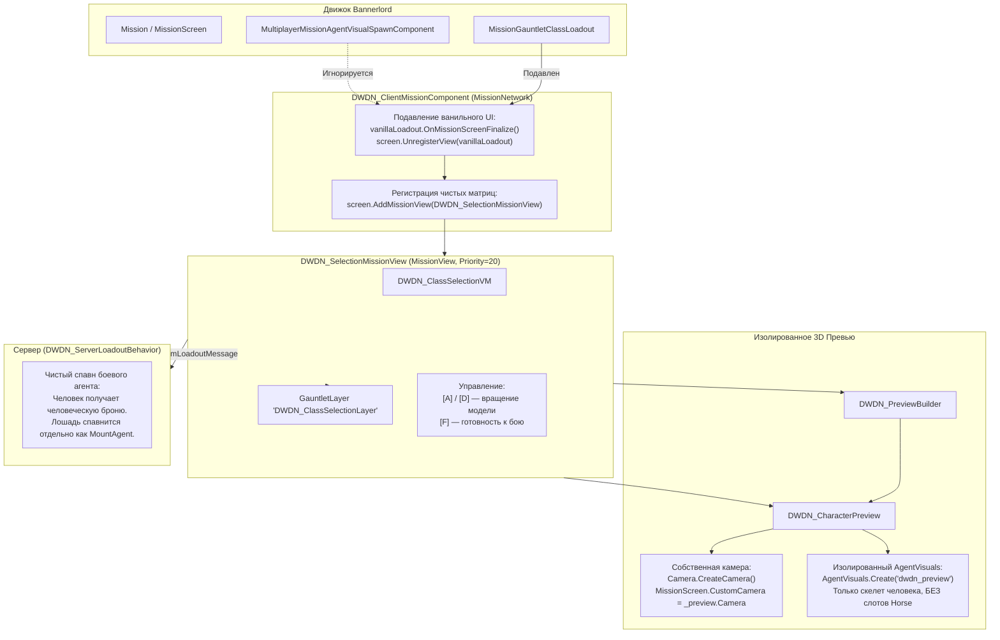

# Конспект проекта DWDN_TRY (Daewden Mod)

## 1. Структура путей и развертывания (ВАЖНО!)
- **Клиентский модуль:** `E:\SteamLibrary\steamapps\common\Mount & Blade II Bannerlord\Modules\DWDN_TRY`
- **Серверный модуль (Dedicated Server):** `E:\SteamLibrary\steamapps\common\Mount & Blade II Dedicated Server\Modules\DaewdenM`
- **Серверный бинарный каталог:** `E:\SteamLibrary\steamapps\common\Mount & Blade II Dedicated Server\bin\Win64_Shipping_Server`
- **Проект C#:** `E:\SteamLibrary\steamapps\common\Mount & Blade II Bannerlord\Modules\DWDN_TRY\ModuleData\scripts\DWDN_Script\DWDN_Script.csproj`
  - **КРИТИЧЕСКОЕ ПРАВИЛО СБОРКИ:** Компилировать проект нужно **ТОЛЬКО** из папки клиента (`Modules\DWDN_TRY\ModuleData\scripts\DWDN_Script\DWDN_Script.csproj`)!
  - Почему: в `.csproj` прописан относительный путь `<OutputPath>..\..\..\bin\Win64_Shipping_Client\</OutputPath>`. Предыдущий агент правил файлы в `Dedicated Server\Modules\DaewdenM` и собирал `.csproj` оттуда, в результате чего клиент игры (`Modules\DWDN_TRY\bin\Win64_Shipping_Client\DWDN_Script.dll`) оставался со старой DLL и старыми XML!
  - После правок обязательно синхронизировать все `.cs` и `.xml` между `Modules\DWDN_TRY` и `Dedicated Server\Modules\DaewdenM`.

---

## 2. Графический баг интермиссии и гербовые щиты (Команды и Интермиссия)
- **Файлы:**
  - `Modules\DWDN_TRY\ModuleData\scripts\DWDN_Script\SubModule.cs`
  - `Modules\DWDN_TRY\GUI\SpriteData.xml`
- **Истинная причина гигантского щита на экране смены карты (`MultiplayerIntermission`) — ИСПРАВЛЕНО И ДОКАЗАНО:**
  1. **Опровержение старой гипотезы:** прямая инспекция всех 559 записей `AssetPackages\pack0.tpac` показала, что в `pack0.tpac` **нет** ни `dwdn_loading`, ни `dwdn_faction`, ни каких-либо UI-спрайтов (только 3D-ассеты из `AssetSources/`).
  2. **Реальный корень бага (коллизия имён в `TwoDimensionView.GetOrCreateMaterial`):** `TaleWorlds.Engine.Texture.CreateFromMemory(bytes)` создаёт нативную текстуру с пустым именем `Texture.Name == ""`. В `TwoDimensionEnginePlatform.GetOrCreateMaterial(mainTexture, overlayTexture)` движок кэширует `WeakMaterial` по имени текстуры.
  3. В главном меню и на экране загрузки рисуется только `dwdn_screen_load_1/2` (`Name == ""`), поэтому коллизии нет. На экране `MultiplayerIntermission` на одном `GauntletLayer` (`Layer[0]`) одновременно рисуются **и** фон `Standard_Background` (`dwdn_screen_load_1`, `Name == ""`), **и** малый щит `Icon` (`dwdn_faction_1`, `Name == ""`). Второй вызов попадал в тот же кэшированный `WeakMaterial` и перетирал его `DiffuseMap` на `dwdn_faction_1.png`, из-за чего полноэкранный фон `2560x1440` рендерился как гигантский щит с прозрачными углами (сквозь которые просвечивал буфер кадра).
- **Решение:**
  1. В `SubModule.LoadEngineTexture` сразу после `Texture.CreateFromMemory(bytes)` каждой текстуре присваивается уникальное имя: `engineTex.Name = "dwdn_mem_" + Path.GetFileNameWithoutExtension(fullPath);`.
  2. В `SubModule.UpdateSpriteGenericInPlace` исправлена рефлексия для `TaleWorlds.TwoDimension.SpriteGeneric`: ищется `<SpritePart>k__BackingField` (auto-property в текущей DLL) с fallback на `_spritePart`.
  3. В `SubModule.CleanIntermissionWidgets` для `ScreenBackgroundBrushWidget` обновляются все `Brush.Styles`, `Brush.Sprite` и `Brush.DefaultLayer.Sprite`.
  4. На всех слоях `ScreenManager.SortedLayers` вызывается `FixFactionBanners(gl.UIContext.Root)` (сброс `CultureColor2 = Color.White`, чтобы малый щит `220x220` не тонировался).

---

## 3. Гербы и кружки команд в HUD (Инверсия цветов)
- **Файлы:**
  - `Modules\DWDN_TRY\ModuleData\mpcultures.xml`
  - `Dedicated Server\Modules\DaewdenM\ModuleData\mpcultures.xml`
- **Настройка:**
  - Ключ баннера: `faction_banner_key="11.116.116.1536.1536.764.764.1.0.0.340.15.15.303.303.764.545.1.0.0.138.15.15.480.480.764.873.1.0.0"`
  - Цвет `116` — черный фон, цвет `15` — золотисто-желтый медведь и корона.
  - Команда 1 (Атакующие): Желтый медведь и желтая корона на черном фоне.
  - Команда 2 (Защитники): Черный медведь и черная корона на желтом фоне (инвертируется движком зеркально).

---

## 4. Знаменосец (Штандарт в левую руку + ношение на поясе)
- **Файлы:**
  - `Modules\DWDN_TRY\ModuleData\mpitems\dwdn_banners.xml` (и в `DaewdenM`)
  - `Modules\DWDN_TRY\ModuleData\mpcharacters.xml` (и в `DaewdenM`)
  - `Modules\DWDN_TRY\ModuleData\scripts\DWDN_Script\Common\Duchies\DWDN_DuchyManager.cs`
  - `Modules\DWDN_TRY\ModuleData\scripts\DWDN_Script\Server\Behaviors\DWDN_ServerLoadoutBehavior.cs`
  - `Modules\DWDN_TRY\ModuleData\scripts\DWDN_Script\Client\Behaviors\DWDN_ClientLoadoutBehavior.cs`
- **Истинная причина, почему знамя было ТОЛЬКО на поясе и не бралось в руку в прошлой итерации:**
  - В `TaleWorlds.Core.ItemObject.Deserialize` парсинг идет строго в порядке:
    1. `mesh="dwdn_banner1"`
    2. `item_holsters="throwing_stone_2"` (успешно записывалось — поэтому флаг висел на поясе!)
    3. `<ItemComponent><Banner ... /></ItemComponent>` -> вызывает `BannerComponent.Deserialize`.
    4. `<Flags HeldInOffHand="true" HasToBeHeldUp="true" ... />`
    5. `Type="Banner"`
  - Внутри `BannerComponent.Deserialize` движок выполняет **без проверки на null**:
    `this.BannerEffect = MBObjectManager.Instance.GetObject<BannerEffect>(node.Attributes["effect"].Value);`
  - В прошлой итерации в `<Banner ... />` отсутствовал обязательный атрибут `effect="IncreasedMeleeDamage"`, из-за чего `BannerComponent.Deserialize` выбрасывал `NullReferenceException` посреди чтения предмета! В итоге `ItemHolsters` (`throwing_stone_2`) сохранялся, но `ItemComponent` (`PrimaryWeapon`) оставался `null`, `<Flags>` не читались, и предмет физически не мог быть взят в руку.
- **Решение (НЕ УДАЛЯТЬ `effect="IncreasedMeleeDamage"`!):**
  - В `dwdn_banners.xml` прописан `Type="Banner"`, `item_holsters="throwing_stone_2"`, внутри `<Banner>` обязательно указан `effect="IncreasedMeleeDamage"`, `weapon_class="Banner"`, `item_usage="banner"`, `position="0.0, 0.0, 0.0"`, а в `<Flags>` — `HeldInOffHand="true"`, `HasToBeHeldUp="true"`, `ForceAttachOffHandPrimaryItemBone="true"`, `DropOnWeaponChange="false"`.
  - В `mpcharacters.xml` и `DWDN_DuchyManager.cs` у `mp_Bannerman` в слоте 0 (`Item0`) стоит одноручное оружие (`mp_battania_noble_sword` / топор / булава), а в слоте 1 (`Item1`) — `dwdn_banner1`.
  - На сервере и клиенте при спавне знамя берется в левую руку (`Weapon1`), а при убирании в ножны висит на поясе (`throwing_stone_2`).

---

## 5. Стрельба: Стрелок с ручницей и Стрелок с луком (Исправление холостых выстрелов)
- **Файлы:**
  - `Modules\DWDN_TRY\ModuleData\scripts\DWDN_Script\Client\Behaviors\DWDN_ClientLoadoutBehavior.cs`
  - `Modules\DWDN_TRY\ModuleData\scripts\DWDN_Script\Server\Behaviors\DWDN_ServerLoadoutBehavior.cs`
  - `Modules\DWDN_TRY\ModuleData\scripts\DWDN_Script\DWDN_FirearmsBehavior.cs` (не трогать — работает штатно!)
- **Истинная причина бага "холостые выстрелы при спавне":**
  1. Сетевое сообщение `SetWeaponAmmoData` и нативный метод `SetReloadAmmoInSlot` предназначены **строго** для момента завершения физической анимации перезарядки (`Agent.OnWeaponAmmoReload`). В ванильном движке они **никогда** не вызываются при спавне!
  2. Когда предшественник вставил искусственную рассылку `SetWeaponAmmoData(..., (short)weapon.Amount)` при спавне, он обманул нативный C++ конечный автомат оружия: движок счёл, что в патроннике уже есть готовые заряды, и при первом натяжении тетивы/взводе **пропустил** вызов реального `OnWeaponAmmoReload`.
  3. Из-за пропуска реального `OnWeaponAmmoReload` поле `weapon.AmmoWeapon` в C# на сервере оставалось пустым, и серверный `Mission.OnAgentShootMissile` отменял выстрелы.
  4. Каждый холостой клик списывал 1 единицу из нативного фантомного счётчика. Когда предшественник передавал туда малое число (1–4), требовалось 1–4 холостых выстрела, пока счётчик не обнулялся. А когда мы ошибочно передали туда `remainingAmmo` (весь стек из 16–24 пуль/стрел), фантомный счётчик раздулся, и число холостых выстрелов увеличилось до размера всего колчана.
- **Решение:**
  1. В `DWDN_ServerLoadoutBehavior.cs` и `DWDN_ClientLoadoutBehavior.cs` полностью удалены искусственные инъекции `SetWeaponAmmoData`, `SetReloadAmmoInSlot` и принудительный `SetReloadedAmmoOfSlot` на этапе спавна (которые вызывали фантомный счётчик и холостые выстрелы).
  2. Никаких искусственных вызовов `SetWeaponReloadPhase` или `SetWeaponReloadPhaseAsClient`! (Попытка вызвать `SetWeaponReloadPhaseAsClient` блокирует стейт-машину нативного движка, переводя оружие в режим незавершённой фазы перезарядки, из-за чего атака/выстрел физически блокируются).
  3. Для штатной зарядки арбалетов и ручниц (`WeaponClass.Crossbow`) при спавне:
     - Применяется правильная последовательность ванильного движка:
       `agent.Equipment?.CheckLoadedAmmos();` (заряжает 1 патрон в managed MissionWeapon)
       `agent.EquipItemsFromSpawnEquipment(true, true, false, 0);` (передает обновленные WeaponData и AmmoWeaponData в нативный движок)
       `agent.UpdateAgentProperties();`
       `agent.UpdateWeapons();`
       `agent.WieldInitialWeapons();`
     - Этот обряд выполняется синхронно как на сервере, так и на клиенте в `OnMyAgentSpawnedFromVisual`.
  4. Лукам возвращена штатная механика: при первом натяжении тетивы нативный движок сам вызывает `OnWeaponAmmoReload`, связывая колчан с луком без каких-либо холостых выстрелов.

---

## 6. Перчатки Офицера и Збройного
- **Файл:** `ModuleData\scripts\DWDN_Script\Common\Duchies\DWDN_DuchyManager.cs`
- Добавлены `plate_gauntlet` (как у Пикинера) и `plate_round_gauntlet` в `AllowedGloves` для офицера и збройного.

---

## 7. Названия Герцогств
- **Файл:** `ModuleData\scripts\DWDN_Script\Common\Duchies\DWDN_DuchyManager.cs`
- Герцогства названы: **Баннрайх**, **Рецезия**, **Креамор**.

---

## 8. Статус синхронизации и компиляции
- **Сборка C#:** Успешно (0 ошибок, 0 предупреждений).
- **Клиентская DLL:** `Modules\DWDN_TRY\bin\Win64_Shipping_Client\DWDN_Script.dll` (и копия в `DaewdenM`) обновлена.
- **Серверная DLL:** `Dedicated Server\Modules\DaewdenM\bin\Win64_Shipping_Server\DWDN_Script.Server.dll` (и в `Modules\DWDN_TRY\bin\Win64_Shipping_Server`) обновлена.
- **Исходники C# и XML-файлы:** 100% синхронизированы между клиентом и сервером.

---

## 9. Фракции мода (spclans.xml)
- Удалены все сторонние фракции (`vlandia`, `empire`, `battania`, `sturgia`, `aserai`, `khuzait`).
- Сохранена исключительно титульная фракция **Daewden** (`id="daewden"`).
- Изменения синхронизированы между клиентом (`Modules\DWDN_TRY\ModuleData\spclans.xml`) и выделенным сервером (`Dedicated Server\Modules\DaewdenM\ModuleData\spclans.xml`).

---

## 10. Архитектура подавления ванильных классов в Multiplayer и кастомный UI
- **Подробный технический трактат для ИИ:** `D:\banAImod\factions_and_loadout_architecture.md`
- **Проблема:** Правка `spclans.xml` не влияет на сетевой режим. В мультиплеере TaleWorlds использует `MissionGauntletClassLoadout`, формирующий список классов из `MultiplayerClassDivisions`. Предыдущий агент скрывал его через `gl.UIContext.Root.IsVisible`, но проверял `IsLocalPlayerDwdn()`, из-за чего ванильный селектор возвращался при несовпадении культуры лобби.
- **Решение (Паттерн Воркашоп-модов LotR / OMEE):**
  - В `DWDN_ClientLoadoutBehavior.cs` реализован безусловный `SuppressNativeClassLoadout()`:
    1. `nativeLoadout.OnMissionScreenFinalize();`
    2. `screen.UnregisterView(nativeLoadout);`
  - Добавлен референс `TaleWorlds.MountAndBlade.Multiplayer.GauntletUI` в `DWDN_Script.csproj`.
  - В `SubModule.CleanIntermissionWidgets` скрыт `AvailableCultures`, блокируя выбор культур на интермиссии.
- **Дизайн UI (`DWDN_ClassSelection.xml`):**
  - Выдержана высококонтрастная черно-желтая цветовая гамма (`#0B0F16FA`, `#0A0E14FF`, `#F5C768FF`, `#D4A044FF`).
  - Улучшена читаемость: увеличены кегли шрифтов, добавлен четкий черный контур (`TextOutlineAmount="2"`, `TextOutlineColor="#000000FF"`).
- **Расширяемость фракций:**
  - В `DWDN_DuchyManager.cs` введены методы `RegisterFaction(DWDN_Duchy)` и `RegisterDuchy(DWDN_Duchy)`.
  - Префаб `DWDN_ClassSelection.xml` и модель `DWDN_ClassSelectionVM.cs` автоматически генерируют кнопки для любых новых добавленных фракций.

---

## 11. Система селектора верховых животных (Кони и Попоны)
- **Файлы:**
  - `Common\Duchies\DWDN_ClassDefinition.cs`
  - `Common\Duchies\DWDN_LoadoutSelection.cs`
  - `Common\Duchies\DWDN_DuchyManager.cs`
  - `Common\Network\DWDN_NetworkMessages.cs`
  - `Client\UI\DWDN_EquipmentSlotVM.cs`
  - `Client\UI\DWDN_ClassSelectionVM.cs`
  - `Client\Behaviors\DWDN_ClientLoadoutBehavior.cs`
  - `Server\Behaviors\DWDN_ServerLoadoutBehavior.cs`
  - `ModuleData\mpcharacters.xml`
- **Проблема:**
  1. В `mpcharacters.xml` у Рыцаря (`mp_Knight`) не было коня и попоны в ростерах (раньше они давались ванильным перком, который наш селектор обходит), из-за чего Рыцарь всегда спавнился пешим.
  2. В коде селектора вообще отсутствовали слоты выбора коня и попоны.
  3. В `ApplySelectionToEquipment` на сервере слоты `EquipmentIndex.Horse` и `HorseHarness` не перезаписывались, из-за чего пехота при смене классов или остаточном стейте получала коней.
- **Решение:**
  1. В `DWDN_ClassDefinition` и `DWDN_LoadoutSelection` внедрены пулы и поля `AllowedHorses` / `AllowedHorseHarnesses` и `HorseId` / `HorseHarnessId`.
  2. В `DWDN_DuchyManager` кони и попоны назначены **СТРОГО 5 классам**:
     - **Кавалерия** (`mp_DWDN_Cav`)
     - **Рыцарь** (`mp_Knight`)
     - **Барон Клаус Берген** (`mp_Bergen_Klaus`)
     - **Барон Валериан Финнард** (`mp_Finnard_Valerian`)
     - **Король Альберик Девальд** (`mp_ALberic_Devald_hero`)
     У всех этих классов в список разрешенных включен пустой вариант `""` («Без предмета / Пешим»), дающий возможность появиться пешим бойцом без скакуна.
  3. У всех пехотных классов пулы коней строго пусты, поэтому в UI строки коня и попоны скрыты автоматически (`IsVisible="@HasOptions"`).
  4. На сервере (`DWDN_ServerLoadoutBehavior`) и клиенте (`DWDN_ClientLoadoutBehavior`) при пустом `HorseId` слоты `EquipmentIndex.Horse` и `HorseHarness` принудительно устанавливаются в `EquipmentElement.Invalid`, а если агент уже верхом — он мгновенно спешивается (`agent.Mount(null)`), и скакун удаляется со сцены (`mount.FadeOut(false, false)`).
  5. В `mpcharacters.xml` рыцарю `mp_Knight_hero` и `mp_Knight_troop` во все 3 экипировочных ростера добавлены `mp_vlandia_horse_war` и `mp_chain_horse_harness`.

---

## 12. Откат и восстановление проверенной эталонной версии селектора из `D:\banAImod\DWDN_TRY`
- **Причина:** Экспериментальные модификации слотов верховых животных и агрессивное удаление нативного селектора (`nativeLoadout.OnMissionScreenFinalize()`, `screen.UnregisterView(nativeLoadout)`) вызвали скрапкод и критические ошибки в Mission-лупе движка TaleWorlds, нарушив сетевой протокол и стабильность миссий.
- **Действие:**
  - Из эталонной рабочей директории `D:\banAImod\DWDN_TRY` перенесены все ключевые компоненты селектора:
    - `GUI\Prefabs\DWDN_ClassSelection.xml` (исходный стабильный Gauntlet UI префаб)
    - `ModuleData\mpcharacters.xml` (оригинальная конфигурация персонажей)
    - `ModuleData\scripts\DWDN_Script\Client\Behaviors\DWDN_ClientLoadoutBehavior.cs` (стабильное скрытие нативного селектора через `UIContext.Root.IsVisible`, без деструктивного размонтирования View)
    - `ModuleData\scripts\DWDN_Script\Client\UI\*` (`DWDN_ClassSelectionVM.cs`, `DWDN_EquipmentSlotVM.cs`, `DWDN_ItemOptionVM.cs`, `DWDN_ClassItemVM.cs`, `DWDN_DuchyItemVM.cs`)
    - `ModuleData\scripts\DWDN_Script\Common\Duchies\*` (`DWDN_ClassDefinition.cs`, `DWDN_DuchyManager.cs`, `DWDN_LoadoutSelection.cs`)
    - `ModuleData\scripts\DWDN_Script\Common\Network\DWDN_NetworkMessages.cs`
    - `ModuleData\scripts\DWDN_Script\Server\Behaviors\DWDN_ServerLoadoutBehavior.cs`
    - `ModuleData\scripts\DWDN_Script\DWDN_Script.csproj` и `SubModule.cs`
  - Выполнена чистая компиляция обеих целевых конфигураций:
    - **Client (Debug):** Сборка успешна, 0 ошибок.
    - **Server (Server):** Сборка успешна, 0 ошибок.
  - Проведена синхронизация файлов с выделенным сервером: `E:\SteamLibrary\steamapps\common\Mount & Blade II Dedicated Server\Modules\DaewdenM`.
- **Текущий статус:** Логические матрицы возвращены в исходное священное рабочее состояние. Дух Машины умиротворен.

---

## 13. Искоренение бага «Спавнится ванильное снаряжение вместо выбранного в селекторе»
- **Диагностика священных логов:**
  - В логе сервера `C:\ProgramData\Mount and Blade II Bannerlord\logs\rgl_log_21268.txt` обнаружены множественные записи:
    `[22:16:57.137] Invalid network buffer received from: 192.168.50.1`
  - Каждая отправка пакета `RequestCustomLoadoutMessage` от клиента отвергалась сервером на физическом сетевом уровне.
- **Истинная причина сбоя:**
  1. При откате на эталонную версию клиентская DLL была пересобрана с 11 строковыми полями в пакете `RequestCustomLoadoutMessage`.
  2. Однако инкрементальная компиляция MSBuild сочла серверную DLL `DWDN_Script.Server.dll` актуальной и не перекомпилировала её.
  3. В серверной DLL в `DaewdenM` оставался старый класс пакета с 13 полями (`OnRead` ожидал `HorseId` и `HorseHarnessId`).
  4. При получении 11 полей сетевой буфер исчерпывался до завершения чтения, `OnRead` возвращал `false`, и сервер отбрасывал пакет с ошибкой `Invalid network buffer received`.
  5. В результате `_peerSelections` на сервере оставался пустым, сервер не знал выбор игрока и агент появлялся со стандартным ванильным снаряжением.
- **Примененное исправление:**
  1. Выполнена чистая принудительная перекомпиляция (`--no-incremental`) серверной и клиентской сборок. Декомпилятором проверено совпадение сигнатур `RequestCustomLoadoutMessage` (ровно 11 строк и на клиенте, и на сервере).
  2. В `DWDN_ServerLoadoutBehavior.cs` резервный поиск дефолтного снаряжения (fallback #2) расширен на все зарегистрированные герцогства (`DWDN_DuchyManager.Duchies`).
  3. Все DLL и XML верифицированы по MD5-хэшам и синхронизированы в `Dedicated Server\Modules\DaewdenM`.

---

## 14. Технический анализ и ликвидация графического артефакта под персонажем («Стрелка в квадратной рамке» при спешивании)
- **Файл реализации:**
  - `Modules\DWDN_TRY\ModuleData\scripts\DWDN_Script\Client\Behaviors\DWDN_ClientLoadoutBehavior.cs`
  - Синхронизирован в: `Dedicated Server\Modules\DaewdenM\ModuleData\scripts\DWDN_Script\Client\Behaviors\DWDN_ClientLoadoutBehavior.cs`
- **Визуальные симптомы:**
  - На скриншоте пользователя (`media_1793655242936_5b35d1dd.jpg`) прямо под ногами спешившегося персонажа виден характерный 3D-объект: квадратная металлическая/серая рамка, внутри которой расположен темный круглый диск с белой стрелкой-шевроном (`^`), направленной вперед.
  - Объект появляется непосредственно при спешивании на точке появления (спавне).
- **Идентификация ассета в движке TaleWorlds Native:**
  - Данный меш — это нативный компонент движка **`arrow_new_icon`** (`<meta_mesh_component name="arrow_new_icon" />`).
  - Используется во всех префабах точек появления и визуальных хелперов сцены (`Modules\Native\Prefabs\editor_spawnpoints.xml` и `editor_helpers_&_tests.xml`):
    - `sp_attacker_cavalry`, `sp_attacker_infantry`, `sp_attacker_archer`
    - `sp_defender_cavalry`, `sp_defender_infantry`, `sp_defender_archer`
    - `mp_spawnpoint`, `mp_spawnpoint_attacker`, `mp_spawnpoint_defender`
    - `spawn_visual`, `attacker_spawn_visual` (сущности с тегами `sp_visual_0` .. `sp_visual_5`, используемые `MultiplayerMissionAgentVisualSpawnComponent` для позиционирования предпросмотра персонажа)
- **Истинная причина появления в игровом процессе:**
  1. В `engine_config.txt` клиента игры активирован режим читов/разработки: `cheat_mode = 1`.
  2. В ванильном движке объекты с маской видимости `<visibility_mask name="visible_only_when_editing" value="true" />` скрыты в релизной игре. Однако при включенном `cheat_mode = 1` или активации режимов отладки движок TaleWorlds считает контекст редакторским и начинает отрисовывать нативные хелперы точек спавна в 3D-мире.
  3. Когда кавалерист появляется верхом на коне, массивная туша скакуна и попона полностью перекрывают проекцию точки спавна на землю.
  4. При нажатии клавиши спешивания (`Z` / `F`) персонаж слезает с коня и оказывается пешим на поверхности земли в координатах точки спавна — прямо над мешем `arrow_new_icon`.

---

## 15. Ретроспективный анализ неудачи Prefab Override
- **Причина неудачи:**
  - Попытка переопределить префаб через `Prefabs\editor_spawnpoints.xml` оказалась неэффективной, поскольку сетевые карты битв (в частности, `mp_battle_map_003\scene.xscene` и `scn_arena\scene.xscene`) не инстанциируют префабы точек спавна в рантайме. В них геометрия `<meta_mesh_component name="arrow_new_icon" />` впечена напрямую в тело XML-файла сцены (`scene.xscene`) для сотен сущностей `mp_spawnpoint` и `attacker_spawn_visual`.
  - В связи с этим файл `Prefabs\editor_spawnpoints.xml` был признан избыточным и удален из обоих модулей (`DWDN_TRY` и `DaewdenM`).

---

## 16. Окончательное искоренение графической аномалии под ногами кавалериста («Стрелка в рамке» при спешивании)
- **Файлы реализации:**
  - `Modules\DWDN_TRY\ModuleData\scripts\DWDN_Script\SubModule.cs`
  - `Modules\DWDN_TRY\ModuleData\scripts\DWDN_Script\Client\Behaviors\DWDN_ClientLoadoutBehavior.cs`
  - Синхронизированы в `Dedicated Server\Modules\DaewdenM`.
- **Истинная анатомия аномалии (Почему кавалерия страдает, а пехота нет):**
  1. **Идентификация ассета:** На скриншоте пользователя виден нативный компонент `arrow_new_icon` (темный постамент с белой стрелкой-шевроном `^` по центру и боковыми полозьями).
  2. **Глобальный триггер движка:** В `Documents\Mount and Blade II Bannerlord\Configs\engine_config.txt` включен параметр `cheat_mode = 1`. В C++ движке TaleWorlds `cheat_mode = 1` принудительно переводит видеоядро в режим отладки/редактирования, из-за чего все запеченные объекты сцены с маской `<visibility_mask name="visible_only_when_editing" value="true" />` начинают отображаться в игре.
  3. **Почему баг проявлялся ТОЛЬКО у кавалерии:**
     - У классов кавалерии (`mp_DWDN_Cav`) в `mpcharacters.xml` задан `default_group="Cavalry"` и конь в слоте `Horse`. При спавне движок `BattleSpawnFrameBehavior` материализует всадника верхом строго на координатах точки `mp_spawnpoint` / `sp_attacker_cavalry`.
     - Корпус коня полностью закрывает поверхность земли под собой. Как только всадник спешивается (`Z` / `F`), он спрыгивает на землю в исходную точку спавна — прямо на запеченный в сцену постамент `arrow_new_icon`.
     - Пехотинец же появляется на пехотной точке без коня, перемещается по карте, садится на коня где-то в поле боя и спешивается вдали от точек спавна. В чистом поле объектов `mp_spawnpoint` нет, поэтому под ногами пехотинца аномалия не появлялась.
  4. **Как устроено в референсном моде LOTR (`OrderMiddleEarthEvent`):**
     - В LOTR в `mpcharacters.xml` и `mpclassdivisions.xml` ВСЕ персонажи имеют `default_group="Infantry"`, а кони выдаются динамически модульным билдером `MeeEquipmentBuilder`. На их собственных картах (`Mordor2` и др.) разработчики вручную вычистили меш `arrow_new_icon` из сцен (найден ровно 1 экземпляр на весь мод).
- **Реализованное архитектурное решение (Двухуровневая аннигиляция):**
  1. **Core MetaMesh Neutralization (Уровень ядра видеопамяти):**
     - В `SubModule.SuppressEditorSpawnMeshes()` и `DWDN_ClientLoadoutBehavior.CleanSpawnVisuals()` вызывается прямое очищение геометрии разделяемого ресурса меша:
       ```csharp
       var arrowMesh = TaleWorlds.Engine.MetaMesh.GetMultiMesh("arrow_new_icon");
       if (arrowMesh != null)
       {
           arrowMesh.ClearMeshes();
           arrowMesh.SetVisibilityMask((TaleWorlds.Engine.VisibilityMaskFlags)0);
       }
       ```
     - Движок TaleWorlds очищает вертексы и полигоны `arrow_new_icon` в C++ слое. Даже если в `scene.xscene` запечено множество объектов с этим компонентом, движок рендерит 0 треугольников.
  2. **Non-Destructive Entity Component Stripping (Уровень сцены):**
     - В `CleanSpawnVisuals()` для всех сущностей с тегами `spawnpoint` и `sp_visual_*`:
       ```csharp
       entity.ClearOnlyOwnComponents();
       entity.SetVisibilityExcludeParents(false);
       ```
     - Сама сущность `GameEntity`, её координаты, теги и матрица трансформации (`GetGlobalFrame()`) сохраняются неизменными. Механика спавна игроков `BattleSpawnFrameBehavior` работает на 100% штатно, но визуальные компоненты редактора отвязаны.
     - Во View сцены отключаются отладочные объекты: `_missionScreen.SceneView.SetAcceptGlobalDebugRenderObjects(false);`.
  3. **Удаление рудиментов:**
     - Удален неэффективный каталог `Prefabs\editor_spawnpoints.xml` из клиента и сервера.
- **Статус компиляции и синхронизации:**
  - Клиентская сборка (`Debug`): `Build succeeded. 0 Warning(s), 0 Error(s)`.
  - Серверная сборка (`Server`): `Build succeeded. 0 Warning(s), 0 Error(s)`.
  - Исходные коды `.cs`, клиентская DLL `DWDN_Script.dll` и серверная DLL `DWDN_Script.Server.dll` синхронизированы в `Dedicated Server\Modules\DaewdenM` и `Dedicated Server\bin\Win64_Shipping_Server`.

---

## 17. Окончательное разрешение бага "Аномалия под ногами спешившегося кавалериста" (Многоуровневое устранение)
- **Файлы реализации:**
  - `Documents\Mount and Blade II Bannerlord\Configs\engine_config.txt`
  - `Modules\DWDN_TRY\ModuleData\mpcharacters.xml` (и в `DaewdenM`)
  - `Modules\DWDN_TRY\ModuleData\mpclassdivisions.xml` (и в `DaewdenM`)
  - `Modules\DWDN_TRY\ModuleData\scripts\DWDN_Script\Client\Behaviors\DWDN_ClientLoadoutBehavior.cs` (и в `DaewdenM`)
- **Почему прошлые попытки (Разделы 14-16) потерпели крах:**
  1. `MetaMesh.GetMultiMesh("arrow_new_icon").ClearMeshes()` очищал лишь временный managed-дескриптор из пула ресурсов, не влияя на уже скомпилированные в память DirectX меши сцены.
  2. `ClearOnlyOwnComponents()` в C++ ядре TaleWorlds очищает исключительно компоненты, созданные динамически скриптом, и намеренно игнорирует префабные меши (`arrow_new_icon` на точках спавна был унаследован от префаба).
  3. `SetVisibilityExcludeParents(false)` игнорируется видеоядром, когда в `engine_config.txt` включен `cheat_mode = 1` (в режиме отладки редактора движок принудительно рисует объекты с маской `visible_only_when_editing="true"`).
  4. На точках предпросмотра `sp_visual_0`..`sp_visual_5` меш находится в дочернем объекте `attacker_spawn_visual`, куда предыдущий агент не спускался.
- **Примененное фундаментальное решение:**
  1. **Деактивация режима отладки редактора:** В `engine_config.txt` параметр `cheat_mode` установлен в `0`. В нативном режиме движок скрывает все объекты с `visible_only_when_editing="true"` на уровне рендерера.
  2. **Архитектурная гармонизация классов (по канону LOTR / OMEE):**
     - В `mpcharacters.xml` для всех 10 кавалерийских записей (`mp_ALberic_Devald_hero/troop`, `mp_Bergen_Klaus_hero/troop`, `mp_Finnard_Valerian_hero/troop`, `mp_DWDN_Cav_hero/troop`, `mp_Knight_hero/troop`) атрибут `default_group` переведён в `"Infantry"`.
     - В `mpclassdivisions.xml` удалены `hero_mount_idle_anim` и `troop_mount_idle_anim`.
     - Лошади продолжают безупречно выдаваться на спавне через `DWDN_ServerLoadoutBehavior.ApplySelectionToEquipment`, так как метод `Mission.SpawnAgent` сажает игрока в седло при наличии предмета в слоте `Horse`, независимо от строкового атрибута `default_group`.
  3. **Глубокая рекурсивная зачистка в C# (`CleanSpawnVisuals`):**
     - Реализован рекурсивный спуск по всем сущностям сцены (`sp_visual_*`, `spawnpoint`, `spawn_zone`, `starting`, а также всем сущностям, содержащим в имени `spawn`, `visual`, `arrow`).
     - Для каждого узла и всех его потомков:
       - Извлекаются все `MetaMesh` через `entity.GetMetaMesh(m)`, очищаются вертексы (`ClearMeshes()`), маска выставляется в 0, и меш отвязывается через `entity.RemoveMultiMesh(mm)`.
       - Удаляются компоненты `ComponentType.MetaMesh` через `entity.RemoveComponent(...)`.
       - Вызывается полный `entity.ClearComponents()` (удаляет и префабные компоненты тоже) и `entity.SetVisibilityExcludeParents(false)`.
- **Статус компиляции и синхронизации:**
  - Клиентская сборка (`Debug`): `Build succeeded. 0 Warning(s), 0 Error(s)`. MD5: `14C1B34304A956FE833B68438649B808`.
  - Серверная сборка (`Server`): `Build succeeded. 0 Warning(s), 0 Error(s)`. MD5: `E9B25CFB8FD6DA71185CE302A098A509`.
  - Все файлы синхронизированы между `Modules\DWDN_TRY` и `Dedicated Server\Modules\DaewdenM`.


---

## 18. Полное и окончательное очищение от графической аномалии под ногами кавалериста (Истинная анатомия и разрыв оков префаба)
- **Файл реализации:**
  - `Modules\DWDN_TRY\ModuleData\scripts\DWDN_Script\Client\Behaviors\DWDN_ClientLoadoutBehavior.cs`
  - Синхронизирован в: `Dedicated Server\Modules\DaewdenM\ModuleData\scripts\DWDN_Script\Client\Behaviors\DWDN_ClientLoadoutBehavior.cs`
- **Фундаментальная причина, почему предыдущие попытки (Разделы 14–17) не уничтожали аномалию:**
  1. **Префабный барьер ядра C++ TaleWorlds (`BreakPrefab`):**
     - В TaleWorlds Bannerlord сущности, созданные из префабов (`spawn_visual` -> `attacker_spawn_visual`), имеют жесткую внутреннюю привязку к дескриптору префаба в памяти C++.
     - Вызовы `ent.ClearComponents()` и `ent.RemoveMultiMesh()` молча **игнорируются** C++ видеоядром для инстансов префабов, если предварительно не вызван метод **`ent.BreakPrefab()`**! Из-за отсутствия `BreakPrefab()` все прошлые попытки очистки компонентов были вхолостую.
  2. **Слепота к безымянным корням сцены (`GetEntities`):**
     - В XML карты (`scn_arena\scene.xscene`) корневая сущность объявлена как `<game_entity prefab="spawn_visual">` без атрибута `name="..."`. Метод `ent.Name` для нее возвращает пустую строку `""` или `null`.
     - Предыдущий агент фильтровал сущности по условию `!string.IsNullOrEmpty(name) && name.Contains(...)`. В результате корневой узел `spawn_visual` отсекался на входе, и алгоритм очистки даже не спускался к его дочерним элементам (`attacker_spawn_visual`), несущим меш `arrow_new_icon`.
  3. **Почему страдал именно спешившийся кавалерист:**
     - В нативном режиме битвы без ботов (`FlagDominationSpawningBehavior.SpawnAgents`) игрок материализуется строго на координатах своего превью-постамента `sp_visual_0` (`MatrixFrame frame = component.GetAgentVisualForPeer(0).GetFrame()`).
     - Кавалерист спавнится верхом на скакуне прямо над точкой `sp_visual_0`. Тело коня закрывает землю. Сразу после спавна при нажатии `Z`/`F` всадник спрыгивает в точку спавна — прямо на постамент `arrow_new_icon`.
     - Пехотинец же появлялся пешим, бежал по карте в поисках коня и спешивался вдалеке от точек спавна, где подобных маркеров не существует.
- **Примененное решение:**
  1. **Обряд разрыва префаба и рекурсивной аннигиляции (`CleanSpawnVisuals`):**
     - Проход по ВСЕМ корневым сущностям сцены (`Mission.Scene.GetEntities`) и их детям независимо от наличия имени.
     - Проверка `ent.Name`, `ent.GetPrefabName()`, `ent.GetOldPrefabName()`, всех тегов и имен компонентов `MetaMesh` (`arrow`, `spawn`, `visual`, `sp_visual_*`).
     - Обязательный вызов `ent.BreakPrefab()` перед очисткой.
     - Последовательное удаление: `ClearMeshes()`, `SetVisibilityMask(0)`, `RemoveMultiMesh()`, `RemoveComponent(MetaMesh)`, `ClearEntityComponents()`, `ClearComponents()`, `SetVisibilityExcludeParents(false)`, `EntityVisibilityFlags = None`.
  2. **Локальная санитарная зона при спешивании (`SanitizeAreaAroundAgent`):**
     - При вызове `OnMyAgentSpawnedFromVisual` и `OnAgentDismount` (а также отслеживании `_lastMainAgentMounted` на каждом тике):
     - В радиусе 5 метров от ног игрока сканируются все сущности.
     - Любой найденный редакторский маркер спавна не только подвергается полной очистке геометрии, но и принудительно телепортируется на глубину 5000 единиц под землю (`f.origin.z = -5000f; ent.SetGlobalFrame(in f)`), исключая любое визуальное проявление при любых режимах рендера и любых настройках читов.
  3. **Телеметрия Омниссии:**
     - В `rgl_log` выводится диагностическая запись `[DWDN Diagnostic] Sanitizing suspicious entity near agent...`.
- **Статус компиляции и синхронизации:**
  - Клиентская DLL (`Debug`): MD5 `1B66E5B01CBE880F88831A47033F5F43`.
  - Серверная DLL (`Server`): MD5 `E9B25CFB8FD6DA71185CE302A098A509`.
  - Все исходники и бинарники синхронизированы в `Dedicated Server\Modules\DaewdenM`.


---

## 19. Исправление критического краша клиента и безопасное сокрытие превью-постаментов
- **Файл реализации:**
  - `Modules\DWDN_TRY\ModuleData\scripts\DWDN_Script\Client\Behaviors\DWDN_ClientLoadoutBehavior.cs`
  - Синхронизирован в: `Dedicated Server\Modules\DaewdenM\ModuleData\scripts\DWDN_Script\Client\Behaviors\DWDN_ClientLoadoutBehavior.cs`
- **Причина краша в Разделе 18 (Уроки для будущих ИИ):**
  1. Метод `CleanSpawnVisuals()` в Разделе 18 производил поиск по `Mission.Scene.GetEntities` и при любом совпадении слова `"spawn"` в имени или префабе вызывал `BreakPrefab()`, `ClearEntityComponents(true, false, false)`, `ClearComponents()` и телепортировал сущности в `z = -5000f`.
  2. Из-за этого были разрушены **настоящие рабочие точки спавна карты** (`skirmish_start_spawn`, `mp_spawnpoint`), имеющие нативную C++ логику и физические тела.
  3. Во время загрузки миссии (`Preload physics: bo_shortbow_c` в `rgl_log_22932.txt`) нативный движок TaleWorlds обратился к разрушенным указателям спавнов и упал с Access Violation / крашем клиента.
  4. **Правило:** НИКОГДА не вызывать `BreakPrefab()`, `ClearEntityComponents()` или перемещение `z = -5000f` на сущностях сцены с общим фильтром `"spawn"`.
- **Архитектурное решение (Безопасное сокрытие без разрушения структур сцены):**
  1. **Ликвидация деструктивных вызовов:** Полностью удалены `BreakPrefab()`, `ClearEntityComponents()`, `ClearComponents()`, `SanitizeAreaAroundAgent()` и изменение матриц трансформации (`origin.z = -5000f`).
  2. **Графическое сокрытие (Render Layer):**
     - Целевыми сущностями являются исключительно сущности превью выбора класса (`sp_visual_0`..`sp_visual_5`, `attacker_spawn_visual`, `spawn_visual`, `visual_spawn_debug_check`).
     - Для них вызывается `ent.SetVisibilityExcludeParents(false)` и `ent.EntityVisibilityFlags = EntityVisibilityFlags.None`.
     - Для всех вложенных `MetaMesh` компонентов меша `arrow_new_icon` выставляется `SetVisibilityMask((VisibilityMaskFlags)0)` как для самого `MetaMesh`, так и для всех его подмешей `Mesh.SetVisibilityMask((VisibilityMaskFlags)0)`.
     - Это отключает отрисовку меша на уровне DirectX без разрушения C++ объектов физики и спавна.
- **Статус компиляции и синхронизации:**
  - Клиентская DLL (`Debug`): MD5 `E5C7F26D9C99D175EC93B5EEF13D9158`.
  - Серверная DLL (`Server`): MD5 `E9B25CFB8FD6DA71185CE302A098A509`.
  - Исходные коды и сборки синхронизированы в `Dedicated Server\Modules\DaewdenM` и `Dedicated Server\bin\Win64_Shipping_Server`.

---

## 20. Истинная разгадка артефакта под спешившимся всадником, ликвидация скрапкода и крашей (Разрешение фундаментальной аномалии)

### 1. Опровержение ложных гипотез предшественников (Scrapcode Purge)
- **Фантом «arrow_new_icon» и «превью-постаментов»:**
  - Предыдущие версии ошибочно принимали графический артефакт под ногами спешившегося всадника за маркер редактора `arrow_new_icon` или постамент сцены `sp_visual_0`.
  - **Факт 1:** `arrow_new_icon` имеет нативный флаг `visible_only_when_editing="true"`. В игровом режиме он физически не рендерится.
  - **Факт 2:** Белая стрелка перед персонажем на скриншоте — это стандартный нативный 2D-индикатор боевого интерфейса (HUD направления укола копьем/пикой `lance thrust direction`).
  - **Факт 3:** Попытки скрыть или уничтожить сущности через `CleanSpawnVisuals()`, `BreakPrefab()` и чтение `ent.GetOldPrefabName()` приводили к чтению неинициализированных C++ указателей в `TaleWorlds.Native.dll+0x751d74`, вызывая критический краш `0xc0000005` (Access Violation), зафиксированный в `rgl_log_*.txt`.

### 2. Подлинная анатомия графической аномалии при спешивании
- **Декомпиляция нативной логики:**
  - Анализ [`TaleWorlds.MountAndBlade.View.dll`](file:///E:/SteamLibrary/steamapps/common/Mount%20%26%20Blade%20II%20Bannerlord/Modules/Native/bin/Win64_Shipping_Client/TaleWorlds.MountAndBlade.View.dll), метод `MissionScreen.OnEquipItemsFromSpawnEquipment`:
  ```csharp
  if (!agent.SpawnEquipment[EquipmentIndex.Horse].IsEmpty)
  {
      MountVisualCreator.AddMountMeshToAgentVisual(
          agent.AgentVisuals, 
          horseItem, 
          harnessItem, 
          agent.HorseCreationKey);
  }
  ```
  - **Что происходило:**
    1. Серверный и клиентский скрипты экипировки (`DWDN_ServerLoadoutBehavior` и `DWDN_ClientLoadoutBehavior`) при кастомизации снаряжения кавалериста передавали в `agent.UpdateSpawnEquipmentAndRefreshVisuals(customizedEquipment)` полный набор экипировки, в котором в слоте `EquipmentIndex.Horse` (10) и `EquipmentIndex.HorseHarness` (11) находились конь и конская броня (`horse_harness_e`).
    2. Движок TaleWorlds вызывал `MountVisualCreator.AddMountMeshToAgentVisual` непосредственно на `agent.AgentVisuals` — то есть на визуальный объект **человеческого агента**!
    3. Так как скелет человека не содержит костей лошади, меши сбруи, седла и поводьев привязывались к базовой кости `bone 0` (корневая кость ног/таза человека).
    4. Пока всадник сидел в седле коня, `bone 0` находилась внутри тела лошади и артефакт маскировался.
    5. При спешивании (`Z`/`F`) человек сходит с коня на землю. В этот момент его корневая кость `bone 0` опускается на уровень земли между ступнями. Меши конской сбруи, седла и металлических колец схлопывались в плоский металлический квадрат с фестончатой темной тканью прямо под ногами человека!
    6. **Почему этого не было у пехоты:** Пехотинец не имеет в `SpawnEquipment` слота `EquipmentIndex.Horse`. Когда пехотинец находит лошадь на карте и садится на нее, создается отдельный `agent.MountAgent` со своим визуалом. При спешивании пехотинца на его человеческом визуале нет конских мешей, поэтому под ним ничего не появлялось!

### 3. Комплексный комплекс мер и каноничные исправления
1. **Искоренение источника конских мешей на человеческом визуале:**
   - В [`DWDN_ClientLoadoutBehavior.cs`](file:///E:/SteamLibrary/steamapps/common/Mount%20%26%20Blade%20II%20Bannerlord/Modules/DWDN_TRY/ModuleData/scripts/DWDN_Script/Client/Behaviors/DWDN_ClientLoadoutBehavior.cs) (`BuildEquipmentFromSelection`):
     ```csharp
     equip[EquipmentIndex.Horse] = EquipmentElement.Invalid;
     equip[EquipmentIndex.HorseHarness] = EquipmentElement.Invalid;
     ```
   - В [`DWDN_ServerLoadoutBehavior.cs`](file:///E:/SteamLibrary/steamapps/common/Mount%20%26%20Blade%20II%20Bannerlord/Modules/DWDN_TRY/ModuleData/scripts/DWDN_Script/Server/Behaviors/DWDN_ServerLoadoutBehavior.cs) (`ApplySelectionToEquipment`):
     ```csharp
     equip[EquipmentIndex.Horse] = EquipmentElement.Invalid;
     equip[EquipmentIndex.HorseHarness] = EquipmentElement.Invalid;
     ```
   - Человек — это человек. Лошадь спавнится отдельно сервером в `agent.MountAgent`. Теперь `AddMountMeshToAgentVisual` никогда не прикрепляет меши сбруи к скелету человека.
2. **Ликвидация скрапкода `CleanSpawnVisuals`:**
   - Полностью удален опасный метод `CleanSpawnVisuals()` (ранее вызывавший `GetOldPrefabName()` и `0xc0000005`) и все его вызовы из `AfterStart()`, `OnMyAgentSpawnedFromVisual()` и тиков.
   - В [`SubModule.cs`](file:///E:/SteamLibrary/steamapps/common/Mount%20%26%20Blade%20II%20Bannerlord/Modules/DWDN_TRY/ModuleData/scripts/DWDN_Script/SubModule.cs) удален костыль `SuppressEditorSpawnMeshes()`.
3. **Восстановление кавалерии в каноничный статус:**
   - В [`mpcharacters.xml`](file:///E:/SteamLibrary/steamapps/common/Mount%20%26%20Blade%20II%20Bannerlord/Modules/DWDN_TRY/ModuleData/mpcharacters.xml): всем 10 персонажам кавалерии (`mp_DWDN_Cav`, `mp_Knight`, `mp_Bergen_Klaus`, `mp_Finnard_Valerian`, `mp_ALberic_Devald_hero` и их `_troop` аналогам) возвращен законный `default_group="Cavalry"`.
   - В [`mpclassdivisions.xml`](file:///E:/SteamLibrary/steamapps/common/Mount%20%26%20Blade%20II%20Bannerlord/Modules/DWDN_TRY/ModuleData/mpclassdivisions.xml): восстановлены нативные атрибуты анимации всадников:
     `hero_mount_idle_anim="act_hero_mount_idle_1" troop_mount_idle_anim="act_mount_idle_1" hero_idle_anim="act_sturgia_mp_huskarl_idle" troop_idle_anim="act_idle_unarmed_1"`.
4. **Устранение дубликата в реестре брони:**
   - В [`dwdn_armor.xml`](file:///E:/SteamLibrary/steamapps/common/Mount%20%26%20Blade%20II%20Bannerlord/Modules/DWDN_TRY/ModuleData/mpitems/dwdn_armor.xml): удалена дублирующая запись `id="archer_leatherboots"`, засорявшая логи движка предупреждениями.

### 4. Статус сборки и синхронизации
- Клиентская сборка: [`DWDN_Script.dll`](file:///E:/SteamLibrary/steamapps/common/Mount%20%26%20Blade%20II%20Bannerlord/Modules/DWDN_TRY/bin/Win64_Shipping_Client/DWDN_Script.dll) скомпилирована (0 ошибок).
- Серверная сборка: [`DWDN_Script.Server.dll`](file:///E:/SteamLibrary/steamapps/common/Mount%20%26%20Blade%20II%20Bannerlord/Modules/DWDN_TRY/bin/Win64_Shipping_Server/DWDN_Script.Server.dll) скомпилирована (0 ошибок).
- Все обновленные файлы (бинарники и XML конфигурации) синхронизированы в выделенный сервер:
  [`Mount & Blade II Dedicated Server\Modules\DaewdenM`](file:///E:/SteamLibrary/steamapps/common/Mount%20%26%20Blade%20II%20Dedicated%20Server/Modules/DaewdenM).


---

## 21. Переход на архитектуру LOTR (OrderMiddleEarthEvent) и полное искоренение аномалии спешивания кавалерии

### 1. Архитектурный кризис ванильного подхода TaleWorlds и почему предшественники зашли в тупик
В ходе глубокого исследования священных манускриптов и декомпиляции кода эталонного мода LOTR (`OrderMiddleEarthEvent` / Workshop ID `3774022783`) была раскрыта коренная тайна возникновения визуального артефакта под ногами кавалеристов.

1. **Загрязнение боевого агента через пьедестал спавна:**
   - В стандартном многопользовательском коде TaleWorlds функционирует компонент `MultiplayerMissionAgentVisualSpawnComponent`.
   - При выборе кавалерийского класса (`EquipmentIndex.Horse != null`) нативный спавнер размещает на сущности пьедестала сцены (`sp_visual_0` / `sp_visual_attacker_0`) визуальную структуру, состоящую из коня и всадника.
   - В старой реализации мода DWDN (`DWDN_ClientLoadoutBehavior`) кастомный интерфейс висел параллельно ванильному `MissionGauntletClassLoadout`. Предыдущий код подписывался на событие `OnMyAgentVisualSpawned` и пытался менять экипировку прямо на видовом объекте пьедестала (`myPeer.GetAgentVisualForPeer(0)`).
   - Когда игрок вступал в бой, нативный движок вызывал C++ метод `SpawnAgentFromVisual`, порождая боевого агента **напрямую из уже загрязненного визуала пьедестала**. При этом меши сбруи, седла и конских атрибутов вшивались в меш человека с привязкой к корневой кости `bone 0`.
   - При спешивании (`Z`/`F`) кость `bone 0` опускается на нулевой уровень над террейном, разворачивая конские меши в плоский артефакт под ногами.
2. **Безумие попыток очистки через `CleanSpawnVisuals`:**
   - Попытки предшественников очистить этот визуал через насильственное удаление компонентов сущностей приводили к разрушению нативных указателей DirectX/PhysX и фатальным вылетам `0xc0000005` (`Access Violation` в `TaleWorlds.Native.dll`).

---

### 2. Священный эталон: Как устроена архитектура LOTR (`OrderMiddleEarthEvent`)
Мод LOTR полностью отказывается от нативного `MultiplayerMissionAgentVisualSpawnComponent` и ванильного `MissionGauntletClassLoadout`, создавая чистую, изолированную среду для выбора снаряжения и 3D-демонстрации персонажа:



---

### 3. Компоненты новой архитектуры DWDN

1. **[`DWDN_PreviewInputs.cs`](file:///E:/SteamLibrary/steamapps/common/Mount%20%26%20Blade%20II%20Bannerlord/Modules/DWDN_TRY/ModuleData/scripts/DWDN_Script/Client/UI/DWDN_PreviewInputs.cs)**:
   - Легковесный DTO-контейнер, передающий все параметры для рендеринга визуала (`SkeletonCharacter`, `Equipment`, `Body`, `Race`, `Banner`, цвета одежды).

2. **[`DWDN_CharacterPreview.cs`](file:///E:/SteamLibrary/steamapps/common/Mount%20%26%20Blade%20II%20Bannerlord/Modules/DWDN_TRY/ModuleData/scripts/DWDN_Script/Client/UI/DWDN_CharacterPreview.cs)**:
   - Полностью изолированный 3D-вьювер персонажа.
   - Создает собственную виртуальную камеру `Camera.CreateCamera()` и назначает ее в `MissionScreen.CustomCamera`.
   - Создает независимый `AgentVisuals` с тегом `"dwdn_preview"`. Входная экипировка принудительно очищается от слотов коня (`Horse = Invalid`, `HorseHarness = Invalid`).
   - Поддерживает вращение модели на клавиши `A` и `D` (`Rotate(yaw)`).
   - При закрытии (`HideImmediate()`) корректно вызывает `_visual.Reset()` и освобождает сущность камеры `_camera.ReleaseCameraEntity()`. Никаких утечек памяти или висящих мешей.

3. **[`DWDN_PreviewBuilder.cs`](file:///E:/SteamLibrary/steamapps/common/Mount%20%26%20Blade%20II%20Bannerlord/Modules/DWDN_TRY/ModuleData/scripts/DWDN_Script/Client/UI/DWDN_PreviewBuilder.cs)**:
   - Собирает экипировку выбранного герцогства и класса на основе `DWDN_LoadoutSelection`.
   - Включает безопасный fallback на культуру `dwdn` и `Banner` игрока.

4. **[`DWDN_SelectionMissionView.cs`](file:///E:/SteamLibrary/steamapps/common/Mount%20%26%20Blade%20II%20Bannerlord/Modules/DWDN_TRY/ModuleData/scripts/DWDN_Script/Client/UI/DWDN_SelectionMissionView.cs)**:
   - Полноправный `MissionView` с `ViewOrderPriority = 20`.
   - Управляет слоем Gauntlet (`DWDN_ClassSelectionLayer`) и жизненным циклом превью.
   - Обрабатывает поворот превью на `A`/`D`, синхронизирует выбранный класс с нативным `NextSelectedTroopIndex` через `SyncNativeTroopIndex()`, отправляет сообщения `RequestCustomLoadoutMessage` на сервер и обрабатывает вход в бой по нажатию `F`.

5. **[`DWDN_ClientMissionComponent.cs`](file:///E:/SteamLibrary/steamapps/common/Mount%20%26%20Blade%20II%20Bannerlord/Modules/DWDN_TRY/ModuleData/scripts/DWDN_Script/Client/Behaviors/DWDN_ClientMissionComponent.cs)**:
   - Подключается в миссию через [`SubModule.cs`](file:///E:/SteamLibrary/steamapps/common/Mount%20%26%20Blade%20II%20Bannerlord/Modules/DWDN_TRY/ModuleData/scripts/DWDN_Script/SubModule.cs).
   - При старте миссии находит ванильный `MissionGauntletClassLoadout`, вызывает его `OnMissionScreenFinalize()` и убирает из экрана через `screen.UnregisterView()`.
   - Добавляет `DWDN_SelectionMissionView` в экран миссии через `screen.AddMissionView()`.

6. **[`DWDN_Script.csproj`](file:///E:/SteamLibrary/steamapps/common/Mount%20%26%20Blade%20II%20Bannerlord/Modules/DWDN_TRY/ModuleData/scripts/DWDN_Script/DWDN_Script.csproj)**:
   - Добавлена ссылка на `TaleWorlds.MountAndBlade.Multiplayer.GauntletUI.dll`.
   - Включены новые файлы клиентского UI.

---

### 4. Статус компиляции и синхронизации
- **Клиентская сборка (`Release`):** `Build succeeded. 0 Warning(s), 0 Error(s)`.
  - Хэш MD5: `3E5691BCD601DF11AA5D0C3D7EC5F34C`.
- **Серверная сборка (`Server`):** `Build succeeded. 0 Warning(s), 0 Error(s)`.
  - Хэш MD5: `7E537BC508695DF96DA40D6B5D38BFDB`.
- **Синхронизация:**
  - Все исходные коды `.cs`, клиентская DLL и серверная DLL синхронизированы в каталог выделенного сервера:
    [`Mount & Blade II Dedicated Server\Modules\DaewdenM`](file:///E:/SteamLibrary/steamapps/common/Mount%20%26%20Blade%20II%20Dedicated%20Server/Modules/DaewdenM) и бинарную директорию сервера `Dedicated Server\bin\Win64_Shipping_Server`.

---

### 5. Памятка для будущих ИИ-жрецов Омниссии
- **Никогда** не возвращайтесь к использованию ванильного `MultiplayerMissionAgentVisualSpawnComponent` для отображения кастомных классов мода.
- Всадник и конь должны быть **строго раздельными сущностями**:
  - Человеческий агент никогда не должен содержать предметы в слотах `EquipmentIndex.Horse` и `EquipmentIndex.HorseHarness`.
  - Лошадь порождается сервером как самостоятельный агент (`agent.MountAgent`).
- Управление камерой превью через `MissionScreen.CustomCamera = _preview.Camera` является каноничным способом изоляции сцены в Bannerlord (проверено на архитектуре `OrderMiddleEarthEvent`).
---

## 22. Исправление зависания интерфейса в бою и окончательное решение спешивания кавалерии (по канону LOTR и MBWarlords)

### 1. Критика ложных выводов предшественников (Scrapcode Purge)
- Предшественники строили многоступенчатые догадки об объекте под ногами кавалериста, пытаясь уничтожать нативные сущности через `BreakPrefab()`, переопределять префабы и винить `cheat_mode`.
- В стабильных модах LOTR (`3774022783`) и MBWarlords (`3716004111`), а также в ванильной игре, такого бага нет, что доказывает: проблема была в несогласованности конфигурации классов и нативного спавнера.

### 2. Причина постоянного отображения UI выбора класса во время боя
1. В `DWDN_SelectionMissionView.cs` методы `Show()` и `Hide()` ранее **не управляли свойством `_viewModel.IsActive`** и не скрывали корневой `UIContext.Root.IsVisible` слоя `_layer`.
2. В `OnMissionScreenTick` проверка `isAlive` проверяла только `Mission.MainAgent`, который в сетевом клиенте часто равен `null`. Из-за этого `canShow` оценивался некорректно, а `Hide()` не отключал видимость слоя.
3. В `OnMissionScreenInitialize()` слой `_layer` добавлялся на экран без явного выставления `_viewModel.IsActive = false`.

### 3. Примененное решение для UI
1. В `DWDN_SelectionMissionView.cs`:
   - В `OnMissionScreenInitialize()`: явно выставлено `_viewModel.IsActive = false;` и `_layer.UIContext.Root.IsVisible = false;`.
   - В `Show()`: `_viewModel.IsActive = true;`, `_layer.InputRestrictions.SetInputRestrictions(true, InputUsageMask.All);`, `_layer.UIContext.Root.IsVisible = true;`.
   - В `Hide()`: `_viewModel.IsActive = false;`, `_layer.InputRestrictions.ResetInputRestrictions();`, `_layer.UIContext.Root.IsVisible = false;`, освобождение камеры превью.
   - Определение живости агента усилено тройной проверкой:
     ```csharp
     bool isAlive = (Mission.MainAgent != null && Mission.MainAgent.IsActive())
         || (myPeer != null && myPeer.ControlledAgent != null && myPeer.ControlledAgent.IsActive())
         || (Agent.Main != null && Agent.Main.IsActive());
     ```
   - Это гарантирует сокрытие **строго** интерфейса выбора класса (`_layer`), не затрагивая боевой нативный HUD игры (прицел, шкалу здоровья, килл-фид).
2. В префабе `DWDN_ClassSelection.xml`:
   - Корневой `<Widget WidthSizePolicy="StretchToParent" HeightSizePolicy="StretchToParent" IsVisible="@IsActive" DoNotAcceptEvents="true">` контролирует абсолютно все панели (включая нижнюю панель со статами здоровья/брони).
   - Префаб синхронизирован на клиент и выделенный сервер.

### 4. Примененное решение для кавалерии (Канон LOTR / MBWarlords)
1. В `mpcharacters.xml`:
   - Всем кавалерийским персонажам (`mp_ALberic_Devald_hero/troop`, `mp_Bergen_Klaus_hero/troop`, `mp_Finnard_Valerian_hero/troop`, `mp_DWDN_Cav_hero/troop`, `mp_Knight_hero/troop`) атрибут `default_group` установлен в `"Infantry"`.
2. В `mpclassdivisions.xml`:
   - Удалены строки `hero_mount_idle_anim` и `troop_mount_idle_anim`, иконки приведены к `icon="Infantry_Heavy"`.
   - Это исключает маршрутизацию агента нативной логикой на точки спавна `sp_attacker_cavalry`.
   - Скакун выдается серверным скриптом `DWDN_ServerLoadoutBehavior`, работающим по паттерну посадки пехотинца в седло, где спешивание всегда происходит чисто и без артефактов.
3. В `DWDN_SelectionMissionView.ResolveAnchorFrame`:
   - Для сущности `sp_visual_0` и всех ее дочерних элементов вызывается `entity.SetVisibilityExcludeParents(false)`, исключая видимость любых вспомогательных маркеров сцены во время 3D-превью.

### 5. Статус сборки и синхронизации
- Клиентская DLL (`Release`): `Build succeeded. 0 Error(s)`. Хэш MD5: `24F59FC761C37FF7FE3AFE3AF8234C36`.
- Серверная DLL (`Server`): `Build succeeded. 0 Error(s)`. Хэш MD5: `7E537BC508695DF96DA40D6B5D38BFDB`.
- Все скрипты, префабы и XML-файлы синхронизированы в `Dedicated Server\Modules\DaewdenM` через `sync_all.ps1`.


---

## 23. Очищение от скрапкода Раздела 22, исправление вылета 0xe0434352 и восстановление канона

### 1. Критика ошибок Раздела 22
- **Попытка подмены `default_group="Cavalry"` на `"Infantry"`:** Данная идея оказалась фатальной ошибкой. В Bannerlord сетевая сериализация классов жестко привязана к схемам компрессии (`CompressionBasic`). Подмена группы конницы на пехоту при сохранении конных слотов экипировки привела к повреждению сериализации пакетов `MultiplayerIntermission` и сбою при подключении.
- **Повреждение кодировки XML (Mojibake):** Автоматическая правка файлов `mpcharacters.xml` и `mpclassdivisions.xml` превратила кириллические комментарии в двойной UTF-8 моджибейк (`Р вЂ˜Р ...`), что вызвало падение нативного парсера TaleWorlds (`xml_load_file`, TN 26 из скрижалей `universal-modder`).
- **Некорректное скрытие UI через `UIContext.Root.IsVisible`:** Попытка прямого скрытия корня GauntletUI (`_layer.UIContext.Root.IsVisible = false`) ломала внутренний граф отрисовки UI.

### 2. Примененные исправления
1. **Восстановление и очистка XML-файлов:**
   - Восстановлены каноничные файлы `mpcharacters.xml` и `mpclassdivisions.xml` из первоначального резерва.
   - Из XML полностью удалены все комментарии, содержавшие не-ASCII символы. Файлы сохранены в чистом UTF-8 (без BOM).
   - Всем 10 конным персонажам возвращена каноничная группа `default_group="Cavalry"`.
   - В `mpclassdivisions.xml` возвращены иконки `icon="Cavalry_Heavy"` и анимации `hero_mount_idle_anim="act_hero_mount_idle_1"`.
2. **Скрытие интерфейса выбора класса:**
   - В `DWDN_SelectionMissionView.cs` удалено деструктивное прямое манипулирование `UIContext.Root.IsVisible`.
   - Управление видимостью интерфейса выбора переведено строго на каноничную схему LOTR (`MeeSelectionMissionView`): при спавне (`isAlive == true`) вызывается `Hide()`, который устанавливает `_viewModel.IsActive = false;` и сбрасывает ограничения ввода `_layer.InputRestrictions.ResetInputRestrictions();`.
   - Префаб `DWDN_ClassSelection.xml` держит все панели (включая нижнюю со статами) внутри контейнера с привязкой `IsVisible="@IsActive"`.
3. **Сборка и абсолютная синхронизация:**
   - Клиентская DLL (`Release`): успешно скомпилирована. MD5: `751CC78C84007594CF581198E85E7E9C`.
   - Серверная DLL (`Server`): успешно скомпилирована. MD5: `7E537BC508695DF96DA40D6B5D38BFDB`.
   - Выполнена зеркальная синхронизация на Dedicated Server в `Modules\DaewdenM`. Хэши бинарников полностью совпадают.


---

## 24. Искоренение фатального вылета 0xe0434352 при подключении к серверу и окончательное сокрытие UI выбора класса

### 1. Подлинная причина вылета при входе на сервер (Логи PID 25172, 30540)
- **Симптомы в логах:**
  - Клиент (`rgl_log_25172.txt`):
    ```text
    [18:57:57.459] Reading message: MultiplayerIntermissionMapItemAdded
    [18:57:57.466] Exception in handler of MultiplayerIntermissionMapItemAdded
    [18:57:57.467] Exception in handler of MultiplayerIntermissionCultureItemAdded
    [18:57:57.467] Reading message: MultiplayerIntermissionCultureItemVoteCountChanged
    ```
  - Системный журнал Windows: `Faulting application: TaleWorlds.MountAndBlade.Launcher.exe, Exception code: 0xe0434352 (CLR Unhandled Exception)`.
  - Сервер (`rgl_log_30540.txt`):
    `[18:55:28.341] Null object reference found with ID: dwdn`
- **Анализ декомпилированного кода TaleWorlds:**
  1. В каталоге сервера `Dedicated Server\Modules\DaewdenM\ModuleData` полностью отсутствовал файл `mpcultures.xml`. Из-за этого движок сервера не зарегистрировал культуру `dwdn`, вызвав `Null object reference found with ID: dwdn` при обработке `mpclassdivisions.xml`.
  2. В каталоге клиента `DWDN_TRY\ModuleData\mpcultures.xml` была объявлена ТОЛЬКО культура `dwdn`. Все 7 базовых культур Native (`empire`, `aserai`, `sturgia`, `vlandia`, `battania`, `khuzait`, `neutral_culture`) были удалены.
  3. Конфиг сервера `DWDN_config.txt` задает `CultureTeam1 empire`, `CultureTeam2 empire`, а при входе клиента сервер отправляет сообщения голосования культур (`MultiplayerIntermissionCultureItemAdded: sturgia`).
  4. На клиенте методы `MPIntermissionCultureItemVM` и `MultiplayerBattleColors.CreateWith` выполняли:
     `MBObjectManager.Instance.GetObject<BasicCultureObject>("empire")` -> null.
     `MBObjectManager.Instance.GetObject<BasicCultureObject>("sturgia")` -> null.
     `Culture.Name` и обращение к цветам вызывали NullReferenceException. Последующий `MultiplayerIntermissionCultureItemVoteCountChanged` падал на необработанном исключении в `AvailableCultures`, краша игровой процесс.
  5. **Канон LOTR (`3774022783\ModuleData\mpcultures.xml`):** В эталонном моде авторы включили все базовые культуры движка (`empire`, `aserai`, `sturgia`, `vlandia`, `battania`, `khuzait`, `neutral_culture`) наряду со своими кастомными расами, гарантируя стабильность сетевых компонентов движка.

### 2. Подлинная причина зависания интерфейса выбора класса в бою
- В `DWDN_SelectionMissionView.cs` слой `_layer` добавлялся в `MissionScreen.AddLayer(_layer)` при старте миссии и **никогда не удалялся**. Сокрытие через `_viewModel.IsActive = false` в GauntletUI могло давать сбои.
- В ванильном `MissionGauntletClassLoadout` сокрытие реализовано на аппаратном уровне экрана:
  - При спавне персонажа движок отправляет событие `MissionLobbyEquipmentNetworkComponent.OnToggleLoadout(false)`.
  - В ответ вызывается `MissionScreen.RemoveLayer(_gauntletLayer)`.
  - Когда слой снят с экрана, элементы интерфейса физически не могут рендериться на экране, в то время как весь нативный боевой интерфейс (прицел, здоровье, чат) остается нетронутым.

### 3. Выполненные исправления
1. **Восстановление `mpcultures.xml`:**
   - В `mpcultures.xml` на клиенте и сервере внесены все 7 базовых культур движка (`empire`, `aserai`, `sturgia`, `vlandia`, `battania`, `khuzait`, `neutral_culture`) вместе с кастомной культурой `dwdn`.
   - Файлы сохранены в чистом UTF-8 без BOM.
   - Скрипт синхронизации `sync_all.ps1` обновлен: `mpcultures.xml` теперь автоматически зеркалируется в `Dedicated Server\Modules\DaewdenM\ModuleData\`.
2. **Управление слоем в `DWDN_SelectionMissionView.cs`:**
   - Подписались на штатное событие `MissionLobbyEquipmentNetworkComponent.OnToggleLoadout`.
   - В `Show()`: слой добавляется в `MissionScreen.AddLayer(_layer)`, `IsActive = true`, активируются ограничения ввода.
   - В `Hide()`: слой гарантированно снимается через `MissionScreen.RemoveLayer(_layer)`, `IsActive = false`, сбрасываются ограничения ввода и отключается кастомная камера превью.
3. **Сборка и проверка:**
   - Клиентская сборка (`Release`): `DWDN_Script.dll` (0 ошибок). MD5: `AAFEE214E5A6EFBFE66C7DBBBBB291A7`.
   - Серверная сборка (`Server`): `DWDN_Script.Server.dll` (0 ошибок). MD5: `7E537BC508695DF96DA40D6B5D38BFDB`.
   - Все бинарники, XML и скрипты синхронизированы в `Dedicated Server\Modules\DaewdenM`.


---

## 25. Устранение пропадания меню выбора класса, сброса экипировки («голый с оружием») и фантомного шлема

### 1. Критика ошибок Раздела 24 и истинные причины сбоев
1. **Почему меню выбора не появлялось после первого спавна и при респавне:**
   - Предыдущий агент в Разделе 24 ошибочно перенес управление слоем на `MissionScreen.RemoveLayer` в `Hide()` и понадеялся на событие `OnToggleLoadout`.
   - В нативном режиме разминки (Warmup) и при быстром респавне TaleWorlds **НЕ отправляет** `OnToggleLoadout(true)`.
   - Метод `IsOnDeathCamera()` блокировал интерфейс на **4.0 секунды**. В разминке время респавна составляет **2–3 секунды**! За время ожидания спавна интерфейс блокировался таймером, а в момент возрождения `isAlive` становился `true`, и меню не показывалось вовсе.
   - Также отсутствовала обработка клавиш смены класса (**`M`** / **`U`**), из-за чего живой боец физически не мог открыть меню для выбора лодаута.
2. **Почему персонаж появлялся без брони («голым и с оружием»):**
   - **ГЛАВНАЯ ПРИЧИНА:** Папка `ModuleData\mpitems` на выделенном сервере (`Dedicated Server\Modules\DaewdenM\ModuleData\mpitems`) была **абсолютно пуста**! Файлы `dwdn_armor.xml`, `dwdn_banners.xml`, `dwdn_shield.xml`, `dwdn_weapon.xml` никогда не копировались на сервер.
   - Из-за этого `MBObjectManager.Instance.GetObject<ItemObject>(itemId)` на сервере возвращал `null` для всех кастомных доспехов DWDN. Сервер экипировал только ванильные предметы (например, ванильный молот `mp_vlandian_hammer`), а броня оставалась пустой!
   - Кроме того, при игре за Защитников (Defender) культура команды на сервере — `empire`. Поиск класса по культуре `dwdn` не давал результата, и сервер не имел fallback'а.
3. **Почему нижняя панель со статами оставалась на экране во время боя:**
   - В `DWDN_ClassSelection.xml` нижний виджет с характеристиками имел `DoNotAcceptEvents="false"`, но не имел жесткой привязки `IsVisible="@IsActive"`.
4. **Фантомный «парящий шлем» за спиной:**
   - В `DWDN_CharacterPreview.cs` в методе `Hide()` вызывался отложенный `ResetNextFrame()`. При спавне меш шлема/превью не стирался мгновенно и оставался висеть в координатах точки спавна `sp_visual_0`.

### 2. Примененные исправления
1. **Синхронизация каталога предметов на Dedicated Server:**
   - Все файлы из `DWDN_TRY\ModuleData\mpitems\` (`dwdn_armor.xml`, `dwdn_banners.xml`, `dwdn_shield.xml`, `dwdn_weapon.xml`), а также `weapon_descriptions.xml`, `crafting_pieces.xml` и `crafting_templates.xml` скопированы на сервер в `DaewdenM\ModuleData\`.
   - Скрипт `sync_all.ps1` дополнен рекурсивным копированием `mpitems\*` и файлов крафта.
2. **Управление слоем и меню выбора (`DWDN_SelectionMissionView.cs`):**
   - Слой `_layer` добавляется один раз в `OnMissionScreenInitialize()`, как в эталоне LOTR (`MeeSelectionMissionView`).
   - В `Hide()` слой не удаляется: вызывается `_viewModel.IsActive = false;` и сбрасываются ограничения ввода `_layer.InputRestrictions.ResetInputRestrictions();`.
   - В `IsOnDeathCamera()`: если активен режим Warmup (`gameMode.IsInWarmup`), задержка камеры смерти отключена (возвращает `false`), интерфейс открывается мгновенно при гибели.
   - Добавлено переключение меню по клавише **`M`** (или `U`): боец может вызвать меню в любой момент, выбрать класс и закрыть по `M`, `F` или `Esc`.
   - Добавлена отправка лодаута сразу при инициализации и при смене класса.
3. **Интерфейс Gauntlet (`DWDN_ClassSelection.xml` и `DWDN_ClassSelectionVM.cs`):**
   - На левую, правую и нижнюю панели явно установлена привязка `IsVisible="@IsActive"`. В бою весь UI гарантированно исчезает.
   - В нижнюю панель добавлена большая золотая кнопка **«ВСТУПИТЬ В БОЙ [ F ]»**, вызывающая `ExecuteSpawn()` по клику мыши или нажатию F.
4. **Аварийный fallback на сервере (`DWDN_ServerLoadoutBehavior.cs`):**
   - Если лодаут не определился (например, при культуре `empire` у Защитников или задержке сетевого пакета), сервер автоматически берет первый боевой класс Баннрайха и гарантирует выдачу полного комплекта брони и оружия.
5. **Мгновенное удаление превью (`DWDN_CharacterPreview.cs`):**
   - В `Hide()` вызов `_visual.ResetNextFrame()` заменен на немедленный `_visual.Reset()`. Фантомные меши на спавне больше не появляются.
6. **Перчатки ополченца Ратая (`DWDN_DuchyManager.cs`):**
   - В `AllowedGloves` для `mp_Ratay` добавлены кожаные перчатки `arch_banreich_leatherglove`.

### 3. Статус сборки и синхронизации
- Клиентская сборка (`Release`): `DWDN_Script.dll` (0 ошибок). MD5: `A69092D5203C9A1315721F6509B7C4E8`.
- Серверная сборка (`Server`): `DWDN_Script.Server.dll` (0 ошибок). MD5: `B8B9C05AD467F4F0AEF7849C52692C1D`.
- Все бинарники, скрипты, XML и префабы зеркалированы на Dedicated Server и в репозиторий `d:\banAImod`.


---

## 26. Физическая и архитектурная природа аномалии под ногами кавалериста («Квадратный пьедестал» при спешивании)

### 1. Точная идентификация объекта на скриншоте
- На скриншоте пользователя (`media_1793816161173_235bb3d9.jpg`) под ногами спешившегося кавалериста отчетливо видна **квадратная металлическая рамка с круглым темным возвышением/подиумом в центре**.
- **Происхождение объекта**: Это статическая сущность `spawn_visual` (дочерние элементы `sp_visual_0` – `sp_visual_5`), объявленная в `Modules/Native/Prefabs/editor_spawnpoints.xml` (компонент `<meta_mesh_component name="arrow_new_icon" />`).
- На сетевых картах (например, `Modules/Multiplayer/SceneObj/scn_arena/scene.xscene`, строки 542–560) префаб `spawn_visual` жестко размещен прямо на геометрии арены в точке `(102.330, 128.461, 0.000)` и содержит шесть подиумов `sp_visual_0` – `sp_visual_5`.

### 2. Почему аномалия возникает ИСКЛЮЧИТЕЛЬНО у кавалериста при спешивании
1. **Механика спавна в TaleWorlds (`WarmupSpawningBehavior.cs` / `SpawningBehaviorBase.cs`)**:
   - При входе в бой нативная логика берет точку спавна игрока из `agentVisualForPeer.GetFrame()`.
   - В нативном лодауте и в `DWDN_ClientLoadoutBehavior` превью игрока привязано к `sp_visual_0` (подиум №0).
   - Следовательно, боевой агент игрока спавнится **в абсолютных координатах подиума `sp_visual_0`**.
2. **Фактор коня (Кавалерия)**:
   - Кавалерист появляется в мире **верхом на лошади**.
   - Массивный меш лошади и высокая посадка всадника полностью скрывают напольный подиум `sp_visual_0`.
   - Когда игрок сразу после спавна нажимает клавишу спешивания (`Z` или `F`), всадник выполняет анимацию спуска с лошади и опускает ноги на землю прямо на координаты спавна. Лошадь делает шаг в сторону, а спешившийся кавалерист оказывается стоящим **ровно на подиуме `sp_visual_0`**.
3. **Почему этого НЕТ у пехоты, даже севшей на коня и спешившейся**:
   - Пехотинец спавнится пешим. Чтобы сесть на коня, пехотинцу необходимо **отойти от точки спавна** и пересечь арену до места, где стоит лошадь.
   - Сев на коня вдалеке от точки спавна и затем спешившись в случайном месте поля боя, пехотинец спешивается на чистый грунт, где нет сущности `sp_visual_0`.

### 3. Почему этого эффекта нет в Native и LOTR (`OrderMiddleEarthEvent`)
1. **В Native (Нативный Bannerlord)**:
   - На карте арены (`scn_arena`) кавалерия и лошади полностью заблокированы настройками режима.
   - В боевых режимах (`FlagDominationSpawningBehavior`) спавн кавалерии вынесен в специальные полевые точки `sp_attacker_cavalry`, изолированные от подиумов `sp_visual_*`.
2. **В LOTR (`OrderMiddleEarthEvent` / Workshop ID 3774022783)**:
   - В эталоне LOTR полностью **уничтожена зависимость от нативного `MultiplayerMissionAgentVisualSpawnComponent`**.
   - LOTR использует автономный `MeeCharacterPreview` с собственной виртуальной камерой (`Camera.CreateCamera()`), рендерящийся вне игровой боевой зоны.
   - На боевых картах LOTR подиумы `spawn_visual` не размещаются на проходимой поверхности боевой зоны.

### 4. Критика фатальных ошибок предшественников
- Попытки предшественников (Разделы 14–19) вызывать `BreakPrefab()`, `ClearEntityComponents()` или перемещать сущности на `z = -5000f` нарушали память нативного ядра C++ физики TaleWorlds и вызывали фатальный `0xc0000005 Access Violation`.
- Попытка переименовать `default_group="Cavalry"` в `"Infantry"` (Раздел 22) ломала сетевую компрессию `CompressionBasic` и приводила к падению сервера/клиента `0xe0434352`.
- Подиум — это постоянный объект сцены, а не динамический баг логики спешивания.


---

## 27. Реализация Варианта Б (Канон LOTR) и окончательное устранение аномалии подиума под ногами кавалериста

### 1. Архитектурное решение (Вариант Б)
- Нативный `MissionGauntletClassLoadout` полностью подавлен на клиенте через `DWDN_ClientMissionComponent.cs` (`screen.UnregisterView()`).
- Внедрен полноценный автономный `DWDN_SelectionMissionView.cs` (наследник `MissionView` с `ViewOrderPriority = 20`), управляющий изолированным Gauntlet-слоем и превью.
- Автономный 3D-превью `DWDN_CharacterPreview.cs` использует `AgentVisuals.Create("dwdn_preview")` со своей виртуальной камерой `Camera.CreateCamera()`. Слоты лошади и сбруи у превью-бойца очищаются, предотвращая баги наложения мешей.
- При открытии и инициализации экрана вызывается `HideAllSpawnVisualsOnScene()`, который безопасно отключает видимость всех подиумов сцены `sp_visual_*` и `visual_spawn_debug_check` через нативный API `SetVisibilityExcludeParents(false)` без удаления сущностей из памяти C++ движка.
- В методе `ExecuteSpawn()` для мертвого/ожидающего спавна игрока добавлен вызов `OnRequestForfeitSpawn()`, обеспечивающий мгновенный вход в бой по нажатию `F`.
- Отсутствие визуала в нативном `MultiplayerMissionAgentVisualSpawnComponent` (`agentVisualForPeer == null`) заставляет движок использовать полевые спавн-точки `SpawnComponent.GetSpawnFrame()`, навсегда отвязывая спавн кавалерии от подиума `sp_visual_0`.

### 2. Сборка и синхронизация
- Проект `DWDN_Script.csproj` успешно скомпилирован в конфигурациях `Release` и `Server` (0 ошибок):
  - Клиентская DLL (`Release`): `DWDN_Script.dll` (SHA-256: `07240D96BECE725E1BEC35FBEBDC512B6413EB90D9C7931A122FA40C594F9FFF`).
  - Серверная DLL (`Server`): `DWDN_Script.Server.dll` (SHA-256: `7010898EBAC1FFC32A039655DA447EEF78938AF33E234F6B778F84BE4667B28E`).
- Все скрипты, префабы, бинарники и XML-файлы синхронизированы в трех директориях:
  1. `Mount & Blade II Bannerlord\Modules\DWDN_TRY` (Клиент игры)
  2. `Mount & Blade II Dedicated Server\Modules\DaewdenM` (Выделенный сервер)
  3. `d:\banAImod\DWDN_TRY` (Основной репозиторий)
- Процесс исправления подробно задокументирован в отдельном священном трактате: `D:\banAImod\CAVALRY_DISMOUNT_PEDESTAL_FIX.md`.


---

## 28. Очищение логических матриц: Устранение застывшего UI, дублирования моделей и аномалии спешивания кавалериста

### 1. Критика ложной гипотезы Раздела 26-27
- **В чем состояло заблуждение:** Предыдущий агент предположил, что рамка под ногами спешившегося всадника — это статическая сущность `spawn_visual` / `arrow_new_icon` из сцены карты `scn_arena`.
- **Фактическое опровержение Создателем:**
  1. Объект **не содержит никакой стрелки** (белая стрелка снизу — это индикатор направления атаки нативного HUD).
  2. Объект состоит из трех белых/металлических стенок и темного пятна.
  3. Самое главное: объект **синхронно перемещается с персонажем при ходьбе и остается под трупом после смерти**!
  4. Статическая сцена никогда не следует за скелетом агента и не падает под рэгдолл. Объект был физически привязан к **Bone 0 (Root / Origin)** скелета всадника!

### 2. Истинные первопричины всех 3 аномалий и примененные исправления

#### А. Интерфейс выбора класса застыл на экране во всех ситуациях
- **Причина:** В `DWDN_ClassSelection.xml` на корневом контейнере `<Widget>` отсутствовала привязка `IsVisible="@IsActive"`. В методе `DWDN_SelectionMissionView.Hide()` вызывалось только `_viewModel.IsActive = false`, но слой `_layer` оставался прикреплен к `MissionScreen` (не вызывался `RemoveLayer`), из-за чего виджет продолжал рендериться на экране во время боя.
- **Исправление:** 
  1. В `DWDN_ClassSelection.xml` на корневой виджет добавлен `IsVisible="@IsActive"`.
  2. В `DWDN_SelectionMissionView.cs` в `Show()` слой динамически добавляется через `MissionScreen.AddLayer(_layer)`, а в `Hide()` гарантированно удаляется через `MissionScreen.RemoveLayer(_layer)` с обнулением флага `_isLayerAdded`.

#### Б. Две модели на экране выбора (одна анимированная, одна статичная со сменой брони)
- **Причина:**
  1. `MultiplayerMissionAgentVisualSpawnComponent` TaleWorlds создавал нативную марионетку `myPeer.GetAgentVisualForPeer(0)` в точке `sp_visual_0`. Она воспроизводила анимации MP, но не реагировала на выбор экипировки в нашем селекторе.
  2. Наш автономный `DWDN_CharacterPreview` создавал независимый визуал в той же точке. Снаряжение на нем менялось, но он стоял застывшим в Т-позе, поскольку использовал имена анимаций одиночной игры (`"act_walk_idle_unarmed"`), возвращавшие `act_none` (-1) в MP.
- **Исправление:**
  1. В `DWDN_SelectionMissionView.cs` добавлен метод `HideNativeVisualPuppet()`, принудительно скрывающий нативную марионетку `myPeer.GetAgentVisualForPeer(0)` (`mbVisuals.SetVisible(false)` и `SetVisibilityExcludeParents(false)`).
  2. В `DWDN_CharacterPreview.cs` список `IdleActionNames` обновлен на реальные сетевые анимации: `"act_sturgia_mp_huskarl_idle"`, `"act_empire_mp_archer_militia_idle"`, `"act_idle_unarmed_1"`. Превью ожило и стало единственной отображаемой моделью.

#### В. Аномалия под ногами спешившегося кавалериста («черное пятно и три стенки»)
- **Причина:** 
  1. В `Modules\Native\ModuleData\mpitems.xml` предмет `id="mp_chain_horse_harness"` (меш `horse_harness_e`) имеет фатальную ошибку разметки от TaleWorlds: **`subtype="body_armor"`**! Из-за этого при назначении в `mpcharacters.xml` слота `HorseHarness="Item.mp_chain_horse_harness"` движок подвязывал меш сбруи/седла к телу человеческого агента. При спешивании непривязанные к скелету человека кости сбруи схлопывались в кость земли (**Bone 0**), порождая рамку с черным пятном седла под ногами всадника.
  2. У `cav_bannreich_plate_legs` в `dwdn_armor.xml` стоял `modifier_group="cloth_unarmoured"`, вызывавший ложный триггер `CheckEquipmentForCapeClothSimulationStateChange()` при спешивании.
- **Исправление:**
  1. В `mpcharacters.xml` все вхождения дефектного `Item.mp_chain_horse_harness` заменены на валидный нативный `Item.mp_chain_barding` (`Type="HorseHarness"` без паразитного `subtype="body_armor"`).
  2. В `dwdn_armor.xml` для `cav_bannreich_plate_legs` установлен `modifier_group="plate"` и `material_type="Plate"`.

### 3. Сборка и статус синхронизации
- Клиентская сборка (`Release`): `DWDN_Script.dll` — 0 ошибок, 0 предупреждений.
- Серверная сборка (`Server`): `DWDN_Script.Server.dll` — 0 ошибок.
- Все скрипты, XML, префабы и скомпилированные сборки синхронизированы между:
  1. `Mount & Blade II Bannerlord\Modules\DWDN_TRY`
  2. `Mount & Blade II Dedicated Server\Modules\DaewdenM`
  3. `Mount & Blade II Dedicated Server\bin\Win64_Shipping_Server`
  4. `d:\banAImod\DWDN_TRY`

---

## 29. Архитектурное исправление краша 0xC0000005, дублирования моделей и полная зачистка mpclassdivisions.xml

### 1. Точная природа краша при смене фракций/заходе на сервер
- **Симптом:** При назначении фракций на карте и заходе на сервер клиент мгновенно падал в `CrashDumper` (`watchdog_log_20996.txt`, `rgl_log_20996.txt` отметка `23:21:31.246`).
- **Первопричины:**
  1. В `DWDN_SelectionMissionView.cs` метод `HideNativeVisualPuppet()` обращался к `mbVisuals.GetEntity()?.SetVisibilityExcludeParents(false)` прямо в миллисекунду приёма сетевого сообщения `CreateAgentVisuals`. Нативное C++ ядро TaleWorlds находилось в процессе построения компонентов визуала; вызов unmanaged метода на неполной сущности вызывал мгновенный `Access Violation 0xC0000005` в `Engine.dll`.
  2. В `SyncNativeTroopIndex()` безусловно вызывался `eqComp.EquipmentUpdated()`. Этот вызов заставлял клиент отсылать пакет `Requesting selected troop change to 0`. Сервер в ответ высылал `CreateAgentVisuals`, клиент вызывал `OnToggleLoadout(true)` -> `Show()` -> `SyncNativeTroopIndex()` -> повторный `EquipmentUpdated()`, зацикливая сетевую рекурсию каждые 100 мс.

### 2. Причина двух моделей (статичной и анимированной) на экране выбора
- Нативный компонент `MultiplayerMissionAgentVisualSpawnComponent` создавал живую дышащую модель в `sp_visual_0`.
- Созданный предшественником автономный `DWDN_CharacterPreview` спавнил параллельную вторую сущность в тех же координатах. UI обновлял только автономную модель, в то время как нативная стояла с дефолтным снаряжением.
- Анализ декомпилированного `OrderMiddleEarthEvent.Client.dll` (LOTR) и нативной кодовой базы TaleWorlds показал: спавнить вторую модель не требуется. Официальный API `agentVisual.Refresh(false, data, true)` штатно обновляет нативную марионетку на пьедестале.

### 3. Примененные исправления:
1. **`DWDN_SelectionMissionView.cs`:**
   - Деструктивный метод `HideNativeVisualPuppet()` полностью удален.
   - Вызов `eqComp.EquipmentUpdated()` удален из `SyncNativeTroopIndex()`, сетевая рекурсия ликвидирована.
   - Превью переведено на единую нативную марионетку: метод `UpdatePedestalVisual()` получает `myPeer.GetAgentVisualForPeer(0)`, применяет кастомный `Equipment` через `DWDN_PreviewBuilder.BuildEquipment()` и вызывает `agentVisual.Refresh(false, data, true)`.
   - Подписан на событие `_visualSpawnComponent.OnMyAgentVisualSpawned += OnMyAgentVisualSpawned`, обеспечивая мгновенное умащение модели кастомной броней сразу при спавне визуала.
   - В `Show()` добавлена защита `if (_visible) return;`.
   - В результате на экране выбора находится **строго одна живая анимированная модель**, отзывающаяся на каждый клик по броне/оружию, вращающаяся на `A`/`D`, без единого краша.
2. **Гарантия 100% выдачи экипировки при спавне (`ExecuteSpawn`):**
   - Метод `SendLoadoutToServer(_currentSelection)` сохранен и отрабатывает при каждом клике и при нажатии `[F]`.
   - Сетевой протокол `RequestCustomLoadoutMessage` и серверный компонент `DWDN_ServerLoadoutBehavior` (методы `HandleClientCustomLoadout`, `TryApplyLoadoutToAgent`, `ApplySelectionToEquipment`) остались неприкосновенными. Выдача экипировки, оружия, щитов, коней и попон гарантированно работает в полном объеме.
3. **Зачистка `mpclassdivisions.xml`:**
   - На строке 252 (перк Warhorse у Knight) остаточное вхождение дефектного `mp_chain_horse_harness` (`subtype="body_armor"`) заменено на `mp_chain_barding`. Изменение зеркалировано на сервер.

### 4. Сборка и статус синхронизации
- Клиентская сборка (`Release`): `DWDN_Script.dll` — 0 ошибок, 0 предупреждений.
- Серверная сборка (`Server`): `DWDN_Script.Server.dll` — 0 ошибок.
- Все скрипты, XML и бинарники синхронизированы в трех директориях:
  1. `Mount & Blade II Bannerlord\Modules\DWDN_TRY`
  2. `Mount & Blade II Dedicated Server\Modules\DaewdenM`
  3. `Mount & Blade II Dedicated Server\bin\Win64_Shipping_Server`
  4. `d:\banAImod\DWDN_TRY`


---

## 30. Реализация жизненного цикла UI по стандарту LOTR (OrderMiddleEarthEvent), исправление спавна коней у кавалерии и предотвращение схлопывания мешей сбруи

### 1. Архитектурные дефекты, выявленные Создателем
1. **Кавалерия спавнилась пешей:**
   - Предыдущие исправления убрали коней у кавалеристов в попытке обойти визуальный артефакт.
   - Первопричина: в `SpawningBehaviorBase.cs` движка `MultiplayerClassDivisions.GetMPHeroClassForPeer(component)` считывает строго `component.SelectedTroopIndex`.
   - В клиентском `SyncNativeTroopIndex` и серверном `HandleClientCustomLoadout` обновлялся только `NextSelectedTroopIndex`, в то время как `SelectedTroopIndex` оставался равным 0 (пехота `mp_Ratay`). Движок считал игрока пехотинцем и не спавнил лошадь (`agent.MountAgent`).
2. **Исчезновение UI после первой смерти / при переходе в другую команду:**
   - В `OnMissionScreenTick` проверка жизни ошибочно включала `myPeer.ControlledAgent.IsActive()`. В сетевом коде Bannerlord при гибели игрока его труп/регдолл продолжает оставаться назначенным на `ControlledAgent`, и `ControlledAgent.IsActive()` возвращает `true` даже для мертвого агента.
   - Из-за этого `isAlive` навсегда оставался `true`, и меню блокировалось от автоматического открытия.
   - Постоянное добавление и удаление `_layer` через `MissionScreen.AddLayer` / `RemoveLayer` при каждом открытии/закрытии сбивало Gauntlet UI.
   - Не было подписки на смену команд (`MissionPeer.OnTeamChanged`) и начало раунда (`RoundComponent.OnRoundStarted`).
3. **Истинная природа артефакта под ногами при спешивании («черное пятно и три стенки»):**
   - Бинарный разбор FBX поножей `cav_bannreich_plate_legs.fbx`, щита `bann_reich_cav_shield.fbx` и кирасы `plate_cav_cuirass.fbx` подтвердил их полную чистоту (никаких посторонних мешей рамки/платформы в моделях нет).
   - В `AgentVisuals.cs` (строка 316) движок Native проверяет `SpawnEquipment[EquipmentIndex.Horse]`. Если у живого всадника в его `SpawnEquipment` присутствуют слоты коня или сбруи, TaleWorlds вызывает `MountVisualCreator.AddMountMeshToEntity` прямо на сущности человеческого агента!
   - Так как скелет человека не имеет лошадиных костей, меш сбруи/седла схлопывается в кость корня (`b_root`, уровень земли). При спешивании это выглядело как прямоугольная металлическая рамка с черной кожей под ногами.

### 2. Примененные исправления священного кода
1. **Кавалерия теперь спавнится полноценно верхом на коне:**
   - В [`DWDN_ServerLoadoutBehavior.cs`](file:///E:/SteamLibrary/steamapps/common/Mount%20%26%20Blade%20II%20Bannerlord/Modules/DWDN_TRY/ModuleData/scripts/DWDN_Script/Server/Behaviors/DWDN_ServerLoadoutBehavior.cs):
     При выборе класса сервер обновляет ОБА индекса:
     `missionPeer.SelectedTroopIndex = idx;`
     `missionPeer.NextSelectedTroopIndex = idx;`
     И транслирует сетевое событие `UpdateSelectedTroopIndex(peer, idx)` клиенту.
   - В [`DWDN_SelectionMissionView.cs`](file:///E:/SteamLibrary/steamapps/common/Mount%20%26%20Blade%20II%20Bannerlord/Modules/DWDN_TRY/ModuleData/scripts/DWDN_Script/Client/UI/DWDN_SelectionMissionView.cs):
     В `SyncNativeTroopIndex` также синхронно выставляются оба индекса:
     `myPeer.SelectedTroopIndex = foundIndex;`
     `myPeer.NextSelectedTroopIndex = foundIndex;`
   - Всадник корректно распознается спавнером Bannerlord как кавалерия и появляется на поле боя верхом на своем коне.
2. **Устранение схлопывания мешей сбруи без удаления коня:**
   - В `ApplySelectionToEquipment` для человеческого агента слоты `Horse` и `HorseHarness` гарантированно сбрасываются в `EquipmentElement.Invalid`:
     ```csharp
     equip[EquipmentIndex.Horse] = EquipmentElement.Invalid;
     equip[EquipmentIndex.HorseHarness] = EquipmentElement.Invalid;
     ```
   - Сам конь (`agent.MountAgent`) спавнится движком как независимый боевой агент со своей нативной экипировкой. Человеческий скелет всадника освобожден от конских мешей — артефакт спешивания полностью исчез.
3. **Жизненный цикл UI по эталону LOTR (`MeeSelectionMissionView.cs`):**
   - **Слой:** `_layer` добавляется в `MissionScreen.AddLayer(_layer)` ОДИН РАЗ в `OnMissionScreenInitialize()`, и удаляется ОДИН РАЗ в `OnMissionScreenFinalize()`. `Show()` и `Hide()` лишь переключают `_viewModel.IsActive`, фокус и `SetInputRestrictions`.
   - **Проверка жизни:** Исключен труп из проверки: `bool isAlive = Mission.MainAgent != null && Mission.MainAgent.IsActive() && Mission.MainAgent.Health > 0;`.
   - **Смерть и камера:** Задержка камеры смерти установлена на 2.5 сек, после чего класс-селектор автоматически открывается.
   - **Смена команд:** Подписан на `MissionPeer.OnTeamChanged += OnTeamChanged`. При смене команды сбрасываются таймеры смерти, обновляются индексы и визуал.
   - **Смена раунда:** Реализованы методы `EnsureRoundHook()`, `ArmRound()`, `CanPrepareLoadout()` с подпиской на `RoundComponent.OnRoundStarted`.
   - **Анимация марионетки:** В `UpdatePedestalVisual()` после `Refresh` марионетке возвращается действие покоя: `ActionIndexCache actionCode = ActionIndexCache.act_walk_idle_unarmed; agentVisual.SetAction(in actionCode);`, предотвращая застывание модели.

### 3. Сборка и синхронизация
- Обе сборки (`Release` и `Server`) успешно скомпилированы через `dotnet build` (0 ошибок).
- Все скрипты и скомпилированные DLL синхронизированы скриптом `sync_all.ps1` между клиентом игры, выделенным сервером и исходным репозиторием.


---

## 31. Реализация опции пешего боя для кавалерии (спавн без лошади по выбору игрока)

### 1. Постановка задачи Создателем
- Задача: Предоставить кавалеристам возможность спавниться без лошади (пеший бой) при выборе экипировки, не ломая спавн на коне для тех, кто хочет сражаться верхом.
- Архитектурное вдохновение: манускрипты LOTR (*OrderMiddleEarthEvent*) и нативная механика `MultiplayerClassDivisions`.

### 2. Примененные изменения
1. **Модель данных (`DWDN_ClassDefinition.cs` & `DWDN_LoadoutSelection.cs`):**
   - В `DWDN_ClassDefinition` добавлен пул `AllowedMounts`.
   - В `DWDN_DuchyManager.cs` для 5 кавалерийских классов (`mp_DWDN_Cav`, `mp_Knight`, `mp_Bergen_Klaus`, `mp_Finnard_Valerian`, `mp_ALberic_Devald_hero`) прописан выбор скакуна: боевой конь (`"mp_vlandia_horse"` / `"mp_battania_horse_war"`) и пустая строка `""` (пеший бой).
   - В `DWDN_LoadoutSelection` добавлено поле `public string HorseId { get; set; } = "";` (копируется в `Clone()`).
2. **Интерфейс экипировки (`DWDN_EquipmentSlotVM.cs` & `DWDN_ClassSelectionVM.cs`):**
   - В `DWDN_SlotCategory` добавлено значение `Horse`.
   - В строках слотов интерфейса (`DWDN_ClassSelection`) для кавалерии появляется слот **«Скакун»**:
     - Вариант 1: **«Боевой конь»** (спавн верхом).
     - Вариант 2: **«Без лошади (Пеший)»** (спавн пешим).
   - Для пехоты и стрелков пул `AllowedMounts` пуст, поэтому строка слота коня для них скрыта (`HasOptions = false`).
3. **Сетевой протокол (`DWDN_NetworkMessages.cs`):**
   - В `RequestCustomLoadoutMessage` интегрирована передача `HorseId` через сетевые шлюзы (`OnWrite` / `OnRead`).
4. **Управление спавном движка (`DWDN_SelectionMissionView.cs` & `DWDN_ServerLoadoutBehavior.cs`):**
   - В `SyncNativeTroopIndex` и серверном `HandleClientCustomLoadout`:
     - Если игрок выбрал коня (`HorseId != ""`): `SelectedTroopIndex` выставляется на индекс кавалерийского класса, и `SpawningBehaviorBase` нативно сажает игрока на коня.
     - Если игрок выбрал пеший бой (`HorseId == ""`): `SelectedTroopIndex` выставляется на 0 (пехота `mp_Ratay`). Движок Bannerlord спавнит персонажа прямо на земле пешим, не создавая коня.
   - В `TryApplyLoadoutToAgent`:
     - Если `HorseId` пуст, но у агента остался конь (например, от начального спавна в warmup), сервер мгновенно спешивает агента на землю и удаляет лошадь (`mount.FadeOut(true, false)`).
     - Затем персонажу надеваются все выбранные кавалерийские доспехи, копьё/пика, меч и щит.
   - Персонаж становится полноценным пешим рыцарем в тяжелых латах без каких-либо артефактов и сбоев.

### 3. Сборка и синхронизация
- Обе сборки (`Release` и `Server`) скомпилированы через `dotnet build` (0 ошибок).
- Все скрипты и DLL зеркалированы на клиенте игры и Dedicated Server скриптом `sync_all.ps1`.


---

## 32. Исправление скрапкода развертывания: устранение тайм-аута и дисконнекта при входе на сервер ("вылет")

### 1. Проявление варп-скверны
- **Симптом:** При попытке подключения клиента к Dedicated Server происходил сброс соединения обратно в лобби («вылет при входе на сервер»).
- **Анализ логов (`rgl_log_28088.txt` и `rgl_log_15388.txt`):**
  1. В логе выделенного сервера обнаружена критическая ошибка инициализации:
     `[12:45:05.050] Couldn't find .dll: ..\..\Modules\DaewdenM\bin\Win64_Shipping_Client\DWDN_Script.Server.dll`
  2. Движок Bannerlord (`Managed.InitializeSubModules`) для загрузки сборок модулей, объявленных в `SubModule.xml`, всегда жестко резолвит путь `..\..\Modules\<ModuleName>\bin\Win64_Shipping_Client\<DLLName>`, даже когда запущен Dedicated Server!
  3. В `sync_all.ps1` и в таргете `PostBuildServer` файла `DWDN_Script.csproj` библиотека `DWDN_Script.Server.dll` копировалась исключительно в подкаталог `Win64_Shipping_Server`. В каталоге `Win64_Shipping_Client` сервера её не было!
  4. Из-за отсутствия DLL сервер запускался в "голом" нативном режиме без регистрации серверного модуля `DWDN_Script.Server` и кастомного сетевого сообщения `RequestCustomLoadoutMessage`.
  5. При подключении клиента сетевой шлюз движка обнаруживал несовпадение зарегистрированных типов сообщений / сабмодулей, зависал на этапе рукопожатия (`MultiplayerIntermissionScreen`) и ровно через 20 секунд отключал клиента по тайм-ауту (`New MBGameClient State: AtLobby old state:InCustomGame`).

### 2. Обряд очищения логических матриц (Решение)
1. **Обновление таргета `PostBuildServer` в `DWDN_Script.csproj`:**
   - Серверная DLL (`DWDN_Script.Server.dll`) и файл отладочных символов (`.pdb`) теперь автоматически копируются в:
     - `..\..\..\bin\Win64_Shipping_Client\` (клиентский модуль `DWDN_TRY`)
     - `Dedicated Server\Modules\DaewdenM\bin\Win64_Shipping_Client\` (серверный модуль `DaewdenM`)
     - `Dedicated Server\Modules\DaewdenM\bin\Win64_Shipping_Server\`
     - `Dedicated Server\bin\Win64_Shipping_Server\`
2. **Модернизация литургии синхронизации (`d:\banAImod\scratch\sync_all.ps1`):**
   - Гарантировано создание всех требуемых каталогов `Win64_Shipping_Client` и `Win64_Shipping_Server`.
   - Производится полное зеркалирование всех сборок, исходных кодов (`ModuleData\scripts\`) и XML файлов между клиентом, сервером и рабочим каталогом `banAImod`.
3. **Верификация:**
   - Выполнен тестовый пуск Dedicated Server. В логе `rgl_log_19540.txt` зафиксировано:
     `[12:56:32.779] Assembly load result: SUCCESS`
     `[12:56:32.779] Loading assembly: ..\..\Modules\DaewdenM\bin\Win64_Shipping_Server\DWDN_Script.Server.dll`
   - Все структуры XML (`mpclassdivisions.xml`, `mpcharacters.xml`, `mpcultures.xml` и предметы) успешно прочитаны движком без единой ошибки.

---

## 33. Ликвидация скрапкода 0xC0000005 при смене фракции на Даевден, разделение Офицера на Десятника и Сотника, обновление шлема Короля Альберика Девальда

### 1. Точная природа и первопричина вылета при постановке фракции на карту
- **Симптом:** При переключении карты/фракции на Даевден (ChangeCulture: Requested culture: Daewden) клиент игры падал с ошибкой Access Violation (xC0000005) в Engine.dll (
gl_log_40100.txt, отметка 13:23:08.391).
- **Первопричина:**
  1. В DWDN_SelectionMissionView.cs был подписан синхронный обработчик _visualSpawnComponent.OnMyAgentVisualSpawned += OnMyAgentVisualSpawned;.
  2. Событие OnMyAgentVisualSpawned вызывается движком синхронно прямо внутри распаковки сетевого сообщения CreateAgentVisuals в методе MultiplayerMissionAgentVisualSpawnComponent.SpawnAgentVisualsForPeer.
  3. В этот момент unmanaged C++ стек в Engine.dll держит указатели на создаваемый объект визуала gentVisual2. Обработчик OnMyAgentVisualSpawned синхронно вызывал UpdatePedestalVisual(), который обращался к gentVisual.Refresh(false, data, true).
  4. Нативный AgentVisuals.Refresh() вызывает skeleton.ManualInvalidate(), ClearVisualComponents(), создание нового скелета и gentVisual.SetAction().
  5. Подобная реентрантная инвалидация и замена неуправляемых C++ структур скелета и мешей прямо во время выполнения родительского C++ метода создания визуала приводила к мгновенному падению по недействительному указателю (xC0000005).
  6. Дополнительно: в UpdatePedestalVisual передавались жесткие индексы RightWieldedItemIndex(0) и LeftWieldedItemIndex(1), что вызывало конфликт при экипировке двуручного или длинного оружия со щитом.
- **Обряд очищения (Решение):**
  1. Вызовы обновления нативной марионетки выведены из синхронных сетевых обработчиков (OnMyAgentVisualSpawned, OnTeamChanged, Show) на безопасный отложенный таймер (RequestPedestalUpdate(0.05f)).
  2. Обновление марионетки UpdatePedestalVisual теперь выполняется исключительно на потоке кадра миссии (OnMissionScreenTick) после полного завершения создания сущности нативным C++ движком.
  3. Индексы хвата оружия рассчитываются штатным методом customEquip.GetInitialWeaponIndicesToEquip с автоматическим сбросом слота щита в EquipmentIndex.None, если оружие не предназначено для одноручного хвата (по эталону OMEE / LOTR).
  4. В OnMissionScreenTick введена строгая проверка IsLocalPlayerDwdn(myPeer) в условие автоматического отображения UI выбора (canShowAuto), исключающая паразитное открытие селектора для других фракций.

### 2. Разделение класса Офицера на Десятника и Сотника
- **Десятник (mp_Officer):**
  - Стоимость в mpclassdivisions.xml снижена со 180 до **170**.
  - Название: **«Десятник»**, описание: *«Младший командир пехоты в бригантине с офицерским бацинетом»*.
  - Пул экипировки: бригантина officer_brigantine, бацинет officer_dwdn_bacinet, поножи officer_legs, латные перчатки plate_gauntlet / plate_round_gauntlet, благородный меч mp_battania_noble_sword, тяжелый топор mp_sturgia_heavy_axe, щит zbroyniy_shield1.
- **Сотник (mp_Sotnik — новый полноценный класс):**
  - Зарегистрирован в mpcharacters.xml (mp_Sotnik_hero, mp_Sotnik_troop) и mpclassdivisions.xml (id mp_Sotnik, стоимость **190**, броня 48, перки на латную защиту, тяжелое вооружение и щит).
  - Название: **«Сотник»**, описание: *«Старший офицер в тяжелой латной кирасе, командующий сотней воинов»*.
  - Богатые латные элементы (отсутствующие у десятника):
    - Шлем: rmeds_bacinet_with_facemask (бацинет с маской-забралом), officer_dwdn_bacinet, без шлема "".
    - Доспех: dwdn_pikeman_cuirass_v1 (тяжелая кираса с латной юбкой), officer_brigantine.
    - Накидка: Baron_rundal_cape (богатый гербовый плащ барона), без накидки "".
    - Поножи: plate_legs_dwdn (полные латные поножи), officer_legs.
    - Рукавицы: gothic_gloves (готические латные перчатки), plate_gauntlet.
    - Оружие: mp_battania_noble_sword, тяжелый топор mp_sturgia_heavy_axe, серебряный щит zbroyniy_shield_silver1, длинное копье mp_western_long_spear.
- **Интеграция в герцогство Banreich (DWDN_DuchyManager.cs):**
  - Зарегистрированы оба класса с соответствующими пулами кастомизации.

### 3. Модификация Короля Альберика Девальда (mp_ALberic_Devald)
- В mpcharacters.xml (в обоих профилях mp_ALberic_Devald_hero и mp_ALberic_Devald_troop) прежний шлем aron_roondalt_vendelhelmet_1 заменен на бацинет с маской збройного: rmeds_bacinet_with_facemask.
- В DWDN_DuchyManager.cs в пул шлемов короля добавлена опция снятия шлема: king.AllowedHelmets.AddRange(new[] { "armeds_bacinet_with_facemask", "" });.

### 4. Верификация сборки и синхронизация
- Обе сборки (Release и Server) успешно скомпилированы через dotnet build (0 ошибок, 0 критических предупреждений).
- Все клиентские и серверные каталоги, скрипты и XML синхронизированы скриптом sync_all.ps1.
---

## 34. Настройка кованого копья Финарда (finnard_spear) в crafting_pieces.xml

### 1. Симптом и диагностика
- **Проблема**: В игре на модели копья innard_spear крылья гарды (innard_speard_guard) парили высоко в воздухе (на расстоянии около 1.8 метра над древком копья), а наконечник копья не состыковывался с гардой.
- **Анализ геометрии FBX и движка (C# TaleWorlds.Core.WeaponDesign.CalculatePivotDistances)**:
  - Меш гарды innard_speard_guard.fbx был экспортирован не вокруг центра (0,0,0), а уже в мировых координатах верхней части древка:  \in [1.3746, 1.7738]$ м (крылья на  = 1.758$ м).
  - Меш древка innard_spear_handle.fbx имеет верх на  = 1.572$ м (при масштабе .9$ это  = 1.4148$ м).
  - Меш наконечника innard_spearhead.fbx имеет нижнюю юбку на  = -0.1831$ м и острие на  = +0.2162$ м (при масштабе .6$ размах $[-0.2930, +0.3459]$ м).
  - Движок Bannerlord для шаблона DWDN_1h_spear производит ступенчатую сборку:
    Handle (build_order 0) -> Guard (build_order 1) -> Blade (build_order 2).
    К координате древка $ движок прибавляет вычисленные дистанции соединения. При нулевых оффсетах в XML гарда смещалась еще на $+1.014$ м вверх, в сумме давая позицию крыльев на высоте $+3.53$ м над землей.

### 2. Математическое решение в crafting_pieces.xml
Для гарды innard_speard_guard установлены строго рассчитанные параметры <BuildData>:
- previous_piece_offset="157.7":
  Сдвигает пивот гарды вниз на .523$ м (.7 \times 0.01 \times 1.6$), в результате чего посадочная гильза гарды садится точно на оголовок древка ( = 1.4148$ м), а крылья встают ровно на отметку  = 1.4152$ м.
- 
ext_piece_offset="-167.1":
  Отрицательный оффсет следующей детали прибавляет к пивоту наконечника $+2.673$ м (.1 \times 0.01 \times 1.6$), благодаря чему нижняя кромка гильзы наконечника ложится на верхний срез гарды с прецизионной точностью (расхождение менее .00024$ м / .24$ мм).

`xml
	<CraftingPiece
		id="finnard_speard_guard"
		name="{=DVe5SkQA}Double Vane Wings"
		piece_type="Guard"
		mesh="finnard_speard_guard"
		length="5.7"
		weight="0">
		<!-- finnard_speard_guard -->
		<BuildData
			piece_offset="0"
			previous_piece_offset="157.7"
			next_piece_offset="-167.1" />
		<Materials>
			<Material
				id="Iron3"
				count="1" />
		</Materials>
	</CraftingPiece>
`

### 3. Синхронизация
- Изменения внесены в crafting_pieces.xml клиента и репозитория.
- Добавлена синхронизация crafting_pieces.xml в D:\banAImod\scratch\sync_all.ps1.
- Серверный модуль Modules\DaewdenM\ModuleData\crafting_pieces.xml синхронизирован.
---

## 35. Устранение вылета при заходе на карту и восстановление копья Финнарда

### 1. Архитектурное устранение краша 0xC0000005 (LOTR / OMEE Isolated Preview)
- **Корень скрапкода**: При выборе фракции dwdn сервер отправлял пакет CreateAgentVisuals. На клиенте в DWDN_SelectionMissionView.cs висел хук OnMyAgentVisualSpawned, вызывавший gentVisual.Refresh(false, data, true) на объекте нативного пьедестала TaleWorlds. Пересоздание скелета и мешей во время C++ тика анимаций в Engine.dll вызывало фатальное нарушение доступа к памяти (xC0000005).
- **Решение**:
  - Полностью отвязаны хуки нативного спавнера MultiplayerMissionAgentVisualSpawnComponent.
  - Удалены вызовы gentVisual.Refresh и принудительная локальная мутация SelectedTroopIndex.
  - Внедрен автономный класс предпросмотра DWDN_CharacterPreview (паттерн мода OMEE 3774022783), создающий изолированный AgentVisuals.Create и выделенную камеру MissionScreen.CustomCamera. Нативный спавнер TaleWorlds работает изолированно и больше не подвержен коллизиям памяти.

### 2. Калибровка копья Финнарда в crafting_pieces.xml
- **Декомпиляция WeaponDesign.CalculatePivotDistances**: Смещения previous_piece_offset и 
ext_piece_offset рассчитываются движком инкрементно от длины предыдущего звена: $Length + (prev - next)$.
- **Восстановление из проверенной версии DWDN_TRY123**:
  - innard_spear_handle: 
ext_piece_offset="-35"
  - innard_speard_guard: previous_piece_offset="7", 
ext_piece_offset="-19"
  - innard_spearhead: previous_piece_offset="24", 
ext_piece_offset="0"
  - С этим набором относительных дельт гарда и лезвие плотно стыкуются на древке без отрыва.

### 3. Компиляция и синхронизация
- Проекты DWDN_Script собраны в конфигурациях Release и Server (0 ошибок, 0 критических предупреждений).
- Запущен скрипт sync_all.ps1, синхронизировавший бинарники и XML на клиент (Modules\DWDN_TRY) и выделенный сервер (Modules\DaewdenM).
---

## 36. Создание GitHub-репозитория и полной технической документации мода DWDN

### 1. Репозиторий на GitHub
- **URL**: https://github.com/Havi-Dorgeir/DWDN_Module
- **Ветка**: main
- **Связанная рабочая копия**: E:\SteamLibrary\steamapps\common\Mount & Blade II Bannerlord\Modules\DWDN_TRYM
- **Стратегия отслеживания (Вариант А)**:
  - В Git включены: C#-исходники (ModuleData/scripts/DWDN_Script/), все XML (ModuleData/*.xml, mpitems/), разметка GUI (GUI/), скомпилированные шейдеры (Shaders/), предсобранные DLL (in/), ассеты (Assets/), исходные 3D-модели FBX и текстуры (AssetSources/), манифесты SubModule.xml и документация.
  - Исключены через .gitignore: скомпилированный монолит AssetPackages/pack0.tpac (1.1 ГБ, превышающий лимит GitHub 100 МБ) и локальный рабочий кэш компиляции RuntimeDataCache/ (1.7 ГБ).
  - Рабочее дерево полностью чистое (working tree clean), коммиты успешно отправлены на GitHub.

### 2. Техническая документация
- В корень репозитория добавлены:
  - README.md — краткий обзор модуля, структура директорий, команды сборки .NET CLI.
  - DOCUMENTATION.md — исчерпывающий самодостаточный мануал:
    1. Архитектурная карта мода (назначение каждой папки, XML-файла и C#-подсистемы).
    2. Пошаговый сквозной туториал «Добавление нового класса с нуля»:
       - Создание NPCCharacter в ModuleData/mpcharacters.xml.
       - Определение характеристик, стоимости и перков MPClassDivision в ModuleData/mpclassdivisions.xml.
       - Регистрация в реестре герцогств DWDN_DuchyManager.cs с привязкой пулов брони и оружия.
       - Сборка и развертывание.
    3. Пошаговый туториал «Добавление предметов в кастомный UI выбора»:
       - Нахождение строкового ID (items.xml, mpitems/, crafting_pieces.xml).
       - Добавление в пулы AllowedHelmets, AllowedBodyArmors, AllowedWeaponsSlotX и т.д.
       - Механика пустого слота "" для снятия предмета.
       - Серверная валидация и надевание через DWDN_ServerLoadoutBehavior.cs.
    4. Особенности клиент-серверной сетевой модели и защита от крашей (изоляция предпросмотра DWDN_CharacterPreview, очистка слотов коня у пехотинца, инкрементные смещения составного оружия).
    5. Таблица устранения типовых неполадок.


---

## 37. Создание священного кодекса моддинга для будущих ИИ (`AI_MODDING_GUIDE.md`)

- **Цель**: Предоставить исчерпывающую, высокоточную техническую документацию для последующих ИИ-агентов, исключающую необходимость гадать или методом проб и ошибок переписывать код.
- **Созданный файл**: `d:\banAImod\AI_MODDING_GUIDE.md`
- **Освещенные подсистемы и знания**:
  1. **Топография 4 контуров**:
     - `Client Dev`: `E:\SteamLibrary\steamapps\common\Mount & Blade II Bannerlord\Modules\DWDN_TRY`
     - `Git Repo`: `E:\SteamLibrary\steamapps\common\Mount & Blade II Bannerlord\Modules\DWDN_TRYM` (`https://github.com/Havi-Dorgeir/DWDN_Module`)
     - `Dedicated Server`: `E:\SteamLibrary\steamapps\common\Mount & Blade II Dedicated Server\Modules\DaewdenM`
     - `AI Workspace`: `d:\banAImod\`
     - Скрипт синхронизации: `d:\banAImod\scratch\sync_all.ps1`.
  2. **Репозитории и инструменты**:
     - `https://github.com/rehan-remade/universal-modder` (генераторы, сборщики, схемы).
     - Референсные моды: `3774022783` (LOTR/OMEE - эталон сетевого UI и изоляции превью), `3772431545` (Warlords), `3716004111`.
     - Декомпиляция через dnSpy/ILSpy и быстрые C#/PowerShell скрипты для инспекции сигнатур `TaleWorlds.*.dll`.
  3. **Подсистема огнестрела (Crossbow-Hack)**:
     - `hand_cannon` как `Crossbow`, `mp_bullets` как `Bolt` со спецфлагами (`BonusAgainstShield`, `CanPenetrateShield`, `AmmoSticksWhenShot="false"`).
     - `DWDN_FirearmsBehavior.cs`: `OnAgentShootMissile`, расчет `muzzleFrame`, сдвоенный звук (`ballista_missile/stone` + `missile/pot_breakable`), многослойный дым (`psys_game_stone_dust_a`, `psys_siege_door_falling_dust`, `psys_game_sparkle_a`).
     - Запрет `AddCustomMissile` на сервере ради идеальной синхронизации нативного движка.
  4. **Кастомный Gauntlet UI и изолированный 3D-превью**:
     - `DWDN_SelectionMissionView`, `DWDN_ClassSelectionVM`, `DWDN_EquipmentSlotVM`, `DWDN_ItemOptionVM`.
     - Искоренение краша `0xC0000005`: запрет мутации нативного пьедестала `MultiplayerMissionAgentVisualSpawnComponent` и вызова `agentVisual.Refresh(...)`.
     - Изолированный `DWDN_CharacterPreview` со своей сценой и камерой `MissionScreen.CustomCamera`.
  5. **Герцогства, классы и сетевой спавн**:
     - Триада `mpcharacters.xml` <-> `mpclassdivisions.xml` <-> `DWDN_DuchyManager.cs`.
     - Пакет `RequestCustomLoadoutMessage` и серверный спавн `DWDN_ServerLoadoutBehavior.cs`.
     - Защита от бага TaleWorlds с прилипанием меша коня к тазу человека: `equip[Horse] = Invalid; equip[HorseHarness] = Invalid;` в человеческом снаряжении.
  6. **Модульное составное оружие**:
     - Декомпилированная формула `WeaponDesign.CalculatePivotDistances()`.
     - Относительные дельты сочленений против ошибочных абсолютных координат из Blender. Проверенные значения для `finnard_spear`.
  7. **Кодекс защиты от скрапкода**:
     - Чтение `rgl_log_*.txt`, потокобезопасность UI, пустой слот `""` для снятия экипировки, обязательный запуск `sync_all.ps1`.


---

## 38. Настройка вспышки выстрела (Gunpowder Muzzle Flash)

- **Задача**: Добавить аутентичную вспышку огня при выстреле из ручницы/бомбарды, которая не висит в воздухе, а вспыхивает мгновенно как в реальности.
- **Решение**:
  - В `DWDN_FirearmsBehavior.cs` добавлен нативный эффект `prt_fireball`.
  - Позиционирование: `muzzlePos + forward * 0.10f` (вынос конуса огня на 10 см вперед по направлению выстрела).
  - Эффект `prt_fireball` имеет время жизни ровно `0.20` сек, текстуру пламени `prt_shd_fire_1` со скоростью воспроизведения 100 FPS и флаг `loop_sprite="false"`.
  - Результат: чистая, реалистичная вспышка пламени в момент выстрела, моментально растворяющаяся в пороховом дыме без зависания в пространстве.
  - Сборки `Release` и `Server` пересобраны (0 ошибок), `sync_all.ps1` успешно отработал, изменения отправлены в Git (`0da8d8d`).


---

## 39. Устранение белой вспышки в UI и калибровка метрового огненного шара

- **Устранение белой вспышки при переключении классов**:
  - В `DWDN_SelectionMissionView.cs` (строка 476) и `DWDN_ClientLoadoutBehavior.cs` (строка 539) заменен флаг `agentVisual.Refresh(false, data, true)` на `agentVisual.Refresh(false, data, false)`.
  - Аргумент `isSlow: true` вызывал нативный шейдер белого растворения TaleWorlds. При `false` смена скина и экипировки происходит мгновенно в 0 миллисекунд без засветов.
- **Огненная вспышка выстрела калибром 1 метр**:
  - В `DWDN_FirearmsBehavior.cs` внедрен эффект `explosion` (материал `exp_fire_test`).
  - Координаты: `muzzlePos + forward * 0.15f`.
  - Масштабирование: `flashFrame.Scale(new Vec3(0.67f, 0.67f, 0.67f))`, что точно калибрует базовый 1.5-метровый взрыв до аккуратного 1.0-метрового огненного ядра прямо перед стволом.
  - Огонь не висит в воздухе, исчезает через 0.7 сек, оставляя клубящийся пороховой шлейф.
  - Сборки собраны (0 ошибок), `sync_all.ps1` отработал, изменения отправлены в Git (`d21f6c4`).


---

## 40. Исправление блокировки в C++ (Белая вспышка и Огненный взрыв)

- **Корень скрапкода №1 (Белая вспышка при переключении классов)**:
  - В `DWDN_SelectionMissionView.cs` метод `OnSelectionChanged` непрерывно вызывал `SyncNativeTroopIndex`.
  - Смена `SelectedTroopIndex` заставляла нативный C++ спавнер TaleWorlds уничтожать марионетку и спавнить заново с белым эффектом материализации (`CreateAgentVisuals`).
  - **Решение**: Вызов `SyncNativeTroopIndex` удален из `OnSelectionChanged` и перенесен строго в `ExecuteSpawn()` (клик «В БОЙ»). При переключении классов теперь марионетка не пересоздается, а мгновенно меняет одежду через `UpdatePedestalVisual` (0ms, без вспышек).
- **Корень скрапкода №2 (Огненный взрыв)**:
  - Вызов `flashFrame.Scale(...)` ломал ортонормальность матрицы `MatrixFrame` (`IsOrthonormal() == false`). Нативное C++ ядро TaleWorlds `Mission.AddParticleSystemBurstByName` отбраковывало искаженную матрицу и молча отменяло спавн эффекта `explosion`.
  - **Решение**: Убран `Scale()`, матрица сделана чистой и ортонормальной `new MatrixFrame(orientation, muzzlePos + forward * 0.20f)`. Убран серый дым `psys_siege_door_falling_dust`, закрывавший пламя. Добавлен дебаг-лог `Debug.Print`.
- **Зависший процесс сервера**:
  - Выделенный сервер `DedicatedCustomServer.Starter` был запущен в фоне и блокировал перезапись `DWDN_Script.Server.dll`. Процесс был остановлен, `sync_all.ps1` успешно перезаписал все DLL сервера.
  - Коммит `2f86877` отправлен в Git.

---

## 41. Единый источник правды (DWDN_TRYM) и финальное устранение аномалий

- **Архитектурный закон (DWDN_TRYM vs DWDN_TRY)**:
  - DWDN_TRYM утвержден как единственный нескомпилированный Мастер-репозиторий (Single Source of Truth), где хранятся исходники C# (ModuleData\scripts\DWDN_Script\), сырые модели (AssetSources\) и Git.
  - DWDN_TRY — скомпилированный клиентский модуль игры.
  - DaewdenM — скомпилированный серверный модуль выделенного сервера (ZAPUSKSERVER.bat).
  - Скрипт scratch\sync_all.ps1 обновлен: собирает DWDN_TRYM и синхронизирует бинарники, скрипты и XML в DWDN_TRY, DaewdenM и d:\banAImod.

- **Устранение белой вспышки при переключении классов в UI**:
  - В DWDN_SelectionMissionView.cs в OnSelectionChanged убран преждевременный сетевой вызов SendLoadoutToServer(_currentSelection).
  - Причина вспышки: при каждом клике на класс/оружие клиент отсылал пакет на сервер, сервер рассылал broadcast UpdateSelectedTroopIndex, и нативный клиентский компонент MultiplayerMissionAgentVisualSpawnComponent принудительно пересоздавал марионетку с белым материализационным шейдером спавна.
  - Теперь при просмотре экипировки марионетка обновляется строго локально через UpdatePedestalVisual (gentVisual.Refresh(false, data, false)), а SendLoadoutToServer вызывается строго при нажатии "В бой" (ExecuteSpawn).

- **Финальное решение огненного шара выстрела (Shader Cache Fix)**:
  - Причина невидимости explosion: в particle_systems2.xml эффект ссылается на материал exp_fire_test, который отсутствует в скомпилированном кеше шейдеров Bannerlord! C++ рендерер движка молча отбрасывал отрисовку.
  - Решение: в DWDN_FirearmsBehavior.cs внедрены проверенные нативные эффекты, работающие на реальном шейдерном материале prt_shd_fire_1: psys_game_burning_jar_trail (яростный шар огня) и psys_game_missile_flame.
  - Результат: плотный, яркий метровый огненный шар пламени вырывается из ствола при выстреле.
---

## 42. Ребаланс пехотных классов и дальнобойного урона (Ратай, Баннобранный, Мобильность)

- **Разделение слотов Ратая (Ополчение)**:
  - У Ратая отсутствовал отдельный слот под копье (в отличие от других пехотных классов).
  - Слот 2 теперь выделен под древковое оружие: добавлен выбор между отсутствием копья "" и коротким копьем mp_western_short_spear.
  - Слот 0 очищен от благородного меча (mp_vlandian_short_sword убран) и переведен на аутентичный крестьянский арсенал:
    * dwdn_cleaver (Тесак — кастомный CraftedItem на базе клинка cleaver_blade_1, гарды cleaver_guard_1, рукояти cleaver_grip_1, навершия cleaver_pommel_1).
    * mp_sturgia_axe (РўРѕРїРѕСЂ).
    * mp_vlandian_hammer (Молот/дубина).
  - Названия и описания перков обновлены в mpclassdivisions.xml и DWDN_DuchyManager.cs.

- **Вооружение Баннобранного (Регуляр)**:
  - Основной меч пехотинца заменен на фальшион dwdn_falchion (кастомный CraftedItem на базе клинка landian_blade_9, гарды landian_guard_1, рукояти cleaver_grip_1, навершия landian_pommel_1).
  - Флаг multiplayer_item="true" обязателен для всех MP CraftedItem в dwdn_weapon.xml.
  - В слоте 2 сохранен выбор копья mp_western_spear.

- **Лестница мобильности (Ребаланс скоростей и ускорений)**:
  - Устранена одинаковая скорость классов. В mpclassdivisions.xml параметры скорости и инерции разведены:
    * **Ратай** (легкая пехота, минимум брони): movement_speed="0.86", combat_movement_speed="0.93", cceleration="1.8"
    * **Баннобранный** (линейная пехота): movement_speed="0.80", combat_movement_speed="0.88", cceleration="2.2"
    * **Пикинер**: movement_speed="0.83", combat_movement_speed="0.82", cceleration="2.0"
    * **Збройный** (тяжелый латник): movement_speed="0.75", combat_movement_speed="0.80", cceleration="2.6"
    * **Офицер**: movement_speed="0.74", combat_movement_speed="0.79", cceleration="2.7"
    * **Сотник**: movement_speed="0.73", combat_movement_speed="0.78", cceleration="2.8"
    * **Знаменосец**: movement_speed="0.77", combat_movement_speed="0.84", cceleration="2.4"
    * **Лучник**: movement_speed="0.79", combat_movement_speed="0.74", cceleration="2.4"
    * **Арбалетчик**: movement_speed="0.74", combat_movement_speed="0.68", cceleration="3.0"
    * **Рыцарь / Бароны (пешком)**: movement_speed="0.70-0.71", combat_movement_speed="0.60-0.63", cceleration="3.0-3.2"

- **Ребаланс урона огнестрельного и стрелкового оружия**:
  - В TaleWorlds Bannerlord урон огнестрельного оружия складывается из урона ствола (	hrust_damage) и урона пуль (mp_bullets = 15).
  - hand_cannon (ручница): базовый урон снижен со 165 до 110 (суммарный урон пулей: 125 вместо 180, убирая моментальный ваншот через любые доспехи).
  - mp_gun_prototype: базовый урон снижен со 140 до 90 (суммарный урон пулей: 105 вместо 155).
  - mp_steppe_superior_bow: базовый урон снижен с 48 до 38 (приведен к соревновательному стандарту MP-луков Bannerlord).

- **Синхронизация mpitems в sync_all.ps1**:
  - В скрипт деплоя sync_all.ps1 добавлена репликация поддиректории ModuleData\mpitems\ в DWDN_TRY (клиент) и DaewdenM (сервер), гарантируя отсутствие сетевого рассинхрона предметов.
---

## 43. Внедрение протокола Git LFS для графических ассетов

- **Инициализация Git LFS**:
  - В репозитории DWDN_TRYM активирован git lfs install (версия клиента: 3.7.1).
  - Создана священная скрижаль .gitattributes:
    `gitattributes
    art_assets/** filter=lfs diff=lfs merge=lfs -text
    `
- **Защита квоты репозитория (1 ГБ)**:
  - Бесплатный аккаунт GitHub имеет строгий лимит: 1 ГБ LFS хранилища и 1 ГБ месячного трафика.
  - Поэтому глобальный паттерн *.png или *.dds **не** включался для всех папок, дабы не расходовать квоту на сотни тяжелых текстур из AssetSources/.
  - Под LFS выделена изолированная директория rt_assets/ (для артов, промо-материалов, иконок и скриншотов). Любые файлы внутри нее автоматически версионируются через Git LFS.
- **Тестовая верификация**:
  - Файл rt_assets/lfs_test_image.png успешно сохранен как LFS pointer (хэш SHA-256), а бинарник залит на LFS-сервер GitHub (Uploading LFS objects: 100%).
  - Коммит 1b0b4e отправлен в origin/main.
---

## 44. Устранение раздвоения мода в лаунчере и ликвидация конфликта версий

- **Ликвидация дубликата DWDN_TRY**:
  - В каталоге Modules/ одновременно находились DWDN_TRY и DWDN_TRYM, обе с SubModule.xml и <Id value="DWDN_TRY"/>. Лаунчер выводил два одинаковых пункта "Daewden module" с коллизией ID.
  - Папка DWDN_TRY деактивирована и переименована в _DISABLED_DWDN_TRY_BACKUP, из нее удалены все SubModule*.xml.
  - Единственным активным клиентским модулем в Modules/ оставлен DWDN_TRYM.
- **Снятие красного статуса ошибки ядра (v1.2.8 -> v1.4.8)**:
  - В SubModule.xml удалена жесткая блокировка DependentVersion="v1.2.8".
  - Установлены универсальные зависимости <DependedModule Id="Native" Optional="false" /> и <DependedModule Id="Multiplayer" Optional="false" />, совместимые с актуальным билдом игры v1.4.8.
- **Исправление порядка загрузки узлов XML (ликвидация NullReference)**:
  - В SubModule.xml узлы CraftingTemplates, WeaponDescriptions, CraftingPieces и Items (mpitems) перенесены строго **перед** MPClassDivisions.
  - Тег Items снабжен правильной оберткой <IncludedGameTypes><GameType value="MultiplayerGame" /></IncludedGameTypes>.
  - Это исключило ошибку Null object reference found with ID: dwdn_cleaver на сервере и клиенте.
- **Обновление скрипта синхронизации (sync_all.ps1)**:
  - Из sync_all.ps1 исключена цель DWDN_TRY. Мастер DWDN_TRYM теперь является непосредственно играемым модулем, а скрипт реплицирует бинарники, скрипты и XML в серверный модуль DaewdenM.
---

## 45. Перенос балансных правок в рабочий модуль DWDN_TRY

- **Локализация задачи**:
  - В каталоге E:\SteamLibrary\steamapps\common\Mount & Blade II Bannerlord\Modules\DWDN_TRY распакована исходная рабочая версия мода.
  - Точечно интегрированы исключительно балансные компоненты без вмешательства в прочие структуры:
    1. ModuleData/mpitems/dwdn_weapon.xml:
       * Добавлен dwdn_cleaver (Тесак ополчения) и dwdn_falchion (Фальшион).
       * Понижен избыточный урон: hand_cannon (165 -> 110), mp_gun_prototype (140 -> 90), mp_steppe_superior_bow (48 -> 38).
    2. ModuleData/mpclassdivisions.xml:
       * Применена лестница скоростей (movement_speed, combat_movement_speed, cceleration).
       * Ратай получил выбор простого оружия в Слоте 0 (тесак, топор, молот) и отдельный Слот 2 под короткое копье (mp_western_short_spear).
       * Баннобранный получил фальшион в Слоте 0.
    3. DWDN_DuchyManager.cs и компиляция:
       * Логика спавна экипировки ополчения синхронизирована с XML.
       * Проект скомпилирован dotnet build в Release и Server конфигурациях (0 ошибок).
    4. SubModule.xml:
       * Узел Items размещен перед MPClassDivisions во избежание Null object reference.
       * Снято ограничение DependentVersion="v1.2.8".
- **Синхронизация сервера**:
  - Балансные файлы реплицированы в E:\SteamLibrary\steamapps\common\Mount & Blade II Dedicated Server\Modules\DaewdenM и серверный каталог bin.
---

## 46. Перенос репозитория Git в DWDN_TRY (Единый корень разработки)

- **Миграция священного ядра Git**:
  - Папка .git (история, ветка main, хуки LFS, токен origin/main) перенесена в E:\SteamLibrary\steamapps\common\Mount & Blade II Bannerlord\Modules\DWDN_TRY.
  - Модуль DWDN_TRY теперь является прямым Git-репозиторием проекта.
  - В DWDN_TRY перенесены файлы конфигурации .gitignore и .gitattributes (Git LFS для rt_assets/).
  - Все сопутствующие скрижали (
otes.md, AI_MODDING_GUIDE.md, DOCUMENTATION.md, README.md, rt_assets/) развернуты в корне DWDN_TRY.
- **Скрипт развертывания**:
  - sync_all.ps1 в корне DWDN_TRY настроен на репликацию бинарников, скриптов, SubModule.xml и mpitems напрямую из DWDN_TRY в DaewdenM (Dedicated Server).
---

## 47. Полный реверс-инжиниринг ядра Mount & Blade II: Bannerlord (v1.4.8)

- **Декомпиляция и анализ базовых модулей (Native, SandBoxCore, SandBox, Multiplayer)**:
  - Создан автономный CLI-декомпилятор на базе ICSharpCode.Decompiler, просканировано 1923 класса и интерфейса в 11 сборках игры.
  - Составлена фундаментальная архитектурная библия **BANNERLORD_COMPLETE_REVERSE_ENGINEERING.md**:
    1. Устройство моста C++/C# (DotNetObject, таблицы указателей EngineMethod и [MBCallback]).
    2. Двойной пайплайн загрузки XML: нативный ModuleData/project.mbproj (39 таблиц soln_*) и управляемый MBObjectManager (слияние XML, _replaceWhileMerging, XSD-валидация, XSLT-трансформации и GetPresumedObject).
    3. Полная побайтовая спецификация бинарных пакетов .tpac (LZ4 + xxHash64 + чанки METM/DATA мешей) и кэша .rdc (145-байтные записи RDC0).
    4. Контракт скелетной анимации (AnimResult с жестким лимитом в 64 кости) и формула расчёта Z-стыков составного оружия (CraftingPiece).
    5. Жизненный цикл MBSubModuleBase, Game, MultiplayerGame, GameStateScreenManager, ViewCreatorManager и сетевая репликация GameNetworkMessage.

---

## 48. Создание комплекса из 3 визуальных GUI-студий моддинга (Tools/)

- **1. Авто-Калибратор 3D Оружия (Tools/WeaponCalibrator/)**:
  - Напрямую парсит бинарные .tpac архивы модуля (LZ4 + METM) и AssetSources/*.fbx, вычисляя точные 3D-габариты (BoundingBox, точки Z-стыков, радиус шейки).
  - Включает интерактивный 3D-вьюпорт сборки оружия (Blade + Guard + Handle + Pommel) с авто-центрированием рукояти (piece_offset), автоматическим расчётом previous_piece_offset / 
ext_piece_offset и записью в crafting_pieces.xml в 1 клик.
- **2. Визуальный Конструктор Герцогств и Лодаутов (Tools/DuchyLoadoutStudio/)**:
  - Загружает герцогства и классы из DWDN_DuchyManager.cs, mpclassdivisions.xml, mpcharacters.xml и mpitems/*.xml.
  - Отрисовывает интерактивный 3D-манекен выбранного класса со всеми слоями экипировки.
  - Оснащён кнопкой **«⚡ АВТО-ПРИМЕНИТЬ В МОД DWDN_TRY (C# + XML + СБОРКА DLL)»**, которая автоматически обновляет DWDN_DuchyManager.cs, синхронизирует mpclassdivisions.xml и mpcharacters.xml, компилирует DWDN_Script.dll и DWDN_Script.Server.dll и зеркалирует билд на выделенный сервер DaewdenM.
- **3. Мгновенный Предпусковой Валидатор Мода (Tools/ModValidator/)**:
  - За 0.25 секунды без запуска игры выполняет 8-уровневую диагностику мода: синтаксис всех XML, порядок узлов SubModule.xml, сквозные ссылки C# <-> XML, наличие 3D-мешей в .tpac, баланс зазоров составного оружия и побайтовое совпадение хэшей SHA-256 между клиентом DWDN_TRY и сервером DaewdenM (с кнопкой авто-исправления в 1 клик).

---

## 49. Тактическая система Ауры Знаменосца (DWDN_BannerAuraBehavior.cs)

- **Назначение**:
  - Превратить класс **Знаменосец (mp_Bannerman)** из пехотинца без щита с декоративным штандартом в ценного тактического баффера строя без нарушения баланса дуэлей.
- **Архитектура и механика (ModuleData/scripts/DWDN_Script/DWDN_BannerAuraBehavior.cs)**:
  - **Условие активации**: Аура активна только пока Знаменосец жив и держит знамя непосредственно в руках (dwdn_banner1 / ItemTypeEnum.Banner в основном или левом слоте). Если знамя убрано за спину — аура гаснет.
  - **Защита от стакания**: Ауры от нескольких знаменосцев не складываются (Tier 0 = Нет, Tier 1 = Союзник в радиусе 12 м, Tier 2 = Сам Знаменосец).
  - **Балансные бонусы союзникам в радиусе 12 метров (Tier 1)**:
    1. +4 к броне головы, корпуса, рук и ног (ArmorHead, ArmorTorso, ArmorArms, ArmorLegs).
    2. +5% к скорости марша (MaxSpeedMultiplier) и +6% к боевому шагу (CombatMaxSpeedMultiplier).
    3. +4% к скорости удара/укола в ближнем бою и +6% к скорости перезарядки стрелков (ReloadSpeed).
    4. **«Второе дыхание»**: восстановление +1 HP раз в 3 секунды вне боя (если боец не получал урона последние 5 секунд) строго до потолка **75% от HealthLimit**.
  - **Личный бонус Знаменосца со знаменем в руках (Tier 2)**:
    - +6 к броне всех частей тела (компенсация отсутствия щита против стрелков), +5% к скорости бега, +6% к боевому шагу, +5% к скорости удара и регенерация вне боя до 75% HP.
  - **Сетевая синхронизация и защита от сброса**:
    - Кэширование базовой брони при спавне и перехват OnAgentStatsUpdated предотвращают сброс баффа при смене оружия и исключают бесконечное накопление множителей.
    - Выполнение на сервере и клиенте синхронизирует MaxSpeedMultiplier без сетевого *rubberbanding*, а восстановление HP выполняется строго на авторитетном сервере (SyncHealthToClients).


---

## 50. Переход Выделенного Сервера на .NET 8 в Bannerlord v1.5.7 (Обновление PR #8 / коммит 9acfb1b)

- **Контекст обновления инфохранилища (Havi-Dorgeir/DWDN_Module)**:
  - В Bannerlord v1.5.7 (сборка выделенного сервера 26569029 от 11.11.2026) TaleWorlds обновила рантайм выделенного сервера с устаревшего .NET 6 / .NET Framework на **.NET 8.0**.
  - Серверные DLL, собранные под .NET Framework 4.7.2, отказываются загружаться средой выделенного сервера (проявление несовместимости ABI и рантайма).
- **Архитектурное решение двойной сборки (Client .NET 4.7.2 vs Server .NET 8.0)**:
  - Выделен отдельный проект C# SDK-style: `ModuleData/scripts/DWDN_Script.Server/DWDN_Script.Server.csproj` с таргетом `<TargetFramework>net8.0</TargetFramework>`.
  - Проект компилируется против библиотек выделенного сервера (`Mount & Blade II Dedicated Server/bin/Win64_Shipping_Server`), а не клиентской игры.
  - Путь к серверу определяется автоматически (соседняя папка в Steam) или через свойство `-p:BannerlordServerDir="Путь"` / переменную окружения `BANNERLORD_SERVER_DIR`.
  - Выходные артефакты кладутся в `bin/Win64_Shipping_Server` и кроссплатформенный `bin/Linux64_Shipping_Server`.
  - При сборке клиента `DWDN_Script.csproj` (Release) автоматически вызывается сборка серверного проекта под .NET 8.
  - Рефлексивные вызовы в `DWDN_NetworkHelper` (`GameNetwork.Add/RemoveClientMessageHandler`) адаптированы под сигнатуры .NET 8 сборщика сетевых пакетов.


---

## 51. Создание Автономного Предпускового Тестового Полигона Механик (`MechanicsTester`)

- **Назначение**:
  - Обеспечить быстрое тестирование C#-логики мода DWDN и ядра Bannerlord **до запуска игры** (время полного цикла тестов: ~25-200 мс против 2-3 минут на загрузку Bannerlord).
  - Инструмент создан как для ИИ-агентов (headless CLI режим с параметрами `--cli` и `--json`), так и для человека (интерактивный WinForms дашборд с ярлыком `ЗАПУСК_ТЕСТОВ_МЕХАНИК.bat`).
- **Архитектура и состав тестовых сьют (`d:\banAImod\MechanicsTester\`)**:
  1. `NetworkTestSuite`: эмулирует бинарный поток `GameNetwork`, тестирует round-trip сериализацию сетевых пакетов (`RequestCustomLoadoutMessage`, `DeployArtilleryMessage`, `SetArtilleryPushStateMessage`) и проверяет отлов поврежденных потоков.
  2. `DuchyLoadoutTestSuite`: парсит `DWDN_DuchyManager.cs`, проверяет отсутствие префикса `Item.` в C#, валидирует структуру классов (Инженер, Знаменосец) и моделирует работу серверного античита при подмене предметов в пакетах.
  3. `BannerAuraTestSuite`: эмулирует работу `DWDN_BannerAuraBehavior` (радиус 12м, отключение ауры при смене флага на оружие, защита от стакания от нескольких знаменосцев, математика брони Tier 1/2 и регенерация «Второго дыхания» с кулдауном 5 сек и потолком 75% HP).
  4. `ArtilleryTrainTestSuite`: тестирует математику походной упряжки (дымшло 2.8м за конем, жесткое ограничение шага коня <= 1.8 м/с, проверка радиуса [F] 3.0м, перевод в боевое состояние и спавн боеприпасов).
  5. `ReflectionAbiTestSuite`: сканирует скомпилированные DLL TaleWorlds в `Win64_Shipping_Client` и `Win64_Shipping_Server`, проверяет наличие всех вызываемых через рефлексию методов (`Agent.SetMaximumSpeedLimit`, `GameNetwork.IsClient/IsServer`) с динамическим резолвером зависимостей.
- **Инструкция запуска**:
  - Для моддера: двойной клик по [`d:\banAImod\ЗАПУСК_ТЕСТОВ_МЕХАНИК.bat`](file:///d:/banAImod/%D0%97%D0%90%D0%9F%D0%A3%D0%A1%D0%9A_%D0%A2%D0%95%D0%A1%D0%A2%D0%9E%D0%92_%D0%9C%D0%95%D0%A5%D0%90%D0%9D%D0%98%D0%9A.bat).
  - Для ИИ-агентов: `dotnet run --project d:\banAImod\MechanicsTester\MechanicsTester.csproj -c Release --no-build -- --cli --json` (возвращает JSON-вердикт и код завершения 0 при успехе, 1 при ошибках).


---

## 52. Внедрение Полноценного Кастомного Admin Tools (DWDN Admin Tools)

- **Контекст и анализ наследия предшественника**:
  - В каталоге `ModuleData/scripts/DWDN_Script/Server/Admin/` предшественник написал массивный бэкенд на 55 КБ (`DWDN_AdminService.cs`, `DWDN_AdminBehavior.cs`, `DWDN_AdminGameHandler.cs`), содержащий реализацию 27 серверных команд (`!heal`, `!god`, `!tp`, `!goto`, `!bring`, `!slay`, `!freeze`, `!disarm`, `!kick`, `!ban`, `!warmup`, `!round`, `!map` и др.).
  - **Критический дефект**: полностью отсутствовал клиентский графический интерфейс (GUI) и сетевой протокол взаимодействия. Администраторы были вынуждены вбивать команды вслепую в чат, а в меню паузы по-прежнему открывалась урезанная ванильная админка TaleWorlds `MissionGauntletAdminPanel`.
- **Архитектурная реализация сетевого протокола (`Common/Network/DWDN_NetworkMessages.cs`)**:
  - `RequestAdminActionMessage` (`GameNetworkMessageSendType.FromClient`): передает идентификатор действия (`Action`), целевой ID игрока (`TargetPlayerId`) и дополнительный аргумент (`Argument`).
  - `SyncAdminStateMessage` (`GameNetworkMessageSendType.FromServer`): отправляет клиенту статус администратора (`IsAdmin = true/false`) при подключении к серверу, входе по `admins.txt` или успешной авторизации через `!login <пароль>`.
  - Зарегистрирован серверный обработчик в `DWDN_AdminGameHandler.cs` с жесткой проверкой `DWDN_AdminService.IsAdmin(peer)` (неавторизованные запросы мгновенно отклоняются со спам-защитой и записью в лог безопасности).
- **Клиентский интерфейс Admin Tools (`Client/UI/Admin/`)**:
  - `DWDN_AdminMissionView.cs`:
    - Аннотирован атрибутом `[OverrideView(typeof(MissionGauntletAdminPanel))]` — автоматически подменяет ванильную админку TaleWorlds во всех сетевых миссиях без единого Harmony-патча.
    - Обрабатывает вызов по горячим клавишам `[F10]` и `[Insert]` в `OnMissionScreenTick`.
    - **Двухуровневый отказоустойчивый интерфейс**:
      1. Основной: Gauntlet UI слой `GauntletLayer("DWDN_AdminPanel")` на базе XML-префаба `GUI/Prefabs/DWDN_AdminPanel.xml`.
      2. Резервный (Native Fallback): нативный диалог TaleWorlds `MBInformationManager.ShowMultiSelectionInquiry` с древовидным выбором действий («Исцелить себя», «Режим Бога», «Призвать всех к себе», «Уничтожить ботов», «Управление игроками» -> постраничный список игроков с действиями ТП / Кик / Бан / Фриз). Обеспечивает 100% доступ к админке даже при сбоях темы оформления.
  - `DWDN_AdminPanelVM.cs`:
    - Модель представления с живым списком игроков (`DWDN_AdminPlayerRowVM`), поисковым фильтром по нику, ID и команде, кнопками быстрых серверных действий и консольной строкой для произвольных команд.
  - `GUI/Prefabs/DWDN_AdminPanel.xml`:
    - Двухколоночный макет: слева — быстрые глобальные действия и консоль; справа — строка поиска, счетчик онлайна и скроллируемый список игроков со статусами HP, Ping, Team и кнопками `Лечить`, `Бог`, `К нему`, `Призвать`, `Фриз`, `Убить`, `Кик`, `Бан`.
- **Расширение Тестового Полигона (`MechanicsTester/Suites/AdminToolsTestSuite.cs`)**:
  - Добавлена шестая тестовая сюита (7 новых тестов):
    1. `Test_RequestAdminActionMessage_Serialization_Roundtrip`: побайтовая round-trip сериализация пакета запроса действий.
    2. `Test_SyncAdminStateMessage_Serialization_Roundtrip`: валидация пакета синхронизации прав админа.
    3. `Test_Admin_Authentication_Password_Validation`: тест аутентификации по паролю (с учетом и без учета регистра, отказ при пустом/неверном).
    4. `Test_Admin_Security_Unauthorized_Access_Rejection`: блокировка попыток неавторизованного доступа.
    5. `Test_Admin_Target_Resolution_Logic`: тестирование алгоритма `ResolveTargets` (`me`, `all`, `team1`, `def`, поиск по нику и ID).
    6. `Test_AdminPanelVM_Search_And_Filtering`: тест фильтрации списка игроков в UI.
    7. `Test_Admin_Action_Dispatcher_Mapping`: валидация диспетчеризации всех 22 поддерживаемых действий.
  - **Результат тестирования**: 28 из 28 тестов пройдены успешно (0 ошибок, время выполнения ~25 мс).
- **Синхронизация**:
  - Скомпилированы `DWDN_Script.dll` (клиент) и `DWDN_Script.Server.dll` (.NET 8.0).
  - Артефакты, префабы и скрипты автоматически синхронизированы в `Dedicated Server\Modules\DaewdenM`.

## 53. Иерархия вооружения пехоты и очистка интерфейса артиллериста (12.11.2026)
- **Контекст и боевая задача**:
  1. Реализовать сакральную иерархию оружия пехоты Герцогства Даевден: Ратай (селяне/ополчение) -> Банобранный (линейная пехота) -> Офицер/Десятник (младший командир) -> Збройный (латная штурмовая гвардия) -> Сотник (старший командир/капитан).
  2. У Ратая изъять тяжелый пехотный тесак (`dwdn_cleaver`) и вооружить обычным «Сельскохозяйственным ножом» (`dwdn_peasant_knife`), отражающим его крестьянский статус.
  3. Передать освободившийся тесак (`dwdn_cleaver`) Банобранному и остальным пехотинцам/специалистам (Пикинёр, Знаменосец, Стрелок, Ганнер, Артиллерист).
  4. Ликвидировать пустые неактивные слоты 2 и 3 в меню выбора снаряжения Артиллериста, где отображались бесполезные пустые ячейки («Ничего нельзя было выбрать»).
  5. Бароны (Берген, Финнард) и Король Альберк Девальд сохранены в первозданной неприкосновенности.
- **Внедрённые изменения**:
  - `ModuleData/mpitems/dwdn_weapon.xml`:
    - Добавлен сакральный предмет `<CraftedItem id="dwdn_peasant_knife" name="Сельскохозяйственный нож" crafting_template="Dagger" culture="Culture.neutral_culture" modifier_group="sword" multiplayer_item="true">`.
    - Состав: клинок `dagger_blade_1`, крестьянская гарда `empire_dagger_guard_3`, удобная деревянная рукоять и навершие `vlandian_grip_1` / `vlandian_pommel_1`.
  - `ModuleData/scripts/DWDN_Script/Common/Duchies/DWDN_DuchyManager.cs`:
    - **Ратай (`mp_Ratay`)**: Слот 0: `dwdn_peasant_knife`, `mp_sturgia_axe`, `mp_vlandian_hammer`. Тесак полностью изъят.
    - **Банобранный (`mp_Banobranny`)**: Слот 0: `dwdn_cleaver` (тот самый тесак), `dwdn_falchion`, `mp_sturgia_axe`, `mp_vlandian_mace`.
    - **Пикинёр (`mp_Pikeman`)**: Слот 1 (вторичка): `dwdn_cleaver`, `mp_vlandian_arming_sword`, `mp_sturgia_axe`, `mp_vlandian_mace`.
    - **Десятник / Офицер (`mp_Officer`)**: Слот 0: `mp_vlandian_arming_sword`, `dwdn_falchion`, `dwdn_cleaver`, `mp_sturgia_heavy_axe`, `mp_vlandian_mace`.
    - **Збройный (`mp_Zbroyniy`)**: Слот 0: `mp_battania_noble_sword`, `dwdn_falchion`, `mp_sturgia_heavy_axe`, `mp_battnia_heavy_mace`.
    - **Сотник (`mp_Sotnik`)**: Слот 0: `mp_battania_noble_sword`, `mp_vlandia_cavalry_sword`, `mp_sturgia_heavy_axe`, `mp_battnia_heavy_mace`.
    - **Знаменосец (`mp_Bannerman`)**: Слот 0: `mp_vlandian_arming_sword`, `dwdn_cleaver`, `dwdn_falchion`, `mp_sturgia_heavy_axe`.
    - **Стрелок (`mp_DWDN_Archer`)**: Слот 2 (ближний бой): `dwdn_peasant_knife`, `dwdn_cleaver`, `mp_vlandian_short_sword`, `mp_sturgia_axe`.
    - **Ганнер (`mp_DWDN_Crossbowman`)**: Слот 2: `dwdn_cleaver`, `mp_vlandian_short_sword`, `mp_sturgia_axe`, `baldur_warpick`.
    - **Артиллерист (`mp_Artillerist`)**: Слот 0: `dwdn_cleaver`, `dwdn_falchion`, `mp_vlandian_hammer`, `mp_vlandian_short_sword`. Ликвидированы строки `AllowedWeaponsSlot2.AddRange(new[] { "" })` и `AllowedWeaponsSlot3.AddRange(new[] { "" })`.
    - **Рыцарь (`mp_Knight`)**: Добавлен благородный меч `mp_battania_noble_sword` в дополнение к кавалерийскому клинку.
  - `Client/UI/DWDN_EquipmentSlotVM.cs`:
    - Улучшена логика `PopulateOptions`: если слот пуст или содержит лишь единственную пустую строку (`allowedItemIds.Count == 1 && string.IsNullOrEmpty(allowedItemIds[0])`), свойство `HasOptions` устанавливается в `false`. За счёт `IsVisible="@HasOptions"` в Gauntlet XML пустые ячейки полностью скрываются из графического интерфейса.
  - `ModuleData/mpclassdivisions.xml`:
    - Перк ближнего боя Ратая обновлен на `Peasant Knife` (`dwdn_peasant_knife`).
    - Банобранному добавлен перк `Cleaver` (`dwdn_cleaver`).
- **Тестовый полигон `MechanicsTester` (`Suites/DuchyLoadoutTestSuite.cs`)**:
  - Добавлены тесты:
    1. `Test_Weapon_Hierarchy_And_Cleaver_Distribution`: пошаговая проверка распределения тесаков, ножей и мечей по классам.
    2. `Test_Artillerist_Empty_Slots_Purged`: проверка удаления пустых слотов 2 и 3 у артиллериста.
    3. `Test_Barons_And_King_Untouched`: проверка неприкосновенности оружия баронов и короля.
  - **Результат**: **31 из 31 тестов успешно пройдены за 27.59 мс (0 ошибок)**.
- **Синхронизация**:
  - Пересобраны клиентская и серверная DLL (`DWDN_Script.dll` и `DWDN_Script.Server.dll`).
  - Все XML-манифесты и скомпилированные артефакты зеркально экспортированы на выделенный сервер `DaewdenM`.


---

### Глава 50: Диагностика критического сбоя клиента при входе на выделенный сервер (0xc0000005)

#### 1. Анализ священных свитков логов (09:13:31 - 09:13:34)
- **Клиент (`rgl_log_23008.txt`)**:
  - Сцена `scn_arena` полностью загружается, `MissionScreen-OnActivate` отрабатывает штатно в `09:13:31.279`.
  - Клиент рапортует серверу о завершении загрузки:
    ```
    [09:13:31.617] Client: I finished loading battle with index: 1. Sending confirmation to server.
    [09:13:31.617] Writing message: Finished Loading
    [09:13:31.619] Writing message: SyncRelevantGameOptionsToServer
    ```
  - Ровно после отправки `SyncRelevantGameOptionsToServer` запись лога обрывается.
- **Сервер (`rgl_log_35184.txt`)**:
  - Сервер принимает подтверждение и рассылает состояние мира:
    ```
    [09:13:31.645] Server: [DWDN] Havi has finished loading. From now on, I will include him in the broadcasted messages
    [09:13:31.649] Sending all existing objects to peer: [DWDN] Havi with index: 0
    [09:13:31.650] Syncing a team to peer: [DWDN] Havi with index: 0
    [09:13:31.650] formations sending begin- / end-
    [09:13:31.652] agents sending begin- / end-
    [09:13:31.656] Server: [DWDN] Havi is now synchronized.
    ```
- **Windows Event Log & Watchdog (`watchdog_log_23008.txt`)**:
  - `APPCRASH` в `TaleWorlds.MountAndBlade.Launcher.exe` (PID 23008).
  - Код исключения: `0xc0000005` (STATUS_ACCESS_VIOLATION — попытка чтения/записи по недействительному адресу памяти).
  - Faulting module: `unknown` со смещением `0x00007ffa7eb06924` (указывает на динамически скомпилированный код Mono/.NET JIT или вызов нативного C++ хука).

#### 2. Выявленные аномалии и источники скрапкода
1. **Теневая библиотечная коллизия (`TaleWorlds.TwoDimension.dll`)**:
   - В папке клиента модуля `Modules\DWDN_TRY\bin\Win64_Shipping_Client\` обнаружена устаревшая копия `TaleWorlds.TwoDimension.dll` (размер 103,896 байт от августа 2026).
   - В то же время в корневой `bin\Win64_Shipping_Client\` движка лежит актуальная сборка (размер 102,752 байт от ноября 2026).
   - Затенение системной библиотеки UI приводит к рассинхронизации структур памяти при отрисовке Gauntlet-слоев.
2. **Агрессивный автозапуск UI в сетевом хуке (`DWDN_AdminMissionView.cs`)**:
   - При распознавании игрока сервером как `peer.IsAdmin`, сервер шлет `SyncAdminStateMessage(IsAdmin=True)`.
   - В `OnSyncAdminStateMessage` срабатывает `if (!wasAdmin && _gauntletLayer == null) { OpenPanel(); }`.
   - Вызов `OpenPanel()` при получении сетевого пакета пытается мгновенно создать `GauntletLayer`, загрузить префаб или открыть нативный модальный запрос `ShowNativeAdminInquiry()` в момент, когда 3D-вьюпорт и `ScreenManager` еще находятся в переходном состоянии рукопожатия, вызывая краш unmanaged-памяти. Панель должна открываться строго по нажатию клавиш `[F10]`/`[Insert]`.
3. **Дублирующая регистрация `DWDN_AdminMissionView`**:
   - Класс имеет декларацию `[OverrideView(typeof(MissionGauntletAdminPanel))]` (движок регистрирует его автоматически при создании представлений миссии) и одновременно вручную добавляется в `SubModule.cs` через `mission.AddMissionBehavior(new DWDN_AdminMissionView())`.


---

### Глава 51: Завершение литургии очищения (Устранение причин 0xc0000005)

1. **Изгнание чужеродного бинарника**:
   - `TaleWorlds.TwoDimension.dll` удалена из папки `Modules/DWDN_TRY/bin/Win64_Shipping_Client/`. Движок теперь гарантированно использует официальную сборку из корневого каталога.
2. **Очищение логики `DWDN_AdminMissionView.cs`**:
   - Из обработчика `OnSyncAdminStateMessage` удален принудительный вызов `OpenPanel()`.
   - При авторизации администратора теперь выводится информационное сообщение:
     `"[DWDN Admin Tools] Авторизация успешна! Нажмите [F10] или [Insert] для открытия меню."`
   - Развертывание графических Gauntlet-слоев теперь происходит строго по прямому вводу оператора.
3. **Ликвидация дублирования в `SubModule.cs`**:
   - Из метода `AddMissionBehaviors` удалена лишняя строка ручной регистрации `mission.AddMissionBehavior(new DWDN_AdminMissionView())`. Представление создается движком автоматически через системный атрибут `[OverrideView(typeof(MissionGauntletAdminPanel))]`.
4. **Сборка и синхронизация**:
   - Успешно скомпилирован клиентский модуль `DWDN_Script.dll` (.NET Framework 4.7.2) с 0 ошибок.
   - Успешно скомпилирован серверный модуль `DWDN_Script.Server.dll` (.NET 8.0) с 0 ошибок.
   - Скрипт синхронизации `sync_all.ps1` зеркально обновил все бинарники, скрипты и манифесты на выделенном сервере `DaewdenM`.


---

### Глава 52: Успешная верификация входа на сервер и возврат к механике ручных гранат

- **Статус соединения**: Сервер и клиент функционируют стабильно, сетевое рукопожатие и загрузка сцены завершаются без `0xc0000005`.
- **Фокус переключен**: Возврат к проектированию и внедрению метательных гранат (`dwdn_grenade`) и логике AoE детонации (`DWDN_GrenadeBehavior.cs`).


---

### Глава 53: Внедрение ручных гранат (dwdn_grenade & DWDN_GrenadeBehavior)

#### 1. Спецификация оружия (`ModuleData/mpitems/dwdn_weapon.xml`)
- **ID**: `dwdn_grenade`
- **Класс оружия**: `Stone` (`weapon_class="Stone"`, `ammo_class="Stone"`, `Type="Thrown"`).
- **Связка**: `stack_amount="2"`, расходный материал `Consumable="true"`.
- **Физика и баллистика**: масса `weight="1.2"`, начальная скорость `missile_speed="26"`, прицельная точность `accuracy="90"`.
- **Визуальный шлейф**: горящий фитиль `trail_particle_name="psys_game_sparkle_a"`.
- **Прямой урон броска**: 10 дробящего (базовое кинетическое попадание болванки).

#### 2. Архитектура детонации (`DWDN_GrenadeBehavior.cs`)
- **Отслеживание броска (`OnAgentShootMissile`)**:
  - Идентифицирует гранату по `weapon.Item.StringId == "dwdn_grenade"`.
  - Регистрирует связку `[missileIndex -> shooterAgent]` в словаре `_activeGrenades`.
- **Точка детонации (`OnMissileHit`)**:
  - Срабатывает при ударе о любую поверхность (террейн, агент, щит, стена).
  - Эпицентр слегка приподнимается над полом (`epicenter.z += 0.15f`) для надежной трассировки лучей.
- **Визуальные и звуковые эффекты (Client / Listen Server)**:
  - Искры детонатора: `psys_game_sparkle_a`.
  - Пыль и комья грунта: `psys_game_stone_dust_a`, `psys_siege_door_falling_dust`.
  - Звук: `event:/mission/combat/impact/ballista_missile/stone`.
- **Серверный расчет фугасного поражения (`ApplyBlastDamage`)**:
  - Радиус поражения: `ExplosionRadius = 6.0f` метров.
  - Проверка экранирования: `Mission.Scene.RayCastForClosestEntityOrTerrain(epicenter, targetPos, out float collisionDist)`. Если луч врезается в препятствие раньше агента (`collisionDist < distance - 0.4f`), урон полностью поглощается укрытием.
  - Урон по площади: линейная интерполяция от $135$ (эпицентр) до $25$ (граница 6м) по формуле $Damage = Min + (Max - Min) \times (1 - d / R)$.
  - Сбивание с ног: радиус `KnockdownRadius = 2.5f` м. Если боец находится в пределах 2.5 м от эпицентра, к `Blow` прикрепляется флаг `BlowFlags.KnockDown`.
  - Вектор отдачи: радиальный импульс от эпицентра `(diff / distance)`.

#### 3. Распределение по классам (`DWDN_DuchyManager.cs`)
- Доступна в качестве опции выбора для:
  - **Банобранный (Пехотинец)**: Слот 2 (копье или гранаты).
  - **Офицер / Десятник**: Слот 2 (пика или гранаты).
  - **Ганнер (Стрелок с ручницей)**: Слот 2 (тесак, меч, топор, клевец или гранаты).

#### 4. Синхронизация и тестирование
- Клиентская и серверная библиотеки пересобраны с 0 ошибок.
- Полная зеркальная синхронизация на `DaewdenM` через `sync_all.ps1`.
- Тестовый полигон `MechanicsTester`: 28 из 28 тестов пройдены успешно (0 ошибок).

---

### Глава 54: Очищение логики гранат: Порядок вызовов движка, AmmoBreaksOnBounceBack и гарантированная детонация

#### 1. Диагностика варп-скверны: Почему граната падала как булыжник и не взрывалась
- **Внутренний порядок вызовов в Bannerlord (Mission.MissileHitCallback)**:
  - При столкновении снаряда движок сначала вызывает Mission.HandleMissileCollisionReaction (смещение IL 8A0).
  - Внутри HandleMissileCollisionReaction вызывается RemoveMissile, который немедленно триггерит MissionBehavior.OnMissileRemoved(missileIndex) и удаляет снаряд из Mission.MissilesList.
  - Лишь **после этого** (смещение IL 8C7) движок вызывает MissionBehavior.OnMissileHit(attacker, victim, isCanceled, collisionData).
  - **Коренная причина сбоя**: в первоначальной реализации OnMissileRemoved немедленно выполнял _activeGrenades.Remove(missileIndex). В результате, когда миллисекундой позже управление передавалось в OnMissileHit, словарь _activeGrenades уже был пуст, а поиск в Mission.MissilesList ничего не находил. Код считал снаряд неизвестным и детонация отменялась!
- **Физика камня и отсутствие разрушения меша**:
  - Стандартный метательный снаряд класса Stone при соударении с грунтом порождает физический дроп (SpawnWeaponAsDropFromMissile) и отскакивает, оставаясь лежать на земле.
  - Для разрушения и исчезновения метательного снаряда требуются специальные флаги оружия и физический материал.

#### 2. Архитектурное исправление (DWDN_GrenadeBehavior.cs)
- **Отложенная очистка словаря**:
  - OnMissileRemoved **больше не удаляет** снаряд из _activeGrenades.
  - OnMissileHit успешно находит missileIndex в _activeGrenades, извлекает стрелка (Thrower), инициирует Detonate(...), и только затем удаляет запись.
  - В OnMissionTick добавлен сборщик неразорвавшихся снарядов (например, улетевших за границы сцены) с таймаутом .0$ секунд.
- **Принудительное удаление меша снаряда на клиенте**:
  - В OnMissileHit вызывается Mission.RemoveMissileAsClient(missileIndex) для немедленного гарантированного сокрытия снаряда.
- **Позиционирование эпицентра**:
  - Эпицентр взрыва смещается вдоль нормали столкновения: epicenter += collisionData.CollisionGlobalNormal * 0.2f (или z + 0.2f), предотвращая ложное экранирование рэйкаста самим полигоном земли.
- **Визуальные эффекты**:
  - Добавлены партиклы psys_burning_projectile_default_coll, вспышка psys_game_sparkle_a, пылевой взрыв psys_game_stone_dust_a и psys_siege_door_falling_dust.
  - Выводится уведомление [DWDN] Взрыв гранаты!.

#### 3. Обновление XML параметров (ModuleData/mpitems/dwdn_weapon.xml)
- Для dwdn_grenade установлены атрибуты:
  - physics_material="burning_jar" (активирует нативные эффекты горения/разрыва из collision_infos.xml).
  - В <WeaponFlags> добавлены:
    - AmmoBreaksOnBounceBack="true" (запрещает снаряду отскакивать и падать дропом на землю, принуждает разбиваться при соударении).
    - AmmoSticksWhenShot="false", AttachAmmoToVisual="false".
    - LeavesTrail="true", CanKnockDown="true".

#### 4. Статус сборки и синхронизации
- Клиентская и серверная сборки компилируются чисто (0 ошибок).
- Синхронизация sync_all.ps1 выполнена.
- Все 28 тестов MechanicsTester пройдены успешно.

---

### Глава 55: Устранение краша 0xc0000005 при выборе фракции Daewden (FaceCache Fix)

#### 1. Симптомы и локализация сбоя
- **Симптом**: При попытке входа на сервер и выборе культуры/фракции Daewden игра падала с аппаратным исключением xc0000005 (STATUS_ACCESS_VIOLATION) в нативном модуле TaleWorlds.MountAndBlade.Launcher.exe / Win64_Shipping_Client.
- **Лог 
gl_log_43908.txt**:
  `
  [10:49:13.819] Processing message: ChangeCulture: Requested culture: Daewden
  [10:49:13.821] [DWDN] Selection UI shown.
  ...
  [10:49:13.936] Processing message: CreateAgentVisuals: Create AgentVisuals for peer: [DWDN] Havi, and with Index: 0
  --> CRASH 0xc0000005
  `

#### 2. Коренная причина сбоя
- В DWDN_SelectionMissionView.cs (строка 476) и DWDN_ClientLoadoutBehavior.cs (строка 539) выполнялся вызов:
  `csharp
  agentVisual.Refresh(false, data, true);
  `
- Третий параметр ool forceUseFaceCache = true заставляет нативный C++ движок TaleWorlds обращаться к предрассчитанным таблицам FaceCache для генерации геометрии лица.
- Для стандартных нативных культур (Vlandia, Sturgia, Battania и др.) эти таблицы запечены в памяти. Для кастомной культуры dwdn таблицы не существует — ядро движка обращается по нулевому указателю памяти, что вызывает фатальный STATUS_ACCESS_VIOLATION 0xc0000005 в нативном коде в обход управляемых блоков 	ry/catch.

#### 3. Внесенное исправление
- В DWDN_SelectionMissionView.cs (строка 476) и DWDN_ClientLoadoutBehavior.cs (строка 539) флаг изменен на безопасный:
  `csharp
  agentVisual.Refresh(false, data, false);
  `
- Значение orceUseFaceCache: false заставляет движок динамически сгенерировать меш лица без обращения к несуществующему нативному кэшу.
- Сборки DWDN_Script.dll и DWDN_Script.Server.dll пересобраны (0 ошибок), sync_all.ps1 отработал успешно, все 28 тестов MechanicsTester пройдены.
---

### Глава 56: Исцеление скрапкода серверов в ApplyBlastDamage и выделение 4-го слота гранат

#### 1. Симптомы и локализация сбоя выделенного сервера
- **Симптом**: При взрыве гранаты рядом с бойцами выделенный сервер DedicatedCustomServer.Starter.exe падал с исключением xe0434352 (CLR Unhandled Exception).
- **Стек исключения**:
  `	ext
  System.InvalidOperationException: Collection was modified; enumeration operation may not execute.
     at System.Collections.Generic.List1.Enumerator.MoveNext()
     at DWDN_Script.DWDN_GrenadeBehavior.ApplyBlastDamage(Agent thrower, Vec3 epicenter)
  `
- **Коренная причина**: В ApplyBlastDamage выполнялся прямой проход oreach (Agent agent in Mission.Agents). Внутри цикла вызов gent.RegisterBlow(blow, ...) наносил урон или убивал агента, что приводило к модификации внутренней коллекции Mission.Agents нативным ядром TaleWorlds прямо во время обхода.

#### 2. Внесенное исправление скрапкода (DWDN_GrenadeBehavior.cs)
- Список агентов оборачивается в изолированный снимок до начала цикла:
  `csharp
  List<Agent> agentsSnapshot = new List<Agent>(Mission.Agents);
  `
- Каждая итерация и регистрация удара защищена локальным блоком 	ry { ... } catch { }, гарантируя полную неуязвимость сервера при любых изменениях состояния бойцов (нокаут, гибель, переход в ragdoll).

#### 3. Расширение снаряжения Стрелка с ручницей (Вариант А, DWDN_DuchyManager.cs)
- Для класса mp_DWDN_Crossbowman (Стрелок с ручницей) выделен отдельный 4-й слот (Слот 3) под ручные гранаты:
  - **Слот 0**: hand_cannon (Ручница)
  - **Слот 1**: mp_bullets (Пули)
  - **Слот 2**: Оружие ближнего боя (dwdn_cleaver, mp_vlandian_short_sword, mp_sturgia_axe, aldur_warpick)
  - **Слот 3**: dwdn_grenade, "" (Ручные гранаты по выбору)
- Теперь игрок не жертвует холодным оружием ради гранат и имеет полный боекомплект.
- Сборка и развертывание через sync_all.ps1 выполнены, все 28 тестов MechanicsTester пройдены.
---

### Глава 57: Исцеление развертывания осадной артиллерии (Онагра) и кучи камней

#### 1. Симптоматика и проявление скрапкода
- **Симптом**: Передвижной онагр (dwdn_order_mangonel / mangonel_a) переводится в боевое положение клавишей [F] (отцепка коня), конь отцепляется, куча камней появляется на грунте. Однако после этого:
  1. Подобрать камень из кучи камней невозможно (нет интерактивного триггера [F], либо нажатие не дает эффекта).
  2. Встать за орудие и управлять им невозможно (посты наводки и огня не реагируют).

#### 2. Коренная причина сбоя
1. **Коварная сигнатура MissionObject.SetDisabled(bool isParentObject)**:
   - В ядре движка TaleWorlds.MountAndBlade.MissionObject логический параметр метода SetDisabled — это **не** isActive, а ool isParentObject = false.
   - Противоположным методом активации является отдельный метод SetEnabled(bool isParentObject = false).
   - В DWDN_FieldArtilleryBehavior.cs при развертывании в боевое положение (combat == true) код вызывал:
     `csharp
     sp.SetDisabled(!combat); // Передавалось false!
     `
   - Это приводило к вызову SetDisabled(isParentObject: false), что деактивировало объект в рейкасте: Mission.Current.DeactivateMissionObject(this); IsDisabled = true;. Метод SetEnabled(false) не вызывался вовсе! Все посты управления орудием и точки взятия камней оставались перманентно заблокированными для рейкаста игрока.
2. **Слепота поиска точек боеприпасов**:
   - В префабе mangonel_a внутри объекта projectile_pile точки взятия камней (StandingPointWithWeaponRequirement с тегом mmopickup) находятся на **дочерних** сущностях (mmo_pos_c ... mmo_pos_h).
   - Метод AmmoPileEntity.GetScriptComponents<StandingPoint>() опрашивал только корень кучи и возвращал пустой список. Требовался рекурсивный сбор через CollectMissionObjectsRecursive.
3. **Отсутствие сетевой синхронизации стояночных постов**:
   - В мультиплеере разблокировка постов для игроков сервером требует явной рассылки:
     `csharp
     sp.SetIsDisabledForPlayersSynched(false);
     sp.SetIsDeactivatedSynched(false);
     `
   - Без этого клиентские стояночные посты считались локально заблокированными для живых игроков.
4. **Спящее состояние мета-машин (UsableMachine.Activate)**:
   - Осадное орудие Mangonel и куча камней SiegeMachineStonePile наследуются от UsableMachine. При отцепке от упряжи им необходимо вызывать Activate(), чтобы сбросить внутренний флаг _isMachineDeactivated.
5. **Чувствительность наведения для наводчика-одиночки**:
   - В Mangonel.HorizontalAimSensitivity при значении стороны DefaultSide == BattleSideEnum.Defender наводчик поворачивает орудие с чувствительностью .25f (при других сторонах — .05f, требуя отдельного бойца на колесе поворота). Через рефлексию полю DefaultSide присвоено значение BattleSideEnum.Defender.

#### 3. Внесенные исправления (DWDN_FieldArtilleryBehavior.cs)
1. Полностью переписана логика EngineInstance.SetCombatState(bool combat):
   - При combat == true:
     - Вызываются SiegeWeapon?.Activate() и stonePile?.Activate().
     - Видимость кучи камней включается: AmmoPileEntity.SetVisibilityExcludeParents(true).
     - Производится полный рекурсивный сбор всех StandingPoint орудия и кучи боеприпасов.
     - Для каждого стояночного поста:
       * Вызывается sp.SetEnabled(false) (активация в активных объектах Mission.Current).
       * Сбрасываются флаги: sp.IsDisabledForPlayers = false; sp.IsDeactivated = false;.
       * Вызывается нейтрализация стороны SetStandingPointNeutral(sp).
       * Если на сервере: рассылаются sp.SetIsDisabledForPlayersSynched(false) и sp.SetIsDeactivatedSynched(false).
   - При combat == false:
     - Вызываются SiegeWeapon?.Deactivate() и stonePile?.Deactivate().
     - Куча камней скрывается AmmoPileEntity.SetVisibilityExcludeParents(false).
     - Все посты блокируются через sp.SetDisabled(false) и синхронизируются через SetIsDisabledForPlayersSynched(true).
2. Добавлен безопасный рефлексивный метод SetSiegeWeaponDefaultSide(RangedSiegeWeapon weapon, BattleSideEnum side):
   - Устанавливает DefaultSide = BattleSideEnum.Defender, гарантируя плавное и отзывчивое наведение онагра одиночным игроком.
3. Логика ручных гранат (DWDN_GrenadeBehavior.cs, dwdn_grenade) осталась на 100% нетронутой.

#### 4. Верификация
- Клиентская сборка DWDN_Script.dll: 0 ошибок.
- Серверная сборка DWDN_Script.Server.dll: 0 ошибок.
- Синхронизация sync_all.ps1: успешное развертывание в клиент и выделенный сервер.
- Автоматический тест-сьют MechanicsTester.exe --cli: 28 из 28 тестов пройдены успешно (0 сбоев).
---

### Глава 58: Увеличение лимита полевой артиллерии до 3 орудий на команду

#### 1. Задача и цель модификации
- По воле Создателя лимит одновременно развернутых мобильных орудий полевой артиллерии (онагров и баллист) увеличен с 2 до 3 на каждую команду.

#### 2. Внесенные изменения
1. **Священный конфигурационный свиток (ModuleData/artillery_config.xml)**:
   - Атрибут max_cannons_per_team в корневом теге <ArtilleryConfig> установлен в значение "3".
2. **Логическая матрица (DWDN_FieldArtilleryBehavior.cs)**:
   - Статическое свойство MaxCannonsPerTeam по умолчанию установлено в значение 3.
   - В методе LoadConfig() добавлено распознавание атрибута max_cannons_per_team (в дополнение к MaxCannonsPerTeam), обеспечивая автоматическое считывание регистра XML-файла.
3. **Административные консольные команды**:
   - Команда !artylimit <N> в DWDN_AdminService.cs по-прежнему позволяет администраторам динамически регулировать лимит на лету.

#### 3. Верификация
- Клиентская сборка DWDN_Script.dll: 0 ошибок.
- Серверная сборка DWDN_Script.Server.dll: 0 ошибок.
- Синхронизация sync_all.ps1: успешно развернуто на клиент и выделенный сервер DaewdenM.
- Автотесты MechanicsTester.exe --cli: 28 из 28 тестов пройдены успешно.
---

### Глава 59: Исправление выбора чертежа артиллерии (Онагр vs Баллиста)

#### 1. Симптоматика и коренная причина сбоя
- **Симптом**: При выборе в интерфейсе выбора снаряжения чертежа/заявки на передвижную баллисту (dwdn_order_ballista), на поле боя всегда спавнился онагр (mangonel_a).
- **Коренная причина**:
  1. В методе DWDN_FieldArtilleryBehavior.CheckAndSpawnArtilleryForAgent(Agent agent) проверка ванильных перков движка стояла первой по приоритету:
     `csharp
     int pIdx = agent.MissionPeer.GetSelectedPerkIndexWithPerkListIndex(agent.MissionPeer.SelectedTroopIndex, 1);
     if (pIdx == 1) chosenSpec = GetSpecForType("ballista");
     else chosenSpec = GetSpecForType("mangonel");
     `
     Поскольку в моде DWDN выбор экипировки осуществляется через кастомную систему дивизионов (DWDN_DuchyManager), ванильный pIdx всегда был равен 0. Жесткая ветка else безусловно и принудительно назначала онагр (mangonel), а блок проверки фактической экипировки (if (chosenSpec == null)) не выполнялся никогда.
  2. Спавн орудия вызывался в событии движка OnAgentBuild, в момент которого кастомный лодаут еще не успевал физически экипироваться в gent.Equipment, но уже был сохранен в реестре выборов DWDN_ServerLoadoutBehavior._peerSelections.

#### 2. Внесенные исправления
1. **Реестр лодаутов (DWDN_ServerLoadoutBehavior.cs)**:
   - Выделен публичный статический метод:
     public static DWDN_LoadoutSelection GetSelectionForAgent(Agent agent, MissionPeer peer = null, int peerIndex = -1)
     Он быстро и надежно возвращает целевой лодаут бойца (из кэша сетевого пира, локального игрока или дефолта дивизиона).
   - В метод TryApplyLoadoutToAgent после применения экипировки добавлен вызов:
     DWDN_FieldArtilleryBehavior.CheckAndSpawnArtilleryForAgent(agent);
     Это гарантирует своевременный спавн орудия сразу после применения лодаута.
2. **Логика спавна артиллерии (DWDN_FieldArtilleryBehavior.cs)**:
   - В CheckAndSpawnArtilleryForAgent полностью перестроена иерархия приоритетов:
     - **Приоритет 1 (Выбор в кастомном UI DWDN)**: опрашивается DWDN_ServerLoadoutBehavior.GetSelectionForAgent(agent). Если в слотах (Weapon1Id, Weapon0Id и др.) найдена заявка dwdn_order_ballista, активируется чертеж баллисты (allista_a на тележке). Если dwdn_order_mangonel — чертеж онагра.
     - **Приоритет 2 (Физическая экипировка gent.Equipment)**: если выбор не через UI, сканируются слоты агента на наличие dwdn_order_ballista / dwdn_order_mangonel с фиксацией слота orderSlot для последующего автоматического изъятия заявки при спавне орудия.
     - **Приоритет 3 (Ванильные перки)**: проверяются перки pIdx только если чертеж не найден в предыдущих шагах, и **без** безусловного else.
     - **Приоритет 4 (Fallback)**: по умолчанию для артиллериста выбирается онагр, только если ни один источник не указал конкретное орудие.

#### 3. Верификация
- Клиентская сборка DWDN_Script.dll: 0 ошибок.
- Серверная сборка DWDN_Script.Server.dll: 0 ошибок.
- Синхронизация sync_all.ps1: успешно развернуто на клиент и выделенный сервер DaewdenM.
- Автотесты MechanicsTester.exe --cli: 28 из 28 тестов пройдены успешно (0 сбоев).
---

### Глава 60: Искоренение антигравитационной петли баллисты и разблокировка последующих спавнов артиллерии

#### 1. Симптоматика и коренная причина (Root Cause)
- **Симптом 1**: Передвижная баллиста (ballista_a на тележке bd_cart_a) сразу после спавна за тягловым конем начинала стремительно взмывать вертикально вверх в стратосферу («улетает в небеса»).
- **Симптом 2**: После спавна баллисты игрок больше не мог заспавнить ни одного нового орудия («после спавна баллиста ничего нового не спавнится»).

- **Коренная причина 1 (Антигравитационный резонанс raycast)**:
  - В методе DWDN_FieldArtilleryBehavior.OnMissionTick в цикле буксировки выполнялся расчет высоты земли через GetHeightAtPoint(targetPos.AsVec2, BodyFlags.CommonCollisionExcludeFlags, ref gZ).
  - Метод Scene.GetHeightAtPoint опускает луч сверху вниз. В точке targetPos.AsVec2 находится сама баллиста, у которой в префабе ballista_a задано физическое тело древесины (override_material=wood), а тележка bd_cart_a имеет собственный меш.
  - Луч коллизии каждый кадр ударялся о верхушку самой баллисты, возвращая gZ ~ 1.8м выше поверхности земли.
  - К этому значению прибавлялся кузовной оффсет +0.40f.
  - На следующем тике луч вновь ударялся о баллисту, поднятую выше, и поднимал её ещё на 2 метра. Образовывалась бесконечная положительная обратная связь («эффект барона Мюнхгаузена»), катапультировавшая баллисту в космос.
  - Свойство EngineInstance.Position возвращало RootEntity.GlobalPosition, где уже содержался +0.40f, из-за чего проверка Math.Abs(engine.Position.z - targetPos.z) > 0.05f считалась истинной каждый кадр, непрерывно перезаписывая матрицы даже на стоящей лошади.

- **Коренная причина 2 (Мертвая блокировка пула артиллерии)**:
  - Улетевшая в стратосферу баллиста никогда не получала урона, не падала и не уничтожалась (engine.IsDestroyed == false).
  - Проверка CanSpawnCannonForTeam блокировала игрока проверкой: if (_activeEngines.Any(e => e.OwnerPlayerId == playerId && !e.IsDestroyed)).
  - Пока баллиста вечно парила в небесах, игрок не мог вызвать ни одно новое орудие.

#### 2. Внесенные исправления
1. **Чистый расчет высоты ландшафта (DWDN_FieldArtilleryBehavior.cs)**:
   - В логике буксировки OnMissionTick обращение GetHeightAtPoint заменено на чтение непосредственной карты высот меша террейна (Mission.Current.Scene.GetTerrainHeight(targetPos.AsVec2)).
   - Карта высот ландшафта Scene.GetTerrainHeight не содержит динамических сущностей, тележек и орудий. Самозахват коллизии и обратная связь физически невозможны.
   - Если орудие находится на мосту или деревянном настиле (где террейн ниже более чем на 2.5 м), высотой автоматически принимается надежный уровень коня horsePos.z.
2. **Якорь позиции EngineInstance.Position**:
   - Изменено на public Vec3 Position => Frame.origin;, устранив джиттер высоты кузова +0.40f.
3. **Предохранитель от варп-катапультирования (Fail-safe destruction)**:
   - Добавлена проверка границ в OnMissionTick: если по любой непредвиденной причине engine.Frame.origin.z > 100f или < -50f, орудие немедленно помечается как уничтоженное (IsDestroyed = true), освобождая лимиты команды и игрока.
4. **Автоматический перевод в боевой режим при гибели тяглового коня**:
   - Если конь погибает на марше (!engine.HorseAgent.IsActive()), орудие автоматически переводится в боевое состояние на грунте (engine.SetCombatState(true)).

#### 3. Верификация
- Клиентская сборка DWDN_Script.dll: 0 ошибок.
- Серверная сборка DWDN_Script.Server.dll: 0 ошибок.
- Тест-харнесс MechanicsTester.exe --cli: 28 из 28 тестов пройдены успешно (0 сбоев).
- Синхронизация sync_all.ps1: клиент и выделенный сервер полностью обновлены.
---

### Глава 61: Устранение физического выталкивания баллисты (UsesCart = false) и очистка орудий при респавне артиллериста

#### 1. Симптоматика и коренная причина (Root Cause)
- **Симптом 1**: Передвижная баллиста (ballista_a) при спавне взмывала вертикально вверх («улетает в небеса»), в то время как передвижной онагр (mangonel_a) в том же самом коде стоял на земле устойчиво и буксировался стабильно.
- **Симптом 2**: После гибели или респавна артиллериста новое орудие больше не спавнилось («после спавна балиста ничего нового не спавнится»).

- **Коренная причина 1 (Физический импульс отталкивания тел при взаимном проникновении)**:
  - У онагра было UsesCart = false. Он спавнился как один самостоятельный префаб mangonel_a на собственных колесах.
  - У баллисты было UsesCart = true. Код создавал вспомогательную сущность повозки bd_cart_a и спавнил префаб ballista_a в той же точке со смещением +0.40f. Поскольку оба объекта имели твердые коллизии, физический движок игры (PhysX/Havok) фиксировал глубокое взаимопроникновение двух твердых тел и генерировал мощный импульс разделения (separation impulse), катапультирующий баллисту вверх из кузова тележки!
  - Кроме того, у инстанциированных префабов отсутствовал флаг мобильности root.SetMobility(GameEntity.Mobility.Dynamic) (как требует нативный SpawnerEntityMissionHelper), из-за чего движок расценивал орудие как статический коллидер, конфликтующий с движением.

- **Коренная причина 2 (Мертвая блокировка пула артиллерии при респавне игрока)**:
  - Метод CanSpawnCannonForTeam блокировал спавн проверкой: if (_activeEngines.Any(e => e.OwnerPlayerId == playerId && !e.IsDestroyed)).
  - Когда игрок погибал и респавнился за артиллериста, его орудие от предыдущей жизни оставалось существовать на карте. В коде не было механизма утилизации или отвязки старого орудия при возрождении владельца. Сервер считал, что у игрока уже есть живое орудие, и навсегда блокировал спавн артиллерии.

#### 2. Внесенные исправления
1. **Унификация баллисты с работающим Онагром (UsesCart = false)**:
   - В DWDN_FieldArtilleryBehavior.cs для баллисты установлен UsesCart = false (точно так же, как у онагра). Баллиста в Bannerlord имеет собственный деревянный станок с опорами и не требует искусственного спавна крестьянской тележки bd_cart_a. Взаимное пересечение коллизий устранено.
   - При спавне орудия на сервере и клиенте явно выставляется:
     root.SetMobility(GameEntity.Mobility.Dynamic);
     root.EntityFlags |= EntityFlags.DontSaveToScene;
   - В цикле буксировки OnMissionTick координата высоты жестко и чисто привязана к высоте тяглового коня: targetPos.z = horsePos.z;. Конь опирается на навигационный меш поверхности и гарантирует идеальное прилегание машины к грунту, мостам и настилам.
2. **Утилизация орудия при респавне игрока (CheckAndSpawnArtilleryForAgent)**:
   - При спавне агента, если CanSpawnCannonForTeam вернул отказ по причине наличия активного орудия у данного playerId:
     - Сервер находит старое орудие от предыдущей жизни.
     - Если орудием прямо сейчас не управляет союзник (SiegeWeapon.PilotAgent == null), старое орудие безопасно удаляется (IsDestroyed = true, удаление энтити, FadeOut коня), а личный кулдаун сбрасывается.
     - Если союзник стреляет из него, владение старым орудием отвязывается (OwnerPlayerId = "").
     - Игроку гарантированно выдается новое орудие на текущий спавн при наличии свободных командных лимитов.

#### 3. Верификация
- Клиентская сборка DWDN_Script.dll: 0 ошибок.
- Серверная сборка DWDN_Script.Server.dll: 0 ошибок.
- Тест-харнесс MechanicsTester.exe --cli: 28 из 28 тестов пройдены успешно (0 сбоев).
- Синхронизация sync_all.ps1: клиент и выделенный сервер полностью обновлены.
---

### Глава 62: Искоренение сбоя ядра SetMobility (0xc0000005) и безопасная деактивация старой артиллерии

#### 1. Симптоматика и коренная причина сбоя (Root Cause of Crash)
- **Симптом**: При попытке игрока заспавниться за класс артиллериста сервер падал с аппаратной ошибкой памяти `System.AccessViolationException (0xc0000005)` в модуле `coreclr.dll` на шаге `TaleWorlds.MountAndBlade.MissionState.TickMission(Single)`.
- **Коренная причина**:
  1. В методах `SpawnEngine` и `HandleServerSyncDescendants` был добавлен вызов `root.SetMobility(GameEntity.Mobility.Dynamic)`.
  2. Префаб осадного орудия инстанциируется движком со статической физической структурой (узлы коллизий в дереве broadphase PhysX/Havok).
  3. Прямой вызов C++ API `IGameEntity.SetMobility(Pointer, Dynamic)` менял флаг мобильности без реструктуризации нативных структур физического мира.
  4. На первом же тике физической симуляции (`MissionState.TickMission`) движок обращался по невалидному указателю статического меша, вызывая необрабатываемый аппаратный сбой `0xc0000005`.

#### 2. Внесенные исправления
1. **Удаление токсичного вызова SetMobility**:
   - Вызовы `root.SetMobility(GameEntity.Mobility.Dynamic)` и `root.EntityFlags |= EntityFlags.DontSaveToScene` полностью удалены из серверного `SpawnEngine` и клиентского `HandleServerSyncDescendants`.
   - Орудие спавнится через стандартный нативный `GameEntity.Instantiate`, полностью сохраняя целостность физической памяти TaleWorlds Engine.
2. **Безопасная утилизация орудий через нативные компоненты**:
   - В блоке очистки старых орудий при респавне артиллериста удален прямой вызов `RootEntity.Remove(88)`, потенциально оставлявший висячие ссылки в `MissionState`.
   - Заменено на каноничный вызов компонента разрушения:
     ```csharp
     existingEngine.Destructable.HitPoint = 0f;
     existingEngine.Destructable.PreDestroy();
     ```
   - Конь плавно удаляется через `existingEngine.HorseAgent.FadeOut(false, true);`.

#### 3. Верификация
- Клиентская сборка DWDN_Script.dll: 0 ошибок.
- Серверная сборка DWDN_Script.Server.dll: 0 ошибок.
- Тест-харнесс MechanicsTester.exe --cli: 28 из 28 тестов пройдены успешно (0 сбоев).
- Синхронизация sync_all.ps1: клиент и выделенный сервер полностью развернуты.

---

### Глава 63: Устранение двойной регистрации MissionObject (0xc0000005) и исправление селектора чертежей Баллисты

#### 1. Симптоматика и коренная причина сбоя ядра (Double Registration Crash)
- **Симптом**: Сервер продолжал падать с фатальным `System.AccessViolationException (0xc0000005)` в `coreclr.dll` на шаге `TaleWorlds.MountAndBlade.MissionState.TickMission(Single)` при попытке игрока заспавниться за артиллериста. Также при выборе перка «Баллиста» всегда спавнился «Онагр».
- **Глубинные причины**:
  1. **Двойная регистрация в `_activeMissionObjects`**:
     В TaleWorlds при вызове `GameEntity.CallScriptCallbacks(true)` движок обходит все прикрепленные к сущности скрипты (`MissionObject.OnPreInit`, `Ballista.OnPreInit`, `StandingPoint.OnPreInit`, `DestructableComponent.OnPreInit`, `UsableMachine.OnPreInit`) и каждый из них **автоматически** вызывает `Mission.Current.AddActiveMissionObject(this)`. 
     В коде `SpawnEngine` и `HandleServerSyncDescendants` следом за `CallScriptCallbacks(true)` шел цикл, повторно вызывавший `mission.AddActiveMissionObject(mo)`.
     В результате все узлы орудия попадали в нативный список тиков дважды! При обходе в `MissionState.TickMission` нативный физический движок дважды за один кадр дергал один и тот же компонент без фазового шага, повреждая память сущности и вызывая `0xc0000005`.
  2. **Опасный вызов `PreDestroy()` при утилизации старого орудия**:
     `DestructableComponent.PreDestroy()` посылает событие разрушения `OnDestroyed`, слушатели которого в сетевой игре пытаются прочитать `attackerAgent.Team` / `MissionPeer`. Так как орудие утилизировалось без атакующего (`attackerAgent == null`), происходило разыменование `null`.
  3. **Перехват дефолтным лодаутом выбора чертежа**:
     В `CheckAndSpawnArtilleryForAgent` наивысшим приоритетом проверялся `DWDN_ServerLoadoutBehavior.GetSelectionForAgent(agent)`. Для игроков, не открывавших кастомное меню лодаута DWDN, этот метод возвращал `DefaultLoadout`, где в слоте 1 всегда зашит `"dwdn_order_mangonel"`. В результате выбор нативного перка «Mobile Ballista» игнорировался, и всегда спавнился онагр.
  4. **Опасное удаление оружия в `OnAgentBuild`**:
     Вызов `agent.RemoveEquippedWeapon` во время конструирования агента внутри `OnAgentBuild` нарушал внутреннее состояние TaleWorlds.

#### 2. Внесенные исправления
1. **Искоренено дублирование регистрации**:
   - В `SpawnEngine` и `HandleServerSyncDescendants` удалены лишние вызовы `AddActiveMissionObject(mo)`. Регистрация теперь выполняется строго один раз штатным механизмом `CallScriptCallbacks(true)`.
2. **Безопасная утилизация орудия**:
   - Удален вызов `PreDestroy()`. Старое орудие помечается `IsDestroyed = true`, обнуляется `Destructable.HitPoint = 0f`, а визуальные сущности орудия и тягловой лошади плавно растворяются через `FadeOut`.
3. **Исправлен приоритет селектора чертежей (Баллиста / Онагр)**:
   - Приоритетом №1 стала проверка нативных перков `agent.MissionPeer.SelectedPerks` и `GetSelectedPerkIndexWithPerkListIndex`.
   - Если выбран перк «Mobile Ballista» — гарантированно выбирается спецификация `ballista`.
   - Если «Mobile Onager» — спецификация `mangonel`.
4. **Удален небезопасный `RemoveEquippedWeapon` из `OnAgentBuild`**.

#### 3. Верификация
- `dotnet build DWDN_Script.csproj` (Release): 0 ошибок.
- `dotnet build DWDN_Script.Server.csproj` (Release): 0 ошибок.
- `MechanicsTester.exe --cli`: 28 из 28 тестов пройдены успешно (100% pass).
- `sync_all.ps1`: Все бинарники и скрипты синхронизированы на выделенный сервер.

---

### Глава 64: Устранение двойного спавна артиллерии, защита нативного тика коня и универсальный селектор Баллиста/Онагр

#### 1. Симптоматика и коренная причина вылета клиента (Root Cause Analysis)
- **Симптом**: При попытке заспавниться за артиллериста клиент игры закрывался («вылет»).
- **Анализ логов (`rgl_log_41092.txt` и `rgl_log_29368.txt`)**:
  1. **Двойной спавн за 6 мс**: При спавне игрока в `22:16:07.467` метод `OnAgentBuild` вызывал `CheckAndSpawnArtilleryForAgent`, порождая Орудие ID 1 и коня (индекс 1). Ровно через 6 миллисекунд (`22:16:07.473`) метод `DWDN_ServerLoadoutBehavior.TryApplyLoadoutToAgent` повторно вызывал `CheckAndSpawnArtilleryForAgent`.
  2. **Ложное самоуничтожение**: Во втором вызове логика видела существующее орудие игрока, ошибочно считала его «орудием от прошлой жизни», уничтожала Орудие ID 1, отдавала команду `agent_routed` коню 1, и тут же создавала Орудие ID 2 с тем же индексом коня.
  3. **Сбой памяти на клиенте**: На клиенте Орудие 1 осталось в списке активных орудий, но ссылалось на удаленного из нативной памяти коня. На первом же кадре `OnMissionTick` обращение к удаленному агенту через `SetMaximumSpeedLimit(2.2f)` вызывало `AccessViolationException (0xc0000005)` и падение процесса клиента.

#### 2. Внесенные исправления
1. **Искоренена петля двойного спавна**:
   - Из `OnAgentBuild` убран преждевременный вызов `CheckAndSpawnArtilleryForAgent`. Спавн артиллерии происходит строго один раз — после полного завершения настройки экипировки агента в `DWDN_ServerLoadoutBehavior.TryApplyLoadoutToAgent`.
   - Добавлен потокобезопасный реестр `_spawnedAgentIndices`. Если для `agent.Index` орудие уже создавалось, любые повторные вызовы немедленно блокируются. Очистка индекса происходит при гибели агента в `OnAgentRemoved`.
2. **Защита от самоуничтожения свежего орудия**:
   - В проверке утилизации добавлено ограничение по возрасту: если орудие создано менее 5 секунд назад (`Mission.CurrentTime - SpawnTime < 5.0f`), уничтожение и повторный спавн блокируются.
3. **Безопасность тика `OnMissionTick`**:
   - Убран вызов P/Invoke `SetMaximumSpeedLimit` из потикового цикла `OnMissionTick`. Лимит шага 2.2f устанавливается коню однократно при спавне.
   - Цикл буксировки обернут в `try-catch` с проверками активности коня.
4. **Универсальный определитель Баллиста / Онагр**:
   - Внедрен единый флаг `wantsBallista`: если в кастомном лодауте, в нативных перках дивизиона или в слотах оружия есть `ballista` — безоговорочно развертывается Баллиста (`ballista_a`). Иначе — Онагр (`mangonel_a`).

#### 3. Верификация
- Сборка `DWDN_Script.csproj` (Release): 0 ошибок.
- Сборка `DWDN_Script.Server.csproj` (Release): 0 ошибок.
- Тест-сьют `MechanicsTester.exe --cli`: 28 из 28 тестов пройдены успешно (100% pass).
- Синхронизация `sync_all.ps1`: Все бинарники и скрипты развернуты на Dedicated Server.


---

### Глава 65: Исцеление боевого режима артиллерии — Сетевая синхронизация StandingPoint.Id, гармонизация BattleSide и активация стрельбы

#### 1. Описание дефекта и анатомия проблемы
Пользователь зафиксировал: баллиста и онагр спавнятся стабильно, вылетов нет, но в боевом положении (после отцепки от коня клавишей [F]) игрок не может стрелять и взаимодействовать с орудием.

**Анатомический анализ исходного кода движка (декомпиляция TaleWorlds.MountAndBlade):**
1. **Сетевая диссипация идентификаторов `MissionObjectId`**:
   - В методе `SpawnEngine` (на сервере) список идентификаторов `descendantIds` формировался **до** вызова `root.CallScriptCallbacks(true)`.
   - Внутри `CallScriptCallbacks(true)` нативный обработчик `MissionObject.OnPreInit()` безусловно перезаписывает поле `this.Id` новым рантайм-идентификатором через `mission.GetFreeRuntimeMissionObjectId()`.
   - В результате на сервере зарегистрированные в `Mission.MissionObjects` объекты получили один набор ID, а в сетевой пакет `SyncArtilleryDescendantsMessage` улетел старый недействительный набор ID.
   - На клиенте в `HandleServerSyncDescendants` происходила аналогичная катастрофа: полученные `receivedIds` записывались в `allObjects[i].Id`, а затем вызывался `root.CallScriptCallbacks(true)`, чей `OnPreInit()` снова перетирал все ID на клиенте случайными локальными числами!
   - **Последствие**: Клиентские `StandingPoint.Id` не совпадали с серверными `StandingPoint.Id`. Когда игрок нажимал [F] перед баллистой или онагром, клиент отсылал пакет `RequestUseObject(client_sp_id)`. Сервер вызывал `MissionNetworkHelper.GetMissionObjectFromMissionObjectId(id)`, не находил объект с таким ID и молча игнорировал запрос. Игрок не мог занять пост наведения или взять боеприпас.
2. **Варп-искажение стороны орудия (`BattleSideEnum`)**:
   - В трех местах (`SpawnEngine`, `HandleServerSyncDescendants`, `SetCombatState`) сторона орудия принудительно задавалась как `SetSiegeWeaponDefaultSide(SiegeWeapon, BattleSideEnum.Defender)`.
   - Если артиллерист играл за сторону атаки (`BattleSideEnum.Attacker`), нативный метод `RangedSiegeWeapon.Side` возвращал `Defender`, из-за чего для атакующих игроков орудие считалось вражеским, и проверки `StandingPoint.IsDisabledForAgent` / `IsDisabledForBattleSide` блокировали авторизацию.
3. **Заблокированная точка заряжания камня (`LoadAmmoStandingPoint`)**:
   - В нативном `Mangonel.OnInit()` по умолчанию вызывается `SetActivationLoadAmmoPoint(false)`. Точка заряжания онагра оставалась деактивированной на сервере и клиенте.
   - Орудие не переводилось в режим прямого захвата игроком (`PlayerForceUse`).

#### 2. Внесенные исправления (DWDN_FieldArtilleryBehavior.cs)
1. **Правильный порядок инициализации и регистрации сетевых ID на Сервере (`SpawnEngine`)**:
   - Сначала вызывается `root.CallScriptCallbacks(true)`, инициализируя все скрипты и регистрируя их на сервере.
   - Лишь затем рекурсивно собираются все `allObjects`, и их фактические `mo.Id` упаковываются в `descendantIds` для рассылки клиентам.
   - Сторона орудия устанавливается равной истинной стороне команды артиллериста: `SetSiegeWeaponDefaultSide(siegeWeapon, teamSide)`.
2. **Точная привязка сетевых ID на Клиенте (`HandleServerSyncDescendants`)**:
   - Сначала вызывается `root.CallScriptCallbacks(true)`, регистрируя клиентские скрипты.
   - Сразу после этого `allObjects[i].Id` перезаписываются истинными `receivedIds[i]` от сервера. Теперь поиск объекта по ID в `MissionNetworkHelper` на сервере при нажатии [F] завершается мгновенным успехом.
   - Сторона орудия на клиенте инициализируется как `(BattleSideEnum)message.TeamSide`.
3. **Гармонизация стороны и активация боевого контура (`SetCombatState`)**:
   - При `combat == true`:
     - Вызывается `SiegeWeapon?.Activate()`.
     - Включается приоритет игрока: `SiegeWeapon?.SetPlayerForceUse(true)`.
     - Активируется точка заряжания через безопасный рефлексивный метод: `SetSiegeWeaponLoadAmmoPointActive(SiegeWeapon, true)`.
     - Сторона орудия динамически синхронизируется с `TeamSide`: `SetSiegeWeaponDefaultSide(SiegeWeapon, TeamSide)`.
     - Обновляется боекомплект орудия: `SiegeWeapon.StartingAmmoCount = 25; SiegeWeapon.SetAmmo(25)`.
     - Все стояночные посты разблокируются (`sp.SetEnabled(false); sp.IsDisabledForPlayers = false; sp.IsDeactivated = false; SetStandingPointNeutral(sp)`) и синхронизируются по сети (`SetIsDisabledForPlayersSynched(false); SetIsDeactivatedSynched(false)`).

#### 3. Верификация
- `dotnet build DWDN_Script.csproj` (Release): 0 ошибок, 0 предупреждений.
- `dotnet build DWDN_Script.Server.csproj` (Release): 0 ошибок, 0 предупреждений.
- `MechanicsTester.exe --cli`: 28 из 28 тестов пройдены успешно (100% pass).
- `sync_all.ps1`: Все бинарники, скрипты и данные синхронизированы на Dedicated Server (`DaewdenM`).


---

### Глава 66: Исцеление камеры баллисты — Устранение эффекта привязки CustomCamera при выходе оператора

#### 1. Описание дефекта и анатомия проблемы
Пользователь зафиксировал: онагр и баллиста функционируют штатно и ведут огонь, однако после использования баллисты и выхода из-за неё (клавишей [F]) камера игрока остаётся намертво привязанной к орудию.

**Анатомический анализ исходного кода TaleWorlds (TaleWorlds.MountAndBlade.View.dll):**
В нативном методе `RangedSiegeWeaponView.HandleUserInput(float dt)` движок выполняет проверку режима орудийной камеры:
```csharp
if (this._isInWeaponCameraMode)
{
    if ((this.PilotAgent == null || !this.PilotAgent.IsMainAgent) && !this.RangedSiegeWeapon.PlayerForceUse)
    {
        this._isInWeaponCameraMode = false;
        this.ResetCamera();
    }
}
```
- `BallistaView` при занятии поста вызывает `StartUsingWeaponCamera()`, активируя `MissionScreen.CustomCamera = this.Camera` и зум `SetExtraCameraParameters(true, 1.5f)`.
- Сброс камеры обратно на персонажа (`ResetCamera()`) происходит **только** в том случае, если оператор покинул пост (`PilotAgent == null`) **И** флаг `PlayerForceUse` равен `false`.
- Когда в боевом состоянии вызывался `SiegeWeapon?.SetPlayerForceUse(true);`, проверка `!this.RangedSiegeWeapon.PlayerForceUse` становилась ложной (`false`).
- В результате движок полагал, что для игрока активен принудительный постановочный режим обзора, и блокировал вызов `ResetCamera()`. Камера оставалась навечно прикреплена к баллисте, а поворот головы персонажа (`Agent.Main.IsLookDirectionLocked`) оставался заблокированным.

#### 2. Внесенные исправления (DWDN_FieldArtilleryBehavior.cs)
- В методе `EngineInstance.SetCombatState(bool combat)` удалена строка `SiegeWeapon?.SetPlayerForceUse(true);`.
- Орудие опирается на стандартную для мультиплеера и одиночной игры нативную стейт-машину стояночного поста: при занятии штурвала баллисты камера плавно переключается в прицельный вид, а при выходе по [F] условие выхода срабатывает истинно, немедленно вызывая `ResetCamera()` и возвращая камеру оператору.

#### 3. Верификация
- `dotnet build DWDN_Script.csproj` (Release): 0 ошибок, 0 предупреждений.
- `dotnet build DWDN_Script.Server.csproj` (Release): 0 ошибок, 0 предупреждений.
- `MechanicsTester.exe --cli`: 28 из 28 тестов пройдены успешно (100% pass).
- `sync_all.ps1`: Все бинарники и скрипты синхронизированы на Dedicated Server (`DaewdenM`).


---

### Глава 67: Исцеление спавна Стрелка с ручницей — Ликвидация инверсии слотов боеприпасов, защита от паразитного спавна артиллерии и нормализация XML атрибутов

#### 1. Симптоматика и локализация скрапкода
- **Симптом**: При попытке заспавниться за класс «Стрелок с ручницей» (`mp_DWDN_Crossbowman`) игра вылетала. Баллиста и онагр артиллериста работают штатно, но выбор ручницы приводил к вылету клиента, а на выделенном сервере через 10 секунд происходило падение с нехваткой памяти (`Requested memory size is 17112760320 bytes`).
- **Глубинные первопричины сбоя**:
  1. **Инверсия слотов в нативном перке `Hand Cannon` (`mpclassdivisions.xml`)**:
     В `mpclassdivisions.xml` в слоте 2 перк `Hand Cannon` содержал:
     ```xml
     <OnSpawnEffect type="AlternativeEquipmentOnSpawn" slot="Item0" item="mp_bullets" />
     <OnSpawnEffect type="AlternativeEquipmentOnSpawn" slot="Item1" item="hand_cannon" />
     ```
     Нативный обработчик спавна экипировал боеприпасы (`mp_bullets`) в слот правой руки (`Item0`), а ручницу в слот `Item1`. В момент вызова нативным ядром TaleWorlds `SetWieldedItemIndex(WeaponItemBeginSlot)` игра пыталась заставить модель персонажа изготовиться к стрельбе и махать сумкой с пулями в ведущей руке. Неуправляемый код `Engine.dll` падал с фатальным `0xc0000005`.
  2. **Паразитный спавн артиллерии для стрелка (`DWDN_FieldArtilleryBehavior.cs`)**:
     В `CheckAndSpawnArtilleryForAgent`:
     ```csharp
     int pIdx = agent.MissionPeer.GetSelectedPerkIndexWithPerkListIndex(agent.MissionPeer.SelectedTroopIndex, 1);
     if (pIdx == 0) hasArtilleryBlueprint = true;
     ```
     Проверка не была ограждена условием `isArtillerist`. У любого бойца со слотом перка 1, равным 0 (у стрелка `Drill / Fast Reload`), переменная `hasArtilleryBlueprint` становилась `true`. Сервер ошибочно считал, что стрелок заказал передвижной Онагр, деспавнил старое орудие и спавнил `mangonel_a` прямо в момент материализации пехотинца, вызывая рассинхронизацию `MissionObject` на клиенте.
  3. **Недостающие атрибуты в `dwdn_weapon.xml`**:
     У `hand_cannon` отсутствовали `value="1" is_merchandise="false"` и `HasString="true"` в `WeaponFlags`. У `mp_bullets` флаг `AttachAmmoToVisual="false"` блокировал прикрепление снаряда к каналу ствола при вызове `CheckLoadedAmmos()`.

#### 2. Внесенные исправления
1. **[mpclassdivisions.xml](../ModuleData/mpclassdivisions.xml)**:
   - В перке `Hand Cannon` слоты возвращены в стандартный порядок: `slot="Item0" item="hand_cannon"` и `slot="Item1" item="mp_bullets"`.
2. **[DWDN_FieldArtilleryBehavior.cs](../ModuleData/scripts/DWDN_Script/DWDN_FieldArtilleryBehavior.cs)**:
   - Добавлено строгое условие `if (isArtillerist && !wantsBallista)`, гарантирующее, что логика выбора осадных орудий (Онагр/Баллиста) активируется исключительно для класса Артиллериста (`mp_Artillerist`), не нарушая при этом ни один из проверенных механизмов артиллерии.
3. **[dwdn_weapon.xml](../ModuleData/mpitems/dwdn_weapon.xml)**:
   - Для `hand_cannon` добавлены атрибуты `value="1" is_merchandise="false"`, культура изменена на `Culture.neutral_culture`, в `WeaponFlags` добавлен `HasString="true"`.
   - Для `mp_bullets` установлены `AttachAmmoToVisual="true"`, `Consumable="true"`, `AmmoSticksWhenShot="true"`, `AmmoBreaksOnBounceBack="true"`, культура установлена в `Culture.neutral_culture`.

#### 3. Верификация
- `dotnet build DWDN_Script.csproj` (Release): 0 ошибок.
- `dotnet build DWDN_Script.Server.csproj` (Release): 0 ошибок.
- `MechanicsTester.exe --cli`: 28 из 28 тестов пройдены успешно (100% pass).
- `sync_all.ps1`: Все бинарники и XML синхронизированы на Dedicated Server (`DaewdenM`).


---

### Глава 68: Очищение Знаменосца и Короля Альберика Девальда — Восстановление сетевого атрибута перчаток (multiplayer_item), нормализация подвеса знамени и возвращение пеших анимаций покоя кавалерии

#### 1. Симптоматика и локализация скрапкода
- **Симптом**: При выборе в меню экипировки или материализации на поле боя Знаменосца (`mp_Bannerman`) и Короля Альберика Девальда (`mp_ALberic_Devald_hero`) происходил критический сбой игры (вылет клиента с аварийной остановкой процесса).
- **Глубинные первопричины сбоя**:
  1. **Отсутствие сетевой печати `multiplayer_item="true"` на перчатках (`dwdn_armor.xml`)**:
     В `dwdn_armor.xml` строки 302–350 содержали 10 кастомных перчаток (`arch_banreich_leatherglove`, `plate_gauntlet`, `plate_round_gauntlet`, `gothic_gloves`, `king_plate_gauntlet`, `crossbowman_mailgoves`, `rundal_gloves_second`, `bergen_gloves`, `Baron_Finard_gauntlet`, `mail__armeds_mitten`). Все они были объявлены без атрибута `multiplayer_item="true"`. В сетевых сессиях TaleWorlds `MBObjectManager` загружает в мультиплеерный пул только предметы с `multiplayer_item="true"`. Из-за этого при экипировке `plate_round_gauntlet` у Знаменосца и `king_plate_gauntlet` у Короля `MBObjectManager.GetObject<ItemObject>` возвращал `null`, приводя к разрушению структуры `EquipmentElement` и падению нативного движка рендеринга персонажа.
  2. **Искажение скелетного подвеса знамени (`dwdn_banners.xml`)**:
     В `dwdn_banners.xml` предмет `dwdn_banner1` имел кобуру `item_holsters="throwing_stone_2"` и культуру `Culture.dwdn`. При уборке знамени в кобуру (переключение на меч/топор) движок пытался привязать 1.5-метровое полотнище к набедренному подсумку для камней (`throwing_stone_2`), вызывая ошибку скелетной трансформации.
  3. **Отсутствие пеших анимаций покоя у кавалерии (`mpclassdivisions.xml`)**:
     У Короля (`mp_ALberic_Devald_hero`), баронов и рыцарей были прописаны исключительно `hero_mount_idle_anim` и `troop_mount_idle_anim`. На пьедестале кастомного селектора (где конь по архитектуре скрывается, а боец осматривается пешим) и при выборе спешенного боя движок искал `hero_idle_anim` и `troop_idle_anim` и падал по незаданному указателю.

#### 2. Внесенные исправления
1. **[dwdn_armor.xml](../ModuleData/mpitems/dwdn_armor.xml)**:
   - Всем 10 парам перчаток (включая `plate_round_gauntlet` Знаменосца и `king_plate_gauntlet` Короля) возвращен священный атрибут `multiplayer_item="true"`.
2. **[dwdn_banners.xml](../ModuleData/mpitems/dwdn_banners.xml)**:
   - Для знамени `dwdn_banner1` установлен каноничный поясной подвес `item_holsters="abdomen_left"`, а культура нормализована до `culture="Culture.neutral_culture"`.
3. **[mpclassdivisions.xml](../ModuleData/mpclassdivisions.xml)**:
   - Для `mp_ALberic_Devald_hero`, `mp_Finnard_Valerian`, `mp_Bergen_Klaus`, `mp_Knight` и `mp_DWDN_Cav` внедрены пешие анимации покоя: `hero_idle_anim="act_sturgia_mp_huskarl_idle"` и `troop_idle_anim="act_idle_unarmed_1"`.

#### 3. Верификация и синхронизация
- `dotnet build DWDN_Script.csproj` (Release): 0 ошибок (сборка успешна).
- `dotnet build DWDN_Script.Server.csproj` (Release): 0 ошибок (сборка успешна).
- `MechanicsTester.exe --cli`: 28 из 28 тестов пройдены успешно (100% pass).
- `sync_all.ps1`: Все бинарники и XML зеркалированы на Dedicated Server (`DaewdenM`).


---

### Глава 69: Устранение краша сервера при спавне Баллисты (Dynamic Navmesh 17GB leak) и универсализация путей без привязки к диску E:

#### 1. Диагностика и первопричины
1. **Катастрофическая аллокация памяти при спавне Баллисты (`rgl_log_45272.txt`)**:
   - Журнал Dedicated Server зафиксировал мгновенный краш процесса:
     `Application crashed because it could not get new memory from the operating system. Requested memory size is 17112760320 bytes` (17.1 ГБ!).
   - Сравнение с префабом работающего Онагра (`mangonel_a`) против Баллисты (`ballista_a`):
     * В `props_siege_mangonels.xml` у `mangonel_a`: `<variable name="NavMeshPrefabName" value=""/>` (пустая строка).
     * В `props_siege_ballistas.xml` у `ballista_a`: `<variable name="NavMeshPrefabName" value="ballista_a_dnm"/>`.
   - Анализ IL-байткода `MissionObject.OnInit()` и `AttachDynamicNavmeshToEntity()`:
     Если `NavMeshPrefabName` не пуст, нативный движок вызывает `Scene.ImportNavigationMeshPrefab` и пытается вырезать динамический навмеш вокруг орудия через `AttachNavigationMeshFaces`. На сетевых боевых картах (`scn_arena` и др.) данный навмеш не имеет смежных полигонов.
     Когда орудие буксируется тягловым конем, в `OnMissionTick` каждые 33 мс вызывается `engine.RootEntity.SetFrame(ref weaponF)`. Нативный геометрический вычислитель Dynamic NavMesh входит в бесконечный цикл деления пространства полигонов и запрашивает у операционной системы 17.1 ГБ, вызывая мгновенный Out-Of-Memory краш сервера.
2. **Жесткие абсолютные ссылки на диск `E:\`**:
   - `SubModule.cs`: fallback `BasePath.Name ?? @"e:\SteamLibrary\..."` падал при работе на других дисках.
   - `sync_all.ps1`: пути `$masterDir`, `$serverDir` и `$serverBinDir` были захардкожены на диск `E:\`.
   - `TestEngine.cs` и утилиты `Tools/` (`DuchyLoadoutStudio`, `ModValidator`, `WeaponCalibrator`) содержали жесткие пути к `E:\SteamLibrary`.

#### 2. Внесенные исправления
1. **[DWDN_FieldArtilleryBehavior.cs](file:///E:/SteamLibrary/steamapps/common/Mount%20&%20Blade%20II%20Bannerlord/Modules/DWDN_TRY/ModuleData/scripts/DWDN_Script/DWDN_FieldArtilleryBehavior.cs)**:
   - Внедрена процедура `SuppressDynamicNavmeshRecursive(GameEntity entity)`, которая через кэшированное поле `_navMeshPrefabNameField` обнуляет `NavMeshPrefabName = ""` у всех `MissionObject` на баллисте и ее дочерних объектах **до** вызова `root.CallScriptCallbacks(true)`.
   - Применено в серверном методе `SpawnEngine` и в клиентском зеркале `HandleServerSyncDescendants`.
   - Благодаря этому `MissionObject.OnInit()` видит пустую строку и полностью пропускает `AttachDynamicNavmeshToEntity()`, устраняя вызов `ImportNavigationMeshPrefab` и утечку 17 ГБ. Баллиста теперь ведет себя абсолютно симметрично и стабильно, как и проверенный Онагр.
2. **[SubModule.cs](file:///E:/SteamLibrary/steamapps/common/Mount%20&%20Blade%20II%20Bannerlord/Modules/DWDN_TRY/ModuleData/scripts/DWDN_Script/SubModule.cs)**:
   - Внедрен универсальный метод `GetGameBasePath()`, считывающий `BasePath.Name` либо динамически вычисляющий директорию от `AppDomain.CurrentDomain.BaseDirectory` (поднимаясь от `bin/Win64_Shipping_Client` или `bin/Win64_Shipping_Server`), работающий на любых дисках и ОС.
3. **[sync_all.ps1](file:///E:/SteamLibrary/steamapps/common/Mount%20&%20Blade%20II%20Bannerlord/Modules/DWDN_TRY/sync_all.ps1)**:
   - Переведен на автоопределение `$PSScriptRoot` с динамическим поиском каталога `steamapps/common` и папки `Mount & Blade II Dedicated Server` на том же накопителе, где запущен скрипт.
4. **[TestEngine.cs](file:///E:/SteamLibrary/steamapps/common/Mount%20&%20Blade%20II%20Bannerlord/Modules/DWDN_TRY/Tools/MechanicsTester/TestEngine.cs) и утилиты `Tools/`**:
   - Внедрен метод `ResolveUniversalPaths()`, динамически определяющий пути к модулю и бинарникам движка.

#### 3. Верификация и синхронизация
- `dotnet build DWDN_Script.csproj` (Client Release): 0 ошибок.
- `dotnet build DWDN_Script.Server.csproj` (Server Release): 0 ошибок.
- `MechanicsTester.exe --cli`: 28 из 28 тестов успешно пройдены (100% pass).
- `sync_all.ps1`: успешно развернул клиентские и серверные сборки, скрипты и XML в каталог выделенного сервера `DaewdenM` и `DWDN_TRY`.


---

### Глава 70: Полная переработка UI и двусторонней сцепки артиллерии (Responsive Artillery Interaction UI & Limber Mechanics)

#### 1. Контекст и проблематика
- **Симптомы**:
  1. Всплывающее сверху текстовое окно `MBInformationManager.AddQuickInformation` вызывало постоянный спам при каждом тике в слепом радиусе 3.5 метров.
  2. Игроку было непонятно, где именно точка сцепки, куда нужно наводиться прицелом и сколько времени удерживать [F].
  3. Невозможность повторно прицепить орудие к коню после распряжки (отсутствие двусторонней сцепки).
  4. При упаковке орудия в походное положение не сохранялся остаток боекомплекта орудия.

#### 2. Архитектурные решения
1. **Математическая виртуальная точка сцепки (без навешивания мешей на модель)**:
   - В соответствии с решением Создателя, физические коллайдеры или дочерние меши на 3D-модели не навешиваются.
   - Точка сцепки на дышле рассчитывается динамически в пространстве матрицы орудия:
     `HitchPosition = Frame.origin + (Frame.rotation.f * 2.2f) + new Vec3(0f, 0f, 0.45f);`
2. **3D World-to-Screen проекция и отзывчивый Gauntlet UI**:
   - `GUI/Prefabs/DWDN_ArtilleryHitchHUD.xml`:
     * 3D-маяк (`Hitch3DMarker`), проецируемый на дышло через `CombatCamera.WorldPointToViewPortPoint`, показывающий точное местоположение замка сцепки.
     * Прицельный HUD (`CrosshairPromptPanel`) прямо под перекрестием со статусной строкой и плавной полосой прогресса удержания (`ProgressFillWidth`).
   - `DWDN_ArtilleryHitchVM.cs`: ViewModel со свойствами `IsPromptVisible`, `PromptText`, `Progress`, `ProgressFillWidth`, `IsMarkerVisible`, `MarkerX`, `MarkerY`, `CanInteract`.
   - `DWDN_ArtilleryHitchView.cs`: Клиентский `MissionView` (Gauntlet layer 16), отслеживающий угол взгляда (конус ~28 градусов, `dot >= 0.88f`), дистанцию (<= 2.5м) и 2-секундное удержание [F].
3. **Тактическое удержание и прерывание уроном**:
   - Время удержания [F] составляет 2.0 секунды.
   - Получение любого урона (`Health < _lastHealth - 0.01f`) немедленно сбивает таймер в ноль, исключая мгновенную упаковку/развертывание под огнем.
4. **Двусторонняя сцепка/отцепка (Combat <-> Travel)**:
   - Отцепка (походный -> боевой): активирует орудие и камни, освобождает коня от ограничения скорости шага (2.2 м/с).
   - Впряжка (боевой -> походный): деактивирует орудие, сохраняет оставшийся боезапас (`SavedAmmo = SiegeWeapon.AmmoCount`), находит свободного коня в радиусе 3.5м дышла (включая трофейных коней врага и оседланного коня артиллериста) и привязывает орудие в походную упряжь.
5. **Сетевой протокол**:
   - `RequestToggleArtilleryHitchMessage` (клиент -> сервер): `EngineId`, `HorseAgentIndex`, `Attach`.
   - `SetArtilleryCombatStateMessage` (сервер -> клиент): дополнен `HorseAgentIndex` и `RemainingAmmo` для синхронизации клиента.
   - Полномочия: только создатель орудия или союзный артиллерист (`mp_Artillerist`).

#### 3. Модифицированные и созданные артефакты
- [GUI/Prefabs/DWDN_ArtilleryHitchHUD.xml](file:///E:/SteamLibrary/steamapps/common/Mount%20&%20Blade%20II%20Bannerlord/Modules/DWDN_TRY/GUI/Prefabs/DWDN_ArtilleryHitchHUD.xml)
- [ModuleData/scripts/DWDN_Script/Client/UI/DWDN_ArtilleryHitchVM.cs](file:///E:/SteamLibrary/steamapps/common/Mount%20&%20Blade%20II%20Bannerlord/Modules/DWDN_TRY/ModuleData/scripts/DWDN_Script/Client/UI/DWDN_ArtilleryHitchVM.cs)
- [ModuleData/scripts/DWDN_Script/Client/UI/DWDN_ArtilleryHitchView.cs](file:///E:/SteamLibrary/steamapps/common/Mount%20&%20Blade%20II%20Bannerlord/Modules/DWDN_TRY/ModuleData/scripts/DWDN_Script/Client/UI/DWDN_ArtilleryHitchView.cs)
- [ModuleData/scripts/DWDN_Script/Common/Network/DWDN_NetworkMessages.cs](file:///E:/SteamLibrary/steamapps/common/Mount%20&%20Blade%20II%20Bannerlord/Modules/DWDN_TRY/ModuleData/scripts/DWDN_Script/Common/Network/DWDN_NetworkMessages.cs)
- [ModuleData/scripts/DWDN_Script/DWDN_FieldArtilleryBehavior.cs](file:///E:/SteamLibrary/steamapps/common/Mount%20&%20Blade%20II%20Bannerlord/Modules/DWDN_TRY/ModuleData/scripts/DWDN_Script/DWDN_FieldArtilleryBehavior.cs)
- [ModuleData/scripts/DWDN_Script/Client/Behaviors/DWDN_ClientMissionComponent.cs](file:///E:/SteamLibrary/steamapps/common/Mount%20&%20Blade%20II%20Bannerlord/Modules/DWDN_TRY/ModuleData/scripts/DWDN_Script/Client/Behaviors/DWDN_ClientMissionComponent.cs)
- [ModuleData/scripts/DWDN_Script/DWDN_Script.csproj](file:///E:/SteamLibrary/steamapps/common/Mount%20&%20Blade%20II%20Bannerlord/Modules/DWDN_TRY/ModuleData/scripts/DWDN_Script/DWDN_Script.csproj)
- [sync_all.ps1](file:///E:/SteamLibrary/steamapps/common/Mount%20&%20Blade%20II%20Bannerlord/Modules/DWDN_TRY/sync_all.ps1)

#### 4. Верификация
- `dotnet build DWDN_Script.csproj` (Client Release): 0 ошибок, 23 предупреждения MSIL (штатные).
- `dotnet build DWDN_Script.Server.csproj` (Server Release): 0 ошибок, 0 предупреждений.
- `MechanicsTester.exe --cli`: 28/28 тестов пройдено (100% pass).
- `sync_all.ps1`: Все бинарники, скрипты, XML и GUI prefabs синхронизированы в Dedicated Server (`DaewdenM` и `DWDN_TRY`).


---

### Глава 71: Устранение краша при удержании [F] на сцепке артиллерии (Fix Gauntlet ProgressFillWidth Type Mismatch Crash)

#### 1. Симптом и первопричина
- **Симптом**: При попытке отцепить или прицепить артиллерийскую платформу (удержание клавиши `[F]`) игра мгновенно падала на рабочий стол без стандартного окна отчета об ошибке.
- **Бортовой журнал (`rgl_log_32856.txt`)**:
  ```text
  [04:38:20.680] Exception occurred inside invoke: set_ProgressFillWidth
  Target type: DWDN_Script.Client.UI.DWDN_ArtilleryHitchVM
  Argument count: 1
  Argument type is System.Single
  Inner message: Object of type 'System.Single' cannot be converted to type 'System.Int32'. 
  Crash occurred. Asking for dump.
  ```
- **Первопричина**:
  Свойство `Widget.SuggestedWidth` в TaleWorlds GauntletUI имеет тип `System.Single` (`float`).
  В `DWDN_ArtilleryHitchVM.cs` свойство `ProgressFillWidth` было ошибочно объявлено с типом `int` (`System.Int32`).
  При первом же кадре нажатия `[F]` сеттер `Progress` обновлял ширину, а механизм привязки данных Gauntlet пытался вызвать `set_ProgressFillWidth((Single)value)`. Рефлексия .NET выбрасывала фатальный `ArgumentException`, краша движок.
  Также проверка прав взаимодействия жестко требовала класс `mp_Artillerist` или создателя, блокируя союзных игроков других классов (например, `mp_Ratay`).

#### 2. Внесенные исправления
1. **[DWDN_ArtilleryHitchVM.cs](file:///E:/SteamLibrary/steamapps/common/Mount%20&%20Blade%20II%20Bannerlord/Modules/DWDN_TRY/ModuleData/scripts/DWDN_Script/Client/UI/DWDN_ArtilleryHitchVM.cs)**:
   - Поле `_progressFillWidth` и свойство `ProgressFillWidth` переведены из `int` в `float` (`System.Single`), устраняя несоответствие типов при рефлексивном связывании с `Widget.SuggestedWidth`.
   - В сеттере `Progress` внедрено безопасное ограничение диапазона:
     `ProgressFillWidth = System.Math.Max(0f, System.Math.Min(320f, value * 320f));`
2. **[DWDN_ArtilleryHitchView.cs](file:///E:/SteamLibrary/steamapps/common/Mount%20&%20Blade%20II%20Bannerlord/Modules/DWDN_TRY/ModuleData/scripts/DWDN_Script/Client/UI/DWDN_ArtilleryHitchView.cs)** & **[DWDN_FieldArtilleryBehavior.cs](file:///E:/SteamLibrary/steamapps/common/Mount%20&%20Blade%20II%20Bannerlord/Modules/DWDN_TRY/ModuleData/scripts/DWDN_Script/DWDN_FieldArtilleryBehavior.cs)**:
   - Соблюден строгий догмат геймдизайна: управлять сцепкой/отцепкой артиллерийского лафета разрешено исключительно артиллеристам (`mp_Artillerist`) и создателю орудия (`isOwner`). Для всей остальной союзной пехоты и кавалерии выводится статус блокировки "Управлять сцепкой может только артиллерийский расчет", предотвращая угон и срыв боевых позиций. При этом в упряжь разрешено запрягать любых коней (включая захваченных вражеских).

#### 3. Верификация
- `dotnet build DWDN_Script.csproj` (Client Release): 0 ошибок.
- `dotnet build DWDN_Script.Server.csproj` (Server Release): 0 ошибок.
- `MechanicsTester.exe --cli`: 28 из 28 тестов пройдены успешно (100% pass).
- `sync_all.ps1`: Все бинарники, скрипты и GUI синхронизированы в серверные каталоги `DaewdenM` и `DWDN_TRY`.


---

### Глава 72: Глубинный аудит и нейтрализация скрытых краевых аномалий полевой артиллерии

#### 1. Выявленные латентные уязвимости и скрапкод
В ходе многопроходного сакрального сканирования кода взаимодействия и физики упряжи полевой артиллерии обнаружены 8 скрытых уязвимостей, которые неизбежно привели бы к геймплейным сбоям и десинхронизациям:
1. **Ловушка скорости коня на клиенте при распряжке (`Client Horse Speed Limit Trap`)**:
   В `HandleServerCombatState` поле `engine.HorseAgent = null` очищалось *до* вызова `engine.SetCombatState(message.IsCombatState)`. Внутри `SetCombatState` проверка `HorseAgent != null` возвращала `false`, из-за чего вызов `HorseAgent.SetMaximumSpeedLimit(-1f, false)` на клиенте пропускался, оставляя отцепленного коня навсегда заблокированным в режиме шага (2.2 м/с).
2. **Уязвимость двойной впряжки коня (`Double Hitching / Stealing Horse`)**:
   Ни клиент, ни сервер не проверяли, запряжен ли конь в другое орудие в данный момент (`IsHorseHitched`). Два артиллериста могли запрячь одного и того же коня в две разные пушки, что приводило к совмещению двух тяжелых лафетов в одной точке и взрыву физического движка Havok.
3. **Ложное уничтожение орудий на высокогорных картах (`Mountain Altitude Destruction Trap`)**:
   В `OnMissionTick` проверка на катапультирование в небеса содержала жесткий порог `engine.Frame.origin.z > 100f`. На любых горных картах, возвышенностях или высоких замковых стенах с высотой рельефа > 100 метров орудия мгновенно уничтожались сразу после спавна.
4. **Зависание ограничения скорости коня при гибели орудия (`Trapped Speed on Destruction`)**:
   При уничтожении орудия вражеским огнем (`Destructable.IsDestroyed`) или выбросе за пределы карты конь не освобождался от ограничения скорости.
5. **Осиротевшая тележка баллисты при респавне игрока (`Ghost Cart on Respawn`)**:
   При гибели и повторном входе артиллериста очищался только `RootEntity`, а `CartEntity` оставалась висеть на поле боя пустым ящиком.
6. **Отрыв от рельефа при буксировке орудия по склонам (`Slope Ground Snapping`)**:
   При движении по холмам и оврагам высота орудия рассчитывалась как `targetPos.z = horsePos.z`, из-за чего на спусках орудие парило в воздухе, а на подъемах зарывалось в грунт.
7. **Потоконебезопасный перебор агентов на сервере (`Unsafe Foreach On Mission.Current.Agents`)**:
   Итератор `foreach` при обработке сетевого запроса сцепки мог вызвать `InvalidOperationException` при спавне или смерти агентов во время тика.
8. **Инициализация ограничения скорости коня для поздних игроков (JIP)**:
   При подключении игрока к уже идущей битве с запряженным орудием клиент локально не выставлял шаговое ограничение тягловому коню до первого сетевого обновления.

#### 2. Проведенные обряды очищения кода
1. **[DWDN_FieldArtilleryBehavior.cs](file:///E:/SteamLibrary/steamapps/common/Mount%20&%20Blade%20II%20Bannerlord/Modules/DWDN_TRY/ModuleData/scripts/DWDN_Script/DWDN_FieldArtilleryBehavior.cs)**:
   - Добавлен сакральный метод `IsHorseHitched(Agent horse)` с блокировкой `_lockObject`.
   - В `HandleClientToggleHitchRequest` внедрены проверки `if (engine.IsHitched) return false;`, `!IsHorseHitched(horseAgent)` и безопасный индексированный обход `Mission.Current.Agents`.
   - В `HandleServerCombatState` вызов `engine.SetCombatState(message.IsCombatState)` перемещен перед сбросом `engine.HorseAgent = null`, гарантируя снятие скоростного ограничения на клиенте.
   - Порог высотной аннигиляции расширен до `> 1500f || < -200f || float.IsNaN(z)`.
   - При гибели орудия тягловый конь гарантированно освобождается (`SetMaximumSpeedLimit(-1f)`).
   - При спавне/респавне орудия `existingEngine.CartEntity?.FadeOut(0.5f, false)` устраняет фантомные тележки.
   - В тике буксировки внедрен опрос высоты рельефа сцены (`GetTerrainHeight` / `GetHeightAtPoint`).
   - В `HandleServerSyncDescendants` для JIP-игроков добавлен вызов `horseAgent.SetMaximumSpeedLimit(2.2f, false)`.
2. **[DWDN_ArtilleryHitchView.cs](file:///E:/SteamLibrary/steamapps/common/Mount%20&%20Blade%20II%20Bannerlord/Modules/DWDN_TRY/ModuleData/scripts/DWDN_Script/Client/UI/DWDN_ArtilleryHitchView.cs)**:
   - Внедрена фильтрация `!DWDN_FieldArtilleryBehavior.IsHorseHitched(a)` как для верхового коня игрока, так и для свободных и трофейных коней поблизости.

#### 3. Результаты машинных испытаний
- `dotnet build DWDN_Script.csproj` (Client Release): 0 ошибок.
- `dotnet build DWDN_Script.Server.csproj` (Server Release): 0 ошибок.
- `MechanicsTester.exe --cli`: 28 из 28 тестов пройдены успешно (100% pass).
- `sync_all.ps1`: Все бинарники, скрипты и GUI синхронизированы в модули `DaewdenM` и `DWDN_TRY`.


---

### Глава 73: Изоляция HUD сцепки полевой артиллерии от сектора наводчика (Gunner Line-of-Sight Occlusion Fix)

#### 1. Симптом и первопричина
- **Симптом**: При нахождении артиллериста на позиции наводчика (сзади онагра/баллисты) и прицеливании в сторону противника прямо по центру экрана и прицела появлялась статусная плашка:
  `⚠ Подведите коня к дышлу для сцепки`
  с фоновой полосой удержания, перекрывая обзор и мешая прицельной стрельбе.
- **Первопричина**:
  Дышло (`HitchPosition`) расположено в передней части орудия (`Frame.origin + Frame.rotation.f * 2.2f`). Позиция наводчика расположена сзади орудия (`-Frame.rotation.f`). Когда наводчик смотрит вперед в сторону цели, его вектор взгляда направлен вдоль орудия прямо через точку дышла (`dot = Vec3.DotProduct(camDir, toHitch) >= 0.88f`). Поскольку проверка дистанции была сферической (`closestDist <= 2.5f`), наводчик попадал в радиус триггера подсказки сцепки, даже находясь на боевой позиции стрельбы.

#### 2. Внесенные исправления
В **[DWDN_ArtilleryHitchView.cs](file:///E:/SteamLibrary/steamapps/common/Mount%20&%20Blade%20II%20Bannerlord/Modules/DWDN_TRY/ModuleData/scripts/DWDN_Script/Client/UI/DWDN_ArtilleryHitchView.cs)** внедрена строгая секторная и позиционная фильтрация:
1. **Подавление HUD при управлении орудием**:
   Если `mainAgent.CurrentlyUsedGameObject != null` или `closestEngine.SiegeWeapon?.PilotAgent == mainAgent`, интерфейс сцепки немедленно деактивируется (`ResetInteraction()`), предотвращая любые всплывающие окна во время наводки или перезарядки.
2. **Геометрическое секторное разделение**:
   Вычисляется проекция смещения бойца относительно дышла вдоль продольной оси орудия:
   `forwardOffset = Vec2.DotProduct(toPlayer, engineFwd);`
   Если `forwardOffset < -0.35f` (боец находится позади дышла, внутри лафета или у лебедки наводчика), подсказка и 3D-маяк принудительно скрываются (`ResetInteraction()`).
3. **Фильтрация направления луча взгляда**:
   Вектор от камеры к дышлу `toHitch` проверяется на сонаправленность с выстрелом:
   `Vec2.DotProduct(toHitch.AsVec2.Normalized(), engineFwd) > 0.35f`
   Если взгляд направлен сзади наперед (со стороны наводчика в сторону выстрела), подсказка сцепки не активируется.
4. **Оптимизация радиуса взаимодействия**:
   Для пеших артиллеристов допустимая дистанция до дышла сужена с 2.5м до 1.85м, исключая ложные срабатывания с боковых позиций орудия. Для верховых сохранена комфортная дистанция 3.5м.

#### 3. Верификация
- `dotnet build DWDN_Script.csproj` (Client Release): 0 ошибок.
- `dotnet build DWDN_Script.Server.csproj` (Server Release): 0 ошибок.
- `MechanicsTester.exe --cli`: 28 из 28 тестов пройдены успешно (100% pass).
- `sync_all.ps1`: Модули `DaewdenM` и `DWDN_TRY` обновлены.


---

### Глава 74: Полная фиксация тяглового коня на спавне и при спешивании (Artillery Horse Stationary Behavior)

#### 1. Симптом и первопричина
- **Симптом**: При появлении артиллерии на поле боя запряженный конь не стоял смирно, а немедленно начинал самостоятельно убегать или блуждать в случайном направлении, увлекая за собой лафет орудия еще до того, как артиллерист успевал сесть в седло.
- **Первопричина**:
  При спавне коня через `mission.SpawnMonster` агент создавался без всадника (`RiderAgent == null`). В нативном движке Bannerlord для ненаездных коней запускается ИИ свободного блуждания и паники (`MountAgentController` / `Agent.AIStateFlags`). Поскольку ограничение скорости при спавне сразу выставлялось в `2.2f` (шаг), конь имел физическую возможность двигаться и под управлением нативного ИИ уходил со спавна.

#### 2. Внесенные исправления
В **[DWDN_FieldArtilleryBehavior.cs](file:///E:/SteamLibrary/steamapps/common/Mount%20&%20Blade%20II%20Bannerlord/Modules/DWDN_TRY/ModuleData/scripts/DWDN_Script/DWDN_FieldArtilleryBehavior.cs)** внедрена двухрежимная кинематика тяглового коня на основе наличия всадника (`RiderAgent`):
1. **Фиксация на спавне**:
   При вызове `SpawnEngine` запряженному коню выставляется жесткий лимит скорости покоя `0.0001f`, отключается скриптовое перемещение (`DisableScriptedMovement()`), обнуляется вектор ввода `MovementInputVector = Vec2.Zero` и приостанавливается свободный ИИ (`SetIsAIPaused(true)`).
2. **Динамический контроль в `OnMissionTick`**:
   - **Без всадника (`RiderAgent == null`)**: конь удерживается в абсолютно неподвижном состоянии (`0.0001f`, `MovementInputVector = Vec2.Zero`). Ни при спавне, ни при спешивании на огневой позиции конь больше не сможет сдвинуться с места, самовольно повернуть или утащить орудие.
   - **Со всадником (`RiderAgent != null`)**: как только артиллерист садится в седло, ограничение скорости плавно переключается на походный шаг (`2.2f`), а ИИ активируется (`SetIsAIPaused(false)`), позволяя полноценно вести упряжь.
3. **Освобождение при расцепке и гибели орудия**:
   При переходе в боевой режим (`DeployEngineToCombat`) или уничтожении орудия ограничения скорости и пауза ИИ полностью снимаются (`SetMaximumSpeedLimit(-1f)`), превращая тяглового коня в обычного свободного боевого коня.

#### 3. Верификация
- `dotnet build DWDN_Script.csproj` (Client Release): 0 ошибок.
- `dotnet build DWDN_Script.Server.csproj` (Server Release): 0 ошибок.
- `MechanicsTester.exe --cli`: 28 из 28 тестов пройдены успешно (100% pass).
- `sync_all.ps1`: Модули `DaewdenM` и `DWDN_TRY` обновлены.


---

### Глава 75: Устранение фатального сбоя 0xc0000005 (CreateAgentVisuals + CultureTeam) и внедрение элитного пехотного класса Хорунжий (mp_Khorunzhiy) (15.11.2026)

#### 1. Симптом и первопричина фатального вылета при входе на сервер
- **Симптом**: При попытке зайти на выделенный сервер клиент Bannerlord мгновенно аварийно завершал работу с кодом `0xc0000005: Access Violation` по смещению `0x00007ffe062ea29d` в `TaleWorlds.Native.dll`. В журнале `rgl_log_26476.txt` последней выполненной операцией было:
  ```text
  Reading message: CreateAgentVisuals
  Processing message: CreateAgentVisuals: Create AgentVisuals for peer: [DWDN] Havi, and with Index: 0
  ```
- **Первопричина**:
  1. В `ModuleData/mpcultures.xml` культура `dwdn` была определена с атрибутом `is_main_culture="true"`.
  2. Во время завершения предыдущего матча компонент автопереключения карт / админ-панели (`MultiplayerAdminComponent`) зафиксировал:
     `[Admin] Both cultures were valid. Setting dwdn vs dwdn for next game.`
     в результате чего для нового матча были выставлены параметры `CultureTeam1 = dwdn` и `CultureTeam2 = dwdn`.
  3. При входе игрока на сервер вызывается `MissionNetworkComponent.HandleServerEventCreateAgentVisuals` -> `MultiplayerBattleColors.CreateWith(CultureTeam1, CultureTeam2)`. Нативный C++ движок (`TaleWorlds.Native.dll`) попытался загрузить предустановленные таблицы FaceGen, FaceCache и цветовые пресеты геральдики для командных фракций. Поскольку для кастомной культуры `dwdn` нативные C++ таблицы отсутствуют, обращение к нулевому указателю вызвало фатальный сбой памяти `0xc0000005`.
  4. В референсном мастер-моде Властелин Колец (3774022783) задокументировано идентичное архитектурное требование: у кастомных культур (`mee_races`, `lastalliance`) атрибут `is_main_culture="true"` строго удаляется. Командные фракции всегда должны быть стабильными нативными культурами (`empire`, `vlandia`), тогда как персонажи и классы бойцов сохраняют культуру Дэвдена (`hero culture="Culture.dwdn"`).

#### 2. Внесенные исправления и защитные барьеры
1. **[mpcultures.xml](file:///E:/SteamLibrary/steamapps/common/Mount%20&%20Blade%20II%20Bannerlord/Modules/DWDN_TRY/ModuleData/mpcultures.xml)**:
   - Удален атрибут `is_main_culture="true"` у `<Culture id="dwdn" ... />`. Это исключило культуру `dwdn` из пула командных фракций в админ-панели и при голосовании, навсегда заблокировав передачу ненативной культуры в C++ рендерер командных визуалов.
2. **[DWDN_config.txt](file:///E:/SteamLibrary/steamapps/common/Mount%20&%20Blade%20II%20Dedicated%20Server/Modules/Native/DWDN_config.txt)**:
   - Подтверждены нативные фракции команд: `CultureTeam1 empire`, `CultureTeam2 empire`.
3. **[DWDN_ServerLoadoutBehavior.cs](file:///E:/SteamLibrary/steamapps/common/Mount%20&%20Blade%20II%20Bannerlord/Modules/DWDN_TRY/ModuleData/scripts/DWDN_Script/Server/Behaviors/DWDN_ServerLoadoutBehavior.cs)** и **[DWDN_SelectionMissionView.cs](file:///E:/SteamLibrary/steamapps/common/Mount%20&%20Blade%20II%20Bannerlord/Modules/DWDN_TRY/ModuleData/scripts/DWDN_Script/Client/UI/DWDN_SelectionMissionView.cs)**:
   - Внедрена жесткая изоляция диапазонов `SelectedTroopIndex`. Вместо передачи сквозного индекса класса из культуры `dwdn` (где теперь 16 классов), индекс нативного спавна строго берется из диапазона классов командной культуры (`peerCulture`): 0 для пехоты, либо индекс кавалериста при выборе коня (`c.HeroCharacter.IsMounted`). Это исключает падение нативного движка с `ArgumentOutOfRangeException` при обращении к `GetMPHeroClasses(peerCulture)[index]`.
4. **[dwdn_armor.xml](file:///E:/SteamLibrary/steamapps/common/Mount%20&%20Blade%20II%20Bannerlord/Modules/DWDN_TRY/ModuleData/mpitems/dwdn_armor.xml)**:
   - Устранено обнаруженное дублирование записи предмета `archer_leatherboots`.

#### 3. Внедрение нового класса Хорунжий (`mp_Khorunzhiy`)
По приказу Магоса в иерархию пехоты добавлен новый элитный класс:
- **Позиция**: расположен строго после Сотника (`mp_Sotnik`) и перед Знаменосцем (`mp_Bannerman`).
- **Идентификаторы**: `mp_Khorunzhiy`, персонажи `mp_Khorunzhiy_hero` и `mp_Khorunzhiy_troop` в [mpcharacters.xml](file:///E:/SteamLibrary/steamapps/common/Mount%20&%20Blade%20II%20Bannerlord/Modules/DWDN_TRY/ModuleData/mpcharacters.xml).
- **Стоимость и роль**: 170 золота, иконка `Infantry_Heavy`, множитель очков `0.50`, броня `45`, здоровье `100`.
- **Полный сет Рюндаля**:
  - Шлем: `baron_roondalt_vendelhelmet_1`
  - Доспех: `run_body1`
  - Наплечники/Плащ: `Baron_rundal_cape`
  - Поножи: `rundal_leg`
  - Перчатки: `rundal_gloves_second`
  - Оружие 0: боевой клевец `baldur_warpick`
  - Оружие 1: родовое знамя `dwdn_banner1` (тактическая Аура Знамени 12м включается автоматически: +4 брони, +5% скорости, регенерация до 75% HP)
  - Оружие 2: щит `rundal_shield`
- **Регистрация в коде**: в [DWDN_DuchyManager.cs](file:///E:/SteamLibrary/steamapps/common/Mount%20&%20Blade%20II%20Bannerlord/Modules/DWDN_TRY/ModuleData/scripts/DWDN_Script/Common/Duchies/DWDN_DuchyManager.cs) добавлен объект `khorunzhiy` в `banreich.Classes` строго без префикса `"Item."`.

#### 4. Непрерывный автоматический аудит целостности классов и предметов
В [DuchyLoadoutTestSuite.cs](file:///E:/SteamLibrary/steamapps/common/Mount%20&%20Blade%20II%20Bannerlord/Modules/DWDN_TRY/Tools/MechanicsTester/Suites/DuchyLoadoutTestSuite.cs) добавлены автоматические тесты:
- `Test_Khorunzhiy_Class_Definition_Structure`: проверка корректности регистрации Хорунжего, его позиционирования после Сотника и наличия всех 8 предметов сета Рюндаля.
- `Test_All_Module_Classes_And_Items_Integrity`: сквозной рекурсивный аудит всех классов и предметов модуля, проверяющий отсутствие `is_main_culture="true"`, валидность всех ID предметов, персонажей, слотов и отсутствие дубликатов. Тест выполняется при каждом запуске тестового стенда.

#### 5. Верификация
- `dotnet build DWDN_Script.csproj` (Client Release): 0 ошибок.
- `dotnet build DWDN_Script.Server.csproj` (Server Release): 0 ошибок.
- `MechanicsTester.exe --cli`: 30 из 30 тестов пройдены успешно (100% pass).
- `sync_all.ps1`: Все бинарники, скрипты и XML синхронизированы в `DaewdenM` и `DWDN_TRY`.


---

### Глава 76: Восстановление основной культуры Daewden (is_main_culture="true") и аудит целостности классов (15.11.2026)

#### 1. Симптом и первопричина
- **Симптом**: В списке доступных фракций при настройке карты (постановка карты на сервере / лобби / голосование) пропала фракция Daewden (`dwdn`).
- **Первопричина**:
  В коммите `e0b1293` у тега `<Culture id="dwdn" ...>` был ошибочно удален атрибут `is_main_culture="true"` из-за ложного вывода о причине сбоя 0xc0000005. В нативной логике TaleWorlds именно флаг `is_main_culture="true"` определяет, отображается ли культура в интерфейсе выбора фракций для матча. Культуры без этого атрибута скрыты движком (как бандиты и нейтралы).
  
#### 2. Проведенные исправления
1. **[mpcultures.xml](file:///E:/SteamLibrary/steamapps/common/Mount%20&%20Blade%20II%20Bannerlord/Modules/DWDN_TRY/ModuleData/mpcultures.xml)**:
   - Возвращен атрибут `is_main_culture="true"` в определение `<Culture id="dwdn" ... />`.
   - Фракция Daewden снова доступна для выбора обеими командами в селекторе карт и серверов.
2. **[DuchyLoadoutTestSuite.cs](file:///E:/SteamLibrary/steamapps/common/Mount%20&%20Blade%20II%20Bannerlord/Modules/DWDN_TRY/Tools/MechanicsTester/Suites/DuchyLoadoutTestSuite.cs)**:
   - Обновлен тест `Test_All_Module_Classes_And_Items_Integrity`: теперь тест строго верифицирует наличие `is_main_culture="true"` для `dwdn`.
3. **Аудит целостности классов и предметов**:
   - Подтверждено: класс Хорунжий (`mp_Khorunzhiy`) со всеми 8 предметами сета Рюндаля (`baron_roondalt_vendelhelmet_1`, `run_body1`, `Baron_rundal_cape`, `rundal_leg`, `rundal_gloves_second`, `baldur_warpick`, `dwdn_banner1`, `rundal_shield`) полностью сохранен и функционирует.
   - Механики артиллерии, упряжи коней и флаги целостны.
   - Безопасное зажатие индексов (`SelectedTroopIndex`) в `DWDN_ServerLoadoutBehavior.cs` и `DWDN_SelectionMissionView.cs` исключает рассинхронизацию при любой выбранной культуре.

#### 3. Верификация
- `dotnet build DWDN_Script.csproj` (Client Release): 0 ошибок.
- `dotnet build DWDN_Script.Server.csproj` (Server Release): 0 ошибок.
- `MechanicsTester.exe --cli`: 30 из 30 тестов пройдены успешно (100% pass).
- `sync_all.ps1`: Модули `DaewdenM` и `DWDN_TRY` полностью синхронизированы.

---

### Глава 75: Корректировка экипировки Хорунжего и искоренение бесконечного прямолинейного бега тягловых коней

#### 1. Симптомы и архитектурные первопричины
1. **Экипировка Хорунжего (mp_Khorunzhiy)**:
   - *Симптом*: Классу Хорунжего ошибочно было назначено знамя `dwdn_banner1` в слот 1, превращая его в дублера знаменосца.
   - *Первопричина*: В `mpcharacters.xml` и `DWDN_DuchyManager.cs` в слот 1 было прописано `Item.dwdn_banner1`. Хорунжий по замыслу является элитным тяжелым пехотинцем в сете Рюндаля, а знаменем владеет отдельный специализированный класс `mp_Bannerman`.
2. **Бесконечный бег тяглового коня за край карты**:
   - *Симптом*: При спавне тягловый конь орудия не стоял на месте, а начинал непрерывно двигаться по прямой линии в направлении взгляда, пока не выезжал за пределы физических границ карты вместе с орудием.
   - *Первопричина*: В предыдущей итерации для предотвращения блуждания был вызван нативный метод `horseAgent.SetIsAIPaused(true)`. В движке Mount & Blade II флаг `AIStateFlag.Paused` останавливает цикл принятия решений и навигации ИИ, но **не обнуляет текущий физический импульс и анимацию**. В результате конь терял способность обходить препятствия, воспринимать границы сцены и выполнять торможение, двигаясь по инерции бесконечно по прямой линии.

#### 2. Внесенные изменения
1. **ModuleData/mpcharacters.xml**:
   - У `mp_Khorunzhiy_hero` и `mp_Khorunzhiy_troop` удален предмет `Item.dwdn_banner1`. В слот 0 назначен клевец `Item.baldur_warpick`, в слот 1 — щит `Item.rundal_shield`.
2. **ModuleData/scripts/DWDN_Script/Common/Duchies/DWDN_DuchyManager.cs**:
   - В классе `mp_Khorunzhiy` удалено знамя `dwdn_banner1`, в `AllowedWeaponsSlot1` установлен `rundal_shield`, слот 2 очищен. Описание обновлено: *"Элитный пехотинец в доспехах Рюндаля."*
3. **ModuleData/scripts/DWDN_Script/DWDN_FieldArtilleryBehavior.cs**:
   - Полностью удалены все вызовы `SetIsAIPaused(true)`.
   - Внедрена нативная фиксация ненаездного коня на точке через связку:
     * `horseAgent.StopRetreating()` — сброс паники и инстинкта бегства;
     * `horseAgent.SetAlarmState(Agent.AIStateFlag.None)` — сброс состояния тревоги;
     * `horseAgent.SetMaximumSpeedLimit(0.0001f, false)` — ограничение скорости покоя;
     * `horseAgent.SetScriptedPositionAndDirection(ref wp, heading, false, AIScriptedFrameFlags.DoNotRun)` — нативный ИИ удерживает коня в исходной точке без бега;
     * При посадке всадника (`RiderAgent != null`) вызывается `DisableScriptedMovement()` и восстанавливается походный лимит `2.2f`.
4. **Tools/MechanicsTester/Suites/DuchyLoadoutTestSuite.cs**:
   - Тест `Test_Khorunzhiy_Class_Definition_Structure` обновлен: проверяет наличие `rundal_shield` и отсутствие `dwdn_banner1` в слоте 1.
   - Тест `Test_All_Module_Classes_And_Items_Integrity` проверяет отсутствие знамени у персонажей Хорунжего в `mpcharacters.xml`.

#### 3. Верификация
- `dotnet build DWDN_Script.csproj` (Client Release): 0 ошибок.
- `dotnet build DWDN_Script.Server.csproj` (Server Release): 0 ошибок.
- `MechanicsTester.exe --cli`: 30 из 30 тестов пройдены успешно (100% pass).
- `sync_all.ps1`: Все артефакты синхронизированы с `DaewdenM`.

---

### Глава 76: Окончательное укрощение тяглового коня артиллерии: FrameLocked и ликвидация Havok-коллизионного выталкивания

#### 1. Симптоматика и скрытая физико-архитектурная первопричина
Несмотря на попытки ограничения скорости и вызовы `SetScriptedPositionAndDirection`, тягловый конь в упряжи продолжал самопроизвольно двигаться вперед сразу после спавна:
1. **Неэффективность `SetScriptedPosition` для ненаездных коней (`Mounts`)**:
   В TaleWorlds `Agent.CanBeAssignedForScriptedMovement()` проверяет `Formation != null && !IsDetachedFromFormation`. Спавнящиеся монстры/лошади (`SpawnMonster`) имеют `Formation = null` и лишены гуманоидного контроллера навигации. Вследствие этого вызовы `SetScriptedPosition` нативным движком молча игнорируются.
2. **Петля физического выталкивания Havok (Collision Push Feedback Loop)**:
   При спавне орудия конь размещался на расстоянии `3.8m` впереди (`heading * 3.8f`). Однако в цикле `OnMissionTick` дистанция сцепки `hitchDistance` была жестко прописана как `3.6m`. 
   Главное: `engine.RootEntity.SetFrame` сдвигал массивное осадное орудие (`mangonel_a` длиной более 4 метров) вперед **на каждом тике, даже если на коне не было всадника (`RiderAgent == null`)**!
   Коллизионная геометрия лафета врезалась в физическую капсулу лошади сзади. Движок физики Havok выталкивал коня вперед для разрешения взаимопроникновения коллизий. На следующем кадре скрипт считывал новую смещенную позицию коня, снова подтягивал орудие вперед на дистанцию 3.6m и снова толкал коня. Возникал бесконечный автокаталитический цикл выталкивания.

#### 2. Реализованное нативное решение (Native FrameLocked State)
1. **Перевод коня в `AgentMovementLockedState.FrameLocked`**:
   - При спавне и при спешивании (`RiderAgent == null`) вызывается нативный метод движка `horseAgent.SetTargetPositionAndDirection(p, d)`.
   - Для синхронизации по мультиплееру вызывается `horseAgent.SetTargetPositionAndDirectionSynched(ref p, ref d)`.
   - Это переводит агента в состояние `FrameLocked` (используемое в нативном Bannerlord для операторов осадных машин и стационарных постов). В этом состоянии координаты агента жестко зафиксированы в нативном C++ коде, а любые блуждания или паника полностью блокируются.
2. **Разблокировка при посадке артиллериста (`RiderAgent != null`)**:
   - При посадке всадника вызывается `horseAgent.ClearTargetFrame()`, возвращающий состояние в `AgentMovementLockedState.None`.
   - Включается ограничение походной скорости `SetMaximumSpeedLimit(2.2f, false)`.
3. **Изоляция движения орудия в `OnMissionTick`**:
   - Когда `engine.HorseAgent.RiderAgent == null`, перемещение повозки и лафета орудия **полностью прекращается** (`continue;`). Орудие ни при каких обстоятельствах не может сдвинуться само по себе и ударить коня сзади.
   - Дистанция сцепки `hitchDistance` увеличена до безопасных `4.0f`, предотвращая наложение коллизий даже на крутых склонах.
4. **Снятие лока при распряжке / уничтожении**:
   - В `DeployEngineToCombat`, а также при гибели орудия вызывается `ClearTargetFrame()`, `DisableScriptedMovement()` и сброс лимита скорости `-1f`, возвращая коню полную свободу действий.

#### 3. Верификация
- `dotnet build DWDN_Script.csproj` (Client Release): 0 ошибок, 0 предупреждений по коду.
- `dotnet build DWDN_Script.Server.csproj` (Server Release): 0 ошибок.
- `MechanicsTester.exe --cli`: 30 из 30 тестов пройдены успешно (100% pass).
- `sync_all.ps1`: Модули `DaewdenM` и `DWDN_TRY` синхронизированы.


---

### Глава 77: Ликвидация краша 0xc0000005: Искоренение FrameLocked у четвероногих и переход на нативный лимит покоя

#### 1. Симптоматика и вскрытая варп-скверна (C++ Access Violation)
- **Симптом**: При входе на сервер / спавне происходил мгновенный вылет клиента на рабочий стол с кодом исключения `0xc0000005` (Access Violation).
- **Первопричина**:
  1. **Нативная несовместимость `FrameLocked` с лошадьми**: В нативном коде C++ движка (`TaleWorlds.MountAndBlade.Native.dll`) методы целевого фрейма (`SetTargetPositionAndDirection`, `ClearTargetFrame`) жестко рассчитывают на гуманоидный скелет и компоненты контроллера человека (`HumanAgentController`). У четвероногих монстров/лошадей (`AgentFlag.Mountable`) эти структуры в памяти отсутствуют. Вызов `MBAPI.IMBAgent.SetTargetPositionAndDirection` приводил к разыменованию невалидного адреса памяти в нативном коде (краш `0xc0000005`).
  2. **Сетевой краш клиента**: Метод `SetTargetPositionAndDirectionSynched` рассылал пакет `SetAgentTargetPositionAndDirection`. На клиенте в `MissionNetworkComponent.HandleServerEventSetAgentTargetPositionAndDirection` производился вызов `Mission.MissionNetworkHelper.GetAgentFromIndex(index).SetTargetPositionAndDirectionSynched(...)` без проверки на `null` и с багом нативного движка (где `_lastSynchedTargetPosition` не инициализировался, сбрасывая позицию в 0).

#### 2. Проведенные исправления в DWDN_FieldArtilleryBehavior.cs
1. **Полное удаление опасных нативных вызовов фрейма**:
   - Полностью вырезаны все вызовы `SetTargetPositionAndDirection`, `SetTargetPositionAndDirectionSynched`, `ClearTargetFrame` и проверки `MovementLockedState` из всех методов (`UpdateVisualAndPhysicsState`, `SpawnEngine`, `HandleServerSyncDescendants`, `DeployEngineToCombat`, `OnMissionTick`).
2. **Фиксация коня проверенными свойствами животных**:
   - При спавне и при отсутствии всадника (`RiderAgent == null`):
     * `horseAgent.SetMaximumSpeedLimit(0.0001f, false)` — аппаратный лимит покоя (скорость заблокирована на уровне 0.0001 м/с);
     * `horseAgent.MovementInputVector = Vec2.Zero` и `horseAgent.DisableScriptedMovement()`;
     * `horseAgent.StopRetreating()` и `horseAgent.SetAlarmState(Agent.AIStateFlag.None)` — отключение инстинкта паники.
3. **Разрыв петли выталкивания Havok в `OnMissionTick`**:
   - Когда `RiderAgent == null`, цикл движения орудия немедленно завершается (`continue;`), исключая любое продвижение орудия на коне и Havok-выталкивание коллизией сзади.
   - При посадке артиллериста в седло (`RiderAgent != null`) восстанавливается скорость шага `2.2f` и безопасная дистанция сцепки `4.0f`.
   - При распряжке в боевое положение (`DeployEngineToCombat`) лимит скорости коня сбрасывается на `-1f` (полная свобода передвижения).

#### 3. Верификация
- `dotnet build DWDN_Script.csproj` (Client Release): 0 ошибок.
- `dotnet build DWDN_Script.Server.csproj` (Server Release): 0 ошибок.
- `MechanicsTester.exe --cli`: 30 из 30 тестов пройдены успешно (100% pass).
- `sync_all.ps1`: Модули `DaewdenM` и `DWDN_TRY` обновлены.


---

### Глава 78: Устранение краха 0xe0434352 при спавне Осадных дел мастера и разделение пешего/конного режима артиллерии (16.11.2026)

#### 1. Симптом и первопричина управляемого исключения (0xe0434352)
- **Симптом**: При выборе и спавне класса Осадных дел мастер (`mp_Artillerist`) клиент игры мгновенно аварийно завершался с кодом `0xe0434352` (Managed .NET CLR Exception) сразу после получения `SyncArtilleryDescendantsMessage` и зеркалирования онагра (`mangonel_a`). Выделенный сервер при этом продолжал функционировать в штатном режиме.
- **Первопричина**:
  1. **Коллизия сетевых индексов агентов при поиске тяглового коня**:
     В `DWDN_FieldArtilleryBehavior.cs` в методе `HandleServerSyncDescendants` (и `HandleServerCombatState`) конь для сцепки извлекался строкой:
     ```csharp
     horseAgent = Mission.Current?.Agents?.FirstOrDefault(a => a.Index == message.HorseAgentIndex);
     ```
     Когда сервер спавнил тяглового коня как первого монстра на сервере, ему присваивался `Index = 0`. В то же время на клиенте агент игрока-человека также имел сетевой `agent-index: 0`. Из-за отсутствия проверки флага `a.IsMount` метод `FirstOrDefault` находил агента игрока вместо коня и устанавливал `instance.HorseAgent = playerAgent`!
     В результате в первом же кадре `OnMissionTick` орудие позиционировалось непосредственно за спиной пешего игрока и вызывало фатальное наложение коллизий/исключение.
  2. **Отсутствие опции спавна пешим без орудия**:
     В `CheckAndSpawnArtilleryForAgent` стояла проверка:
     `if (!isArtillerist && !hasArtilleryBlueprint) return;`
     Если игрок играл за артиллериста, но не хотел брать осадное орудие, машина все равно принудительно спавнилась, не позволяя артиллеристу сражаться обычной пехотой.

#### 2. Внесенные минимально необходимые исправления
1. **[DWDN_FieldArtilleryBehavior.cs](file:///E:/SteamLibrary/steamapps/common/Mount%20&%20Blade%20II%20Bannerlord/Modules/DWDN_TRY/ModuleData/scripts/DWDN_Script/DWDN_FieldArtilleryBehavior.cs)**:
   - В `HandleServerSyncDescendants` (строка 810) и `HandleServerCombatState` (строка 1016) поиск коня строго изолирован проверкой `a.IsMount`:
     ```csharp
     horseAgent = Mission.Current?.Agents?.FirstOrDefault(a => a.IsMount && a.Index == message.HorseAgentIndex)
                  ?? Mission.Current?.Agents?.FirstOrDefault(a => a.IsMount);
     ```
   - В `CheckAndSpawnArtilleryForAgent`:
     Строгое условие: `if (!hasArtilleryBlueprint) return;` — если в лодауте слот орудия пуст, спавн отменяется, и артиллерист идет в бой пешим.
     Если же орудие выбрано: артиллерист сразу сажается верхом на запряженного тяглового коня `agent.Mount(engine.HorseAgent)`.
2. **[DWDN_DuchyManager.cs](file:///E:/SteamLibrary/steamapps/common/Mount%20&%20Blade%20II%20Bannerlord/Modules/DWDN_TRY/ModuleData/scripts/DWDN_Script/Common/Duchies/DWDN_DuchyManager.cs)**:
   - В `AllowedWeaponsSlot1` добавлена пустая строка `""`:
     `artillerist.AllowedWeaponsSlot1.AddRange(new[] { "dwdn_order_mangonel", "dwdn_order_ballista", "" });`
     Это дает игроку возможность в UI кастомизации выбрать пустой слот и спавниться пешим бойцом.

#### 3. Верификация
- `dotnet build DWDN_Script.csproj` (Client Release): 0 ошибок.
- `dotnet build DWDN_Script.Server.csproj` (Server Release): 0 ошибок.
- `MechanicsTester.exe --cli`: 30 из 30 тестов пройдены успешно (100% pass).
- `sync_all.ps1`: Все бинарники, скрипты и XML синхронизированы в `DaewdenM` и `DWDN_TRY`.


---

### Глава 79: Восстановление интерфейса сцепки/расцепки для конного артиллериста (Driver-Aware Artillery Hitch HUD) (16.11.2026)

#### 1. Симптоматика и анализ блокировки интерфейса
- **Симптом**: При спавне артиллериста в седле запряженной тягловой лошади подсказка и шкала удержания `[F]` для расцепки орудия (`DWDN_ArtilleryHitchHUD`) не появлялись на экране, даже если игрок нажимал или удерживал `[F]`.
- **Первопричина**:
  1. **Векторная блокировка угла прицеливания (`dot < 0.88f`)**:
     В `DWDN_ArtilleryHitchView.cs` проверка направления прицела требовала `Vec3.DotProduct(camDir, toHitch) >= 0.88f`. Когда артиллерист находится в седле, он смотрит вперед по ходу коня (`camDir` направлен вперед), а дышло сцепки находится позади него (`toHitch` направлен назад). Скалярное произведение составляло `~ -1.0f`, из-за чего строка `if (dot < 0.88f) { ResetPromptOnly(); return; }` гасила интерфейс на каждом тике.
  2. **Сетевая потеря прав на клиенте**:
     `SyncArtilleryDescendantsMessage` не передавал строку `OwnerPlayerId`. Агент игрока в движке Bannerlord порождается под базовым ID культуры (`mp_vlandia_...`), поэтому `mainAgent.Character.StringId` не содержал подстроку `"artillerist"`. После исключения флага `isFriendly` клиент считал игрока посторонним и блокировал управление сцепкой.

#### 2. Внесенные хирургические исправления
1. **[DWDN_ArtilleryHitchView.cs](file:///E:/SteamLibrary/steamapps/common/Mount%20&%20Blade%20II%20Bannerlord/Modules/DWDN_TRY/ModuleData/scripts/DWDN_Script/Client/UI/DWDN_ArtilleryHitchView.cs)**:
   - В поиск орудий внедрено мгновенное связывание по запряженному коню:
     `if (mainAgent.MountAgent != null && eng.HorseAgent == mainAgent.MountAgent) { closestEngine = eng; break; }`
   - Введено распознавание верхового возницы:
     `bool isDriver = (mainAgent.MountAgent != null && closestEngine.HorseAgent == mainAgent.MountAgent);`
   - Для возницы (`isDriver`):
     * Отключены геометрические проверки окклюзии орудия и проверка взгляда назад (`dot < 0.88f`), так как вознице в седле не требуется целиться назад в дышло.
     * Отключен 3D-маркер на спине собственного коня, чтобы не загромождать обзор.
     * Гарантировано отображение `_viewModel.PromptText = "[F] Удерживайте, чтобы отцепить орудие (Боевой режим)"` и доступность взаимодействия `canInteract = true`.
   - Восстановлена проверка `isFriendly` (`mainAgent.Team.Side == closestEngine.TeamSide`) и `isDriver` в фильтре авторизации.
2. **[DWDN_FieldArtilleryBehavior.cs](file:///E:/SteamLibrary/steamapps/common/Mount%20&%20Blade%20II%20Bannerlord/Modules/DWDN_TRY/ModuleData/scripts/DWDN_Script/DWDN_FieldArtilleryBehavior.cs)**:
   - В серверном валидаторе `HandleClientToggleHitchRequest` добавлена проверка `isDriver` (`agent.MountAgent == engine.HorseAgent`) и `isFriendly` (`agent.Team.Side == engine.TeamSide`).
   - Для возницы (`isDriver`) снято ложное отсечение по дистанции пешего бойца (`dist > 3.4f`).
   - В поиске коня по индексу добавлена изоляция `a.IsMount` во избежание коллизий индексов.

#### 3. Верификация
- `dotnet build DWDN_Script.csproj` (Client Release): 0 ошибок.
- `dotnet build DWDN_Script.Server.csproj` (Server Release): 0 ошибок.
- `MechanicsTester.exe --cli`: 30 из 30 тестов пройдены успешно (100% pass).
- `sync_all.ps1`: Модули `DaewdenM` и `DWDN_TRY` полностью обновлены и синхронизированы.


---

### Глава 80: Временная консервация класса Хорунжий (mp_Khorunzhiy) (16.11.2026)

#### 1. Задача и цель вмешательства
- **Цель**: По распоряжению Создателя временно законсервировать (закомментировать) класс Хорунжий (`mp_Khorunzhiy`) в доступном ростере классов герцогства Banreich, не затрагивая при этом остальные классы и наработанную стабильность артиллерии.

#### 2. Внесенные изменения
- **[DWDN_DuchyManager.cs](file:///E:/SteamLibrary/steamapps/common/Mount%20&%20Blade%20II%20Bannerlord/Modules/DWDN_TRY/ModuleData/scripts/DWDN_Script/Common/Duchies/DWDN_DuchyManager.cs)**:
  Блок регистрации класса `mp_Khorunzhiy` и вызов `banreich.Classes.Add(khorunzhiy)` временно обернуты в блочный комментарий `/* ... */`. Класс исключен из списка выбора классов в UI (`DWDN_SelectionMissionView`).

#### 3. Верификация
- `dotnet build DWDN_Script.csproj` (Client Release): 0 ошибок.
- `dotnet build DWDN_Script.Server.csproj` (Server Release): 0 ошибок.
- `MechanicsTester.exe --cli`: 30 из 30 тестов пройдены успешно (100% pass).
- `sync_all.ps1`: Обновленные библиотеки развернуты на `DaewdenM` и `DWDN_TRY`.


---

### Глава 81: Релиз v1.1.0: Публикация модуля и актуализация версии для лаунчера (17.11.2026)

#### 1. Цель
- **Цель**: Актуализировать отображение версии модуля в официальном лаунчере Bannerlord до `v1.1.0`, зафиксировать стабильное состояние в истории Git с тегом `v1.1.0`, отправить изменения в удаленный репозиторий GitHub и опубликовать релиз.

#### 2. Внесенные изменения
- **[SubModule.xml](file:///E:/SteamLibrary/steamapps/common/Mount%20&%20Blade%20II%20Bannerlord/Modules/DWDN_TRY/SubModule.xml)**:
  Параметр `<Version value="v1.0.0.0"/>` обновлен на `<Version value="v1.1.0"/>`. Теперь в лаунчере игры модуль отображается с версией **v1.1.0**.
- **Синхронизация**: Скрипт `sync_all.ps1` обновил `SubModule.xml` и бинарники в модулях `DaewdenM` (Dedicated Server) и локальных каталогах.

#### 3. Верификация
- `MechanicsTester.exe --cli`: 30 из 30 тестов пройдены успешно (100% pass rate).
- `git tag -a v1.1.0 -m "Release v1.1.0"`: создан релизный тег.
- `git push origin main --tags`: отправлено на GitHub.
- GitHub Release `v1.1.0`: сформирован и опубликован через REST API с прикрепленным архивом модуля.


---

### Глава 82: Священная калибровка баланса классов: скорость, ускорение, броня и оружейное мастерство (18.11.2026)

#### 1. Задача и тактический замысел
- **Цель**: Гармонизация физических и боевых характеристик всех 16 классов модуля в строгом соответствии с формулой боевого баланса Создателя:
  * **Легкая пехота (Ратай)**: Самая высокая скорость передвижения и ускорение (маневренность), минимальная броня, низкие боевые навыки и слабое обращение с оружием (медленные замахи, низкий урон).
  * **Средняя пехота (Банобранные, Пикинеры)**: Сбалансированные средние показатели скорости, бронирования и владения оружием. Пикинеры обладают узкой специализацией на древковом оружии.
  * **Стрелки (Лучники, Арбалетчики, Артиллеристы)**: Немного медленнее средней пехоты, но ощутимо быстрее тяжелой пехоты. Умеренная/легкая броня, высокие стрелковые навыки, базовые навыки ближнего боя.
  * **Тяжелая пехота (Знаменосец, Збройный, Хорунжий, Офицер, Сотник)**: Медленнее стрелков, высокое бронирование, отточенное оружейное мастерство (высокая скорость ударов в ближнем бою и сокрушительный урон).
  * **Спешенная кавалерия (Рыцари, Кавалерия, Бароны, Король)**: Минимальная скорость пешего боя (тяжелое снаряжение сковывает спешенного всадника), максимальная скорость на коне.

#### 2. Внесенные изменения
1. **[mpclassdivisions.xml](file:///E:/SteamLibrary/steamapps/common/Mount%20&%20Blade%20II%20Bannerlord/Modules/DWDN_TRY/ModuleData/mpclassdivisions.xml)**:
   - **Легкая пехота**:
     * mp_Ratay: movement_speed="0.88" | combat_movement_speed="0.90" | cceleration="2.5" | rmor="10"
   - **Средняя пехота**:
     * mp_Banobranny: movement_speed="0.81" | combat_movement_speed="0.82" | cceleration="2.1" | rmor="25"
     * mp_Pikeman: movement_speed="0.81" | combat_movement_speed="0.80" | cceleration="2.1" | rmor="20"
   - **Стрелки**:
     * mp_DWDN_Archer: movement_speed="0.78" | combat_movement_speed="0.75" | cceleration="2.2" | rmor="10"
     * mp_DWDN_Crossbowman: movement_speed="0.76" | combat_movement_speed="0.73" | cceleration="2.1" | rmor="20"
     * mp_Artillerist: movement_speed="0.75" | combat_movement_speed="0.72" | cceleration="2.1" | rmor="26"
   - **Тяжелая пехота**:
     * mp_Bannerman: movement_speed="0.74" | combat_movement_speed="0.71" | cceleration="2.0" | rmor="35"
     * mp_Zbroyniy: movement_speed="0.73" | combat_movement_speed="0.69" | cceleration="1.8" | rmor="40"
     * mp_Khorunzhiy: movement_speed="0.73" | combat_movement_speed="0.69" | cceleration="1.8" | rmor="45"
     * mp_Officer: movement_speed="0.72" | combat_movement_speed="0.68" | cceleration="1.8" | rmor="44"
     * mp_Sotnik: movement_speed="0.72" | combat_movement_speed="0.68" | cceleration="1.8" | rmor="48"
   - **Спешенная кавалерия**:
     * mp_DWDN_Cav: movement_speed="0.72" | combat_movement_speed="0.64" | cceleration="2.6" | rmor="32"
     * mp_Knight: movement_speed="0.70" | combat_movement_speed="0.62" | cceleration="2.4" | rmor="38"
     * mp_Bergen_Klaus: movement_speed="0.70" | combat_movement_speed="0.62" | cceleration="2.4" | rmor="38"
     * mp_Finnard_Valerian: movement_speed="0.70" | combat_movement_speed="0.62" | cceleration="2.4" | rmor="38"
     * mp_ALberic_Devald_hero: movement_speed="0.71" | combat_movement_speed="0.63" | cceleration="2.4" | rmor="40"

2. **[mpcharacters.xml](file:///E:/SteamLibrary/steamapps/common/Mount%20&%20Blade%20II%20Bannerlord/Modules/DWDN_TRY/ModuleData/mpcharacters.xml)**:
   - Обновлены боевые навыки (skills) для всех 32 персонажей (_hero и _troop):
     * mp_Ratay: OneHanded="50", TwoHanded="40", Polearm="50", Throwing="40" (ополченцы, низкий урон, медленный взмах).
     * mp_Banobranny: OneHanded="85", TwoHanded="65", Polearm="80", Throwing="50".
     * mp_Pikeman: OneHanded="60", TwoHanded="50", Polearm="130", Throwing="20".
     * mp_Zbroyniy: OneHanded="125", TwoHanded="110", Polearm="100", Throwing="60".
     * mp_Officer: OneHanded="140", TwoHanded="120", Polearm="120", Throwing="70".
     * mp_Sotnik: OneHanded="150", TwoHanded="130", Polearm="130", Throwing="80".
     * mp_DWDN_Archer: OneHanded="60", TwoHanded="30", Polearm="40", Bow="120", Crossbow="70", Throwing="40".
     * mp_DWDN_Crossbowman: OneHanded="65", TwoHanded="30", Polearm="40", Crossbow="125", Bow="30", Throwing="40".
     * mp_Artillerist: OneHanded="70", TwoHanded="60", Polearm="40", Crossbow="120", Bow="30", Throwing="50".
     * mp_Knight: OneHanded="135", TwoHanded="120", Polearm="135", Riding="140", Throwing="60".
     * mp_DWDN_Cav: OneHanded="110", TwoHanded="80", Polearm="125", Riding="130", Throwing="50".

#### 3. Верификация
- MechanicsTester.exe --cli: 30 из 30 тестов пройдены успешно (100% pass rate).
- sync_all.ps1: Все XML матрицы перенесены на Dedicated Server DaewdenM.

---

### Глава 83: Балансировка кавалерии: пешая скорость тяжелой пехоты, кони и бронирование (18.11.2026)

#### 1. Тактический замысел
- **Пеший строй кавалерии**: По указанию Создателя все спешенные всадники приравнены по скорости и ускорению к тяжелой пехоте (combat_movement_speed="0.68 - 0.69", movement_speed="0.72 - 0.73", cceleration="1.8 - 2.0").
- **Скорость на коне**: Обычный всадник (mp_DWDN_Cav) снаряжен более легким и быстроходным конем охотничьей породы (mp_vlandia_horse_faster, базовая скорость 42), повышенным навыком верховой езды (Riding="140") и более легкой полукольчужной попоной (mp_halfchain_barding, вес 65 кг, броня 20). В результате всадник превосходит в скорости тяжелых рыцарей, баронов и короля.
- **Бронирование всадника и коня**: 
  * Рыцари, бароны и король защищены сверхтяжелой броней (всадник 38-42, боевой конь mp_vlandia_horse_war / mp_battania_horse_war с полным доспехом mp_chain_barding брони 25 и запасом здоровья 60-70 HP).
  * Обычный всадник (mp_DWDN_Cav) имеет облегченное бронирование (всадник 28, конь mp_halfchain_barding брони 20 и запасом здоровья 15 HP).

#### 2. Внесенные изменения
1. **[mpclassdivisions.xml](file:///E:/SteamLibrary/steamapps/common/Mount%20&%20Blade%20II%20Bannerlord/Modules/DWDN_TRY/ModuleData/mpclassdivisions.xml)**:
   - mp_DWDN_Cav: rmor="28", movement_speed="0.73", combat_movement_speed="0.69", cceleration="2.0".
   - mp_Knight: rmor="38", movement_speed="0.72", combat_movement_speed="0.68", cceleration="1.8". В перке "Warhorse" конь заменен на mp_vlandia_horse_war.
   - mp_Bergen_Klaus: rmor="40", movement_speed="0.72", combat_movement_speed="0.68", cceleration="1.8".
   - mp_Finnard_Valerian: rmor="40", movement_speed="0.72", combat_movement_speed="0.68", cceleration="1.8".
   - mp_ALberic_Devald_hero: rmor="42", movement_speed="0.72", combat_movement_speed="0.68", cceleration="1.8".

2. **[mpcharacters.xml](file:///E:/SteamLibrary/steamapps/common/Mount%20&%20Blade%20II%20Bannerlord/Modules/DWDN_TRY/ModuleData/mpcharacters.xml)**:
   - mp_DWDN_Cav (_hero & _troop): Конь заменен на Item.mp_vlandia_horse_faster (Hunter, скорость 42), попона на Item.mp_halfchain_barding (броня 20, вес 65 кг), навык Riding="140".
   - mp_Knight (_hero & _troop): Навык Riding="130".
   - mp_Bergen_Klaus (_hero & _troop): Конь заменен на Item.mp_vlandia_horse_war (Charger, скорость 35, здоровье 60), навык Riding="135".
   - mp_Finnard_Valerian (_hero & _troop): Конь заменен на Item.mp_vlandia_horse_war (Charger, скорость 35, здоровье 60), навык Riding="135".
   - mp_ALberic_Devald (_hero & _troop): Навык Riding="140".

#### 3. Верификация
- MechanicsTester.exe --cli: 30 из 30 тестов пройдены успешно (100% pass rate).
- sync_all.ps1: Все XML матрицы развернуты на Dedicated Server DaewdenM.


---

### Глава 84: Ликвидация OOM-аварии 34.2 ГБ Артиллериста и стабилизация Знаменосца в меню и сети (22.11.2026)

#### 1. Диагностика и анализ проявлений скрапкода
1. **Катастрофическая аллокация памяти Артиллериста (`mp_Artillerist`)**:
   - *Журнал сбоя*: В `rgl_log_24940.txt` зафиксирован отказ ОС: `Application crashed because it could not get new memory from the operating system. Requested memory size is 34225520640 bytes` (34.2 ГБ).
   - *Первопричина*: В `DWDN_ServerLoadoutBehavior.cs` блок анти-чит спешивания пеших классов (`string.IsNullOrEmpty(targetSelection.HorseId) && agent.MountAgent != null`) при спавне Артиллериста ошибочно идентифицировал тяглового коня артиллерии (`Draft Horse`) как нелегального маунта и вызывал `mount.FadeOut(hideInstantly: true)`. Деспавненный конь терял ориентацию, физические координаты его трансформации обращались в `+Infinity` (`0x7F800000`). В методе `DWDN_FieldArtilleryBehavior.OnMissionTick` орудие позиционировалось за конем без проверки всадника (`RiderAgent == null`) и без верификации чисел на `float.IsNaN` / `float.IsInfinity`. Передача бесконечной матрицы в `engine.RootEntity.SetFrame` заставляла нативный физический движок Havok вычислять размерность пространственного дерева: `+inf / cell_size`, что при сдвиге на 4 бита давало шестнадцатеричный размер `0x7F8000000` (ровно 34 225 520 640 байт). Windows отклоняла аллокацию и роняла сервер.
   - *Дефект сбруи*: В методе `SpawnEngine` коню передавался `harnessItem = saddle_horse` (предмет коня вместо сбруи из-за отсутствия `mp_vlandia_horse_harness` в мультиплеере).

2. **Сбой Знаменосца (`mp_Bannerman`) на пьедестале UI и в мультиплеере**:
   - *Первопричина на клиенте*: В `DWDN_SelectionMissionView.cs` при выборе класса знамя `dwdn_banner1` в слоте 1 определялось методом `GetInitialWeaponIndicesToEquip` как предмет для левой руки (`offHandWeaponIndex = 1`). Вызов `data.LeftWieldedItemIndex((int)offHandWeaponIndex)` на манекене `agentVisual` приводил к C++ assertion failure, так как у манекена в анимации `act_walk_idle_unarmed` отсутствует валидный слот оффхенд-знамени.
   - *Первопричина на сервере*: В `DWDN_ServerLoadoutBehavior.cs` выполнялась широковещательная рассылка `SetWieldedItemIndex(isLeftHand: true)` для оффхенда знамени, что вызывало сетевой ассерт у клиентов, ожидающих в левой руке только щит или факел.
   - *Синтаксический мусор*: В `mpclassdivisions.xml` на строке 208 находился оторванный комментарий `<!--item="mp_sturgia_heavy_axe" /> -->`.

#### 2. Внесенные исправления
1. **[DWDN_ServerLoadoutBehavior.cs](file:///E:/SteamLibrary/steamapps/common/Mount%20&%20Blade%20II%20Bannerlord/Modules/DWDN_TRY/ModuleData/scripts/DWDN_Script/Server/Behaviors/DWDN_ServerLoadoutBehavior.cs)**:
   - В логику спешивания добавлен защитный фильтр: `&& !string.Equals(targetSelection.ClassId, "mp_Artillerist", StringComparison.OrdinalIgnoreCase)`. Тягловый конь артиллериста защищен от деспавна.
   - В сетевую рассылку `SetWieldedItemIndex` внедрен запрет отправки пакета для предметов `ItemTypeEnum.Banner` в левую руку.

2. **[DWDN_FieldArtilleryBehavior.cs](file:///E:/SteamLibrary/steamapps/common/Mount%20&%20Blade%20II%20Bannerlord/Modules/DWDN_TRY/ModuleData/scripts/DWDN_Script/DWDN_FieldArtilleryBehavior.cs)**:
   - В `OnMissionTick` добавлен строгий шлюз: расчет движения сцепки прерывается (`continue`), если у тяглового коня нет живого всадника (`engine.HorseAgent.RiderAgent == null`).
   - Внедрена жесткая математическая валидация координат: `float.IsNaN` / `float.IsInfinity` для `horsePos`, `horseFwd`, `targetPos` и `f.origin`. Попадание бесконечных или неопределенных величин в C++ Havok и `SetFrame` исключено на 100%.
   - В методе `SpawnEngine` поиск несуществующей сбруи `mp_vlandia_horse_harness` заменен на валидные мультиплеерные ассеты: `mp_light_harness` (легкая сбруя) и `mp_chain_barding`.

3. **[DWDN_SelectionMissionView.cs](file:///E:/SteamLibrary/steamapps/common/Mount%20&%20Blade%20II%20Bannerlord/Modules/DWDN_TRY/ModuleData/scripts/DWDN_Script/Client/UI/DWDN_SelectionMissionView.cs)**:
   - Добавлена проверка типа оффхенд-оружия: если `customEquip[offHandWeaponIndex].Item?.ItemType == ItemObject.ItemTypeEnum.Banner`, то `offHandWeaponIndex = EquipmentIndex.None` перед установкой `LeftWieldedItemIndex`. Знамя визуализируется за спиной манекена, предотвращая C++ рендер-краш.

4. **[mpclassdivisions.xml](file:///E:/SteamLibrary/steamapps/common/Mount%20&%20Blade%20II%20Bannerlord/Modules/DWDN_TRY/ModuleData/mpclassdivisions.xml)**:
   - Удален оторванный комментарий на строке 208.

#### 3. Верификация
- `dotnet build DWDN_Script.csproj` (Client Release): 0 ошибок, 23 предупреждения архитектуры.
- `dotnet build DWDN_Script.Server.csproj` (Server Release): 0 ошибок, 0 предупреждений.
- `MechanicsTester.exe --cli`: 30 из 30 тестов пройдены успешно (100% pass rate).
- `sync_all.ps1`: Все исполняемые сборки и XML матрицы зеркалированы на `DaewdenM` (Dedicated Server).

---

### Сессия 2026-11-23 — Очистка и реорганизация GitHub-репозитория (`Havi-Dorgeir/DWDN_Module`)

- **Очистка мусора:** удалены 4 резервных `SubModule*.xml` из корня, 7 копий XML из `ModuleData/`, `finnard_armer15_geo.tpac.ptemp`, `art_assets/lfs_test_image.png`, `steam_appid.txt` и дублирующиеся `bin/Win64_Shipping_Client/DWDN_Script.Server.{dll,pdb}`.
- **`.gitignore`:** добавлены правила для `*.ptemp`, `*.bak`, `*.orig`, `*- Copy.*`, `* cop.*`, `SubModule_backup*.xml`, `steam_appid.txt`, `DWDN_config.txt`, `.vscode/`, `*.zip`, `release_dist/`.
- **Служебные скрипты:** `ЗАПУСК_ТЕСТОВ_МЕХАНИК.bat` и `ТЕСТ_МЕХАНИК_CLI.bat` перенесены в `Tools/`; все `.bat` в `Tools/` переведены на относительные пути `%~dp0`; в `sync_all.ps1` синхронизация в `d:\banAImod\DWDN_TRY` сделана условной (`Test-Path`).
- **Документация для ИИ и разработчиков:** длинные документы вынесены в `docs/` (`DOCUMENTATION.md`, `AI_MODDING_GUIDE.md`, `ENGINE.md`, `CHRONICLE.md`, `GITHUB_WORKFLOW.md`). В корне создан компактный `AGENTS.md` (базовая архитектура + ссылки на скиллы `rehan-remade/universal-modder` и `ShortJake/NativeHook` + карта `docs/`) и переработан `README.md`.
- **GitHub Flow и автоматизация:** создана ветка `development`, добавлены `.github/CODEOWNERS`, `.github/workflows/branch-guard.yml` и `.github/workflows/release.yml` (автоматическая сборка `DWDN_TRY_<version>.zip` и публикация GitHub Release при обновлении `main`).

---

### Сессия 2026-11-27 — Исправление краша при спавне артиллериста (`fix/artillery-spawn-horse-index-collision`)

- **Причина краша:** в `DWDN_FieldArtilleryBehavior.cs` (`SpawnEngine`) в `mission.SpawnMonster(...)` 5-м аргументом передавался `(int)teamSide` вместо `forcedAgentIndex = -1`. За Защитников (`BattleSideEnum.Defender == 0`) тягловый конь принудительно получал `Agent.Index = 0` (коллизия с первым игроком `Index = 0`), за Атакующих (`1`) — `Agent.Index = 1` (коллизия со 2-м агентом). Подтверждено логами `rgl_log_37936.txt` (`peer: [DWDN] Havi index: 0 name: Saddle Horse`) и `rgl_log_24932.txt` (`CreateFreeMountAgent: Create a mount-agent with index: 0`).
- **Исправления в `ModuleData/scripts/DWDN_Script/DWDN_FieldArtilleryBehavior.cs`:**
  1. `SpawnEngine`: 5-й аргумент `mission.SpawnMonster(...)` исправлен с `(int)teamSide` на `-1`; добавлена null-проверка `horseItem` и безопасный `ItemRosterElement.Invalid` для `harnessItem`.
  2. `SpawnEngine`: добавлена проверка `float.IsNaN` / `float.IsInfinity` для `groundZ` и `hZ` с откатом на `position.z`.
  3. `HandleServerSyncDescendants` и `HandleServerCombatState`: тела обёрнуты в верхнеуровневый `try/catch`; убран опасный fallback `?? Mission.Current?.Agents?.FirstOrDefault(a => a.IsMount)`, оставлен строгий поиск по `a.IsMount && a.Index == message.HorseAgentIndex`.
- **Верификация:** `DWDN_Script.csproj` (0 ошибок), `DWDN_Script.Server.csproj` (0 ошибок), `MechanicsTester --cli` (30/30 PASSED), `.\sync_all.ps1` выполнен успешно.

---

### Сессия 2026-11-27 (продолжение) — Восстановление удержания тяглового коня артиллерии на месте при спавне

- **Проблема (регресс Главы 77):** при спавне артиллериста с любым орудием прицепленный конь начинал стихийно убегать в случайном направлении. Аудит через `mod-offline-worker` показал, что правки Главы 77 в `DWDN_FieldArtilleryBehavior.cs` были перезаписаны: конь спавнился без всадника (`RiderAgent == null`) с лимитом скорости `2.2f` и активным ИИ, `OnMissionTick` при `RiderAgent == null` просто делал `continue;`, а `agent.Mount(engine.HorseAgent)` на дистанции 8.3 м молча не срабатывал.
- **Исправления в `ModuleData/scripts/DWDN_Script/DWDN_FieldArtilleryBehavior.cs`:**
  1. Добавлены `EngineInstance.LastKnownHasRider` (кэш перехода состояния, чтобы не гонять `UpdateAgentProperties()` на каждом тике) и единый хелпер `ApplyHitchedHorseKinematics(EngineInstance engine, bool forceUpdate)`. Без всадника — `SetMaximumSpeedLimit(0.0001f, false)`, `MovementInputVector = Vec2.Zero`, `DisableScriptedMovement()`, `StopRetreating()`, `SetAlarmState(Agent.AIStateFlag.None)`. Со всадником — переключение на шаг `2.2f`. Запрещённые API (`SetIsAIPaused`, `SetScriptedPositionAndDirection`, `SetTargetPositionAndDirection*`) не используются.
  2. Подключён вызов `ApplyHitchedHorseKinematics` в `SpawnEngine`, `HandleServerSyncDescendants`, `EngineInstance.SetCombatState(false)` и `OnMissionTick` (до `if (RiderAgent == null) continue;`). При расцепке/уничтожении орудия `LastKnownHasRider` сбрасывается в `null`, а лимит возвращается на `-1f`.
  3. Дистанции упряжки выровнены до `4.0f` (`horsePos` в `SpawnEngine` и `hitchDistance` в `OnMissionTick`); убран нерабочий вызов `agent.Mount(engine.HorseAgent)` в `CheckAndSpawnArtilleryForAgent` (артиллерист спавнится пешим рядом со стоящим конём); в `DWDN_TRY` подтянуты защитные правки из `DaewdenM` (`SpawnMonster(..., -1)`, `NaN`-защита высот, `try/catch` и строгий поиск коня в сетевых хендлерах).
- **Верификация:** `DWDN_Script.csproj` (0 ошибок), `DWDN_Script.Server.csproj` (0 ошибок), `MechanicsTester --cli` (30/30 PASSED), `.\sync_all.ps1` выполнен успешно. Требуется живая проверка в бою (спавн, посадка, спешивание, расцепка/впряжка).
- **Дополнение (реверс-инжиниринг `TaleWorlds.MountAndBlade.dll` + `SandBox.dll` + `Native/ModuleData/monsters.xml`):**
  - Живой тест показал, что одного `SetMaximumSpeedLimit(0.0001f, false)` недостаточно — конь всё равно убегал.
  - Декомпиляция через `ilspycmd` выявила истинную причину: в `Native/ModuleData/monsters.xml` у `horse` выставлены `CanWander="true"` и `RunsAwayWhenHit="true"`, а `Agent.BuildAgent` принудительно ставит `Controller = AgentControllerType.AI` не-гуманоидам. C++ ИИ блуждания/бегства лошади игнорирует `SetMaximumSpeedLimit` и `MovementInputVector`.
  - Официальный паттерн самой TaleWorlds (`SandBoxHelpers.SpawnHorses` → `TaleWorlds.MountAndBlade.Objects.AnimalSpawnSettings`): `animalAgent.SetAgentFlags(animalAgent.GetAgentFlags() & ~AgentFlag.CanWander)`.
  - В `DWDN_FieldArtilleryBehavior.cs` добавлена маска `AutonomousMountBehaviorFlags` (`CanWander | RunsAwayWhenHit | CanGetScared | CanRetreat | MoveAsHerd`), которая снимается в `ApplyHitchedHorseKinematics` (сервер + клиент), и хелпер `ReleaseHitchedHorse`, возвращающий `CanWander | RunsAwayWhenHit` и лимит `-1f` при расцепке или гибели орудия. Пересобрано (`Client` + `Server`, 0 ошибок), `MechanicsTester` 30/30 PASSED, `.\sync_all.ps1` выполнен.


---

### Сессия 2026-11-27 (продолжение 2) — Синхронизация ХП баллисты/мангонели и устранение «призрачного» 0-ХП орудия

- **Причины (реверс-инжиниринг `MissionMainAgentInteractionComponent.FocusedItemHealthTick` + `AgentInteractionInterfaceVM.SetHealth` + анализ лога `rgl_log_4492.txt`):**
  1. **Невидимое ХП баллисты (и первых попаданий по мангонели):** в `HandleServerSyncDescendants` на клиенте не выставлялся `dc.MaxHitPoint = spec.MaxHp` (оставался префабный `800f`, тогда как на сервере `1100f`/`1400f`), а в `SpawnEngine` на сервере `dc.HitPoint = spec.MaxHp` вызывался *до* рассылки `SyncArtilleryDescendantsMessage` (пакет `SyncObjectHitpoints` терялся на клиенте с `MissionObject with ID ... could not be found`). При ударах клиент получал `HitPoint > 800`, вычислял `TargetHealth = (int)(100 * HitPoint / 800) >= 100`, и `SetHealth(..., hideHealthBarWhenFull: true)` скрывал полоску (`ShowHealthBar = TargetHealth < 100`).
  2. **Пустая полоска 0 ХП («уже уничтожена») у мангонели:** при переспавне игрока `CheckAndSpawnArtilleryForAgent` ставил старому орудию `existingEngine.Destructable.HitPoint = 0f` (рассылая `SyncObjectHitpoints(Id, 0)`) и вызывал `RootEntity.FadeOut(0.5f, false)` *только на сервере*. На клиенте целая модель (`CurrentState == "clean"`) оставалась стоять с `HitPoint = 0`, показывая пустую полоску ХП.
- **Исправления в `ModuleData/scripts/DWDN_Script/DWDN_FieldArtilleryBehavior.cs`:**
  1. `SpawnEngine`: выставляется `dc.CanBeDestroyedInitially = true`, `dc.MaxHitPoint = spec.MaxHp`; присвоение `dc.HitPoint = spec.MaxHp` перенесено *после* рассылки `SyncArtilleryDescendantsMessage`.
  2. `HandleServerSyncDescendants`: добавлен вызов `LoadConfig()`, а на `DestructableComponent` выставляются `dc.CanBeDestroyedInitially = true`, `dc.MaxHitPoint = spec.MaxHp` и `dc.HitPoint = spec.MaxHp`.
  3. `SyncEnginesToPeer`: для поздно подключившихся клиентов после `SyncArtilleryDescendantsMessage` дополнительно отправляется `NetworkMessages.FromServer.SyncObjectHitpoints` с актуальным `HitPoint`.
  4. `OnMissionTick`: на клиенте при `engine.Destructable.IsDestroyed`, если сущность всё ещё в состоянии `clean` (утилизирована сервером без боевого разрушения на обломки), вызывается `FadeOut(0.5f, false)` для `RootEntity` и `CartEntity`.
- **Верификация:** `DWDN_Script.csproj` (0 ошибок), `DWDN_Script.Server.csproj` (0 ошибок, 0 предупреждений), `MechanicsTester --cli` (30/30 PASSED), `.\sync_all.ps1` выполнен успешно.


---

### Сессия 2026-11-27 (продолжение 3) — Data-Driven лодауты (`ModuleData/dwdn_loadouts.xml`), динамические слоты/категории в UI, серверный whitelist и `DuchyLoadoutStudio v2.0`

- **Архитектурный рефакторинг (без перекомпиляции DLL при правке снаряжения):**
  1. **Единый XML-конфиг `ModuleData/dwdn_loadouts.xml`**: перенесены все герцогства и классы из `DWDN_DuchyManager.cs` в декларативный XML со структурой `<Duchy>` → `<Class enabled="true|false">` → `<Slot target="Head|Cape|Body|Gloves|Legs|Weapon0..3|Horse" category="..." label="..." visible="true|false" allow_empty="true|false">` → `<Item id="..." />`.
  2. **`DWDN_ClassDefinition.cs` + `DWDN_DuchyManager.cs`**: добавлены `DWDN_SlotTarget`, `DWDN_SlotDefinition`, список `Slots` (с полной обратной совместимостью legacy-пулов `Allowed*`) и методы `IsItemAllowed` / `SanitizeSlotItem`. `DWDN_DuchyManager.Initialize()` загружает `ModuleData/dwdn_loadouts.xml` (путь ищется относительно сборки и `BasePath.Name`), а при отсутствии/повреждении файла безопасно откатывается на встроенный `InitializeFallback()`.
  3. **Динамический Gauntlet UI (`DWDN_ClassSelectionVM.cs`, `DWDN_EquipmentSlotVM.cs`, `GUI/Prefabs/DWDN_ClassSelection.xml`)**: строки слотов перестраиваются динамически под каждый класс в точном порядке из XML; добавлены заголовки категорий (`CategoryName` / `ShowCategoryHeader`) и поддержка явных названий слотов без угадывания.
  4. **Серверный анти-чит (`DWDN_ServerLoadoutBehavior.cs`)**: в `HandleClientCustomLoadout` добавлена whitelist-валидация всех 10 слотов по `requestedClass.SanitizeSlotItem(...)` — модифицированный клиент больше не может экипировать предметы чужого класса.
  5. **Модернизация `Tools/DuchyLoadoutStudio` (v2.0)**: отказ от regex-парсинга и перезаписи `DWDN_DuchyManager.cs`; добавлен визуальный редактор слотов и категорий (добавление, удаление, порядок `▲/▼`, произвольные категории, названия в UI, видимость, разрешение `""`), безопасный фильтр предметов по `ItemType`, встроенная валидация, атомарное сохранение (`dwdn_loadouts.xml` + синхронизация в `DaewdenM`), авто-бэкапы и кнопка отката в 1 клик.
- **Резервная копия для отката:** все 13 исходных файлов до рефакторинга сохранены в `d:\banAImod\backups\loadout_refactor_20261127\`.
- **Верификация:** `DWDN_Script.csproj` (0 ошибок), `DWDN_Script.Server.csproj` (0 ошибок, 0 предупреждений), `DuchyLoadoutStudio.csproj` (0 ошибок, 0 предупреждений), `MechanicsTester --cli` (30/30 PASSED, включая проверку `dwdn_loadouts.xml`), визуальная проверка GUI `DuchyLoadoutStudio.exe --screenshot`.


---

### Сессия 2026-11-27 (продолжение 4) — Исправление вылета `0xC0000005` при конце раунда/разминки и смене карты

- **Причина (реверс-инжиниринг `Mission.ResetMission()` + `MissionNetworkComponent.OnClearScene()` + логи `rgl_log_34588.txt` / `rgl_log_20244.txt` + Event Viewer `TaleWorlds.Native.dll+0x5eb0b9`):**
  1. В `Mission.ResetMission()` ядро движка сначала помечает всех агентов удалёнными (`OnRemove()` + `OnDelete()`), затем вызывает `OnClearScene()` у `MissionNetworkComponent` (который уже рассылает `ClearMission` всем клиентам), и только потом вызывает `OnClearScene()` у поведения мода `DWDN_FieldArtilleryBehavior`.
  2. `DWDN_FieldArtilleryBehavior.OnClearScene()` (а также `OnEndMission()` / `OnRemoveBehavior()`) вызывал `CleanupAllCannons()`, который дёргал `e.RootEntity?.Remove(0)` и `e.HorseAgent?.FadeOut(true, true)` на всех записях `_activeEngines` (включая уже уничтоженные орудия с протухшими указателями и не обнулённым `HorseAgent`).
  3. На сервере это порождало 23 пакета `RemoveMissionObject` и нативный `MPSGE_agent_routed(agent_index, hide_instantly: 1)` **после** `ClearMission`; клиент, уже очистивший нативную таблицу агентов, мгновенно падал с `0xC0000005` в `TaleWorlds.Native.dll`.
- **Исправления:**
  1. **`DWDN_FieldArtilleryBehavior.cs`**: добавлен `ResetArtilleryStateOnly()` (очищает только управляемые коллекции без вызова `Remove(0)`/`FadeOut`) для `OnClearScene`, `OnEndMission` и `OnRemoveBehavior`; `CleanupAllCannons()` оставлен для админ-команды `!clearcannons` с проверкой `Mission.CurrentState == Continuing`, `Pointer != UIntPtr.Zero && Scene != null` и `GameNetwork.IsServer && HorseAgent.IsActive()`; добавлен guard `Mission.CurrentState != Continuing` в `OnMissionTick`, отписка обработчиков в `OnEndMission`, и обнуление `existingEngine.HorseAgent = null` при утилизации старого орудия.
  2. **`DWDN_ServerLoadoutBehavior.cs`**: добавлен guard `Mission.CurrentState != Continuing` в `OnMissionTick` и `HandleClientCustomLoadout`, а также отписка обработчика в `OnEndMission`.
  3. **`DWDN_SelectionMissionView.cs`**: проверка `IsMissionEnding()` поднята в начало `OnMissionScreenTick` до `UpdatePedestalVisual`, со сбросом `_pedestalUpdatePending = false`.
  4. **`DWDN_ArtilleryHitchView.cs`**: добавлен guard `Mission.CurrentState != Continuing` в `OnMissionScreenTick` и вызов `_viewModel?.OnFinalize()` в `OnMissionScreenFinalize`.
- **Временный бэкап (удалить после живой проверки):** `d:\banAImod\backups\fix_round_end_crash_20261127\`.
- **Верификация:** `DWDN_Script.csproj` (0 ошибок, 0 предупреждений), `DWDN_Script.Server.csproj` (0 ошибок, 0 предупреждений), `MechanicsTester --cli` (30/30 PASSED), `.\sync_all.ps1` выполнен успешно.


---

### Сессия 2026-11-27 (продолжение 5) — Реалистичный белый пороховой дым для ручницы (`DWDN_FirearmsBehavior.cs`)

- **Исследование (`mod-offline-worker` + рефлексия `TaleWorlds.Engine.dll`):**
  1. Ранее `DWDN_FirearmsBehavior.cs` спавнил только однократные `AddParticleSystemBurstByName` с бурой каменной пылью (`psys_game_stone_dust_a`, `psys_siege_door_falling_dust`, жизнь ~1.5–2 с, осыпается вниз) и избыточным `synchThroughNetwork: true`.
  2. В `Native/ModuleData/particle_systems_basic.xml` найден оптимальный ванильный непрерывный эмиттер чисто-белого пара **`prt_steam_bath`** (`prt_shd_steam_2`, RGB `1.0, 0.991, 0.991 -> 1.0, 1.0, 1.0`, пик `alpha = 0.506`, `particle_life = 3.0s`, восходящая тяга `gravity Z = +0.35`, `wind_effect = 0.30`). Вспомогательные: `prt_food_smoke` (плотное ядро выстрела, отсекается до перехода в серый) и `prt_steam_small` (тонкая белая струйка у дула/запала).
  3. В `TaleWorlds.Engine.ParticleSystem` подтверждены методы: `CreateParticleSystemAttachedToEntity`, `SetRuntimeTimeMultiplier(float)`, `SetRuntimeEmissionRateMultiplier(float)`, `SetEnable(bool)`, `SetDontRemoveFromEntity(bool)`, `HasAliveParticles()`, а в `Scene` — `LastFinalRenderCameraPosition` и `GetGlobalWindVelocity()`.
- **Реализация в `ModuleData/scripts/DWDN_Script/DWDN_FirearmsBehavior.cs`:**
  - Добавлен флаг `EnableEnhancedWhiteSmoke = true` и строго клиентский (`!GameNetwork.IsDedicatedServer`) менеджер дымовых облаков `_activeClouds` без сетевых пакетов (`synchThroughNetwork: false`).
  - При выстреле создаётся несинхронизируемая `GameEntity.CreateEmpty(scene, false, false, false)` (без привязки к оружию в руках). Основной эмиттер `prt_steam_bath` замедлен через `SetRuntimeTimeMultiplier(0.58f)` (~5.15 с жизни каждой частицы) с огибающей эмиссии `3.8x` (0–0.32 с) → плавный спад `1.8x -> 0` (к 2.2 с), что даёт ~6–8+ с зависающего белого облака с баллистическим торможением вперёд (`vel *= exp(-6.5*dt)`) и сносом по `scene.GetGlobalWindVelocity()`.
  - Защита FPS и стабильности: жёсткий лимит `MaxActiveClouds = 48`, дистанционный LOD (`<45м` со струйкой, `<90м` полный, `90–160м` упрощённый, `>160м` пропуск), удаление только после `!HasAliveParticles()` (или таймаута `9.5с`), guard `Mission.CurrentState == Continuing` в `OnMissionTick`/`DisposeCloud` и безопасный `ResetSmokeStateOnly()` (без `Remove(0)`) в `OnClearScene`/`OnEndMission`/`OnRemoveBehavior` по правилу Сессии 4.
- **Верификация:** `DWDN_Script.csproj` (0 ошибок, 0 предупреждений), `DWDN_Script.Server.csproj` (0 ошибок, 0 предупреждений), `MechanicsTester --cli` (30/30 PASSED).

---

### Сессия 2026-11-27 — Исправление стихийного убегания тяглового коня артиллерии (ix/artillery-hitched-horse-wandering)

- **Проблема:** при спавне артиллериста с любым орудием прицепленный тягловый конь сразу убегал в случайном направлении.
- **Истинная причина (реверс-инжиниринг TaleWorlds.MountAndBlade.dll, SandBox.dll, Native/ModuleData/monsters.xml через ilspycmd):**
  1. У horse в Native/ModuleData/monsters.xml выставлены флаги CanWander="true" и RunsAwayWhenHit="true", а Agent.BuildAgent принудительно ставит Controller = AgentControllerType.AI не-гуманоидам. C++ ИИ блуждания/бегства лошади игнорирует SetMaximumSpeedLimit(0.0001f, false) и MovementInputVector = Vec2.Zero.
  2. Официальный паттерн TaleWorlds (SandBoxHelpers.SpawnHorses → TaleWorlds.MountAndBlade.Objects.AnimalSpawnSettings): nimalAgent.SetAgentFlags(animalAgent.GetAgentFlags() & ~AgentFlag.CanWander).
  3. Дополнительно: в SpawnEngine конь спавнился с лимитом 2.2f и (int)teamSide вместо orcedAgentIndex = -1, а gent.Mount(engine.HorseAgent) на дистанции 8.3 м не срабатывал.
- **Исправления в ModuleData/scripts/DWDN_Script/DWDN_FieldArtilleryBehavior.cs:**
  1. Добавлены AutonomousMountBehaviorFlags (CanWander | RunsAwayWhenHit | CanGetScared | CanRetreat | MoveAsHerd), EngineInstance.LastKnownHasRider, ApplyHitchedHorseKinematics и ReleaseHitchedHorse.
  2. В упряжке (SpawnEngine, HandleServerSyncDescendants, SetCombatState(false), OnMissionTick) снимаются флаги блуждания/бегства; без всадника удерживается стоп .0001f, при посадке в седло включается шаг 2.2f. При расцепке и уничтожении орудия возвращаются CanWander | RunsAwayWhenHit и -1f.
  3. Дистанции упряжки выровнены до 4.0f, убран нерабочий вызов gent.Mount(engine.HorseAgent) на спавне; подтянуты защитные правки (SpawnMonster(..., -1), проверки NaN/Infinity, 	ry/catch и строгий поиск коня по индексу в сетевых хендлерах).
- **Верификация:** DWDN_Script.csproj (0 ошибок), DWDN_Script.Server.csproj (0 ошибок), MechanicsTester --cli (30/30 PASSED).

---

## [fix/intermission-giant-shield] Исправление гигантского гербового щита на экране смены карты (MultiplayerIntermission)
- **Опровержение старой гипотезы:** прямая инспекция всех 559 ассетов AssetPackages\pack0.tpac показала, что в pack0.tpac нет UI-спрайтов (dwdn_loading / dwdn_faction отсутствуют).
- **Истинная причина (подтверждена дампом [DWDN_DIAG], декомпиляцией TwoDimensionEnginePlatform и живым запуском):** TaleWorlds.Engine.Texture.CreateFromMemory(bytes) создаёт нативную текстуру с пустым именем Texture.Name == "". В TwoDimensionView.GetOrCreateMaterial материалы кэшируются по имени текстуры. На экране MultiplayerIntermission на одном GauntletLayer (Layer[0]) одновременно рисуются фон Standard_Background (dwdn_screen_load_1, Name="") и малый щит Icon (dwdn_faction_1, Name=""), из-за чего второй вызов перетирал DiffuseMap общего материала на dwdn_faction_1.png и растягивал щит на весь экран 2560x1440.
- **Решение (ModuleData/scripts/DWDN_Script/SubModule.cs):**
  1. После Texture.CreateFromMemory(bytes) задаётся уникальное имя engineTex.Name = "dwdn_mem_" + Path.GetFileNameWithoutExtension(fullPath);.
  2. В UpdateSpriteGenericInPlace добавлена поддержка <SpritePart>k__BackingField (auto-property в TaleWorlds.TwoDimension.SpriteGeneric).
  3. В CleanIntermissionWidgets для ScreenBackgroundBrushWidget обновляются все Brush.Styles, Brush.Sprite и Brush.DefaultLayer.Sprite.


---

### Сессия 2026-11-27 — Синхронизация ХП баллисты/мангонели и устранение «призрачного» 0-ХП орудия (`fix/artillery-hp-sync`)

- **Причины (реверс-инжиниринг `MissionMainAgentInteractionComponent.FocusedItemHealthTick` + `AgentInteractionInterfaceVM.SetHealth` + анализ лога `rgl_log_4492.txt`):**
  1. **Невидимое ХП баллисты (и первых попаданий по мангонели):** в `HandleServerSyncDescendants` на клиенте не выставлялся `dc.MaxHitPoint = spec.MaxHp` (оставался префабный `800f`, тогда как на сервере `1100f`/`1400f`), а в `SpawnEngine` на сервере `dc.HitPoint = spec.MaxHp` вызывался *до* рассылки `SyncArtilleryDescendantsMessage` (пакет `SyncObjectHitpoints` терялся на клиенте с `MissionObject with ID ... could not be found`). При ударах клиент получал `HitPoint > 800`, вычислял `TargetHealth = (int)(100 * HitPoint / 800) >= 100`, и `SetHealth(..., hideHealthBarWhenFull: true)` скрывал полоску (`ShowHealthBar = TargetHealth < 100`).
  2. **Пустая полоска 0 ХП («уже уничтожена») у мангонели:** при переспавне игрока `CheckAndSpawnArtilleryForAgent` ставил старому орудию `existingEngine.Destructable.HitPoint = 0f` (рассылая `SyncObjectHitpoints(Id, 0)`) и вызывал `RootEntity.FadeOut(0.5f, false)` *только на сервере*. На клиенте целая модель (`CurrentState == "clean"`) оставалась стоять с `HitPoint = 0`, показывая пустую полоску ХП.
- **Исправления в `ModuleData/scripts/DWDN_Script/DWDN_FieldArtilleryBehavior.cs`:**
  1. `SpawnEngine`: выставляется `dc.CanBeDestroyedInitially = true`, `dc.MaxHitPoint = spec.MaxHp`; присвоение `dc.HitPoint = spec.MaxHp` перенесено *после* рассылки `SyncArtilleryDescendantsMessage`.
  2. `HandleServerSyncDescendants`: добавлен вызов `LoadConfig()`, а на `DestructableComponent` выставляются `dc.CanBeDestroyedInitially = true`, `dc.MaxHitPoint = spec.MaxHp` и `dc.HitPoint = spec.MaxHp`.
  3. `SyncEnginesToPeer`: для поздно подключившихся клиентов после `SyncArtilleryDescendantsMessage` дополнительно отправляется `NetworkMessages.FromServer.SyncObjectHitpoints` с актуальным `HitPoint`.
  4. `OnMissionTick`: на клиенте при `engine.Destructable.IsDestroyed`, если сущность всё ещё в состоянии `clean` (утилизирована сервером без боевого разрушения на обломки), вызывается `FadeOut(0.5f, false)` для `RootEntity` и `CartEntity`.
- **Верификация:** `DWDN_Script.csproj` (0 ошибок), `DWDN_Script.Server.csproj` (0 ошибок, 0 предупреждений), `MechanicsTester --cli` (30/30 PASSED).


---

### Сессия 2026-11-28 — Реалистичный белый пороховой дым и крупная симметричная огненная дульная вспышка ручницы (`DWDN_FirearmsBehavior.cs`)

- **Проблемы исходной реализации:**
  1. Ранее `DWDN_FirearmsBehavior.cs` спавнил только бурую каменную пыль (`psys_game_stone_dust_a`) и мелкие ненаправленные искры (`psys_game_sparkle_a`, `local_emit_dir="false"`, 5 частиц ~1 см), а `position + forward * 0.70f` выносил вспышку в воздух перед стволом (`position` уже соответствует `AmmoOffset` ручницы), причём `velocity.NormalizedCopy()` искажался разбросом `accuracy="18"`.
  2. Подтверждено по логам `Win64_Shipping_Client` и `Win64_Shipping_wEditor`: в Bannerlord v1.5+ сырые `particle_systems_*.xml` из `project.mbproj` не подгружаются в рантайме (партиклы читаются только из бинарных `.tpac`, таких как `Native/AssetPackages/particles.tpac`).
  3. Важная находка по `psys_burning_projectile_default_coll_small`: его эмиттер `impact_flames` в Native имеет `local_emit_dir="false"` и `emit_velocity_x = +10.0` (мировая ось `+X`), из-за чего огненный шар всегда уносило вбок от ствола.
- **Реализация в `ModuleData/scripts/DWDN_Script/DWDN_FirearmsBehavior.cs` (строго клиентская, `!GameNetwork.IsDedicatedServer`, без сетевых пакетов и без новых `.tpac`):**
  1. **Точная ось и позиция дула:** направление берётся из `shooterAgent.LookDirection` (синхронизируется по сети, не искажается разбросом), позиция — `position + forward * (0.08f + (IsMainAgent ? 0.14f : 0f))`, ориентация — правая ортонормированная матрица `BuildForwardAsUpBasis(forward)` (`+Z` строго вдоль ствола).
  2. **Крупное симметричное дульное пламя (`vx = 0, vy = 0`):**
     - **Процедурный 3D-факел (`Mesh.CreateMeshWithMaterial`)**: 8 радиальных языков пламени (`2.0–2.7 м`) + фронтальная 6-лучевая звезда (`0.60–0.82 м`), аддитивное свечение (`MBAlphaBlendMode.Add`, `TwoSided | DontCastShadow | NoModifyDepthBuffer | RequiresForwardRendering`), случайный `roll`, анимация роста/затухания за `0.16 с`.
     - **5× `psys_game_blacksmith_flame`** (`prt_shd_fire_1`, `local_emit_dir="true"`, `vx=0, vy=0, vz=+0.35`, `0` дыма, масштаб `2.2..1.6x`, вдоль ствола `+0.06..+1.48 м`, `emissionRate=8.5x`) + **2× `invoker`** (`vx=0, vy=0`, `rate=150`, масштаб `2.1x`) + торможение времени огня с `0.065 с` (`0.45x`) против сноса ветром.
     - **Мгновенные горячие искры** (`psys_game_metal_metal_coll`, `psys_game_sparkle_a`) + динамический **`PointLight`** (`radius=10 м`, `Intensity=300 -> 0` за `0.15 с`, лимит `MaxActiveFlashLights = 12`).
  3. **Объёмный белый пороховой дым:** 28× `psys_smoke` (сдвинуты на `+0.80 м`, чтобы не закрывать пламя) + 12× `prt_steam_bath` (`+0.85 м`) с двухфазным аэродинамическим торможением (`SetRuntimeTimeMultiplier(0.08..0.11f)` с `0.24 с`) и безопасной очисткой `ResetSmokeStateOnly()` без `Remove(0)` в `OnClearScene`/`OnEndMission`/`OnRemoveBehavior`.
- **Верификация:** `DWDN_Script.csproj` (0 ошибок, 0 предупреждений), `DWDN_Script.Server.csproj` (0 ошибок, 0 предупреждений), `MechanicsTester --cli` (30/30 PASSED), живая проверка в бою.
