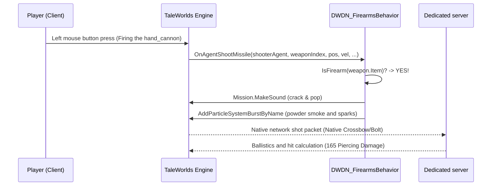

# Firearms Subsystem

> Part of the DWDN agent guide. See [AGENTS.md](../../AGENTS.md) for the entry point, build commands and the topic index.

Firearms in DWDN are implemented through a combination of XML projectile models and a client-server `MissionBehavior`.



### 3.1. XML configuration (`ModuleData/mpitems/dwdn_weapon.xml`)
Instead of trying to introduce a completely new, non-existent weapon type, which would break the TaleWorlds C++ animation interfaces, we use a clever and 100% stable **Crossbow-Hack**:

1. **The weapon itself (`hand_cannon`):**
   ```xml
   <Item multiplayer_item="true" id="hand_cannon" name="{=*}Hand Bombard" 
		 body_name="bo_composite_crossbows" mesh="crossbow_e" culture="Culture.vlandia" 
		 weight="3.8" appearance="1" difficulty="0" Type="Crossbow" 
		 AmmoOffset="0.0, 0.02131, 0.22975" 
		 item_holsters="crossbow_back:bow_hip:mace_right_hip:bow_hip_2" 
		 holster_position_shift="0.02,0,-0.4">
	   <ItemComponent>
		   <Weapon weapon_class="Crossbow" ammo_class="Bolt" 
				   missile_speed="135" accuracy="18" thrust_damage="165" 
				   thrust_speed="22" speed_rating="15" weapon_length="100" 
				   ammo_limit="1" thrust_damage_type="Pierce" 
				   item_usage="crossbow" reload_phase_count="2" 
				   physics_material="wood_weapon" center_of_mass="0,0,0.4">
			   <WeaponFlags RangedWeapon="true" BonusAgainstShield="true" 
							CanPenetrateShield="true" AmmoSticksWhenShot="false" 
							AttachAmmoToVisual="false" CantReloadOnHorseback="true" 
							NotUsableWithOneHand="true" TwoHandIdleOnMount="true" />
		   </Weapon>
	   </ItemComponent>
	   <Flags />
   </Item>
   ```
2. **Bullets (`mp_bullets`):**
   ```xml
   <Item multiplayer_item="true" id="mp_bullets" name="{=*}Lead Shot" 
		 body_name="bo_capsule_arrow" holster_body_name="bo_axe_short" 
		 mesh="bolt_bl_c" value="1" is_merchandise="false" 
		 holster_mesh="bolt_bl_c_quiver" holster_mesh_with_weapon="bolt_bl_c_quiver" 
		 flying_mesh="bolt_bl_flying" weight="0.10" appearance="1" Type="Bolts" 
		 item_holsters="quiver_bolts:quiver_bolts_2:quiver_back_middle:quiver_back_top">
	   <ItemComponent>
		   <Weapon weapon_class="Bolt" stack_amount="12" thrust_damage="5" 
				   thrust_speed="0" speed_rating="0" physics_material="missile" 
				   weapon_length="35" 
				   flying_sound_code="event:/mission/combat/missile/flyby/arrow">
			   <WeaponFlags Consumable="true" AmmoSticksWhenShot="false" />
		   </Weapon>
	   </ItemComponent>
   </Item>
   ```

### 3.2. C# firing logic (`DWDN_FirearmsBehavior.cs`)
The class inherits from `MissionBehavior` and is registered in the mission.
* **Weapon identification**: `IsFirearm(ItemObject)` compares the `StringId` against the keywords (`hand_cannon`, `cannon`, `bombard`, `handgonne`, `firearm`).
* **Muzzle Position**:
  ```csharp
  Vec3 forward = velocity.NormalizedCopy();
  if (forward.LengthSquared < 0.001f) forward = orientation.f;
  Vec3 muzzlePos = position + forward * 0.70f;
  MatrixFrame muzzleFrame = new MatrixFrame(orientation, muzzlePos);
  ```
* **Acoustic effect (a light report)**:  
  A paired native sound:
  * `event:/mission/combat/impact/ballista_missile/stone` (a dry powder crack).
  * `event:/mission/combat/impact/missile/pot_breakable` (a dull resonant thump).
* **Visual particles (VFX)**:
  * Instant flame burst: `prt_fireball` at `muzzlePos + forward * 0.10f` (0.20 sec, no residual burning).
  * Dense powder smoke: `psys_game_stone_dust_a` and `psys_siege_door_falling_dust`.
  * Smoke trail along the shot trajectory: emitters at `muzzlePos + forward * 0.60f` and `muzzlePos + forward * 1.20f`.
  * Bright powder sparks: `psys_game_sparkle_a`.
  * Touch-hole smoke: at `position - forward * 0.10f + Vec3(0, 0, 0.04f)`.

> [!IMPORTANT]
> **PROHIBITION ON `AddCustomMissile` ON THE SERVER:**  
> Never spawn third-party missiles/bullets via `Mission.AddCustomMissile` on the dedicated server for firearms!  
> The native TaleWorlds engine synchronizes the projectile itself through the crossbow ballistics pipeline. If you try to spawn custom bullets in code, the dedicated server will guaranteedly fall into a physical-world desynchronization.
