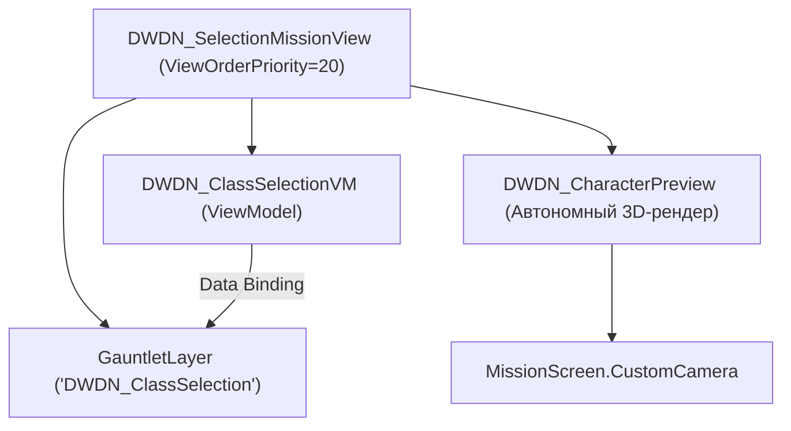

# Architecture of the Custom Gauntlet UI and 3D Preview

> Part of the DWDN agent guide. See [AGENTS.md](../../AGENTS.md) for the entry point, build commands and the topic index.

The loadout and class selection screen in DWDN replaces the standard Bannerlord spawn screen.



### 4.1. UI Component Stack
* **Display layer (`DWDN_SelectionMissionView.cs`)**:
  * Creates a `GauntletLayer` with `ViewOrderPriority = 20`.
  * Binds `DWDN_ClassSelectionVM` to the Gauntlet layout.
  * Intercepts mouse input to rotate the character.
* **ViewModel hierarchy**:
  * `DWDN_ClassSelectionVM` — the main window, switching between Duchies and classes.
  * `DWDN_DuchyItemVM` — Duchy selection buttons.
  * `DWDN_ClassItemVM` — class selection buttons inside a Duchy.
  * `DWDN_EquipmentSlotVM` — equipment slots (Helmet, Torso, Weapon 0..3, etc.).
  * `DWDN_ItemOptionVM` — the list of items available for the selected slot.

### 4.2. Architecture of the Isolated 3D Preview (LOTR / OMEE Pattern)
**HISTORY OF THE SCRAPCODE AND THE `0xC0000005` CRASH:**  
In early versions of the mod, changing the class called `MultiplayerMissionAgentVisualSpawnComponent.OnMyAgentVisualSpawned` or a direct `agentVisual.Refresh(...)` on the native TaleWorlds pedestal.  
Because the native C++ thread of `Engine.dll` was playing the pedestal idle animation on the very same millisecond tick, destroying the skeleton caused a fatal memory access violation (*Access Violation 0xC0000005*).

**THE CANONICAL SOLUTION (Class `DWDN_CharacterPreview.cs`):**
1. Complete abandonment of hooks into the native `MultiplayerMissionAgentVisualSpawnComponent`.
2. Creation of an isolated visual agent:
   ```csharp
   AgentVisualsData data = new AgentVisualsData()
	   .ActionSet(actionSet)
	   .Equipment(equipment)
	   .BodyProperties(bodyProperties)
	   .Frame(anchor)
	   .ActionCode(idleAction)
	   .Scene(Mission.Current.Scene)
	   .PrepareForNativeMeshOptimization(true);

   _visual = AgentVisuals.Create(data, "dwdn_preview", false, false, false);
   ```
3. Allocation of an independent camera:
   ```csharp
   _camera = Camera.CreateCamera();
   _camera.SetFovVertical(0.785f, Screen.AspectRatio, 0.1f, 1000f);
   MissionScreen.CustomCamera = _camera;
   ```
4. When the menu closes, `MissionScreen.CustomCamera = null`, and `_visual.Reset()` safely releases the C++ memory. **Result: 0 engine crashes.**
