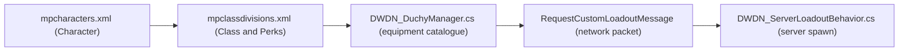

# Duchies, Classes and Networked Spawn (Loadout Pipeline)

> Part of the DWDN agent guide. See [AGENTS.md](../../AGENTS.md) for the entry point, build commands and the topic index.

Every class in the mod is defined at three inseparable points:



### 5.1. Class Registration
1. **`ModuleData/mpcharacters.xml`**:
   Base character, body model, gender, skeleton, race.
   ```xml
   <NPCCharacter id="dwdn_militia_infantry" name="{=*}Militia Infantry" 
				 default_group="Infantry" age="28" voice="curt" 
				 is_female="false" culture="Culture.vlandia" 
				 occupation="Soldier" is_hero="false">
   ```
2. **`ModuleData/mpclassdivisions.xml`**:
   Gold cost, statistics (HP, armor, speed), perks:
   ```xml
   <MPClassDivision id="dwdn_militia_infantry_division" 
					hero="NPCCharacter.dwdn_militia_infantry" 
					cost="120" culture="Culture.vlandia" 
					class_group="Infantry" icon_type="Infantry">
   ```
3. **The Duchy registry in C# (`DWDN_DuchyManager.cs`)**:
   Defines the lists of allowed items for the GUI:
   ```csharp
   DWDN_ClassDefinition militia = new DWDN_ClassDefinition(
	   id: "dwdn_militia_infantry",
	   name: "Ополченец",
	   characterId: "dwdn_militia_infantry",
	   divisionId: "dwdn_militia_infantry_division",
	   allowedHelmets: new List<string> { "", "padded_coif", "kettle_hat" },
	   allowedBodyArmors: new List<string> { "padded_armor", "leather_tunic" },
	   allowedWeaponsSlot0: new List<string> { "vlandia_sword_1", "vlandia_axe_1" },
	   allowedWeaponsSlot1: new List<string> { "", "vlandia_shield_wood" },
	   allowedHorses: new List<string>() // Пусто для пехотинца!
   );
   ```

### 5.2. Networked Equipment Synchronization
1. The player presses the **"TO BATTLE"** button in the Gauntlet UI.
2. The client packs `DWDN_ClassSelection` into the network packet `RequestCustomLoadoutMessage`:
   ```csharp
   GameNetwork.BeginModuleEventAsClient();
   GameNetwork.WriteMessage(new RequestCustomLoadoutMessage(selection));
   GameNetwork.EndModuleEventAsClient();
   ```
3. On the dedicated server, `DWDN_ServerLoadoutBehavior.cs` receives the packet:
   * Verifies that each StringId is actually allowed for that class in `DWDN_DuchyManager` (anti-cheat validation).
   * Stores the equipment in the player registry `_peerLoadouts[peer]`.
   * When `OnAgentBuild` fires: fills `agent.SpawnEquipment` with the validated items.

### 5.3. Protection Against the Horse Warp Glitch (The Cavalry Dismount Fix)
> [!CAUTION]
> **CRITICAL TALEWORLDS BUG:**  
> If a foot character has a filled `EquipmentIndex.Horse` or `EquipmentIndex.HorseHarness` slot in its `SpawnEquipment`, the native engine method `MountVisualCreator.AddMountMeshToAgentVisual` mistakenly attaches the horse mesh to the pelvis bones of the **human skeleton**. On dismount or while moving, the mesh deforms and collapses onto the ground at the point `(0,0,0)`.

**HOW THIS IS SOLVED IN `DWDN_ServerLoadoutBehavior.cs`:**
```csharp
// 1. Человек-всадник НИКОГДА не должен нести слоты Horse / HorseHarness в человеческом снаряжении:
equip[EquipmentIndex.Horse] = EquipmentElement.Invalid;
equip[EquipmentIndex.HorseHarness] = EquipmentElement.Invalid;

// 2. Лошадь спавнится движком ТОЛЬКО тогда, когда SelectedTroopIndex указывает на кавалерийский класс:
int targetIdx = string.IsNullOrEmpty(selection.HorseId) ? 0 : cavalryIndex;
missionPeer.SelectedTroopIndex = targetIdx;
missionPeer.NextSelectedTroopIndex = targetIdx;
```
