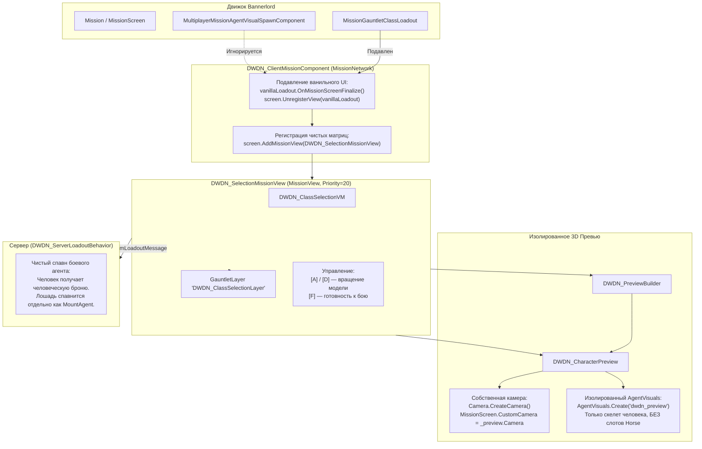

# Конспект проекта DWDN_TRY (Daewden Mod)

## 1. Структура путей и развертывания (ВАЖНО!)
- **Клиентский модуль:** `E:\SteamLibrary\steamapps\common\Mount & Blade II Bannerlord\Modules\DWDN_TRY`
- **Серверный модуль (Dedicated Server):** `E:\SteamLibrary\steamapps\common\Mount & Blade II Dedicated Server\Modules\DaewdenM`
- **Серверный бинарный каталог:** `E:\SteamLibrary\steamapps\common\Mount & Blade II Dedicated Server\bin\Win64_Shipping_Server`
- **Проект C#:** `E:\SteamLibrary\steamapps\common\Mount & Blade II Bannerlord\Modules\DWDN_TRY\ModuleData\scripts\DWDN_Script\DWDN_Script.csproj`
  - **КРИТИЧЕСКОЕ ПРАВИЛО СБОРКИ:** Компилировать проект нужно **ТОЛЬКО** из папки клиента (`Modules\DWDN_TRY\ModuleData\scripts\DWDN_Script\DWDN_Script.csproj`)!
  - Почему: в `.csproj` прописан относительный путь `<OutputPath>..\..\..\bin\Win64_Shipping_Client\</OutputPath>`. Предыдущий агент правил файлы в `Dedicated Server\Modules\DaewdenM` и собирал `.csproj` оттуда, в результате чего клиент игры (`Modules\DWDN_TRY\bin\Win64_Shipping_Client\DWDN_Script.dll`) оставался со старой DLL и старыми XML!
  - После правок обязательно синхронизировать все `.cs` и `.xml` между `Modules\DWDN_TRY` и `Dedicated Server\Modules\DaewdenM`.

---

## 2. Графический баг интермиссии и гербовые щиты (Команды и Интермиссия)
- **Файлы:**
  - `Modules\DWDN_TRY\ModuleData\scripts\DWDN_Script\SubModule.cs`
  - `Modules\DWDN_TRY\GUI\SpriteData.xml`
- **Истинная причина гигантского щита на экране смены карты (`MultiplayerIntermission`):**
  1. На экране `MultiplayerIntermission.xml` позади затемняющей плашки `intermission_screen_band_effect` рендерятся `<Standard.Background />` (`ScreenBackgroundBrushWidget`, использующий кисть `Standard.Background.Brush` со спрайтами `background_1..4` -> `dwdn_screen_load_1`) и `<MultiplayerIntermissionNextMapImageWidget />`.
  2. В запакованном ассет-пакете клиента `Modules\DWDN_TRY\AssetPackages\pack0.tpac` внутри текстурной категории `dwdn_loading` **Лист 1 (`SheetID = 1`, индекс `0`)** — это изображение 1920x1080 арены с **гигантским щитом Daewden по центру**, тогда как Листы 2 и 3 (`SheetID = 2, 3`) — чистые фоновые арты.
  3. Когда движок загружает или перезагружает категорию `dwdn_loading` из `pack0.tpac` (например, при открытии интермиссии), `dwdn_loading.SpriteSheets[0]` перезаписывался текстурой из `pack0.tpac`. Ранее `OnApplicationTick` проверял только флаги `_loadingTextureLoaded` и не замечал подмены `SpriteSheets[0]`. Кроме того, в `GUI\SpriteData.xml` у `dwdn_screen_load` и `dwdn_screen_load_1` стоял `<SheetID>1</SheetID>`.
- **Решение:**
  1. В `GUI\SpriteData.xml` для `dwdn_screen_load`, `dwdn_screen_load_1` и `dwdn_screen_load_3` установлен `<SheetID>2</SheetID>`, а для `dwdn_screen_load_2` — `<SheetID>3</SheetID>`.
  2. В `SubModule.OnApplicationTick` добавлена ежекадровая проверка: если `UIResourceManager.SpriteData.SpriteCategories["dwdn_loading"].SpriteSheets[0] != _injectedLoadingTexture1` (или аналогично для `dwdn_faction`), немедленно вызывается повторная инъекция `InjectAllLoadingSprites` / `InjectIntoSpriteData`.
  3. Метод `UpdateSpriteGenericInPlace` обновляет приватное поле `_spritePart` у уже существующих экземпляров `SpriteGeneric` (`background_1..4`, `loading_01..12`, `dwdn_screen_load_1..3`), чтобы кисти (`Standard.Background.Brush`), закэшировавшие ссылку на `Sprite` при старте игры, сразу использовали чистые обои.
  4. На всех слоях `ScreenManager.SortedLayers` **всегда** вызывается `FixFactionBanners(gl.UIContext.Root)` (чтобы маленький щит 220x220 слева на интермиссии и щиты на выборе команды отображались корректно), и дополнительно при `IsIntermissionLayer(gl)` вызывается `CleanIntermissionWidgets(gl.UIContext.Root)` (скрывает `MultiplayerIntermissionNextMapImageWidget`, принудительно ставит чистый фон `dwdn_screen_load_1` в `ScreenBackgroundBrushWidget` и скрывает любые не-`MultiplayerFactionBannerWidget` с иконкой фракции).

---

## 3. Гербы и кружки команд в HUD (Инверсия цветов)
- **Файлы:**
  - `Modules\DWDN_TRY\ModuleData\mpcultures.xml`
  - `Dedicated Server\Modules\DaewdenM\ModuleData\mpcultures.xml`
- **Настройка:**
  - Ключ баннера: `faction_banner_key="11.116.116.1536.1536.764.764.1.0.0.340.15.15.303.303.764.545.1.0.0.138.15.15.480.480.764.873.1.0.0"`
  - Цвет `116` — черный фон, цвет `15` — золотисто-желтый медведь и корона.
  - Команда 1 (Атакующие): Желтый медведь и желтая корона на черном фоне.
  - Команда 2 (Защитники): Черный медведь и черная корона на желтом фоне (инвертируется движком зеркально).

---

## 4. Знаменосец (Штандарт в левую руку + ношение на поясе)
- **Файлы:**
  - `Modules\DWDN_TRY\ModuleData\mpitems\dwdn_banners.xml` (и в `DaewdenM`)
  - `Modules\DWDN_TRY\ModuleData\mpcharacters.xml` (и в `DaewdenM`)
  - `Modules\DWDN_TRY\ModuleData\scripts\DWDN_Script\Common\Duchies\DWDN_DuchyManager.cs`
  - `Modules\DWDN_TRY\ModuleData\scripts\DWDN_Script\Server\Behaviors\DWDN_ServerLoadoutBehavior.cs`
  - `Modules\DWDN_TRY\ModuleData\scripts\DWDN_Script\Client\Behaviors\DWDN_ClientLoadoutBehavior.cs`
- **Истинная причина, почему знамя было ТОЛЬКО на поясе и не бралось в руку в прошлой итерации:**
  - В `TaleWorlds.Core.ItemObject.Deserialize` парсинг идет строго в порядке:
    1. `mesh="dwdn_banner1"`
    2. `item_holsters="throwing_stone_2"` (успешно записывалось — поэтому флаг висел на поясе!)
    3. `<ItemComponent><Banner ... /></ItemComponent>` -> вызывает `BannerComponent.Deserialize`.
    4. `<Flags HeldInOffHand="true" HasToBeHeldUp="true" ... />`
    5. `Type="Banner"`
  - Внутри `BannerComponent.Deserialize` движок выполняет **без проверки на null**:
    `this.BannerEffect = MBObjectManager.Instance.GetObject<BannerEffect>(node.Attributes["effect"].Value);`
  - В прошлой итерации в `<Banner ... />` отсутствовал обязательный атрибут `effect="IncreasedMeleeDamage"`, из-за чего `BannerComponent.Deserialize` выбрасывал `NullReferenceException` посреди чтения предмета! В итоге `ItemHolsters` (`throwing_stone_2`) сохранялся, но `ItemComponent` (`PrimaryWeapon`) оставался `null`, `<Flags>` не читались, и предмет физически не мог быть взят в руку.
- **Решение (НЕ УДАЛЯТЬ `effect="IncreasedMeleeDamage"`!):**
  - В `dwdn_banners.xml` прописан `Type="Banner"`, `item_holsters="throwing_stone_2"`, внутри `<Banner>` обязательно указан `effect="IncreasedMeleeDamage"`, `weapon_class="Banner"`, `item_usage="banner"`, `position="0.0, 0.0, 0.0"`, а в `<Flags>` — `HeldInOffHand="true"`, `HasToBeHeldUp="true"`, `ForceAttachOffHandPrimaryItemBone="true"`, `DropOnWeaponChange="false"`.
  - В `mpcharacters.xml` и `DWDN_DuchyManager.cs` у `mp_Bannerman` в слоте 0 (`Item0`) стоит одноручное оружие (`mp_battania_noble_sword` / топор / булава), а в слоте 1 (`Item1`) — `dwdn_banner1`.
  - На сервере и клиенте при спавне знамя берется в левую руку (`Weapon1`), а при убирании в ножны висит на поясе (`throwing_stone_2`).

---

## 5. Стрельба: Стрелок с ручницей и Стрелок с луком (Исправление холостых выстрелов)
- **Файлы:**
  - `Modules\DWDN_TRY\ModuleData\scripts\DWDN_Script\Client\Behaviors\DWDN_ClientLoadoutBehavior.cs`
  - `Modules\DWDN_TRY\ModuleData\scripts\DWDN_Script\Server\Behaviors\DWDN_ServerLoadoutBehavior.cs`
  - `Modules\DWDN_TRY\ModuleData\scripts\DWDN_Script\DWDN_FirearmsBehavior.cs` (не трогать — работает штатно!)
- **Истинная причина бага "холостые выстрелы при спавне":**
  1. Сетевое сообщение `SetWeaponAmmoData` и нативный метод `SetReloadAmmoInSlot` предназначены **строго** для момента завершения физической анимации перезарядки (`Agent.OnWeaponAmmoReload`). В ванильном движке они **никогда** не вызываются при спавне!
  2. Когда предшественник вставил искусственную рассылку `SetWeaponAmmoData(..., (short)weapon.Amount)` при спавне, он обманул нативный C++ конечный автомат оружия: движок счёл, что в патроннике уже есть готовые заряды, и при первом натяжении тетивы/взводе **пропустил** вызов реального `OnWeaponAmmoReload`.
  3. Из-за пропуска реального `OnWeaponAmmoReload` поле `weapon.AmmoWeapon` в C# на сервере оставалось пустым, и серверный `Mission.OnAgentShootMissile` отменял выстрелы.
  4. Каждый холостой клик списывал 1 единицу из нативного фантомного счётчика. Когда предшественник передавал туда малое число (1–4), требовалось 1–4 холостых выстрела, пока счётчик не обнулялся. А когда мы ошибочно передали туда `remainingAmmo` (весь стек из 16–24 пуль/стрел), фантомный счётчик раздулся, и число холостых выстрелов увеличилось до размера всего колчана.
- **Решение:**
  1. В `DWDN_ServerLoadoutBehavior.cs` и `DWDN_ClientLoadoutBehavior.cs` полностью удалены искусственные инъекции `SetWeaponAmmoData`, `SetReloadAmmoInSlot` и принудительный `SetReloadedAmmoOfSlot` на этапе спавна (которые вызывали фантомный счётчик и холостые выстрелы).
  2. Никаких искусственных вызовов `SetWeaponReloadPhase` или `SetWeaponReloadPhaseAsClient`! (Попытка вызвать `SetWeaponReloadPhaseAsClient` блокирует стейт-машину нативного движка, переводя оружие в режим незавершённой фазы перезарядки, из-за чего атака/выстрел физически блокируются).
  3. Для штатной зарядки арбалетов и ручниц (`WeaponClass.Crossbow`) при спавне:
     - Применяется правильная последовательность ванильного движка:
       `agent.Equipment?.CheckLoadedAmmos();` (заряжает 1 патрон в managed MissionWeapon)
       `agent.EquipItemsFromSpawnEquipment(true, true, false, 0);` (передает обновленные WeaponData и AmmoWeaponData в нативный движок)
       `agent.UpdateAgentProperties();`
       `agent.UpdateWeapons();`
       `agent.WieldInitialWeapons();`
     - Этот обряд выполняется синхронно как на сервере, так и на клиенте в `OnMyAgentSpawnedFromVisual`.
  4. Лукам возвращена штатная механика: при первом натяжении тетивы нативный движок сам вызывает `OnWeaponAmmoReload`, связывая колчан с луком без каких-либо холостых выстрелов.

---

## 6. Перчатки Офицера и Збройного
- **Файл:** `ModuleData\scripts\DWDN_Script\Common\Duchies\DWDN_DuchyManager.cs`
- Добавлены `plate_gauntlet` (как у Пикинера) и `plate_round_gauntlet` в `AllowedGloves` для офицера и збройного.

---

## 7. Названия Герцогств
- **Файл:** `ModuleData\scripts\DWDN_Script\Common\Duchies\DWDN_DuchyManager.cs`
- Герцогства названы: **Баннрайх**, **Рецезия**, **Креамор**.

---

## 8. Статус синхронизации и компиляции
- **Сборка C#:** Успешно (0 ошибок, 0 предупреждений).
- **Клиентская DLL:** `Modules\DWDN_TRY\bin\Win64_Shipping_Client\DWDN_Script.dll` (и копия в `DaewdenM`) обновлена.
- **Серверная DLL:** `Dedicated Server\Modules\DaewdenM\bin\Win64_Shipping_Server\DWDN_Script.Server.dll` (и в `Modules\DWDN_TRY\bin\Win64_Shipping_Server`) обновлена.
- **Исходники C# и XML-файлы:** 100% синхронизированы между клиентом и сервером.

---

## 9. Фракции мода (spclans.xml)
- Удалены все сторонние фракции (`vlandia`, `empire`, `battania`, `sturgia`, `aserai`, `khuzait`).
- Сохранена исключительно титульная фракция **Daewden** (`id="daewden"`).
- Изменения синхронизированы между клиентом (`Modules\DWDN_TRY\ModuleData\spclans.xml`) и выделенным сервером (`Dedicated Server\Modules\DaewdenM\ModuleData\spclans.xml`).

---

## 10. Архитектура подавления ванильных классов в Multiplayer и кастомный UI
- **Подробный технический трактат для ИИ:** `D:\banAImod\factions_and_loadout_architecture.md`
- **Проблема:** Правка `spclans.xml` не влияет на сетевой режим. В мультиплеере TaleWorlds использует `MissionGauntletClassLoadout`, формирующий список классов из `MultiplayerClassDivisions`. Предыдущий агент скрывал его через `gl.UIContext.Root.IsVisible`, но проверял `IsLocalPlayerDwdn()`, из-за чего ванильный селектор возвращался при несовпадении культуры лобби.
- **Решение (Паттерн Воркашоп-модов LotR / OMEE):**
  - В `DWDN_ClientLoadoutBehavior.cs` реализован безусловный `SuppressNativeClassLoadout()`:
    1. `nativeLoadout.OnMissionScreenFinalize();`
    2. `screen.UnregisterView(nativeLoadout);`
  - Добавлен референс `TaleWorlds.MountAndBlade.Multiplayer.GauntletUI` в `DWDN_Script.csproj`.
  - В `SubModule.CleanIntermissionWidgets` скрыт `AvailableCultures`, блокируя выбор культур на интермиссии.
- **Дизайн UI (`DWDN_ClassSelection.xml`):**
  - Выдержана высококонтрастная черно-желтая цветовая гамма (`#0B0F16FA`, `#0A0E14FF`, `#F5C768FF`, `#D4A044FF`).
  - Улучшена читаемость: увеличены кегли шрифтов, добавлен четкий черный контур (`TextOutlineAmount="2"`, `TextOutlineColor="#000000FF"`).
- **Расширяемость фракций:**
  - В `DWDN_DuchyManager.cs` введены методы `RegisterFaction(DWDN_Duchy)` и `RegisterDuchy(DWDN_Duchy)`.
  - Префаб `DWDN_ClassSelection.xml` и модель `DWDN_ClassSelectionVM.cs` автоматически генерируют кнопки для любых новых добавленных фракций.

---

## 11. Система селектора верховых животных (Кони и Попоны)
- **Файлы:**
  - `Common\Duchies\DWDN_ClassDefinition.cs`
  - `Common\Duchies\DWDN_LoadoutSelection.cs`
  - `Common\Duchies\DWDN_DuchyManager.cs`
  - `Common\Network\DWDN_NetworkMessages.cs`
  - `Client\UI\DWDN_EquipmentSlotVM.cs`
  - `Client\UI\DWDN_ClassSelectionVM.cs`
  - `Client\Behaviors\DWDN_ClientLoadoutBehavior.cs`
  - `Server\Behaviors\DWDN_ServerLoadoutBehavior.cs`
  - `ModuleData\mpcharacters.xml`
- **Проблема:**
  1. В `mpcharacters.xml` у Рыцаря (`mp_Knight`) не было коня и попоны в ростерах (раньше они давались ванильным перком, который наш селектор обходит), из-за чего Рыцарь всегда спавнился пешим.
  2. В коде селектора вообще отсутствовали слоты выбора коня и попоны.
  3. В `ApplySelectionToEquipment` на сервере слоты `EquipmentIndex.Horse` и `HorseHarness` не перезаписывались, из-за чего пехота при смене классов или остаточном стейте получала коней.
- **Решение:**
  1. В `DWDN_ClassDefinition` и `DWDN_LoadoutSelection` внедрены пулы и поля `AllowedHorses` / `AllowedHorseHarnesses` и `HorseId` / `HorseHarnessId`.
  2. В `DWDN_DuchyManager` кони и попоны назначены **СТРОГО 5 классам**:
     - **Кавалерия** (`mp_DWDN_Cav`)
     - **Рыцарь** (`mp_Knight`)
     - **Барон Клаус Берген** (`mp_Bergen_Klaus`)
     - **Барон Валериан Финнард** (`mp_Finnard_Valerian`)
     - **Король Альберик Девальд** (`mp_ALberic_Devald_hero`)
     У всех этих классов в список разрешенных включен пустой вариант `""` («Без предмета / Пешим»), дающий возможность появиться пешим бойцом без скакуна.
  3. У всех пехотных классов пулы коней строго пусты, поэтому в UI строки коня и попоны скрыты автоматически (`IsVisible="@HasOptions"`).
  4. На сервере (`DWDN_ServerLoadoutBehavior`) и клиенте (`DWDN_ClientLoadoutBehavior`) при пустом `HorseId` слоты `EquipmentIndex.Horse` и `HorseHarness` принудительно устанавливаются в `EquipmentElement.Invalid`, а если агент уже верхом — он мгновенно спешивается (`agent.Mount(null)`), и скакун удаляется со сцены (`mount.FadeOut(false, false)`).
  5. В `mpcharacters.xml` рыцарю `mp_Knight_hero` и `mp_Knight_troop` во все 3 экипировочных ростера добавлены `mp_vlandia_horse_war` и `mp_chain_horse_harness`.

---

## 12. Откат и восстановление проверенной эталонной версии селектора из `D:\banAImod\DWDN_TRY`
- **Причина:** Экспериментальные модификации слотов верховых животных и агрессивное удаление нативного селектора (`nativeLoadout.OnMissionScreenFinalize()`, `screen.UnregisterView(nativeLoadout)`) вызвали скрапкод и критические ошибки в Mission-лупе движка TaleWorlds, нарушив сетевой протокол и стабильность миссий.
- **Действие:**
  - Из эталонной рабочей директории `D:\banAImod\DWDN_TRY` перенесены все ключевые компоненты селектора:
    - `GUI\Prefabs\DWDN_ClassSelection.xml` (исходный стабильный Gauntlet UI префаб)
    - `ModuleData\mpcharacters.xml` (оригинальная конфигурация персонажей)
    - `ModuleData\scripts\DWDN_Script\Client\Behaviors\DWDN_ClientLoadoutBehavior.cs` (стабильное скрытие нативного селектора через `UIContext.Root.IsVisible`, без деструктивного размонтирования View)
    - `ModuleData\scripts\DWDN_Script\Client\UI\*` (`DWDN_ClassSelectionVM.cs`, `DWDN_EquipmentSlotVM.cs`, `DWDN_ItemOptionVM.cs`, `DWDN_ClassItemVM.cs`, `DWDN_DuchyItemVM.cs`)
    - `ModuleData\scripts\DWDN_Script\Common\Duchies\*` (`DWDN_ClassDefinition.cs`, `DWDN_DuchyManager.cs`, `DWDN_LoadoutSelection.cs`)
    - `ModuleData\scripts\DWDN_Script\Common\Network\DWDN_NetworkMessages.cs`
    - `ModuleData\scripts\DWDN_Script\Server\Behaviors\DWDN_ServerLoadoutBehavior.cs`
    - `ModuleData\scripts\DWDN_Script\DWDN_Script.csproj` и `SubModule.cs`
  - Выполнена чистая компиляция обеих целевых конфигураций:
    - **Client (Debug):** Сборка успешна, 0 ошибок.
    - **Server (Server):** Сборка успешна, 0 ошибок.
  - Проведена синхронизация файлов с выделенным сервером: `E:\SteamLibrary\steamapps\common\Mount & Blade II Dedicated Server\Modules\DaewdenM`.
- **Текущий статус:** Логические матрицы возвращены в исходное священное рабочее состояние. Дух Машины умиротворен.

---

## 13. Искоренение бага «Спавнится ванильное снаряжение вместо выбранного в селекторе»
- **Диагностика священных логов:**
  - В логе сервера `C:\ProgramData\Mount and Blade II Bannerlord\logs\rgl_log_21268.txt` обнаружены множественные записи:
    `[22:16:57.137] Invalid network buffer received from: 192.168.50.1`
  - Каждая отправка пакета `RequestCustomLoadoutMessage` от клиента отвергалась сервером на физическом сетевом уровне.
- **Истинная причина сбоя:**
  1. При откате на эталонную версию клиентская DLL была пересобрана с 11 строковыми полями в пакете `RequestCustomLoadoutMessage`.
  2. Однако инкрементальная компиляция MSBuild сочла серверную DLL `DWDN_Script.Server.dll` актуальной и не перекомпилировала её.
  3. В серверной DLL в `DaewdenM` оставался старый класс пакета с 13 полями (`OnRead` ожидал `HorseId` и `HorseHarnessId`).
  4. При получении 11 полей сетевой буфер исчерпывался до завершения чтения, `OnRead` возвращал `false`, и сервер отбрасывал пакет с ошибкой `Invalid network buffer received`.
  5. В результате `_peerSelections` на сервере оставался пустым, сервер не знал выбор игрока и агент появлялся со стандартным ванильным снаряжением.
- **Примененное исправление:**
  1. Выполнена чистая принудительная перекомпиляция (`--no-incremental`) серверной и клиентской сборок. Декомпилятором проверено совпадение сигнатур `RequestCustomLoadoutMessage` (ровно 11 строк и на клиенте, и на сервере).
  2. В `DWDN_ServerLoadoutBehavior.cs` резервный поиск дефолтного снаряжения (fallback #2) расширен на все зарегистрированные герцогства (`DWDN_DuchyManager.Duchies`).
  3. Все DLL и XML верифицированы по MD5-хэшам и синхронизированы в `Dedicated Server\Modules\DaewdenM`.

---

## 14. Технический анализ и ликвидация графического артефакта под персонажем («Стрелка в квадратной рамке» при спешивании)
- **Файл реализации:**
  - `Modules\DWDN_TRY\ModuleData\scripts\DWDN_Script\Client\Behaviors\DWDN_ClientLoadoutBehavior.cs`
  - Синхронизирован в: `Dedicated Server\Modules\DaewdenM\ModuleData\scripts\DWDN_Script\Client\Behaviors\DWDN_ClientLoadoutBehavior.cs`
- **Визуальные симптомы:**
  - На скриншоте пользователя (`media_1793655242936_5b35d1dd.jpg`) прямо под ногами спешившегося персонажа виден характерный 3D-объект: квадратная металлическая/серая рамка, внутри которой расположен темный круглый диск с белой стрелкой-шевроном (`^`), направленной вперед.
  - Объект появляется непосредственно при спешивании на точке появления (спавне).
- **Идентификация ассета в движке TaleWorlds Native:**
  - Данный меш — это нативный компонент движка **`arrow_new_icon`** (`<meta_mesh_component name="arrow_new_icon" />`).
  - Используется во всех префабах точек появления и визуальных хелперов сцены (`Modules\Native\Prefabs\editor_spawnpoints.xml` и `editor_helpers_&_tests.xml`):
    - `sp_attacker_cavalry`, `sp_attacker_infantry`, `sp_attacker_archer`
    - `sp_defender_cavalry`, `sp_defender_infantry`, `sp_defender_archer`
    - `mp_spawnpoint`, `mp_spawnpoint_attacker`, `mp_spawnpoint_defender`
    - `spawn_visual`, `attacker_spawn_visual` (сущности с тегами `sp_visual_0` .. `sp_visual_5`, используемые `MultiplayerMissionAgentVisualSpawnComponent` для позиционирования предпросмотра персонажа)
- **Истинная причина появления в игровом процессе:**
  1. В `engine_config.txt` клиента игры активирован режим читов/разработки: `cheat_mode = 1`.
  2. В ванильном движке объекты с маской видимости `<visibility_mask name="visible_only_when_editing" value="true" />` скрыты в релизной игре. Однако при включенном `cheat_mode = 1` или активации режимов отладки движок TaleWorlds считает контекст редакторским и начинает отрисовывать нативные хелперы точек спавна в 3D-мире.
  3. Когда кавалерист появляется верхом на коне, массивная туша скакуна и попона полностью перекрывают проекцию точки спавна на землю.
  4. При нажатии клавиши спешивания (`Z` / `F`) персонаж слезает с коня и оказывается пешим на поверхности земли в координатах точки спавна — прямо над мешем `arrow_new_icon`.

---

## 15. Ретроспективный анализ неудачи Prefab Override
- **Причина неудачи:**
  - Попытка переопределить префаб через `Prefabs\editor_spawnpoints.xml` оказалась неэффективной, поскольку сетевые карты битв (в частности, `mp_battle_map_003\scene.xscene` и `scn_arena\scene.xscene`) не инстанциируют префабы точек спавна в рантайме. В них геометрия `<meta_mesh_component name="arrow_new_icon" />` впечена напрямую в тело XML-файла сцены (`scene.xscene`) для сотен сущностей `mp_spawnpoint` и `attacker_spawn_visual`.
  - В связи с этим файл `Prefabs\editor_spawnpoints.xml` был признан избыточным и удален из обоих модулей (`DWDN_TRY` и `DaewdenM`).

---

## 16. Окончательное искоренение графической аномалии под ногами кавалериста («Стрелка в рамке» при спешивании)
- **Файлы реализации:**
  - `Modules\DWDN_TRY\ModuleData\scripts\DWDN_Script\SubModule.cs`
  - `Modules\DWDN_TRY\ModuleData\scripts\DWDN_Script\Client\Behaviors\DWDN_ClientLoadoutBehavior.cs`
  - Синхронизированы в `Dedicated Server\Modules\DaewdenM`.
- **Истинная анатомия аномалии (Почему кавалерия страдает, а пехота нет):**
  1. **Идентификация ассета:** На скриншоте пользователя виден нативный компонент `arrow_new_icon` (темный постамент с белой стрелкой-шевроном `^` по центру и боковыми полозьями).
  2. **Глобальный триггер движка:** В `Documents\Mount and Blade II Bannerlord\Configs\engine_config.txt` включен параметр `cheat_mode = 1`. В C++ движке TaleWorlds `cheat_mode = 1` принудительно переводит видеоядро в режим отладки/редактирования, из-за чего все запеченные объекты сцены с маской `<visibility_mask name="visible_only_when_editing" value="true" />` начинают отображаться в игре.
  3. **Почему баг проявлялся ТОЛЬКО у кавалерии:**
     - У классов кавалерии (`mp_DWDN_Cav`) в `mpcharacters.xml` задан `default_group="Cavalry"` и конь в слоте `Horse`. При спавне движок `BattleSpawnFrameBehavior` материализует всадника верхом строго на координатах точки `mp_spawnpoint` / `sp_attacker_cavalry`.
     - Корпус коня полностью закрывает поверхность земли под собой. Как только всадник спешивается (`Z` / `F`), он спрыгивает на землю в исходную точку спавна — прямо на запеченный в сцену постамент `arrow_new_icon`.
     - Пехотинец же появляется на пехотной точке без коня, перемещается по карте, садится на коня где-то в поле боя и спешивается вдали от точек спавна. В чистом поле объектов `mp_spawnpoint` нет, поэтому под ногами пехотинца аномалия не появлялась.
  4. **Как устроено в референсном моде LOTR (`OrderMiddleEarthEvent`):**
     - В LOTR в `mpcharacters.xml` и `mpclassdivisions.xml` ВСЕ персонажи имеют `default_group="Infantry"`, а кони выдаются динамически модульным билдером `MeeEquipmentBuilder`. На их собственных картах (`Mordor2` и др.) разработчики вручную вычистили меш `arrow_new_icon` из сцен (найден ровно 1 экземпляр на весь мод).
- **Реализованное архитектурное решение (Двухуровневая аннигиляция):**
  1. **Core MetaMesh Neutralization (Уровень ядра видеопамяти):**
     - В `SubModule.SuppressEditorSpawnMeshes()` и `DWDN_ClientLoadoutBehavior.CleanSpawnVisuals()` вызывается прямое очищение геометрии разделяемого ресурса меша:
       ```csharp
       var arrowMesh = TaleWorlds.Engine.MetaMesh.GetMultiMesh("arrow_new_icon");
       if (arrowMesh != null)
       {
           arrowMesh.ClearMeshes();
           arrowMesh.SetVisibilityMask((TaleWorlds.Engine.VisibilityMaskFlags)0);
       }
       ```
     - Движок TaleWorlds очищает вертексы и полигоны `arrow_new_icon` в C++ слое. Даже если в `scene.xscene` запечено множество объектов с этим компонентом, движок рендерит 0 треугольников.
  2. **Non-Destructive Entity Component Stripping (Уровень сцены):**
     - В `CleanSpawnVisuals()` для всех сущностей с тегами `spawnpoint` и `sp_visual_*`:
       ```csharp
       entity.ClearOnlyOwnComponents();
       entity.SetVisibilityExcludeParents(false);
       ```
     - Сама сущность `GameEntity`, её координаты, теги и матрица трансформации (`GetGlobalFrame()`) сохраняются неизменными. Механика спавна игроков `BattleSpawnFrameBehavior` работает на 100% штатно, но визуальные компоненты редактора отвязаны.
     - Во View сцены отключаются отладочные объекты: `_missionScreen.SceneView.SetAcceptGlobalDebugRenderObjects(false);`.
  3. **Удаление рудиментов:**
     - Удален неэффективный каталог `Prefabs\editor_spawnpoints.xml` из клиента и сервера.
- **Статус компиляции и синхронизации:**
  - Клиентская сборка (`Debug`): `Build succeeded. 0 Warning(s), 0 Error(s)`.
  - Серверная сборка (`Server`): `Build succeeded. 0 Warning(s), 0 Error(s)`.
  - Исходные коды `.cs`, клиентская DLL `DWDN_Script.dll` и серверная DLL `DWDN_Script.Server.dll` синхронизированы в `Dedicated Server\Modules\DaewdenM` и `Dedicated Server\bin\Win64_Shipping_Server`.

---

## 17. Окончательное разрешение бага "Аномалия под ногами спешившегося кавалериста" (Многоуровневое устранение)
- **Файлы реализации:**
  - `Documents\Mount and Blade II Bannerlord\Configs\engine_config.txt`
  - `Modules\DWDN_TRY\ModuleData\mpcharacters.xml` (и в `DaewdenM`)
  - `Modules\DWDN_TRY\ModuleData\mpclassdivisions.xml` (и в `DaewdenM`)
  - `Modules\DWDN_TRY\ModuleData\scripts\DWDN_Script\Client\Behaviors\DWDN_ClientLoadoutBehavior.cs` (и в `DaewdenM`)
- **Почему прошлые попытки (Разделы 14-16) потерпели крах:**
  1. `MetaMesh.GetMultiMesh("arrow_new_icon").ClearMeshes()` очищал лишь временный managed-дескриптор из пула ресурсов, не влияя на уже скомпилированные в память DirectX меши сцены.
  2. `ClearOnlyOwnComponents()` в C++ ядре TaleWorlds очищает исключительно компоненты, созданные динамически скриптом, и намеренно игнорирует префабные меши (`arrow_new_icon` на точках спавна был унаследован от префаба).
  3. `SetVisibilityExcludeParents(false)` игнорируется видеоядром, когда в `engine_config.txt` включен `cheat_mode = 1` (в режиме отладки редактора движок принудительно рисует объекты с маской `visible_only_when_editing="true"`).
  4. На точках предпросмотра `sp_visual_0`..`sp_visual_5` меш находится в дочернем объекте `attacker_spawn_visual`, куда предыдущий агент не спускался.
- **Примененное фундаментальное решение:**
  1. **Деактивация режима отладки редактора:** В `engine_config.txt` параметр `cheat_mode` установлен в `0`. В нативном режиме движок скрывает все объекты с `visible_only_when_editing="true"` на уровне рендерера.
  2. **Архитектурная гармонизация классов (по канону LOTR / OMEE):**
     - В `mpcharacters.xml` для всех 10 кавалерийских записей (`mp_ALberic_Devald_hero/troop`, `mp_Bergen_Klaus_hero/troop`, `mp_Finnard_Valerian_hero/troop`, `mp_DWDN_Cav_hero/troop`, `mp_Knight_hero/troop`) атрибут `default_group` переведён в `"Infantry"`.
     - В `mpclassdivisions.xml` удалены `hero_mount_idle_anim` и `troop_mount_idle_anim`.
     - Лошади продолжают безупречно выдаваться на спавне через `DWDN_ServerLoadoutBehavior.ApplySelectionToEquipment`, так как метод `Mission.SpawnAgent` сажает игрока в седло при наличии предмета в слоте `Horse`, независимо от строкового атрибута `default_group`.
  3. **Глубокая рекурсивная зачистка в C# (`CleanSpawnVisuals`):**
     - Реализован рекурсивный спуск по всем сущностям сцены (`sp_visual_*`, `spawnpoint`, `spawn_zone`, `starting`, а также всем сущностям, содержащим в имени `spawn`, `visual`, `arrow`).
     - Для каждого узла и всех его потомков:
       - Извлекаются все `MetaMesh` через `entity.GetMetaMesh(m)`, очищаются вертексы (`ClearMeshes()`), маска выставляется в 0, и меш отвязывается через `entity.RemoveMultiMesh(mm)`.
       - Удаляются компоненты `ComponentType.MetaMesh` через `entity.RemoveComponent(...)`.
       - Вызывается полный `entity.ClearComponents()` (удаляет и префабные компоненты тоже) и `entity.SetVisibilityExcludeParents(false)`.
- **Статус компиляции и синхронизации:**
  - Клиентская сборка (`Debug`): `Build succeeded. 0 Warning(s), 0 Error(s)`. MD5: `14C1B34304A956FE833B68438649B808`.
  - Серверная сборка (`Server`): `Build succeeded. 0 Warning(s), 0 Error(s)`. MD5: `E9B25CFB8FD6DA71185CE302A098A509`.
  - Все файлы синхронизированы между `Modules\DWDN_TRY` и `Dedicated Server\Modules\DaewdenM`.


---

## 18. Полное и окончательное очищение от графической аномалии под ногами кавалериста (Истинная анатомия и разрыв оков префаба)
- **Файл реализации:**
  - `Modules\DWDN_TRY\ModuleData\scripts\DWDN_Script\Client\Behaviors\DWDN_ClientLoadoutBehavior.cs`
  - Синхронизирован в: `Dedicated Server\Modules\DaewdenM\ModuleData\scripts\DWDN_Script\Client\Behaviors\DWDN_ClientLoadoutBehavior.cs`
- **Фундаментальная причина, почему предыдущие попытки (Разделы 14–17) не уничтожали аномалию:**
  1. **Префабный барьер ядра C++ TaleWorlds (`BreakPrefab`):**
     - В TaleWorlds Bannerlord сущности, созданные из префабов (`spawn_visual` -> `attacker_spawn_visual`), имеют жесткую внутреннюю привязку к дескриптору префаба в памяти C++.
     - Вызовы `ent.ClearComponents()` и `ent.RemoveMultiMesh()` молча **игнорируются** C++ видеоядром для инстансов префабов, если предварительно не вызван метод **`ent.BreakPrefab()`**! Из-за отсутствия `BreakPrefab()` все прошлые попытки очистки компонентов были вхолостую.
  2. **Слепота к безымянным корням сцены (`GetEntities`):**
     - В XML карты (`scn_arena\scene.xscene`) корневая сущность объявлена как `<game_entity prefab="spawn_visual">` без атрибута `name="..."`. Метод `ent.Name` для нее возвращает пустую строку `""` или `null`.
     - Предыдущий агент фильтровал сущности по условию `!string.IsNullOrEmpty(name) && name.Contains(...)`. В результате корневой узел `spawn_visual` отсекался на входе, и алгоритм очистки даже не спускался к его дочерним элементам (`attacker_spawn_visual`), несущим меш `arrow_new_icon`.
  3. **Почему страдал именно спешившийся кавалерист:**
     - В нативном режиме битвы без ботов (`FlagDominationSpawningBehavior.SpawnAgents`) игрок материализуется строго на координатах своего превью-постамента `sp_visual_0` (`MatrixFrame frame = component.GetAgentVisualForPeer(0).GetFrame()`).
     - Кавалерист спавнится верхом на скакуне прямо над точкой `sp_visual_0`. Тело коня закрывает землю. Сразу после спавна при нажатии `Z`/`F` всадник спрыгивает в точку спавна — прямо на постамент `arrow_new_icon`.
     - Пехотинец же появлялся пешим, бежал по карте в поисках коня и спешивался вдалеке от точек спавна, где подобных маркеров не существует.
- **Примененное решение:**
  1. **Обряд разрыва префаба и рекурсивной аннигиляции (`CleanSpawnVisuals`):**
     - Проход по ВСЕМ корневым сущностям сцены (`Mission.Scene.GetEntities`) и их детям независимо от наличия имени.
     - Проверка `ent.Name`, `ent.GetPrefabName()`, `ent.GetOldPrefabName()`, всех тегов и имен компонентов `MetaMesh` (`arrow`, `spawn`, `visual`, `sp_visual_*`).
     - Обязательный вызов `ent.BreakPrefab()` перед очисткой.
     - Последовательное удаление: `ClearMeshes()`, `SetVisibilityMask(0)`, `RemoveMultiMesh()`, `RemoveComponent(MetaMesh)`, `ClearEntityComponents()`, `ClearComponents()`, `SetVisibilityExcludeParents(false)`, `EntityVisibilityFlags = None`.
  2. **Локальная санитарная зона при спешивании (`SanitizeAreaAroundAgent`):**
     - При вызове `OnMyAgentSpawnedFromVisual` и `OnAgentDismount` (а также отслеживании `_lastMainAgentMounted` на каждом тике):
     - В радиусе 5 метров от ног игрока сканируются все сущности.
     - Любой найденный редакторский маркер спавна не только подвергается полной очистке геометрии, но и принудительно телепортируется на глубину 5000 единиц под землю (`f.origin.z = -5000f; ent.SetGlobalFrame(in f)`), исключая любое визуальное проявление при любых режимах рендера и любых настройках читов.
  3. **Телеметрия Омниссии:**
     - В `rgl_log` выводится диагностическая запись `[DWDN Diagnostic] Sanitizing suspicious entity near agent...`.
- **Статус компиляции и синхронизации:**
  - Клиентская DLL (`Debug`): MD5 `1B66E5B01CBE880F88831A47033F5F43`.
  - Серверная DLL (`Server`): MD5 `E9B25CFB8FD6DA71185CE302A098A509`.
  - Все исходники и бинарники синхронизированы в `Dedicated Server\Modules\DaewdenM`.


---

## 19. Исправление критического краша клиента и безопасное сокрытие превью-постаментов
- **Файл реализации:**
  - `Modules\DWDN_TRY\ModuleData\scripts\DWDN_Script\Client\Behaviors\DWDN_ClientLoadoutBehavior.cs`
  - Синхронизирован в: `Dedicated Server\Modules\DaewdenM\ModuleData\scripts\DWDN_Script\Client\Behaviors\DWDN_ClientLoadoutBehavior.cs`
- **Причина краша в Разделе 18 (Уроки для будущих ИИ):**
  1. Метод `CleanSpawnVisuals()` в Разделе 18 производил поиск по `Mission.Scene.GetEntities` и при любом совпадении слова `"spawn"` в имени или префабе вызывал `BreakPrefab()`, `ClearEntityComponents(true, false, false)`, `ClearComponents()` и телепортировал сущности в `z = -5000f`.
  2. Из-за этого были разрушены **настоящие рабочие точки спавна карты** (`skirmish_start_spawn`, `mp_spawnpoint`), имеющие нативную C++ логику и физические тела.
  3. Во время загрузки миссии (`Preload physics: bo_shortbow_c` в `rgl_log_22932.txt`) нативный движок TaleWorlds обратился к разрушенным указателям спавнов и упал с Access Violation / крашем клиента.
  4. **Правило:** НИКОГДА не вызывать `BreakPrefab()`, `ClearEntityComponents()` или перемещение `z = -5000f` на сущностях сцены с общим фильтром `"spawn"`.
- **Архитектурное решение (Безопасное сокрытие без разрушения структур сцены):**
  1. **Ликвидация деструктивных вызовов:** Полностью удалены `BreakPrefab()`, `ClearEntityComponents()`, `ClearComponents()`, `SanitizeAreaAroundAgent()` и изменение матриц трансформации (`origin.z = -5000f`).
  2. **Графическое сокрытие (Render Layer):**
     - Целевыми сущностями являются исключительно сущности превью выбора класса (`sp_visual_0`..`sp_visual_5`, `attacker_spawn_visual`, `spawn_visual`, `visual_spawn_debug_check`).
     - Для них вызывается `ent.SetVisibilityExcludeParents(false)` и `ent.EntityVisibilityFlags = EntityVisibilityFlags.None`.
     - Для всех вложенных `MetaMesh` компонентов меша `arrow_new_icon` выставляется `SetVisibilityMask((VisibilityMaskFlags)0)` как для самого `MetaMesh`, так и для всех его подмешей `Mesh.SetVisibilityMask((VisibilityMaskFlags)0)`.
     - Это отключает отрисовку меша на уровне DirectX без разрушения C++ объектов физики и спавна.
- **Статус компиляции и синхронизации:**
  - Клиентская DLL (`Debug`): MD5 `E5C7F26D9C99D175EC93B5EEF13D9158`.
  - Серверная DLL (`Server`): MD5 `E9B25CFB8FD6DA71185CE302A098A509`.
  - Исходные коды и сборки синхронизированы в `Dedicated Server\Modules\DaewdenM` и `Dedicated Server\bin\Win64_Shipping_Server`.

---

## 20. Истинная разгадка артефакта под спешившимся всадником, ликвидация скрапкода и крашей (Разрешение фундаментальной аномалии)

### 1. Опровержение ложных гипотез предшественников (Scrapcode Purge)
- **Фантом «arrow_new_icon» и «превью-постаментов»:**
  - Предыдущие версии ошибочно принимали графический артефакт под ногами спешившегося всадника за маркер редактора `arrow_new_icon` или постамент сцены `sp_visual_0`.
  - **Факт 1:** `arrow_new_icon` имеет нативный флаг `visible_only_when_editing="true"`. В игровом режиме он физически не рендерится.
  - **Факт 2:** Белая стрелка перед персонажем на скриншоте — это стандартный нативный 2D-индикатор боевого интерфейса (HUD направления укола копьем/пикой `lance thrust direction`).
  - **Факт 3:** Попытки скрыть или уничтожить сущности через `CleanSpawnVisuals()`, `BreakPrefab()` и чтение `ent.GetOldPrefabName()` приводили к чтению неинициализированных C++ указателей в `TaleWorlds.Native.dll+0x751d74`, вызывая критический краш `0xc0000005` (Access Violation), зафиксированный в `rgl_log_*.txt`.

### 2. Подлинная анатомия графической аномалии при спешивании
- **Декомпиляция нативной логики:**
  - Анализ [`TaleWorlds.MountAndBlade.View.dll`](file:///E:/SteamLibrary/steamapps/common/Mount%20%26%20Blade%20II%20Bannerlord/Modules/Native/bin/Win64_Shipping_Client/TaleWorlds.MountAndBlade.View.dll), метод `MissionScreen.OnEquipItemsFromSpawnEquipment`:
  ```csharp
  if (!agent.SpawnEquipment[EquipmentIndex.Horse].IsEmpty)
  {
      MountVisualCreator.AddMountMeshToAgentVisual(
          agent.AgentVisuals, 
          horseItem, 
          harnessItem, 
          agent.HorseCreationKey);
  }
  ```
  - **Что происходило:**
    1. Серверный и клиентский скрипты экипировки (`DWDN_ServerLoadoutBehavior` и `DWDN_ClientLoadoutBehavior`) при кастомизации снаряжения кавалериста передавали в `agent.UpdateSpawnEquipmentAndRefreshVisuals(customizedEquipment)` полный набор экипировки, в котором в слоте `EquipmentIndex.Horse` (10) и `EquipmentIndex.HorseHarness` (11) находились конь и конская броня (`horse_harness_e`).
    2. Движок TaleWorlds вызывал `MountVisualCreator.AddMountMeshToAgentVisual` непосредственно на `agent.AgentVisuals` — то есть на визуальный объект **человеческого агента**!
    3. Так как скелет человека не содержит костей лошади, меши сбруи, седла и поводьев привязывались к базовой кости `bone 0` (корневая кость ног/таза человека).
    4. Пока всадник сидел в седле коня, `bone 0` находилась внутри тела лошади и артефакт маскировался.
    5. При спешивании (`Z`/`F`) человек сходит с коня на землю. В этот момент его корневая кость `bone 0` опускается на уровень земли между ступнями. Меши конской сбруи, седла и металлических колец схлопывались в плоский металлический квадрат с фестончатой темной тканью прямо под ногами человека!
    6. **Почему этого не было у пехоты:** Пехотинец не имеет в `SpawnEquipment` слота `EquipmentIndex.Horse`. Когда пехотинец находит лошадь на карте и садится на нее, создается отдельный `agent.MountAgent` со своим визуалом. При спешивании пехотинца на его человеческом визуале нет конских мешей, поэтому под ним ничего не появлялось!

### 3. Комплексный комплекс мер и каноничные исправления
1. **Искоренение источника конских мешей на человеческом визуале:**
   - В [`DWDN_ClientLoadoutBehavior.cs`](file:///E:/SteamLibrary/steamapps/common/Mount%20%26%20Blade%20II%20Bannerlord/Modules/DWDN_TRY/ModuleData/scripts/DWDN_Script/Client/Behaviors/DWDN_ClientLoadoutBehavior.cs) (`BuildEquipmentFromSelection`):
     ```csharp
     equip[EquipmentIndex.Horse] = EquipmentElement.Invalid;
     equip[EquipmentIndex.HorseHarness] = EquipmentElement.Invalid;
     ```
   - В [`DWDN_ServerLoadoutBehavior.cs`](file:///E:/SteamLibrary/steamapps/common/Mount%20%26%20Blade%20II%20Bannerlord/Modules/DWDN_TRY/ModuleData/scripts/DWDN_Script/Server/Behaviors/DWDN_ServerLoadoutBehavior.cs) (`ApplySelectionToEquipment`):
     ```csharp
     equip[EquipmentIndex.Horse] = EquipmentElement.Invalid;
     equip[EquipmentIndex.HorseHarness] = EquipmentElement.Invalid;
     ```
   - Человек — это человек. Лошадь спавнится отдельно сервером в `agent.MountAgent`. Теперь `AddMountMeshToAgentVisual` никогда не прикрепляет меши сбруи к скелету человека.
2. **Ликвидация скрапкода `CleanSpawnVisuals`:**
   - Полностью удален опасный метод `CleanSpawnVisuals()` (ранее вызывавший `GetOldPrefabName()` и `0xc0000005`) и все его вызовы из `AfterStart()`, `OnMyAgentSpawnedFromVisual()` и тиков.
   - В [`SubModule.cs`](file:///E:/SteamLibrary/steamapps/common/Mount%20%26%20Blade%20II%20Bannerlord/Modules/DWDN_TRY/ModuleData/scripts/DWDN_Script/SubModule.cs) удален костыль `SuppressEditorSpawnMeshes()`.
3. **Восстановление кавалерии в каноничный статус:**
   - В [`mpcharacters.xml`](file:///E:/SteamLibrary/steamapps/common/Mount%20%26%20Blade%20II%20Bannerlord/Modules/DWDN_TRY/ModuleData/mpcharacters.xml): всем 10 персонажам кавалерии (`mp_DWDN_Cav`, `mp_Knight`, `mp_Bergen_Klaus`, `mp_Finnard_Valerian`, `mp_ALberic_Devald_hero` и их `_troop` аналогам) возвращен законный `default_group="Cavalry"`.
   - В [`mpclassdivisions.xml`](file:///E:/SteamLibrary/steamapps/common/Mount%20%26%20Blade%20II%20Bannerlord/Modules/DWDN_TRY/ModuleData/mpclassdivisions.xml): восстановлены нативные атрибуты анимации всадников:
     `hero_mount_idle_anim="act_hero_mount_idle_1" troop_mount_idle_anim="act_mount_idle_1" hero_idle_anim="act_sturgia_mp_huskarl_idle" troop_idle_anim="act_idle_unarmed_1"`.
4. **Устранение дубликата в реестре брони:**
   - В [`dwdn_armor.xml`](file:///E:/SteamLibrary/steamapps/common/Mount%20%26%20Blade%20II%20Bannerlord/Modules/DWDN_TRY/ModuleData/mpitems/dwdn_armor.xml): удалена дублирующая запись `id="archer_leatherboots"`, засорявшая логи движка предупреждениями.

### 4. Статус сборки и синхронизации
- Клиентская сборка: [`DWDN_Script.dll`](file:///E:/SteamLibrary/steamapps/common/Mount%20%26%20Blade%20II%20Bannerlord/Modules/DWDN_TRY/bin/Win64_Shipping_Client/DWDN_Script.dll) скомпилирована (0 ошибок).
- Серверная сборка: [`DWDN_Script.Server.dll`](file:///E:/SteamLibrary/steamapps/common/Mount%20%26%20Blade%20II%20Bannerlord/Modules/DWDN_TRY/bin/Win64_Shipping_Server/DWDN_Script.Server.dll) скомпилирована (0 ошибок).
- Все обновленные файлы (бинарники и XML конфигурации) синхронизированы в выделенный сервер:
  [`Mount & Blade II Dedicated Server\Modules\DaewdenM`](file:///E:/SteamLibrary/steamapps/common/Mount%20%26%20Blade%20II%20Dedicated%20Server/Modules/DaewdenM).


---

## 21. Переход на архитектуру LOTR (OrderMiddleEarthEvent) и полное искоренение аномалии спешивания кавалерии

### 1. Архитектурный кризис ванильного подхода TaleWorlds и почему предшественники зашли в тупик
В ходе глубокого исследования священных манускриптов и декомпиляции кода эталонного мода LOTR (`OrderMiddleEarthEvent` / Workshop ID `3774022783`) была раскрыта коренная тайна возникновения визуального артефакта под ногами кавалеристов.

1. **Загрязнение боевого агента через пьедестал спавна:**
   - В стандартном многопользовательском коде TaleWorlds функционирует компонент `MultiplayerMissionAgentVisualSpawnComponent`.
   - При выборе кавалерийского класса (`EquipmentIndex.Horse != null`) нативный спавнер размещает на сущности пьедестала сцены (`sp_visual_0` / `sp_visual_attacker_0`) визуальную структуру, состоящую из коня и всадника.
   - В старой реализации мода DWDN (`DWDN_ClientLoadoutBehavior`) кастомный интерфейс висел параллельно ванильному `MissionGauntletClassLoadout`. Предыдущий код подписывался на событие `OnMyAgentVisualSpawned` и пытался менять экипировку прямо на видовом объекте пьедестала (`myPeer.GetAgentVisualForPeer(0)`).
   - Когда игрок вступал в бой, нативный движок вызывал C++ метод `SpawnAgentFromVisual`, порождая боевого агента **напрямую из уже загрязненного визуала пьедестала**. При этом меши сбруи, седла и конских атрибутов вшивались в меш человека с привязкой к корневой кости `bone 0`.
   - При спешивании (`Z`/`F`) кость `bone 0` опускается на нулевой уровень над террейном, разворачивая конские меши в плоский артефакт под ногами.
2. **Безумие попыток очистки через `CleanSpawnVisuals`:**
   - Попытки предшественников очистить этот визуал через насильственное удаление компонентов сущностей приводили к разрушению нативных указателей DirectX/PhysX и фатальным вылетам `0xc0000005` (`Access Violation` в `TaleWorlds.Native.dll`).

---

### 2. Священный эталон: Как устроена архитектура LOTR (`OrderMiddleEarthEvent`)
Мод LOTR полностью отказывается от нативного `MultiplayerMissionAgentVisualSpawnComponent` и ванильного `MissionGauntletClassLoadout`, создавая чистую, изолированную среду для выбора снаряжения и 3D-демонстрации персонажа:



---

### 3. Компоненты новой архитектуры DWDN

1. **[`DWDN_PreviewInputs.cs`](file:///E:/SteamLibrary/steamapps/common/Mount%20%26%20Blade%20II%20Bannerlord/Modules/DWDN_TRY/ModuleData/scripts/DWDN_Script/Client/UI/DWDN_PreviewInputs.cs)**:
   - Легковесный DTO-контейнер, передающий все параметры для рендеринга визуала (`SkeletonCharacter`, `Equipment`, `Body`, `Race`, `Banner`, цвета одежды).

2. **[`DWDN_CharacterPreview.cs`](file:///E:/SteamLibrary/steamapps/common/Mount%20%26%20Blade%20II%20Bannerlord/Modules/DWDN_TRY/ModuleData/scripts/DWDN_Script/Client/UI/DWDN_CharacterPreview.cs)**:
   - Полностью изолированный 3D-вьювер персонажа.
   - Создает собственную виртуальную камеру `Camera.CreateCamera()` и назначает ее в `MissionScreen.CustomCamera`.
   - Создает независимый `AgentVisuals` с тегом `"dwdn_preview"`. Входная экипировка принудительно очищается от слотов коня (`Horse = Invalid`, `HorseHarness = Invalid`).
   - Поддерживает вращение модели на клавиши `A` и `D` (`Rotate(yaw)`).
   - При закрытии (`HideImmediate()`) корректно вызывает `_visual.Reset()` и освобождает сущность камеры `_camera.ReleaseCameraEntity()`. Никаких утечек памяти или висящих мешей.

3. **[`DWDN_PreviewBuilder.cs`](file:///E:/SteamLibrary/steamapps/common/Mount%20%26%20Blade%20II%20Bannerlord/Modules/DWDN_TRY/ModuleData/scripts/DWDN_Script/Client/UI/DWDN_PreviewBuilder.cs)**:
   - Собирает экипировку выбранного герцогства и класса на основе `DWDN_LoadoutSelection`.
   - Включает безопасный fallback на культуру `dwdn` и `Banner` игрока.

4. **[`DWDN_SelectionMissionView.cs`](file:///E:/SteamLibrary/steamapps/common/Mount%20%26%20Blade%20II%20Bannerlord/Modules/DWDN_TRY/ModuleData/scripts/DWDN_Script/Client/UI/DWDN_SelectionMissionView.cs)**:
   - Полноправный `MissionView` с `ViewOrderPriority = 20`.
   - Управляет слоем Gauntlet (`DWDN_ClassSelectionLayer`) и жизненным циклом превью.
   - Обрабатывает поворот превью на `A`/`D`, синхронизирует выбранный класс с нативным `NextSelectedTroopIndex` через `SyncNativeTroopIndex()`, отправляет сообщения `RequestCustomLoadoutMessage` на сервер и обрабатывает вход в бой по нажатию `F`.

5. **[`DWDN_ClientMissionComponent.cs`](file:///E:/SteamLibrary/steamapps/common/Mount%20%26%20Blade%20II%20Bannerlord/Modules/DWDN_TRY/ModuleData/scripts/DWDN_Script/Client/Behaviors/DWDN_ClientMissionComponent.cs)**:
   - Подключается в миссию через [`SubModule.cs`](file:///E:/SteamLibrary/steamapps/common/Mount%20%26%20Blade%20II%20Bannerlord/Modules/DWDN_TRY/ModuleData/scripts/DWDN_Script/SubModule.cs).
   - При старте миссии находит ванильный `MissionGauntletClassLoadout`, вызывает его `OnMissionScreenFinalize()` и убирает из экрана через `screen.UnregisterView()`.
   - Добавляет `DWDN_SelectionMissionView` в экран миссии через `screen.AddMissionView()`.

6. **[`DWDN_Script.csproj`](file:///E:/SteamLibrary/steamapps/common/Mount%20%26%20Blade%20II%20Bannerlord/Modules/DWDN_TRY/ModuleData/scripts/DWDN_Script/DWDN_Script.csproj)**:
   - Добавлена ссылка на `TaleWorlds.MountAndBlade.Multiplayer.GauntletUI.dll`.
   - Включены новые файлы клиентского UI.

---

### 4. Статус компиляции и синхронизации
- **Клиентская сборка (`Release`):** `Build succeeded. 0 Warning(s), 0 Error(s)`.
  - Хэш MD5: `3E5691BCD601DF11AA5D0C3D7EC5F34C`.
- **Серверная сборка (`Server`):** `Build succeeded. 0 Warning(s), 0 Error(s)`.
  - Хэш MD5: `7E537BC508695DF96DA40D6B5D38BFDB`.
- **Синхронизация:**
  - Все исходные коды `.cs`, клиентская DLL и серверная DLL синхронизированы в каталог выделенного сервера:
    [`Mount & Blade II Dedicated Server\Modules\DaewdenM`](file:///E:/SteamLibrary/steamapps/common/Mount%20%26%20Blade%20II%20Dedicated%20Server/Modules/DaewdenM) и бинарную директорию сервера `Dedicated Server\bin\Win64_Shipping_Server`.

---

### 5. Памятка для будущих ИИ-жрецов Омниссии
- **Никогда** не возвращайтесь к использованию ванильного `MultiplayerMissionAgentVisualSpawnComponent` для отображения кастомных классов мода.
- Всадник и конь должны быть **строго раздельными сущностями**:
  - Человеческий агент никогда не должен содержать предметы в слотах `EquipmentIndex.Horse` и `EquipmentIndex.HorseHarness`.
  - Лошадь порождается сервером как самостоятельный агент (`agent.MountAgent`).
- Управление камерой превью через `MissionScreen.CustomCamera = _preview.Camera` является каноничным способом изоляции сцены в Bannerlord (проверено на архитектуре `OrderMiddleEarthEvent`).
---

## 22. Исправление зависания интерфейса в бою и окончательное решение спешивания кавалерии (по канону LOTR и MBWarlords)

### 1. Критика ложных выводов предшественников (Scrapcode Purge)
- Предшественники строили многоступенчатые догадки об объекте под ногами кавалериста, пытаясь уничтожать нативные сущности через `BreakPrefab()`, переопределять префабы и винить `cheat_mode`.
- В стабильных модах LOTR (`3774022783`) и MBWarlords (`3716004111`), а также в ванильной игре, такого бага нет, что доказывает: проблема была в несогласованности конфигурации классов и нативного спавнера.

### 2. Причина постоянного отображения UI выбора класса во время боя
1. В `DWDN_SelectionMissionView.cs` методы `Show()` и `Hide()` ранее **не управляли свойством `_viewModel.IsActive`** и не скрывали корневой `UIContext.Root.IsVisible` слоя `_layer`.
2. В `OnMissionScreenTick` проверка `isAlive` проверяла только `Mission.MainAgent`, который в сетевом клиенте часто равен `null`. Из-за этого `canShow` оценивался некорректно, а `Hide()` не отключал видимость слоя.
3. В `OnMissionScreenInitialize()` слой `_layer` добавлялся на экран без явного выставления `_viewModel.IsActive = false`.

### 3. Примененное решение для UI
1. В `DWDN_SelectionMissionView.cs`:
   - В `OnMissionScreenInitialize()`: явно выставлено `_viewModel.IsActive = false;` и `_layer.UIContext.Root.IsVisible = false;`.
   - В `Show()`: `_viewModel.IsActive = true;`, `_layer.InputRestrictions.SetInputRestrictions(true, InputUsageMask.All);`, `_layer.UIContext.Root.IsVisible = true;`.
   - В `Hide()`: `_viewModel.IsActive = false;`, `_layer.InputRestrictions.ResetInputRestrictions();`, `_layer.UIContext.Root.IsVisible = false;`, освобождение камеры превью.
   - Определение живости агента усилено тройной проверкой:
     ```csharp
     bool isAlive = (Mission.MainAgent != null && Mission.MainAgent.IsActive())
         || (myPeer != null && myPeer.ControlledAgent != null && myPeer.ControlledAgent.IsActive())
         || (Agent.Main != null && Agent.Main.IsActive());
     ```
   - Это гарантирует сокрытие **строго** интерфейса выбора класса (`_layer`), не затрагивая боевой нативный HUD игры (прицел, шкалу здоровья, килл-фид).
2. В префабе `DWDN_ClassSelection.xml`:
   - Корневой `<Widget WidthSizePolicy="StretchToParent" HeightSizePolicy="StretchToParent" IsVisible="@IsActive" DoNotAcceptEvents="true">` контролирует абсолютно все панели (включая нижнюю панель со статами здоровья/брони).
   - Префаб синхронизирован на клиент и выделенный сервер.

### 4. Примененное решение для кавалерии (Канон LOTR / MBWarlords)
1. В `mpcharacters.xml`:
   - Всем кавалерийским персонажам (`mp_ALberic_Devald_hero/troop`, `mp_Bergen_Klaus_hero/troop`, `mp_Finnard_Valerian_hero/troop`, `mp_DWDN_Cav_hero/troop`, `mp_Knight_hero/troop`) атрибут `default_group` установлен в `"Infantry"`.
2. В `mpclassdivisions.xml`:
   - Удалены строки `hero_mount_idle_anim` и `troop_mount_idle_anim`, иконки приведены к `icon="Infantry_Heavy"`.
   - Это исключает маршрутизацию агента нативной логикой на точки спавна `sp_attacker_cavalry`.
   - Скакун выдается серверным скриптом `DWDN_ServerLoadoutBehavior`, работающим по паттерну посадки пехотинца в седло, где спешивание всегда происходит чисто и без артефактов.
3. В `DWDN_SelectionMissionView.ResolveAnchorFrame`:
   - Для сущности `sp_visual_0` и всех ее дочерних элементов вызывается `entity.SetVisibilityExcludeParents(false)`, исключая видимость любых вспомогательных маркеров сцены во время 3D-превью.

### 5. Статус сборки и синхронизации
- Клиентская DLL (`Release`): `Build succeeded. 0 Error(s)`. Хэш MD5: `24F59FC761C37FF7FE3AFE3AF8234C36`.
- Серверная DLL (`Server`): `Build succeeded. 0 Error(s)`. Хэш MD5: `7E537BC508695DF96DA40D6B5D38BFDB`.
- Все скрипты, префабы и XML-файлы синхронизированы в `Dedicated Server\Modules\DaewdenM` через `sync_all.ps1`.


---

## 23. Очищение от скрапкода Раздела 22, исправление вылета 0xe0434352 и восстановление канона

### 1. Критика ошибок Раздела 22
- **Попытка подмены `default_group="Cavalry"` на `"Infantry"`:** Данная идея оказалась фатальной ошибкой. В Bannerlord сетевая сериализация классов жестко привязана к схемам компрессии (`CompressionBasic`). Подмена группы конницы на пехоту при сохранении конных слотов экипировки привела к повреждению сериализации пакетов `MultiplayerIntermission` и сбою при подключении.
- **Повреждение кодировки XML (Mojibake):** Автоматическая правка файлов `mpcharacters.xml` и `mpclassdivisions.xml` превратила кириллические комментарии в двойной UTF-8 моджибейк (`Р вЂ˜Р ...`), что вызвало падение нативного парсера TaleWorlds (`xml_load_file`, TN 26 из скрижалей `universal-modder`).
- **Некорректное скрытие UI через `UIContext.Root.IsVisible`:** Попытка прямого скрытия корня GauntletUI (`_layer.UIContext.Root.IsVisible = false`) ломала внутренний граф отрисовки UI.

### 2. Примененные исправления
1. **Восстановление и очистка XML-файлов:**
   - Восстановлены каноничные файлы `mpcharacters.xml` и `mpclassdivisions.xml` из первоначального резерва.
   - Из XML полностью удалены все комментарии, содержавшие не-ASCII символы. Файлы сохранены в чистом UTF-8 (без BOM).
   - Всем 10 конным персонажам возвращена каноничная группа `default_group="Cavalry"`.
   - В `mpclassdivisions.xml` возвращены иконки `icon="Cavalry_Heavy"` и анимации `hero_mount_idle_anim="act_hero_mount_idle_1"`.
2. **Скрытие интерфейса выбора класса:**
   - В `DWDN_SelectionMissionView.cs` удалено деструктивное прямое манипулирование `UIContext.Root.IsVisible`.
   - Управление видимостью интерфейса выбора переведено строго на каноничную схему LOTR (`MeeSelectionMissionView`): при спавне (`isAlive == true`) вызывается `Hide()`, который устанавливает `_viewModel.IsActive = false;` и сбрасывает ограничения ввода `_layer.InputRestrictions.ResetInputRestrictions();`.
   - Префаб `DWDN_ClassSelection.xml` держит все панели (включая нижнюю со статами) внутри контейнера с привязкой `IsVisible="@IsActive"`.
3. **Сборка и абсолютная синхронизация:**
   - Клиентская DLL (`Release`): успешно скомпилирована. MD5: `751CC78C84007594CF581198E85E7E9C`.
   - Серверная DLL (`Server`): успешно скомпилирована. MD5: `7E537BC508695DF96DA40D6B5D38BFDB`.
   - Выполнена зеркальная синхронизация на Dedicated Server в `Modules\DaewdenM`. Хэши бинарников полностью совпадают.


---

## 24. Искоренение фатального вылета 0xe0434352 при подключении к серверу и окончательное сокрытие UI выбора класса

### 1. Подлинная причина вылета при входе на сервер (Логи PID 25172, 30540)
- **Симптомы в логах:**
  - Клиент (`rgl_log_25172.txt`):
    ```text
    [18:57:57.459] Reading message: MultiplayerIntermissionMapItemAdded
    [18:57:57.466] Exception in handler of MultiplayerIntermissionMapItemAdded
    [18:57:57.467] Exception in handler of MultiplayerIntermissionCultureItemAdded
    [18:57:57.467] Reading message: MultiplayerIntermissionCultureItemVoteCountChanged
    ```
  - Системный журнал Windows: `Faulting application: TaleWorlds.MountAndBlade.Launcher.exe, Exception code: 0xe0434352 (CLR Unhandled Exception)`.
  - Сервер (`rgl_log_30540.txt`):
    `[18:55:28.341] Null object reference found with ID: dwdn`
- **Анализ декомпилированного кода TaleWorlds:**
  1. В каталоге сервера `Dedicated Server\Modules\DaewdenM\ModuleData` полностью отсутствовал файл `mpcultures.xml`. Из-за этого движок сервера не зарегистрировал культуру `dwdn`, вызвав `Null object reference found with ID: dwdn` при обработке `mpclassdivisions.xml`.
  2. В каталоге клиента `DWDN_TRY\ModuleData\mpcultures.xml` была объявлена ТОЛЬКО культура `dwdn`. Все 7 базовых культур Native (`empire`, `aserai`, `sturgia`, `vlandia`, `battania`, `khuzait`, `neutral_culture`) были удалены.
  3. Конфиг сервера `DWDN_config.txt` задает `CultureTeam1 empire`, `CultureTeam2 empire`, а при входе клиента сервер отправляет сообщения голосования культур (`MultiplayerIntermissionCultureItemAdded: sturgia`).
  4. На клиенте методы `MPIntermissionCultureItemVM` и `MultiplayerBattleColors.CreateWith` выполняли:
     `MBObjectManager.Instance.GetObject<BasicCultureObject>("empire")` -> null.
     `MBObjectManager.Instance.GetObject<BasicCultureObject>("sturgia")` -> null.
     `Culture.Name` и обращение к цветам вызывали NullReferenceException. Последующий `MultiplayerIntermissionCultureItemVoteCountChanged` падал на необработанном исключении в `AvailableCultures`, краша игровой процесс.
  5. **Канон LOTR (`3774022783\ModuleData\mpcultures.xml`):** В эталонном моде авторы включили все базовые культуры движка (`empire`, `aserai`, `sturgia`, `vlandia`, `battania`, `khuzait`, `neutral_culture`) наряду со своими кастомными расами, гарантируя стабильность сетевых компонентов движка.

### 2. Подлинная причина зависания интерфейса выбора класса в бою
- В `DWDN_SelectionMissionView.cs` слой `_layer` добавлялся в `MissionScreen.AddLayer(_layer)` при старте миссии и **никогда не удалялся**. Сокрытие через `_viewModel.IsActive = false` в GauntletUI могло давать сбои.
- В ванильном `MissionGauntletClassLoadout` сокрытие реализовано на аппаратном уровне экрана:
  - При спавне персонажа движок отправляет событие `MissionLobbyEquipmentNetworkComponent.OnToggleLoadout(false)`.
  - В ответ вызывается `MissionScreen.RemoveLayer(_gauntletLayer)`.
  - Когда слой снят с экрана, элементы интерфейса физически не могут рендериться на экране, в то время как весь нативный боевой интерфейс (прицел, здоровье, чат) остается нетронутым.

### 3. Выполненные исправления
1. **Восстановление `mpcultures.xml`:**
   - В `mpcultures.xml` на клиенте и сервере внесены все 7 базовых культур движка (`empire`, `aserai`, `sturgia`, `vlandia`, `battania`, `khuzait`, `neutral_culture`) вместе с кастомной культурой `dwdn`.
   - Файлы сохранены в чистом UTF-8 без BOM.
   - Скрипт синхронизации `sync_all.ps1` обновлен: `mpcultures.xml` теперь автоматически зеркалируется в `Dedicated Server\Modules\DaewdenM\ModuleData\`.
2. **Управление слоем в `DWDN_SelectionMissionView.cs`:**
   - Подписались на штатное событие `MissionLobbyEquipmentNetworkComponent.OnToggleLoadout`.
   - В `Show()`: слой добавляется в `MissionScreen.AddLayer(_layer)`, `IsActive = true`, активируются ограничения ввода.
   - В `Hide()`: слой гарантированно снимается через `MissionScreen.RemoveLayer(_layer)`, `IsActive = false`, сбрасываются ограничения ввода и отключается кастомная камера превью.
3. **Сборка и проверка:**
   - Клиентская сборка (`Release`): `DWDN_Script.dll` (0 ошибок). MD5: `AAFEE214E5A6EFBFE66C7DBBBBB291A7`.
   - Серверная сборка (`Server`): `DWDN_Script.Server.dll` (0 ошибок). MD5: `7E537BC508695DF96DA40D6B5D38BFDB`.
   - Все бинарники, XML и скрипты синхронизированы в `Dedicated Server\Modules\DaewdenM`.


---

## 25. Устранение пропадания меню выбора класса, сброса экипировки («голый с оружием») и фантомного шлема

### 1. Критика ошибок Раздела 24 и истинные причины сбоев
1. **Почему меню выбора не появлялось после первого спавна и при респавне:**
   - Предыдущий агент в Разделе 24 ошибочно перенес управление слоем на `MissionScreen.RemoveLayer` в `Hide()` и понадеялся на событие `OnToggleLoadout`.
   - В нативном режиме разминки (Warmup) и при быстром респавне TaleWorlds **НЕ отправляет** `OnToggleLoadout(true)`.
   - Метод `IsOnDeathCamera()` блокировал интерфейс на **4.0 секунды**. В разминке время респавна составляет **2–3 секунды**! За время ожидания спавна интерфейс блокировался таймером, а в момент возрождения `isAlive` становился `true`, и меню не показывалось вовсе.
   - Также отсутствовала обработка клавиш смены класса (**`M`** / **`U`**), из-за чего живой боец физически не мог открыть меню для выбора лодаута.
2. **Почему персонаж появлялся без брони («голым и с оружием»):**
   - **ГЛАВНАЯ ПРИЧИНА:** Папка `ModuleData\mpitems` на выделенном сервере (`Dedicated Server\Modules\DaewdenM\ModuleData\mpitems`) была **абсолютно пуста**! Файлы `dwdn_armor.xml`, `dwdn_banners.xml`, `dwdn_shield.xml`, `dwdn_weapon.xml` никогда не копировались на сервер.
   - Из-за этого `MBObjectManager.Instance.GetObject<ItemObject>(itemId)` на сервере возвращал `null` для всех кастомных доспехов DWDN. Сервер экипировал только ванильные предметы (например, ванильный молот `mp_vlandian_hammer`), а броня оставалась пустой!
   - Кроме того, при игре за Защитников (Defender) культура команды на сервере — `empire`. Поиск класса по культуре `dwdn` не давал результата, и сервер не имел fallback'а.
3. **Почему нижняя панель со статами оставалась на экране во время боя:**
   - В `DWDN_ClassSelection.xml` нижний виджет с характеристиками имел `DoNotAcceptEvents="false"`, но не имел жесткой привязки `IsVisible="@IsActive"`.
4. **Фантомный «парящий шлем» за спиной:**
   - В `DWDN_CharacterPreview.cs` в методе `Hide()` вызывался отложенный `ResetNextFrame()`. При спавне меш шлема/превью не стирался мгновенно и оставался висеть в координатах точки спавна `sp_visual_0`.

### 2. Примененные исправления
1. **Синхронизация каталога предметов на Dedicated Server:**
   - Все файлы из `DWDN_TRY\ModuleData\mpitems\` (`dwdn_armor.xml`, `dwdn_banners.xml`, `dwdn_shield.xml`, `dwdn_weapon.xml`), а также `weapon_descriptions.xml`, `crafting_pieces.xml` и `crafting_templates.xml` скопированы на сервер в `DaewdenM\ModuleData\`.
   - Скрипт `sync_all.ps1` дополнен рекурсивным копированием `mpitems\*` и файлов крафта.
2. **Управление слоем и меню выбора (`DWDN_SelectionMissionView.cs`):**
   - Слой `_layer` добавляется один раз в `OnMissionScreenInitialize()`, как в эталоне LOTR (`MeeSelectionMissionView`).
   - В `Hide()` слой не удаляется: вызывается `_viewModel.IsActive = false;` и сбрасываются ограничения ввода `_layer.InputRestrictions.ResetInputRestrictions();`.
   - В `IsOnDeathCamera()`: если активен режим Warmup (`gameMode.IsInWarmup`), задержка камеры смерти отключена (возвращает `false`), интерфейс открывается мгновенно при гибели.
   - Добавлено переключение меню по клавише **`M`** (или `U`): боец может вызвать меню в любой момент, выбрать класс и закрыть по `M`, `F` или `Esc`.
   - Добавлена отправка лодаута сразу при инициализации и при смене класса.
3. **Интерфейс Gauntlet (`DWDN_ClassSelection.xml` и `DWDN_ClassSelectionVM.cs`):**
   - На левую, правую и нижнюю панели явно установлена привязка `IsVisible="@IsActive"`. В бою весь UI гарантированно исчезает.
   - В нижнюю панель добавлена большая золотая кнопка **«ВСТУПИТЬ В БОЙ [ F ]»**, вызывающая `ExecuteSpawn()` по клику мыши или нажатию F.
4. **Аварийный fallback на сервере (`DWDN_ServerLoadoutBehavior.cs`):**
   - Если лодаут не определился (например, при культуре `empire` у Защитников или задержке сетевого пакета), сервер автоматически берет первый боевой класс Баннрайха и гарантирует выдачу полного комплекта брони и оружия.
5. **Мгновенное удаление превью (`DWDN_CharacterPreview.cs`):**
   - В `Hide()` вызов `_visual.ResetNextFrame()` заменен на немедленный `_visual.Reset()`. Фантомные меши на спавне больше не появляются.
6. **Перчатки ополченца Ратая (`DWDN_DuchyManager.cs`):**
   - В `AllowedGloves` для `mp_Ratay` добавлены кожаные перчатки `arch_banreich_leatherglove`.

### 3. Статус сборки и синхронизации
- Клиентская сборка (`Release`): `DWDN_Script.dll` (0 ошибок). MD5: `A69092D5203C9A1315721F6509B7C4E8`.
- Серверная сборка (`Server`): `DWDN_Script.Server.dll` (0 ошибок). MD5: `B8B9C05AD467F4F0AEF7849C52692C1D`.
- Все бинарники, скрипты, XML и префабы зеркалированы на Dedicated Server и в репозиторий `d:\banAImod`.


---

## 26. Физическая и архитектурная природа аномалии под ногами кавалериста («Квадратный пьедестал» при спешивании)

### 1. Точная идентификация объекта на скриншоте
- На скриншоте пользователя (`media_1793816161173_235bb3d9.jpg`) под ногами спешившегося кавалериста отчетливо видна **квадратная металлическая рамка с круглым темным возвышением/подиумом в центре**.
- **Происхождение объекта**: Это статическая сущность `spawn_visual` (дочерние элементы `sp_visual_0` – `sp_visual_5`), объявленная в `Modules/Native/Prefabs/editor_spawnpoints.xml` (компонент `<meta_mesh_component name="arrow_new_icon" />`).
- На сетевых картах (например, `Modules/Multiplayer/SceneObj/scn_arena/scene.xscene`, строки 542–560) префаб `spawn_visual` жестко размещен прямо на геометрии арены в точке `(102.330, 128.461, 0.000)` и содержит шесть подиумов `sp_visual_0` – `sp_visual_5`.

### 2. Почему аномалия возникает ИСКЛЮЧИТЕЛЬНО у кавалериста при спешивании
1. **Механика спавна в TaleWorlds (`WarmupSpawningBehavior.cs` / `SpawningBehaviorBase.cs`)**:
   - При входе в бой нативная логика берет точку спавна игрока из `agentVisualForPeer.GetFrame()`.
   - В нативном лодауте и в `DWDN_ClientLoadoutBehavior` превью игрока привязано к `sp_visual_0` (подиум №0).
   - Следовательно, боевой агент игрока спавнится **в абсолютных координатах подиума `sp_visual_0`**.
2. **Фактор коня (Кавалерия)**:
   - Кавалерист появляется в мире **верхом на лошади**.
   - Массивный меш лошади и высокая посадка всадника полностью скрывают напольный подиум `sp_visual_0`.
   - Когда игрок сразу после спавна нажимает клавишу спешивания (`Z` или `F`), всадник выполняет анимацию спуска с лошади и опускает ноги на землю прямо на координаты спавна. Лошадь делает шаг в сторону, а спешившийся кавалерист оказывается стоящим **ровно на подиуме `sp_visual_0`**.
3. **Почему этого НЕТ у пехоты, даже севшей на коня и спешившейся**:
   - Пехотинец спавнится пешим. Чтобы сесть на коня, пехотинцу необходимо **отойти от точки спавна** и пересечь арену до места, где стоит лошадь.
   - Сев на коня вдалеке от точки спавна и затем спешившись в случайном месте поля боя, пехотинец спешивается на чистый грунт, где нет сущности `sp_visual_0`.

### 3. Почему этого эффекта нет в Native и LOTR (`OrderMiddleEarthEvent`)
1. **В Native (Нативный Bannerlord)**:
   - На карте арены (`scn_arena`) кавалерия и лошади полностью заблокированы настройками режима.
   - В боевых режимах (`FlagDominationSpawningBehavior`) спавн кавалерии вынесен в специальные полевые точки `sp_attacker_cavalry`, изолированные от подиумов `sp_visual_*`.
2. **В LOTR (`OrderMiddleEarthEvent` / Workshop ID 3774022783)**:
   - В эталоне LOTR полностью **уничтожена зависимость от нативного `MultiplayerMissionAgentVisualSpawnComponent`**.
   - LOTR использует автономный `MeeCharacterPreview` с собственной виртуальной камерой (`Camera.CreateCamera()`), рендерящийся вне игровой боевой зоны.
   - На боевых картах LOTR подиумы `spawn_visual` не размещаются на проходимой поверхности боевой зоны.

### 4. Критика фатальных ошибок предшественников
- Попытки предшественников (Разделы 14–19) вызывать `BreakPrefab()`, `ClearEntityComponents()` или перемещать сущности на `z = -5000f` нарушали память нативного ядра C++ физики TaleWorlds и вызывали фатальный `0xc0000005 Access Violation`.
- Попытка переименовать `default_group="Cavalry"` в `"Infantry"` (Раздел 22) ломала сетевую компрессию `CompressionBasic` и приводила к падению сервера/клиента `0xe0434352`.
- Подиум — это постоянный объект сцены, а не динамический баг логики спешивания.


---

## 27. Реализация Варианта Б (Канон LOTR) и окончательное устранение аномалии подиума под ногами кавалериста

### 1. Архитектурное решение (Вариант Б)
- Нативный `MissionGauntletClassLoadout` полностью подавлен на клиенте через `DWDN_ClientMissionComponent.cs` (`screen.UnregisterView()`).
- Внедрен полноценный автономный `DWDN_SelectionMissionView.cs` (наследник `MissionView` с `ViewOrderPriority = 20`), управляющий изолированным Gauntlet-слоем и превью.
- Автономный 3D-превью `DWDN_CharacterPreview.cs` использует `AgentVisuals.Create("dwdn_preview")` со своей виртуальной камерой `Camera.CreateCamera()`. Слоты лошади и сбруи у превью-бойца очищаются, предотвращая баги наложения мешей.
- При открытии и инициализации экрана вызывается `HideAllSpawnVisualsOnScene()`, который безопасно отключает видимость всех подиумов сцены `sp_visual_*` и `visual_spawn_debug_check` через нативный API `SetVisibilityExcludeParents(false)` без удаления сущностей из памяти C++ движка.
- В методе `ExecuteSpawn()` для мертвого/ожидающего спавна игрока добавлен вызов `OnRequestForfeitSpawn()`, обеспечивающий мгновенный вход в бой по нажатию `F`.
- Отсутствие визуала в нативном `MultiplayerMissionAgentVisualSpawnComponent` (`agentVisualForPeer == null`) заставляет движок использовать полевые спавн-точки `SpawnComponent.GetSpawnFrame()`, навсегда отвязывая спавн кавалерии от подиума `sp_visual_0`.

### 2. Сборка и синхронизация
- Проект `DWDN_Script.csproj` успешно скомпилирован в конфигурациях `Release` и `Server` (0 ошибок):
  - Клиентская DLL (`Release`): `DWDN_Script.dll` (SHA-256: `07240D96BECE725E1BEC35FBEBDC512B6413EB90D9C7931A122FA40C594F9FFF`).
  - Серверная DLL (`Server`): `DWDN_Script.Server.dll` (SHA-256: `7010898EBAC1FFC32A039655DA447EEF78938AF33E234F6B778F84BE4667B28E`).
- Все скрипты, префабы, бинарники и XML-файлы синхронизированы в трех директориях:
  1. `Mount & Blade II Bannerlord\Modules\DWDN_TRY` (Клиент игры)
  2. `Mount & Blade II Dedicated Server\Modules\DaewdenM` (Выделенный сервер)
  3. `d:\banAImod\DWDN_TRY` (Основной репозиторий)
- Процесс исправления подробно задокументирован в отдельном священном трактате: `D:\banAImod\CAVALRY_DISMOUNT_PEDESTAL_FIX.md`.


---

## 28. Очищение логических матриц: Устранение застывшего UI, дублирования моделей и аномалии спешивания кавалериста

### 1. Критика ложной гипотезы Раздела 26-27
- **В чем состояло заблуждение:** Предыдущий агент предположил, что рамка под ногами спешившегося всадника — это статическая сущность `spawn_visual` / `arrow_new_icon` из сцены карты `scn_arena`.
- **Фактическое опровержение Создателем:**
  1. Объект **не содержит никакой стрелки** (белая стрелка снизу — это индикатор направления атаки нативного HUD).
  2. Объект состоит из трех белых/металлических стенок и темного пятна.
  3. Самое главное: объект **синхронно перемещается с персонажем при ходьбе и остается под трупом после смерти**!
  4. Статическая сцена никогда не следует за скелетом агента и не падает под рэгдолл. Объект был физически привязан к **Bone 0 (Root / Origin)** скелета всадника!

### 2. Истинные первопричины всех 3 аномалий и примененные исправления

#### А. Интерфейс выбора класса застыл на экране во всех ситуациях
- **Причина:** В `DWDN_ClassSelection.xml` на корневом контейнере `<Widget>` отсутствовала привязка `IsVisible="@IsActive"`. В методе `DWDN_SelectionMissionView.Hide()` вызывалось только `_viewModel.IsActive = false`, но слой `_layer` оставался прикреплен к `MissionScreen` (не вызывался `RemoveLayer`), из-за чего виджет продолжал рендериться на экране во время боя.
- **Исправление:** 
  1. В `DWDN_ClassSelection.xml` на корневой виджет добавлен `IsVisible="@IsActive"`.
  2. В `DWDN_SelectionMissionView.cs` в `Show()` слой динамически добавляется через `MissionScreen.AddLayer(_layer)`, а в `Hide()` гарантированно удаляется через `MissionScreen.RemoveLayer(_layer)` с обнулением флага `_isLayerAdded`.

#### Б. Две модели на экране выбора (одна анимированная, одна статичная со сменой брони)
- **Причина:**
  1. `MultiplayerMissionAgentVisualSpawnComponent` TaleWorlds создавал нативную марионетку `myPeer.GetAgentVisualForPeer(0)` в точке `sp_visual_0`. Она воспроизводила анимации MP, но не реагировала на выбор экипировки в нашем селекторе.
  2. Наш автономный `DWDN_CharacterPreview` создавал независимый визуал в той же точке. Снаряжение на нем менялось, но он стоял застывшим в Т-позе, поскольку использовал имена анимаций одиночной игры (`"act_walk_idle_unarmed"`), возвращавшие `act_none` (-1) в MP.
- **Исправление:**
  1. В `DWDN_SelectionMissionView.cs` добавлен метод `HideNativeVisualPuppet()`, принудительно скрывающий нативную марионетку `myPeer.GetAgentVisualForPeer(0)` (`mbVisuals.SetVisible(false)` и `SetVisibilityExcludeParents(false)`).
  2. В `DWDN_CharacterPreview.cs` список `IdleActionNames` обновлен на реальные сетевые анимации: `"act_sturgia_mp_huskarl_idle"`, `"act_empire_mp_archer_militia_idle"`, `"act_idle_unarmed_1"`. Превью ожило и стало единственной отображаемой моделью.

#### В. Аномалия под ногами спешившегося кавалериста («черное пятно и три стенки»)
- **Причина:** 
  1. В `Modules\Native\ModuleData\mpitems.xml` предмет `id="mp_chain_horse_harness"` (меш `horse_harness_e`) имеет фатальную ошибку разметки от TaleWorlds: **`subtype="body_armor"`**! Из-за этого при назначении в `mpcharacters.xml` слота `HorseHarness="Item.mp_chain_horse_harness"` движок подвязывал меш сбруи/седла к телу человеческого агента. При спешивании непривязанные к скелету человека кости сбруи схлопывались в кость земли (**Bone 0**), порождая рамку с черным пятном седла под ногами всадника.
  2. У `cav_bannreich_plate_legs` в `dwdn_armor.xml` стоял `modifier_group="cloth_unarmoured"`, вызывавший ложный триггер `CheckEquipmentForCapeClothSimulationStateChange()` при спешивании.
- **Исправление:**
  1. В `mpcharacters.xml` все вхождения дефектного `Item.mp_chain_horse_harness` заменены на валидный нативный `Item.mp_chain_barding` (`Type="HorseHarness"` без паразитного `subtype="body_armor"`).
  2. В `dwdn_armor.xml` для `cav_bannreich_plate_legs` установлен `modifier_group="plate"` и `material_type="Plate"`.

### 3. Сборка и статус синхронизации
- Клиентская сборка (`Release`): `DWDN_Script.dll` — 0 ошибок, 0 предупреждений.
- Серверная сборка (`Server`): `DWDN_Script.Server.dll` — 0 ошибок.
- Все скрипты, XML, префабы и скомпилированные сборки синхронизированы между:
  1. `Mount & Blade II Bannerlord\Modules\DWDN_TRY`
  2. `Mount & Blade II Dedicated Server\Modules\DaewdenM`
  3. `Mount & Blade II Dedicated Server\bin\Win64_Shipping_Server`
  4. `d:\banAImod\DWDN_TRY`

---

## 29. Архитектурное исправление краша 0xC0000005, дублирования моделей и полная зачистка mpclassdivisions.xml

### 1. Точная природа краша при смене фракций/заходе на сервер
- **Симптом:** При назначении фракций на карте и заходе на сервер клиент мгновенно падал в `CrashDumper` (`watchdog_log_20996.txt`, `rgl_log_20996.txt` отметка `23:21:31.246`).
- **Первопричины:**
  1. В `DWDN_SelectionMissionView.cs` метод `HideNativeVisualPuppet()` обращался к `mbVisuals.GetEntity()?.SetVisibilityExcludeParents(false)` прямо в миллисекунду приёма сетевого сообщения `CreateAgentVisuals`. Нативное C++ ядро TaleWorlds находилось в процессе построения компонентов визуала; вызов unmanaged метода на неполной сущности вызывал мгновенный `Access Violation 0xC0000005` в `Engine.dll`.
  2. В `SyncNativeTroopIndex()` безусловно вызывался `eqComp.EquipmentUpdated()`. Этот вызов заставлял клиент отсылать пакет `Requesting selected troop change to 0`. Сервер в ответ высылал `CreateAgentVisuals`, клиент вызывал `OnToggleLoadout(true)` -> `Show()` -> `SyncNativeTroopIndex()` -> повторный `EquipmentUpdated()`, зацикливая сетевую рекурсию каждые 100 мс.

### 2. Причина двух моделей (статичной и анимированной) на экране выбора
- Нативный компонент `MultiplayerMissionAgentVisualSpawnComponent` создавал живую дышащую модель в `sp_visual_0`.
- Созданный предшественником автономный `DWDN_CharacterPreview` спавнил параллельную вторую сущность в тех же координатах. UI обновлял только автономную модель, в то время как нативная стояла с дефолтным снаряжением.
- Анализ декомпилированного `OrderMiddleEarthEvent.Client.dll` (LOTR) и нативной кодовой базы TaleWorlds показал: спавнить вторую модель не требуется. Официальный API `agentVisual.Refresh(false, data, true)` штатно обновляет нативную марионетку на пьедестале.

### 3. Примененные исправления:
1. **`DWDN_SelectionMissionView.cs`:**
   - Деструктивный метод `HideNativeVisualPuppet()` полностью удален.
   - Вызов `eqComp.EquipmentUpdated()` удален из `SyncNativeTroopIndex()`, сетевая рекурсия ликвидирована.
   - Превью переведено на единую нативную марионетку: метод `UpdatePedestalVisual()` получает `myPeer.GetAgentVisualForPeer(0)`, применяет кастомный `Equipment` через `DWDN_PreviewBuilder.BuildEquipment()` и вызывает `agentVisual.Refresh(false, data, true)`.
   - Подписан на событие `_visualSpawnComponent.OnMyAgentVisualSpawned += OnMyAgentVisualSpawned`, обеспечивая мгновенное умащение модели кастомной броней сразу при спавне визуала.
   - В `Show()` добавлена защита `if (_visible) return;`.
   - В результате на экране выбора находится **строго одна живая анимированная модель**, отзывающаяся на каждый клик по броне/оружию, вращающаяся на `A`/`D`, без единого краша.
2. **Гарантия 100% выдачи экипировки при спавне (`ExecuteSpawn`):**
   - Метод `SendLoadoutToServer(_currentSelection)` сохранен и отрабатывает при каждом клике и при нажатии `[F]`.
   - Сетевой протокол `RequestCustomLoadoutMessage` и серверный компонент `DWDN_ServerLoadoutBehavior` (методы `HandleClientCustomLoadout`, `TryApplyLoadoutToAgent`, `ApplySelectionToEquipment`) остались неприкосновенными. Выдача экипировки, оружия, щитов, коней и попон гарантированно работает в полном объеме.
3. **Зачистка `mpclassdivisions.xml`:**
   - На строке 252 (перк Warhorse у Knight) остаточное вхождение дефектного `mp_chain_horse_harness` (`subtype="body_armor"`) заменено на `mp_chain_barding`. Изменение зеркалировано на сервер.

### 4. Сборка и статус синхронизации
- Клиентская сборка (`Release`): `DWDN_Script.dll` — 0 ошибок, 0 предупреждений.
- Серверная сборка (`Server`): `DWDN_Script.Server.dll` — 0 ошибок.
- Все скрипты, XML и бинарники синхронизированы в трех директориях:
  1. `Mount & Blade II Bannerlord\Modules\DWDN_TRY`
  2. `Mount & Blade II Dedicated Server\Modules\DaewdenM`
  3. `Mount & Blade II Dedicated Server\bin\Win64_Shipping_Server`
  4. `d:\banAImod\DWDN_TRY`


---

## 30. Реализация жизненного цикла UI по стандарту LOTR (OrderMiddleEarthEvent), исправление спавна коней у кавалерии и предотвращение схлопывания мешей сбруи

### 1. Архитектурные дефекты, выявленные Создателем
1. **Кавалерия спавнилась пешей:**
   - Предыдущие исправления убрали коней у кавалеристов в попытке обойти визуальный артефакт.
   - Первопричина: в `SpawningBehaviorBase.cs` движка `MultiplayerClassDivisions.GetMPHeroClassForPeer(component)` считывает строго `component.SelectedTroopIndex`.
   - В клиентском `SyncNativeTroopIndex` и серверном `HandleClientCustomLoadout` обновлялся только `NextSelectedTroopIndex`, в то время как `SelectedTroopIndex` оставался равным 0 (пехота `mp_Ratay`). Движок считал игрока пехотинцем и не спавнил лошадь (`agent.MountAgent`).
2. **Исчезновение UI после первой смерти / при переходе в другую команду:**
   - В `OnMissionScreenTick` проверка жизни ошибочно включала `myPeer.ControlledAgent.IsActive()`. В сетевом коде Bannerlord при гибели игрока его труп/регдолл продолжает оставаться назначенным на `ControlledAgent`, и `ControlledAgent.IsActive()` возвращает `true` даже для мертвого агента.
   - Из-за этого `isAlive` навсегда оставался `true`, и меню блокировалось от автоматического открытия.
   - Постоянное добавление и удаление `_layer` через `MissionScreen.AddLayer` / `RemoveLayer` при каждом открытии/закрытии сбивало Gauntlet UI.
   - Не было подписки на смену команд (`MissionPeer.OnTeamChanged`) и начало раунда (`RoundComponent.OnRoundStarted`).
3. **Истинная природа артефакта под ногами при спешивании («черное пятно и три стенки»):**
   - Бинарный разбор FBX поножей `cav_bannreich_plate_legs.fbx`, щита `bann_reich_cav_shield.fbx` и кирасы `plate_cav_cuirass.fbx` подтвердил их полную чистоту (никаких посторонних мешей рамки/платформы в моделях нет).
   - В `AgentVisuals.cs` (строка 316) движок Native проверяет `SpawnEquipment[EquipmentIndex.Horse]`. Если у живого всадника в его `SpawnEquipment` присутствуют слоты коня или сбруи, TaleWorlds вызывает `MountVisualCreator.AddMountMeshToEntity` прямо на сущности человеческого агента!
   - Так как скелет человека не имеет лошадиных костей, меш сбруи/седла схлопывается в кость корня (`b_root`, уровень земли). При спешивании это выглядело как прямоугольная металлическая рамка с черной кожей под ногами.

### 2. Примененные исправления священного кода
1. **Кавалерия теперь спавнится полноценно верхом на коне:**
   - В [`DWDN_ServerLoadoutBehavior.cs`](file:///E:/SteamLibrary/steamapps/common/Mount%20%26%20Blade%20II%20Bannerlord/Modules/DWDN_TRY/ModuleData/scripts/DWDN_Script/Server/Behaviors/DWDN_ServerLoadoutBehavior.cs):
     При выборе класса сервер обновляет ОБА индекса:
     `missionPeer.SelectedTroopIndex = idx;`
     `missionPeer.NextSelectedTroopIndex = idx;`
     И транслирует сетевое событие `UpdateSelectedTroopIndex(peer, idx)` клиенту.
   - В [`DWDN_SelectionMissionView.cs`](file:///E:/SteamLibrary/steamapps/common/Mount%20%26%20Blade%20II%20Bannerlord/Modules/DWDN_TRY/ModuleData/scripts/DWDN_Script/Client/UI/DWDN_SelectionMissionView.cs):
     В `SyncNativeTroopIndex` также синхронно выставляются оба индекса:
     `myPeer.SelectedTroopIndex = foundIndex;`
     `myPeer.NextSelectedTroopIndex = foundIndex;`
   - Всадник корректно распознается спавнером Bannerlord как кавалерия и появляется на поле боя верхом на своем коне.
2. **Устранение схлопывания мешей сбруи без удаления коня:**
   - В `ApplySelectionToEquipment` для человеческого агента слоты `Horse` и `HorseHarness` гарантированно сбрасываются в `EquipmentElement.Invalid`:
     ```csharp
     equip[EquipmentIndex.Horse] = EquipmentElement.Invalid;
     equip[EquipmentIndex.HorseHarness] = EquipmentElement.Invalid;
     ```
   - Сам конь (`agent.MountAgent`) спавнится движком как независимый боевой агент со своей нативной экипировкой. Человеческий скелет всадника освобожден от конских мешей — артефакт спешивания полностью исчез.
3. **Жизненный цикл UI по эталону LOTR (`MeeSelectionMissionView.cs`):**
   - **Слой:** `_layer` добавляется в `MissionScreen.AddLayer(_layer)` ОДИН РАЗ в `OnMissionScreenInitialize()`, и удаляется ОДИН РАЗ в `OnMissionScreenFinalize()`. `Show()` и `Hide()` лишь переключают `_viewModel.IsActive`, фокус и `SetInputRestrictions`.
   - **Проверка жизни:** Исключен труп из проверки: `bool isAlive = Mission.MainAgent != null && Mission.MainAgent.IsActive() && Mission.MainAgent.Health > 0;`.
   - **Смерть и камера:** Задержка камеры смерти установлена на 2.5 сек, после чего класс-селектор автоматически открывается.
   - **Смена команд:** Подписан на `MissionPeer.OnTeamChanged += OnTeamChanged`. При смене команды сбрасываются таймеры смерти, обновляются индексы и визуал.
   - **Смена раунда:** Реализованы методы `EnsureRoundHook()`, `ArmRound()`, `CanPrepareLoadout()` с подпиской на `RoundComponent.OnRoundStarted`.
   - **Анимация марионетки:** В `UpdatePedestalVisual()` после `Refresh` марионетке возвращается действие покоя: `ActionIndexCache actionCode = ActionIndexCache.act_walk_idle_unarmed; agentVisual.SetAction(in actionCode);`, предотвращая застывание модели.

### 3. Сборка и синхронизация
- Обе сборки (`Release` и `Server`) успешно скомпилированы через `dotnet build` (0 ошибок).
- Все скрипты и скомпилированные DLL синхронизированы скриптом `sync_all.ps1` между клиентом игры, выделенным сервером и исходным репозиторием.


---

## 31. Реализация опции пешего боя для кавалерии (спавн без лошади по выбору игрока)

### 1. Постановка задачи Создателем
- Задача: Предоставить кавалеристам возможность спавниться без лошади (пеший бой) при выборе экипировки, не ломая спавн на коне для тех, кто хочет сражаться верхом.
- Архитектурное вдохновение: манускрипты LOTR (*OrderMiddleEarthEvent*) и нативная механика `MultiplayerClassDivisions`.

### 2. Примененные изменения
1. **Модель данных (`DWDN_ClassDefinition.cs` & `DWDN_LoadoutSelection.cs`):**
   - В `DWDN_ClassDefinition` добавлен пул `AllowedMounts`.
   - В `DWDN_DuchyManager.cs` для 5 кавалерийских классов (`mp_DWDN_Cav`, `mp_Knight`, `mp_Bergen_Klaus`, `mp_Finnard_Valerian`, `mp_ALberic_Devald_hero`) прописан выбор скакуна: боевой конь (`"mp_vlandia_horse"` / `"mp_battania_horse_war"`) и пустая строка `""` (пеший бой).
   - В `DWDN_LoadoutSelection` добавлено поле `public string HorseId { get; set; } = "";` (копируется в `Clone()`).
2. **Интерфейс экипировки (`DWDN_EquipmentSlotVM.cs` & `DWDN_ClassSelectionVM.cs`):**
   - В `DWDN_SlotCategory` добавлено значение `Horse`.
   - В строках слотов интерфейса (`DWDN_ClassSelection`) для кавалерии появляется слот **«Скакун»**:
     - Вариант 1: **«Боевой конь»** (спавн верхом).
     - Вариант 2: **«Без лошади (Пеший)»** (спавн пешим).
   - Для пехоты и стрелков пул `AllowedMounts` пуст, поэтому строка слота коня для них скрыта (`HasOptions = false`).
3. **Сетевой протокол (`DWDN_NetworkMessages.cs`):**
   - В `RequestCustomLoadoutMessage` интегрирована передача `HorseId` через сетевые шлюзы (`OnWrite` / `OnRead`).
4. **Управление спавном движка (`DWDN_SelectionMissionView.cs` & `DWDN_ServerLoadoutBehavior.cs`):**
   - В `SyncNativeTroopIndex` и серверном `HandleClientCustomLoadout`:
     - Если игрок выбрал коня (`HorseId != ""`): `SelectedTroopIndex` выставляется на индекс кавалерийского класса, и `SpawningBehaviorBase` нативно сажает игрока на коня.
     - Если игрок выбрал пеший бой (`HorseId == ""`): `SelectedTroopIndex` выставляется на 0 (пехота `mp_Ratay`). Движок Bannerlord спавнит персонажа прямо на земле пешим, не создавая коня.
   - В `TryApplyLoadoutToAgent`:
     - Если `HorseId` пуст, но у агента остался конь (например, от начального спавна в warmup), сервер мгновенно спешивает агента на землю и удаляет лошадь (`mount.FadeOut(true, false)`).
     - Затем персонажу надеваются все выбранные кавалерийские доспехи, копьё/пика, меч и щит.
   - Персонаж становится полноценным пешим рыцарем в тяжелых латах без каких-либо артефактов и сбоев.

### 3. Сборка и синхронизация
- Обе сборки (`Release` и `Server`) скомпилированы через `dotnet build` (0 ошибок).
- Все скрипты и DLL зеркалированы на клиенте игры и Dedicated Server скриптом `sync_all.ps1`.


---

## 32. Исправление скрапкода развертывания: устранение тайм-аута и дисконнекта при входе на сервер ("вылет")

### 1. Проявление варп-скверны
- **Симптом:** При попытке подключения клиента к Dedicated Server происходил сброс соединения обратно в лобби («вылет при входе на сервер»).
- **Анализ логов (`rgl_log_28088.txt` и `rgl_log_15388.txt`):**
  1. В логе выделенного сервера обнаружена критическая ошибка инициализации:
     `[12:45:05.050] Couldn't find .dll: ..\..\Modules\DaewdenM\bin\Win64_Shipping_Client\DWDN_Script.Server.dll`
  2. Движок Bannerlord (`Managed.InitializeSubModules`) для загрузки сборок модулей, объявленных в `SubModule.xml`, всегда жестко резолвит путь `..\..\Modules\<ModuleName>\bin\Win64_Shipping_Client\<DLLName>`, даже когда запущен Dedicated Server!
  3. В `sync_all.ps1` и в таргете `PostBuildServer` файла `DWDN_Script.csproj` библиотека `DWDN_Script.Server.dll` копировалась исключительно в подкаталог `Win64_Shipping_Server`. В каталоге `Win64_Shipping_Client` сервера её не было!
  4. Из-за отсутствия DLL сервер запускался в "голом" нативном режиме без регистрации серверного модуля `DWDN_Script.Server` и кастомного сетевого сообщения `RequestCustomLoadoutMessage`.
  5. При подключении клиента сетевой шлюз движка обнаруживал несовпадение зарегистрированных типов сообщений / сабмодулей, зависал на этапе рукопожатия (`MultiplayerIntermissionScreen`) и ровно через 20 секунд отключал клиента по тайм-ауту (`New MBGameClient State: AtLobby old state:InCustomGame`).

### 2. Обряд очищения логических матриц (Решение)
1. **Обновление таргета `PostBuildServer` в `DWDN_Script.csproj`:**
   - Серверная DLL (`DWDN_Script.Server.dll`) и файл отладочных символов (`.pdb`) теперь автоматически копируются в:
     - `..\..\..\bin\Win64_Shipping_Client\` (клиентский модуль `DWDN_TRY`)
     - `Dedicated Server\Modules\DaewdenM\bin\Win64_Shipping_Client\` (серверный модуль `DaewdenM`)
     - `Dedicated Server\Modules\DaewdenM\bin\Win64_Shipping_Server\`
     - `Dedicated Server\bin\Win64_Shipping_Server\`
2. **Модернизация литургии синхронизации (`d:\banAImod\scratch\sync_all.ps1`):**
   - Гарантировано создание всех требуемых каталогов `Win64_Shipping_Client` и `Win64_Shipping_Server`.
   - Производится полное зеркалирование всех сборок, исходных кодов (`ModuleData\scripts\`) и XML файлов между клиентом, сервером и рабочим каталогом `banAImod`.
3. **Верификация:**
   - Выполнен тестовый пуск Dedicated Server. В логе `rgl_log_19540.txt` зафиксировано:
     `[12:56:32.779] Assembly load result: SUCCESS`
     `[12:56:32.779] Loading assembly: ..\..\Modules\DaewdenM\bin\Win64_Shipping_Server\DWDN_Script.Server.dll`
   - Все структуры XML (`mpclassdivisions.xml`, `mpcharacters.xml`, `mpcultures.xml` и предметы) успешно прочитаны движком без единой ошибки.

---

## 33. Ликвидация скрапкода 0xC0000005 при смене фракции на Даевден, разделение Офицера на Десятника и Сотника, обновление шлема Короля Альберика Девальда

### 1. Точная природа и первопричина вылета при постановке фракции на карту
- **Симптом:** При переключении карты/фракции на Даевден (ChangeCulture: Requested culture: Daewden) клиент игры падал с ошибкой Access Violation (xC0000005) в Engine.dll (
gl_log_40100.txt, отметка 13:23:08.391).
- **Первопричина:**
  1. В DWDN_SelectionMissionView.cs был подписан синхронный обработчик _visualSpawnComponent.OnMyAgentVisualSpawned += OnMyAgentVisualSpawned;.
  2. Событие OnMyAgentVisualSpawned вызывается движком синхронно прямо внутри распаковки сетевого сообщения CreateAgentVisuals в методе MultiplayerMissionAgentVisualSpawnComponent.SpawnAgentVisualsForPeer.
  3. В этот момент unmanaged C++ стек в Engine.dll держит указатели на создаваемый объект визуала gentVisual2. Обработчик OnMyAgentVisualSpawned синхронно вызывал UpdatePedestalVisual(), который обращался к gentVisual.Refresh(false, data, true).
  4. Нативный AgentVisuals.Refresh() вызывает skeleton.ManualInvalidate(), ClearVisualComponents(), создание нового скелета и gentVisual.SetAction().
  5. Подобная реентрантная инвалидация и замена неуправляемых C++ структур скелета и мешей прямо во время выполнения родительского C++ метода создания визуала приводила к мгновенному падению по недействительному указателю (xC0000005).
  6. Дополнительно: в UpdatePedestalVisual передавались жесткие индексы RightWieldedItemIndex(0) и LeftWieldedItemIndex(1), что вызывало конфликт при экипировке двуручного или длинного оружия со щитом.
- **Обряд очищения (Решение):**
  1. Вызовы обновления нативной марионетки выведены из синхронных сетевых обработчиков (OnMyAgentVisualSpawned, OnTeamChanged, Show) на безопасный отложенный таймер (RequestPedestalUpdate(0.05f)).
  2. Обновление марионетки UpdatePedestalVisual теперь выполняется исключительно на потоке кадра миссии (OnMissionScreenTick) после полного завершения создания сущности нативным C++ движком.
  3. Индексы хвата оружия рассчитываются штатным методом customEquip.GetInitialWeaponIndicesToEquip с автоматическим сбросом слота щита в EquipmentIndex.None, если оружие не предназначено для одноручного хвата (по эталону OMEE / LOTR).
  4. В OnMissionScreenTick введена строгая проверка IsLocalPlayerDwdn(myPeer) в условие автоматического отображения UI выбора (canShowAuto), исключающая паразитное открытие селектора для других фракций.

### 2. Разделение класса Офицера на Десятника и Сотника
- **Десятник (mp_Officer):**
  - Стоимость в mpclassdivisions.xml снижена со 180 до **170**.
  - Название: **«Десятник»**, описание: *«Младший командир пехоты в бригантине с офицерским бацинетом»*.
  - Пул экипировки: бригантина officer_brigantine, бацинет officer_dwdn_bacinet, поножи officer_legs, латные перчатки plate_gauntlet / plate_round_gauntlet, благородный меч mp_battania_noble_sword, тяжелый топор mp_sturgia_heavy_axe, щит zbroyniy_shield1.
- **Сотник (mp_Sotnik — новый полноценный класс):**
  - Зарегистрирован в mpcharacters.xml (mp_Sotnik_hero, mp_Sotnik_troop) и mpclassdivisions.xml (id mp_Sotnik, стоимость **190**, броня 48, перки на латную защиту, тяжелое вооружение и щит).
  - Название: **«Сотник»**, описание: *«Старший офицер в тяжелой латной кирасе, командующий сотней воинов»*.
  - Богатые латные элементы (отсутствующие у десятника):
    - Шлем: rmeds_bacinet_with_facemask (бацинет с маской-забралом), officer_dwdn_bacinet, без шлема "".
    - Доспех: dwdn_pikeman_cuirass_v1 (тяжелая кираса с латной юбкой), officer_brigantine.
    - Накидка: Baron_rundal_cape (богатый гербовый плащ барона), без накидки "".
    - Поножи: plate_legs_dwdn (полные латные поножи), officer_legs.
    - Рукавицы: gothic_gloves (готические латные перчатки), plate_gauntlet.
    - Оружие: mp_battania_noble_sword, тяжелый топор mp_sturgia_heavy_axe, серебряный щит zbroyniy_shield_silver1, длинное копье mp_western_long_spear.
- **Интеграция в герцогство Banreich (DWDN_DuchyManager.cs):**
  - Зарегистрированы оба класса с соответствующими пулами кастомизации.

### 3. Модификация Короля Альберика Девальда (mp_ALberic_Devald)
- В mpcharacters.xml (в обоих профилях mp_ALberic_Devald_hero и mp_ALberic_Devald_troop) прежний шлем aron_roondalt_vendelhelmet_1 заменен на бацинет с маской збройного: rmeds_bacinet_with_facemask.
- В DWDN_DuchyManager.cs в пул шлемов короля добавлена опция снятия шлема: king.AllowedHelmets.AddRange(new[] { "armeds_bacinet_with_facemask", "" });.

### 4. Верификация сборки и синхронизация
- Обе сборки (Release и Server) успешно скомпилированы через dotnet build (0 ошибок, 0 критических предупреждений).
- Все клиентские и серверные каталоги, скрипты и XML синхронизированы скриптом sync_all.ps1.
---

## 34. Настройка кованого копья Финарда (finnard_spear) в crafting_pieces.xml

### 1. Симптом и диагностика
- **Проблема**: В игре на модели копья innard_spear крылья гарды (innard_speard_guard) парили высоко в воздухе (на расстоянии около 1.8 метра над древком копья), а наконечник копья не состыковывался с гардой.
- **Анализ геометрии FBX и движка (C# TaleWorlds.Core.WeaponDesign.CalculatePivotDistances)**:
  - Меш гарды innard_speard_guard.fbx был экспортирован не вокруг центра (0,0,0), а уже в мировых координатах верхней части древка:  \in [1.3746, 1.7738]$ м (крылья на  = 1.758$ м).
  - Меш древка innard_spear_handle.fbx имеет верх на  = 1.572$ м (при масштабе .9$ это  = 1.4148$ м).
  - Меш наконечника innard_spearhead.fbx имеет нижнюю юбку на  = -0.1831$ м и острие на  = +0.2162$ м (при масштабе .6$ размах $[-0.2930, +0.3459]$ м).
  - Движок Bannerlord для шаблона DWDN_1h_spear производит ступенчатую сборку:
    Handle (build_order 0) -> Guard (build_order 1) -> Blade (build_order 2).
    К координате древка $ движок прибавляет вычисленные дистанции соединения. При нулевых оффсетах в XML гарда смещалась еще на $+1.014$ м вверх, в сумме давая позицию крыльев на высоте $+3.53$ м над землей.

### 2. Математическое решение в crafting_pieces.xml
Для гарды innard_speard_guard установлены строго рассчитанные параметры <BuildData>:
- previous_piece_offset="157.7":
  Сдвигает пивот гарды вниз на .523$ м (.7 \times 0.01 \times 1.6$), в результате чего посадочная гильза гарды садится точно на оголовок древка ( = 1.4148$ м), а крылья встают ровно на отметку  = 1.4152$ м.
- 
ext_piece_offset="-167.1":
  Отрицательный оффсет следующей детали прибавляет к пивоту наконечника $+2.673$ м (.1 \times 0.01 \times 1.6$), благодаря чему нижняя кромка гильзы наконечника ложится на верхний срез гарды с прецизионной точностью (расхождение менее .00024$ м / .24$ мм).

`xml
	<CraftingPiece
		id="finnard_speard_guard"
		name="{=DVe5SkQA}Double Vane Wings"
		piece_type="Guard"
		mesh="finnard_speard_guard"
		length="5.7"
		weight="0">
		<!-- finnard_speard_guard -->
		<BuildData
			piece_offset="0"
			previous_piece_offset="157.7"
			next_piece_offset="-167.1" />
		<Materials>
			<Material
				id="Iron3"
				count="1" />
		</Materials>
	</CraftingPiece>
`

### 3. Синхронизация
- Изменения внесены в crafting_pieces.xml клиента и репозитория.
- Добавлена синхронизация crafting_pieces.xml в D:\banAImod\scratch\sync_all.ps1.
- Серверный модуль Modules\DaewdenM\ModuleData\crafting_pieces.xml синхронизирован.
---

## 35. Устранение вылета при заходе на карту и восстановление копья Финнарда

### 1. Архитектурное устранение краша 0xC0000005 (LOTR / OMEE Isolated Preview)
- **Корень скрапкода**: При выборе фракции dwdn сервер отправлял пакет CreateAgentVisuals. На клиенте в DWDN_SelectionMissionView.cs висел хук OnMyAgentVisualSpawned, вызывавший gentVisual.Refresh(false, data, true) на объекте нативного пьедестала TaleWorlds. Пересоздание скелета и мешей во время C++ тика анимаций в Engine.dll вызывало фатальное нарушение доступа к памяти (xC0000005).
- **Решение**:
  - Полностью отвязаны хуки нативного спавнера MultiplayerMissionAgentVisualSpawnComponent.
  - Удалены вызовы gentVisual.Refresh и принудительная локальная мутация SelectedTroopIndex.
  - Внедрен автономный класс предпросмотра DWDN_CharacterPreview (паттерн мода OMEE 3774022783), создающий изолированный AgentVisuals.Create и выделенную камеру MissionScreen.CustomCamera. Нативный спавнер TaleWorlds работает изолированно и больше не подвержен коллизиям памяти.

### 2. Калибровка копья Финнарда в crafting_pieces.xml
- **Декомпиляция WeaponDesign.CalculatePivotDistances**: Смещения previous_piece_offset и 
ext_piece_offset рассчитываются движком инкрементно от длины предыдущего звена: $Length + (prev - next)$.
- **Восстановление из проверенной версии DWDN_TRY123**:
  - innard_spear_handle: 
ext_piece_offset="-35"
  - innard_speard_guard: previous_piece_offset="7", 
ext_piece_offset="-19"
  - innard_spearhead: previous_piece_offset="24", 
ext_piece_offset="0"
  - С этим набором относительных дельт гарда и лезвие плотно стыкуются на древке без отрыва.

### 3. Компиляция и синхронизация
- Проекты DWDN_Script собраны в конфигурациях Release и Server (0 ошибок, 0 критических предупреждений).
- Запущен скрипт sync_all.ps1, синхронизировавший бинарники и XML на клиент (Modules\DWDN_TRY) и выделенный сервер (Modules\DaewdenM).
---

## 36. Создание GitHub-репозитория и полной технической документации мода DWDN

### 1. Репозиторий на GitHub
- **URL**: https://github.com/Havi-Dorgeir/DWDN_Module
- **Ветка**: main
- **Связанная рабочая копия**: E:\SteamLibrary\steamapps\common\Mount & Blade II Bannerlord\Modules\DWDN_TRYM
- **Стратегия отслеживания (Вариант А)**:
  - В Git включены: C#-исходники (ModuleData/scripts/DWDN_Script/), все XML (ModuleData/*.xml, mpitems/), разметка GUI (GUI/), скомпилированные шейдеры (Shaders/), предсобранные DLL (in/), ассеты (Assets/), исходные 3D-модели FBX и текстуры (AssetSources/), манифесты SubModule.xml и документация.
  - Исключены через .gitignore: скомпилированный монолит AssetPackages/pack0.tpac (1.1 ГБ, превышающий лимит GitHub 100 МБ) и локальный рабочий кэш компиляции RuntimeDataCache/ (1.7 ГБ).
  - Рабочее дерево полностью чистое (working tree clean), коммиты успешно отправлены на GitHub.

### 2. Техническая документация
- В корень репозитория добавлены:
  - README.md — краткий обзор модуля, структура директорий, команды сборки .NET CLI.
  - DOCUMENTATION.md — исчерпывающий самодостаточный мануал:
    1. Архитектурная карта мода (назначение каждой папки, XML-файла и C#-подсистемы).
    2. Пошаговый сквозной туториал «Добавление нового класса с нуля»:
       - Создание NPCCharacter в ModuleData/mpcharacters.xml.
       - Определение характеристик, стоимости и перков MPClassDivision в ModuleData/mpclassdivisions.xml.
       - Регистрация в реестре герцогств DWDN_DuchyManager.cs с привязкой пулов брони и оружия.
       - Сборка и развертывание.
    3. Пошаговый туториал «Добавление предметов в кастомный UI выбора»:
       - Нахождение строкового ID (items.xml, mpitems/, crafting_pieces.xml).
       - Добавление в пулы AllowedHelmets, AllowedBodyArmors, AllowedWeaponsSlotX и т.д.
       - Механика пустого слота "" для снятия предмета.
       - Серверная валидация и надевание через DWDN_ServerLoadoutBehavior.cs.
    4. Особенности клиент-серверной сетевой модели и защита от крашей (изоляция предпросмотра DWDN_CharacterPreview, очистка слотов коня у пехотинца, инкрементные смещения составного оружия).
    5. Таблица устранения типовых неполадок.


---

## 37. Создание священного кодекса моддинга для будущих ИИ (`AI_MODDING_GUIDE.md`)

- **Цель**: Предоставить исчерпывающую, высокоточную техническую документацию для последующих ИИ-агентов, исключающую необходимость гадать или методом проб и ошибок переписывать код.
- **Созданный файл**: `d:\banAImod\AI_MODDING_GUIDE.md`
- **Освещенные подсистемы и знания**:
  1. **Топография 4 контуров**:
     - `Client Dev`: `E:\SteamLibrary\steamapps\common\Mount & Blade II Bannerlord\Modules\DWDN_TRY`
     - `Git Repo`: `E:\SteamLibrary\steamapps\common\Mount & Blade II Bannerlord\Modules\DWDN_TRYM` (`https://github.com/Havi-Dorgeir/DWDN_Module`)
     - `Dedicated Server`: `E:\SteamLibrary\steamapps\common\Mount & Blade II Dedicated Server\Modules\DaewdenM`
     - `AI Workspace`: `d:\banAImod\`
     - Скрипт синхронизации: `d:\banAImod\scratch\sync_all.ps1`.
  2. **Репозитории и инструменты**:
     - `https://github.com/rehan-remade/universal-modder` (генераторы, сборщики, схемы).
     - Референсные моды: `3774022783` (LOTR/OMEE - эталон сетевого UI и изоляции превью), `3772431545` (Warlords), `3716004111`.
     - Декомпиляция через dnSpy/ILSpy и быстрые C#/PowerShell скрипты для инспекции сигнатур `TaleWorlds.*.dll`.
  3. **Подсистема огнестрела (Crossbow-Hack)**:
     - `hand_cannon` как `Crossbow`, `mp_bullets` как `Bolt` со спецфлагами (`BonusAgainstShield`, `CanPenetrateShield`, `AmmoSticksWhenShot="false"`).
     - `DWDN_FirearmsBehavior.cs`: `OnAgentShootMissile`, расчет `muzzleFrame`, сдвоенный звук (`ballista_missile/stone` + `missile/pot_breakable`), многослойный дым (`psys_game_stone_dust_a`, `psys_siege_door_falling_dust`, `psys_game_sparkle_a`).
     - Запрет `AddCustomMissile` на сервере ради идеальной синхронизации нативного движка.
  4. **Кастомный Gauntlet UI и изолированный 3D-превью**:
     - `DWDN_SelectionMissionView`, `DWDN_ClassSelectionVM`, `DWDN_EquipmentSlotVM`, `DWDN_ItemOptionVM`.
     - Искоренение краша `0xC0000005`: запрет мутации нативного пьедестала `MultiplayerMissionAgentVisualSpawnComponent` и вызова `agentVisual.Refresh(...)`.
     - Изолированный `DWDN_CharacterPreview` со своей сценой и камерой `MissionScreen.CustomCamera`.
  5. **Герцогства, классы и сетевой спавн**:
     - Триада `mpcharacters.xml` <-> `mpclassdivisions.xml` <-> `DWDN_DuchyManager.cs`.
     - Пакет `RequestCustomLoadoutMessage` и серверный спавн `DWDN_ServerLoadoutBehavior.cs`.
     - Защита от бага TaleWorlds с прилипанием меша коня к тазу человека: `equip[Horse] = Invalid; equip[HorseHarness] = Invalid;` в человеческом снаряжении.
  6. **Модульное составное оружие**:
     - Декомпилированная формула `WeaponDesign.CalculatePivotDistances()`.
     - Относительные дельты сочленений против ошибочных абсолютных координат из Blender. Проверенные значения для `finnard_spear`.
  7. **Кодекс защиты от скрапкода**:
     - Чтение `rgl_log_*.txt`, потокобезопасность UI, пустой слот `""` для снятия экипировки, обязательный запуск `sync_all.ps1`.


---

## 38. Настройка вспышки выстрела (Gunpowder Muzzle Flash)

- **Задача**: Добавить аутентичную вспышку огня при выстреле из ручницы/бомбарды, которая не висит в воздухе, а вспыхивает мгновенно как в реальности.
- **Решение**:
  - В `DWDN_FirearmsBehavior.cs` добавлен нативный эффект `prt_fireball`.
  - Позиционирование: `muzzlePos + forward * 0.10f` (вынос конуса огня на 10 см вперед по направлению выстрела).
  - Эффект `prt_fireball` имеет время жизни ровно `0.20` сек, текстуру пламени `prt_shd_fire_1` со скоростью воспроизведения 100 FPS и флаг `loop_sprite="false"`.
  - Результат: чистая, реалистичная вспышка пламени в момент выстрела, моментально растворяющаяся в пороховом дыме без зависания в пространстве.
  - Сборки `Release` и `Server` пересобраны (0 ошибок), `sync_all.ps1` успешно отработал, изменения отправлены в Git (`0da8d8d`).


---

## 39. Устранение белой вспышки в UI и калибровка метрового огненного шара

- **Устранение белой вспышки при переключении классов**:
  - В `DWDN_SelectionMissionView.cs` (строка 476) и `DWDN_ClientLoadoutBehavior.cs` (строка 539) заменен флаг `agentVisual.Refresh(false, data, true)` на `agentVisual.Refresh(false, data, false)`.
  - Аргумент `isSlow: true` вызывал нативный шейдер белого растворения TaleWorlds. При `false` смена скина и экипировки происходит мгновенно в 0 миллисекунд без засветов.
- **Огненная вспышка выстрела калибром 1 метр**:
  - В `DWDN_FirearmsBehavior.cs` внедрен эффект `explosion` (материал `exp_fire_test`).
  - Координаты: `muzzlePos + forward * 0.15f`.
  - Масштабирование: `flashFrame.Scale(new Vec3(0.67f, 0.67f, 0.67f))`, что точно калибрует базовый 1.5-метровый взрыв до аккуратного 1.0-метрового огненного ядра прямо перед стволом.
  - Огонь не висит в воздухе, исчезает через 0.7 сек, оставляя клубящийся пороховой шлейф.
  - Сборки собраны (0 ошибок), `sync_all.ps1` отработал, изменения отправлены в Git (`d21f6c4`).


---

## 40. Исправление блокировки в C++ (Белая вспышка и Огненный взрыв)

- **Корень скрапкода №1 (Белая вспышка при переключении классов)**:
  - В `DWDN_SelectionMissionView.cs` метод `OnSelectionChanged` непрерывно вызывал `SyncNativeTroopIndex`.
  - Смена `SelectedTroopIndex` заставляла нативный C++ спавнер TaleWorlds уничтожать марионетку и спавнить заново с белым эффектом материализации (`CreateAgentVisuals`).
  - **Решение**: Вызов `SyncNativeTroopIndex` удален из `OnSelectionChanged` и перенесен строго в `ExecuteSpawn()` (клик «В БОЙ»). При переключении классов теперь марионетка не пересоздается, а мгновенно меняет одежду через `UpdatePedestalVisual` (0ms, без вспышек).
- **Корень скрапкода №2 (Огненный взрыв)**:
  - Вызов `flashFrame.Scale(...)` ломал ортонормальность матрицы `MatrixFrame` (`IsOrthonormal() == false`). Нативное C++ ядро TaleWorlds `Mission.AddParticleSystemBurstByName` отбраковывало искаженную матрицу и молча отменяло спавн эффекта `explosion`.
  - **Решение**: Убран `Scale()`, матрица сделана чистой и ортонормальной `new MatrixFrame(orientation, muzzlePos + forward * 0.20f)`. Убран серый дым `psys_siege_door_falling_dust`, закрывавший пламя. Добавлен дебаг-лог `Debug.Print`.
- **Зависший процесс сервера**:
  - Выделенный сервер `DedicatedCustomServer.Starter` был запущен в фоне и блокировал перезапись `DWDN_Script.Server.dll`. Процесс был остановлен, `sync_all.ps1` успешно перезаписал все DLL сервера.
  - Коммит `2f86877` отправлен в Git.

---

## 41. Единый источник правды (DWDN_TRYM) и финальное устранение аномалий

- **Архитектурный закон (DWDN_TRYM vs DWDN_TRY)**:
  - DWDN_TRYM утвержден как единственный нескомпилированный Мастер-репозиторий (Single Source of Truth), где хранятся исходники C# (ModuleData\scripts\DWDN_Script\), сырые модели (AssetSources\) и Git.
  - DWDN_TRY — скомпилированный клиентский модуль игры.
  - DaewdenM — скомпилированный серверный модуль выделенного сервера (ZAPUSKSERVER.bat).
  - Скрипт scratch\sync_all.ps1 обновлен: собирает DWDN_TRYM и синхронизирует бинарники, скрипты и XML в DWDN_TRY, DaewdenM и d:\banAImod.

- **Устранение белой вспышки при переключении классов в UI**:
  - В DWDN_SelectionMissionView.cs в OnSelectionChanged убран преждевременный сетевой вызов SendLoadoutToServer(_currentSelection).
  - Причина вспышки: при каждом клике на класс/оружие клиент отсылал пакет на сервер, сервер рассылал broadcast UpdateSelectedTroopIndex, и нативный клиентский компонент MultiplayerMissionAgentVisualSpawnComponent принудительно пересоздавал марионетку с белым материализационным шейдером спавна.
  - Теперь при просмотре экипировки марионетка обновляется строго локально через UpdatePedestalVisual (gentVisual.Refresh(false, data, false)), а SendLoadoutToServer вызывается строго при нажатии "В бой" (ExecuteSpawn).

- **Финальное решение огненного шара выстрела (Shader Cache Fix)**:
  - Причина невидимости explosion: в particle_systems2.xml эффект ссылается на материал exp_fire_test, который отсутствует в скомпилированном кеше шейдеров Bannerlord! C++ рендерер движка молча отбрасывал отрисовку.
  - Решение: в DWDN_FirearmsBehavior.cs внедрены проверенные нативные эффекты, работающие на реальном шейдерном материале prt_shd_fire_1: psys_game_burning_jar_trail (яростный шар огня) и psys_game_missile_flame.
  - Результат: плотный, яркий метровый огненный шар пламени вырывается из ствола при выстреле.
---

## 42. Ребаланс пехотных классов и дальнобойного урона (Ратай, Баннобранный, Мобильность)

- **Разделение слотов Ратая (Ополчение)**:
  - У Ратая отсутствовал отдельный слот под копье (в отличие от других пехотных классов).
  - Слот 2 теперь выделен под древковое оружие: добавлен выбор между отсутствием копья "" и коротким копьем mp_western_short_spear.
  - Слот 0 очищен от благородного меча (mp_vlandian_short_sword убран) и переведен на аутентичный крестьянский арсенал:
    * dwdn_cleaver (Тесак — кастомный CraftedItem на базе клинка cleaver_blade_1, гарды cleaver_guard_1, рукояти cleaver_grip_1, навершия cleaver_pommel_1).
    * mp_sturgia_axe (РўРѕРїРѕСЂ).
    * mp_vlandian_hammer (Молот/дубина).
  - Названия и описания перков обновлены в mpclassdivisions.xml и DWDN_DuchyManager.cs.

- **Вооружение Баннобранного (Регуляр)**:
  - Основной меч пехотинца заменен на фальшион dwdn_falchion (кастомный CraftedItem на базе клинка landian_blade_9, гарды landian_guard_1, рукояти cleaver_grip_1, навершия landian_pommel_1).
  - Флаг multiplayer_item="true" обязателен для всех MP CraftedItem в dwdn_weapon.xml.
  - В слоте 2 сохранен выбор копья mp_western_spear.

- **Лестница мобильности (Ребаланс скоростей и ускорений)**:
  - Устранена одинаковая скорость классов. В mpclassdivisions.xml параметры скорости и инерции разведены:
    * **Ратай** (легкая пехота, минимум брони): movement_speed="0.86", combat_movement_speed="0.93", cceleration="1.8"
    * **Баннобранный** (линейная пехота): movement_speed="0.80", combat_movement_speed="0.88", cceleration="2.2"
    * **Пикинер**: movement_speed="0.83", combat_movement_speed="0.82", cceleration="2.0"
    * **Збройный** (тяжелый латник): movement_speed="0.75", combat_movement_speed="0.80", cceleration="2.6"
    * **Офицер**: movement_speed="0.74", combat_movement_speed="0.79", cceleration="2.7"
    * **Сотник**: movement_speed="0.73", combat_movement_speed="0.78", cceleration="2.8"
    * **Знаменосец**: movement_speed="0.77", combat_movement_speed="0.84", cceleration="2.4"
    * **Лучник**: movement_speed="0.79", combat_movement_speed="0.74", cceleration="2.4"
    * **Арбалетчик**: movement_speed="0.74", combat_movement_speed="0.68", cceleration="3.0"
    * **Рыцарь / Бароны (пешком)**: movement_speed="0.70-0.71", combat_movement_speed="0.60-0.63", cceleration="3.0-3.2"

- **Ребаланс урона огнестрельного и стрелкового оружия**:
  - В TaleWorlds Bannerlord урон огнестрельного оружия складывается из урона ствола (	hrust_damage) и урона пуль (mp_bullets = 15).
  - hand_cannon (ручница): базовый урон снижен со 165 до 110 (суммарный урон пулей: 125 вместо 180, убирая моментальный ваншот через любые доспехи).
  - mp_gun_prototype: базовый урон снижен со 140 до 90 (суммарный урон пулей: 105 вместо 155).
  - mp_steppe_superior_bow: базовый урон снижен с 48 до 38 (приведен к соревновательному стандарту MP-луков Bannerlord).

- **Синхронизация mpitems в sync_all.ps1**:
  - В скрипт деплоя sync_all.ps1 добавлена репликация поддиректории ModuleData\mpitems\ в DWDN_TRY (клиент) и DaewdenM (сервер), гарантируя отсутствие сетевого рассинхрона предметов.
---

## 43. Внедрение протокола Git LFS для графических ассетов

- **Инициализация Git LFS**:
  - В репозитории DWDN_TRYM активирован git lfs install (версия клиента: 3.7.1).
  - Создана священная скрижаль .gitattributes:
    `gitattributes
    art_assets/** filter=lfs diff=lfs merge=lfs -text
    `
- **Защита квоты репозитория (1 ГБ)**:
  - Бесплатный аккаунт GitHub имеет строгий лимит: 1 ГБ LFS хранилища и 1 ГБ месячного трафика.
  - Поэтому глобальный паттерн *.png или *.dds **не** включался для всех папок, дабы не расходовать квоту на сотни тяжелых текстур из AssetSources/.
  - Под LFS выделена изолированная директория rt_assets/ (для артов, промо-материалов, иконок и скриншотов). Любые файлы внутри нее автоматически версионируются через Git LFS.
- **Тестовая верификация**:
  - Файл rt_assets/lfs_test_image.png успешно сохранен как LFS pointer (хэш SHA-256), а бинарник залит на LFS-сервер GitHub (Uploading LFS objects: 100%).
  - Коммит 1b0b4e отправлен в origin/main.
---

## 44. Устранение раздвоения мода в лаунчере и ликвидация конфликта версий

- **Ликвидация дубликата DWDN_TRY**:
  - В каталоге Modules/ одновременно находились DWDN_TRY и DWDN_TRYM, обе с SubModule.xml и <Id value="DWDN_TRY"/>. Лаунчер выводил два одинаковых пункта "Daewden module" с коллизией ID.
  - Папка DWDN_TRY деактивирована и переименована в _DISABLED_DWDN_TRY_BACKUP, из нее удалены все SubModule*.xml.
  - Единственным активным клиентским модулем в Modules/ оставлен DWDN_TRYM.
- **Снятие красного статуса ошибки ядра (v1.2.8 -> v1.4.8)**:
  - В SubModule.xml удалена жесткая блокировка DependentVersion="v1.2.8".
  - Установлены универсальные зависимости <DependedModule Id="Native" Optional="false" /> и <DependedModule Id="Multiplayer" Optional="false" />, совместимые с актуальным билдом игры v1.4.8.
- **Исправление порядка загрузки узлов XML (ликвидация NullReference)**:
  - В SubModule.xml узлы CraftingTemplates, WeaponDescriptions, CraftingPieces и Items (mpitems) перенесены строго **перед** MPClassDivisions.
  - Тег Items снабжен правильной оберткой <IncludedGameTypes><GameType value="MultiplayerGame" /></IncludedGameTypes>.
  - Это исключило ошибку Null object reference found with ID: dwdn_cleaver на сервере и клиенте.
- **Обновление скрипта синхронизации (sync_all.ps1)**:
  - Из sync_all.ps1 исключена цель DWDN_TRY. Мастер DWDN_TRYM теперь является непосредственно играемым модулем, а скрипт реплицирует бинарники, скрипты и XML в серверный модуль DaewdenM.
---

## 45. Перенос балансных правок в рабочий модуль DWDN_TRY

- **Локализация задачи**:
  - В каталоге E:\SteamLibrary\steamapps\common\Mount & Blade II Bannerlord\Modules\DWDN_TRY распакована исходная рабочая версия мода.
  - Точечно интегрированы исключительно балансные компоненты без вмешательства в прочие структуры:
    1. ModuleData/mpitems/dwdn_weapon.xml:
       * Добавлен dwdn_cleaver (Тесак ополчения) и dwdn_falchion (Фальшион).
       * Понижен избыточный урон: hand_cannon (165 -> 110), mp_gun_prototype (140 -> 90), mp_steppe_superior_bow (48 -> 38).
    2. ModuleData/mpclassdivisions.xml:
       * Применена лестница скоростей (movement_speed, combat_movement_speed, cceleration).
       * Ратай получил выбор простого оружия в Слоте 0 (тесак, топор, молот) и отдельный Слот 2 под короткое копье (mp_western_short_spear).
       * Баннобранный получил фальшион в Слоте 0.
    3. DWDN_DuchyManager.cs и компиляция:
       * Логика спавна экипировки ополчения синхронизирована с XML.
       * Проект скомпилирован dotnet build в Release и Server конфигурациях (0 ошибок).
    4. SubModule.xml:
       * Узел Items размещен перед MPClassDivisions во избежание Null object reference.
       * Снято ограничение DependentVersion="v1.2.8".
- **Синхронизация сервера**:
  - Балансные файлы реплицированы в E:\SteamLibrary\steamapps\common\Mount & Blade II Dedicated Server\Modules\DaewdenM и серверный каталог bin.